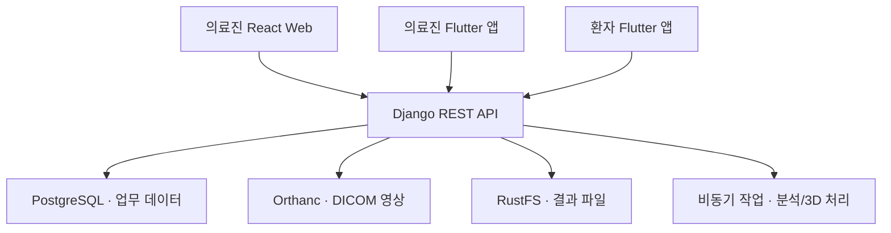

# CDSS 백엔드 포트폴리오 | 김유리

### AI 기반 심혈관 진료 의사결정 지원 시스템 (DUGN)

저는 이 팀 프로젝트에서 **Django REST API와 의료 데이터 처리**를 맡았습니다. 환자 예약 시간을 만들고 충돌을 검증하는 로직, 의료진의 판독·서명 이후에만 환자 결과를 제공하는 API, 의료영상과 CT 분할 결과를 서비스에 연결하는 처리를 구현했습니다.

## 내가 구현한 기능

| 담당 영역 | 제가 구현한 부분 | 서비스에서 연결되는 흐름 |
| --- | --- | --- |
| 예약·의료진 일정 | 근무 일정으로 30분 단위 슬롯 생성, 휴무 반영, 일정 변경 시 기존 예약과 충돌 검사 | 환자 앱의 예약 가능 시간 |
| 환자 결과 공개 | 환자 기록 연결과 `FINAL` 서명·`RELEASED` 공개 상태 확인, 서명된 보고서 스냅샷과 이미지 제공 | 의료진 판독 이후 환자 앱 결과 조회 |
| 의료영상·3D 데이터 | Orthanc/RustFS 연동, CT와 분할 마스크 좌표 정렬, 3D GLB 파일 생성·제공 | 의료진 Web의 영상·3D 결과 확인 |
| 의료진 업무 API | 최근 작업, 채팅 메시지 및 알림, 서명된 결과를 묶는 통합 보고서 | 의료진 Web·태블릿 업무 흐름 |

**담당 범위:** 백엔드 API·업무 규칙·데이터 연동. React/Flutter 화면 구현과 AI 모델 학습은 팀 프로젝트의 다른 담당 영역입니다. 아래 영상은 **팀 전체 서비스 시연**이며, 제 구현 내용은 [문제 해결 사례](#03-내가-해결한-문제)에 자세히 적었습니다.

> 이 저장소는 개인 취업 포트폴리오입니다. 팀의 전체 소스 코드를 복제하지 않고 제가 맡은 구현과 선택의 이유를 설명합니다.

[최종 발표 자료](https://drive.google.com/file/d/1jagyOOrqoHlLhwOtsjSue_Fl1Vzs5IBd/view?usp=drivesdk) · [전체 시연영상 (접근 제한)](https://drive.google.com/file/d/1mQFj2CJv3jKBsEk-Uw4sgLknAnSkTGPL/view?usp=drivesdk) · [공개용 하이라이트](https://drive.google.com/file/d/1wwTVWZjQudIwmc8xLDw1NEU_5TCeblzw/view)

## 01. 팀 프로젝트 한눈에 보기

환자 예약 → 진료·검사 → AI 분석 결과 확인 → 의료진 판독·서명 → 결과 공개 → 환자 조회까지 연결한 서비스입니다. AI는 의료진 판단에 활용하는 자료를 제공하며, 최종 판독과 결과 공개는 의료진 업무 흐름에 따릅니다.

| 항목 | 내용 |
| --- | --- |
| 문제 | 진료 예약, 의료영상, AI 분석, 의료진 판독, 환자 결과 전달이 서로 다른 단계에 흩어져 있음 |
| 목표 | 각 단계를 연결하고, 사용자와 결과 상태에 맞는 정보만 제공 |
| 서비스 흐름 | 환자 예약 → 진료·검사 → 분석 결과 확인 → 의료진 판독·서명 → 결과 공개 → 환자 조회 |

### 서비스 구성

| 사용자 | 화면 | 주요 경험 |
| --- | --- | --- |
| 의료진 | React Web | 환자·검사 조회, XCA 영상과 병변 표시, AI 결과, CT/3D 구조, 판독 및 결과지 |
| 의료진 | Flutter 태블릿 | 환자·검사 조회, 일정·메모·협진 및 커뮤니케이션 |
| 환자 | Flutter 모바일 | 예약, 공개된 검사 결과와 의료진 의견 확인 |

의료진 Web과 앱의 화면 구현은 팀 프로젝트 전체 범위입니다. 아래 사례는 **제가 담당한 Backend와 서비스 연결 작업**에 초점을 맞췄습니다.

## 02. 아키텍처



| 구성 요소 | 맡은 데이터와 역할 |
| --- | --- |
| PostgreSQL | 사용자·환자·의료진, 예약, 진료, 검사, 보고서 버전과 결과 공개 상태 |
| Orthanc | DICOM 의료영상의 보관 및 조회 |
| RustFS | 결과 이미지, PDF, 3D 파일 등의 객체 저장 |
| Django API | 클라이언트별 응답, 권한 검사, 업무 상태와 저장소 연동 |

의료영상 저장소 주소를 환자 앱에 직접 전달하지 않고, Backend가 공개 가능한 결과와 이미지를 확인해 제공합니다.

## 03. 내가 해결한 문제

### A. 의료진 판독 전 결과가 환자에게 노출되지 않도록 설계

**문제**  
AI 분석 결과가 생성되었다는 사실만으로 환자에게 결과를 보여주면 의료진의 최종 판독 전 정보가 전달될 수 있습니다. 이미지 파일의 저장소 주소를 직접 반환하는 방식도 접근 제어 지점을 줄입니다.

**구현**

1. 환자 계정과 병원 환자 기록의 활성 연결을 확인했습니다.
2. 최종 서명(`FINAL`)과 결과 공개(`RELEASED`)가 존재하는 보고서 버전만 조회하도록 했습니다.
3. 환자용 응답은 현재 AI 값이 아닌 **서명된 보고서 스냅샷**에서 구성했습니다.
4. XCA/CCTA 이미지는 같은 공개 조건을 다시 검사한 뒤 Backend에서 스트리밍하고, 비공개 캐시 정책을 적용했습니다.

```text
AI 분석 결과 → 의료진 판독·서명 → 결과 공개 → 환자 결과 및 이미지 조회
```

**결과**  
환자 API의 조회 조건에 의료진 판독·공개 상태를 반영하고, 결과 내용과 이미지 제공 경로를 한곳에서 통제할 수 있게 했습니다. 연결된 환자 기록이 없거나 공개된 결과가 없으면 조회를 허용하지 않습니다.

### B. 의료진 일정이 바뀌어도 예약 가능 시간이 일치하도록 연결

**문제**  
진료 일정과 예약 시간을 따로 관리하면 휴무 또는 일정 변경 뒤에도 환자에게 기존 시간이 예약 가능한 것으로 표시될 수 있습니다.

**구현**

- 활성 진료 일정에서 **30분 단위 예약 슬롯**을 만들고 점심시간과 휴무를 반영했습니다.
- 슬롯 갱신을 트랜잭션으로 처리하고 기존 슬롯을 잠근 뒤, 변경된 일정과 충돌하는 활성 예약을 검사했습니다.
- 일반 의사의 일정 변경 요청과 부서장의 승인·거절 흐름을 예약 슬롯 갱신에 연결했습니다.
- 환자 예약 연락처는 Firebase 전화 인증 결과와 일치하는지 확인했습니다.

**결과**  
의료진 일정 변경이 환자의 예약 가능 시간에 반영되고, 기존 예약과 충돌하는 변경에는 오류를 반환하는 흐름을 만들었습니다.

### C. CT와 분할 결과의 좌표를 맞춰 3D 파일 생성

**문제**  
심장·대동맥·관상동맥·석회화 마스크를 각각 3D로 변환할 때 CT의 원점·방향·간격을 무시하면 구조가 서로 어긋날 수 있습니다. 가는 혈관이나 작은 석회화 영역은 메시 후처리 과정에서도 변형될 수 있습니다.

**구현**

- 분할 마스크를 CT 기준 영상에 리샘플링하고 정렬 상태를 확인했습니다.
- `marching_cubes`로 만든 정점을 영상의 물리 좌표계에 맞춰 변환한 뒤 GLB에 담았습니다.
- 정렬 확인용 오버레이 이미지를 만들고, 관상동맥과 석회화에는 심장·대동맥에 쓰는 시각적 smoothing을 적용하지 않았습니다.

**결과**  
한 환자의 CT 좌표를 기준으로 여러 구조물의 3D 파일을 생성하는 Backend 흐름을 구성했습니다. **제가 구현한 부분은 3D 데이터 생성·제공이며, 화면의 3D Viewer 라이브러리 구현과 구분합니다.**

### D. 업무 흐름을 이어 주는 API

- **최근 작업:** 로그인한 의료진의 최근 작업을 최대 3개 반환하고, 같은 대상을 다시 열면 마지막 접근 시각을 갱신했습니다.
- **의료진 채팅:** 메시지 작성은 REST API로 처리하고, 새 메시지 및 협진 알림은 WebSocket 이벤트로 전달했습니다.
- **통합 보고서:** 서명된 XCA·CCTA 결과의 버전 스냅샷을 묶어 의료진이 검토할 통합 보고서를 구성했습니다.

## 04. AI와 시연 범위

팀 프로젝트에서는 관상동맥 조영 영상(XCA), 임상·혈액검사 데이터, CT 관상동맥 영상(CCTA)의 분석 결과를 서비스에 연결했습니다. 모델 개발·학습, 의료진 화면, 환자 앱은 각 팀원의 담당 영역과 구분해 소개합니다.

발표 시연의 AI 분석 화면은 **사전 계산한 결과를 진행 UI 이후 표시하는 데모 흐름**입니다. 이를 매 요청의 실시간 모델 추론으로 소개하지 않습니다. 모델 성능 수치도 평가 조건과 로그를 함께 제시할 수 있을 때만 추가할 예정입니다.

## 05. 기술 스택

| 영역 | 기술 |
| --- | --- |
| Backend / API | Python, Django, Django REST Framework, Swagger(OpenAPI) |
| Database | PostgreSQL |
| 의료영상·파일 | DICOM, Orthanc, RustFS, boto3 |
| 비동기·이벤트 | Celery, Django Channels, Redis |
| 3D 데이터 처리 | SimpleITK, NumPy, SciPy, scikit-image, trimesh |
| 서비스 클라이언트 | React Web, Flutter 태블릿·모바일 앱 **(팀 구현 범위)** |

## 06. 최종 발표와 시연

팀 최종 발표 자료와 드라이브의 전체 통합 시연영상을 연결했습니다. 영상은 의료진 Web과 환자 앱을 잇는 시연 흐름을 보여줍니다.

| 자료 | 링크 |
| --- | --- |
| 최종 발표 PDF | [DUGN 최종 발표 자료 보기](https://drive.google.com/file/d/1jagyOOrqoHlLhwOtsjSue_Fl1Vzs5IBd/view?usp=drivesdk) |
| 전체 통합 시연영상 (12분 59초) | [DUGN 전체 시연영상 보기](https://drive.google.com/file/d/1mQFj2CJv3jKBsEk-Uw4sgLknAnSkTGPL/view?usp=drivesdk) — 개인 Drive 사본, 접근 제한 |
| 비식별 하이라이트 (약 1분, 무음) | [DUGN 공개용 시연 영상 보기](https://drive.google.com/file/d/1wwTVWZjQudIwmc8xLDw1NEU_5TCeblzw/view) |

전체 영상에는 화면에 이름·연락처가 표시되는 구간이 있어 개인 사본은 비공개로 두었습니다. 외부 열람용으로는 해당 구간과 음성을 제외한 하이라이트를 이용할 수 있습니다.

## 07. 회고

이 프로젝트에서는 데이터를 어떤 화면에 보낼지에 앞서 **누가, 언제, 어떤 상태의 결과를 볼 수 있는지**를 정하는 일이 중요했습니다. 예약에는 근무 일정과 기존 예약의 충돌 검사가, 환자 결과에는 의료진 서명과 공개 상태가 필요했습니다. 의료영상과 3D 결과를 서비스에 연결하면서는 저장소의 역할과 좌표계의 일관성도 함께 다뤘습니다.

---

**Repository scope:** 개인 포트폴리오 문서와 발표·시연 자료 링크. 팀의 전체 코드 저장소와는 별개입니다.
