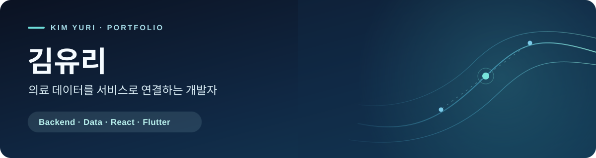

  

  <a href="projects/cdss-backend.md">DUGN 백엔드</a> ·
  <a href="projects/eye-to-ai.md">EYE TO AI</a> ·
  <a href="projects/coronary-web-react.md">React 웹</a> ·
  <a href="projects/macgyver-flutter.md">Flutter 앱</a>

## 안녕하세요, 김유리입니다

의료 데이터를 다루는 팀 프로젝트에서 **백엔드 업무 규칙과 데이터 연결**, 그리고 **의료진이 사용하는 웹·모바일 화면**을 개발했습니다. 이 포트폴리오는 **제가 맡은 기능과 해결한 문제**를 중심으로 정리했습니다.

## 포트폴리오

담당 기능, 문제 해결 과정, 화면 미리보기와 발표·시연 자료를 정리했습니다.

[김유리의 Notion 포트폴리오 보기](https://app.notion.com/p/Yuri-Portfolio-3f70b387fad880f3942ffb8cb4d343b5?source=copy_link)

| Backend · API | Medical Data | Web · Mobile |
| --- | --- | --- |
| 예약 슬롯과 충돌 검사, 서명 후 결과 공개, 의료진 업무 API | DICOM 저장소 연동, CT·분할 마스크 좌표 정렬, 3D 데이터 제공 | React 의료진 대시보드·영상 뷰어, Flutter 의료진 업무 화면 |

## 프로젝트

### 01 · DUGN — 심혈관 진료 의사결정 지원 시스템

**제 역할:** Django REST API · 예약·결과 공개 규칙 · 의료영상·3D 데이터 처리  
`Python` `Django REST Framework` `PostgreSQL` `Orthanc` `RustFS`

- 근무 일정과 휴무를 반영해 예약 가능 시간을 만들고, 일정 변경 시 기존 예약과 충돌하는지 검사했습니다.
- 의료진 판독·서명과 결과 공개 상태를 확인한 뒤에만 환자에게 보고서와 이미지를 제공했습니다.
- CT와 분할 마스크의 좌표를 맞춰 3D 결과를 생성·제공하는 백엔드 흐름을 연결했습니다.

[구현 과정과 문제 해결 자세히 보기 →](projects/cdss-backend.md)

---

### 02 · EYE TO AI — 안구 데이터 기반 만성질환 위험 분석

**제 역할:** 모델 실험·평가 · Django 로그인·의료진 승인·관리자 기능  
`Python` `scikit-learn` `XGBoost` `Django`

당뇨·고혈압 예측 실험에서 클래스 불균형, 정밀도·재현율의 균형, 낮은 판별력이라는 한계를 함께 기록했습니다. 웹 서비스에서는 사용자 인증과 역할별 접근을 담당했습니다.

[실험 결과와 담당 기능 보기 →](projects/eye-to-ai.md)

---

### 03 · 관상동맥 협착 판독 지원 웹 — React

**제 역할:** 의료진 대시보드 · 영상 뷰어 제어 · 다크 모드  
`React` `Video UI`

의료진이 환자 ID를 검색하면 의료정보를 카드로 보여주고, 영상 재생·0.5배속·구간 반복·확대 기능을 맡았습니다. 확대·이동 시 영상과 병변 박스의 좌표가 함께 움직이도록 뷰어 구조를 다뤘습니다.

[React 화면과 뷰어 사례 보기 →](projects/coronary-web-react.md)

---

### 04 · 맥(脈)가이버 — Flutter 의료진 앱

**제 역할:** 의료진 대시보드·환자 조회 · 채팅·협진 · 일정·할 일 · 텍스트·음성 메모  
`Flutter` `Mobile UI`

의료진이 이동 중 환자를 확인하고, 협진 요청과 답변 상태, 일정과 업무 기록을 한 흐름에서 관리하는 화면을 맡았습니다. 의료진 앱 시연영상은 상세 페이지에 연결했습니다.

[Flutter 업무 화면과 시연 보기 →](projects/macgyver-flutter.md)

---

### 프로젝트를 읽는 기준

React 웹과 맥(脈)가이버 Flutter 앱은 관상동맥 협착 탐지 주제의 **각각 다른 의료진용 팀 프로젝트 단계**입니다. DUGN은 이후의 통합 CDSS 프로젝트이며, 이때 제 담당은 백엔드였습니다. 최종 DUGN의 Flutter 앱은 환자용 팀 구현 범위입니다. 각 상세 페이지에는 제 구현 범위와 팀 전체 시연 범위, 발표 자료와 확인 가능한 한계를 구분했습니다.

> 발표 자료와 영상은 공유드라이브 링크이므로 계정별 접근 권한이 필요할 수 있습니다. 이 저장소는 개인 포트폴리오 문서이며 팀 전체 소스의 복제본은 아닙니다.
