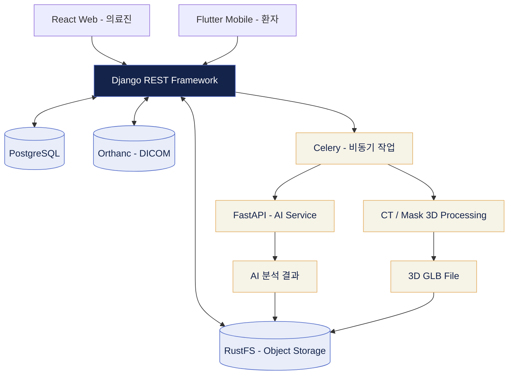
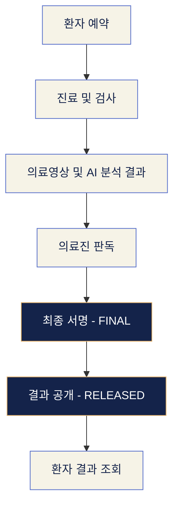

[← DUGN Overview](./README.md) · [Portfolio Home](../../README.md)

# 01. System Architecture & Engineering Decisions

**Django REST API를 중심으로 의료 업무 데이터, DICOM 영상,
AI 분석 결과 및 3D 데이터를 연결하는 백엔드 구조를 구성했습니다.**

서비스별 데이터 특성과 사용 목적을 고려하여 저장소를 분리하고,
의료진과 환자의 접근 권한 및 업무 상태에 따라 데이터를 제공하도록 설계했습니다.

---

## 1.1 System Architecture

아래 다이어그램은 DUGN의 논리적 서비스 구성과
데이터 흐름을 나타냅니다.



> Architecture Scope:
> 서비스 간 논리적 연결을 단순화한 구조입니다.
> 실제 서버 배치 및 분석 작업별 실행 경로와는 구분합니다.

---

## 1.2 Engineering Decisions

| Design Decision | Engineering Reasoning |
| :--- | :--- |
| Django 중심의 Backend | 예약, 진료, 검사, 판독 및 결과 공개에 필요한 업무 규칙을 일관되게 관리 |
| PostgreSQL | 관계형 의료 업무 데이터 및 트랜잭션 관리 |
| Orthanc | DICOM 의료영상의 보관 및 조회 |
| RustFS | 결과 이미지, PDF, GLB 등 비정형 파일 관리 |
| Celery | 장시간 처리 작업을 HTTP 요청과 분리 |
| FastAPI | AI 서비스와 업무 Backend의 책임 분리 |
| Django Channels | 의료진 채팅 및 실시간 이벤트 전달 |
| Backend Access Control | 의료진과 환자의 접근 범위 및 결과 공개 조건 관리 |

---

## 1.3 Backend Domain Structure

Django Backend의 기능을 업무 영역에 따라 구분했습니다.

| Domain | Responsibility |
| :--- | :--- |
| accounts | 사용자 인증 및 권한 관리 |
| appointments | 의료진 일정, 예약 슬롯, 환자 예약 |
| imaging | 의료영상 정보 및 DICOM 연동 |
| ai | AI 분석 결과 및 3D 데이터 처리 |
| reports | 판독 보고서, 의료진 서명 및 결과 공개 |
| stafftools | 의료진 채팅, 알림 및 최근 작업 |
| core | 공통 기능 및 파일 저장소 연동 |

<details>
<summary><strong>Backend Structure — 주요 구현 파일</strong></summary>

```text
CDSS_backend/
├── accounts/
│   ├── authentication.py
│   └── permissions.py
├── appointments/
│   ├── models.py
│   ├── services.py
│   └── tests.py
├── imaging/
│   ├── models.py
│   └── views.py
├── ai/
│   ├── tasks.py
│   └── ccta_rendering.py
├── reports/
│   ├── models.py
│   ├── workflow.py
│   └── patient_result_views.py
├── stafftools/
│   ├── models.py
│   ├── views.py
│   └── consumers.py
├── core/
│   └── storage.py
└── config/
    ├── settings.py
    └── celery.py
```

위 구조는 전체 저장소 중 주요 Backend 기능과
관련된 파일을 중심으로 정리했습니다.

</details>

---

## 1.4 Data Storage Strategy

의료 서비스에서 사용하는 데이터는
형식과 접근 목적이 서로 다릅니다.

모든 데이터를 하나의 저장소에서 관리하는 대신
업무 데이터, 의료영상, 결과 파일의 책임을 분리했습니다.

| Storage | Data | Responsibility |
| :--- | :--- | :--- |
| PostgreSQL | 환자, 의료진, 예약, 진료, 보고서 | 관계 및 업무 상태 관리 |
| Orthanc | DICOM 의료영상 | 의료영상 보관 및 조회 |
| RustFS | 결과 이미지, PDF, GLB | 객체 기반 파일 저장 |

<details>
<summary><strong>Why Separate Storage? — 저장소를 분리한 이유</strong></summary>

### PostgreSQL

환자와 진료, 예약 및 검사 결과는
서로 연결된 관계형 데이터입니다.

관계와 상태를 관리하고 트랜잭션을 적용하기 위해
PostgreSQL을 사용했습니다.

### Orthanc

DICOM은 일반 이미지와 달리 의료영상 및
검사 관련 메타데이터를 포함하는 표준 형식입니다.

의료영상 전용 저장 및 조회 기능을 활용하기 위해
Orthanc를 사용했습니다.

### RustFS

AI 결과 이미지, PDF, GLB 파일은
관계형 업무 데이터와 다른 저장 특성을 가집니다.

파일 자체와 업무 데이터의 관리 책임을 분리하기 위해
객체 저장소인 RustFS를 사용했습니다.

### Engineering Outcome

- 업무 데이터와 파일 저장의 책임 분리
- 데이터 특성에 맞는 저장소 활용
- Backend를 통한 데이터 접근 조건 관리
- 의료영상과 분석 결과의 서비스 연계

</details>

---

## 1.5 Clinical Workflow

환자 예약부터 의료진 판독 및 결과 공개까지
업무 흐름을 Backend에서 연결했습니다.



### 핵심 설계 원칙

AI 분석 결과의 생성과 환자 결과 공개를
서로 다른 업무 단계로 구분했습니다.

AI 분석이 완료되었다는 이유만으로
환자가 결과를 조회할 수 없도록 하고,
의료진의 최종 서명과 공개 상태를 확인한 뒤
환자용 API에서 결과를 제공하도록 구현했습니다.

---

## 1.6 Engineering Takeaways

이 프로젝트를 통해 Backend 개발은
단순히 API를 구현하는 작업이 아니라,
서비스의 업무 규칙과 데이터의 관계,
저장 방식 및 접근 조건을 함께 고려해야 하는
과정이라는 점을 경험했습니다.

특히 의료 데이터를 다루는 환경에서는
데이터가 생성되는 시점과 사용자에게 제공되는 시점을
구분하는 설계가 중요하다는 것을 배웠습니다.

---

[← DUGN Overview](./README.md) · [02. Backend & API →](./backend-api.md)
