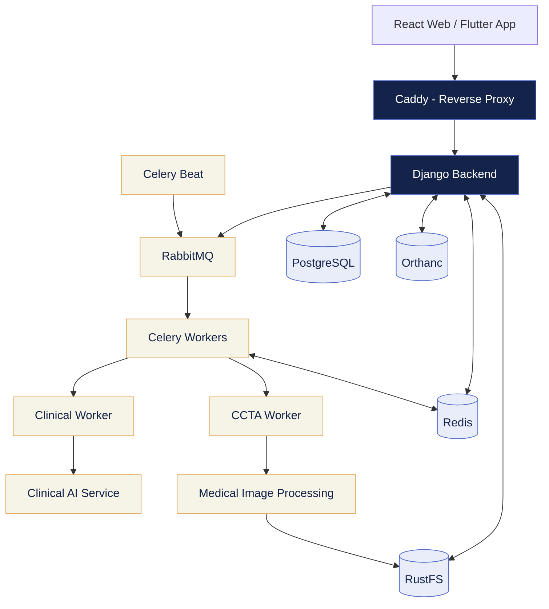
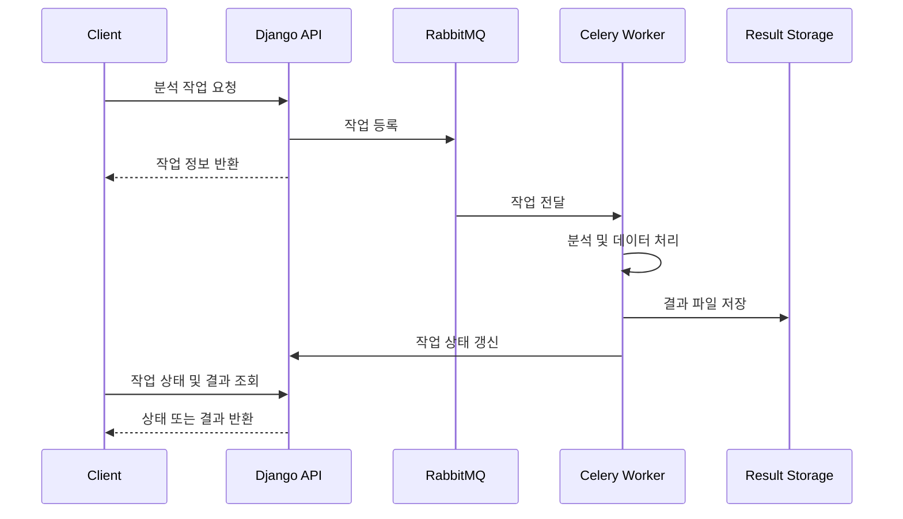

[← DUGN Overview](./README.md) · [Portfolio Home](../../README.md)

# 04. Async Processing & Infrastructure

**의료영상 처리 및 AI 분석과 같이 실행 시간이 긴 작업을
일반적인 HTTP 요청 처리와 분리하고,
서비스별 실행 환경을 구성했습니다.**

Backend API, 비동기 Worker, AI Service 및
데이터 저장소의 역할을 구분하여
의료 서비스의 전체 실행 구조를 구성했습니다.

---

## 4.1 Infrastructure Overview

| Technology | Responsibility |
| :--- | :--- |
| Django REST Framework | 서비스 API 및 업무 로직 |
| FastAPI | AI 모델 서비스 |
| Celery | 비동기 작업 실행 |
| RabbitMQ | 작업 메시지 전달 |
| Redis | 비동기 처리 및 실시간 통신 관련 지원 |
| Celery Beat | 주기적인 작업 스케줄링 |
| Docker | 서비스별 실행 환경 구성 |
| Docker Compose | 다중 컨테이너 서비스 구성 |
| Caddy | Reverse Proxy |
| Google Cloud VM | 프로젝트 서버 실행 환경 |

---

## 4.2 Infrastructure Architecture

아래 구조는 프로젝트의 Docker Compose 설정을
기반으로 주요 서비스의 역할을 정리한 것입니다.



> Architecture Scope:
> 주요 서비스의 논리적 역할을 나타낸 구조입니다.
> 모든 서비스와 실제 네트워크 설정을 표현한 것은 아닙니다.

---

## 4.3 Asynchronous Processing Strategy

### Why Asynchronous Processing?

의료영상 처리 및 AI 분석 작업은
일반적인 데이터 조회 API와 비교하여
상대적으로 많은 연산과 실행 시간이 필요합니다.

이러한 작업을 HTTP 요청 내부에서
동기적으로 실행할 경우,
처리가 완료될 때까지 요청이 유지되어야 합니다.

이를 고려하여 Backend API와
장시간 실행되는 작업의 책임을 분리했습니다.

| Synchronous Processing | Asynchronous Processing |
| :--- | :--- |
| 요청 내부에서 작업 실행 | Worker에서 작업 실행 |
| 처리 완료까지 응답 대기 | 작업 요청과 실행 분리 |
| 요청 처리 시간에 연산 시간 포함 | 작업 상태를 별도로 관리 |
| API와 연산 작업의 책임 결합 | API와 Worker의 책임 분리 |

### Async Job Workflow



위 다이어그램은 비동기 작업의
개념적인 처리 흐름을 나타냅니다.

---

## 4.4 Celery Configuration

Django 설정과 Celery를 연동하여
Backend 내부의 비동기 작업을 실행할 수 있도록
구성했습니다.

<details>
<summary><strong>Core Implementation — Celery 초기 설정</strong></summary>

**Source File:** `config/celery.py`

```python
import os

from celery import Celery

os.environ.setdefault(
    "DJANGO_SETTINGS_MODULE",
    "config.settings",
)

app = Celery("cdss")

app.config_from_object(
    "django.conf:settings",
    namespace="CELERY",
)

app.autodiscover_tasks()
```

### Code Analysis

#### Django Settings Integration

Django의 설정 모듈을 지정하여
Backend와 Celery가 동일한 프로젝트 설정을
참조할 수 있도록 구성합니다.

#### Configuration Namespace

`namespace="CELERY"`를 사용하여
Django 설정 중 Celery 관련 설정을
구분하여 불러옵니다.

#### Task Discovery

`autodiscover_tasks()`를 통해
Django 애플리케이션에 정의된
Celery Task를 자동으로 탐색합니다.

</details>

---

## 4.5 Task Queue & Worker Separation

분석 작업의 종류에 따라
Task Queue와 Worker를 구분했습니다.

| Queue | Responsibility |
| :--- | :--- |
| clinical | 임상 데이터 기반 예측 작업 |
| ccta | CCTA 의료영상 분석 및 처리 |

<details>
<summary><strong>Implementation Evidence — Task Queue 분리</strong></summary>

**Source File:** `ai/tasks.py`

```python
@shared_task(queue="clinical")
def run_clinical_prediction(job_id):
    # 임상 예측 작업 처리
    ...
```

CCTA 관련 작업에는 다음 Queue 설정을 적용했습니다.

```python
@shared_task(queue="ccta")
```

> 실제 소스의 Task 선언부를 발췌했으며,
> 함수 내부 구현은 생략했습니다.

### Engineering Reasoning

임상 데이터 예측과 의료영상 처리 작업은
데이터의 크기와 연산 특성이 서로 다릅니다.

작업 Queue를 분리함으로써
작업 유형에 따라 Worker를 구분하여
실행할 수 있는 구조를 구성했습니다.

### Related Job Management Functions

| Function | Responsibility |
| :--- | :--- |
| start_job | 작업 시작 처리 |
| update_job_progress | 작업 진행 상태 갱신 |
| fail_job | 실패 상태 및 오류 정보 처리 |
| upload_result_file | 결과 파일 저장소 업로드 |
| save_ccta_result | CCTA 분석 결과 저장 |

</details>

---

## 4.6 Periodic Task Scheduling

Celery Beat를 활용하여
주기적으로 실행해야 하는 작업을 구성했습니다.

<details>
<summary><strong>Core Implementation — 예약 알림 스케줄링</strong></summary>

**Source File:** `config/celery.py`

```python
app.conf.beat_schedule = {
    "queue-due-sms-reminders-hourly": {
        "task": "notifications.tasks.queue_due_sms_reminders_task",
        "schedule": 3600.0,
    },
}
```

### Implementation

예약 SMS 알림 대상 일정을
매시간 다시 확인하도록
주기적인 Task를 등록했습니다.

### Engineering Reasoning

예약 알림과 같이 특정 조건에 따라
실행되어야 하는 작업을
사용자의 API 요청과 분리했습니다.

- Celery Beat: 실행 일정 관리
- Message Broker: 작업 메시지 전달
- Celery Worker: 등록된 작업 실행

</details>

---

## 4.7 Container-based Service Configuration

Docker Compose를 기반으로
Backend, AI Service, Worker 및
저장소의 실행 환경을 구성했습니다.

### Container Services

| Service | Responsibility |
| :--- | :--- |
| web | Django Backend |
| db | PostgreSQL |
| clinical-ai | 임상 AI Service |
| xca-bridge | XCA 분석 서비스 연계 |
| rabbitmq | Message Broker |
| redis | 비동기 및 실시간 통신 지원 |
| celery | Celery Worker |
| clinical-worker | 임상 예측 작업 |
| ccta-worker | CCTA 처리 작업 |
| celery-beat | 주기적 작업 관리 |
| orthanc | DICOM 의료영상 저장소 |
| rustfs | 객체 저장소 |
| caddy | Reverse Proxy |
| chatbot | 챗봇 서비스 |

<details>
<summary><strong>Infrastructure Configuration Files</strong></summary>

```text
CDSS_backend/
├── Dockerfile
├── compose.staging.yml
├── compose.orthanc.yml
├── compose.rustfs.yml
├── requirements.txt
├── config/
│   ├── settings.py
│   └── celery.py
├── clinical_ai_service/
├── xca_bridge/
├── chatbot_service/
└── ai/
    └── tasks.py
```

### Containerization Purpose

- 서비스별 실행 환경 구분
- 애플리케이션 의존성 관리
- Backend와 AI Service의 실행 책임 분리
- 데이터 저장소 및 Worker 연동
- 다중 서비스 실행 환경 관리

> 위 구성은 팀 프로젝트 전체의 실행 환경입니다.
> 모든 인프라 구성 요소를 단독으로 개발했다는
> 의미는 아닙니다.

</details>

---

## 4.8 Persistent Data Management

컨테이너의 실행 환경과
데이터 저장 영역을 구분했습니다.

Docker Compose 설정에서는
주요 데이터 저장소에 Volume을 사용합니다.

| Volume | Responsibility |
| :--- | :--- |
| postgres_data | PostgreSQL 데이터 |
| orthanc_data | DICOM 의료영상 데이터 |
| rustfs_data | 객체 저장소 데이터 |
| rabbitmq_data_v3 | RabbitMQ 데이터 |
| redis_data | Redis 데이터 |
| static_data | 정적 파일 데이터 |

### Engineering Reasoning

컨테이너가 재생성되더라도
저장된 데이터가 컨테이너의 수명에
직접적으로 종속되지 않도록
데이터 저장 영역을 분리하는 방식입니다.

Volume을 통한 데이터 지속성과
별도의 백업 및 장애 복구 체계는 구분합니다.

---

## 4.9 Cloud Infrastructure & Troubleshooting

### GCP VM Memory Bottleneck

프로젝트 실행 환경으로
Google Cloud Platform의 VM을 활용했습니다.

초기에는 4GB 메모리 환경에서
여러 서비스와 의료영상 처리 작업을 실행하면서
서비스 응답 및 작업 처리 지연을 경험했습니다.

<details>
<summary><strong>Troubleshooting — VM 메모리 자원 부족 대응</strong></summary>

### Problem

Backend, 데이터 저장소, AI 관련 서비스 및
의료영상 처리 작업을 실행하는 과정에서
전체적인 처리 속도가 저하되었습니다.

### Investigation

애플리케이션 코드뿐 아니라
서버의 실행 환경과 자원 용량도
처리 속도에 영향을 줄 수 있다고 판단했습니다.

특히 여러 서비스가 동일한 VM의
메모리 자원을 공유하는 환경에서
초기 4GB 메모리 용량의 제약을 확인했습니다.

### Resolution

GCP VM의 메모리 사양을 상향하여
서비스 실행에 필요한 자원을 확보했습니다.

### Outcome

VM 사양 변경 이후
프로젝트 실행 환경의 처리 지연이 완화되었습니다.

### Engineering Takeaway

서비스 성능 문제를 분석할 때
애플리케이션 로직뿐 아니라
서버 자원과 실행 환경을 함께 고려해야 한다는
점을 경험했습니다.

> 별도의 부하 테스트나 정량적인 성능 측정은
> 수행하지 않았으므로 개선율 및 처리량 수치는
> 기재하지 않습니다.

</details>

---

## 4.10 AI Integration & Demo Scope

DUGN은 AI 분석 서비스와
Backend 업무 흐름을 연계하는 구조입니다.

다만 최종 시연에서는
제한된 실행 환경과 시연 시간을 고려하여
사전에 생성된 AI 분석 결과를 활용했습니다.

| Area | Scope |
| :--- | :--- |
| AI Service | AI 분석 서비스 연동 구조 |
| Async Processing | 작업 등록 및 상태 관리 구조 |
| Final Demonstration | 사전 생성된 AI 분석 결과 활용 |
| Backend | 분석 결과 조회 및 업무 흐름 연계 |
| Clinical Workflow | 의료진 판독, 서명 및 환자 공개 |

실시간 모델 추론의 처리 성능과
최종 시연에서 구현한 업무 흐름을 구분하여
프로젝트의 구현 범위를 설명합니다.

---

## 4.11 Implementation Evidence

| Implementation | Source File |
| :--- | :--- |
| Celery 초기 설정 | config/celery.py |
| 주기적 작업 설정 | config/celery.py |
| AI 비동기 작업 | ai/tasks.py |
| 작업 진행 상태 관리 | ai/tasks.py |
| 의료영상 처리 | ai/ccta_rendering.py |
| 컨테이너 구성 | Dockerfile |
| 다중 서비스 구성 | compose.staging.yml |
| DICOM 저장소 구성 | compose.orthanc.yml |
| 객체 저장소 구성 | compose.rustfs.yml |
| Backend 환경 설정 | config/settings.py |

---

## 4.12 Engineering Takeaways

이 프로젝트를 통해 Backend API 개발뿐 아니라
여러 서비스가 함께 동작하는 실행 환경과
비동기 작업 처리 구조를 경험했습니다.

- HTTP 요청과 장시간 실행 작업의 책임 분리
- Task Queue와 Worker의 역할 이해
- 주기적 작업 스케줄링
- 컨테이너 기반 다중 서비스 구성
- 데이터 저장 영역과 실행 환경 분리
- 클라우드 VM 자원 제약 및 대응

Backend 개발자는 애플리케이션 내부의
비즈니스 로직뿐 아니라
서비스가 실제로 실행되는 환경까지
함께 고려해야 한다는 점을 배웠습니다.

---

[← 03. Medical Data & 3D](./medical-data.md) · [DUGN Overview](./README.md) · [05. Troubleshooting →](./troubleshooting.md)
