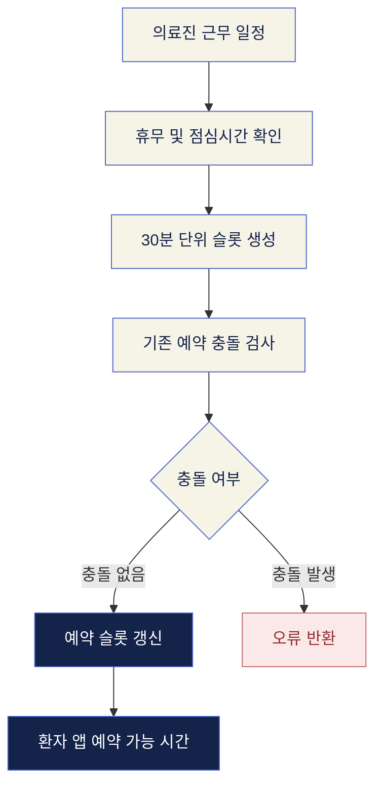
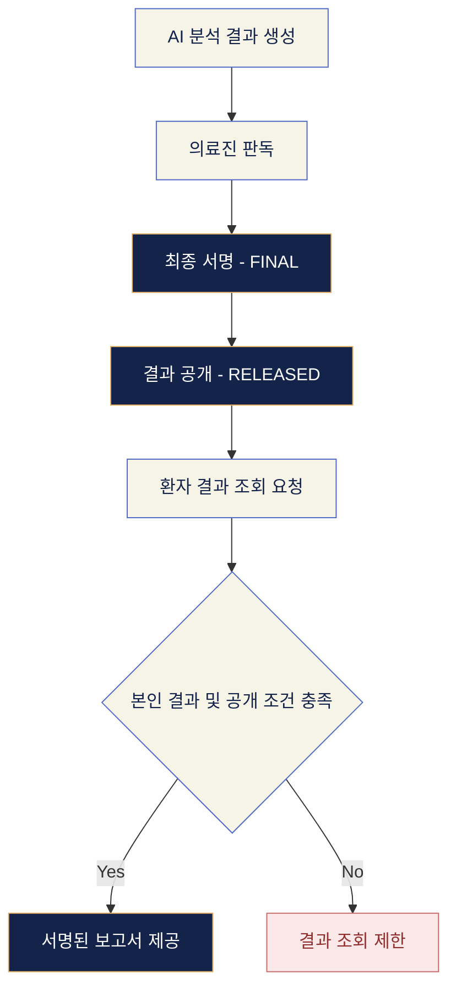
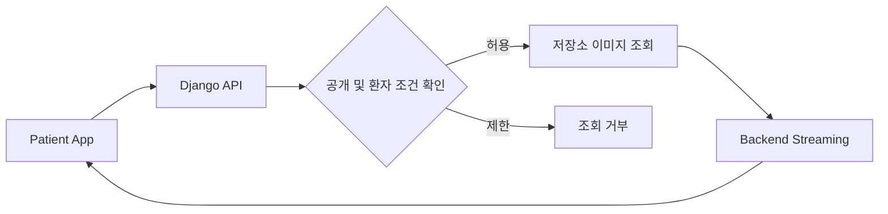
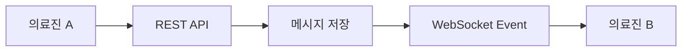

[← DUGN Overview](./README.md) · [Portfolio Home](../../README.md)

# 02. Backend Engineering & API Implementation

**Django REST Framework를 기반으로 의료 서비스의 업무 규칙,
데이터 정합성 및 사용자별 접근 조건을 구현했습니다.**

단순 CRUD API 구현을 넘어 예약 충돌 방지,
의료진 일정 관리, 보고서 상태 관리 및
환자 결과 공개 조건을 Backend에서 처리했습니다.

---

## 2.1 Backend Engineering Overview

| Engineering Area | Implementation |
| :--- | :--- |
| REST API | Django REST Framework 기반 서비스 API |
| Business Logic | 의료진 일정, 예약 및 판독 업무 규칙 |
| Transaction Management | transaction.atomic 기반 데이터 변경 처리 |
| Concurrency Control | select_for_update 기반 행 잠금 |
| Access Control | 사용자 및 환자 기록에 따른 접근 조건 검사 |
| State Management | 의료진 서명 및 결과 공개 상태 관리 |
| Data Integrity | 예약 충돌 검사 및 보고서 버전 관리 |
| Real-time Communication | REST API와 WebSocket 기반 의료진 업무 연계 |

---

## 2.2 Appointment & Schedule Management

### 의료진 일정 기반 예약 슬롯 생성

의료진의 근무 일정과 환자 예약을 연결하여
실제 예약 가능한 시간을 제공하도록 구현했습니다.

| Requirement | Implementation |
| :--- | :--- |
| 예약 시간 생성 | 30분 단위 예약 슬롯 생성 |
| 근무 일정 반영 | 활성 의료진 일정 기준 |
| 예약 불가 시간 | 점심시간 및 휴무 반영 |
| 일정 변경 | 기존 활성 예약과 충돌 검사 |
| 동시 변경 | 트랜잭션 및 행 잠금 적용 |
| 일정 변경 승인 | 일반 의사 요청 및 부서장 승인·거절 흐름 |

### Appointment Workflow



<details>
<summary><strong>Core Implementation — 트랜잭션 및 동시성 제어</strong></summary>

**Source File:** `appointments/services.py`

```python
@transaction.atomic
def sync_doctor_availability_for_date(doctor, target_date):
    wanted = _wanted_slot_ranges(doctor, target_date)
    day_start, day_end = _day_bounds(target_date)

    existing = {
        (slot.starts_at, slot.ends_at): slot
        for slot in DoctorAvailabilitySlot.objects.select_for_update().filter(
            doctor=doctor,
            starts_at__gte=day_start,
            starts_at__lt=day_end,
        )
    }

    # 이후 활성 예약 조회, 충돌 검사,
    # 슬롯 생성 및 갱신 처리 생략
```

### Engineering Decisions

#### Transaction Management

`transaction.atomic()`을 사용하여
예약 슬롯 갱신에 필요한 데이터 변경을
하나의 트랜잭션으로 처리했습니다.

처리 중 예외가 발생할 경우
해당 트랜잭션의 변경사항이 롤백되도록 구성했습니다.

#### Row-level Locking

`select_for_update()`를 사용하여
조회한 기존 예약 슬롯의 행을 잠갔습니다.

동일한 슬롯에 대한 동시 변경으로
데이터 상태가 엇갈릴 가능성을 줄이고자 적용했습니다.

#### Conflict Detection

변경된 일정에서 기존 활성 예약을
수용할 수 있는지 검사했습니다.

충돌이 발생하면 다음 오류를 반환하도록 구현했습니다.

`SCHEDULE_HAS_ACTIVE_RESERVATIONS`

변경된 일정에서 제외된 슬롯은
`BLOCKED` 상태로 전환했습니다.

> 위 코드는 슬롯 갱신 로직의 핵심 발췌입니다.
> 전체 예약 생성 과정의 동시성 보장을 의미하지는 않습니다.

</details>

---

## 2.3 Clinical Report & Result Release

### 의료진 판독과 환자 결과 공개 분리

AI 분석 결과가 생성되었다는 이유만으로
환자에게 검사 결과를 제공하지 않도록 설계했습니다.

의료진의 최종 서명과 결과 공개 상태를
별도로 확인한 후 환자용 API에서 결과를 반환합니다.

| Validation Condition | Responsibility |
| :--- | :--- |
| Patient Link | 환자 계정과 병원 환자 기록의 활성 연결 확인 |
| Patient Ownership | 요청한 환자 본인의 검사 결과인지 확인 |
| Final Signoff | 의료진 최종 서명 여부 확인 |
| Release Status | 결과 공개 상태 확인 |
| Withdrawal | 공개 철회 여부 확인 |
| Report Snapshot | 서명된 보고서 버전 기준 결과 제공 |

### Result Release Workflow



<details>
<summary><strong>Core Implementation — 환자 결과 접근 제어</strong></summary>

**Source File:** `reports/patient_result_views.py`

```python
def released_result(patient, result_id):
    return (
        ResultRelease.objects.select_related(
            "signoff",
            "signoff__doctor",
            "signoff__doctor__department",
            "report",
            "report__report_version",
            "report__report_version__medical_result",
        )
        .filter(
            report__report_version__medical_result_id=result_id,
            report__report_version__medical_result__patient=patient,
            report__status__in=[Report.Status.ACTIVE, "FINAL"],
            release_status=ResultRelease.ReleaseStatus.RELEASED,
            withdrawn_at__isnull=True,
            signoff__signoff_type="FINAL",
        )
        .order_by("-released_at", "-id")
        .first()
    )
```

### Engineering Decisions

#### Object-level Access Control

검사 결과 ID뿐 아니라 환자 조건을
데이터 조회에 포함했습니다.

다른 환자의 검사 결과가 반환되지 않도록
조회 대상의 소유 관계를 확인했습니다.

#### State-based Access Control

의료진의 최종 서명과 결과 공개 상태를
함께 확인하도록 구현했습니다.

- FINAL: 의료진 최종 서명
- RELEASED: 환자 결과 공개
- withdrawn_at: 공개 철회 여부

최종 서명되지 않았거나 공개가 철회된 결과는
환자 조회 대상에서 제외했습니다.

#### Report Version & Snapshot

현재 AI 분석값을 그대로 반환하는 대신
서명된 보고서 버전의 스냅샷을 기준으로
환자용 응답을 구성했습니다.

이를 통해 환자에게 제공되는 결과를
의료진이 서명한 내용과 연결했습니다.

#### ORM Query Design

`select_related()`를 사용하여
보고서, 서명, 의료진 등 관련 객체를
함께 조회하도록 구성했습니다.

관련 객체에 접근할 때 발생할 수 있는
추가 데이터베이스 조회를 줄이기 위한 방식입니다.

</details>

---

## 2.4 Authentication & Access Control

의료 서비스는 사용자 유형에 따라
접근 가능한 데이터와 기능이 달라집니다.

Backend에서 인증 여부뿐 아니라
업무 상태와 데이터 소유 관계를 확인하도록 구성했습니다.

| User | Access Scope |
| :--- | :--- |
| 의료진 | 담당 업무에 필요한 환자 및 검사 정보 |
| 환자 | 본인의 예약 및 공개된 검사 결과 |
| 부서장 | 의료진 일정 변경 요청 승인 및 거절 |

### Access Control Strategy

- 사용자 인증 및 권한 검사
- 환자 계정과 병원 환자 기록 연결 확인
- 환자 예약 연락처와 Firebase 전화 인증 결과 확인
- 의료진 서명 및 결과 공개 상태 검사
- 이미지 조회 요청에서도 동일한 공개 조건 재검사

<details>
<summary><strong>Protected Medical Image Access</strong></summary>

환자 앱에 의료영상 저장소의 주소를
직접 제공하는 대신 Backend에서 접근 조건을 확인한 후
결과 이미지를 제공하도록 구현했습니다.



이미지 응답에는 비공개 캐시 정책을 적용했습니다.

### Design Purpose

- 의료 데이터 접근 조건의 Backend 관리
- 보고서와 이미지 조회 권한의 일관성 유지
- 공개되지 않은 결과의 환자 조회 제한

</details>

---

## 2.5 Clinical Staff Workflow APIs

의료진의 업무 흐름을 연결하기 위한
최근 작업, 채팅, 협진 알림 및 통합 보고서 기능을 구현했습니다.

| Feature | Implementation |
| :--- | :--- |
| Recent Activity | 로그인한 의료진의 최근 작업 최대 3개 반환 |
| Activity Update | 동일 대상 재접근 시 마지막 접근 시간 갱신 |
| Messaging | REST API 기반 메시지 작성 |
| Notification | WebSocket 기반 새 메시지 및 협진 알림 전달 |
| Integrated Report | 서명된 XCA·CCTA 결과 스냅샷 통합 |

<details>
<summary><strong>REST API & WebSocket Integration</strong></summary>

메시지 작성과 데이터 관리는 REST API로 처리하고,
새 메시지 및 협진 알림은 WebSocket 이벤트로 전달했습니다.



### Design Purpose

REST API를 통한 업무 데이터 처리와
WebSocket을 통한 실시간 이벤트 전달의
책임을 구분했습니다.

**Related Files**

- `stafftools/models.py`
- `stafftools/views.py`
- `stafftools/consumers.py`

</details>

---

## 2.6 Backend Implementation Evidence

| Implementation | Source File |
| :--- | :--- |
| 예약 슬롯 및 충돌 검사 | appointments/services.py |
| 예약 데이터 모델 | appointments/models.py |
| 보고서 업무 흐름 | reports/workflow.py |
| 환자 결과 조회 | reports/patient_result_views.py |
| 보고서 데이터 모델 | reports/models.py |
| 인증 | accounts/authentication.py |
| 접근 권한 | accounts/permissions.py |
| 의료진 업무 API | stafftools/views.py |
| WebSocket | stafftools/consumers.py |

> 원본 Backend 저장소는 비공개입니다.
> 개인 포트폴리오에서는 담당 구현의 핵심 코드와
> 기술적인 설계 근거를 중심으로 소개합니다.

---

## 2.7 Engineering Takeaways

이 프로젝트를 통해 Backend 개발에서
기능 구현뿐 아니라 데이터의 일관성과
업무 규칙을 유지하는 것이 중요하다는 점을 경험했습니다.

특히 다음과 같은 기술적인 관점을 발전시켰습니다.

- 트랜잭션을 고려한 데이터 변경
- 동시 변경 상황을 고려한 행 잠금
- 업무 상태에 따른 접근 조건 관리
- 사용자와 데이터 소유 관계 검증
- 보고서 버전 및 스냅샷 관리
- REST API와 실시간 이벤트의 역할 분리

의료 서비스의 Backend는 데이터를 전달하는 역할을 넘어,
올바른 사용자에게 올바른 상태의 데이터를 제공하는
업무 규칙을 구현해야 한다는 점을 배웠습니다.

---

[← 01. System Architecture](./architecture.md) · [DUGN Overview](./README.md) · [03. Medical Data & 3D →](./medical-data.md)
