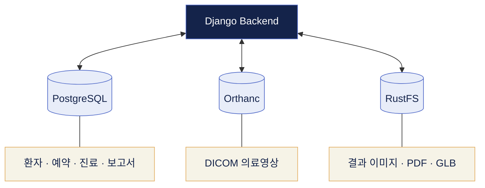
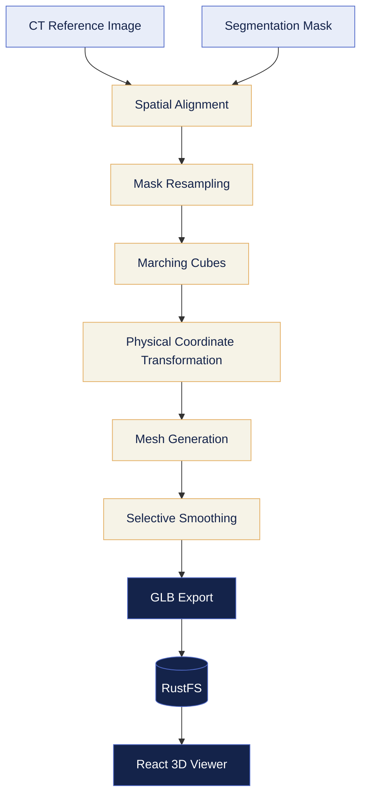

[← DUGN Overview](./README.md) · [Portfolio Home](../../README.md)

# 03. Medical Data Engineering & 3D Processing

**의료 업무 데이터, DICOM 의료영상, AI 분석 결과의
저장 및 처리 방식을 분리하고,
CT와 Segmentation Mask를 활용한 3D 데이터 생성
파이프라인을 구현했습니다.**

---

## 3.1 Medical Data Engineering Overview

| Engineering Area | Implementation |
| :--- | :--- |
| Relational Database | PostgreSQL 기반 의료 업무 데이터 관리 |
| Medical Imaging | Orthanc 기반 DICOM 저장 및 조회 |
| Object Storage | RustFS 기반 결과 파일 관리 |
| Image Processing | SimpleITK, NumPy, SciPy |
| Spatial Alignment | CT와 Segmentation Mask 좌표 정렬 |
| Surface Extraction | Marching Cubes 알고리즘 |
| Mesh Processing | Trimesh 기반 Mesh 생성 및 Smoothing |
| 3D Export | GLB 형식의 3D 데이터 생성 |

---

## 3.2 Medical Data Storage Architecture

의료 서비스에서 사용하는 데이터는
저장 형식과 접근 목적이 서로 다릅니다.

데이터의 특성에 따라 저장소를 분리하고,
Django Backend를 중심으로 각 저장소를 연동했습니다.



| Storage | Data Type | Access Method |
| :--- | :--- | :--- |
| PostgreSQL | 관계형 업무 데이터 | Django ORM |
| Orthanc | DICOM 의료영상 | REST API |
| RustFS | 비정형 결과 파일 | S3 Compatible API |

<details>
<summary><strong>Engineering Decision — 저장소 연동 방식</strong></summary>

### PostgreSQL

환자, 의료진, 진료, 예약 및 보고서 사이의
관계를 관리하는 업무 데이터 저장소입니다.

Django ORM을 활용하여 데이터 조회 및 변경,
관계 관리와 트랜잭션 처리를 구현했습니다.

### Orthanc

DICOM 의료영상의 저장 및 조회를 담당합니다.

일반적인 이미지 파일과 달리 DICOM은
영상 정보와 의료영상 관련 메타데이터를 포함합니다.

의료영상 관리 기능을 별도의 서비스에 위임하고,
Backend에서 필요한 영상 데이터와 연동했습니다.

### RustFS

S3 호환 객체 저장소로,
AI 결과 이미지, PDF 및 3D GLB 파일 등을 관리합니다.

Python의 boto3를 활용하여
객체 저장소와 Backend를 연동했습니다.

### Design Purpose

- 데이터 특성에 따른 저장 책임 분리
- 업무 데이터와 대용량 파일의 분리 관리
- 의료영상 관리 기능의 독립적인 구성
- Backend를 통한 데이터 접근 조건 관리

</details>

---

## 3.3 CT & Segmentation Mask Processing

AI 모델이 생성한 Segmentation Mask를 활용하여
심혈관 구조의 3D 데이터를 생성했습니다.

CT 영상과 Mask는 배열 크기뿐 아니라
Voxel Spacing, Origin, Direction 등의
공간 정보도 함께 고려해야 합니다.

단순히 배열 인덱스를 기준으로 처리할 경우
실제 의료영상의 공간 위치와
생성된 3D 모델의 위치가 달라질 수 있습니다.

### Spatial Metadata

| Metadata | Description |
| :--- | :--- |
| Size | 영상 배열의 크기 |
| Spacing | 각 Voxel 사이의 실제 물리적 거리 |
| Origin | 영상 좌표계의 시작 위치 |
| Direction | 영상 좌표축의 방향 |
| Mask | 특정 해부학적 구조를 구분하는 분할 데이터 |

<details>
<summary><strong>Engineering Problem — CT와 Mask의 공간 정합성</strong></summary>

### Problem

CT와 Segmentation Mask를 활용하여
3D 모델을 생성하는 과정에서
구조물의 공간 위치를 일치시키는 문제가 발생했습니다.

### Root Cause

의료영상의 배열 인덱스와
실제 물리적 좌표는 동일하지 않습니다.

또한 SimpleITK의 영상 좌표 순서와
NumPy 배열의 축 순서가 다르기 때문에
좌표 변환 과정에서 이를 고려해야 합니다.

### Resolution

- CT를 기준 영상으로 설정
- Mask를 CT의 공간 정보에 맞게 Resampling
- 배열 좌표와 영상 좌표의 축 순서 변환
- Spacing, Direction, Origin을 반영한 좌표 계산

### Engineering Outcome

CT와 Mask의 공간 정보를 일치시키고,
동일한 물리적 좌표계를 기준으로
3D Mesh를 생성하도록 처리했습니다.

</details>

---

## 3.4 3D Data Generation Pipeline

Segmentation Mask를 기반으로
해부학적 구조의 표면을 추출하고,
Web Viewer에서 사용할 수 있는 GLB 파일을 생성했습니다.



### Processing Stages

| Stage | Responsibility |
| :--- | :--- |
| 01. Spatial Alignment | CT와 Mask의 공간 정보 일치 |
| 02. Resampling | CT 기준 영상 격자로 Mask 변환 |
| 03. Surface Extraction | Marching Cubes 기반 표면 추출 |
| 04. Coordinate Transformation | 물리적 좌표계 변환 |
| 05. Mesh Generation | Vertex와 Face 기반 Mesh 생성 |
| 06. Selective Smoothing | 구조별 표면 평활화 적용 |
| 07. GLB Export | 3D 모델 파일 생성 |
| 08. Storage & Delivery | 결과 파일 저장 및 Viewer 연계 |

---

## 3.5 Core Implementation

### Marching Cubes & Physical Coordinate Transformation

Marching Cubes 알고리즘을 활용하여
3차원 Mask 데이터에서 표면을 추출했습니다.

추출된 Vertex를 실제 의료영상의
물리적 좌표계에 맞게 변환한 후
Trimesh를 활용하여 Mesh를 생성했습니다.

<details>
<summary><strong>View Source Code — 3D Mesh Generation</strong></summary>

**Source File:** `ai/ccta_rendering.py`

```python
spacing_xyz = image.GetSpacing()

vertices, faces, _normals, _values = marching_cubes(
    mask,
    level=0.5,
    spacing=(
        spacing_xyz[2],
        spacing_xyz[1],
        spacing_xyz[0],
    ),
)

vertices = vertices[:, [2, 1, 0]]

direction = np.asarray(
    image.GetDirection(),
    dtype=float,
).reshape(3, 3)

origin = np.asarray(
    image.GetOrigin(),
    dtype=float,
)

vertices = vertices @ direction.T + origin

mesh = trimesh.Trimesh(
    vertices=vertices,
    faces=faces,
    process=False,
)

if name in {"heart", "aorta"}:
    trimesh.smoothing.filter_laplacian(
        mesh,
        iterations=5,
        volume_constraint=True,
    )
```

> 실제 구현의 핵심 코드 발췌이며,
> 관련 모듈의 Import 및 전체 처리 과정은 생략했습니다.

### Code Analysis

#### 01. Voxel Spacing

```python
spacing_xyz = image.GetSpacing()
```

영상의 Voxel 사이 물리적 거리를 조회합니다.

이를 Marching Cubes에 전달하여
영상의 축별 간격을 반영한 표면을 추출합니다.

#### 02. Surface Extraction

```python
vertices, faces, _normals, _values = marching_cubes(
    mask,
    level=0.5,
    spacing=(
        spacing_xyz[2],
        spacing_xyz[1],
        spacing_xyz[0],
    ),
)
```

Mask에서 경계면을 추출하여
Vertex와 Face 정보를 생성합니다.

NumPy 배열의 축 순서를 고려하여
Spacing 순서를 Z, Y, X로 전달합니다.

#### 03. Axis Transformation

```python
vertices = vertices[:, [2, 1, 0]]
```

Marching Cubes에서 반환된 좌표를
Z, Y, X 순서에서 X, Y, Z 순서로 변환합니다.

#### 04. Physical Coordinate Transformation

```python
vertices = vertices @ direction.T + origin
```

영상의 방향 행렬과 시작 위치를 반영하여
Vertex를 의료영상의 물리적 좌표계로 변환합니다.

Spacing은 앞선 표면 추출 과정에서
이미 반영되었습니다.

#### 05. Mesh Generation

```python
mesh = trimesh.Trimesh(
    vertices=vertices,
    faces=faces,
    process=False,
)
```

변환된 Vertex와 Face를 기반으로
3D Mesh 객체를 생성합니다.

</details>

---

## 3.6 Selective Mesh Smoothing

모든 해부학적 구조에 동일한
Smoothing 처리를 적용하지 않았습니다.

구조별 특성을 고려하여
심장과 대동맥에만 표면 평활화를 적용했습니다.

| Anatomical Structure | Processing |
| :--- | :--- |
| Heart | Laplacian Smoothing |
| Aorta | Laplacian Smoothing |
| Coronary Artery | Smoothing 미적용 |
| Calcification | Smoothing 미적용 |

<details>
<summary><strong>Engineering Decision — 구조별 Smoothing 적용</strong></summary>

### Problem

Mesh의 표면을 부드럽게 만드는 과정에서
작은 구조물의 형태가 변형될 가능성이 있습니다.

### Decision

상대적으로 큰 구조인 심장과 대동맥에는
Laplacian Smoothing을 적용하고,
관상동맥과 석회화 구조에는 적용하지 않았습니다.

```python
if name in {"heart", "aorta"}:
    trimesh.smoothing.filter_laplacian(
        mesh,
        iterations=5,
        volume_constraint=True,
    )
```

### Design Purpose

- 심장 및 대동맥의 표면 평활화
- 관상동맥과 석회화 구조의 형태 변형 최소화
- 구조별 특성을 고려한 Mesh 처리

> 구조 보존을 고려한 구현 방식이며,
> 임상적 정확도에 대한 별도의 정량 검증을
> 완료했다는 의미는 아닙니다.

</details>

---

## 3.7 Backend & 3D Viewer Integration

3D 모델의 생성과 화면 렌더링을
서로 다른 역할로 구분했습니다.

| Component | Responsibility |
| :--- | :--- |
| Backend | CT 및 Mask 처리, 좌표 변환, Mesh 생성 |
| Object Storage | 생성된 GLB 파일 관리 |
| React Viewer | 3D 모델 표시 및 사용자 인터랙션 |

Backend에서 의료영상 기반 3D 데이터를 생성하고,
결과 파일을 저장소에 관리하여
Frontend Viewer와 연계할 수 있도록 구성했습니다.

### Contribution Scope

본인의 담당 범위는 Backend에서의
의료영상 처리 및 3D 데이터 생성,
저장소 연동입니다.

AI 모델 학습 및 Frontend 3D Viewer 구현은
팀 프로젝트의 다른 담당 영역과 구분합니다.

---

## 3.8 Implementation Evidence

| Implementation | Source File |
| :--- | :--- |
| 의료영상 데이터 모델 | imaging/models.py |
| 의료영상 조회 및 연동 | imaging/views.py |
| 객체 저장소 연동 | core/storage.py |
| CT 및 Mask 처리 | ai/ccta_rendering.py |
| 3D Mesh 생성 | ai/ccta_rendering.py |
| 비동기 작업 | ai/tasks.py |
| 3D 결과 제공 API | ai/rendering_views.py |

### Technology Stack

| Technology | Purpose |
| :--- | :--- |
| SimpleITK | 의료영상 및 공간 메타데이터 처리 |
| NumPy | 배열 연산 및 좌표 변환 |
| SciPy | 수치 및 영상 처리 |
| scikit-image | Marching Cubes 기반 표면 추출 |
| Trimesh | Mesh 생성, Smoothing 및 파일 처리 |
| boto3 | S3 호환 객체 저장소 연동 |
| Orthanc | DICOM 의료영상 관리 |
| RustFS | 결과 파일 저장 |

---

## 3.9 Engineering Takeaways

의료영상 데이터는 일반적인 이미지와 달리
배열 정보뿐 아니라 실제 물리적 공간 정보를
함께 고려해야 한다는 점을 경험했습니다.

특히 CT와 Segmentation Mask의 좌표 정렬,
영상 축 순서 변환, 물리적 좌표 계산을 통해
데이터 정합성이 결과물에 미치는 영향을 이해했습니다.

또한 데이터 처리, 파일 저장, 화면 렌더링의
책임을 분리하면서 Backend와 Frontend 사이의
데이터 연계 구조를 경험했습니다.

---

[← 02. Backend & API](./backend-api.md) · [DUGN Overview](./README.md) · [04. Async & Infrastructure →](./async-infra.md)
