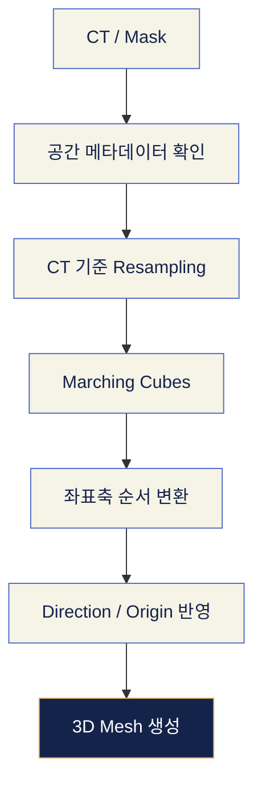
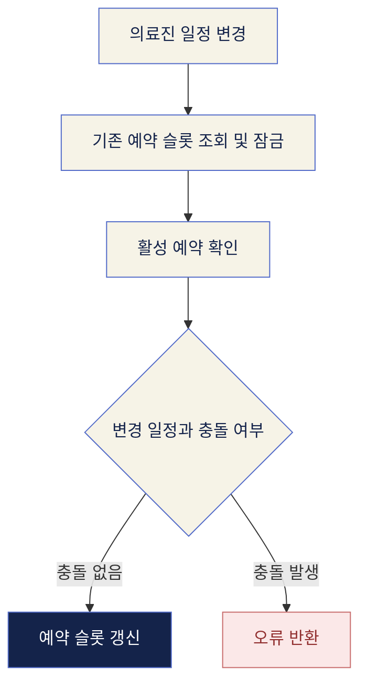
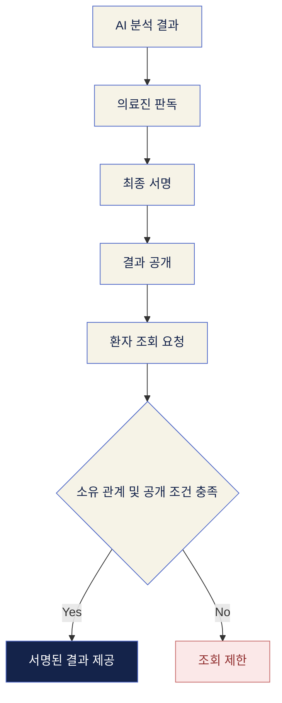

[← DUGN Overview](./README.md) · [Portfolio Home](../../README.md)

# 05. Troubleshooting & Engineering Decisions

**프로젝트 개발 과정에서 발생한 기술적 문제와
업무 규칙에 따른 설계 과제를 분석하고,
데이터 처리 방식 및 시스템 구조를 개선했습니다.**

문제의 현상만 해결하는 것이 아니라
발생 원인과 데이터의 특성,
서비스의 업무 흐름을 함께 고려했습니다.

---

## 5.1 Troubleshooting Overview

| Case | Engineering Challenge | Resolution | Category |
| :--- | :--- | :--- | :--- |
| 01 | CT와 Mask의 공간 좌표 정합성 | Resampling 및 물리적 좌표 변환 | Medical Data |
| 02 | 의료진 일정 변경과 기존 예약 충돌 | Transaction, Row Lock, 충돌 검사 | Data Integrity |
| 03 | 환자 검사 결과 공개 조건 관리 | 서명 및 공개 상태 기반 접근 제어 | Access Control |
| 04 | GCP VM 실행 환경의 처리 지연 | VM 메모리 사양 상향 | Infrastructure |

---

## CASE 01. CT & Mask Spatial Misalignment

`Medical Imaging` `Coordinate Transformation` `3D Processing`

### 의료영상과 Segmentation Mask의 좌표 정합성 문제

CT와 Segmentation Mask를 활용하여
3D 데이터를 생성하는 과정에서
영상과 구조물의 공간 위치를 일치시키는
문제를 해결해야 했습니다.

<details>
<summary><strong>View Troubleshooting Details</strong></summary>

### Problem

CT 영상과 Segmentation Mask를
배열 정보만 기준으로 처리할 경우
생성된 3D 구조물이 실제 의료영상의
물리적 위치와 일치하지 않을 수 있습니다.

이는 의료영상과 분석 결과를
동일한 공간에서 표현하는 과정에
영향을 주는 문제였습니다.

### Root Cause

의료영상은 단순한 3차원 배열이 아니라
물리적 공간 정보를 포함합니다.

- Voxel Spacing
- Image Origin
- Direction Matrix
- 영상 좌표와 배열 좌표의 축 순서 차이

SimpleITK의 영상 좌표는 X, Y, Z 순서이지만,
NumPy 배열은 일반적으로 Z, Y, X 순서로
처리됩니다.

따라서 배열 인덱스만으로는
실제 의료영상의 물리적 좌표를
정확하게 표현하기 어렵습니다.

### Investigation

CT와 Mask의 공간 메타데이터를 기준으로
영상 처리 및 좌표 변환 방식을 검토했습니다.

특히 Marching Cubes에서 생성된 Vertex를
의료영상의 물리적 좌표계로 변환하는
과정에 집중했습니다.

### Resolution

1. CT를 기준 영상으로 설정
2. Segmentation Mask를 CT 격자에 맞게 Resampling
3. Marching Cubes를 통한 표면 추출
4. Z, Y, X 좌표를 X, Y, Z 순서로 변환
5. Spacing, Direction, Origin 반영
6. 동일한 물리적 좌표계에서 Mesh 생성



### Core Implementation

**Source File:** `ai/ccta_rendering.py`

```python
vertices = vertices[:, [2, 1, 0]]

direction = np.asarray(
    image.GetDirection(),
    dtype=float,
).reshape(3, 3)

origin = np.asarray(
    image.GetOrigin(),
    dtype=float,
)

vertices = vertices @ direction.T + origin
```

위 코드는 Marching Cubes에서 생성된 Vertex를
의료영상의 물리적 좌표계로 변환하는
핵심 구현입니다.

### Outcome

- CT 기준의 Mask 공간 정렬
- 의료영상의 물리적 좌표 정보를 반영한 Mesh 생성
- GLB 파일 생성 및 Frontend Viewer 연계

별도의 임상적 정확도에 대한
정량 검증 수치는 측정하지 않았습니다.

### Engineering Takeaway

의료영상 처리에서는 데이터의 배열 크기뿐 아니라
좌표계와 공간 메타데이터를 이해하는 것이
중요하다는 점을 경험했습니다.

### Implementation Evidence

- `ai/ccta_rendering.py`
- `ai/rendering_views.py`
- [Medical Data & 3D Processing](./medical-data.md)

</details>

---

## CASE 02. Appointment & Schedule Conflict

`Transaction` `Concurrency Control` `Data Integrity`

### 의료진 일정 변경 시 기존 예약 충돌 방지

의료진의 근무 일정이 변경될 때
이미 등록된 환자 예약과
충돌할 수 있는 상황을 고려했습니다.

<details>
<summary><strong>View Troubleshooting Details</strong></summary>

### Problem

의료진의 근무 일정이나 휴무가 변경되면
기존에 생성된 예약 가능 시간도
변경되어야 합니다.

그러나 이미 환자가 예약한 시간까지
단순히 삭제하거나 변경할 경우
기존 예약과 의료진 일정 사이의
데이터 불일치가 발생할 수 있습니다.

### Root Cause

의료진 근무 일정, 예약 슬롯,
환자 예약은 서로 연결된 업무 데이터입니다.

일정 변경 시 기존 예약의 상태를
함께 검사하지 않으면
업무 규칙에 맞지 않는 데이터가
생성될 가능성이 있습니다.

또한 동일한 슬롯에 대한 동시 변경도
고려해야 합니다.

### Resolution

- 의료진 근무 일정 기반 예약 슬롯 생성
- 변경 대상 날짜의 기존 슬롯 조회
- 활성 예약과 변경 일정의 충돌 검사
- transaction.atomic 기반 변경 처리
- select_for_update 기반 기존 슬롯 행 잠금
- 변경 일정에서 제외된 슬롯의 BLOCKED 처리



### Core Implementation

**Source File:** `appointments/services.py`

```python
@transaction.atomic
def sync_doctor_availability_for_date(doctor, target_date):
    wanted = _wanted_slot_ranges(doctor, target_date)
    day_start, day_end = _day_bounds(target_date)

    existing = {
        (slot.starts_at, slot.ends_at): slot
        for slot in DoctorAvailabilitySlot.objects.select_for_update().filter(
            doctor=doctor,
            starts_at__gte=day_start,
            starts_at__lt=day_end,
        )
    }

    # 이후 활성 예약 조회 및 충돌 검사,
    # 슬롯 생성과 갱신 처리 생략
```

### Error Handling

기존 활성 예약과 일정 변경이 충돌하는 경우
다음 오류를 반환하도록 구현했습니다.

`SCHEDULE_HAS_ACTIVE_RESERVATIONS`

### Outcome

- 기존 활성 예약을 고려한 일정 변경
- 예약 충돌 발생 시 변경 제한
- 트랜잭션 단위의 예약 슬롯 갱신
- 기존 슬롯의 동시 변경 위험 감소

### Engineering Takeaway

예약 시스템에서는 단순한 데이터 생성 및 수정뿐 아니라
서로 연결된 업무 데이터의 상태와
동시 변경 가능성을 고려해야 한다는 점을 배웠습니다.

### Implementation Evidence

- `appointments/services.py`
- `appointments/models.py`
- `appointments/tests.py`
- [Backend & API Implementation](./backend-api.md)

</details>

---

## CASE 03. Clinical Result Access Control

`Authorization` `State Management` `Medical Data`

### 의료진 판독과 환자 결과 공개의 분리

AI 분석 결과가 생성되는 시점과
환자에게 검사 결과를 제공하는 시점을
구분해야 하는 설계 과제를 해결했습니다.

<details>
<summary><strong>View Troubleshooting Details</strong></summary>

### Problem

AI 분석 결과가 생성되더라도
의료진의 판독과 최종 확인이
완료되지 않았을 수 있습니다.

또한 검사 결과 조회 시
환자 본인의 결과인지,
현재 공개 가능한 상태인지
확인해야 합니다.

### Root Cause

AI 분석 결과의 생성 여부만으로는
환자에게 결과를 제공할 수 있는지
판단하기 어렵습니다.

다음 조건을 함께 고려해야 합니다.

- 환자 계정과 병원 환자 기록의 연결
- 검사 결과의 소유 관계
- 의료진의 최종 서명
- 결과 공개 상태
- 공개 철회 여부
- 서명된 보고서 버전

### Resolution

AI 분석, 의료진 판독, 최종 서명,
결과 공개를 서로 다른 업무 단계로 구분했습니다.

환자 결과 조회 API에서는
환자 소유 관계와 결과 공개 조건을
함께 검사하도록 구현했습니다.



### Core Implementation

**Source File:** `reports/patient_result_views.py`

```python
.filter(
    report__report_version__medical_result_id=result_id,
    report__report_version__medical_result__patient=patient,
    report__status__in=[Report.Status.ACTIVE, "FINAL"],
    release_status=ResultRelease.ReleaseStatus.RELEASED,
    withdrawn_at__isnull=True,
    signoff__signoff_type="FINAL",
)
```

위 코드는 환자 검사 결과 조회 과정에서
적용한 핵심 데이터 필터링 조건입니다.

### Additional Decision

보고서뿐 아니라 결과 이미지 조회에서도
동일한 환자 및 공개 조건을 확인했습니다.

Backend를 통해 접근 조건을 검사한 후
이미지를 제공하도록 구성했습니다.

### Outcome

- 의료진 최종 서명과 환자 결과 공개 분리
- 환자 본인의 검사 결과를 기준으로 조회
- 공개되지 않았거나 철회된 결과의 조회 제한
- 서명된 보고서 스냅샷 기반 결과 제공

### Engineering Takeaway

접근 제어는 단순히 로그인 여부를
확인하는 것만으로 충분하지 않습니다.

데이터의 소유 관계와 업무 상태까지
고려해야 한다는 점을 경험했습니다.

### Implementation Evidence

- `reports/workflow.py`
- `reports/patient_result_views.py`
- `reports/test_patient_result_views.py`
- `reports/test_unified_workflow.py`
- [Backend & API Implementation](./backend-api.md)

</details>

---

## CASE 04. GCP VM Memory Bottleneck

`Google Cloud` `Infrastructure` `Resource Management`

### 클라우드 VM 실행 환경의 처리 지연

여러 서비스와 의료영상 처리 작업을
동일한 VM 환경에서 실행하는 과정에서
처리 속도 저하를 경험했습니다.

<details>
<summary><strong>View Troubleshooting Details</strong></summary>

### Problem

초기 4GB 메모리의 GCP VM 환경에서
Backend, 데이터 저장소 및
AI 관련 서비스를 실행하는 과정에서
전체적인 처리 지연이 발생했습니다.

### Investigation

처리 속도 저하의 원인을
애플리케이션 코드에만 한정하지 않고
서버 실행 환경과 자원 용량도
함께 고려했습니다.

의료영상 처리 및 여러 서비스가
동일한 VM의 자원을 공유하는 상황에서
메모리 용량의 제약에 주목했습니다.

### Root Cause

초기 VM의 메모리 용량은
여러 서비스와 의료영상 처리 작업을
함께 실행하는 환경에서 제약이 있었습니다.

다만 별도의 자원 사용량 프로파일링이나
부하 테스트를 수행하지 않았으므로,
메모리 외의 다른 병목 가능성까지
배제한 것은 아닙니다.

### Resolution

GCP VM의 메모리 사양을 상향하여
프로젝트 실행에 필요한 자원을
추가로 확보했습니다.


### Outcome

VM 사양 변경 이후
프로젝트 실행 과정에서 발생하던
처리 지연이 완화되었습니다.

정량적인 응답 시간, 처리량,
메모리 사용량 개선 수치는
별도로 측정하지 않았습니다.

### Engineering Takeaway

서비스 성능 문제를 해결하기 위해서는
애플리케이션 내부의 로직뿐 아니라
서버 자원, 실행 환경 및
서비스 구성도 함께 고려해야 합니다.

향후에는 자원 사용량과 응답 시간의
측정 데이터를 기반으로
병목 원인을 분석하고자 합니다.

### Related Evidence

- `compose.staging.yml`
- `Dockerfile`
- [Async Processing & Infrastructure](./async-infra.md)

</details>

---

## 5.2 Engineering Lessons

| Engineering Challenge | Key Learning |
| :--- | :--- |
| Medical Data Processing | 배열 정보와 물리적 좌표계의 차이 이해 |
| Data Integrity | 연관 데이터의 상태 및 업무 규칙 고려 |
| Concurrency Control | 트랜잭션과 행 잠금을 활용한 변경 처리 |
| Access Control | 인증, 데이터 소유 관계 및 상태 기반 권한 검사 |
| Infrastructure | 애플리케이션과 서버 자원을 함께 고려 |

---

## 5.3 Future Improvements

프로젝트에서 경험한 문제 해결 과정을 기반으로
향후 다음과 같은 개선 방향을 고려하고 있습니다.

| Improvement | Purpose |
| :--- | :--- |
| Concurrent Request Testing | 동시 예약 요청에 대한 정합성 검증 |
| API Performance Testing | API 응답 시간 및 처리량 측정 |
| Resource Monitoring | CPU 및 메모리 사용량 분석 |
| Structured Logging | 작업 실패 원인 및 오류 추적 |
| Spatial Validation | CT와 Mask의 공간 정합성 정량 검증 |
| Automated Testing | 주요 업무 규칙에 대한 회귀 테스트 확대 |

> 위 항목은 프로젝트의 향후 개선 방향이며,
> 현재 구현을 완료한 기능과 구분합니다.

---

## 5.4 Conclusion

DUGN 프로젝트를 통해
Backend 개발 과정에서 발생하는 문제를
데이터, 업무 규칙, 시스템 구조 및
실행 환경의 관점에서 분석하는 경험을 했습니다.

기능이 동작하는 것에 그치지 않고
왜 해당 문제가 발생하는지,
어떤 기술적 방식으로 대응할 수 있는지를
고려하는 개발자로 성장하고자 합니다.

---

[← 04. Async & Infrastructure](./async-infra.md) · [DUGN Overview](./README.md) · [06. Validation & Contributions →](./validation.md)
