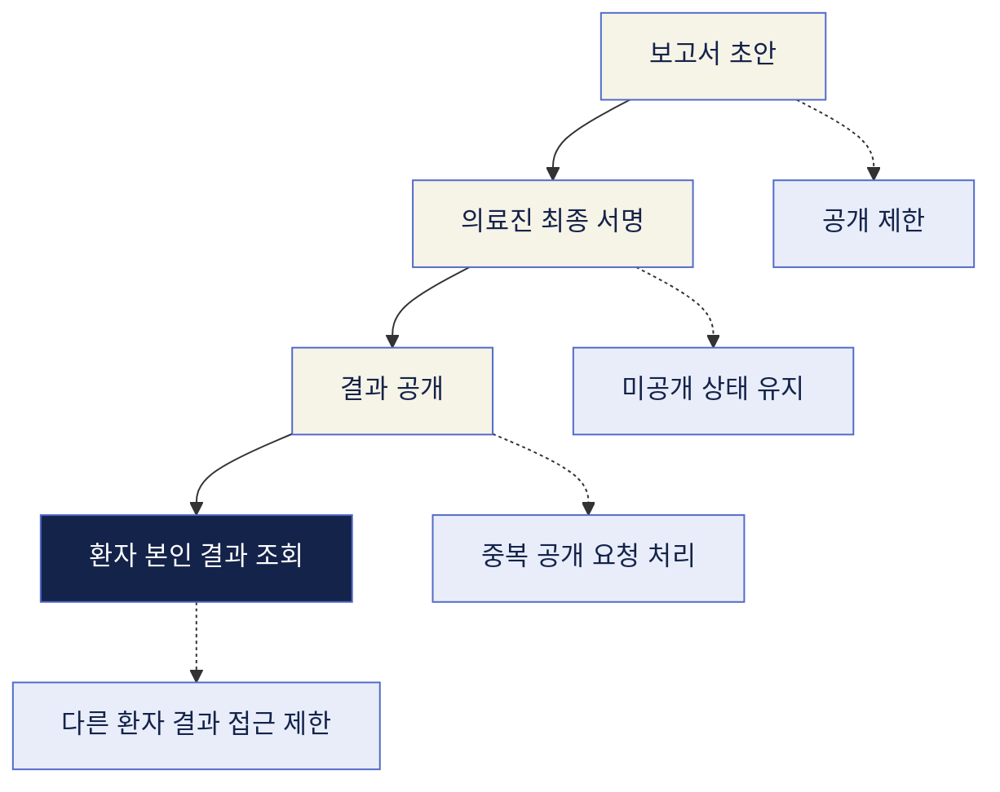

[← DUGN Overview](./README.md) · [Portfolio Home](../../README.md)

# 06. Validation & Engineering Contributions

**Backend 구현 내용과 업무 규칙을 검증하기 위한
테스트 코드 및 개인 기여 범위를 정리했습니다.**

프로젝트의 구현 결과를 기능 목록으로만 설명하지 않고,
실제 소스 코드와 테스트 시나리오를 기반으로
기술적인 근거를 제시합니다.

---

## 6.1 Validation Overview

| Validation Area | Validation Scope | Evidence |
| :--- | :--- | :--- |
| Appointment | 예약 가능 시간 및 예약 변경 | Test Code |
| Authentication | Firebase 전화 인증 및 연락처 검증 | Test Code |
| Clinical Workflow | 의료진 판독, 서명 및 결과 공개 | Test Code |
| Access Control | 환자 본인의 공개된 결과 조회 | Test Code |
| Report Integrity | 서명된 보고서 및 Snapshot 유지 | Test Code |
| Medical Data | CT와 Mask의 공간 좌표 변환 | Implementation |
| 3D Processing | Mesh 및 GLB 생성 | Implementation |
| Infrastructure | 비동기 Worker 및 컨테이너 구성 | Configuration |
| Service Integration | 의료진 Web 및 환자 App 연계 | Demonstration |

> Validation Scope:
> 실제 저장소에 존재하는 테스트 코드와 구현 내용을
> 기준으로 정리했습니다.
> 전체 테스트의 실행 결과 및 통과율은
> 별도로 확인하지 않았습니다.

---

## 6.2 Backend Test Coverage

Django의 TestCase 및 SimpleTestCase를 활용한
Backend 테스트 코드가 구성되어 있습니다.

주요 검증 대상은 예약 업무 규칙,
환자 인증, 의료진 서명 및 결과 공개,
보고서 데이터 정합성입니다.

### Appointment & Reservation Tests

**Source File:** `appointments/tests.py`

| Test Scenario | Validation Purpose |
| :--- | :--- |
| 예약 승인 | 환자와 주치의 관계 활성화 |
| 예약 변경 | 정원이 찬 슬롯으로의 변경 제한 |
| 예약 가능 시간 | 정원이 찬 슬롯의 선택 제한 |
| 예약 취소 | 예약 취소 알림 생성 |
| 전화 인증 | 인증된 전화번호와 예약 연락처 일치 |
| 전화번호 형식 | E.164 형식 저장 |
| 의료진 일정 | 진료 휴무일과 당직일 구분 |

<details>
<summary><strong>View Actual Test Methods</strong></summary>

```python
class PatientReservationApiTests(TestCase):

    def test_patient_can_list_departments_and_filter_doctors(self):
        ...

    def test_change_request_rejects_full_slot(self):
        ...

    def test_full_slot_remains_visible_but_is_not_selectable(self):
        ...

    def test_cancel_creates_reservation_notification(self):
        ...

    def test_firebase_verified_phone_must_match_reservation_contact(self):
        ...

    def test_firebase_verified_phone_is_saved_in_e164_format(self):
        ...

    def test_calendar_distinguishes_clinical_off_and_on_call_days(self):
        ...
```

실제 저장소의 테스트 클래스 및 메서드 선언을
발췌한 내용입니다.

테스트 내부의 Fixture, 요청 데이터 및
Assertion 구현은 생략했습니다.

### Engineering Purpose

예약 API의 정상적인 동작뿐 아니라
정원이 찬 슬롯, 연락처 불일치 등
업무 규칙에 위배되는 상황도
검증 대상으로 포함합니다.

</details>

---

## 6.3 Clinical Workflow Validation

**Source File:** `reports/test_unified_workflow.py`

의료진의 판독 보고서 작성부터
최종 서명 및 환자 결과 공개까지의
업무 흐름을 검증하는 테스트입니다.

| Test Scenario | Expected Behavior |
| :--- | :--- |
| AI 결과 연결 | 성공한 AI 결과만 초안에 연결 |
| 의료진 서명 | 서명 완료와 공개 상태 구분 |
| 서명 전 공개 | 결과 공개 제한 |
| 서명 후 공개 | 공개 처리 허용 |
| 중복 공개 요청 | 동일 요청의 중복 처리 방지 |
| 환자 결과 조회 | 본인의 공개된 보고서만 조회 |
| 보고서 수정 | 기존 XCA 첨부 정보 유지 |
| 서명 Snapshot | 이후 AI 결과 변경의 영향 제한 |

<details>
<summary><strong>View Actual Test Methods</strong></summary>

```python
class UnifiedReportWorkflowTests(TestCase):

    def test_draft_detail_connects_succeeded_ai_only(self):
        ...

    def test_save_conclusion_then_signoff_sets_signed_not_released(self):
        ...

    def test_release_before_signoff_is_forbidden(self):
        ...

    def test_release_after_signoff_and_duplicate_is_idempotent(self):
        ...

    def test_patient_sees_only_released_own_report(self):
        ...

    def test_editable_version_preserves_xca_attachments(self):
        ...

    def test_signed_snapshot_ignores_later_ai_changes(self):
        ...
```

실제 테스트 메서드 중 주요 업무 흐름과
관련된 항목을 발췌했습니다.

### Engineering Purpose

의료진의 서명과 결과 공개가
독립적인 업무 단계로 유지되는지,
환자가 공개 조건을 충족한
본인의 보고서만 조회할 수 있는지를
검증 대상으로 구성했습니다.

</details>

### Clinical State Validation



---

## 6.4 Report Snapshot & Data Integrity

**Source File:** `reports/test_patient_result_views.py`

환자에게 제공되는 통합 검사 결과가
서명된 보고서 및 분석 결과와
일관되게 연결되는지 확인하기 위한 테스트입니다.

| Test Scenario | Validation Purpose |
| :--- | :--- |
| XCA Attachment | 고정된 XCA 첨부 데이터 유지 |
| CCTA Pending | 미완료 CT 결과의 대기 상태 유지 |
| Doctor Opinion | 승인된 CCTA 판독 소견 제공 |
| CCTA Fallback | 공개된 CCTA Snapshot 활용 |
| Integrated Payload | 통합 응답의 결과 제공 상태 확인 |

<details>
<summary><strong>View Actual Test Methods</strong></summary>

```python
class IntegratedPayloadTests(SimpleTestCase):

    def test_uses_frozen_xca_attachment_and_keeps_ct_pending(self):
        ...

    def test_exposes_approved_ccta_conclusion_as_doctor_opinion(self):
        ...


class PatientCctaFallbackTests(SimpleTestCase):

    def test_uses_released_ccta_snapshot_as_fallback(self):
        ...

    def test_integrated_payload_exposes_fallback_ccta_as_available(self):
        ...
```

### Engineering Purpose

환자에게 제공되는 결과는
현재 분석 데이터뿐 아니라
의료진이 승인하고 공개한 보고서의
내용과 상태를 고려해야 합니다.

통합 결과 응답에서 이러한 업무 규칙을
검증하기 위한 테스트가 구성되어 있습니다.

</details>

---

## 6.5 Test Execution Guide

Django Backend 실행 환경과
테스트 데이터베이스 설정이 준비된 상태에서
다음 명령어를 통해 관련 테스트를 실행할 수 있습니다.

### Appointment Tests

```bash
python manage.py test appointments.tests
```

### Clinical Workflow Tests

```bash
python manage.py test reports.test_unified_workflow
```

### Patient Result Tests

```bash
python manage.py test reports.test_patient_result_views
```

### Combined Test Execution

```bash
python manage.py test appointments.tests reports.test_unified_workflow reports.test_patient_result_views
```

> 위 명령어는 테스트 실행 방법을 안내하기 위한 것입니다.
> 실행 환경에 따라 데이터베이스, 환경 변수 및
> 관련 서비스 설정이 필요할 수 있습니다.
>
> 실제 실행 로그 및 테스트 통과율은
> 확인된 결과를 확보한 이후 추가할 예정입니다.

---

## 6.6 Implementation Evidence

개인 담당 영역의 핵심 구현과
관련 소스 파일을 정리했습니다.

| Engineering Contribution | Implementation Evidence | Details |
| :--- | :--- | :--- |
| 예약 슬롯 생성 | appointments/services.py | [View Details](./backend-api.md#22-appointment--schedule-management) |
| 예약 데이터 관리 | appointments/models.py | [View Details](./backend-api.md) |
| 예약 충돌 검사 | appointments/services.py | [View Details](./troubleshooting.md) |
| 의료진 서명 및 공개 | reports/workflow.py | [View Details](./backend-api.md#23-clinical-report--result-release) |
| 환자 결과 접근 제어 | reports/patient_result_views.py | [View Details](./backend-api.md) |
| 의료영상 연동 | imaging/views.py | [View Details](./medical-data.md) |
| 객체 저장소 연동 | core/storage.py | [View Details](./medical-data.md) |
| CT 및 Mask 좌표 정렬 | ai/ccta_rendering.py | [View Details](./medical-data.md) |
| 3D Mesh 및 GLB 생성 | ai/ccta_rendering.py | [View Details](./medical-data.md) |
| 의료진 업무 API | stafftools/views.py | [View Details](./backend-api.md) |
| 실시간 이벤트 연계 | stafftools/consumers.py | [View Details](./backend-api.md) |

### Repository Access

원본 Backend 저장소는
의료 서비스 프로젝트의 소스 및 설정 정보 보호를 위해
비공개 상태로 관리하고 있습니다.

공개 포트폴리오에서는
핵심 구현 코드의 일부와
설계 의사결정 및 문제 해결 과정을 제공합니다.

---

## 6.7 My Contributions & Team Scope

4인 팀 프로젝트에서
Backend Developer 역할을 담당했습니다.

### Personal Contribution

| Area | Contribution |
| :--- | :--- |
| Backend API | Django REST API 및 업무 로직 구현 |
| Appointment | 의료진 일정 및 예약 슬롯 관리 |
| Data Integrity | 예약 충돌 검사 및 트랜잭션 처리 |
| Clinical Workflow | 의료진 서명 및 환자 결과 공개 연계 |
| Access Control | 환자 결과 조회 조건 관리 |
| Medical Data | PostgreSQL, Orthanc, RustFS 연동 |
| 3D Processing | CT와 Mask 정렬 및 GLB 생성 |
| Staff Workflow | 최근 작업, 채팅 및 협진 관련 API |
| Infrastructure | GCP VM 실행 환경 및 메모리 병목 대응 |

### Team Project Scope

| Area | Responsibility |
| :--- | :--- |
| Django Backend | 본인 담당 |
| React Web | 팀원 담당 |
| Flutter Mobile | 팀원 담당 |
| AI Model Training | 팀원 담당 |
| AI Service Integration | Backend와 AI 담당 영역의 연계 |
| System Integration | 팀 협업 |

AI 모델 학습과 Frontend 화면 구현을
개인 Backend 개발 범위와 구분합니다.

또한 프로젝트 전체에 포함된 테스트 코드 및
인프라 설정은 팀 프로젝트의 구현 증빙이며,
모든 코드를 개인이 단독 작성했다는
의미는 아닙니다.

---

## 6.8 Project Deliverables

| Deliverable | Description | Link |
| :--- | :--- | :--- |
| Portfolio | 프로젝트 상세 내용 | [Notion](https://app.notion.com/p/3f60b387fad8816191acdb1eb0f7ac36) |
| Presentation | 최종 프로젝트 발표 자료 | [Presentation](https://drive.google.com/file/d/1jagyOOrqoHlLhwOtsjSue_Fl1Vzs5IBd/view?usp=drivesdk) |
| Demonstration | 전체 서비스 시연 영상 | [Demo - 접근 제한](https://drive.google.com/file/d/1mQFj2CJv3jKBsEk-Uw4sgLknAnSkTGPL/view?usp=drivesdk) |
| Technical Documentation | Backend 설계 및 구현 | [DUGN Overview](./README.md) |
| Troubleshooting | 문제 해결 과정 | [View Details](./troubleshooting.md) |

### Demonstration Scope

최종 시연에서는 사전에 생성된
AI 분석 결과를 활용하여
의료진 판독 및 환자 결과 공개까지의
서비스 업무 흐름을 시연했습니다.

실시간 AI 추론 성능 및 임상적 정확도에 대한
별도의 정량 검증 결과는 포함하지 않습니다.

---

## 6.9 Validation Status & Limitations

| Validation Item | Current Evidence |
| :--- | :--- |
| Backend 주요 업무 규칙 | 테스트 코드 확인 |
| 환자 결과 접근 조건 | 구현 및 테스트 코드 확인 |
| 보고서 Snapshot | 구현 및 테스트 코드 확인 |
| 3D 데이터 생성 | 구현 코드 및 프로젝트 결과 |
| 비동기 처리 구조 | Task 및 Worker 설정 확인 |
| 컨테이너 실행 환경 | Docker Compose 설정 확인 |
| 서비스 업무 흐름 | 프로젝트 시연 |
| 전체 테스트 통과율 | 실행 결과 미확인 |
| API 부하 테스트 | 정량 측정 미수행 |
| 동시 요청 스트레스 테스트 | 별도 검증 필요 |
| 의료영상 공간 정합성 | 정량 검증 필요 |
| AI 모델 임상적 정확도 | 개인 검증 범위 제외 |

---

## 6.10 Engineering Growth

DUGN 프로젝트를 통해
Backend 개발자로서 다음과 같은
기술적인 경험을 쌓았습니다.

- Django REST API 기반 서비스 개발
- 관계형 데이터 모델 및 업무 규칙 관리
- 트랜잭션과 동시성 제어
- 데이터 소유 관계 및 상태 기반 접근 제어
- 의료영상 및 객체 저장소 연동
- 의료영상 기반 3D 데이터 처리
- 비동기 작업 및 다중 서비스 실행 환경 이해
- 서버 자원 제약에 대한 문제 해결

향후에는 실제 테스트 실행 결과,
API 성능 측정 및 서버 자원 모니터링을 통해
구현 결과를 정량적으로 검증할 수 있는
Backend 개발 역량을 발전시키고자 합니다.

---

<p align="center">
  <strong>DUGN — Engineering for Reliable Medical Data</strong>
</p>

---

[← 05. Troubleshooting](./troubleshooting.md) · [DUGN Overview](./README.md) · [Portfolio Home](../../README.md)
