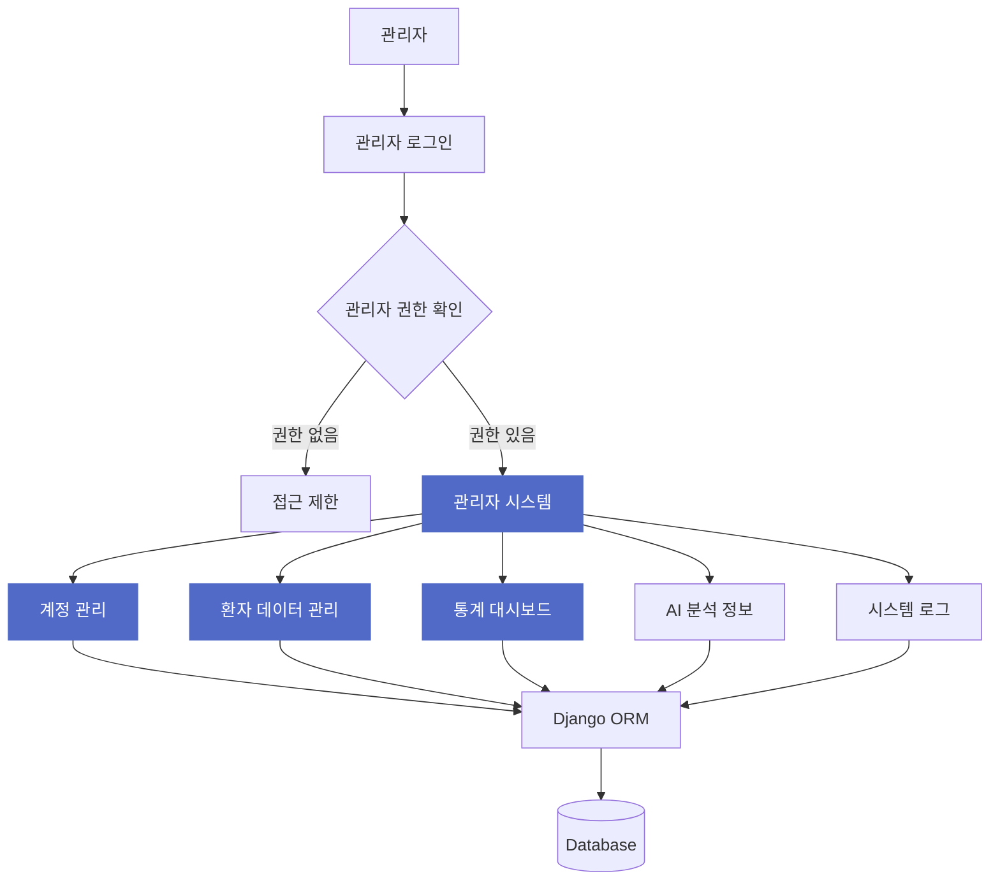
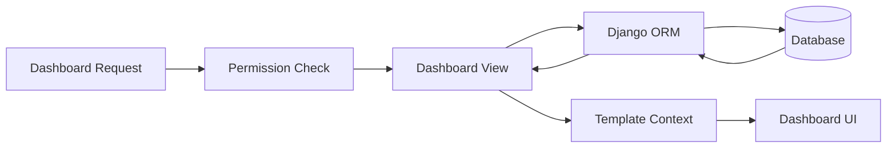
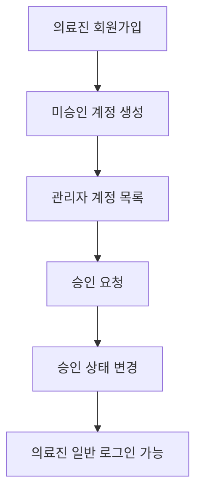
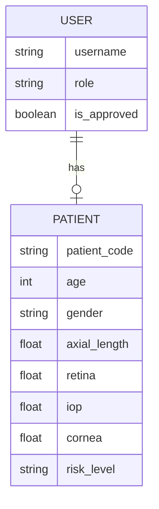
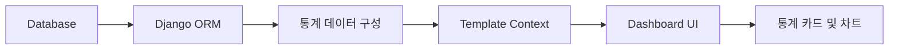

# Administration System

> Django 기반 관리자 대시보드 및 통합 데이터 관리 시스템

[← Authentication & Authorization](./authentication.md)

## 1. Overview

EYE TO AI의 관리자 시스템은 사용자 계정, 의료진 승인 상태, 환자 데이터, AI 모델 정보 및 시스템 활동을 관리하기 위한 기능입니다.

관리자가 서비스 운영에 필요한 정보를 확인하고 사용자 계정 및 접근 권한을 관리할 수 있도록 별도의 관리자 환경을 구성했습니다.

관리자 시스템은 본 프로젝트의 주요 개인 담당 영역입니다.

## 2. Personal Contributions

| 기능 | 개인 기여 내용 |
| --- | --- |
| Admin Dashboard | 관리자 대시보드 구현 |
| Account Management | 의료진 계정 목록 및 승인 상태 관리 |
| Permission Management | 의료진 관리자 권한 변경 |
| Patient Data | 환자 데이터 조회 및 관리 화면 구성 |
| Statistics | 사용자 및 환자 관련 통계 표시 |
| Visualization | 관리자 대시보드 차트 연동 |
| AI Model Information | AI 모델 정보 표시 작업 |
| System Log | 시스템 활동 기록 및 표시 |
| Admin Interface | 관리자 페이지 및 공통 화면 구성 |

## 3. Administration Architecture



관리자 기능은 Django의 인증 시스템 및 ORM을 기반으로 구성했습니다.

accounts 앱을 중심으로 관리자 기능을 구현했으며, analysis 앱의 분석 관리 정보와 연결되는 작업에도 참여했습니다.

위 다이어그램은 관리자 시스템의 논리적 기능 구성을 나타냅니다.

## 4. Admin Dashboard

### Problem

사용자 계정, 의료진 승인 상태 및 환자 관련 데이터가 개별적으로 관리될 경우 관리자가 전체 서비스 현황을 파악하기 어렵습니다.

### Implementation

관리자 대시보드에서 주요 서비스 운영 정보를 확인할 수 있도록 데이터 조회 및 통계 표시 기능을 구성했습니다.

### 주요 조회 항목

| 항목 | 설명 |
| --- | --- |
| 전체 사용자 | 등록된 사용자 계정 수 |
| 전체 환자 | 등록된 환자 수 |
| 승인 대기 의료진 | 관리자 승인이 필요한 의료진 계정 |
| 고위험 환자 | 위험 수준이 높은 환자 수 |
| 주의 환자 | 주의 단계의 환자 수 |
| 정상 환자 | 정상 단계의 환자 수 |

### Data Flow



관리자 요청이 들어오면 접근 권한을 확인하고, Django ORM을 통해 필요한 데이터를 조회합니다.

조회한 데이터는 Template Context를 통해 관리자 화면에 전달됩니다.

## 5. Django ORM Statistics

관리자 대시보드에서는 Django ORM의 count와 filter를 활용하여 사용자 및 환자 관련 통계를 조회했습니다.

### 전체 사용자 및 환자 수

```python
total_users = User.objects.count()
total_patients = Patient.objects.count()
```

### 승인 대기 의료진 조회

```python
pending_doctors = User.objects.filter(
    role="doctor",
    is_approved=False
).count()
```

### 위험 수준별 환자 조회

```python
high_risk = Patient.objects.filter(
    risk_level="high"
).count()
```

위 코드는 실제 구현의 핵심 조회 방식을 설명하기 위해 단순화한 예시입니다.

### Engineering Decision

데이터베이스에 저장된 사용자 및 환자 정보를 기준으로 통계를 조회하는 구조를 사용했습니다.

Django ORM을 활용하면 직접 SQL을 작성하지 않고도 모델 기반 조회와 조건별 집계를 구현할 수 있습니다.

### Improvement

서비스 데이터가 증가할 경우 반복적인 count 및 filter 조회가 데이터베이스 부하로 이어질 수 있습니다.

향후에는 다음과 같은 개선을 고려할 수 있습니다.

- aggregate 및 annotate 기반 집계
- 자주 사용하는 조회 조건의 인덱스 검토
- 중복 쿼리 최소화
- 통계 데이터 캐싱
- 데이터 증가에 따른 쿼리 성능 측정

위 내용은 향후 개선 방향이며, 실제 성능 최적화 결과를 의미하지 않습니다.

## 6. Account Management

관리자가 의료진 계정과 승인 상태를 확인할 수 있도록 계정 관리 기능을 구성했습니다.

### 주요 기능

- 의료진 계정 목록 조회
- 계정 승인 상태 확인
- 의료진 가입 승인
- 관리자 권한 변경

### 계정 목록 조회 방식

```python
doctors = User.objects.filter(
    role="doctor"
)
```

사용자 모델의 role 필드를 기준으로 의료진 계정을 구분하여 조회합니다.

### Approval Workflow



의료진 회원가입과 관리자 승인 과정을 분리하여 계정 생성 이후 접근 허용 여부를 관리하도록 구성했습니다.

## 7. Permission Management

사용자 유형과 관리자 권한을 별도의 필드로 관리했습니다.

| Field | Responsibility |
| --- | --- |
| role | 관리자, 의료진, 환자 등 사용자 유형 |
| is_staff | 관리자 접근 권한 확인 |
| is_approved | 계정 승인 상태 |
| is_superuser | Django 최고 관리자 권한 |

관리자 기능에서는 is_staff를 기준으로 접근 권한을 확인하는 방식을 사용했습니다.

```python
def is_admin(user):
    return user.is_staff
```

의료진 권한 변경 기능에서는 대상 의료진 계정의 is_staff 값을 수정할 수 있도록 구성했습니다.

### Security Consideration

현재 구조에서는 is_staff가 여러 관리자 기능의 접근 기준으로 사용됩니다.

향후에는 Django Groups 및 Permissions를 활용하여 관리자 기능별 권한을 세분화할 필요가 있습니다.

예를 들어 계정 승인, 환자 데이터 조회, 시스템 로그 조회 권한을 각각 구분할 수 있습니다.

## 8. Patient Data Management

환자 계정과 환자 관련 데이터를 관리자 환경에서 조회할 수 있도록 데이터 관리 기능에 참여했습니다.

### 주요 관리 데이터

| Category | Data |
| --- | --- |
| Identification | 환자 식별 코드 |
| Demographics | 연령, 성별 |
| Eye Biomarkers | 안축장, 망막 관련 변수, 안압, 각막 관련 변수 |
| Risk Information | 위험 수준 |
| Analysis | 질환 관련 분석 정보 |

사용자 계정과 환자 데이터는 별도의 모델로 구성되며, OneToOneField 관계를 통해 연결됩니다.



위 ERD는 주요 필드를 중심으로 단순화한 구조입니다.

### Design Purpose

- 사용자 인증 정보와 환자 데이터 구분
- 환자 식별 코드를 활용한 데이터 관리
- 관리자 화면에서 환자 관련 정보 조회
- 위험 수준별 통계와 환자 데이터 연결

실제 의료 서비스에서는 민감정보에 대한 접근 제어, 암호화 및 개인정보 보호 정책이 추가로 필요합니다.

## 9. Dashboard Visualization

관리자가 서비스 운영 현황을 파악할 수 있도록 사용자 및 환자 데이터를 통계와 차트로 표현하는 작업에 참여했습니다.



### 주요 시각화 대상

- 전체 사용자 수
- 환자 등록 현황
- 의료진 승인 대기 현황
- 환자 위험 수준별 분포

데이터 조회와 화면 표현을 연결하면서 백엔드에서 처리한 데이터를 관리자 인터페이스로 전달하는 흐름을 경험했습니다.

일부 차트 데이터의 실제 전달 여부 및 최종 화면 반영 상태는 추가 검증이 필요합니다.

## 10. AI Model Information

관리자 환경에서 AI 모델 및 분석 관련 정보를 확인할 수 있도록 analysis 앱과의 데이터 연동 작업에 참여했습니다.

### 주요 작업 범위

- AI 모델 정보 표시
- 분석 관리 화면 구성 및 수정
- 시스템 로그 표시
- 환자 및 분석 데이터 흐름 확인

최종 팀 플랫폼에서는 Random Forest 기반 질환 위험 예측과 SHAP 분석 기능을 구성했습니다.

개인 담당 영역은 예측 모듈 전체의 구현이 아니라 관리자 환경에서 관련 정보를 확인할 수 있도록 연결하는 작업입니다.

상세 내용은 ai-integration.md에서 설명합니다.

## 11. System Logging

서비스 내 사용자 활동을 확인할 수 있도록 시스템 로그 기록 및 표시 기능을 구성했습니다.

### 주요 데이터

| Field | Description |
| --- | --- |
| message | 활동 및 이벤트 관련 메시지 |
| timestamp | 기록 생성 시각 |

### Logging Flow


일반 로그인 및 관리자 로그인 과정에서 관련 활동을 기록하는 구조를 사용했습니다.

### Engineering Purpose

- 사용자 활동 확인
- 서비스 운영 현황 파악
- 문제 발생 시 관련 기록 확인

현재 구현은 기본적인 시스템 활동 기록이며, 완전한 감사 추적 시스템은 아닙니다.

### Future Improvement

- 로그 수준 구분
- 이벤트 유형 관리
- 관리자 권한 변경 이력 기록
- 변경 전후 상태 기록
- 로그 접근 권한 및 보존 기간 관리
- 민감정보의 로그 노출 방지

## 12. Custom Admin Dashboard vs Django Admin

Django 기본 관리자 기능과 서비스 전용 관리자 대시보드는 서로 다른 목적으로 활용했습니다.

| 구분 | Django Admin | Custom Admin Dashboard |
| --- | --- | --- |
| 목적 | 모델 기반 데이터 관리 | 서비스 운영 및 현황 관리 |
| 화면 | Django 기본 관리자 UI | 프로젝트 전용 UI |
| 데이터 | 등록된 Django 모델 | 사용자 및 서비스 관련 정보 |
| 기능 | 모델 조회 및 수정 | 계정 승인, 통계 및 운영 정보 확인 |
| 구현 방식 | ModelAdmin | Django Views, ORM, Templates |

Django Admin에서는 사용자 및 환자 모델의 관리 환경을 구성하고, 별도의 관리자 화면에서는 서비스 운영에 필요한 기능을 연결했습니다.

## 13. Engineering Review

### 구현 과정에서 경험한 내용

- 사용자 모델과 관리자 권한의 관계
- Django ORM 기반 조건별 데이터 조회
- View와 Template 사이의 데이터 전달
- 사용자 및 환자 데이터의 관계
- 분석 관련 정보와 관리자 화면의 연결
- 시스템 활동 기록 및 조회

### 향후 개선 방향

| Area | Improvement |
| --- | --- |
| Query Performance | 중복 조회 및 집계 쿼리 최적화 |
| Authorization | 기능별 관리자 권한 분리 |
| Account Approval | POST 요청 및 승인 대상 검증 강화 |
| Data Security | 환자 민감정보 접근 제어 |
| Audit Logging | 관리자 작업 변경 이력 관리 |
| Pagination | 사용자 및 환자 목록 페이지네이션 검토 |
| Testing | 관리자 기능 및 권한 자동화 테스트 |

위 개선 항목은 프로젝트 구현 이후 검토한 사항이며, 실제 구현 완료된 기능과 구분합니다.

## 14. Validation Scenarios

| Scenario | Expected Result |
| --- | --- |
| 관리자 로그인 | 관리자 대시보드 접근 |
| 일반 사용자의 관리자 페이지 요청 | 접근 제한 |
| 의료진 계정 목록 조회 | 의료진 계정 표시 |
| 미승인 의료진 계정 승인 | 승인 상태 변경 |
| 의료진 관리자 권한 변경 | is_staff 상태 변경 |
| 환자 데이터 조회 | 등록된 환자 정보 표시 |
| 사용자 및 환자 통계 조회 | 조건별 집계 결과 표시 |
| 로그인 활동 기록 | 관련 시스템 로그 생성 |

위 표는 기능 검증을 위한 시나리오이며, 자동화 테스트의 실행 결과를 의미하지 않습니다.

## 15. Contribution Evidence

개인 개발 이력에서 확인되는 주요 관리자 시스템 관련 커밋입니다.

| Commit | Description |
| --- | --- |
| f32f943 | 관리자 대시보드 구현 |
| 5407547 | 관리자 화면 및 관련 기능 구성 |
| 75d4bd5 | 전반적인 오류 수정 및 관리자 대시보드 작업 |
| 1045d8c | 모델 및 로그 표시 완료 |
| 6177491 | 대시보드 수정 |
| 3f7f2fb | 관리자 탭 및 디자인 수정 |
| a3e1ea5 | 관리자 대시보드 환자 데이터 수정 |
| 7020583 | 데이터 흐름 확인 및 관리자 대시보드 차트 추가 |

팀 프로젝트의 원본 소스 전체를 복제하지 않고, 개인 담당 기능과 개발 이력을 중심으로 정리했습니다.

## 16. Retrospective

관리자 시스템을 구현하면서 단순한 화면 개발뿐만 아니라 사용자 인증, 접근 권한, 데이터 모델 및 데이터베이스 조회가 서로 연결되는 구조를 경험했습니다.

특히 관리자 대시보드를 구성하는 과정에서 사용자와 환자 관련 데이터를 어떤 기준으로 조회하고 화면에 전달해야 하는지 학습했습니다.

향후에는 관리자 권한 세분화, 데이터 조회 최적화, 민감정보 보호 및 감사 로그 기능을 강화하여 실제 서비스 운영에 적합한 구조로 발전시키고자 합니다.

---

[← Authentication & Authorization](./authentication.md) | [AI Service Integration →](./ai-integration.md)
