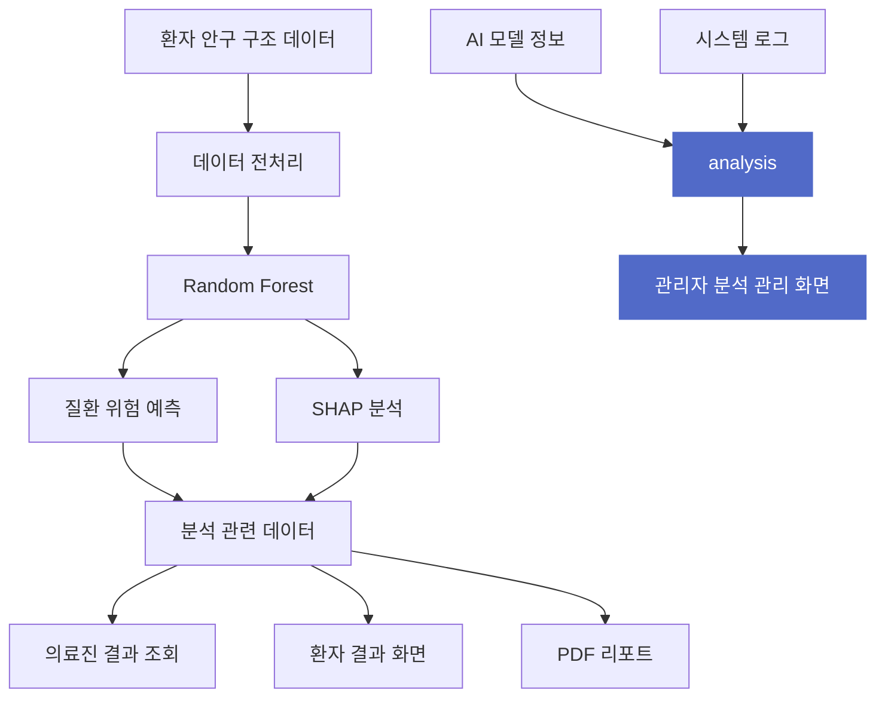
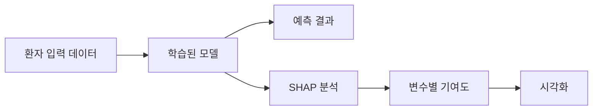

# AI Service Integration

> 머신러닝 분석과 Django 기반 의료 IT 서비스의 데이터 연동

[← Administration System](./admin-system.md)

## 1. Overview

EYE TO AI는 안구 구조 데이터를 활용한 만성질환 위험 분석 모델을 Django 기반 웹 서비스와 연결한 프로젝트입니다.

머신러닝 모델의 예측 결과를 제공하는 것뿐만 아니라 의료진이 분석 정보를 확인하고 관리자가 모델 및 시스템 관련 정보를 관리할 수 있는 서비스 환경을 구성했습니다.

본 문서에서는 전체 AI 서비스 구조와 개인 담당 영역인 관리자 데이터 연동을 구분하여 설명합니다.

## 2. Contribution Scope

| 영역 | 구현 내용 | 기여 범위 |
| --- | --- | --- |
| ML Experiment | Logistic Regression, XGBoost 실험 | 개인 분석 참여 |
| Data Processing | 안구 구조 데이터 전처리 및 변수 검토 | 개인 분석 참여 |
| Prediction Pipeline | Random Forest 기반 질환 위험 예측 | 팀 전체 구현 |
| Explainable AI | SHAP 기반 변수 영향 분석 | 팀 전체 구현 |
| AI Model Management | 관리자 화면의 모델 정보 표시 | 개인 연동 참여 |
| Analysis Management | 분석 관련 데이터 및 관리 화면 구성 | 개인 연동 참여 |
| System Logging | 시스템 로그 기록 및 표시 | 개인 담당 |
| PDF Report | ReportLab 기반 리포트 생성 | 팀 전체 구현 |

최종 머신러닝 예측 모듈, SHAP 분석 및 PDF 리포트 전체를 개인 단독 구현으로 소개하지 않습니다.

## 3. AI Service Architecture



위 다이어그램은 최종 팀 발표 자료를 바탕으로 재구성한 AI 서비스의 논리적 구조입니다.

파란색 영역은 개인적으로 참여한 관리자 데이터 연동 영역을 나타냅니다.

실제 함수 호출 순서 및 모든 데이터 저장 관계를 표현한 것은 아닙니다.

## 4. Machine Learning Pipeline

최종 팀 플랫폼에서는 Random Forest 기반의 만성질환 위험 예측 모델을 사용했습니다.

### Pipeline Components

| Stage | Technology | Responsibility |
| --- | --- | --- |
| Data Processing | pandas, NumPy | 데이터 정리 및 전처리 |
| Prediction | Random Forest | 질환 위험 예측 |
| Model Framework | scikit-learn | 머신러닝 모델 구성 |
| Model Management | joblib | 학습 모델 파일 관리 |
| Explainability | SHAP | 변수별 예측 영향 분석 |
| Visualization | matplotlib, seaborn | 분석 결과 시각화 |
| Report | ReportLab | PDF 리포트 생성 |
| Web Service | Django | 사용자 및 분석 관련 기능 연결 |

위 기술은 최종 팀 플랫폼의 전체 구성입니다.

### Prediction Targets

- Diabetes: 당뇨 관련 위험 분석
- Hypertension: 고혈압 관련 위험 분석

### Input Features

안구 구조 및 관련 건강 정보를 활용한 분석을 수행했습니다.

대표적인 안구 구조 변수는 다음과 같습니다.

- 안축장
- 망막 관련 측정값
- 안압
- 각막 관련 측정값

실제 최종 모델의 전체 입력 변수 및 전처리 조건은 모델별 학습 설정에 따라 달라질 수 있습니다.

## 5. Django Integration Structure

AI 관련 기능과 웹 서비스 기능은 Django 프로젝트 내부의 기능별 모듈을 통해 연결됩니다.

```text
Django_project_2team/
│
├── accounts/
│   ├── models.py
│   ├── views.py
│   └── templates/
│
├── analysis/
│   ├── models.py
│   ├── views.py
│   ├── urls.py
│   ├── utils.py
│   └── templates/
│
├── doctor/
│   ├── views.py
│   └── services/
│       └── xai_explainer.py
│
└── ml_model/
    ├── predictor.py
    └── feature_description.py
```

### Module Responsibilities

| Module | Responsibility |
| --- | --- |
| accounts | 사용자 인증 및 관리자 기능 |
| analysis | AI 모델 및 분석 관련 관리 정보 |
| doctor | 의료진 업무 및 분석 결과 관련 기능 |
| ml_model | 머신러닝 예측 관련 기능 |

개인적으로는 accounts와 analysis를 중심으로 관리자 화면의 데이터 연동 및 표시 작업에 참여했습니다.

## 6. AI Model Information Management

### Problem

머신러닝 모델이 웹 서비스에 연결되더라도 관리자가 모델 관련 정보를 확인할 수 있는 환경이 없다면 서비스 운영 현황을 파악하기 어렵습니다.

예측 기능과 별도로 모델 정보를 확인할 수 있는 관리 환경이 필요했습니다.

### Implementation

analysis 앱의 모델 정보 및 관련 데이터를 관리자 화면에 표시하는 작업에 참여했습니다.

주요 작업 범위는 다음과 같습니다.

- AI 모델 관련 정보 표시
- 분석 관리 화면 구성 및 수정
- 관리자 화면과 분석 관련 데이터 연결
- 모델 정보 및 시스템 로그 표시

### Data Flow


위 흐름은 관리자 데이터 조회 및 화면 표시 과정을 개념적으로 정리한 것입니다.

모델 학습, 재학습, 자동 배포 및 모델 버전 관리 시스템 전체를 구현한 것은 아닙니다.

## 7. Analysis Data Management

환자 정보와 분석 관련 데이터는 서로 다른 목적을 가지므로 각각의 역할을 구분하여 관리하는 구조를 사용했습니다.

| Data Category | Purpose |
| --- | --- |
| User Data | 사용자 인증 및 계정 관리 |
| Patient Data | 환자 식별 및 관련 건강 정보 |
| Analysis Data | 머신러닝 분석 관련 정보 |
| AI Model Information | 모델 관련 관리 정보 |
| System Log | 사용자 및 시스템 활동 기록 |

관리자 대시보드와 분석 관리 화면에서 필요한 정보를 확인할 수 있도록 관련 데이터의 흐름을 파악하고 화면 연동 작업에 참여했습니다.

### Engineering Perspective

AI 모델을 서비스에 연결하는 과정에서는 예측 성능뿐만 아니라 다음과 같은 요소도 중요합니다.

- 분석 대상 환자의 식별
- 데이터 조회 및 관리 구조
- 사용자별 접근 권한
- 분석 결과의 전달 방식
- 모델 관련 정보의 관리
- 서비스 활동 기록

본 프로젝트를 통해 머신러닝 분석과 웹 서비스의 데이터 관리 구조가 서로 연결되는 과정을 경험했습니다.

## 8. Explainable AI

최종 팀 플랫폼에서는 SHAP을 활용하여 머신러닝 예측에 영향을 준 변수 정보를 시각화했습니다.

### Purpose

머신러닝 모델의 예측값만 제공하는 경우 사용자가 어떤 변수가 예측에 영향을 주었는지 이해하기 어렵습니다.

SHAP은 개별 변수의 예측 기여도를 설명하는 데 활용할 수 있습니다.

### Conceptual Workflow



프로젝트 저장소에는 SHAP Force Plot 및 Waterfall Plot 관련 이미지와 설명 모듈이 포함되어 있습니다.

SHAP 분석은 최종 팀 플랫폼의 전체 구현 영역입니다.

SHAP 결과는 모델의 예측에 대한 설명이며, 특정 안구 변수가 질환의 직접적인 원인이라는 의미는 아닙니다.

## 9. Report Generation

최종 팀 플랫폼에서는 ReportLab을 활용한 PDF 리포트 생성 기능을 구성했습니다.

### Report Generation Purpose

- 분석 결과를 문서 형태로 제공
- 의료진의 분석 정보 확인 지원
- 웹 화면 외의 결과 전달 방식 제공

PDF 리포트 생성은 팀 전체 시스템의 기능이며 개인 단독 구현 영역은 아닙니다.

## 10. System Logging

AI 관련 관리 정보와 함께 서비스 활동을 확인할 수 있도록 시스템 로그 표시 작업에 참여했습니다.


### Purpose

- 사용자 활동 확인
- 서비스 운영 현황 파악
- 시스템 관련 기록 조회

현재 구현은 기본적인 시스템 활동 기록입니다.

AI 모델의 실시간 성능 모니터링, 데이터 드리프트 탐지 또는 자동 장애 대응 시스템을 구현한 것은 아닙니다.

## 11. Personal Experiment vs Final Team Model

개인 머신러닝 실험과 최종 팀 플랫폼의 모델을 구분하여 정리했습니다.

| 구분 | 개인 실험 | 최종 팀 플랫폼 |
| --- | --- | --- |
| Model | Logistic Regression, XGBoost | Random Forest |
| Purpose | 변수 및 모델 성능 검토 | 웹 서비스 기반 위험 분석 |
| Evaluation | Precision, Recall, F1, ROC-AUC | 팀 최종 분석 기준 |
| Explainability | 변수 영향 검토 | SHAP 기반 설명 |
| Service Integration | 관리자 데이터 연동 참여 | 전체 AI 서비스 구성 |

개인 초기 실험 결과와 최종 팀 모델의 성능을 동일한 결과로 소개하지 않습니다.

개인 머신러닝 실험의 상세 내용은 ml-experiment.md에서 설명합니다.

## 12. Engineering Decisions

### 12.1 Django 기반 서비스 연동

별도의 AI 마이크로서비스를 운영하는 대신 Django 프로젝트 내부에서 머신러닝 관련 모듈과 웹 서비스 기능을 연결하는 구조를 사용했습니다.

제한된 개발 기간 내에서 모델과 웹 서비스의 기능을 연결하기 위한 구조였습니다.

### 12.2 기능별 모듈 분리

사용자 인증, 의료진 업무, 환자 서비스 및 분석 관련 기능을 각각의 모듈로 구분했습니다.

이를 통해 개인 담당 영역과 팀원 담당 영역을 구분하면서 하나의 서비스로 연결할 수 있었습니다.

### 12.3 관리자 데이터 연동

예측 기능과 별도로 관리자 환경에서 모델 및 분석 관련 정보를 확인할 수 있도록 구성했습니다.

AI 서비스에서는 예측 기능뿐만 아니라 사용자, 데이터 및 모델 관련 정보의 관리 구조도 중요하다는 점을 경험했습니다.

### 12.4 Explainable AI

최종 팀 플랫폼에서는 SHAP을 활용하여 예측 결과에 대한 설명 정보를 제공하는 구조를 사용했습니다.

다만 설명 가능 AI가 모델의 임상적 신뢰성이나 진단 정확성을 보장하는 것은 아닙니다.

## 13. Limitations and Future Improvements

| Area | Improvement |
| --- | --- |
| Model Versioning | 모델 버전 및 학습 정보 관리 |
| Prediction History | 환자별 분석 결과 이력 관리 강화 |
| Data Validation | 모델 입력 데이터의 유효성 검증 |
| Error Handling | 예측 실패 및 예외 처리 강화 |
| Async Processing | 분석 작업의 비동기 처리 검토 |
| Monitoring | 예측 실패율 및 처리 시간 모니터링 |
| Data Drift | 입력 데이터 분포 변화 탐지 |
| Explainability | 설명 결과의 일관성 및 신뢰성 검토 |
| Security | 분석 결과 및 의료 데이터 접근 제어 |
| Testing | 예측 모듈과 웹 서비스 간 통합 테스트 |
| Clinical Validation | 외부 데이터 및 임상적 유효성 검증 |

위 항목은 실제 운영 환경을 고려한 향후 개선 방향이며, 본 프로젝트에서 구현 완료된 기능은 아닙니다.

## 14. Contribution Evidence

개인 개발 이력에서 확인되는 주요 AI 및 분석 관리 관련 작업입니다.

| Commit | Description |
| --- | --- |
| 75d4bd5 | 분석 관리 화면 및 관리자 대시보드 관련 작업 |
| 1045d8c | 모델 정보 및 로그 표시 완료 |
| a3e1ea5 | 관리자 대시보드 환자 데이터 수정 |
| 7020583 | 데이터 흐름 확인 및 관리자 대시보드 차트 추가 |

### 주요 수정 파일

```text
accounts/views.py
accounts/models.py
analysis/models.py
analysis/views.py
analysis/utils.py
analysis/admin.py
analysis/templates/analysis/admin_dashboard.html
```

위 파일은 개인 커밋에서 변경 이력이 확인된 주요 파일입니다.

파일 전체를 개인이 작성했다는 의미는 아니며, 팀 공동 개발 과정에서 수정 및 연동 작업에 참여한 범위를 나타냅니다.

## 15. Retrospective

이번 프로젝트에서는 머신러닝 모델 실험과 Django 웹 서비스 개발을 함께 경험했습니다.

특히 AI 모델 관련 정보, 환자 데이터 및 시스템 로그가 관리자 화면에 연결되는 과정을 통해 AI 서비스에서 백엔드 데이터 관리가 가지는 역할을 이해할 수 있었습니다.

단순히 예측값을 출력하는 것에서 나아가 사용자 인증, 접근 권한, 데이터 관리 및 결과 전달 구조를 함께 고려해야 한다는 점을 학습했습니다.

향후에는 모델 버전 관리, 분석 작업의 비동기 처리, 예외 처리 및 모니터링을 포함하는 보다 안정적인 AI 서비스 아키텍처를 구현하고자 합니다.

본 프로젝트는 교육 및 연구 목적의 프로토타입이며, 임상적으로 검증된 의료 진단 시스템은 아닙니다.

---

[← Administration System](./admin-system.md) | [Machine Learning Experiment →](./ml-experiment.md)
