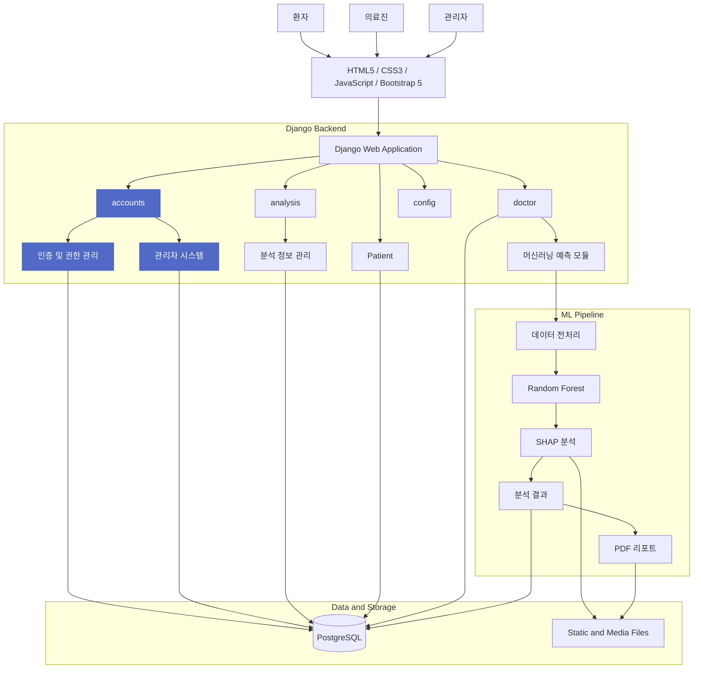
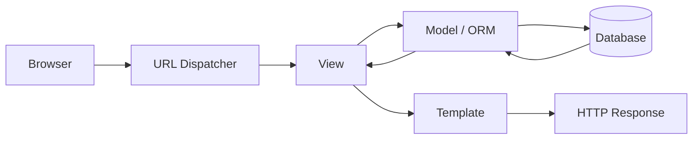
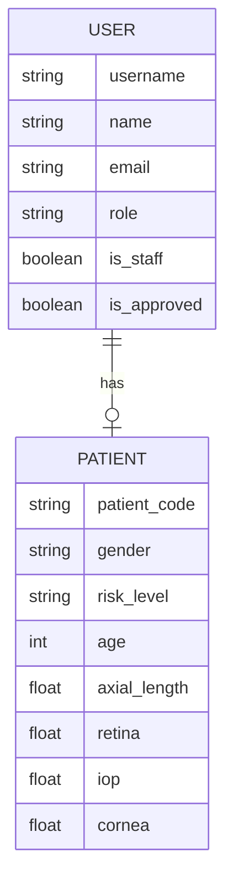
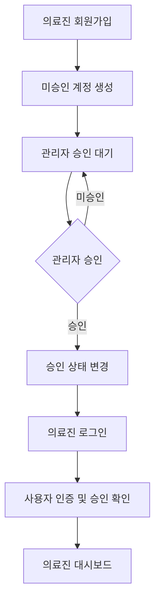
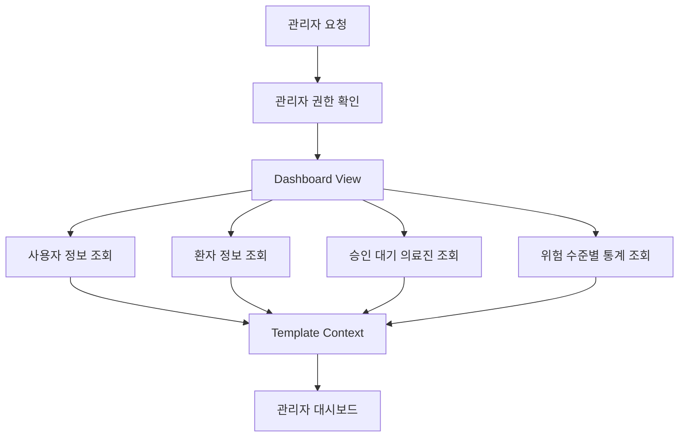
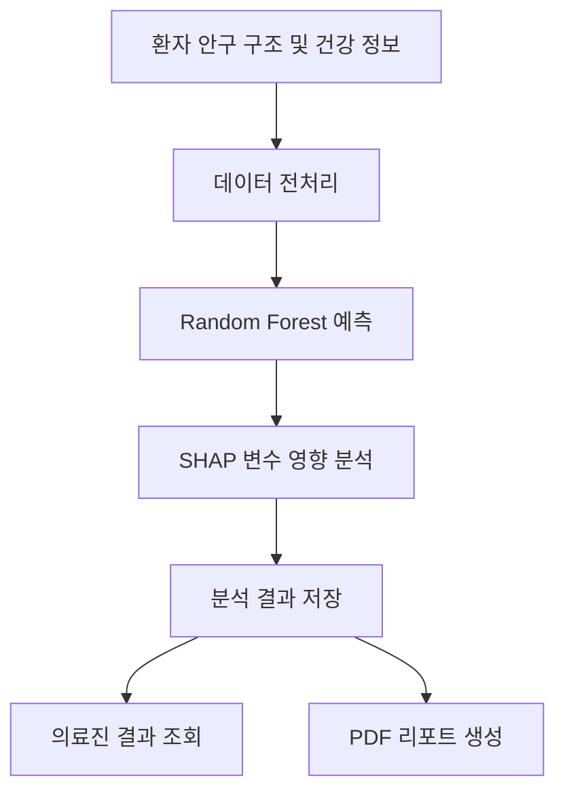
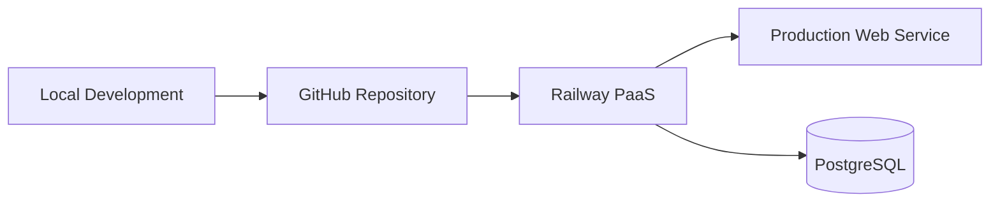

# System Architecture

> Django 기반 의료 IT 플랫폼의 시스템 구조 및 데이터 흐름

[← Project Overview](./README.md)

## 1. Architecture Overview

EYE TO AI는 안구 바이오마커 기반 만성질환 위험 분석 모델을 Django 웹 애플리케이션과 연결한 의료 IT 플랫폼입니다.

관리자, 의료진, 환자별 서비스 환경을 구성하고 사용자 인증, 환자 데이터 관리, AI 분석, 리포트 생성 기능을 하나의 웹 서비스로 연결했습니다.

전체 시스템은 Django MTV 패턴을 기반으로 기능별 앱을 분리한 모듈형 모놀리식 구조입니다.

본 문서는 최종 팀 발표 자료와 프로젝트 저장소의 구조를 기준으로 작성했으며, 전체 시스템과 개인 담당 영역을 구분합니다.

## 2. System Architecture Diagram



파란색으로 표시된 영역은 주요 개인 담당 기능입니다.

위 구성도는 최종 발표 자료와 저장소 구조를 바탕으로 재구성한 논리적 아키텍처이며, 모든 함수 호출 및 데이터베이스 관계를 표현한 것은 아닙니다.

## 3. Architecture Layers

| Layer | Technology | Responsibility |
| --- | --- | --- |
| Client | Web Browser | 관리자, 의료진, 환자 서비스 접근 |
| Presentation | Django Template, Bootstrap 5 | 사용자 인터페이스 |
| Application | Django Views, URL Routing | 요청 처리 및 비즈니스 로직 |
| Authentication | Django Auth, Session | 사용자 인증 및 접근 제어 |
| Data Access | Django ORM | 데이터 조회 및 저장 |
| ML Pipeline | Random Forest, SHAP | 질환 위험 예측 및 변수 영향 설명 |
| Storage | PostgreSQL, Static & Media | 서비스 데이터 및 결과 파일 관리 |
| Infrastructure | Railway | 웹 서비스 및 데이터베이스 배포 환경 |

## 4. Django Project Structure

```text
Django_project_2team/
│
├── config/
│   ├── settings.py
│   ├── urls.py
│   └── templates/
│
├── accounts/
│   ├── models.py
│   ├── forms.py
│   ├── views.py
│   ├── urls.py
│   ├── admin.py
│   └── templates/
│
├── doctor/
│   ├── models.py
│   ├── views.py
│   ├── urls.py
│   └── services/
│
├── Patient/
│   ├── models.py
│   ├── forms.py
│   ├── views.py
│   └── urls.py
│
├── analysis/
│   ├── models.py
│   ├── views.py
│   ├── urls.py
│   └── utils.py
│
├── ml_model/
│   ├── predictor.py
│   └── feature_description.py
│
├── manage.py
└── requirements.txt
```

최종 발표 자료에서는 머신러닝 모듈을 ml로 표현했으며, 실제 저장소의 주요 예측 관련 모듈은 ml_model 디렉터리에 구성되어 있습니다.

## 5. Module Responsibilities

| Module | Responsibility | Personal Contribution |
| --- | --- | --- |
| config | 프로젝트 설정, URL, 공통 템플릿 | 초기 환경 구성 참여 |
| accounts | 사용자 모델, 인증, 승인, 권한 및 관리자 기능 | 주요 담당 |
| doctor | 의료진 업무, 검사 및 분석 관련 기능 | 초기 앱 구성 참여 |
| Patient | 환자 서비스, 예약 및 기록 | 초기 구성 및 페이지 연동 참여 |
| analysis | AI 분석 정보 및 관리 기능 | 관리자 데이터 연동 참여 |
| ml_model | 머신러닝 모델 예측 | 팀 전체 구현 영역 |

초기 프로젝트 환경 구성과 Django 앱 분리에 참여했으며, accounts 앱을 중심으로 인증 및 관리자 시스템을 개발했습니다.

다른 팀원이 구현한 의료진 업무, 환자 서비스, 예측 모듈 전체를 개인 단독 구현으로 소개하지 않습니다.

## 6. Django Request Lifecycle



### Model

사용자, 환자 및 분석 관련 데이터의 구조와 관계를 정의합니다.

### Template

View에서 전달받은 데이터를 사용자 화면에 표시합니다.

### View

사용자 요청, 인증 및 권한 확인, 데이터 조회와 비즈니스 로직을 처리합니다.

### URL Dispatcher

사용자의 요청 경로를 해당 View에 연결합니다.

### Django ORM

Python 객체를 기반으로 데이터베이스 조회, 저장 및 수정 작업을 처리합니다.

## 7. User Data Architecture

사용자 계정 정보와 환자 관련 데이터를 별도의 모델로 구분하여 관리했습니다.



위 ERD는 실제 사용자 및 환자 모델의 주요 필드를 중심으로 단순화한 구조입니다.

### Custom User Model

Django의 AbstractBaseUser와 PermissionsMixin을 활용한 커스텀 사용자 모델을 사용했습니다.

- 사용자 식별 정보
- 관리자, 의료진, 환자 역할
- 관리자 권한
- 의료진 승인 상태
- 사용자 인증 정보

### Patient Model

사용자 모델과 OneToOneField 관계를 사용하여 환자 식별 코드, 위험 수준 및 안구 구조 관련 데이터를 관리합니다.

### Design Purpose

인증에 필요한 계정 정보와 환자 관련 데이터를 구분하고, 사용자 유형별 서비스 접근 및 데이터 관리를 연결하기 위한 구조입니다.

## 8. Authentication and Authorization



의료진 회원가입과 실제 서비스 접근을 분리하고, 관리자가 승인 상태를 관리하도록 구성했습니다.

### Authentication

Django 인증 시스템을 활용하여 사용자 계정 정보를 검증합니다.

### Authorization

사용자 역할과 관리자 권한에 따라 접근 가능한 기능을 구분합니다.

### Approval

의료진 계정의 승인 상태를 별도로 관리합니다.

### Session

로그인 이후 Django Session을 활용하여 인증 상태를 유지합니다.

위 흐름은 의료진 계정의 주요 인증 과정을 나타냅니다. 관리자 및 환자 전용 로그인 경로는 별도로 존재합니다.

## 9. Administration Data Flow



Django ORM을 활용하여 사용자 및 환자 관련 정보를 조회하고 Template Context를 통해 관리자 화면에 표시했습니다.

### 주요 개인 담당 기능

- 의료진 계정 승인 관리
- 사용자 계정 및 권한 관리
- 관리자 대시보드
- 환자 데이터 조회 및 통계
- AI 모델 정보 표시
- 시스템 로그 표시

AI 모델 정보와 시스템 로그는 별도의 분석 관리 화면을 포함한 관리자 환경에서 확인할 수 있도록 연동 작업에 참여했습니다.

## 10. Machine Learning Pipeline

최종 팀 플랫폼은 Random Forest 기반 예측 모델과 SHAP 분석을 연결하는 구조로 구성되었습니다.



| Stage | Technology |
| --- | --- |
| Data Processing | pandas, NumPy |
| Prediction | Random Forest, scikit-learn |
| Explainability | SHAP |
| Visualization | matplotlib, seaborn |
| Model Storage | joblib |
| Report Generation | ReportLab |

### Personal Experiment vs Final Team Model

| 구분 | 모델 |
| --- | --- |
| 개인 머신러닝 실험 | Logistic Regression, XGBoost |
| 최종 팀 플랫폼 | Random Forest |
| 최종 팀 설명 가능 AI | SHAP |

개인 실험에서는 불균형 데이터의 평가 지표와 모델 성능의 한계를 검토했습니다.

최종 예측 모듈, SHAP 분석 및 PDF 리포트는 팀 전체 구현 영역이며 개인 단독 구현으로 소개하지 않습니다.

## 11. Data and Storage Layer

### Local Development

개발 과정에서는 SQLite 기반의 로컬 데이터베이스를 사용했습니다.

### Production Database

최종 발표 자료 기준으로 Railway에서 제공하는 PostgreSQL을 배포 환경의 데이터베이스로 구성했습니다.

주요 관리 데이터는 다음과 같습니다.

- 사용자 및 환자 정보
- 의료진 관련 정보
- 예약 및 진료 관련 데이터
- 안구 구조 데이터
- 머신러닝 분석 결과
- 시스템 로그

### Static and Media Files

데이터베이스와 별도로 서비스에서 사용하는 파일을 관리하는 구조입니다.

- SHAP 시각화 이미지
- PDF 리포트
- HTML 화면 관련 정적 리소스
- CSS, JavaScript, 이미지 파일

파일의 실제 저장 위치 및 영구 보존 정책은 배포 환경 설정에 따라 달라질 수 있습니다.

## 12. Infrastructure and Deployment

최종 발표 자료에 명시된 팀 배포 구조입니다.



| Environment | Responsibility |
| --- | --- |
| Local | VS Code, Git, Django 개발 서버 |
| GitHub | 소스 코드 및 브랜치 관리 |
| Railway | 웹 애플리케이션 배포 환경 |
| PostgreSQL | 배포 환경 데이터베이스 |
| HTTPS | 사용자와 웹 서비스 간 통신 |

개인적으로는 초기 프로젝트 환경 구성, requirements.txt 관리, Git 브랜치 협업 및 추적 제외 설정에 참여했습니다.

Railway 배포 환경은 팀 전체 아키텍처로 소개합니다.

## 13. Engineering Decisions

### 13.1 Django Framework

Django는 사용자 인증, ORM, 관리자 기능 및 템플릿 시스템을 제공하는 프레임워크입니다.

1주라는 제한된 개발 기간 내에 머신러닝 분석과 웹 서비스 개발을 병행하기에 적합한 구조였습니다.

### 13.2 Modular Monolith

독립적인 서비스를 여러 개 운영하는 대신 하나의 Django 프로젝트 안에서 기능별 앱을 분리했습니다.

이를 통해 배포 구조를 단순하게 유지하면서 팀원 간 기능별 담당 영역을 구분할 수 있었습니다.

### 13.3 Custom User Model

관리자, 의료진, 환자라는 서로 다른 사용자 유형을 하나의 인증 시스템에서 관리하기 위해 역할 및 승인 상태를 포함하는 사용자 모델을 구성했습니다.

### 13.4 Server-side Rendering

별도의 프론트엔드 서버 없이 Django View와 Template을 연결하여 화면을 구성했습니다.

인증 및 데이터 조회 로직과 화면을 빠르게 연결할 수 있는 방식이었습니다.

### 13.5 Database Environment

개발 환경에서는 SQLite를 사용하고 최종 배포 아키텍처에서는 PostgreSQL을 적용하는 구조로 구성했습니다.

### 13.6 AI Explainability

최종 팀 플랫폼에서는 예측 결과뿐만 아니라 SHAP 기반 변수 영향 분석을 제공하는 구조를 구성했습니다.

다만 설명 가능 AI 결과가 임상적 인과관계나 진단의 정확성을 보장하는 것은 아닙니다.

## 14. Architecture Limitations and Improvements

| Area | Improvement |
| --- | --- |
| Authentication | 로그인 경로별 승인 정책 일관성 확보 |
| Authorization | 역할 및 관리자 권한 세분화 |
| Security | 의료 민감정보 보호 강화 |
| Testing | 인증, 승인 및 권한 자동화 테스트 |
| Audit | 관리자 작업에 대한 감사 로그 강화 |
| Storage | 결과 파일의 영구 저장 및 접근 정책 검토 |
| ML | 외부 데이터 검증 및 모델 버전 관리 |
| Deployment | 환경 변수, 백업 및 장애 대응 체계 개선 |
| Scalability | 필요에 따른 분석 작업의 비동기 처리 검토 |

위 항목은 향후 개선 방향이며, 프로젝트에서 모두 구현한 기능은 아닙니다.

## 15. Contribution Summary

Django 프로젝트 초기 환경 구성과 기능별 앱 분리에 참여했으며, 사용자 인증, 의료진 승인, 권한 관리 및 관리자 시스템을 주요 담당 영역으로 개발했습니다.

또한 환자 데이터와 AI 분석 관련 정보가 관리자 화면으로 연결되는 과정에 참여하면서 웹 서비스의 요청 처리 구조와 데이터 관리 흐름을 경험했습니다.

개인 머신러닝 실험에서는 불균형 데이터의 평가 지표를 비교하고 질환 예측 모델의 한계를 검토했습니다.

본 프로젝트는 연구 및 교육 목적의 프로토타입으로, 임상적으로 검증된 의료 진단 시스템은 아닙니다.

---

[← Project Overview](./README.md) | [Authentication & Authorization →](./authentication.md)
