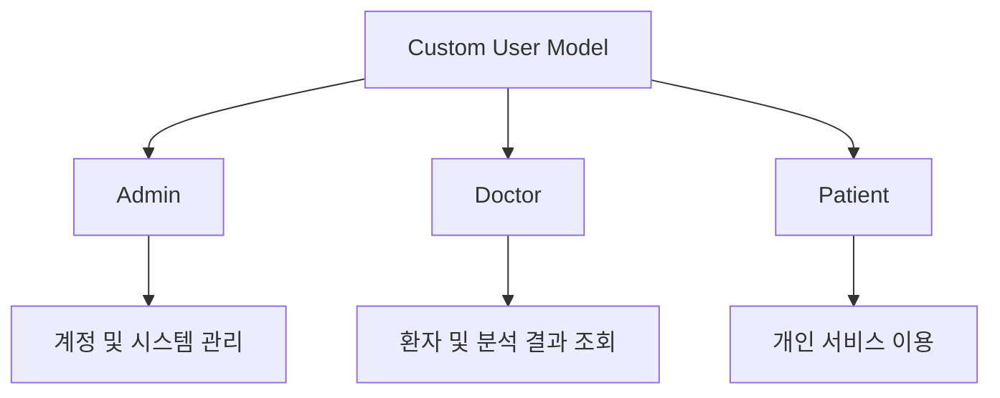
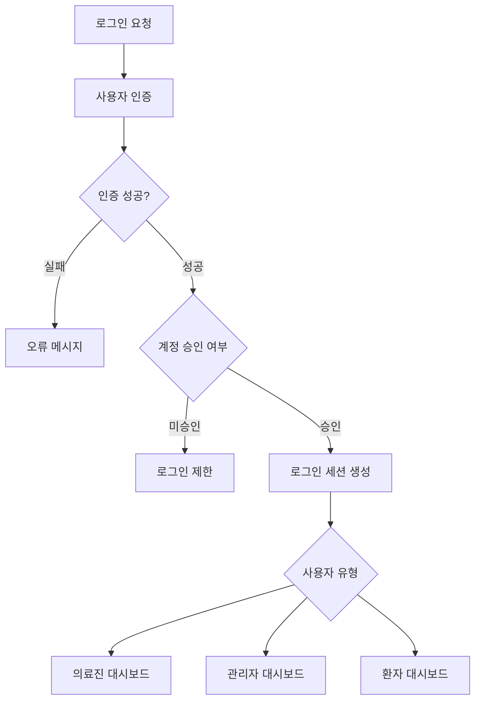
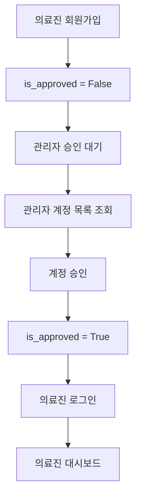
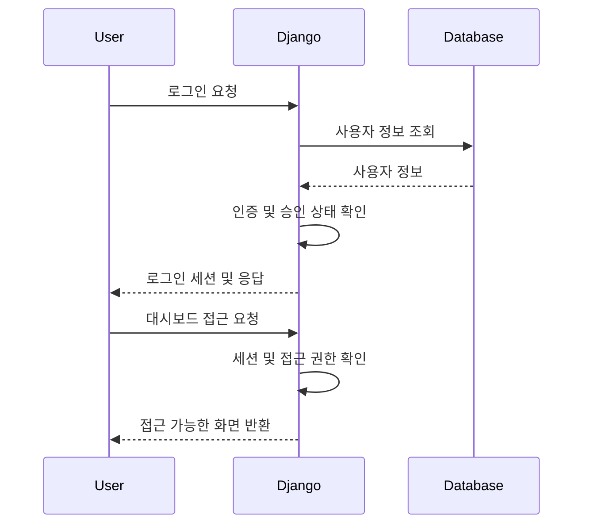

# Authentication & Authorization

> Django 기반 사용자 인증, 의료진 승인 및 접근 권한 관리

[← System Architecture](./architecture.md)

## 1. Overview

EYE TO AI는 관리자, 의료진, 환자가 서로 다른 목적으로 사용하는 의료 IT 플랫폼입니다.

사용자 유형에 따라 접근 가능한 기능을 구분하고, 의료진 계정은 관리자 승인 이후 서비스를 이용할 수 있도록 인증 및 권한 관리 기능을 구성했습니다.

본 프로젝트에서 사용자 인증과 계정 관리는 주요 개인 담당 영역입니다.

## 2. Personal Contributions

| 기능 | 구현 내용 |
| --- | --- |
| Custom User Model | 사용자 역할 및 승인 상태 관리 |
| Authentication | 로그인 및 회원가입 |
| Password Validation | 비밀번호 검증 로직 개선 |
| Approval Workflow | 의료진 가입 승인 |
| Authorization | 관리자 및 의료진 접근 권한 관리 |
| Session Management | Django 기반 로그인 상태 유지 |
| Dashboard Routing | 사용자 유형별 대시보드 연결 |
| System Log | 로그인 관련 활동 기록 |

## 3. Custom User Model

Django의 AbstractBaseUser와 PermissionsMixin을 활용한 커스텀 사용자 모델을 구성했습니다.

기본 사용자 인증 정보뿐만 아니라 의료 서비스에 필요한 사용자 역할과 승인 상태를 관리할 수 있도록 설계했습니다.

### 주요 필드

| Field | Description |
| --- | --- |
| username | 사용자 로그인 식별자 |
| name | 사용자 이름 |
| email | 이메일 |
| role | 관리자, 의료진, 환자 구분 |
| is_staff | 관리자 접근 권한 |
| is_approved | 계정 승인 상태 |
| is_superuser | Django 최고 관리자 권한 |

### 사용자 역할



### 설계 목적

- 하나의 사용자 모델에서 여러 사용자 유형 관리
- 인증 정보와 사용자 역할 구분
- 의료진 계정의 승인 상태 관리
- 사용자 유형에 따른 서비스 연결

## 4. Password Management

비밀번호를 평문으로 저장하지 않도록 Django의 비밀번호 해싱 기능을 활용했습니다.

사용자 생성 과정에서는 set_password를 사용하고, 로그인 과정에서는 Django 인증 시스템을 활용하여 사용자 정보를 검증합니다.

### 핵심 처리 방식

```python
# 비밀번호 저장 방식 요약
user.set_password(password)
user.save()
```

```python
# 사용자 인증 방식 요약
user = authenticate(
    request,
    username=username,
    password=password
)
```

위 코드는 핵심 처리 방식을 설명하기 위해 단순화한 예시입니다.

개발 과정에서는 check_password를 활용한 비밀번호 검증 로직 개선 작업에도 참여했습니다.

### 기술적 의미

비밀번호 원문을 데이터베이스에 저장하지 않고 해시를 기반으로 검증함으로써 계정 정보 보호를 강화할 수 있습니다.

## 5. Authentication Workflow

일반 로그인 경로에서는 사용자 인증 이후 계정 승인 상태를 확인하고, 사용자 유형에 맞는 대시보드로 연결합니다.



관리자와 환자 전용 로그인 경로는 별도로 구성되어 있습니다.

위 다이어그램은 일반 로그인 경로를 단순화한 것으로, 모든 로그인 경로가 동일한 승인 검증을 수행한다는 의미는 아닙니다.

## 6. Medical Staff Approval Workflow

### Problem

의료진 전용 기능을 제공하는 서비스에서는 회원가입만으로 의료진 권한을 부여하는 방식에 문제가 있을 수 있습니다.

가입 요청과 서비스 접근 허용을 구분할 필요가 있었습니다.

### Implementation

의료진 회원가입 시 승인 상태를 False로 설정하고, 관리자가 승인 상태를 변경하도록 구성했습니다.



### 상태 관리

| 상태 | is_approved | 일반 로그인 |
| --- | --- | --- |
| 가입 직후 | False | 제한 |
| 관리자 승인 이후 | True | 인증 성공 시 허용 |

### Engineering Decision

회원가입 여부와 서비스 접근 허용 여부를 별도의 상태로 관리했습니다.

이를 통해 사용자 계정이 생성되더라도 승인 상태에 따라 일반 로그인 경로의 접근을 제한할 수 있습니다.

다만 관리자 승인이 실제 의료인 자격 검증을 의미하는 것은 아닙니다.

## 7. Authorization

인증은 사용자의 신원을 확인하는 과정이며, 인가는 인증된 사용자가 특정 기능에 접근할 수 있는지 확인하는 과정입니다.

### 접근 제어 기준

| 사용자 유형 | 주요 접근 제어 기준 |
| --- | --- |
| 관리자 | is_staff |
| 의료진 | role 및 계정 승인 상태 |
| 환자 | 사용자 유형 및 관련 환자 정보 |
| 미인증 사용자 | 로그인 필요 |

관리자 기능에서는 login_required와 user_passes_test를 활용하여 접근 권한을 확인했습니다.

### 핵심 구현 방식

```python
def is_admin(user):
    return user.is_staff
```

```python
@login_required
@user_passes_test(is_admin)
def account_admin_view(request):
    # 관리자 계정 관리 처리
    ...
```

위 예시는 실제 관리자 접근 제어 방식의 핵심을 나타냅니다.

화면에서 관리자 메뉴를 숨기는 것뿐만 아니라 서버의 View에서도 접근 권한을 확인하는 구조입니다.

## 8. Session Management

Django의 세션 기반 인증 방식을 활용했습니다.



로그인 이후에는 Django 세션을 통해 인증 상태를 유지하고, 각 View에서 필요한 접근 권한을 확인합니다.

## 9. Account Management

관리자 화면에서는 의료진 계정의 목록 및 승인 상태를 조회하고 관리할 수 있도록 구성했습니다.

### 주요 기능

- 의료진 계정 목록 조회
- 승인 대기 계정 확인
- 의료진 계정 승인
- 관리자 접근 권한 변경
- 사용자 관련 통계 표시

사용자 역할과 관리자 권한은 서로 다른 필드로 관리합니다.

role은 사용자 유형을 나타내며, is_staff는 관리자 접근 권한 확인에 사용됩니다.

## 10. System Logging

로그인 관련 활동을 SystemLog 모델에 기록하는 기능을 구성했습니다.

관리자 화면에서 사용자 활동과 시스템 관련 정보를 확인할 수 있도록 데이터 표시 작업에 참여했습니다.

현재 구현은 기본적인 활동 기록이며, 완전한 의료정보 감사 로그 시스템은 아닙니다.

## 11. Security Review

프로젝트 구현 이후 실제 서비스 운영을 고려하여 다음과 같은 개선 사항을 정리했습니다.

| Area | Improvement |
| --- | --- |
| Authentication | 로그인 경로별 승인 검증 정책 통일 |
| Authorization | 사용자 역할 및 관리자 권한 세분화 |
| Approval | 승인 대상이 의료진 계정인지 검증 |
| HTTP Method | 계정 승인 등 상태 변경 요청을 POST로 제한 |
| CSRF | 상태 변경 요청의 CSRF 보호 확인 |
| Session | 운영 환경의 세션 및 쿠키 보안 설정 검토 |
| Audit Log | 관리자 작업의 상세 변경 이력 기록 |
| Testing | 인증 및 권한 관리 자동화 테스트 |

위 항목은 기존 구현을 검토하여 도출한 향후 개선 방향이며, 모두 구현 완료된 기능은 아닙니다.

## 12. Validation Scenarios

인증 및 권한 관리 기능에서 확인해야 할 주요 테스트 시나리오입니다.

| Scenario | Expected Result |
| --- | --- |
| 올바른 계정 정보 입력 | 인증 성공 |
| 잘못된 비밀번호 입력 | 인증 실패 |
| 미승인 의료진 일반 로그인 | 로그인 제한 |
| 승인된 의료진 일반 로그인 | 의료진 대시보드 연결 |
| 미인증 사용자의 관리자 접근 | 접근 제한 |
| 관리자 권한이 없는 사용자의 관리자 접근 | 접근 제한 |
| 관리자의 의료진 계정 승인 | 승인 상태 변경 |

위 표는 기능 검증을 위한 테스트 시나리오이며, 자동화 테스트 실행 결과를 의미하지 않습니다.

## 13. Retrospective

이번 프로젝트를 통해 사용자 인증과 접근 권한 관리가 서로 다른 책임을 가진다는 점을 경험했습니다.

특히 의료진 회원가입과 관리자 승인 과정을 분리하고, 사용자 역할과 관리자 권한에 따라 서비스 기능을 연결하는 구조를 구현했습니다.

향후에는 로그인 경로별 정책을 일관되게 적용하고, 권한 변경 및 승인 기능에 대한 자동화 테스트와 보안 검증을 강화하고자 합니다.

---

[← System Architecture](./architecture.md) | [Administration System →](./admin-system.md)
