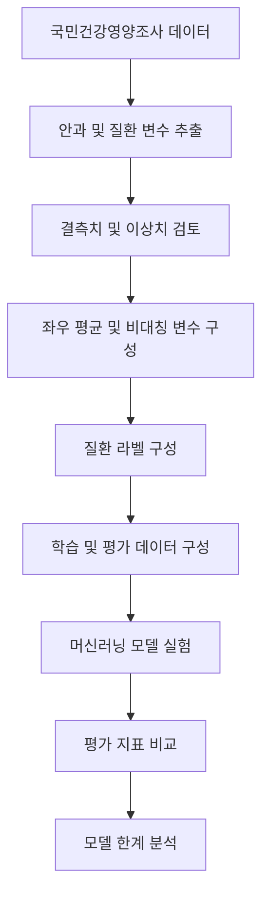

# Machine Learning Experiment

> 안구 바이오마커 기반 당뇨 및 고혈압 위험 예측 실험

[← AI Service Integration](./ai-integration.md)

## 1. Overview

본 실험은 안구 구조 데이터와 전신질환 사이의 연관성을 탐색하고, 머신러닝을 활용하여 당뇨 및 고혈압 위험군을 구분할 수 있는 가능성을 확인하기 위해 진행했습니다.

개인 분석에서는 Logistic Regression과 XGBoost를 활용하여 모델 성능을 비교하고, 클래스 불균형과 변수 영향 및 평가 지표를 검토했습니다.

본 문서에 제시된 성능 수치는 개인 초기 실험 결과이며, 최종 팀 플랫폼의 Random Forest 모델 성능과 구분됩니다.

## 2. Research Objectives

### 연구 배경

안구 구조는 다양한 신체적 특성 및 건강 상태와 연관될 수 있습니다.

안과 검진 과정에서 수집되는 정량적 데이터를 활용하여 만성질환과의 연관성을 탐색하고, 추가 검사가 필요한 위험군을 선별할 가능성을 확인하고자 했습니다.

### 분석 목표

- 안구 구조 데이터와 만성질환 간 연관성 탐색
- 당뇨 및 고혈압 이진 분류 실험
- 머신러닝 모델별 성능 검토
- 클래스 불균형 문제 분석
- 변수별 예측 영향 검토
- 모델의 활용 가능성과 한계 분석

## 3. Dataset

국민건강영양조사 자료의 안과 관련 측정 변수와 질환 관련 정보를 활용했습니다.

### Prediction Targets

| Target | Description |
| --- | --- |
| Diabetes | 당뇨 여부 분류 |
| Hypertension | 고혈압 여부 분류 |

### Representative Features

| Feature | Description |
| --- | --- |
| Axial Length | 안축장 |
| Retina | 망막 관련 측정값 |
| IOP | 안압 |
| Cornea | 각막 관련 측정값 |
| Bilateral Mean | 좌우 측정값의 평균 |
| Asymmetry | 좌우 측정값의 비대칭 정보 |

위 변수는 프로젝트에서 검토한 대표적인 변수이며, 모든 모델에 동일한 입력 변수가 사용되었다는 의미는 아닙니다.

## 4. Data Processing Pipeline

### 4.1 Feature Selection

안구 구조와 질환 관련 변수를 검토하여 분석에 필요한 데이터를 구성했습니다.

### 4.2 Missing Values and Outliers

결측값과 이상값이 모델 학습 및 평가에 영향을 줄 수 있으므로 데이터 전처리 과정에서 해당 항목을 검토했습니다.

### 4.3 Feature Engineering

좌우 안구 측정값의 평균과 비대칭 정보를 활용하여 기존 측정값 외의 파생 변수를 검토했습니다.

### 4.4 Target Definition

당뇨 및 고혈압 관련 정보를 분류 모델의 목표 변수로 구성했습니다.

질환별 모델은 서로 다른 분류 문제로 접근했습니다.

## 5. Class Imbalance

### Problem

질환 분류 데이터에서는 정상군과 질환군의 데이터 수가 균등하지 않을 수 있습니다.

다수 클래스에 편향된 모델은 높은 정확도를 기록하더라도 실제 질환군을 충분히 탐지하지 못할 수 있습니다.

### Example

전체 데이터 중 정상군이 90%, 질환군이 10%라고 가정할 경우 모든 데이터를 정상으로 예측해도 정확도는 90%가 됩니다.

그러나 실제 질환군을 탐지하는 재현율은 0%입니다.

위 수치는 클래스 불균형 문제를 설명하기 위한 가상의 예시이며, 실제 프로젝트의 데이터 분포는 아닙니다.

### Approach

개인 실험에서는 다음과 같은 요소를 검토했습니다.

- 클래스 가중치 조정
- 분류 임계값 조정
- 정밀도 및 재현율 비교
- F1-score를 활용한 균형 평가
- ROC-AUC를 활용한 분류 성능 평가

단순히 정확도를 높이는 것보다 질환군 탐지 성능과 오탐 발생 사이의 균형을 확인하는 데 집중했습니다.

## 6. Model Selection

### 6.1 Logistic Regression

Logistic Regression은 입력 변수와 이진 분류 결과 사이의 관계를 분석할 수 있는 분류 모델입니다.

#### 검토 이유

- 기본 분류 모델로 활용 가능
- 모델 구조가 비교적 단순함
- 변수별 회귀계수 해석 가능
- 다른 모델과 비교할 기준 모델로 활용 가능

#### Limitations

- 복잡한 비선형 관계 표현에 제한이 있음
- 변수 간 상호작용을 별도로 고려해야 할 수 있음
- 데이터 전처리 및 변수 구성에 영향을 받음

### 6.2 XGBoost

XGBoost는 여러 결정 트리를 순차적으로 학습하는 그래디언트 부스팅 기반 모델입니다.

#### 검토 이유

- 정형 데이터 분류 문제에 활용 가능
- 비선형 관계 학습 가능
- 변수 간 상호작용 표현 가능
- 변수 중요도 검토 가능

#### Limitations

- 하이퍼파라미터 설정에 영향을 받음
- 과적합 방지를 위한 검증 필요
- 단순 선형 모델보다 해석이 복잡할 수 있음

### Model Comparison

| Category | Logistic Regression | XGBoost |
| --- | --- | --- |
| Model Type | 선형 분류 모델 | 트리 기반 앙상블 |
| Nonlinear Relationship | 제한적 | 학습 가능 |
| Interpretability | 비교적 높음 | 추가 해석 필요 |
| Training Complexity | 비교적 낮음 | 상대적으로 높음 |
| Role | 기준 모델 실험 | 비선형 모델 실험 |

위 표는 모델의 일반적인 특성을 비교한 것이며, 실제 실험 성능의 우열을 의미하지 않습니다.

## 7. Evaluation Metrics

클래스 불균형 문제를 고려하여 정확도 외의 평가 지표를 함께 검토했습니다.

### Precision

모델이 질환군으로 예측한 대상 중 실제 질환군의 비율입니다.

Precision = TP / (TP + FP)

정밀도가 낮으면 질환군으로 분류한 대상 중 실제 정상군이 많이 포함될 수 있습니다.

### Recall

실제 질환군 중 모델이 질환군으로 탐지한 비율입니다.

Recall = TP / (TP + FN)

재현율이 낮으면 실제 질환군을 놓칠 가능성이 높아집니다.

### F1-score

정밀도와 재현율의 조화평균입니다.

F1 = 2 × (Precision × Recall) / (Precision + Recall)

두 평가 지표의 균형을 확인하는 데 활용했습니다.

### ROC-AUC

여러 분류 임계값에 걸쳐 모델이 양성군과 음성군을 얼마나 잘 구분하는지 평가하는 지표입니다.

ROC-AUC가 0.5에 가까우면 무작위 순위 구분과 유사한 수준이며, 1에 가까울수록 구분 성능이 높습니다.

### Metric Selection

| Metric | Evaluation Purpose |
| --- | --- |
| Precision | 양성 예측의 정확성 확인 |
| Recall | 실제 질환군 탐지 비율 확인 |
| F1-score | 정밀도와 재현율의 균형 확인 |
| ROC-AUC | 전체적인 클래스 구분 능력 확인 |

## 8. Personal Experiment Results

다음은 개인 초기 Logistic Regression 실험 기록입니다.

| Disease | ROC-AUC | Precision | Recall | F1-score |
| --- | ---: | ---: | ---: | ---: |
| Diabetes | 0.60 | 0.20 | 0.54 | 0.29 |
| Hypertension | 0.59 | 0.28 | 0.55 | 0.37 |

### Performance Visualization

```mermaid
xychart-beta
    title "Personal Logistic Regression Experiment"
    x-axis ["ROC-AUC", "Precision", "Recall", "F1"]
    y-axis "Score" 0 --> 1
    bar [0.60, 0.20, 0.54, 0.29]
    bar [0.59, 0.28, 0.55, 0.37]
```

첫 번째 막대 계열은 당뇨, 두 번째 막대 계열은 고혈압 실험 결과입니다.

위 결과는 개인 초기 실험에 해당합니다.

XGBoost의 구체적인 성능 수치는 확인 가능한 실험 기록이 확보되기 전까지 별도로 기재하지 않습니다.

## 9. Result Analysis

### 9.1 Diabetes

| Metric | Score |
| --- | ---: |
| ROC-AUC | 0.60 |
| Precision | 0.20 |
| Recall | 0.54 |
| F1-score | 0.29 |

당뇨 모델은 실제 양성군의 약 54%를 탐지했지만, 양성으로 예측한 대상 중 실제 양성군의 비율은 약 20%였습니다.

재현율에 비해 정밀도가 낮아 오탐 문제가 나타났습니다.

ROC-AUC 역시 0.60으로 제한적인 클래스 구분 성능을 보였습니다.

### 9.2 Hypertension

| Metric | Score |
| --- | ---: |
| ROC-AUC | 0.59 |
| Precision | 0.28 |
| Recall | 0.55 |
| F1-score | 0.37 |

고혈압 모델은 실제 양성군의 약 55%를 탐지했습니다.

당뇨 모델보다 정밀도와 F1-score가 높았지만, ROC-AUC는 0.59로 전체적인 클래스 구분 능력에 한계가 있었습니다.

### 9.3 Overall Interpretation

두 모델 모두 높은 질환 분류 성능을 확보했다고 판단하기 어렵습니다.

안구 구조 변수만으로 만성질환을 충분히 구분하기 어려울 가능성이 있으며, 추가 변수와 데이터 검증이 필요합니다.

실험 결과를 실제 의료 진단 성능으로 해석할 수 없습니다.

## 10. Threshold and Class Weight

### Classification Threshold

분류 모델의 예측 확률을 실제 클래스 결과로 변환하기 위해 분류 임계값을 사용합니다.

일반적으로 임계값을 낮추면 더 많은 대상을 양성으로 분류하므로 재현율이 높아질 수 있지만, 오탐도 증가할 수 있습니다.

반대로 임계값을 높이면 양성 예측이 줄어들면서 실제 질환군을 놓칠 가능성이 증가할 수 있습니다.

### Class Weight

클래스 불균형 문제를 고려하여 소수 클래스의 학습 중요도를 높이는 가중치 조정 방법을 검토했습니다.

### Engineering Perspective

클래스 가중치와 분류 임계값은 서로 다른 단계에서 영향을 줍니다.

| Method | Application Stage | Purpose |
| --- | --- | --- |
| Class Weight | 모델 학습 | 클래스별 학습 중요도 조정 |
| Threshold | 모델 예측 이후 | 양성 및 음성 분류 기준 조정 |

두 방법 모두 정밀도와 재현율 사이의 균형을 고려해야 합니다.

개인 실험에서는 이러한 조정 방법을 검토했으나, 최적의 임계값이나 임상적으로 유효한 분류 기준을 확립한 것은 아닙니다.

## 11. Feature Interpretation

머신러닝 모델의 성능뿐만 아니라 입력 변수가 예측에 미치는 영향도 검토했습니다.

### Logistic Regression

회귀계수의 방향과 크기를 통해 변수와 모델 예측 사이의 관계를 검토할 수 있습니다.

다만 변수의 단위와 스케일, 변수 간 상관관계 등을 함께 고려해야 합니다.

### XGBoost

트리 기반 모델의 변수 중요도를 활용하여 예측 과정에서 활용되는 변수 정보를 검토할 수 있습니다.

### Final Team Platform

최종 팀 플랫폼에서는 Random Forest와 SHAP을 활용한 설명 가능 AI 기능을 구성했습니다.

SHAP은 모델 예측에 대한 변수별 기여도를 설명하는 방법입니다.

변수 중요도 및 SHAP 결과가 질환과의 직접적인 인과관계를 증명하는 것은 아닙니다.

## 12. Personal Experiment vs Final Team Model

| Category | Personal Experiment | Final Team Platform |
| --- | --- | --- |
| Model | Logistic Regression, XGBoost | Random Forest |
| Purpose | 모델 및 변수 검토 | 서비스 기반 위험 분석 |
| Evaluation | Precision, Recall, F1, ROC-AUC | 최종 팀 평가 기준 |
| Explainability | 변수 영향 검토 | SHAP |
| Contribution | 개인 머신러닝 실험 | 팀 공동 구현 |

최종 팀 모델의 성능을 개인 초기 실험 결과와 혼합하지 않습니다.

최종 모델 선정 과정 및 서비스 구현은 팀 전체 프로젝트의 결과입니다.

## 13. Research Limitations

### Data Limitations

- 안구 구조 변수만으로 질환을 설명하는 데 한계가 있을 수 있음
- 정상군과 질환군 사이의 클래스 불균형
- 데이터 수집 조건 및 대상 집단의 특성에 따른 편향 가능성

### Model Limitations

- 제한적인 ROC-AUC
- 낮은 양성 예측 정밀도
- 오탐과 미탐 사이의 균형 문제
- 모델의 일반화 성능에 대한 추가 검증 필요

### Clinical Limitations

- 독립적인 외부 데이터 검증 필요
- 임상적 유효성 검증 필요
- 실제 의료 환경의 적용 기준 미확립
- 의료진의 진단을 대체할 수 없음

## 14. Future Improvements

| Area | Improvement |
| --- | --- |
| Data | 추가 건강 및 임상 관련 변수 검토 |
| Validation | 교차 검증 및 외부 데이터 평가 |
| Imbalance | 클래스 가중치 및 샘플링 방법 비교 |
| Evaluation | PR-AUC 등 불균형 데이터 평가 지표 추가 |
| Threshold | 검증 데이터를 활용한 임계값 선정 |
| Calibration | 예측 확률의 보정 및 신뢰도 평가 |
| Explainability | 변수 영향 및 설명 결과의 안정성 검토 |
| Reproducibility | 데이터 분할, 모델 설정 및 실험 기록 관리 |
| Deployment | 모델 버전 및 예측 이력 관리 |

위 항목은 기존 실험의 한계를 바탕으로 정리한 향후 개선 방향이며, 구현 완료된 기능은 아닙니다.

## 15. Engineering Retrospective

이번 실험을 통해 머신러닝 모델의 성능을 단순히 정확도만으로 평가해서는 안 된다는 점을 학습했습니다.

특히 의료 데이터에서는 클래스 불균형과 오탐 및 미탐이 모델 활용 가능성에 영향을 줄 수 있다는 점을 확인했습니다.

Logistic Regression과 XGBoost를 검토하면서 모델의 복잡성뿐만 아니라 데이터의 특성, 변수 구성 및 평가 기준이 중요하다는 점을 경험했습니다.

또한 Django 웹 서비스 개발을 병행하면서 모델 개발과 실제 서비스의 사용자 인증, 데이터 관리 및 결과 전달 구조를 함께 고려해야 한다는 점을 이해할 수 있었습니다.

## 16. Project Resources

- [머신러닝 최종 발표 자료](https://drive.google.com/file/d/1bTtQJRYK0mqAZUFNnmMvoHNdnBZ8dDFG/view)
- [EYE TO AI 플랫폼 최종 발표 자료](https://drive.google.com/file/d/1tgNf8M-XuqKN_QSud_ycv44pdD3pkll_/view)

발표 자료는 팀 전체 분석 및 구현 결과이며, 개인 초기 실험 기록과 구분됩니다.

일부 자료는 공유 권한에 따라 접근이 제한될 수 있습니다.

---

본 프로젝트는 교육 및 연구 목적의 프로토타입이며, 임상적으로 검증된 의료 진단 시스템은 아닙니다.

[← AI Service Integration](./ai-integration.md) | [Troubleshooting →](./troubleshooting.md)
