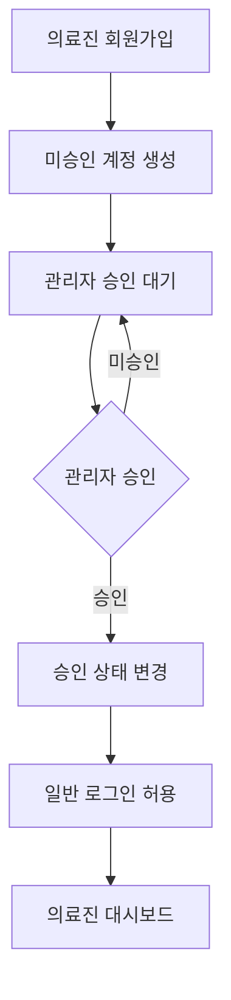
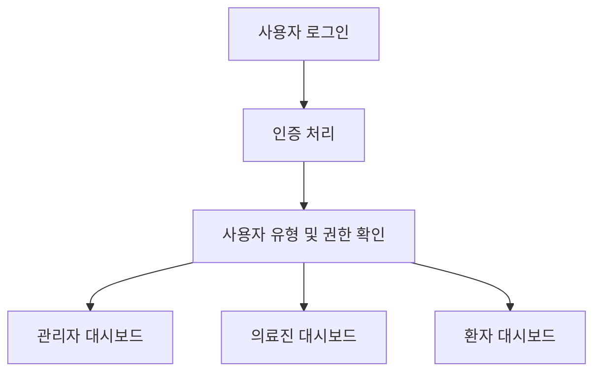
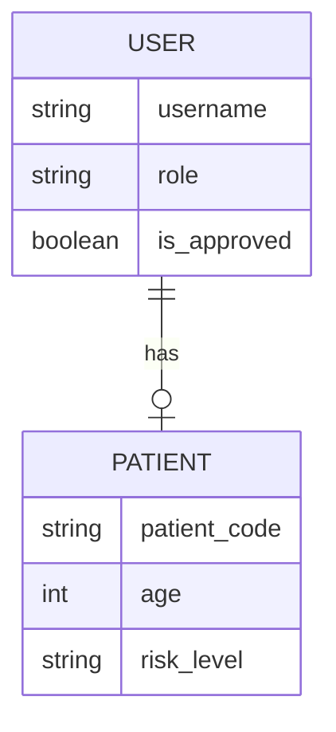
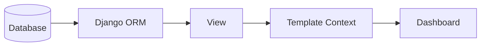
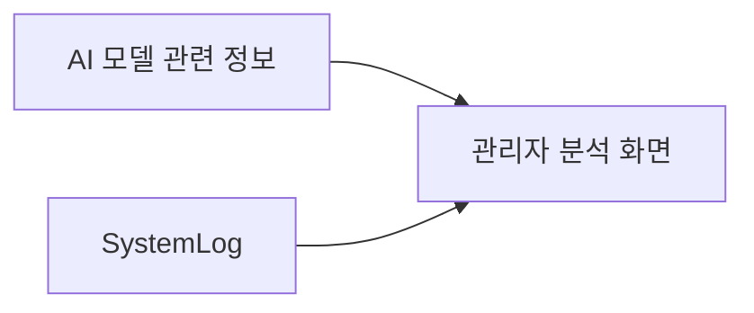
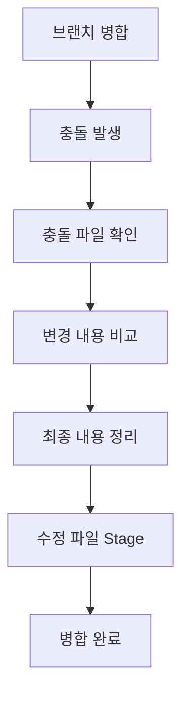

# Troubleshooting & Engineering Improvements

> 개발 과정에서의 문제 해결 경험 및 기술적 개선 방향

[← Machine Learning Experiment](./ml-experiment.md)

## 1. Overview

EYE TO AI 프로젝트에서는 1주라는 제한된 개발 기간 동안 머신러닝 실험과 Django 기반 의료 IT 플랫폼 개발을 병행했습니다.

개발 과정에서 사용자 인증, 의료진 승인, 관리자 데이터 조회, 화면 연동 및 Git 협업과 관련된 문제를 검토하고 개선했습니다.

본 문서는 개인 개발 이력에서 확인되는 작업과 프로젝트 구현 이후 도출한 개선 방향을 구분하여 정리합니다.

## 2. Troubleshooting Summary

| ID | Issue | Approach | Status |
| --- | --- | --- | --- |
| TS-01 | 사용자 비밀번호 검증 | Django 인증 및 비밀번호 검증 로직 개선 | 개선 작업 수행 |
| TS-02 | 의료진 계정 접근 관리 | 가입 및 관리자 승인 상태 분리 | 구현 |
| TS-03 | 사용자별 대시보드 연결 | 로그인 경로 및 화면 연결 수정 | 구현 |
| TS-04 | 관리자 환자 데이터 조회 | 모델 및 ORM 조회 구조 수정 | 개선 작업 수행 |
| TS-05 | 관리자 통계 데이터 전달 | 데이터 흐름 확인 및 차트 추가 | 개선 작업 수행 |
| TS-06 | AI 모델 및 로그 표시 | 분석 관리 화면 데이터 연동 | 구현 |
| TS-07 | 불필요한 Git 추적 파일 | gitignore 및 추적 제외 설정 | 해결 |
| TS-08 | Git 병합 충돌 | 충돌 파일 확인 및 병합 처리 | 해결 |
| TS-09 | 머신러닝 클래스 불균형 | 평가 지표 및 가중치 검토 | 한계 확인 |

## 3. TS-01. Password Validation

### Problem

사용자 로그인 과정에서 입력한 비밀번호를 올바르게 검증할 수 있는 인증 구조가 필요했습니다.

### Technical Consideration

Django에서는 사용자 비밀번호를 평문이 아닌 해시 형태로 관리합니다.

따라서 입력한 비밀번호와 데이터베이스에 저장된 값을 단순 문자열 비교하는 방식은 적절하지 않습니다.

### Solution

개발 과정에서 check_password를 활용한 비밀번호 검증 로직 개선 작업을 수행했습니다.

최종 인증 구조에서는 Django의 authenticate 및 set_password 기능을 활용했습니다.

```python
# 비밀번호 저장 방식
user.set_password(password)
user.save()
```

```python
# 비밀번호 검증 방식
is_valid = user.check_password(input_password)
```

```python
# Django 인증 방식
user = authenticate(
    request,
    username=username,
    password=password
)
```

위 코드는 Django의 핵심 인증 처리 방식을 설명하기 위한 예시입니다.

### Result

Django의 비밀번호 해싱 및 검증 방식을 이해하고 인증 로직을 개선했습니다.

### Evidence

- 3ec9def: 로그인 로직 강화 및 check_password 사용
- 47fb7cd: 인증 관련 입력 처리 수정
- 878ffb9: 회원가입 및 로그인 관련 오류 수정

### Lesson Learned

인증 기능을 구현할 때는 비밀번호 저장 방식과 검증 방식을 함께 고려해야 합니다.

프레임워크에서 제공하는 인증 기능을 활용하는 것이 직접 비밀번호 처리 로직을 구현하는 것보다 안전하고 유지보수하기 용이합니다.

## 4. TS-02. Medical Staff Approval

### Problem

의료진 전용 기능을 제공하는 서비스에서는 회원가입과 서비스 접근 허용을 구분할 필요가 있었습니다.

가입만으로 의료진 기능에 접근할 수 있는 구조는 적절한 권한 관리 방식이 아니라고 판단했습니다.

### Solution

Custom User Model에 is_approved 필드를 활용하여 의료진 계정의 승인 상태를 관리했습니다.



### Implementation

- 의료진 회원가입 시 미승인 상태 설정
- 관리자 화면에서 의료진 계정 조회
- 관리자 승인 기능 연결
- 일반 로그인 과정에서 승인 상태 확인

### Result

회원가입과 관리자 승인 과정을 분리하여 일반 로그인 경로에서 미승인 의료진의 접근을 제한하는 구조를 구현했습니다.

### Remaining Issues

최종 코드 검토 과정에서 다음과 같은 개선 가능성을 확인했습니다.

- 로그인 경로별 승인 정책 일관성 확보
- 승인 대상이 의료진 계정인지 확인
- 계정 승인 요청을 POST 방식으로 제한
- 승인 처리 이력 기록

위 항목은 향후 개선 방향입니다.

### Lesson Learned

사용자 인증과 서비스 접근 권한은 서로 다른 책임으로 관리해야 합니다.

## 5. TS-03. Dashboard Routing

### Problem

관리자, 의료진, 환자가 서로 다른 화면과 기능을 사용하므로 로그인 이후 적절한 대시보드로 연결해야 했습니다.

### Approach

사용자 역할, 관리자 권한 및 로그인 경로에 따라 화면을 연결하는 구조를 구성했습니다.



위 다이어그램은 사용자별 화면 연결 구조를 단순화한 것입니다.

### Implementation

- 관리자 전용 로그인 화면 연결
- 의료진 로그인 및 대시보드 연결
- 환자 로그인 및 대시보드 연결 작업 참여
- 사용자별 URL 및 Template 연결 수정

### Evidence

- 92a1872: 관리자 로그인 탭 생성 및 연결
- 4cab007: 의료진 로그인 및 대시보드 연결
- ad8e8ea: 환자 로그인 및 대시보드 연결
- 8c68893: 로그인 관련 수정

### Result

사용자 유형별 서비스 화면을 연결하고 로그인 이후 화면 이동과 관련된 개선 작업을 수행했습니다.

### Lesson Learned

로그인 성공 여부와 접근 가능한 페이지는 별도로 고려해야 합니다.

화면 이동 로직뿐만 아니라 서버 측 접근 권한 확인도 함께 구성해야 합니다.

## 6. TS-04. Patient Data Management

### Problem

관리자 대시보드에서 사용자 계정과 환자 관련 데이터를 조회하기 위해 모델 간 관계 및 데이터 조회 구조를 파악해야 했습니다.

### Approach

사용자 인증 정보와 환자 데이터를 별도의 모델로 관리하고, 모델 관계를 활용하여 필요한 데이터를 조회하는 구조를 검토했습니다.



### Implementation

- 사용자 모델과 환자 모델의 관계 확인
- 관리자 화면에서 필요한 환자 데이터 검토
- 환자 관련 모델 및 조회 로직 수정
- 관리자 대시보드 데이터 연결

### Evidence

- a3e1ea5: 관리자 대시보드 환자 데이터 수정
- 7020583: 데이터 흐름 파악 및 관리자 차트 추가

### Result

환자 데이터와 관리자 대시보드 사이의 데이터 연동 개선 작업을 수행했습니다.

### Lesson Learned

화면에 데이터를 표시하기 전에 데이터의 저장 위치, 모델 관계 및 조회 조건을 먼저 파악해야 합니다.

데이터 모델을 이해하는 것이 백엔드 기능 구현의 중요한 출발점이라는 점을 경험했습니다.

## 7. TS-05. Dashboard Statistics and Visualization

### Problem

관리자가 서비스 운영 현황을 파악할 수 있도록 사용자 및 환자 데이터를 통계 형태로 제공할 필요가 있었습니다.

### Approach

Django ORM을 활용하여 조건별 데이터를 조회하고, 조회 결과를 Template Context를 통해 화면에 전달하는 방식을 사용했습니다.



### Implementation Example

```python
total_users = User.objects.count()

pending_doctors = User.objects.filter(
    role="doctor",
    is_approved=False
).count()
```

위 코드는 관리자 통계 조회 방식의 핵심을 설명하기 위한 예시입니다.

### Result

사용자 및 환자 관련 통계 표시와 관리자 차트 추가 작업을 수행했습니다.

### Remaining Issues

최종 코드에서는 일부 집계 데이터가 계산되더라도 Template Context에 전달되지 않는 부분이 있어 추가 검증이 필요합니다.

향후에는 다음과 같은 개선을 고려할 수 있습니다.

- View와 Template 사이의 데이터 전달 검증
- 중복 Context 항목 제거
- 집계 쿼리 최적화
- 데이터가 없는 경우의 화면 처리
- 관리자 대시보드 자동화 테스트

### Evidence

- f32f943: 관리자 대시보드 구현
- 6177491: 대시보드 수정
- 7020583: 데이터 흐름 파악 및 관리자 차트 추가

### Lesson Learned

데이터베이스에서 값을 정상적으로 조회하는 것과 사용자 화면에 올바르게 표시하는 것은 별도의 검증이 필요한 과정입니다.

## 8. TS-06. AI Model Information and System Logs

### Problem

AI 분석 기능과 별도로 관리자가 모델 관련 정보와 시스템 활동을 확인할 수 있는 관리 환경이 필요했습니다.

### Approach

accounts 및 analysis 앱의 데이터 흐름을 확인하고 관리자 화면에서 관련 정보를 표시하도록 연동 작업을 수행했습니다.



### Implementation

- 분석 관리 화면 구성 및 수정
- AI 모델 정보 표시
- 시스템 로그 표시
- 관련 View 및 Template 연동

### Evidence

- 75d4bd5: 관리자 대시보드 및 분석 관련 작업
- 1045d8c: 모델 및 로그 표시 완료

### Result

관리자 환경에서 모델 관련 정보와 시스템 활동을 확인할 수 있도록 데이터 표시 기능을 구성했습니다.

### Lesson Learned

AI 서비스는 예측 모델뿐만 아니라 모델 관련 정보, 사용자 데이터 및 서비스 운영 정보를 관리하는 백엔드 구조가 필요합니다.

## 9. TS-07. Git Tracking Management

### Problem

팀 프로젝트에서 로컬 데이터베이스와 Python 실행 과정에서 생성되는 캐시 파일 등이 Git 추적 대상에 포함되는 문제가 있었습니다.

이러한 파일은 개발 환경마다 변경될 수 있어 불필요한 변경 이력과 협업 충돌의 원인이 될 수 있습니다.

### Technical Consideration

gitignore에 파일을 추가하더라도 이미 Git에서 추적 중인 파일은 자동으로 추적 대상에서 제외되지 않습니다.

### Solution

gitignore를 적용하고 기존 추적 대상에 포함된 로컬 데이터베이스 및 캐시 파일을 추적 대상에서 제외했습니다.

### Configuration Example

```gitignore
__pycache__/
*.pyc
db.sqlite3
```

위 설정은 관련 파일의 추적 제외 방식을 설명하기 위한 예시입니다.

### Git Command Example

```bash
git rm --cached db.sqlite3
```

위 명령은 로컬 파일을 유지하면서 Git 인덱스에서 해당 파일을 제거하는 방법입니다.

### Result

로컬 개발 환경에서 생성되는 일부 파일을 버전 관리 대상에서 제외했습니다.

### Evidence

- 9a24005: gitignore 적용
- 95bcce7: gitignore 적용 및 캐시 파일 추적 제외

### Lesson Learned

Git에서는 파일의 실제 존재 여부와 추적 상태가 서로 다릅니다.

팀 프로젝트 초기 단계에서 버전 관리 대상과 제외 대상을 명확하게 설정하는 것이 중요합니다.

## 10. TS-08. Git Merge Conflict

### Problem

팀원별 브랜치에서 프로젝트를 수정하는 과정에서 gitignore 파일의 병합 충돌이 발생했습니다.

### Approach

충돌이 발생한 파일을 확인하고 팀 프로젝트에서 유지해야 하는 추적 제외 설정을 정리하여 병합 충돌을 해결했습니다.

### General Conflict Resolution Flow



### Evidence

- dbda20a: gitignore conflict resolved

### Result

gitignore 파일의 병합 충돌을 해결했습니다.

### Lesson Learned

팀 협업에서는 기능 구현뿐만 아니라 공통 설정 파일의 변경 내용도 관리해야 합니다.

작업 범위를 명확하게 구분하고 변경 이력을 확인하는 것이 협업 과정에서 중요합니다.

## 11. TS-09. Machine Learning Class Imbalance

### Problem

당뇨 및 고혈압 분류 실험에서 클래스 불균형과 낮은 양성 예측 정밀도를 검토했습니다.

단순 정확도만으로는 질환군에 대한 모델의 탐지 성능을 충분히 평가하기 어려웠습니다.

### Approach

- Logistic Regression 및 XGBoost 실험
- Precision, Recall, F1-score 검토
- ROC-AUC를 활용한 구분 성능 평가
- 클래스 가중치 조정 검토
- 분류 임계값 조정 검토

### Personal Initial Experiment Results

| Disease | ROC-AUC | Precision | Recall | F1-score |
| --- | ---: | ---: | ---: | ---: |
| Diabetes | 0.60 | 0.20 | 0.54 | 0.29 |
| Hypertension | 0.59 | 0.28 | 0.55 | 0.37 |

위 결과는 개인 초기 Logistic Regression 실험 기록입니다.

### Result

재현율에 비해 정밀도가 낮고 전체적인 클래스 구분 성능에도 한계가 있음을 확인했습니다.

클래스 불균형 문제를 완전히 해결하거나 임상적으로 유효한 성능을 확보한 것은 아닙니다.

### Future Improvement

- 추가 건강 및 임상 변수 검토
- 불균형 데이터 처리 방법 비교
- PR-AUC 평가 추가
- 검증 데이터 기반 임계값 선정
- 외부 데이터 검증

### Lesson Learned

모델 성능을 평가할 때는 단일 지표보다 데이터 특성과 서비스 목적을 함께 고려해야 합니다.

특히 의료 관련 분류 문제에서는 오탐과 미탐의 영향을 구분하여 평가하는 것이 중요합니다.

## 12. Post-Project Code Review

프로젝트 종료 이후 최종 코드 구조를 검토하여 실제 서비스 운영 관점의 개선 가능성을 정리했습니다.

아래 항목은 기존 프로젝트에서 해결 완료한 문제가 아니라 향후 개선해야 할 사항입니다.

### 12.1 Approval Request Security

현재 계정 승인 기능은 관리자 권한을 확인한 후 대상 사용자의 승인 상태를 변경하는 구조입니다.

다만 상태 변경 요청의 HTTP Method 제한과 의료진 역할 검증을 강화할 필요가 있습니다.

### Proposed Implementation

```python
@login_required
@user_passes_test(is_admin)
@require_POST
def approve_user_view(request, user_id):
    doctor = get_object_or_404(
        User,
        id=user_id,
        role="doctor"
    )

    doctor.is_approved = True
    doctor.save(update_fields=["is_approved"])

    return redirect("account_admin")
```

위 코드는 향후 개선 방향을 설명하기 위한 예시이며, 기존 프로젝트에 적용한 코드는 아닙니다.

실제 적용 시 필요한 모듈 import, URL 이름 및 Template의 CSRF 설정을 함께 확인해야 합니다.

### 12.2 Authentication Policy Consistency

일반 로그인, 관리자 로그인 및 환자 로그인 경로가 별도로 구성되어 있습니다.

각 경로의 사용자 역할, 승인 상태 및 접근 권한 확인 정책을 일관되게 적용할 필요가 있습니다.

### 12.3 Permission Granularity

관리자 접근 권한을 확인하기 위해 is_staff를 활용했습니다.

향후에는 Django Groups 및 Permissions를 활용하여 기능별 접근 권한을 세분화할 수 있습니다.

### 12.4 Dashboard Query Optimization

사용자 및 환자 관련 통계 조회에서 반복적인 count 및 filter 사용을 개선할 수 있습니다.

데이터 증가에 대비하여 집계 쿼리 최적화 및 성능 측정을 검토할 필요가 있습니다.

### 12.5 Audit Logging

기본적인 로그인 활동 기록 외에도 관리자 작업에 대한 상세 감사 로그를 구성할 필요가 있습니다.

- 작업 수행 사용자
- 작업 대상
- 작업 유형
- 변경 전후 상태
- 작업 시각

의료 관련 시스템에서는 민감정보가 로그에 불필요하게 포함되지 않도록 관리해야 합니다.

## 13. Improvement Roadmap

| Priority | Area | Improvement |
| --- | --- | --- |
| High | Authentication | 로그인 경로별 인증 정책 통일 |
| High | Authorization | 기능별 접근 권한 세분화 |
| High | Approval | POST 요청 및 승인 대상 검증 |
| High | Data Security | 환자 민감정보 보호 |
| Medium | Database | 집계 및 조회 쿼리 최적화 |
| Medium | Logging | 관리자 감사 로그 강화 |
| Medium | Testing | 인증 및 관리자 기능 자동화 테스트 |
| Medium | AI Integration | 모델 버전 및 분석 이력 관리 |
| Medium | Infrastructure | 환경 변수 및 배포 설정 검증 |
| Research | ML Validation | 외부 데이터 및 임상적 유효성 검증 |

## 14. Engineering Growth

이번 프로젝트를 통해 다음과 같은 기술적 경험을 쌓았습니다.

### Backend Engineering

- Django 기반 사용자 인증 및 권한 관리
- Custom User Model 활용
- Django ORM 기반 데이터 조회
- 사용자 및 환자 데이터 모델 관계 이해
- 관리자 대시보드 데이터 연동

### Problem Solving

- 로그인 및 비밀번호 검증 로직 개선
- 사용자별 대시보드 연결 수정
- 관리자 환자 데이터 조회 구조 검토
- 모델 정보 및 시스템 로그 표시
- Git 추적 파일 관리 및 병합 충돌 해결

### Machine Learning

- 정형 데이터 기반 분류 모델 실험
- 클래스 불균형 문제 검토
- 평가 지표 비교 및 결과 해석
- 모델 성능과 활용 가능성의 한계 분석

### Collaboration

- 기능별 Django 앱 분리
- 공통 템플릿 및 초기 환경 구성
- Git 브랜치 기반 협업
- 팀원 담당 기능과 개인 구현 기능의 연동

## 15. Retrospective

1주라는 제한된 개발 기간 동안 머신러닝 분석과 Django 기반 웹 서비스 개발을 병행하면서 백엔드 시스템의 전체적인 데이터 흐름을 경험했습니다.

특히 사용자 인증, 의료진 승인, 관리자 데이터 조회 및 AI 관련 정보 연동을 구현하면서 기능 개발뿐만 아니라 데이터 구조와 접근 권한을 함께 고려해야 한다는 점을 학습했습니다.

개발 과정에서 발생한 문제를 수정하는 경험과 함께 프로젝트 종료 이후 기존 코드를 검토하며 보안, 성능 및 유지보수 관점의 개선 가능성을 정리했습니다.

향후에는 기능 구현에 그치지 않고 자동화 테스트, 권한 관리, 데이터 검증 및 운영 안정성을 고려한 백엔드 시스템을 개발하고자 합니다.

---

[← Machine Learning Experiment](./ml-experiment.md) | [Project Overview →](./README.md)
