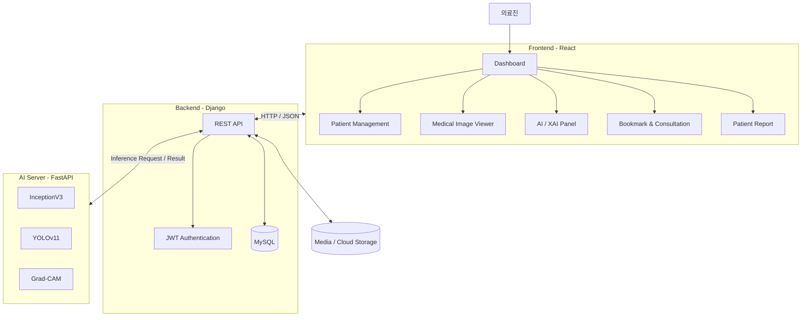

# ANGIO XAI

## 딥러닝 기반 관상동맥 협착 탐지 및 XAI 판독 지원 시스템

> Deep Learning-based Coronary Artery Stenosis Detection & Explainable AI System

의료진의 관상동맥 조영영상 판독을 지원하기 위해 AI 분석 결과와 환자 임상정보를 통합하여 제공하는 웹 기반 관상동맥 의료영상 AI 판독 지원 시스템입니다.

React 기반의 의료진 대시보드와 의료영상 Viewer를 중심으로 환자 조회, AI 분석 결과 시각화, 의료진 주석, 북마크, 협진 요청 및 판독 결과 관리 인터페이스를 구현하였습니다.

---

## 1. Project Overview

| 항목 | 내용 |
|---|---|
| 프로젝트명 | ANGIO XAI |
| 프로젝트 유형 | 설명 가능한 AI 기반 의료영상 판독 지원 웹 |
| 개발 형태 | 팀 프로젝트 |
| 개발 인원 | 5명 |
| 개인 개발 기간 | 3일 |
| 최종 발표일 | 2026.07.28 |
| 담당 역할 | Frontend Developer |
| 주요 담당 | 의료진 대시보드, 의료영상 Viewer, Canvas Annotation |
| 개발 환경 | React, JavaScript, TypeScript, Tailwind CSS |

- [Team GitHub Repository](https://github.com/hyunkyung31/React_DL)
- [개인 개발 브랜치](https://github.com/hyunkyung31/React_DL/tree/yuri)

---

## 2. Background & Problem

관상동맥 조영영상 판독 과정에서는 의료진이 영상과 환자의 임상정보를 함께 검토하고, 병변의 위치와 협착 여부를 판단해야 합니다.

기존 판독 업무에서 다음과 같은 문제에 주목하였습니다.

- 의료영상과 환자 임상정보를 함께 확인해야 하는 업무 복잡성
- AI 예측 결과만으로는 판단 근거를 파악하기 어려운 문제
- 영상 확대 및 이동 시 AI 병변 표시 영역과 영상 간 좌표 정렬 문제
- 주요 판독 지점과 의료진 의견을 관리하기 위한 인터페이스의 필요성

이를 개선하기 위해 AI 분석 결과와 의료진의 판독 작업을 하나의 웹 인터페이스에서 확인할 수 있는 시스템을 설계하였습니다.

본 프로젝트는 의료진의 판단을 보조하기 위한 교육용 프로토타입이며, 실제 임상적 유효성이나 의료기기 수준의 안전성을 검증한 시스템은 아닙니다.

---

## 3. Project Objectives

- 환자 정보와 의료영상의 통합 조회
- 관상동맥 협착 여부 및 병변 위치 시각화
- Grad-CAM 기반 AI 판단 근거 제공
- 의료진 중심의 영상 탐색 및 주석 인터페이스 구현
- 북마크, 협진 요청 및 판독 결과 관리 지원
- 의료진 업무 흐름을 고려한 다크 테마 UI 구성

---

## 4. Tech Stack

### Frontend — 개인 주요 담당

| 기술 | 활용 목적 |
|---|---|
| React | 컴포넌트 기반 사용자 인터페이스 |
| JavaScript | 화면 로직 및 이벤트 처리 |
| TypeScript | 애플리케이션 데이터 타입 정의 |
| Tailwind CSS | 반응형 레이아웃 및 다크 테마 |
| Lucide React | 인터페이스 아이콘 |
| Canvas API | Bounding Box 및 의료진 주석 |
| CSS Transform | 영상 확대 및 이동 |
| HTML Video API | 개발 과정의 영상 재생 제어 |
| Axios / Fetch API | 백엔드 API 연동 |

### Backend & AI — 팀 구현 영역

| 기술 | 활용 목적 |
|---|---|
| Django | 의료 서비스 백엔드 |
| REST API | 프론트엔드와 서버 간 데이터 통신 |
| JWT | 사용자 인증 |
| MySQL | 환자 및 업무 데이터 관리 |
| FastAPI | AI 모델 추론 서비스 |
| InceptionV3 | 관상동맥 영상 분류 |
| YOLOv11 | 협착 의심 영역 탐지 |
| Grad-CAM | AI 판단 근거 시각화 |
| FFmpeg | 영상 형식 변환 |

### Infrastructure — 팀 설계 및 발표 자료 기준

| 기술 | 활용 목적 |
|---|---|
| Google Cloud Platform | 클라우드 실행 환경 |
| Compute Engine | 가상 서버 환경 |
| Google Cloud Storage | 의료 미디어 및 모델 파일 관리 |
| Nginx | 웹 서비스 및 요청 전달 |
| Gunicorn | Django 애플리케이션 실행 |

백엔드, AI 모델 및 인프라 구축은 팀 프로젝트의 전체 기술 구성으로, 개인 단독 구현 범위와 구분합니다.

세부 배포 구성은 최종 발표 자료를 기준으로 정리하였으며, 현재 운영 환경을 검증한 것은 아닙니다.

---

## 5. System Architecture

React는 의료진의 입력과 화면 상태를 관리하고, Django REST API를 통해 환자 정보 및 분석 결과를 전달받습니다.

AI 모델 추론은 FastAPI 기반의 별도 서비스에서 처리하며, 분석 결과는 의료진이 확인할 수 있는 시각화 인터페이스에 연결됩니다.

위 다이어그램은 팀 시스템의 논리적 구성과 데이터 흐름을 표현한 것입니다.

---

## 6. My Contributions

### 01. 의료진 대시보드 및 환자 관리

환자 정보를 중심으로 의료진이 필요한 화면에 접근할 수 있도록 대시보드와 환자 조회 인터페이스를 구현하였습니다.

- 환자 ID 및 이름 기반 검색
- 사이드바 빠른 검색 및 환자 선택
- 환자 상세정보 카드 렌더링
- 환자 목록 및 상세 화면 연결
- 메인 대시보드 홈 화면 구현
- Props와 Callback 기반 데이터 전달
- 메뉴 상태에 따른 조건부 렌더링
- Home 컴포넌트 분리 및 리팩토링

**주요 파일**

- `src/Page/Dashboard.jsx`
- `src/Page/Home.jsx`
- `src/Page/Patient_Management.jsx`
- `src/Page/Patient_Detail.jsx`

---

### 02. 의료영상 Viewer 인터랙션

관상동맥 조영영상의 확인과 탐색을 지원하기 위한 Viewer 인터페이스를 구현하였습니다.

- 재생 및 일시정지 컨트롤
- 0.5배속을 포함한 재생 속도 설정
- 프레임 번호 및 탐색 UI
- 영상 확대 및 축소
- 마우스 드래그 기반 영상 이동
- 전체 화면 전환
- 이미지 및 영상 유형별 렌더링
- 이미지 파일 드래그 앤 드롭 미리보기

개발 과정에서는 HTML Video API를 이용한 재생 제어를 구현하였으며, 이후 Viewer 구조 변경에 따라 프레임 탐색 및 재생 제어 UI를 구성하였습니다.

최종 개인 브랜치의 프레임 카운터와 실제 영상 프레임 간 완전한 동기화는 추가 개선이 필요한 부분입니다.

**주요 파일**

- `src/Components/Main_viewer.jsx`
- `src/Page/Dashboard.jsx`

---

### 03. Canvas 기반 의료진 Annotation

AI 분석 결과를 확인하는 과정에서 의료진이 영상 위에 직접 주석을 추가할 수 있도록 Canvas 기반 인터랙션을 구현하였습니다.

- Bounding Box 직접 그리기
- 자유곡선 주석
- 텍스트 주석
- 마우스 이벤트 기반 좌표 계산
- 역방향 드래그 시 사각형 좌표 보정
- 최소 크기 조건을 통한 불필요한 Box 생성 방지
- 의료진 주석 상태 관리
- 주석 초기화
- 영상 이동과 주석 도구 간 이벤트 충돌 방지

AI 오버레이와 의료진 주석을 원본 이미지 위의 Canvas에 표현하여 원본 영상 자체를 수정하지 않고 판독 정보를 시각화하도록 구성하였습니다.

의료진 주석의 서버 저장 및 재조회는 개인 구현 범위에서 검증되지 않았습니다.

**주요 파일**

- `src/Components/Main_viewer.jsx`

**대표 커밋**

- `f83d166` — AI 진단 메인화면 3분할, Canvas 기능 추가, 메인뷰어 수정

---

### 04. AI 판독 화면 통합

영상과 AI 분석 결과, 의료진 판독 정보를 함께 확인할 수 있도록 AI 진단 화면을 재구성하였습니다.

- 의료영상 중심의 3분할 레이아웃
- AI 결과 및 XAI 시각화 패널 통합
- Heatmap 및 Bounding Box 표시 제어 UI 연동
- Confidence Threshold 설정 UI 연동
- Heatmap 투명도 설정 UI 연동
- 판독 체크리스트 인터페이스 개선
- AI 분석 상태에 따른 화면 표시

AI 모델 개발과 추론 API 구현은 팀 담당 영역이며, 개인 기여는 의료진 판독 화면 구성과 시각화 인터페이스 통합에 집중하였습니다.

**주요 파일**

- `src/Page/Dashboard.jsx`
- `src/Components/Main_viewer.jsx`
- `src/Components/Xai_visualization.jsx`
- `src/Components/FindingChecklist.jsx`

---

### 05. 북마크 및 협진 인터페이스

의료진이 주요 판독 지점을 확인하고 협진 요청 정보를 입력할 수 있도록 업무 지원 인터페이스를 구성하였습니다.

- 북마크 목록 및 검색
- 선택한 북마크의 상세 팝업
- 이미지 및 영상 유형별 상세 표시
- 미디어 누락 시 대체 안내
- 이벤트 버블링 제어
- 협진 요청 화면 및 입력 폼
- 환자 선택과 협진 입력 정보 연결

북마크 저장 API 및 협진 서버 연동은 팀 협업 영역으로 구분합니다.

**주요 파일**

- `src/Components/BoomarkView.jsx`
- `src/Components/Consultation_View.jsx`

---

### 06. 환자 판독 결과 리포트

환자의 임상정보와 판독 결과를 확인할 수 있도록 결과 리포트 화면을 구현하였습니다.

- 환자별 결과 조회 인터페이스
- 환자 기본정보 및 임상정보 표시
- ECG 이미지 조회 인터페이스
- 판독 소견 표시
- 결과 리포트 탭 추가
- 브라우저 인쇄 기능 연결

일부 리포트 항목에는 시연용 Mock 데이터가 포함되어 있으며, 실제 임상 결과나 서버 기반 PDF 자동 생성 기능과 구분합니다.

**주요 파일**

- `src/Components/Patient_ReportView.jsx`
- `src/Page/Dashboard.jsx`

---

## 7. Engineering Highlights

### Component-Based Architecture

Dashboard에 집중된 화면 구성을 기능별 컴포넌트로 분리하고, Props와 Callback을 이용하여 데이터와 사용자 이벤트를 전달하도록 구성하였습니다.

### State Management

React의 `useState`, `useEffect`, `useRef`를 활용하여 환자 선택, 화면 전환, 영상 제어, 주석 도구 및 팝업 상태를 관리하였습니다.

### Coordinate Transformation

원본 이미지와 화면 표시 이미지의 크기 비율을 이용하여 AI Bounding Box의 표시 좌표를 계산하는 구조를 적용하였습니다.

영상과 Canvas를 동일한 부모 컨테이너에 배치하여 공통 Transform을 사용하도록 구성하였습니다.

### Event Handling

Canvas 주석 도구와 영상 이동 기능을 상태에 따라 분리하고, 북마크 내부 버튼에는 이벤트 전파 제어를 적용하였습니다.

### Defensive Programming

빈 환자 목록, 미디어 누락, 이미지 로딩 오류 및 지원하지 않는 파일 유형에 대한 예외 처리 인터페이스를 구성하였습니다.

---

## 8. Troubleshooting

| 문제 및 개선 대상 | 해결 및 구현 방향 |
|---|---|
| 영상과 AI Bounding Box의 좌표 정렬 | 이미지 표시 비율 계산 및 공통 Transform |
| Canvas 주석과 영상 이동 간 충돌 | 도구 활성화 상태에 따른 이벤트 분리 |
| 역방향 드래그 시 Box 좌표 문제 | 시작 좌표 보정 및 절댓값 기반 크기 계산 |
| 이미지와 영상 썸네일 표시 문제 | 미디어 유형별 조건부 렌더링 |
| 북마크 내부 버튼 이벤트 충돌 | `stopPropagation()` 적용 |
| 대시보드 코드 복잡성 | Home 컴포넌트 분리 및 상태 구조 정리 |
| 새로운 파일 선택 시 기존 상태 유지 | 분석 결과 및 Viewer 상태 초기화 |

구현 코드와 Git 변경 이력을 기준으로 정리하였으며, 정량적인 성능 개선 수치나 전체 브라우저 호환성 테스트 결과를 의미하지 않습니다.

---

## 9. Git Contribution

개인 개발 브랜치 및 전체 브랜치의 작성자별 Git 이력을 분석하여 개인 기여 범위를 확인하였습니다.

| 항목 | 내용 |
|---|---|
| 개인 개발 브랜치 | `origin/yuri` |
| 일반 커밋 | 14개 |
| Merge 포함 커밋 | 17개 |
| 주요 개발 기간 | 2026.07.25 ~ 2026.07.27 |

### Representative Commits

| Commit | Contribution |
|---|---|
| `7d3a4d5` | Tailwind CSS 설정 및 로그인 페이지 구현 |
| `8749953` | 환자 목록 대시보드 생성 |
| `d75b325` | 환자 상세 페이지 및 사이드바 빠른 검색 |
| `21acdae` | 사이드바 검색 기능 수정 |
| `847f46d` | 메인 Viewer, 북마크 및 협진 화면 |
| `8e188fc` | 인트로 화면 및 북마크 상세 팝업 |
| `e7fa8f8` | 대시보드 수정 및 Home 컴포넌트 분리 작업 |
| `0161739` | 대시보드 복구 및 영상 제어 구조 수정 |
| `17fc9b7` | 미디어 유형별 썸네일 렌더링 개선 |
| `77e079c` | 대시보드 및 AI Viewer 수정 |
| `f83d166` | AI 판독 3분할 화면 및 Canvas Annotation |
| `c871f85` | AI 진단 화면 재구성 |
| `ee3c068` | 결과 리포트 탭 및 주요 화면 수정 |

커밋 수는 개인 개발 활동의 참고 지표이며, 전체 프로젝트에 대한 기여율이나 코드 소유 비율을 의미하지 않습니다.

---

## 10. Technical Documentation

| Document | Description |
|---|---|
| [Architecture](./architecture.md) | 전체 시스템 구조 및 데이터 흐름 |
| [Dashboard](./dashboard.md) | 환자 검색 및 대시보드 구현 |
| [Image Viewer](./image-viewer.md) | 영상 제어, Canvas 및 좌표 처리 |
| [AI Diagnosis](./ai-diagnosis.md) | AI 판독 화면 및 결과 리포트 |
| [UI & State Management](./ui-state.md) | 화면 상태, 북마크 및 협진 인터페이스 |
| [Troubleshooting](./troubleshooting.md) | 기술적 문제 해결 및 개선 방향 |

---

## 11. Limitations & Future Improvements

### Medical Image Viewer

- 실제 영상 재생 시간과 프레임 번호 동기화
- 구간 반복 재생의 구현 및 검증
- 의료진 주석 좌표의 정규화
- 화면 크기 및 확대 배율 변경에 따른 좌표 검증
- Object URL 생성 및 해제 생명주기 개선

### Clinical Data & API

- 환자 데이터 응답 형식 표준화
- 환자 전환 시 이전 비동기 요청 취소
- 누락된 임상정보와 정상 소견의 명확한 구분
- 인증 및 미디어 접근 로직 공통화
- 의료진 주석의 서버 저장 및 재조회

### AI & Clinical Workflow

- Mock 데이터와 실제 AI 분석 결과의 명확한 분리
- AI 모델의 외부 데이터 검증
- Segmentation 기반 병변 영역 시각화
- 의료진 판독 결과의 서버 저장 및 검증
- 비동기 분석 요청 처리
- 외부 PACS 및 EMR 연동

---

## 12. Retrospective

이번 프로젝트를 통해 React 기반의 컴포넌트 설계와 상태 관리뿐만 아니라, 의료영상과 AI 분석 결과를 사용자 인터페이스에 연결하는 과정을 경험하였습니다.

특히 의료영상 Viewer를 구현하면서 원본 데이터와 화면에 표시되는 데이터의 좌표 체계가 다를 수 있다는 점을 이해하였으며, 사용자 인터랙션과 데이터 상태를 함께 관리하는 구조의 중요성을 배웠습니다.

또한 환자 정보, 의료영상, AI 분석 결과를 연동하는 과정에서 프론트엔드의 안정적인 동작을 위해 백엔드 API 응답 형식과 데이터 관리 구조가 중요하다는 점을 경험하였습니다.

이러한 경험은 이후 통합 심혈관 CDSS 프로젝트인 DUGN에서 의료 데이터 관리, 백엔드 API 설계 및 의료 서비스 업무 흐름을 구현하는 기반이 되었습니다.

---

## 13. Repository & Attribution

본 문서는 팀 프로젝트의 최종 발표 자료, 개인 개발 브랜치 및 Git 변경 이력을 바탕으로 작성한 개인 기술 포트폴리오입니다.

팀 전체의 시스템 구현 내용과 개인 개발 기여 범위를 구분하여 기술하였습니다.

- Team Repository: https://github.com/hyunkyung31/React_DL
- Personal Branch: https://github.com/hyunkyung31/React_DL/tree/yuri

팀 프로젝트 전체 소스코드를 개인 포트폴리오 저장소에 재배포하지 않으며, 개인 기여 내용과 기술적 구현 경험을 중심으로 문서화하였습니다.
