# AI Diagnosis & XAI Integration

> ANGIO XAI — AI 분석 결과 연동 및 의료진 판독 지원 인터페이스

관상동맥 조영영상의 AI 분석 결과를 의료진이 확인하고, 영상과 분석 정보를 비교하며 판독 소견을 작성할 수 있도록 AI 판독 지원 인터페이스를 구성하였습니다.

본 문서는 AI 분석 API 연동 구조, 응답 데이터 처리, XAI 시각화, 의료진 판독 체크리스트 및 결과 리포트 화면을 중심으로 설명합니다.

---

## 1. Implementation Overview

| 항목 | 내용 |
|---|---|
| 프로젝트 | ANGIO XAI |
| 담당 영역 | AI 판독 화면 구성 및 Viewer 연동 |
| Frontend | React, JavaScript, Tailwind CSS |
| Backend | Django REST API |
| AI Server | FastAPI |
| Classification | InceptionV3 |
| Object Detection | YOLOv11 |
| Explainable AI | Grad-CAM |
| API Communication | Axios, Fetch API |
| Authentication | JWT Bearer Token |
| Visualization | Canvas API |
| 주요 기능 | AI 결과 표시, 판독 체크리스트, 결과 리포트 |

AI 모델 학습, 추론 서버 및 백엔드 API 구현은 팀 협업 영역입니다.

개인 개발은 의료진이 해당 분석 결과를 활용할 수 있도록 화면을 구성하고, Viewer와 판독 인터페이스를 연결하는 작업에 집중하였습니다.

### Implementation Objectives

- 환자 중심의 AI 분석 화면 구성
- 분석 대상 이미지 선택 및 업로드
- AI 분석 API 요청 및 응답 처리 구조 연결
- Classification 및 Detection 결과 표시
- Heatmap과 Bounding Box 표시 옵션 연동
- 의료진 판독 체크리스트 구성 개선
- 판독 소견 및 결과 리포트 화면 연결
- 분석 상태와 오류 상태 구분
- AI 결과와 의료진 입력 정보 구분

---

## 2. Background & Problem

관상동맥 협착 탐지 모델이 분석 결과를 제공하더라도, 의료진이 해당 결과를 확인하고 판단하기 위한 사용자 인터페이스가 필요합니다.

단순히 AI 모델의 분류 결과만 표시하는 경우 다음과 같은 한계가 존재합니다.

- AI 모델이 주목한 영상 영역을 확인하기 어려움
- 분류 결과와 병변 위치를 별도로 확인해야 함
- 환자 임상정보와 AI 결과가 분리되어 있음
- 의료진의 추가 판독 의견을 작성하기 어려움
- AI 결과 확인 이후 업무 화면 전환이 복잡함

이를 고려하여 원본 의료영상, AI 분석 결과 및 의료진 판독 영역을 하나의 화면에 배치하였습니다.

### Design Requirements

| 요구사항 | 구현 방향 |
|---|---|
| 원본 영상 확인 | Medical Image Viewer |
| AI 분류 결과 확인 | Classification Result Panel |
| 협착 의심 영역 확인 | Bounding Box Overlay |
| 모델 설명 정보 확인 | Grad-CAM Heatmap |
| 표시 정보 조절 | XAI Control Panel |
| 의료진 판단 입력 | Finding Checklist |
| 판독 소견 작성 | Impression Template |
| 결과 확인 | Patient Report View |

본 시스템은 교육용 의료 AI 프로토타입이며, 독립적인 의료 진단이나 임상적 의사결정을 보장하는 시스템은 아닙니다.

---

## 3. AI System Architecture

### 3.1 Overall Architecture

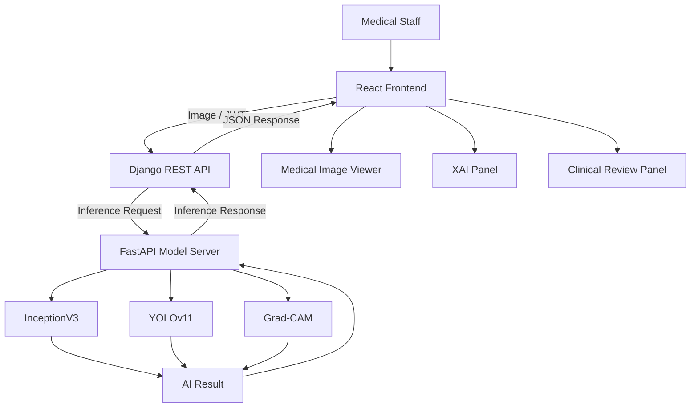

React는 사용자 입력과 결과 표시를 담당하고, Django는 인증 및 업무 API를 담당하는 구조입니다.

FastAPI 모델 서버는 AI 추론을 수행하고 분석 결과를 반환합니다.

위 다이어그램은 팀 프로젝트의 발표 자료와 프론트엔드 소스코드를 바탕으로 재구성한 개념적 아키텍처입니다.

### 3.2 Responsibility Separation

| Layer | Responsibility |
|---|---|
| React | 사용자 인터페이스 및 분석 결과 표시 |
| Django | 인증, 환자 데이터 및 업무 API |
| FastAPI | AI 모델 추론 서비스 |
| InceptionV3 | 영상 분류 |
| YOLOv11 | 병변 의심 영역 탐지 |
| Grad-CAM | 모델 설명 정보 생성 |
| MySQL | 환자 및 검사 관련 업무 데이터 |
| GCS / Server Media | 모델 및 의료 미디어 관리 |

서버 내부 구현과 저장소 구성은 팀 발표 자료를 기준으로 설명합니다.

개인 개발 범위는 프론트엔드 화면 구성 및 데이터 연결입니다.

---

## 4. AI Model Overview

### 4.1 Classification

InceptionV3는 입력 영상의 특징을 추출하고 분류 결과를 생성하는 모델입니다.

프로젝트에서는 관상동맥 조영영상의 협착 관련 분류 정보를 제공하기 위해 활용하였습니다.

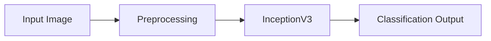

분류 결과는 프론트엔드에서 클래스와 모델 출력 점수를 표시하기 위한 데이터로 사용됩니다.

### 4.2 Object Detection

YOLOv11은 영상에서 관심 객체의 위치를 탐지하는 모델입니다.

프로젝트에서는 협착 의심 영역을 Bounding Box 형태로 표시하기 위해 활용하였습니다.

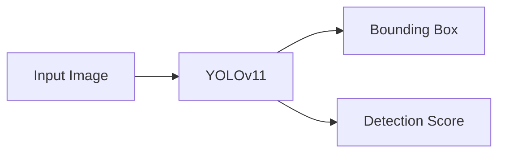

### 4.3 Explainable AI

Grad-CAM은 모델의 분류 결과에 영향을 준 공간적 특징을 시각화하는 방법입니다.

프론트엔드에서는 생성된 Heatmap을 원본 영상 위에 표시할 수 있도록 구성하였습니다.

### 4.4 Model Output Comparison

| Technology | Output | UI Usage |
|---|---|---|
| InceptionV3 | 분류 결과 및 점수 | AI 결과 카드 |
| YOLOv11 | Bounding Box 및 탐지 점수 | 병변 의심 영역 표시 |
| Grad-CAM | Heatmap 이미지 | 모델 설명 정보 표시 |

Grad-CAM은 병변의 정확한 경계를 제공하는 Segmentation 결과와는 다릅니다.

또한 모델의 출력 점수가 실제 임상적 진단 확률과 동일하다는 의미는 아닙니다.

### 4.5 Contribution Boundary

AI 모델의 학습, 전처리, 모델 성능 평가 및 추론 서버 구축은 팀 담당 영역입니다.

개인 기여는 해당 모델의 분석 결과를 확인할 수 있는 판독 화면 및 Viewer 인터페이스를 구성하는 작업입니다.

---

## 5. AI Diagnosis Screen

### 5.1 Three-Column Layout

개인 커밋 `f83d166`에서는 AI 판독 메인 화면을 3분할 구조로 구성하는 변경이 확인됩니다.

```text
+----------------------+---------------+----------------+
| Medical Image Viewer | AI Analysis   | Clinical Review|
|                      |               |                |
| Image Upload         | Classification| Checklist      |
|                      |               |                |
| Original Image       | XAI Controls  | Impression     |
|                      |               |                |
| Canvas Annotation    | MACE Beta     | EMR Confirm    |
|                      |               |                |
| Playback Controls    | AI Result     | Report Workflow|
+----------------------+---------------+----------------+
        6 Columns          3 Columns       3 Columns
```

12개 Grid Column을 기준으로 6:3:3 비율의 화면 구성이 확인됩니다.

### 5.2 Layout Responsibilities

| Area | Components | Purpose |
|---|---|---|
| Left | Main_viewer | 의료영상 및 주석 |
| Center | AI Result, Xai_visualization | AI 분석 정보 및 표시 옵션 |
| Center | Mace_risk | 보조 위험도 표시 |
| Right | FindingChecklist | 의료진 판독 항목 |
| Right | ImpressionTemplate | 판독 소견 |
| Right | EmrConfirmPanel | 결과 확인 및 업무 연결 |

### 5.3 Component Architecture

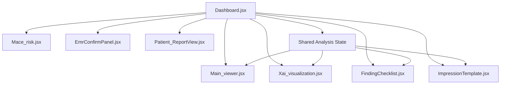

Dashboard에서 환자 및 AI 분석 관련 상태를 관리하고, 각 컴포넌트에 필요한 데이터를 전달합니다.

### 5.4 Design Benefits

- 원본 영상과 AI 결과를 동일 화면에서 비교
- 영상 탐색과 AI 표시 옵션을 분리
- 의료진 입력 영역을 별도로 구성
- 판독 소견 작성과 결과 확인 흐름 연결
- 기능별 컴포넌트 책임 구분

위 항목은 화면 설계의 목적이며, 실제 판독 시간 감소나 의료진 업무 효율 향상을 정량적으로 측정한 결과는 아닙니다.

---

## 6. Patient Selection & Analysis Context

### 6.1 Analysis Target

AI 분석 화면에서는 현재 선택한 환자와 분석 대상 환자를 상태로 관리합니다.

```javascript
const [selectedPatient, setSelectedPatient] =
  useState(null);

const [selectedDiagPatient, setSelectedDiagPatient] =
  useState(null);
```

분석 대상은 다음과 같은 우선순위로 결정하는 구조가 확인됩니다.

```javascript
const targetPatient =
  selectedDiagPatient || selectedPatient;
```

### 6.2 Patient Detail Request

| 항목 | 내용 |
|---|---|
| Method | GET |
| Endpoint | `/api/patients/{id}/` |
| Authentication | Bearer Token |
| Purpose | 분석 대상 환자의 상세 데이터 조회 |

환자 상세정보에서 검사 이미지 경로를 확인하고, 인증 미디어 접근 공통 함수를 통해 분석 대상 이미지를 불러오는 구조입니다.

### 6.3 Analysis Context Flow

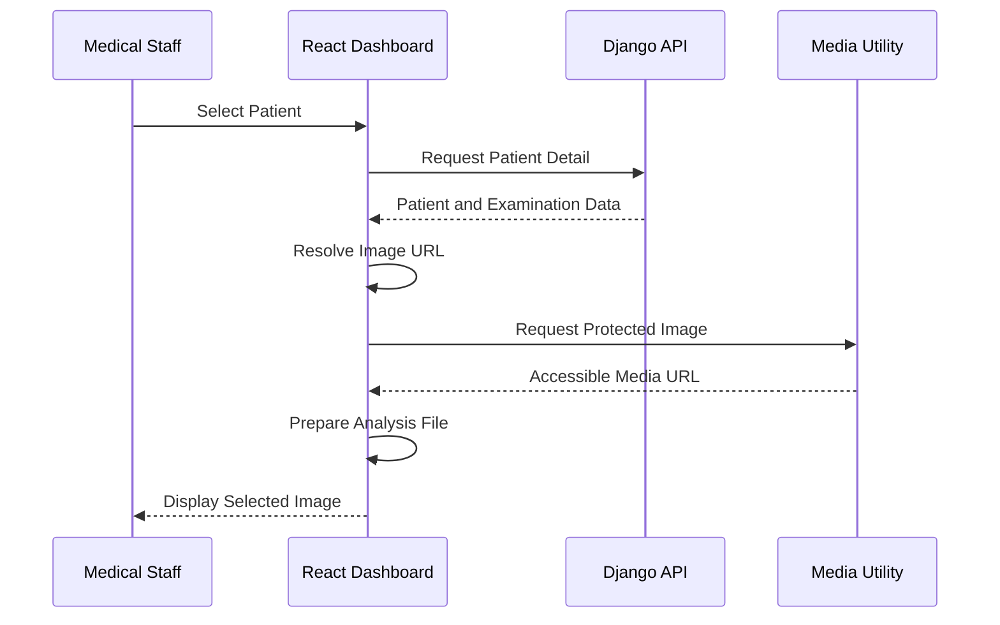

### 6.4 File Preparation

확인한 코드에서는 조회한 미디어를 Blob 형태로 변환한 뒤 File 객체로 구성하여 AI 분석 요청에 활용하는 구조가 존재합니다.

```javascript
const response = await fetch(mediaUrl);
const blob = await response.blob();

const file = new File(
  [blob],
  'patient-image.png',
  {
    type: blob.type
  }
);
```

위 코드는 데이터 변환 원리를 설명하기 위한 단순화 예시입니다.

실제 파일명과 MIME Type은 원본 데이터에 따라 결정되어야 합니다.

### 6.5 Context Integrity

의료 서비스에서는 다음 데이터의 연결 관계가 중요합니다.

- 환자 ID
- 검사 ID
- 분석 대상 이미지
- AI 분석 결과
- 의료진 판독 소견

환자가 변경되었을 때 이전 환자의 분석 결과가 계속 표시되지 않도록 관련 상태를 관리해야 합니다.

현재 구현에는 일부 초기화 처리가 존재하지만, 모든 환자 및 검사 변경 상황에 대한 데이터 무결성 검증을 완료한 것은 아닙니다.

---

## 7. Image Upload & AI Request

### 7.1 Analysis File State

분석 대상 파일과 화면 표시 URL을 별도 상태로 관리하는 구조입니다.

| State | Responsibility |
|---|---|
| selectedFile | 분석 요청에 사용할 파일 |
| aiFileUrl | 화면에 표시할 이미지 URL |
| aiResult | AI 분석 결과 |
| isAnalyzing | 분석 진행 상태 |

위 상태명은 분석 화면의 역할을 설명하기 위한 개념적 분류이며, 모든 변수명이 원본 코드와 동일한 것은 아닙니다.

### 7.2 Local Preview

사용자가 선택한 파일은 Object URL을 통해 브라우저에서 미리 표시할 수 있습니다.

```javascript
const previewUrl =
  URL.createObjectURL(file);
```

로컬 미리보기와 서버 AI 분석 요청은 서로 다른 과정입니다.

### 7.3 AI Analysis Endpoint

최종 개인 브랜치에서 확인한 AI 분석 요청 경로는 다음과 같습니다.

| 항목 | 내용 |
|---|---|
| Method | POST |
| Endpoint | `/api/ai/image-analyze/` |
| Request Body | Multipart FormData |
| File Field | file |
| Authentication | JWT Bearer Token |
| Response | AI Analysis JSON |

Django API와 FastAPI 모델 서버 사이의 내부 요청은 팀 백엔드 및 AI 서버 구현 영역입니다.

### 7.4 Multipart FormData

이미지 파일을 서버에 전달하기 위해 FormData를 활용합니다.

```javascript
const formData = new FormData();

formData.append('file', selectedFile);
```

FormData는 파일과 일반 입력 데이터를 Multipart 형식으로 전달할 수 있도록 지원합니다.

### 7.5 Request Example

다음은 확인한 AI 분석 요청 구조를 설명하기 위한 단순화 예시입니다.

```javascript
async function requestAnalysis(file) {
  const access = localStorage.getItem('access');

  if (!file) {
    throw new Error('분석 대상 파일이 없습니다.');
  }

  if (!access) {
    throw new Error('인증 정보가 없습니다.');
  }

  const formData = new FormData();

  formData.append('file', file);

  const response = await axios.post(
    '/api/ai/image-analyze/',
    formData,
    {
      headers: {
        Authorization: `Bearer ${access}`
      }
    }
  );

  return response.data;
}
```

브라우저 환경에서 FormData를 전송할 때는 HTTP Client가 Multipart Boundary를 적절히 설정할 수 있도록 처리해야 합니다.

위 코드는 프론트엔드 연동 방식을 설명하기 위한 예시이며, 개인이 해당 백엔드 API를 구현하였다는 의미는 아닙니다.

### 7.6 Request Sequence

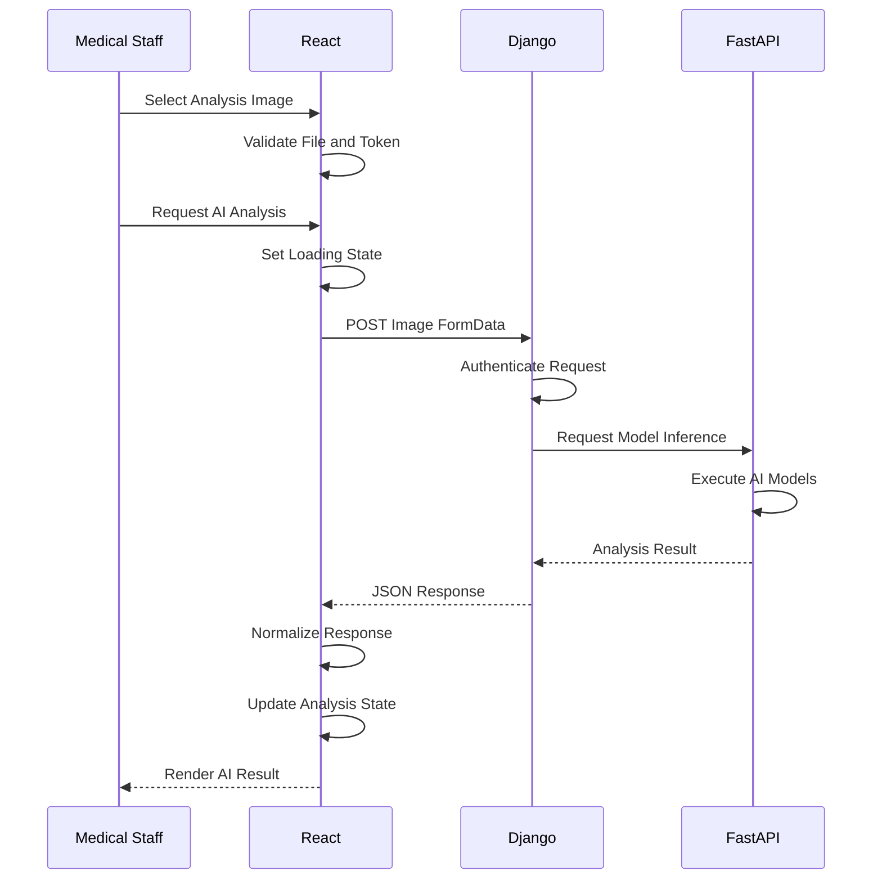

---

## 8. Asynchronous Analysis Lifecycle

### 8.1 Analysis States

AI 분석은 서버 요청과 모델 추론을 포함하는 비동기 작업입니다.

프론트엔드에서는 분석 요청의 진행 상태와 결과 상태를 구분하여 표시합니다.

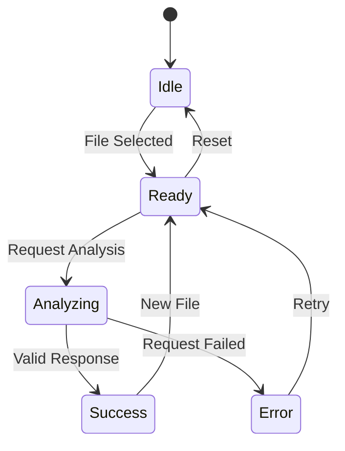

위 다이어그램은 분석 화면의 상태 흐름을 개념적으로 표현한 것입니다.

### 8.2 Loading State

```javascript
setIsAnalyzing(true);

try {
  const result =
    await requestAnalysis(selectedFile);

  setAiResult(result);

} catch (error) {
  // Handle analysis failure
} finally {
  setIsAnalyzing(false);
}
```

`finally`를 사용하여 요청 성공 여부와 관계없이 분석 진행 상태를 종료합니다.

### 8.3 Error Handling

| Scenario | Handling Direction |
|---|---|
| 분석 파일 없음 | 요청 제한 및 안내 |
| 인증 정보 없음 | 인증 필요 안내 |
| HTTP 401 | 인증 관련 오류 안내 |
| 서버 오류 | 응답 오류 메시지 표시 |
| 분석 요청 완료 | 로딩 상태 종료 |
| 응답 구조 차이 | 데이터 정규화 |

최종 개인 브랜치에서는 파일 및 토큰 확인, 401 오류 구분, 서버 응답 오류 처리와 로딩 종료 구조가 확인됩니다.

### 8.4 Frontend Loading vs Server Job

프론트엔드에서 비동기 요청을 수행한다는 것은 서버에서 작업 큐를 사용한다는 의미와는 다릅니다.

현재 분석 요청 구조와 다음 기능은 구분해야 합니다.

- Celery 기반 작업 큐
- 분석 Job ID 발급
- 작업 진행률 조회
- 분석 작업 취소
- WebSocket 기반 완료 알림

위 기능은 향후 확장할 수 있는 서버 아키텍처이며, 기존 프로젝트에서 구현한 것으로 확인되지 않았습니다.

---

## 9. AI Response Data Contract

### 9.1 Response Structure

AI 분석 결과는 분류 정보, 탐지 정보 및 설명 이미지 등을 포함할 수 있습니다.

다음은 데이터 처리 구조를 설명하기 위한 가상의 응답 예시입니다.

```json
{
  "classification": {
    "label": "example_class",
    "confidence": 0.92,
    "heatmap_base64": "BASE64_IMAGE"
  },
  "detection": {
    "boxes": [
      {
        "x1": 120,
        "y1": 80,
        "x2": 260,
        "y2": 180,
        "confidence": 0.87
      }
    ]
  }
}
```

위 값은 실제 환자의 분석 결과나 모델 성능 측정값이 아닙니다.

또한 원본 API의 전체 응답 스키마를 그대로 재현한 것이 아니라 프론트엔드에서 처리하는 데이터의 개념적 구조를 나타냅니다.

### 9.2 Data Responsibilities

| Field | Purpose |
|---|---|
| classification | 영상 분류 정보 |
| confidence | 모델 출력 점수 |
| detection | 객체 탐지 정보 |
| boxes | 탐지 영역 좌표 |
| heatmap_base64 | 설명 이미지 데이터 |
| overlay_base64 | 시각화 이미지 데이터 |

### 9.3 Data Contract Requirements

AI 결과를 안정적으로 표시하려면 서버와 프론트엔드 사이에서 다음 항목을 명확하게 정의해야 합니다.

- 분류 클래스의 이름 및 코드
- 모델 출력 점수의 범위
- Bounding Box 좌표 형식
- 원본 이미지의 가로 및 세로 크기
- 좌표 정규화 여부
- Heatmap 인코딩 형식
- 분석 대상 환자 및 검사 식별자
- 결과 누락 시 응답 규칙

이러한 데이터 계약이 일관되지 않으면 모델 추론이 정상적으로 수행되더라도 프론트엔드에서 결과를 잘못 표시할 수 있습니다.

---

## 10. Response Normalization

### 10.1 Problem

AI 모델과 API가 반환하는 결과는 구현 방식에 따라 서로 다른 구조를 가질 수 있습니다.

예를 들어 분류 결과가 최상위 객체에 존재하거나 classification 객체 내부에 포함될 수 있습니다.

Bounding Box 역시 다양한 형식으로 전달될 수 있습니다.

### 10.2 Bounding Box Formats

| Format | Example |
|---|---|
| XYXY | x1, y1, x2, y2 |
| XYWH | x, y, width, height |
| Array | [x1, y1, x2, y2] |
| Normalized | 원본 이미지 대비 상대 좌표 |

배열 형식의 좌표는 서버에서 정의한 순서와 의미를 확인한 후 처리해야 합니다.

### 10.3 XYXY to XYWH

Canvas의 strokeRect 함수는 시작 좌표와 가로 및 세로 크기를 사용합니다.

따라서 XYXY 형태의 좌표를 XYWH 형태로 변환할 수 있습니다.

```text
X = X1
Y = Y1

Width  = X2 - X1
Height = Y2 - Y1
```

### 10.4 Conversion Example

| Property | Value |
|---|---:|
| X1 | 120 |
| Y1 | 80 |
| X2 | 260 |
| Y2 | 180 |
| X | 120 |
| Y | 80 |
| Width | 140 |
| Height | 100 |

위 값은 좌표 변환을 설명하기 위한 가상의 데이터입니다.

### 10.5 Normalization Pipeline

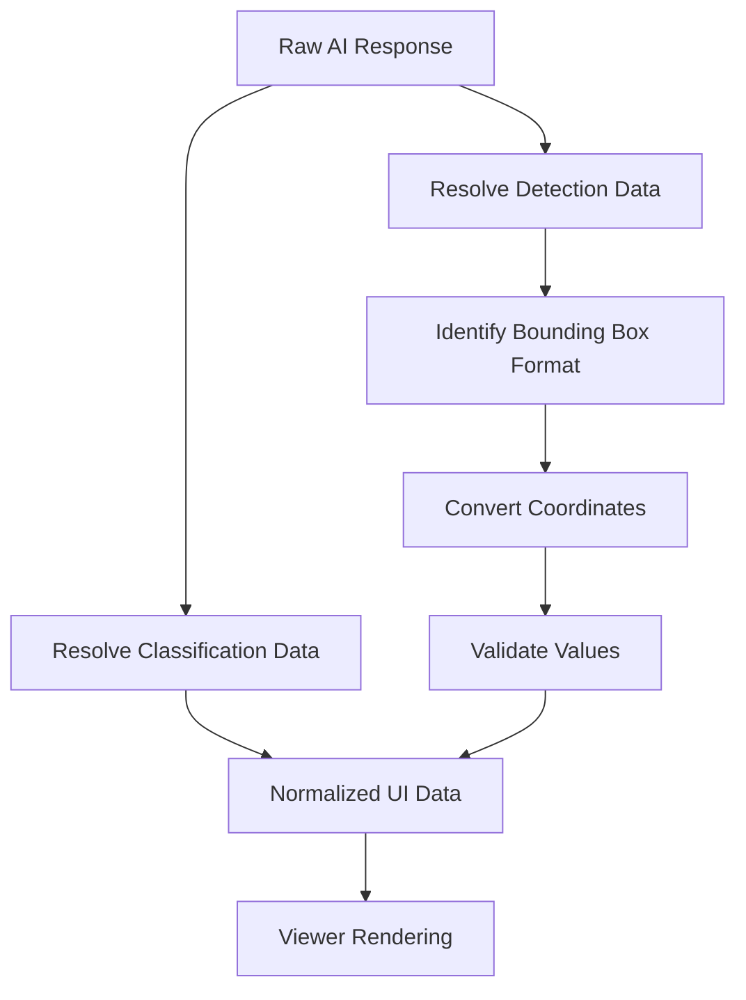

최종 개인 브랜치의 Dashboard에서는 중첩된 응답과 다양한 Bounding Box 좌표 형식을 처리하는 코드가 확인됩니다.

해당 정규화 로직 전체의 개인 단독 구현 여부는 확인되지 않았으므로 팀 연동 구조로 설명합니다.

### 10.6 Improved Normalization Example

다음 코드는 좌표 검증을 포함한 개선 설계 예시입니다.

```javascript
function normalizeXYXY(box) {
  const values = [
    box.x1,
    box.y1,
    box.x2,
    box.y2
  ];

  if (
    !values.every(value =>
      typeof value === 'number' &&
      Number.isFinite(value)
    )
  ) {
    return null;
  }

  const { x1, y1, x2, y2 } = box;

  if (x2 <= x1 || y2 <= y1) {
    return null;
  }

  return {
    x: x1,
    y: y1,
    width: x2 - x1,
    height: y2 - y1
  };
}
```

위 코드는 기존 프로젝트에 적용한 구현이 아니라 소스코드 검토 이후 작성한 개선 예시입니다.

### 10.7 Identified Coordinate Bug

확인한 Dashboard의 일부 좌표 변환 분기에서는 다음 계산이 존재합니다.

```javascript
height: Math.max(0, y2 - y2)
```

동일한 값을 서로 빼기 때문에 결과가 항상 0이 됩니다.

이는 Bounding Box의 높이가 0으로 계산되어 정상적인 사각형 표시를 방해할 수 있는 문제입니다.

개선 방향:

```javascript
height: Math.max(0, y2 - y1)
```

다만 크기가 0인 좌표를 단순히 허용하기보다, 유효하지 않은 Bounding Box를 별도로 검증하고 제외하는 방식도 고려할 수 있습니다.

해당 문제는 소스코드 검토 과정에서 확인한 잠재 오류이며, 프로젝트 개발 당시 수정 완료한 문제로 기록하지 않습니다.

---

## 11. Normalized Coordinate Handling

### 11.1 Relative Coordinates

AI 모델은 Bounding Box 좌표를 원본 이미지의 크기에 대한 상대값으로 반환할 수 있습니다.

예를 들어 다음과 같은 형식입니다.

```json
{
  "x1": 0.2,
  "y1": 0.3,
  "x2": 0.4,
  "y2": 0.5
}
```

### 11.2 Pixel Coordinate Conversion

```text
Pixel X1 = Normalized X1 × Image Width
Pixel Y1 = Normalized Y1 × Image Height

Pixel X2 = Normalized X2 × Image Width
Pixel Y2 = Normalized Y2 × Image Height
```

### 11.3 Calculation Example

원본 이미지 크기가 1000 × 800인 경우:

| Coordinate | Relative | Pixel |
|---|---:|---:|
| X1 | 0.2 | 200 |
| Y1 | 0.3 | 240 |
| X2 | 0.4 | 400 |
| Y2 | 0.5 | 400 |

변환한 원본 이미지 좌표는 다음 단계에서 실제 화면 표시 크기에 맞게 다시 변환할 수 있습니다.

### 11.4 Coordinate Pipeline

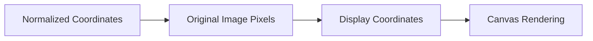

모델 전처리 과정에서 Resize, Crop 또는 Letterbox Padding이 적용된 경우에는 해당 변환 정보도 고려해야 합니다.

단순한 이미지 크기 비율 계산만으로 모든 모델 좌표를 정확하게 복원할 수 있는 것은 아닙니다.

자세한 Canvas 좌표 처리 구조는 `image-viewer.md`에서 설명합니다.

---

## 12. Classification Result Display

### 12.1 UI Purpose

분류 결과 영역은 AI 모델이 반환한 클래스 및 점수를 의료진이 확인할 수 있도록 구성합니다.

### 12.2 Score Conversion

모델 출력값이 0과 1 사이의 값으로 전달되는 경우 백분율 형태로 표시할 수 있습니다.

```javascript
const displayScore =
  confidence * 100;
```

예시:

| Raw Score | Display |
|---|---:|
| 0.92 | 92% |
| 0.75 | 75% |
| 0.40 | 40% |

위 값은 표시 방식의 설명을 위한 가상의 데이터입니다.

### 12.3 Confidence Interpretation

모델의 출력 점수는 다음 항목과 동일하지 않습니다.

- 실제 협착 발생 확률
- 임상적 진단 확률
- 모델 전체 정확도
- 의료진 판독의 신뢰도
- 검증된 환자 위험도

모델 점수를 임상적으로 해석하기 위해서는 별도의 검증 및 Calibration 과정이 필요합니다.

### 12.4 Missing Result Handling

개발용 화면에서는 분석 결과가 없는 경우 샘플 데이터가 사용되는 부분이 확인됩니다.

실제 의료 서비스에서는 샘플 결과와 실제 AI 분석 결과를 명확하게 구분해야 합니다.

개선 예시:

```javascript
if (!aiResult) {
  return (
    <div>
      AI 분석 결과가 없습니다.
    </div>
  );
}
```

분석하지 않은 환자에게 임의의 점수나 분류 결과를 표시하지 않는 것이 중요합니다.

---

## 13. XAI Visualization

### 13.1 Explainable AI Interface

XAI 화면은 의료진이 AI 분석 결과의 표시 방식을 조절할 수 있도록 구성되었습니다.

주요 기능은 다음과 같습니다.

- Heatmap 표시 여부
- Bounding Box 표시 여부
- Confidence Threshold 조절
- Heatmap Opacity 조절
- 분석 진행 및 결과 상태 표시

### 13.2 Component Relationship

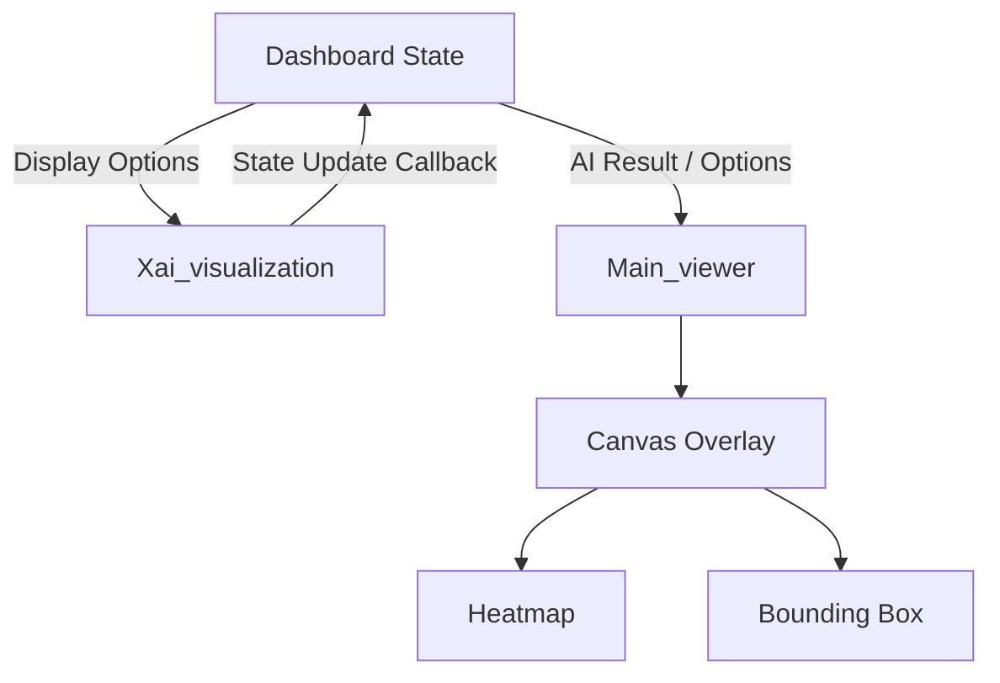

XAI 패널에서 변경한 표시 옵션은 상위 상태를 통해 Viewer에 전달됩니다.

### 13.3 Display Option States

```javascript
const [showHeatmap, setShowHeatmap] =
  useState(true);

const [showBoundingBox, setShowBoundingBox] =
  useState(true);

const [confidenceThreshold, setConfidenceThreshold] =
  useState(25);

const [heatmapOpacity, setHeatmapOpacity] =
  useState(70);
```

위 초기값은 표시 옵션 구조를 설명하기 위한 예시입니다.

실제 초기값은 브랜치 및 개발 시점에 따라 달라질 수 있습니다.

### 13.4 Controlled Component

```jsx
<XaiVisualization
  showHeatmap={showHeatmap}
  setShowHeatmap={setShowHeatmap}
  showBoundingBox={showBoundingBox}
  setShowBoundingBox={setShowBoundingBox}
  confidenceThreshold={confidenceThreshold}
  setConfidenceThreshold={setConfidenceThreshold}
  heatmapOpacity={heatmapOpacity}
  setHeatmapOpacity={setHeatmapOpacity}
/>
```

위 코드는 XAI 표시 옵션의 상태 전달 방식을 설명하기 위한 재구성 예시입니다.

### 13.5 Contribution Boundary

XAI 시각화 및 Grad-CAM 관련 기능은 팀 담당 영역입니다.

개인 커밋 `77e079c`에서는 XAI 컴포넌트와 Main Viewer 및 Dashboard의 수정이 확인됩니다.

따라서 개인 기여는 XAI 알고리즘 개발이 아니라 AI 판독 화면과 표시 인터페이스의 연동 및 개선으로 설명합니다.

---

## 14. Heatmap Visualization

### 14.1 Visualization Concept

Heatmap은 AI 모델이 분류 과정에서 주목한 공간적 특징을 확인하기 위한 설명 정보입니다.

원본 의료영상 위에 Heatmap을 표시하여 모델 결과와 영상의 관계를 시각적으로 확인할 수 있도록 구성합니다.

### 14.2 Rendering Layers

```text
+-------------------------------+
| Clinician Annotation          |
+-------------------------------+
| AI Bounding Box               |
+-------------------------------+
| Grad-CAM Heatmap              |
+-------------------------------+
| Original Medical Image        |
+-------------------------------+
```

위 구조는 논리적인 렌더링 순서를 나타냅니다.

실제 Viewer에서는 하나의 Overlay Canvas에 AI 결과와 의료진 주석을 순차적으로 렌더링합니다.

### 14.3 Opacity Control

Heatmap의 표시 강도를 조절하기 위해 0부터 100까지의 UI 값을 Canvas의 Alpha 범위로 변환할 수 있습니다.

```javascript
const alpha = heatmapOpacity / 100;
```

| UI Opacity | Canvas Alpha |
|---|---:|
| 0% | 0.0 |
| 25% | 0.25 |
| 50% | 0.5 |
| 75% | 0.75 |
| 100% | 1.0 |

### 14.4 Canvas Rendering Example

```javascript
ctx.save();

ctx.globalAlpha =
  heatmapOpacity / 100;

ctx.drawImage(
  heatmapImage,
  0,
  0,
  displayWidth,
  displayHeight
);

ctx.restore();
```

위 코드는 Canvas 투명도 제어 원리를 설명하기 위한 예시입니다.

### 14.5 Canvas Context Isolation

Canvas의 globalAlpha는 이후 렌더링 작업에도 영향을 줄 수 있습니다.

따라서 Heatmap 렌더링 이후 상태를 복원하지 않으면 Bounding Box와 의료진 주석에도 동일한 투명도가 적용될 수 있습니다.

`save()`와 `restore()`를 활용하면 개별 렌더링 단계의 상태를 분리할 수 있습니다.

### 14.6 Heatmap Limitations

Grad-CAM 시각화 결과는 다음과 같은 제한이 있습니다.

- 실제 병변 경계와 일치하지 않을 수 있음
- 모델의 판단 근거를 완전하게 설명하지 못함
- 영상 전처리 및 모델 구조의 영향을 받음
- 의료진의 독립적인 판독을 대체할 수 없음

---

## 15. Confidence Threshold

### 15.1 Purpose

Confidence Threshold는 탐지 결과를 화면에 표시할 때 사용할 기준값입니다.

예를 들어 탐지 점수가 기준값보다 낮은 Bounding Box를 화면에서 제외할 수 있습니다.

### 15.2 Threshold Conversion

모델 점수가 0부터 1까지의 범위이고 UI 기준값이 0부터 100까지의 범위라면 단위를 통일해야 합니다.

```javascript
const threshold =
  confidenceThreshold / 100;
```

### 15.3 Filtering Example

```javascript
const visibleBoxes = boxes.filter(box => {
  return box.confidence >= threshold;
});
```

위 코드는 탐지 결과 필터링 원리를 설명하기 위한 단순화 예시입니다.

### 15.4 Example

가상의 탐지 결과:

| Bounding Box | Confidence |
|---|---:|
| Box A | 0.92 |
| Box B | 0.78 |
| Box C | 0.54 |
| Box D | 0.31 |

| Threshold | Visible Boxes |
|---|---|
| 25% | A, B, C, D |
| 50% | A, B, C |
| 75% | A, B |
| 90% | A |

### 15.5 Implementation Boundary

프론트엔드에서 표시 기준을 변경하는 것은 기존 분석 결과의 표시 여부를 조절하는 기능입니다.

모델을 다시 학습하거나 실제 추론 기준을 서버에서 변경하는 것과는 구분합니다.

또한 높은 Threshold가 항상 더 정확하거나 임상적으로 안전한 결과를 보장하는 것은 아닙니다.

---

## 16. Uncertainty Representation

### 16.1 Existing Display

확인한 XAI 관련 화면에서는 Confidence와 그 보완값을 활용하여 불확실성 관련 정보를 표시하는 구조가 존재합니다.

```text
Displayed Complement = 1 - Confidence
```

### 16.2 Interpretation Limitation

위 계산은 모델 점수의 단순 보완값입니다.

다음과 같은 검증된 불확실성 추정 방법과 동일하지 않습니다.

- Predictive Entropy
- Monte Carlo Dropout
- Deep Ensemble
- Bayesian Uncertainty
- Calibration 기반 불확실성 평가

### 16.3 Improvement Direction

향후에는 모델의 실제 출력 특성과 검증 데이터를 고려하여 불확실성 표시 방식을 설계할 수 있습니다.

- 모델 점수의 정의 명확화
- Calibration 검증
- 분류 확률 분포 활용
- 검증된 불확실성 지표 제공
- 낮은 신뢰도 결과에 대한 검토 안내

현재 프로젝트에서 이러한 불확실성 추정 방법을 구현하거나 검증한 것은 아닙니다.

---

## 17. Clinical Risk Information

### 17.1 HEART Score

팀 프로젝트에서는 의료진의 임상적 판단을 보조하기 위한 정보로 HEART Score 관련 구조를 다루었습니다.

| Component | Meaning |
|---|---|
| H | History |
| E | ECG |
| A | Age |
| R | Risk Factors |
| T | Troponin |

각 항목을 평가하여 합산하는 임상 위험도 평가 방식입니다.

### 17.2 MACE

MACE는 Major Adverse Cardiovascular Events를 의미합니다.

프로젝트에서는 환자 임상정보와 AI 결과를 함께 확인할 수 있도록 관련 위험도 표시 영역을 구성하였습니다.

### 17.3 Implementation Limitation

확인한 Dashboard에는 일부 기본값과 계산식을 활용한 MACE 관련 프로토타입 로직이 존재합니다.

그러나 해당 계산을 실제 환자에게 적용할 수 있는 검증된 임상 위험도 예측 모델로 볼 수는 없습니다.

### 17.4 Contribution Boundary

HEART Score 및 MACE 관련 알고리즘과 서버 기능은 팀 담당 영역입니다.

개인 개발은 AI 판독 화면에서 해당 정보를 확인할 수 있도록 화면을 구성하는 작업에 해당합니다.

---

## 18. Finding Checklist

### 18.1 Clinical Review Interface

의료진이 AI 분석 결과를 확인한 후 판독 관련 항목을 선택할 수 있도록 체크리스트 인터페이스를 구성하였습니다.

### 18.2 Component Structure

| Component | Responsibility |
|---|---|
| FindingChecklist | 혈관 및 처치 관련 항목 선택 |
| ImpressionTemplate | 판독 소견 표시 및 입력 |
| Dashboard | 선택 상태 및 소견 상태 관리 |
| EmrConfirmPanel | 판독 결과 확인 인터페이스 |

### 18.3 Vessel Selection

체크리스트에서는 다음 혈관 관련 항목을 선택할 수 있습니다.

| Code | Meaning |
|---|---|
| LAD | Left Anterior Descending Artery |
| RCA | Right Coronary Artery |
| LCX | Left Circumflex Artery |
| LMT | Left Main Trunk |

혈관 선택 기능은 의료진의 입력을 위한 인터페이스이며, AI 모델이 해당 혈관의 병변을 자동으로 확정하는 기능은 아닙니다.

### 18.4 Multiple Selection State

여러 혈관을 선택할 수 있도록 배열 상태를 활용합니다.

```javascript
const [selectedVessels, setSelectedVessels] =
  useState([]);
```

### 18.5 Immutable State Update

```javascript
const updatedVessels =
  selectedVessels.includes(vessel)
    ? selectedVessels.filter(
        item => item !== vessel
      )
    : [...selectedVessels, vessel];

setSelectedVessels(updatedVessels);
```

기존 배열을 직접 수정하지 않고 새로운 배열을 생성하여 상태를 갱신합니다.

### 18.6 PCI Selection

체크리스트에서는 PCI 필요 여부와 관찰 관련 선택 항목을 제공합니다.

해당 값은 의료진의 입력 상태로 관리합니다.

실제 PCI 시행 여부는 임상적 판단이 필요한 사항이며, 본 프로토타입이 이를 자동으로 결정하는 것은 아닙니다.

### 18.7 Controlled Input Structure

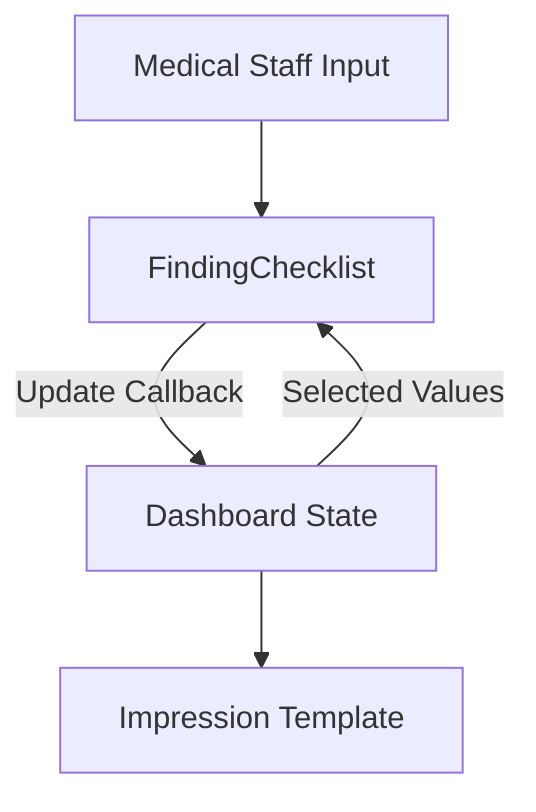

상위 컴포넌트에서 선택값을 관리하고, 하위 컴포넌트는 전달받은 상태와 Callback을 활용합니다.

### 18.8 Contribution Boundary

FindingChecklist는 팀 협업 컴포넌트입니다.

개인 커밋 `f83d166`에서는 체크리스트와 AI 판독 화면의 수정이 확인됩니다.

따라서 체크리스트 전체를 개인이 단독으로 개발했다고 표현하지 않고, AI 판독 화면 구성 및 체크리스트 연동 개선에 참여한 것으로 설명합니다.

---

## 19. Impression Generation

### 19.1 Implementation Concept

의료진이 선택한 체크리스트 항목을 바탕으로 판독 소견 초안을 표시하는 구조입니다.

### 19.2 Existing Workflow

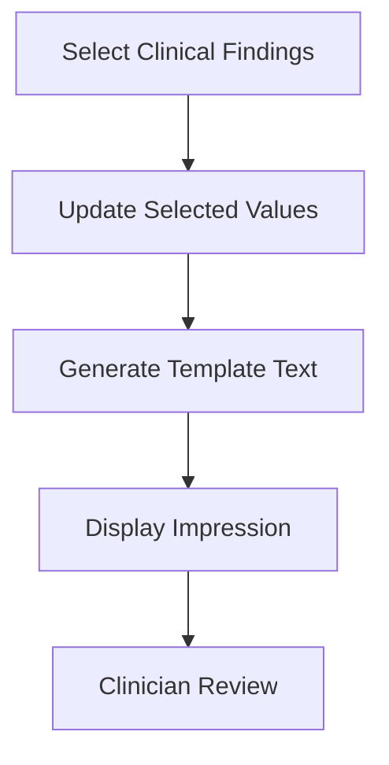

확인한 FindingChecklist에서는 선택 항목을 기반으로 문자열 템플릿을 생성하는 프로토타입 로직이 존재합니다.

### 19.3 Template-Based Generation

다음은 구현 원리를 설명하기 위한 가상의 예시입니다.

```javascript
function createImpression(vessels) {
  if (vessels.length === 0) {
    return '판독 항목이 선택되지 않았습니다.';
  }

  return (
    `선택된 검토 대상 혈관: ` +
    vessels.join(', ')
  );
}
```

위 코드는 의료진 입력값을 문자열로 구성하는 예시이며, 실제 의료 판독문을 자동으로 작성하는 알고리즘은 아닙니다.

### 19.4 State Update Timing

React 상태 업데이트는 즉시 변수에 반영되지 않을 수 있습니다.

따라서 상태를 변경한 직후 이전 상태를 참조하면 최신 선택값이 판독 소견에 반영되지 않을 수 있습니다.

```javascript
setSelectedVessels(updatedVessels);

generateImpression(updatedVessels);
```

확인한 체크리스트 코드에서는 변경된 값을 직접 소견 생성 함수에 전달하는 구조가 사용됩니다.

### 19.5 Mock Asynchronous Generation

확인한 코드에서는 setTimeout을 활용하여 소견 생성 진행 상태를 표현하는 부분이 존재합니다.

이는 실제 AI 추론 API 호출이나 LLM 기반 의료 판독문 생성과는 다릅니다.

### 19.6 Identified Limitations

- 선택값 없음과 정상 판독을 구분해야 함
- 반복 입력 시 타이머 관리 필요
- 컴포넌트 종료 시 타이머 정리 필요
- 의료진의 최종 확인 필요
- 실제 판독 소견과 템플릿 데이터 구분 필요

---

## 20. Clinical Report Workflow

### 20.1 Report Lifecycle

프로젝트의 판독 업무 흐름은 AI 분석 결과 확인 이후 의료진이 판독 소견을 작성하고 결과 화면을 확인하는 방향으로 구성되었습니다.

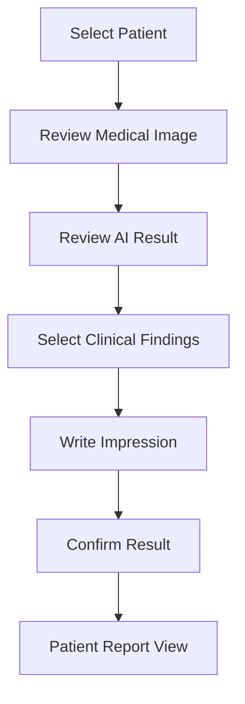

위 흐름은 확인한 프론트엔드 화면 간 업무 연결을 설명한 것입니다.

서버에서 판독 결과가 영구 저장되거나 실제 EMR 시스템으로 전송되는 모든 과정을 검증한 것은 아닙니다.

### 20.2 Local Report State

Dashboard에서는 선택한 환자와 판독 소견을 기반으로 결과 객체를 생성하고, 저장된 리포트 목록 상태를 갱신하는 코드가 확인됩니다.

### 20.3 Report Object

다음은 확인한 상태 구조를 단순화한 예시입니다.

```javascript
const report = {
  ...targetPatient,

  clinicalReport:
    impressionText ||
    targetPatient.clinical_report ||
    '작성된 소견 없음',

  confirmedAt:
    new Date().toLocaleString()
};
```

### 20.4 Upsert by Patient ID

동일한 환자의 결과가 이미 존재하는 경우 기존 항목을 변경하고, 존재하지 않는 경우 새로운 항목을 추가하는 구조입니다.

```javascript
setSavedReports(previous => {
  const exists = previous.some(item =>
    String(item.patient_id) ===
    String(report.patient_id)
  );

  if (exists) {
    return previous.map(item =>
      String(item.patient_id) ===
      String(report.patient_id)
        ? report
        : item
    );
  }

  return [...previous, report];
});
```

위 코드는 실제 상태 갱신 원리를 설명하기 위한 재구성 예시입니다.

### 20.5 Persistence Boundary

위 구조는 React 상태를 활용한 로컬 결과 관리입니다.

다음 기능을 의미하지 않습니다.

- 데이터베이스 영구 저장
- 서버 기반 판독 이력 관리
- 전자서명 완료
- 실제 EMR 전송
- 법적 효력이 있는 의료 기록 확정

---

## 21. Patient Report View

### 21.1 Personal Contribution

개인 커밋 `ee3c068`에서는 `Patient_ReportView.jsx` 파일의 신규 생성이 확인됩니다.

해당 화면은 의료진이 환자 정보와 검사 관련 정보 및 판독 소견을 확인할 수 있도록 구성한 결과 리포트 인터페이스입니다.

### 21.2 Report Layout

```text
+----------------------------------------------+
| Patient Report                               |
| Patient Selection / Print                    |
+----------------------------------------------+
| Patient Information                          |
| ID / Name / Age / Gender                     |
+----------------------------------------------+
| Clinical Information                         |
| Chief Complaint / Clinical Indicators        |
+----------------------------------------------+
| ECG Image                                    |
+----------------------------------------------+
| AI Analysis Information                      |
+----------------------------------------------+
| Clinical Impression                          |
+----------------------------------------------+
```

### 21.3 Component Props

| Prop | Responsibility |
|---|---|
| patient | 선택 환자 |
| ecgImageUrl | ECG 이미지 경로 |
| clinicalReport | 판독 소견 |
| patients | 환자 선택 목록 |
| onSelectPatient | 환자 선택 Callback |

### 21.4 Patient Synchronization

리포트 화면은 상위 컴포넌트에서 전달한 환자와 내부 선택 상태를 연결하는 구조입니다.

```javascript
const [
  selectedReportPatient,
  setSelectedReportPatient
] = useState(patient);
```

환자 정보가 변경될 때 선택 상태를 갱신하는 Effect 구조가 확인됩니다.

### 21.5 Patient Selection

```javascript
const selected = patients.find(item =>
  String(item.patient_id) ===
  String(selectedId)
);

if (selected) {
  setSelectedReportPatient(selected);

  onSelectPatient?.(selected);
}
```

위 코드는 환자 선택 처리 방식을 설명하기 위한 단순화 예시입니다.

### 21.6 Empty Patient Handling

선택된 환자가 없는 경우 결과 리포트 대신 대체 안내 화면을 표시하는 구조가 존재합니다.

이를 통해 환자 객체가 존재하지 않는 상태에서 속성에 접근하는 오류를 방지할 수 있습니다.

---

## 22. ECG Image Integration

### 22.1 ECG Display

리포트 화면에서는 환자의 ECG 관련 이미지 경로를 확인하고 해당 이미지를 표시할 수 있도록 구성하였습니다.

```javascript
const targetUrl =
  selectedReportPatient?.ecg_image_url ||
  initialEcgUrl;
```

### 22.2 Authenticated Media Request

팀 공통 함수인 `fetchAuthBlobUrl`을 활용하여 인증 미디어 접근 구조를 연결합니다.

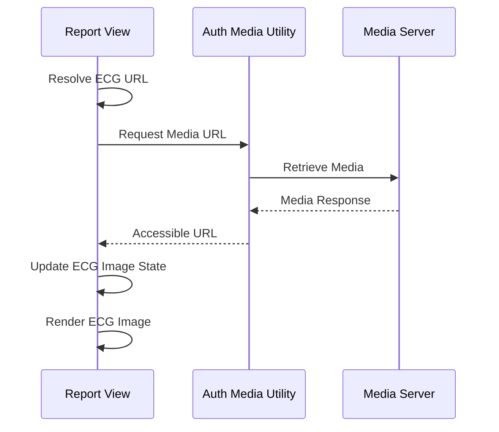

### 22.3 Resource Lifecycle

확인한 코드에서는 비동기 요청의 취소 여부 플래그와 Blob URL 해제 처리를 사용합니다.

다만 환자 변경 이후 이전 요청이 늦게 완료되는 경우까지 모든 자원 정리가 보장되는 것은 아닙니다.

### 22.4 ECG Data Boundary

팀 발표 자료에서는 ECG 결과 유형에 대응하는 대표 이미지 파일을 활용하는 구조를 설명합니다.

이는 환자의 실제 심전도 파형 데이터를 직접 생성하거나 분석하는 기능과는 구분합니다.

### 22.5 Clinical Data Integrity

ECG 이미지가 존재하지 않는 경우 다른 환자의 이미지 또는 임의의 정상 이미지를 표시해서는 안 됩니다.

환자 ID와 ECG 이미지의 연결 관계를 명확하게 검증할 필요가 있습니다.

---

## 23. Report Printing

### 23.1 Browser Print API

결과 리포트 화면에서는 브라우저 인쇄 기능을 호출하는 구조가 확인됩니다.

```javascript
function handlePrint() {
  window.print();
}
```

### 23.2 Implementation Scope

| Feature | Status |
|---|---|
| 결과 리포트 화면 | 개인 구현 확인 |
| 환자 정보 표시 | 구현 확인 |
| ECG 이미지 표시 | 구현 구조 확인 |
| 판독 소견 표시 | 구현 구조 확인 |
| 브라우저 인쇄 호출 | 구현 확인 |
| 브라우저 PDF 저장 | 인쇄 환경에 따라 가능 |
| 서버 PDF 생성 | 개인 구현으로 확인되지 않음 |
| 의료 기록 전자서명 | 별도 검증 필요 |

`window.print()`는 브라우저의 인쇄 인터페이스를 호출하는 기능입니다.

독립적인 PDF 생성 라이브러리나 서버 기반 의료 문서 생성 시스템을 구현한 것과는 구분합니다.

---

## 24. EMR Confirmation Interface

### 24.1 Intended Workflow

팀 프로젝트에서는 의료진의 판독 소견을 확인하고 EMR 관련 업무로 연결하는 화면을 구성하였습니다.

### 24.2 API Structure

EmrConfirmPanel 내부에는 다음 API를 호출하는 함수가 존재합니다.

| 항목 | 내용 |
|---|---|
| Method | POST |
| Endpoint | `/api/emr-signoffs/` |
| Authentication | Bearer Token |
| Purpose | 판독 확정 관련 데이터 요청 |

### 24.3 Payload Example

다음은 확인한 요청 데이터의 구조를 설명하기 위한 예시입니다.

```json
{
  "patient_id": 1001,
  "finalized": true,
  "final_result": "Example clinical impression",
  "ai_result": null,
  "report_ready": true,
  "emr_transmitted": true
}
```

위 객체는 가상의 데이터이며 실제 환자 정보가 아닙니다.

요청 객체에 `emr_transmitted: true`가 포함되어 있다는 사실만으로 외부 EMR 시스템으로 실제 전송되었다고 판단할 수는 없습니다.

### 24.4 Intended API Flow

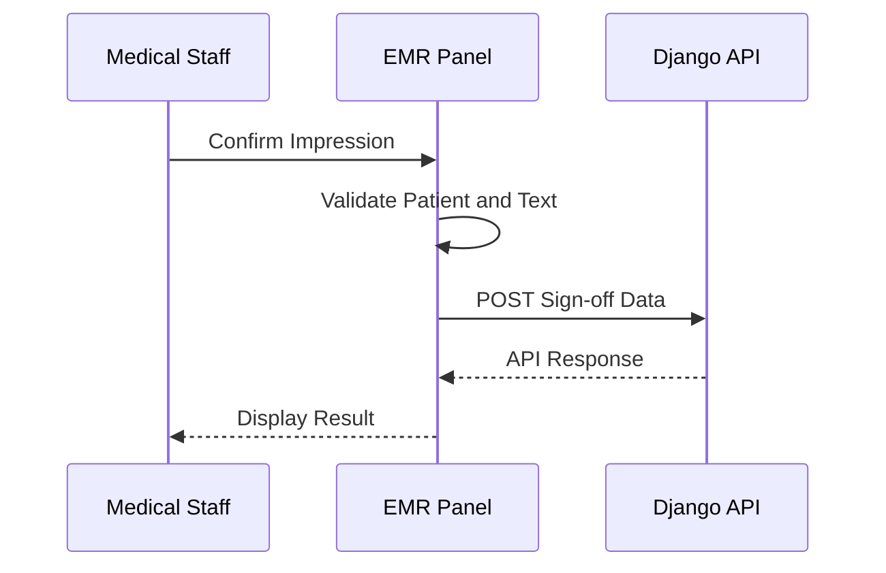

위 다이어그램은 컴포넌트 내부에 정의된 API 호출 함수의 의도된 흐름입니다.

### 24.5 Actual Button Connection

확인한 개인 브랜치에서는 EMR 확인 버튼이 내부 API 호출 함수가 아닌 상위 컴포넌트의 `onConfirm` Callback에 연결되어 있습니다.

```jsx
<button onClick={onConfirm}>
  결과 확인
</button>
```

Dashboard에서 전달하는 Callback은 로컬 리포트 상태를 갱신하는 함수입니다.

따라서 확인한 버튼 경로에서는 내부 EMR API 호출 함수가 직접 실행되지 않는 구조입니다.

### 24.6 Actual UI Flow

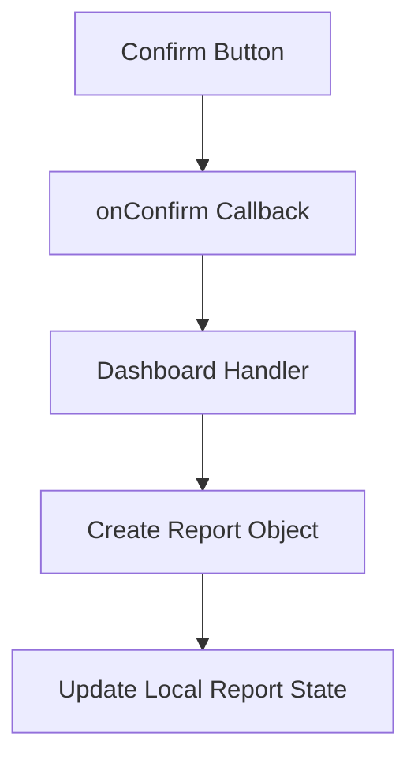

### 24.7 Contribution Boundary

EMR API 구현 및 서버 데이터 확정 처리는 팀 담당 영역입니다.

개인 개발은 결과 리포트 화면 구성 및 판독 화면 간 사용자 인터페이스 연결에 집중하였습니다.

실제 EMR 전송 및 서버 저장을 완료한 기능으로 표현하지 않습니다.

---

## 25. AI & Clinician Data Separation

### 25.1 Data Categories

AI 결과와 의료진 입력 정보는 서로 다른 데이터입니다.

| Category | Examples |
|---|---|
| Original Media | 관상동맥 조영영상 |
| AI Classification | 모델 분류 결과 |
| AI Detection | Bounding Box |
| XAI Data | Grad-CAM Heatmap |
| Clinician Annotation | Box, Pen, Text |
| Clinical Findings | 체크리스트 선택값 |
| Clinical Impression | 의료진 판독 소견 |
| Report State | 결과 확인 정보 |

### 25.2 Separation Architecture

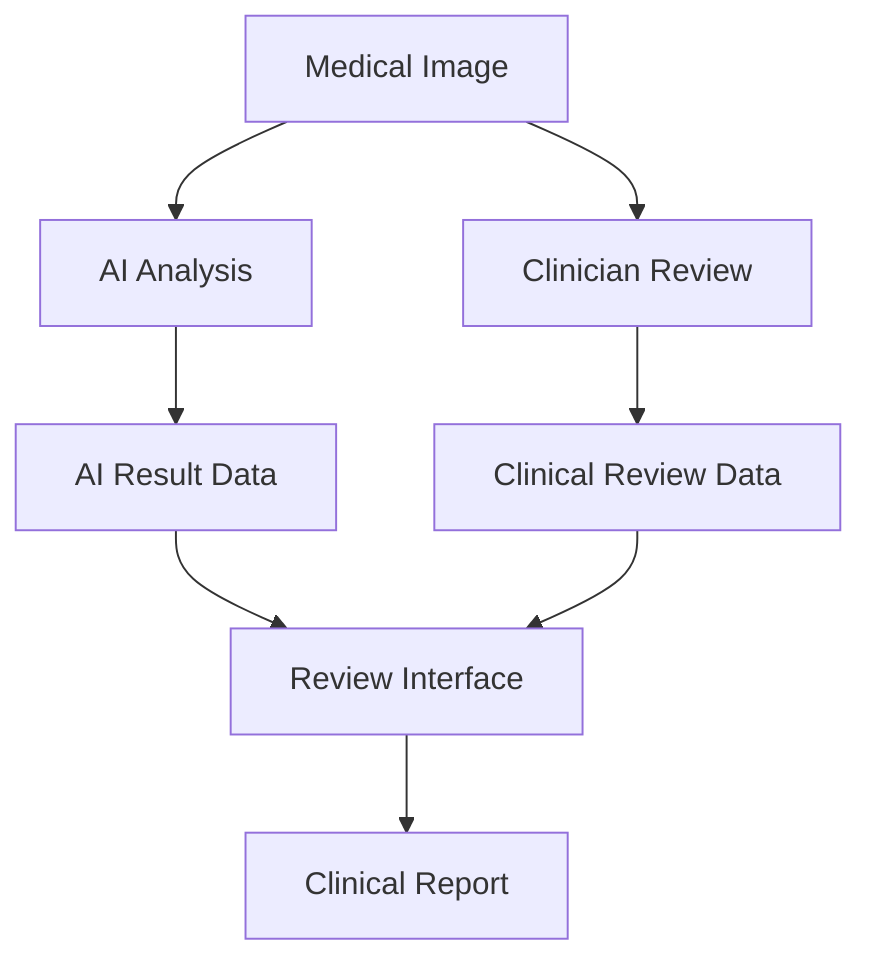

AI 분석 결과와 의료진의 최종 판독 정보는 출처와 역할이 구분되어야 합니다.

### 25.3 Backend Engineering Consideration

향후 실제 서비스에서는 다음 데이터를 독립적으로 관리할 필요가 있습니다.

- AI 모델 버전
- 분석 실행 시점
- 분석 대상 검사
- AI 결과 원본
- 의료진 작성자
- 판독 소견 수정 이력
- 결과 확정 상태
- 데이터 접근 권한

이를 통해 AI 결과와 의료진 판단이 혼재되지 않도록 설계할 수 있습니다.

위 내용은 향후 백엔드 확장 설계에 대한 고려사항입니다.

---

## 26. Technical Review & Identified Limitations

소스코드 검토 과정에서 확인한 주요 개선 필요 항목입니다.

### 26.1 Mock AI Results

일부 화면에서는 실제 분석 결과가 존재하지 않는 경우 샘플 분류 점수와 Bounding Box를 표시하는 구조가 확인됩니다.

개선 방향:

- 실제 분석 결과와 샘플 데이터 구분
- 미분석 상태 표시
- 분석 실패 상태 표시
- 시연 모드 명시
- 실제 환자 화면에서 샘플 결과 사용 제한

### 26.2 Bounding Box Height Calculation

일부 좌표 변환 분기에서 `y2 - y2` 계산이 사용됩니다.

개선 방향:

- 좌표 변환 함수 통합
- 유효한 좌표 범위 검증
- 양수 크기 확인
- 원본 이미지 크기 확인
- 좌표 변환 단위 테스트

### 26.3 Response Schema Consistency

다양한 응답 형식을 프론트엔드에서 개별적으로 처리하면 예외 분기가 증가할 수 있습니다.

개선 방향:

- 서버 응답 스키마 표준화
- 공통 AI Result Adapter 구성
- TypeScript 타입 정의
- 런타임 데이터 검증
- API 버전 관리

### 26.4 Patient Context Synchronization

환자 변경 중 이전 분석 요청이 완료되는 경우 현재 선택된 환자와 결과가 일치하는지 확인해야 합니다.

개선 방향:

- 환자 ID 및 검사 ID 검증
- 분석 요청 식별자 관리
- 이전 요청 취소
- 분석 결과 초기화
- 이전 응답 반영 제한

### 26.5 Report Data Accuracy

결과 리포트 화면에는 일부 임상정보와 AI 점수의 샘플 기본값이 존재합니다.

개선 방향:

- 실제 검사 결과만 표시
- 누락 데이터 명시
- 샘플 데이터와 실제 데이터 구분
- 분석 결과와 리포트 데이터 연결 검증
- 환자별 판독 소견 관리

### 26.6 Report Component Contract

Dashboard에서 전달하는 일부 리포트 관련 Props와 Patient_ReportView가 실제로 받는 Props 사이에 차이가 확인됩니다.

개선 방향:

- 컴포넌트 인터페이스 통일
- 환자 목록 전달 규칙 정의
- 저장된 리포트 조회 구조 연결
- 상위 상태와 내부 상태의 책임 정리

### 26.7 EMR API Connection

EMR 확인 버튼과 내부 API 호출 함수가 직접 연결되지 않는 구조가 확인됩니다.

개선 방향:

- 실제 서버 저장 함수와 버튼 연결
- 요청 중 중복 클릭 방지
- 서버 응답 성공 이후 상태 변경
- 환자 및 검사 식별자 검증
- 실패 시 재시도 처리
- 실제 전송 결과 확인

### 26.8 Uncertainty Interpretation

모델 점수의 단순 보완값을 불확실성으로 표시하는 방식은 검증된 불확실성 추정 방법과 다릅니다.

개선 방향:

- 점수의 의미 명확화
- Calibration 평가
- 모델 불확실성 지표 검증
- 임상적 해석 범위 제한

### 26.9 Clinical Risk Calculation

일부 위험도 표시 로직은 기본값과 프로토타입 계산식을 사용합니다.

개선 방향:

- 누락된 임상정보를 임의로 보완하지 않음
- 검증된 평가 기준 적용
- 의료 전문가 검토
- 모델 및 계산 결과의 검증
- 실제 임상 적용 범위 명시

---

## 27. Proposed AI Result Adapter

### 27.1 Improvement Concept

AI 응답 처리 로직을 Dashboard 내부에 모두 포함하는 대신 별도의 데이터 변환 모듈로 분리할 수 있습니다.

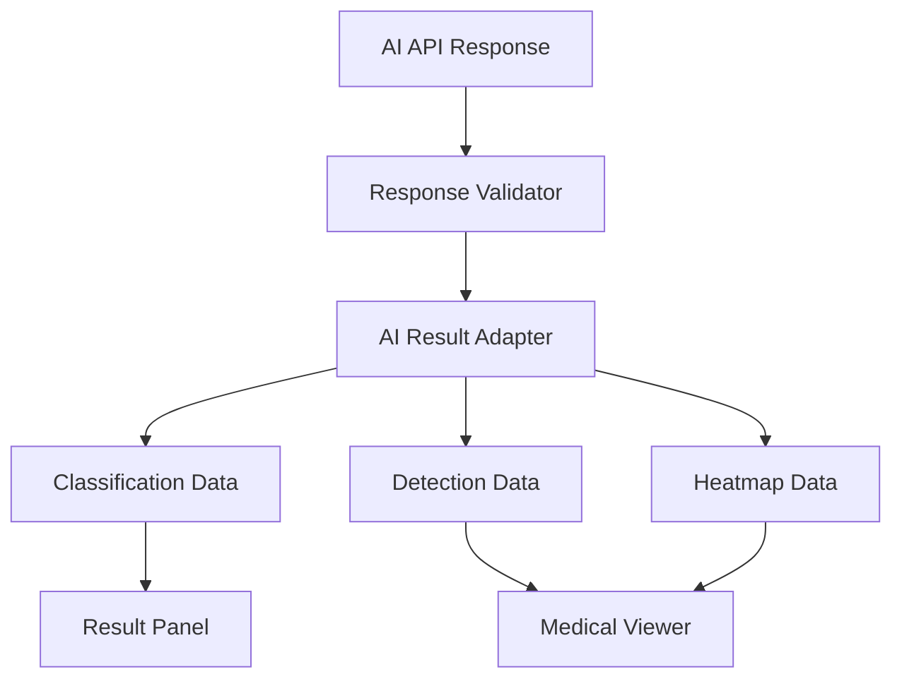

### 27.2 Proposed Type Definition

```typescript
interface BoundingBox {
  x: number;
  y: number;
  width: number;
  height: number;
  confidence: number | null;
}

interface ClassificationResult {
  label: string;
  confidence: number | null;
}

interface NormalizedAiResult {
  patientId: string;
  examinationId: string;
  classification: ClassificationResult | null;
  boxes: BoundingBox[];
  heatmapUrl: string | null;
  imageWidth: number;
  imageHeight: number;
}
```

위 타입은 향후 데이터 계약을 명확하게 정의하기 위한 개선 설계 예시입니다.

기존 프로젝트의 실제 API 응답 스키마와 동일하지 않습니다.

### 27.3 Expected Engineering Benefits

- 응답 처리 책임 분리
- 데이터 검증 로직 재사용
- 좌표 변환 오류 관리
- 컴포넌트 의존성 감소
- 단위 테스트 작성 용이
- 서버와 프론트엔드 간 데이터 계약 명확화

위 항목은 개선 설계의 기대 효과이며, 실제 적용 및 성능 측정 결과는 아닙니다.

---

## 28. Proposed Backend Integration

### 28.1 Analysis Job Architecture

AI 분석 시간이 증가하거나 여러 의료진이 동시에 분석을 요청하는 환경에서는 비동기 작업 기반 서버 구조를 고려할 수 있습니다.

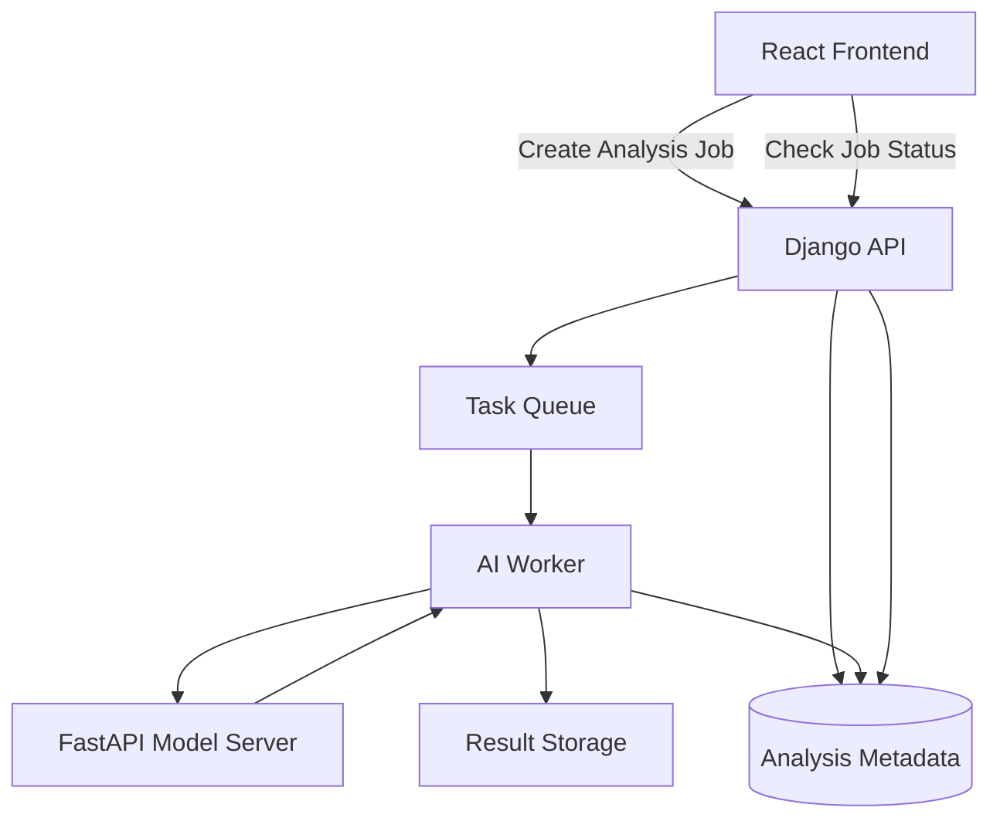

위 아키텍처는 향후 확장 제안이며, ANGIO XAI에 적용된 실제 작업 큐 구조는 아닙니다.

### 28.2 Proposed Job States

| State | Meaning |
|---|---|
| PENDING | 분석 대기 |
| RUNNING | 분석 진행 |
| SUCCESS | 분석 완료 |
| FAILED | 분석 실패 |
| CANCELLED | 분석 취소 |

### 28.3 Proposed API Design

| Method | Endpoint | Purpose |
|---|---|---|
| POST | /api/analysis-jobs/ | 분석 작업 생성 |
| GET | /api/analysis-jobs/{id}/ | 작업 상태 조회 |
| GET | /api/analysis-results/{id}/ | 분석 결과 조회 |
| POST | /api/clinical-reports/ | 판독 소견 생성 |
| PATCH | /api/clinical-reports/{id}/ | 판독 소견 수정 |
| POST | /api/clinical-reports/{id}/finalize/ | 결과 확정 |

위 API는 향후 백엔드 확장 방향을 설명하기 위한 제안입니다.

기존 프로젝트에서 실제로 제공한 Endpoint 목록과는 구분합니다.

### 28.4 Design Considerations

- 환자 및 검사 접근 권한
- 동일 분석 요청의 중복 처리
- 분석 작업 상태 관리
- 모델 버전 기록
- 결과 파일과 메타데이터 분리
- 의료진 판독 이력
- 오류 복구 및 재시도 정책
- 감사 로그 관리

---

## 29. Validation Scenarios

다음은 AI 분석 화면과 의료진 판독 기능의 검증을 위해 정의한 테스트 시나리오입니다.

실제 자동화 테스트 실행 결과가 아니라 소스코드 검토를 바탕으로 작성한 검증 계획입니다.

| ID | Test Scenario | Expected Result |
|---|---|---|
| AI-01 | 분석 파일 없음 | 분석 요청 제한 |
| AI-02 | 인증 토큰 없음 | 인증 필요 안내 |
| AI-03 | 정상 분석 요청 | 로딩 상태 표시 |
| AI-04 | 정상 API 응답 | 분석 결과 표시 |
| AI-05 | HTTP 401 응답 | 인증 오류 안내 |
| AI-06 | 서버 오류 | 오류 메시지 표시 |
| AI-07 | 분석 요청 실패 | 로딩 상태 종료 |
| AI-08 | 중첩된 분류 응답 | 분류 정보 추출 |
| AI-09 | XYXY 좌표 응답 | XYWH 좌표 변환 |
| AI-10 | 정규화 좌표 응답 | 원본 좌표 변환 |
| AI-11 | 잘못된 좌표 | 유효하지 않은 결과 제외 |
| AI-12 | Heatmap 비활성화 | Heatmap 숨김 |
| AI-13 | Bounding Box 비활성화 | AI Box 숨김 |
| AI-14 | Opacity 변경 | 투명도 반영 |
| AI-15 | Threshold 변경 | 표시 결과 필터링 |
| AI-16 | 환자 변경 중 분석 완료 | 이전 환자 결과 반영 제한 |
| AI-17 | AI 결과 없음 | 미분석 상태 표시 |
| AI-18 | 혈관 복수 선택 | 선택 목록 갱신 |
| AI-19 | 선택 항목 해제 | 해당 항목 제거 |
| AI-20 | 체크리스트 변경 | 최신 소견 입력값 반영 |
| AI-21 | 판독 소견 확인 | 결과 상태 갱신 |
| AI-22 | 결과 리포트 진입 | 선택 환자 정보 표시 |
| AI-23 | ECG 이미지 없음 | 데이터 없음 안내 |
| AI-24 | 브라우저 인쇄 선택 | 인쇄 인터페이스 호출 |
| AI-25 | EMR 확정 요청 실패 | 성공 상태 반영 제한 |
| AI-26 | 동일 환자 리포트 변경 | 로컬 결과 항목 갱신 |
| AI-27 | 임상정보 누락 | 임의의 정상값 표시 방지 |
| AI-28 | 환자별 리포트 전환 | 다른 환자 데이터 혼재 방지 |

AI-11, AI-16, AI-17, AI-25, AI-27 및 AI-28 등은 기존 구현의 개선 필요 영역을 포함합니다.

---

## 30. Git Contribution

### 30.1 Representative Commits

| Commit | Contribution |
|---|---|
| `77e079c` | AI Viewer 및 XAI 관련 화면 수정 |
| `f83d166` | AI 판독 화면 3분할, Canvas 기능 및 체크리스트 수정 |
| `c871f85` | AI 진단 메인 화면 재구성 |
| `ee3c068` | 결과 리포트 화면 신규 생성 및 업무 화면 연결 |

### 30.2 Representative Source Files

- `src/Page/Dashboard.jsx`
- `src/Components/Main_viewer.jsx`
- `src/Components/Xai_visualization.jsx`
- `src/Components/FindingChecklist.jsx`
- `src/Components/ImpressionTemplate.jsx`
- `src/Components/EmrConfirmPanel.jsx`
- `src/Components/Patient_ReportView.jsx`

### 30.3 Personal Contribution Summary

개인 개발 기여가 명확하게 확인되는 주요 영역은 다음과 같습니다.

- AI 판독 화면 3분할 레이아웃 구성
- 의료영상 Viewer 인터랙션 개선
- Canvas 기반 의료진 주석 기능 추가
- AI 결과 표시 인터페이스 연결 및 수정
- 체크리스트 화면 구성 개선
- AI 진단 화면 재구성
- 결과 리포트 컴포넌트 신규 생성
- 환자 정보와 판독 소견 표시 구조 구성
- 결과 확인 화면 및 인쇄 인터페이스 구성

### 30.4 Team Contribution Boundary

다음 영역은 팀 담당 기능으로 구분합니다.

| Area | Responsibility |
|---|---|
| InceptionV3 | AI 모델 학습 및 분류 |
| YOLOv11 | 병변 의심 영역 탐지 |
| Grad-CAM | 모델 설명 정보 생성 |
| FastAPI | 모델 추론 서버 |
| Django | 인증 및 업무 API |
| MySQL | 데이터베이스 |
| XAI Algorithm | 설명 정보 처리 |
| MACE Algorithm | 위험도 관련 기능 |
| EMR API | 서버 기반 결과 확정 처리 |

개인 Git 변경 이력은 해당 기능에 대한 개발 참여를 확인하기 위한 근거이며, 관련 컴포넌트의 모든 기능을 개인이 단독으로 구현하였다는 의미는 아닙니다.

---

## 31. Engineering Retrospective

이번 프로젝트에서는 AI 모델의 분석 결과가 실제 사용자 인터페이스에서 활용되기 위해 필요한 데이터 처리 구조를 경험하였습니다.

AI 모델의 추론 결과를 단순히 화면에 표시하는 것뿐만 아니라, 결과 데이터의 형식과 좌표 기준, 환자 식별정보 및 사용자 입력 상태를 함께 고려해야 한다는 점을 이해하였습니다.

특히 의료영상 Viewer와 AI 판독 화면을 구성하면서 서버의 데이터 응답 규격이 명확하지 않으면 프론트엔드의 예외 처리와 데이터 변환 로직이 복잡해질 수 있다는 점을 확인하였습니다.

또한 AI 결과와 의료진이 직접 작성한 판독 정보를 구분하고, 결과 확인 화면까지 연결하는 과정을 통해 의료 서비스의 업무 흐름을 이해할 수 있었습니다.

### Key Learnings

- AI 추론 결과의 프론트엔드 활용
- Multipart 파일 전송 구조
- JWT 기반 API 요청
- 비동기 요청 및 오류 상태 관리
- JSON 응답 데이터 정규화
- Bounding Box 좌표 형식의 차이
- XAI 표시 옵션과 Viewer 연결
- Controlled Component 구조
- 의료진 판독 정보와 AI 결과 구분
- 환자 중심의 데이터 무결성
- 프론트엔드와 백엔드 간 API 계약

### Backend Engineering Perspective

AI 판독 화면을 구현하면서 백엔드 API는 단순히 데이터를 반환하는 역할뿐만 아니라, 해당 데이터의 의미와 형식을 일관되게 정의해야 한다는 점을 이해하였습니다.

특히 의료 서비스에서는 환자, 검사, AI 분석 결과 및 의료진 판독 소견의 연결 관계가 명확해야 하며, 데이터 누락이나 잘못된 결과 표시를 방지하기 위한 검증이 필요합니다.

이러한 경험을 바탕으로 이후 DUGN 프로젝트에서는 의료영상 분석 결과의 데이터 관리, 저장소 분리, 의료진 판독 및 환자 결과 공개 흐름을 백엔드 중심으로 구현하였습니다.

---

## 32. Related Documentation

- [Project Overview](./README.md)
- [System Architecture](./architecture.md)
- [Dashboard & Patient Management](./dashboard.md)
- [Medical Image Viewer](./image-viewer.md)
- [UI & State Management](./ui-state.md)
- [Troubleshooting](./troubleshooting.md)

### Source References

- [Team Repository](https://github.com/hyunkyung31/React_DL)
- [Personal Development Branch](https://github.com/hyunkyung31/React_DL/tree/yuri)
- [Dashboard Source](https://github.com/hyunkyung31/React_DL/blob/yuri/src/Page/Dashboard.jsx)
- [XAI Component](https://github.com/hyunkyung31/React_DL/blob/yuri/src/Components/Xai_visualization.jsx)
- [Finding Checklist](https://github.com/hyunkyung31/React_DL/blob/yuri/src/Components/FindingChecklist.jsx)
- [Patient Report View](https://github.com/hyunkyung31/React_DL/blob/yuri/src/Components/Patient_ReportView.jsx)
- [AI Viewer Update Commit](https://github.com/hyunkyung31/React_DL/commit/77e079c)
- [Three-Column Layout and Canvas Commit](https://github.com/hyunkyung31/React_DL/commit/f83d166)
- [AI Diagnosis Refactoring Commit](https://github.com/hyunkyung31/React_DL/commit/c871f85)
- [Patient Report Implementation Commit](https://github.com/hyunkyung31/React_DL/commit/ee3c068)

본 문서는 개인 개발 브랜치, Git 변경 이력 및 팀 프로젝트 최종 발표 자료를 바탕으로 작성하였습니다.

설명용 코드, 가상 데이터 및 다이어그램은 실제 구현 구조를 이해하기 쉽게 재구성하였습니다.

소스코드 검토 과정에서 확인한 개선 필요 항목과 향후 확장 설계는 기존 구현 및 실제 검증 결과와 구분하여 표시하였습니다.
