# System Architecture

> ANGIO XAI — 시스템 아키텍처 및 데이터 흐름

본 문서는 관상동맥 협착 탐지 및 XAI 판독 지원 시스템의 전체 아키텍처와 React 기반 프론트엔드의 컴포넌트 구조, API 통신 및 데이터 관리 방식을 설명합니다.

팀 프로젝트의 전체 시스템 구성과 개인 개발 범위를 구분하여 기술하였습니다.

---

## 1. Architecture Overview

ANGIO XAI는 의료진의 환자 조회, 의료영상 확인, AI 분석 및 판독 업무를 지원하기 위해 프론트엔드, 백엔드, AI 추론 서비스를 분리하여 구성하였습니다.

| Layer | Technology | Responsibility |
|---|---|---|
| Presentation | React, Tailwind CSS | 의료진 인터페이스 및 사용자 상태 관리 |
| Application | Django REST API | 인증, 환자 조회 및 업무 데이터 처리 |
| AI Inference | FastAPI | AI 모델 추론 및 분석 결과 반환 |
| Database | MySQL | 환자, 검사 및 업무 데이터 관리 |
| Storage | GCS, Server Media | 모델 파일 및 의료 미디어 관리 |
| Infrastructure | GCP, Nginx, Gunicorn | 서비스 실행 및 요청 전달 |

### 설계 목적

- 사용자 인터페이스와 서버 비즈니스 로직의 분리
- AI 추론 서비스와 의료 업무 API의 역할 분리
- 환자 정보와 의료영상의 통합 조회
- 의료영상과 AI 분석 결과의 시각적 연결
- 기능별 컴포넌트 구성을 통한 화면 관리

---

## 2. Infrastructure Architecture

최종 발표 자료에서는 Google Cloud Platform의 가상 서버를 중심으로 React, Django 및 FastAPI 서비스를 구성하였습니다.

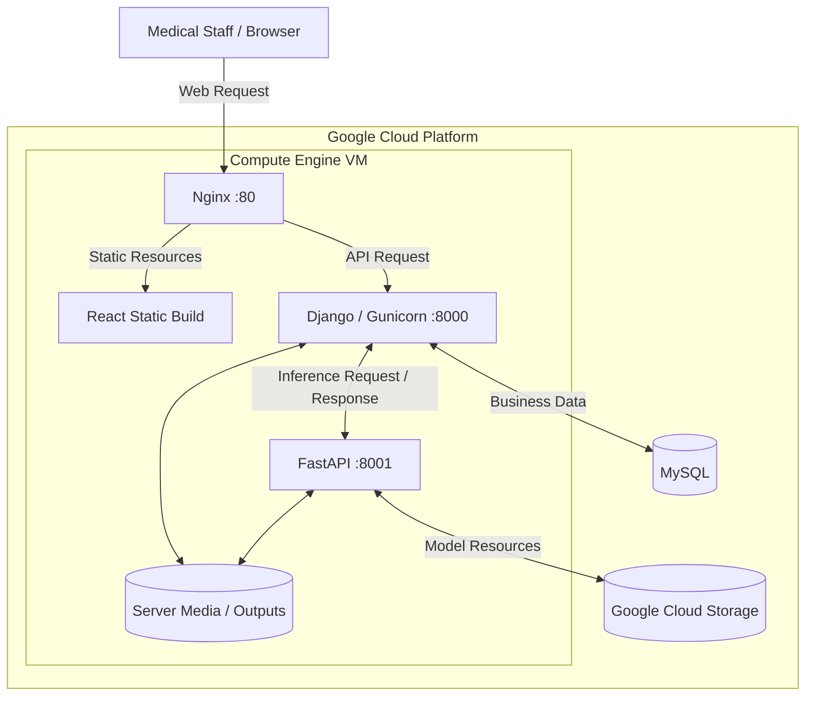

### 2.1 Presentation Layer

React 기반 웹 애플리케이션은 의료진이 사용하는 화면을 담당합니다.

주요 기능은 다음과 같습니다.

- 의료진 로그인
- 환자 목록 및 상세정보 조회
- 의료영상 Viewer
- AI 분석 결과 및 XAI 시각화
- Canvas 기반 의료진 주석
- 북마크 및 협진 인터페이스
- 환자 판독 결과 리포트

### 2.2 Application Layer

Django는 프론트엔드와 AI 추론 서비스 사이에서 의료 업무 데이터를 처리하는 애플리케이션 서버 역할을 담당합니다.

- JWT 기반 사용자 인증
- 환자 및 검사 데이터 조회
- 의료 업무 데이터 관리
- AI 분석 요청 전달
- 분석 결과 응답
- 북마크 및 협진 관련 API

### 2.3 AI Inference Layer

FastAPI는 관상동맥 영상 분석을 위한 AI 모델 추론 서비스로 구성되었습니다.

| Model | Responsibility |
|---|---|
| InceptionV3 | 관상동맥 영상 분류 |
| YOLOv11 | 협착 의심 영역 탐지 |
| Grad-CAM | 모델 판단 근거 시각화 |

AI 모델은 의료진의 판단을 보조하기 위한 분석 정보를 제공합니다.

모델의 실제 임상적 유효성과 외부 의료기관 데이터에 대한 일반화 성능은 별도의 검증이 필요합니다.

### 2.4 Infrastructure Scope

위 구성은 최종 발표 자료에 제시된 단일 VM 기반 아키텍처를 중심으로 정리하였습니다.

실제 배포 설정 파일, 네트워크 보안 설정, TLS 구성 및 현재 서버 운영 상태까지 독립적으로 검증한 것은 아닙니다.

백엔드, AI 모델 및 인프라 구축은 팀 담당 영역이며, 개인 개발은 React 기반 사용자 인터페이스에 집중하였습니다.

---

## 3. Frontend Project Structure

개인 개발 브랜치의 주요 소스코드 구조는 다음과 같습니다.

```text
React_DL/
├── public/
├── src/
│   ├── assets/
│   │   ├── angio_sample.png
│   │   └── hero.png
│   │
│   ├── Components/
│   │   ├── BoomarkView.jsx
│   │   ├── Consultation_View.jsx
│   │   ├── EmrConfirmPanel.jsx
│   │   ├── FindingChecklist.jsx
│   │   ├── ImpressionTemplate.jsx
│   │   ├── Mace_risk.jsx
│   │   ├── Main_viewer.jsx
│   │   ├── Notification_bell.jsx
│   │   ├── Patient_ReportView.jsx
│   │   └── Xai_visualization.jsx
│   │
│   ├── Page/
│   │   ├── Dashboard.jsx
│   │   ├── Home.jsx
│   │   ├── Intro.jsx
│   │   ├── Login.jsx
│   │   ├── Patient_Detail.jsx
│   │   └── Patient_Management.jsx
│   │
│   ├── utils/
│   │   ├── authMedia.js
│   │   └── bookmarksApi.js
│   │
│   ├── App.tsx
│   ├── App.css
│   ├── index.css
│   └── main.jsx
│
├── package.json
├── package-lock.json
├── vite.config.js
├── tailwind.config.js
└── postcss.config.js
```

실제 저장소의 파일명을 기준으로 작성하였으며, `BoomarkView.jsx`는 원본 파일명을 유지하였습니다.

### Directory Responsibilities

| Directory | Responsibility |
|---|---|
| Page | 화면 단위 컴포넌트 |
| Components | 기능별 UI 및 사용자 인터랙션 |
| utils | API 통신 및 미디어 접근 관련 공통 기능 |
| assets | 이미지 등 정적 리소스 |
| App.tsx | 애플리케이션 진입 상태 및 공통 데이터 관리 |

---

## 4. Frontend Component Architecture

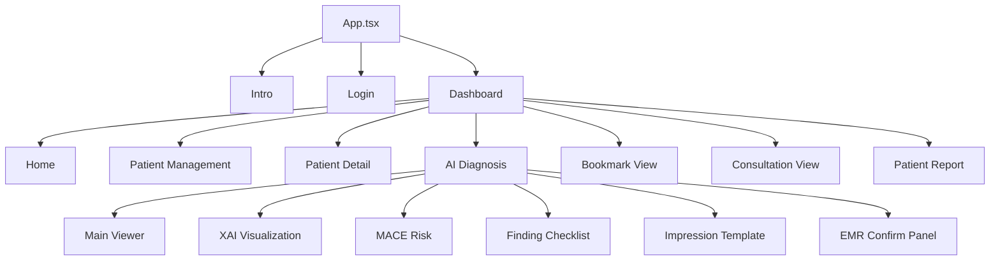

### 4.1 App-Level Responsibilities

`App.tsx`는 애플리케이션의 진입 상태와 여러 화면에서 사용하는 공통 데이터를 관리합니다.

- 로그인 여부
- 의료진 표시 이름
- 환자 목록
- 서버 상태
- 북마크 목록
- 로그인 및 로그아웃 처리
- 북마크 API 연동

로그인 상태에 따라 Intro, Login, Dashboard 컴포넌트를 조건부로 렌더링합니다.

React Router가 패키지에 포함되어 있지만, 확인한 개인 브랜치의 주요 화면 전환은 상태 기반 조건부 렌더링으로 구현되어 있습니다.

### 4.2 Dashboard-Level Responsibilities

`Dashboard.jsx`는 의료진 업무 화면의 중심 컴포넌트입니다.

- 현재 메뉴 상태 관리
- 환자 선택 상태 관리
- 사이드바 검색
- 환자 상세 화면 연결
- AI 분석 대상 환자 선택
- AI 분석 요청 및 결과 상태 관리
- XAI 표시 옵션 관리
- 기능별 하위 컴포넌트 연결

### 4.3 Feature-Level Responsibilities

| Component | Responsibility |
|---|---|
| Home | 환자 현황 및 빠른 메뉴 |
| Patient_Management | 환자 목록 및 검색 |
| Patient_Detail | 환자 임상정보 및 검사 이미지 |
| Main_viewer | 의료영상 표시 및 사용자 인터랙션 |
| Xai_visualization | AI 오버레이 표시 옵션 |
| FindingChecklist | 의료진 판독 항목 입력 |
| BoomarkView | 북마크 목록 및 상세 팝업 |
| Consultation_View | 협진 요청 인터페이스 |
| Patient_ReportView | 환자 판독 결과 표시 |

---

## 5. Component Separation & Refactoring

### 5.1 Background

초기 개발 과정에서는 Dashboard 컴포넌트에 여러 화면과 사용자 인터랙션 관련 로직이 집중되어 있었습니다.

화면 기능이 추가되면서 환자 목록, 메인 홈 화면, 영상 제어 및 AI 분석 상태를 하나의 컴포넌트에서 관리해야 하는 구조가 형성되었습니다.

### 5.2 Refactoring Direction

기능별 화면을 독립적인 컴포넌트로 분리하고, 상위 컴포넌트에서 필요한 데이터와 이벤트를 전달하는 구조로 개선하였습니다.

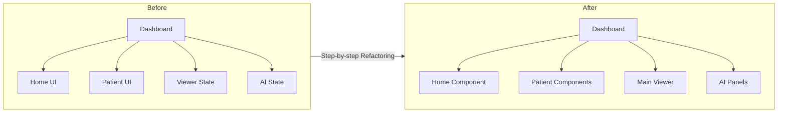

### 5.3 Props & Callback

상위 컴포넌트는 환자 목록과 화면 전환 함수를 하위 컴포넌트에 전달합니다.

아래 코드는 실제 구조를 설명하기 위해 단순화한 예시입니다.

```jsx
<Home
  displayName={displayName}
  patients={patientList}
  onNavigate={setCurrentMenu}
  onSelectPatient={handleSelectPatient}
/>
```

Home 컴포넌트는 전달받은 데이터를 렌더링하고, 사용자 이벤트가 발생하면 Callback을 호출합니다.

```jsx
function Home({
  patients = [],
  onNavigate,
  onSelectPatient
}) {
  return (
    <div>
      <button onClick={() => onNavigate('patients')}>
        환자 관리
      </button>

      {patients.map(patient => (
        <button
          key={patient.patient_id}
          onClick={() => onSelectPatient(patient)}
        >
          {patient.patient_name}
        </button>
      ))}
    </div>
  );
}
```

### 5.4 Design Benefits

- 화면별 책임 구분
- 기능 단위 코드 수정 범위 축소
- 공통 환자 데이터 전달
- 상위 컴포넌트를 통한 화면 전환 관리
- 독립적인 화면 구성 및 유지보수

위 항목은 구조적인 설계상의 이점이며, 코드 복잡도나 렌더링 성능을 정량적으로 측정한 결과는 아닙니다.

### 5.5 Git Evidence

| Commit | Description |
|---|---|
| `8749953` | 환자 목록 대시보드 생성 |
| `d75b325` | 환자 상세 페이지 및 빠른 검색 |
| `e7fa8f8` | Home 컴포넌트 생성 및 분리 작업 |
| `0161739` | 대시보드 복구 및 화면 구조 수정 |
| `f83d166` | AI 판독 화면 3분할 및 Viewer 개선 |
| `ee3c068` | 결과 리포트 및 화면 전환 개선 |

`e7fa8f8`에서는 내부 Home 함수와 별도의 Home 파일이 함께 존재하는 중간 단계가 확인됩니다.

따라서 한 번의 커밋으로 모든 구조를 완전히 분리한 것이 아니라, 여러 개발 단계에 걸쳐 컴포넌트 구조를 개선하였습니다.

---

## 6. State Management Architecture

본 프로젝트의 개인 개발 브랜치에서는 React Hooks와 Props를 중심으로 화면 상태를 관리하였습니다.

Redux 또는 별도의 전역 상태 관리 라이브러리를 사용한 구조로 설명하지 않습니다.

### 6.1 State Ownership

| Owner | State | Purpose |
|---|---|---|
| App | user | 로그인 사용자 |
| App | patients | 공통 환자 목록 |
| App | bookmarks | 북마크 목록 |
| Dashboard | currentMenu | 현재 화면 |
| Dashboard | selectedPatient | 선택한 환자 |
| Dashboard | selectedDiagPatient | AI 분석 대상 |
| Dashboard | aiFile | 분석 요청 파일 |
| Dashboard | aiResult | AI 분석 결과 |
| Dashboard | aiLoading | 분석 진행 상태 |
| Dashboard | aiError | 분석 오류 |
| Main_viewer | currentFrame | 프레임 표시 상태 |
| Main_viewer | scale | 영상 확대 배율 |
| Main_viewer | position | 영상 이동 위치 |
| Main_viewer | activeTool | 활성화된 주석 도구 |
| Main_viewer | userAnnotations | 의료진 주석 목록 |
| BookmarkView | selectedItem | 상세 팝업 대상 |

### 6.2 Data Down, Events Up

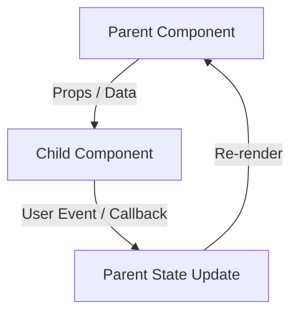

상위 컴포넌트에서 데이터를 전달하고, 하위 컴포넌트에서 발생한 사용자 이벤트는 Callback을 통해 상위 상태에 반영합니다.

### 6.3 State Lifecycle

환자 변경 또는 새로운 파일 선택 시 기존 분석 결과와 화면 상태를 초기화하여 서로 다른 환자나 검사 정보가 혼재하지 않도록 하는 로직을 구성하였습니다.

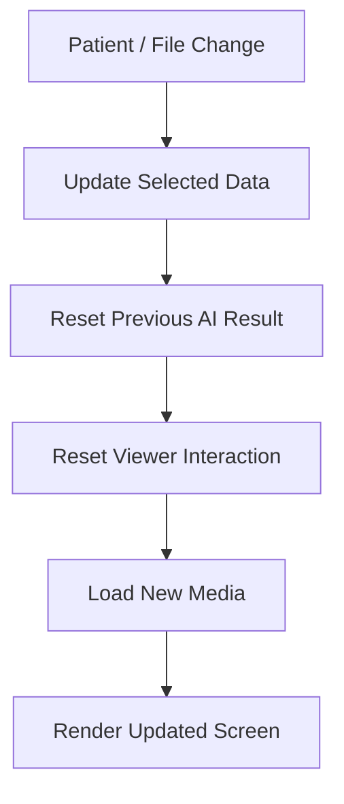

실제 코드에서는 상태별 초기화 범위가 다르며, 모든 컴포넌트의 상태가 일관되게 초기화되는지는 추가 검증이 필요합니다.

---

## 7. Authentication & API Communication

### 7.1 JWT Authentication

팀 프로젝트에서는 Django 기반 JWT 인증 구조를 사용하였습니다.

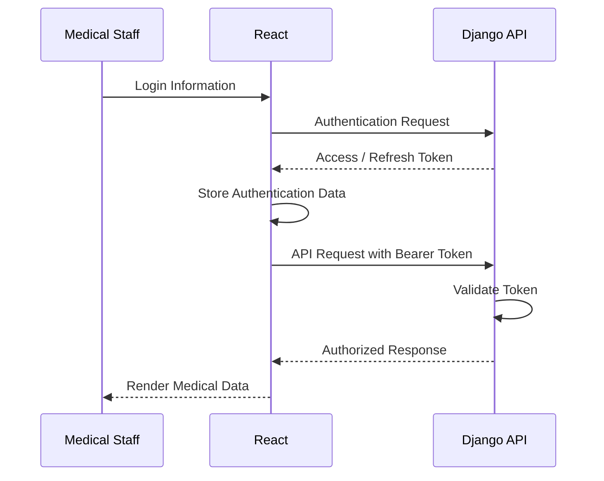

프론트엔드에서는 LocalStorage에 저장된 Access Token을 API 요청의 Authorization Header에 포함합니다.

```javascript
const access = localStorage.getItem('access');

const headers = {
  Authorization: `Bearer ${access}`
};
```

위 코드는 인증 헤더 구성을 설명하기 위한 단순화 예시입니다.

### 7.2 Authentication Responsibilities

| Frontend | Backend |
|---|---|
| 로그인 입력 UI | 사용자 인증 |
| 토큰 보관 | 토큰 발급 및 검증 |
| Authorization Header 구성 | API 접근 권한 검증 |
| 인증 오류 표시 | 사용자별 데이터 접근 제어 |
| 로그아웃 시 로컬 상태 초기화 | 서버 측 인증 정책 |

프론트엔드의 로그인 상태 확인만으로 의료 데이터에 대한 접근 권한이 보장되는 것은 아닙니다.

실제 접근 권한은 서버에서 검증해야 합니다.

### 7.3 Security Considerations

현재 프로토타입은 LocalStorage 기반 토큰 관리 방식을 사용합니다.

실제 의료 서비스로 확장하기 위해서는 다음과 같은 보안 검토가 필요합니다.

- HTTPS 기반 통신
- XSS 방어
- 토큰 저장 방식 개선
- 토큰 만료 및 재발급 정책
- 서버 측 환자별 접근 권한 검증
- 의료 데이터 접근 감사 로그
- 개인정보 및 민감정보 보호

위 내용은 향후 보안 개선 방향이며, 해당 기능을 개인이 구현하거나 검증하였다는 의미는 아닙니다.

---

## 8. API Interface

확인한 프론트엔드 소스코드 및 개발 이력을 기준으로 주요 API 요청 경로를 정리하였습니다.

| Method | Endpoint | Purpose |
|---|---|---|
| GET | `/api/health/` | 서버 상태 확인 |
| GET | `/api/patients/` | 환자 목록 조회 |
| GET | `/api/patients/{id}/` | 환자 상세정보 조회 |
| GET | `/api/patients/search/` | 개발 과정의 환자 검색 |
| GET | `/api/doctors/` | 협진 대상 의료진 조회 |
| POST | `/api/ai/image-analyze/` | 의료영상 AI 분석 |
| GET | `/api/bookmarks/` | 북마크 목록 조회 |
| POST | `/api/bookmarks/` | 북마크 생성 |
| PATCH | `/api/bookmarks/{id}/` | 북마크 수정 |
| DELETE | `/api/bookmarks/{id}/` | 북마크 삭제 |
| POST | `/api/consultations/` | 협진 요청 |
| POST | `/api/emr-signoffs/` | 판독 확정 API 관련 코드 |

### API Verification Scope

위 표는 프론트엔드 코드에서 확인한 요청 경로를 정리한 것입니다.

- 모든 API의 서버 구현 및 응답을 독립적으로 검증한 것은 아닙니다.
- 일부 요청 경로는 개발 과정에서 변경되었습니다.
- 북마크 수정 API 함수는 존재하지만 화면에서의 실제 호출은 추가 확인이 필요합니다.
- EMR Sign-off API 관련 코드는 존재하지만, 확인한 개인 브랜치의 판독 확정 버튼은 로컬 상태 저장 함수에 연결되어 있습니다.

서버의 실제 호스트 주소 및 인증 정보는 공개 포트폴리오에 포함하지 않습니다.

---

## 9. Patient Data Flow

### 9.1 Patient List

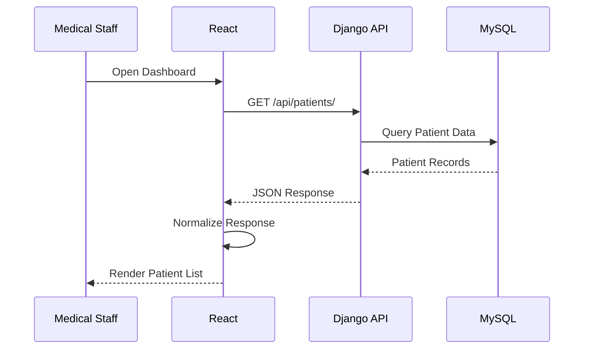

환자 목록을 조회한 후 응답 데이터를 화면 상태에 저장하고, 환자 관리 및 메인 홈 화면에서 활용합니다.

### 9.2 Response Normalization

API 응답이 배열 형태이거나 `results` 속성을 포함하는 객체 형태일 수 있으므로, 응답 구조를 구분하여 처리합니다.

```javascript
const results = Array.isArray(data)
  ? data
  : (data.results || []);
```

이와 같은 처리 방식은 서로 다른 응답 형태를 화면에서 사용할 수 있는 목록 구조로 변환하기 위한 것입니다.

향후에는 공통 API 응답 규격과 TypeScript 타입 정의를 통해 데이터 구조를 더욱 명확하게 관리할 필요가 있습니다.

### 9.3 Patient Selection

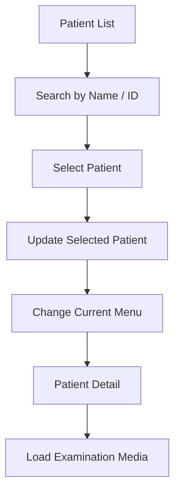

환자 선택 시 환자 객체를 상위 컴포넌트 상태에 저장하고 상세 화면으로 전환합니다.

사이드바 검색어와 검색 결과 표시 상태를 초기화하여 환자 선택 이후 화면 상태를 정리합니다.

---

## 10. Medical Media Data Flow

의료영상 및 검사 이미지 접근 과정에서는 일반적인 JSON 데이터와 미디어 파일을 구분하여 처리합니다.

### 10.1 Authenticated Media Access

개인 개발 브랜치에서는 팀에서 구현한 `fetchAuthBlobUrl` 공통 함수를 환자 상세 화면, 북마크 팝업 및 결과 리포트에서 활용합니다.

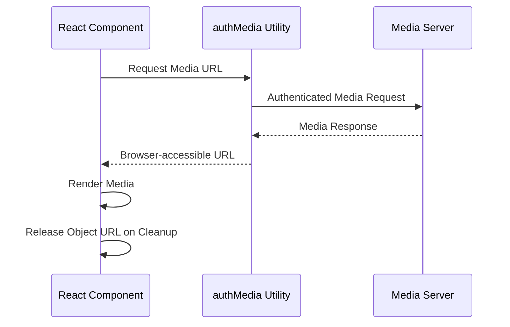

Blob URL을 활용하는 방식은 인증된 미디어 응답을 브라우저에서 표시하기 위한 구조입니다.

### 10.2 Media Lifecycle

| Stage | Processing |
|---|---|
| Request | 환자 또는 검사 미디어 URL 확인 |
| Fetch | 인증 미디어 접근 함수 호출 |
| Display | 이미지 또는 영상 표시 |
| Error | 로딩 실패 및 미디어 누락 안내 |
| Cleanup | 사용이 종료된 Blob URL 해제 |

일부 화면에서는 비동기 요청 취소 여부를 확인하고 Object URL을 해제하는 Cleanup 로직을 사용합니다.

다만 모든 비동기 완료 시점과 URL 생성 경로에 대한 자원 해제가 보장되는 것은 아니므로 추가 개선이 필요합니다.

---

## 11. AI Inference Data Flow

### 11.1 Analysis Pipeline

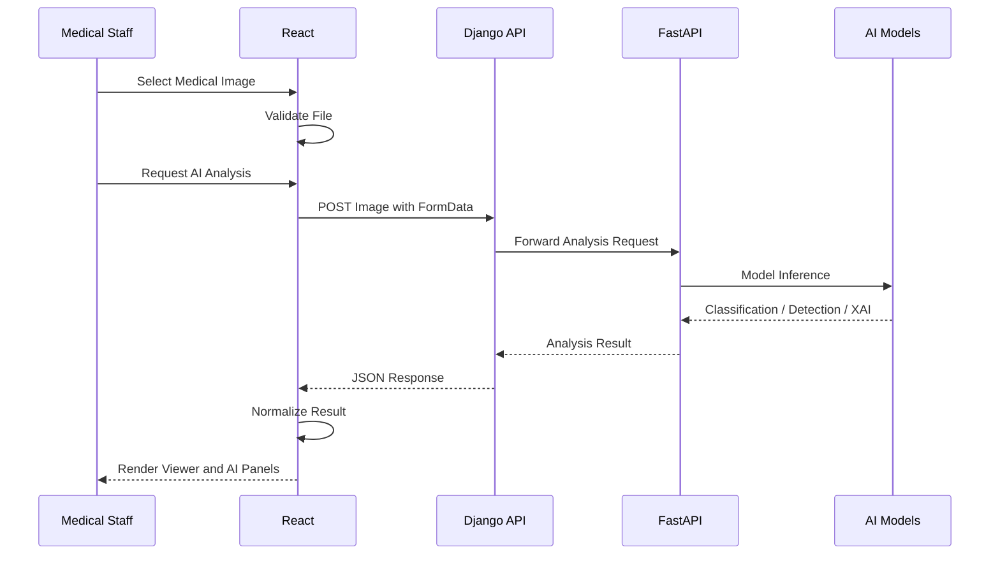

React는 분석 대상 파일과 분석 요청 상태를 관리하고, Django를 통해 AI 분석을 요청합니다.

FastAPI 기반 추론 서비스 및 모델 실행은 팀 담당 영역입니다.

### 11.2 Request Structure

아래 코드는 확인한 프론트엔드 요청 구조를 단순화한 예시입니다.

```javascript
const formData = new FormData();

formData.append('file', aiFile);

const response = await axios.post(
  '/api/ai/image-analyze/',
  formData,
  {
    headers: {
      Authorization: `Bearer ${access}`
    }
  }
);
```

### 11.3 Analysis State

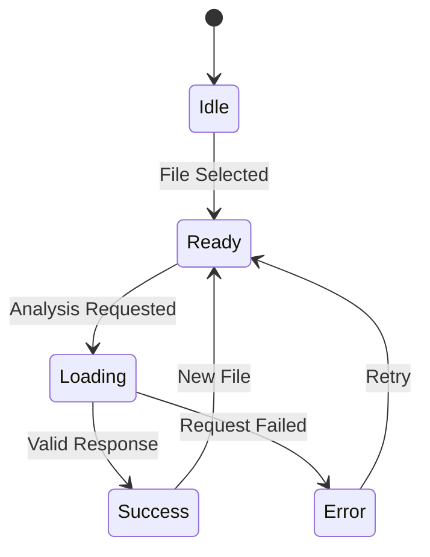

| State | UI Behavior |
|---|---|
| Idle | 분석 대상 선택 안내 |
| Ready | 분석 요청 가능 |
| Loading | 분석 진행 표시 |
| Success | AI 결과 및 시각화 |
| Error | 오류 메시지 표시 |

### 11.4 Mock Data & Actual API

개발 과정에서는 AI 서버 연동과 별개로 화면을 구성하고 확인하기 위해 Mock 데이터를 사용한 이력이 있습니다.

최종 개인 브랜치에서는 실제 AI 분석 API 호출 코드가 확인되지만, 일부 결과 카드와 위험도 및 리포트에는 시연용 대체 데이터가 남아 있습니다.

따라서 실제 모델 응답과 시연용 데이터는 구분하여 설명합니다.

---

## 12. Database & Storage Architecture

최종 발표 자료의 ERD를 기준으로 주요 의료 업무 데이터 관계를 정리하였습니다.

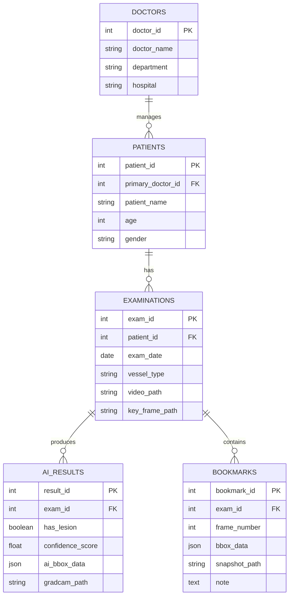

위 ERD는 발표 자료에 제시된 주요 엔티티와 관계를 설명하기 위한 개념적 재구성입니다.

실제 데이터베이스의 전체 스키마, 컬럼 타입 및 제약조건을 독립적으로 검증한 결과는 아닙니다.

### 12.1 Storage Responsibilities

| Storage | Data |
|---|---|
| MySQL | 의료진, 환자, 검사 및 분석 메타데이터 |
| Server Media | 원본 의료영상 및 분석 결과 파일 |
| GCS | 모델 파일 및 클라우드 리소스 |
| React State | 화면 표시 및 사용자 인터랙션 상태 |
| LocalStorage | 인증 관련 클라이언트 데이터 |

### 12.2 Design Considerations

관계형 데이터와 대용량 의료 미디어 파일은 서로 다른 관리 특성을 가집니다.

관계형 데이터는 환자, 검사, 분석 결과 간의 관계를 표현하고, 미디어 파일은 별도의 저장 경로를 통해 접근하는 구조로 설명할 수 있습니다.

이러한 데이터 분리 방식은 이후 의료 서비스 백엔드 설계에서 저장소별 책임을 고려하는 기반이 되었습니다.

---

## 13. AI Diagnosis Screen Architecture

AI 판독 화면은 의료영상, AI 분석 결과, 의료진 판독 도구를 함께 확인할 수 있도록 3분할 구조로 구성하였습니다.

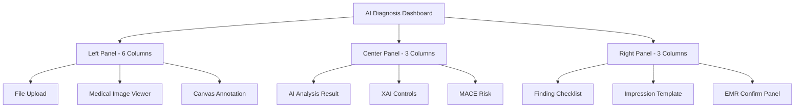

### Panel Responsibilities

| Panel | Main Responsibility |
|---|---|
| Left | 의료영상 조회 및 사용자 인터랙션 |
| Center | AI 결과 및 판단 근거 시각화 |
| Right | 의료진 판독 항목 및 소견 관리 |

### Data Coordination

- 선택한 환자 정보는 Dashboard에서 관리합니다.
- AI 분석 결과는 Viewer 및 분석 결과 패널에 전달됩니다.
- XAI 표시 옵션은 Viewer의 오버레이 렌더링에 반영됩니다.
- 의료진 주석은 Viewer 내부 상태에서 관리됩니다.
- 판독 체크리스트와 소견은 관련 UI 컴포넌트를 통해 처리합니다.

이 구조는 의료영상과 판독 정보를 한 화면에서 확인할 수 있도록 구성한 사용자 인터페이스 설계입니다.

---

## 14. Personal Contribution Boundary

### 14.1 Direct Implementation

개인 Git 변경 이력에서 확인한 주요 개발 영역입니다.

| Area | Contribution |
|---|---|
| Dashboard | 메인 화면 및 메뉴 구조 |
| Patient Management | 환자 검색 및 상세 화면 |
| Component Design | Home 컴포넌트 분리 |
| Viewer | 확대, 이동, 재생 제어 인터페이스 |
| Canvas | Box, Pen, Text Annotation |
| Bookmark | 상세 팝업 및 이벤트 처리 |
| AI Diagnosis | 3분할 화면 재구성 |
| Report | 환자 결과 리포트 화면 |
| Consultation | 협진 요청 UI |
| Theme | 다크 테마 및 화면 스타일 |

### 14.2 Collaborative Integration

팀에서 구현한 기능과 개인 화면을 연결한 영역입니다.

- 환자 조회 API
- 인증 미디어 접근
- AI 분석 결과 전달
- XAI 표시 제어
- 북마크 API 연동
- 협진 요청 API
- 판독 체크리스트 및 소견 화면

### 14.3 Team Implementation

다음 영역은 팀 전체 시스템 구성에 해당하며, 개인 단독 구현으로 기술하지 않습니다.

- Django 서버 및 데이터베이스 구축
- JWT 인증 서버
- FastAPI 추론 서버
- AI 모델 학습 및 추론
- Grad-CAM 생성
- GCP 인프라 구성
- 서버 기반 의료 업무 API

---

## 15. Architectural Limitations

### 15.1 State Complexity

Dashboard가 여러 화면과 분석 상태를 함께 관리하므로 기능 확장에 따라 상태 관리의 복잡성이 증가할 수 있습니다.

개선 방향:

- 기능별 Custom Hook 분리
- 공통 데이터 상태와 화면 상태 구분
- 상태 전환 규칙 명확화
- 중복 API 요청 제거

### 15.2 API Consistency

일부 API 응답은 배열과 객체 형태가 혼재하며, 미디어 URL 필드도 여러 형태로 처리됩니다.

개선 방향:

- API 응답 스키마 표준화
- TypeScript 인터페이스 강화
- 공통 API Client 구성
- 서버 응답과 UI 모델 간 변환 계층 분리

### 15.3 Media Lifecycle

환자 전환 및 파일 변경 시 비동기 미디어 요청과 Object URL의 생명주기를 일관되게 관리할 필요가 있습니다.

개선 방향:

- AbortController 활용
- Object URL 해제 로직 공통화
- 이전 환자의 미디어 응답 반영 방지
- 로딩 및 오류 상태 초기화

### 15.4 Clinical Data Integrity

시연용 데이터와 실제 임상 데이터가 혼재하면 의료진이 결과를 잘못 해석할 가능성이 있습니다.

개선 방향:

- Mock 데이터의 명시적 분리
- 누락된 검사값과 정상 결과 구분
- 환자 ID 기반 분석 결과 검증
- 판독 결과의 서버 저장 및 변경 이력 관리

### 15.5 AI Processing Scalability

AI 분석 요청의 처리 시간이 길어질 경우 동기 요청 구조는 사용자 대기 시간과 서버 자원 관리 측면에서 제약이 발생할 수 있습니다.

향후 개선 아키텍처는 다음과 같이 고려할 수 있습니다.

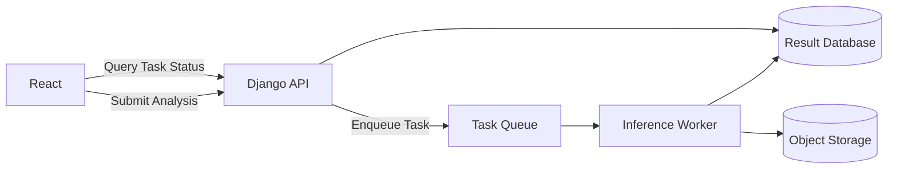

위 구조는 비동기 분석 처리를 위한 향후 설계 제안이며, ANGIO XAI에서 실제 구현한 아키텍처는 아닙니다.

---

## 16. Engineering Retrospective

이번 프로젝트에서는 React 기반 의료진 화면을 개발하면서 프론트엔드가 독립적인 화면 구현에 그치지 않고, 백엔드 API와 AI 추론 서비스의 데이터 구조에 직접적인 영향을 받는다는 점을 경험하였습니다.

특히 다음과 같은 기술적 중요성을 이해하였습니다.

- 컴포넌트별 책임과 상태 관리 범위
- API 응답 데이터의 일관성
- 인증이 필요한 의료 미디어 접근
- 비동기 요청과 자원 생명주기
- AI 분석 결과와 사용자 인터페이스의 연결
- 실제 데이터와 시연용 데이터의 분리

이러한 경험을 통해 안정적인 사용자 인터페이스를 구현하기 위해서는 백엔드의 데이터 모델, API 계약 및 서비스 구조에 대한 이해가 필요하다는 점을 배웠습니다.

이후 DUGN 프로젝트에서는 이러한 경험을 바탕으로 의료 업무 API, 데이터 저장소 분리 및 분석 결과 관리 등 백엔드 중심의 개발을 수행하였습니다.

---

## 17. Related Documentation

- [Project Overview](./README.md)
- [Dashboard & Patient Management](./dashboard.md)
- [Medical Image Viewer](./image-viewer.md)
- [AI Diagnosis & XAI](./ai-diagnosis.md)
- [UI & State Management](./ui-state.md)
- [Troubleshooting](./troubleshooting.md)

### Source References

- [Team Repository](https://github.com/hyunkyung31/React_DL)
- [Personal Development Branch](https://github.com/hyunkyung31/React_DL/tree/yuri)
- [Component Refactoring Commit](https://github.com/hyunkyung31/React_DL/commit/e7fa8f8)
- [Dashboard Recovery Commit](https://github.com/hyunkyung31/React_DL/commit/0161739)
- [Canvas Implementation Commit](https://github.com/hyunkyung31/React_DL/commit/f83d166)

본 문서는 최종 발표 자료, 개인 개발 브랜치 및 Git 변경 이력을 기준으로 작성하였습니다.

설명용 코드와 다이어그램은 실제 구현 구조를 이해하기 쉽게 재구성한 것이며, 향후 개선 아키텍처는 기존 구현과 구분하여 표시하였습니다.
