# Dashboard & Patient Management

> ANGIO XAI — 의료진 대시보드 및 환자 데이터 관리

의료진이 환자의 기본정보, 임상정보 및 검사 데이터를 효율적으로 확인할 수 있도록 React 기반 대시보드와 환자 관리 인터페이스를 구현하였습니다.

본 문서는 개인 개발 영역인 대시보드 구성, 환자 검색, 상세정보 조회, 컴포넌트 분리 및 데이터 전달 구조를 중심으로 설명합니다.

---

## 1. Implementation Overview

| 항목 | 내용 |
|---|---|
| 담당 영역 | 의료진 대시보드 및 환자 관리 |
| 주요 기술 | React, JavaScript, Tailwind CSS |
| 상태 관리 | useState, useEffect |
| 데이터 전달 | Props, Callback |
| API 통신 | Axios, Fetch API |
| 인증 방식 | JWT Bearer Token |
| 주요 기능 | 환자 검색, 상세 조회, 화면 전환, 미디어 조회 |

### Implementation Objectives

- 환자 중심의 의료진 업무 화면 구성
- 환자 ID 및 이름 기반 검색
- 환자 기본정보와 임상정보 통합 표시
- 환자 선택 상태와 상세 화면 연결
- 의료영상 및 검사 이미지 조회
- 기능별 컴포넌트 분리
- 데이터 누락 및 요청 실패에 대한 예외 처리

---

## 2. Background & Problem

의료진이 관상동맥 조영영상을 판독하기 위해서는 영상 자체뿐만 아니라 환자의 기본정보, 증상 및 임상 검사 결과를 함께 확인해야 합니다.

환자 정보와 검사 결과를 서로 다른 화면에서 확인하는 경우 화면 이동과 정보 탐색 과정이 복잡해질 수 있습니다.

이를 고려하여 환자 목록, 빠른 검색, 상세정보 카드 및 의료영상 조회 기능을 하나의 대시보드 구조로 구성하였습니다.

### Design Requirements

| 요구사항 | 구현 방향 |
|---|---|
| 환자 정보 탐색 | ID 및 이름 기반 검색 |
| 빠른 화면 접근 | 사이드바 검색 및 빠른 메뉴 |
| 환자 상태 확인 | 임상정보 카드 및 목록 |
| 검사 결과 확인 | 환자 상세 화면과 이미지 Viewer |
| 화면 일관성 | 공통 다크 테마 |
| 유지보수 | 기능별 컴포넌트 분리 |
| 데이터 안정성 | 기본값 및 예외 처리 |

---

## 3. Component Structure

### 3.1 Main Components

| File | Responsibility |
|---|---|
| `App.tsx` | 로그인 상태 및 공통 환자 데이터 |
| `Dashboard.jsx` | 메뉴 전환 및 환자 선택 상태 |
| `Home.jsx` | 메인 대시보드 및 환자 현황 |
| `Patient_Management.jsx` | 환자 목록 및 검색 |
| `Patient_Detail.jsx` | 환자 상세정보 및 검사 이미지 |
| `authMedia.js` | 인증 미디어 접근 공통 함수 |

### 3.2 Component Architecture

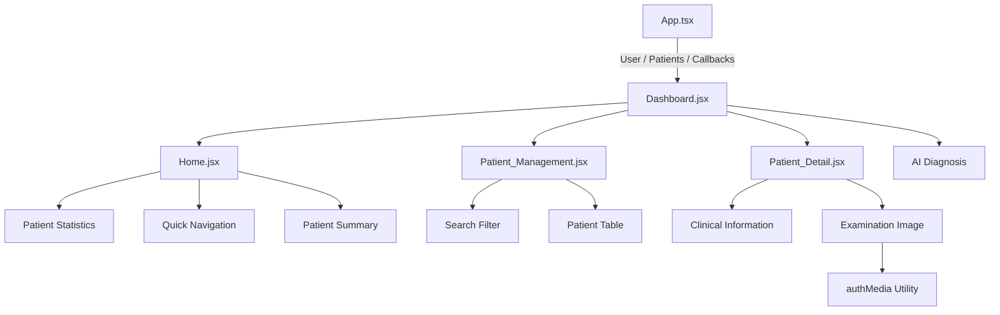

Dashboard는 화면 전환과 환자 선택 상태를 관리하며, 각 하위 컴포넌트는 전달받은 데이터를 자신의 역할에 맞게 렌더링합니다.

---

## 4. Main Dashboard

### 4.1 Dashboard Layout

메인 대시보드는 의료진이 환자 현황을 확인하고 주요 업무 화면으로 이동할 수 있도록 구성하였습니다.

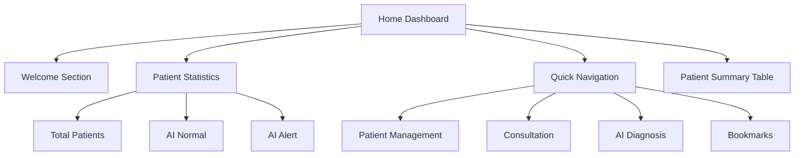

### 4.2 Patient Statistics

Home 컴포넌트에서는 전달받은 환자 목록을 기반으로 전체 환자 수와 분류별 환자 수를 계산합니다.

전체 환자 수는 배열의 길이를 통해 계산합니다.

```javascript
const totalPatientsCount = patients.length;
```

환자 분류별 통계는 환자 객체의 분석 결과 관련 필드를 활용하여 계산하는 구조입니다.

최종 개인 브랜치에서는 `latest_severity_class`와 `has_lesion` 등의 값을 사용합니다.

### 4.3 Percentage Calculation

환자 수가 0명인 경우 0으로 나누는 연산이 발생하지 않도록 조건을 적용합니다.

다음 코드는 실제 구현 방식을 단순화한 예시입니다.

```javascript
const percentage = totalPatientsCount > 0
  ? Math.round(
      (categoryCount / totalPatientsCount) * 100
    )
  : 0;
```

### 4.4 Patient Summary

메인 화면에서는 전체 환자 목록 중 일부를 표시하여 환자 상세정보에 빠르게 접근할 수 있도록 구성하였습니다.

```javascript
const recentPatients = patients.slice(0, 5);
```

표시되는 주요 정보는 다음과 같습니다.

- 환자 ID
- 환자 이름
- 나이 및 성별
- 주요 증상
- Troponin T
- 상세 조회 버튼

현재 구현에서는 목록의 앞부분 5개 항목을 선택합니다.

등록일 기준 정렬을 수행하지 않으므로, 실제 최신 등록 환자 5명을 보장하는 기능과는 구분합니다.

### 4.5 Quick Navigation

주요 업무 화면으로 이동할 수 있도록 빠른 메뉴를 구성하였습니다.

```jsx
<button onClick={() => onNavigate('patients')}>
  환자 목록 관리
</button>

<button onClick={() => onNavigate('consultation')}>
  협진 요청
</button>

<button onClick={() => onNavigate('ai-diag')}>
  AI 진단 분석
</button>

<button onClick={() => onNavigate('bookmarks')}>
  북마크 관리
</button>
```

위 코드는 Callback 기반 화면 전환 구조를 설명하기 위한 단순화 예시입니다.

---

## 5. Patient API Integration

### 5.1 Patient List Request

환자 목록은 Django REST API를 통해 조회하는 구조입니다.

| 항목 | 내용 |
|---|---|
| Method | GET |
| Endpoint | `/api/patients/` |
| Authentication | Bearer Token |
| Response | JSON |
| Frontend State | patientList |

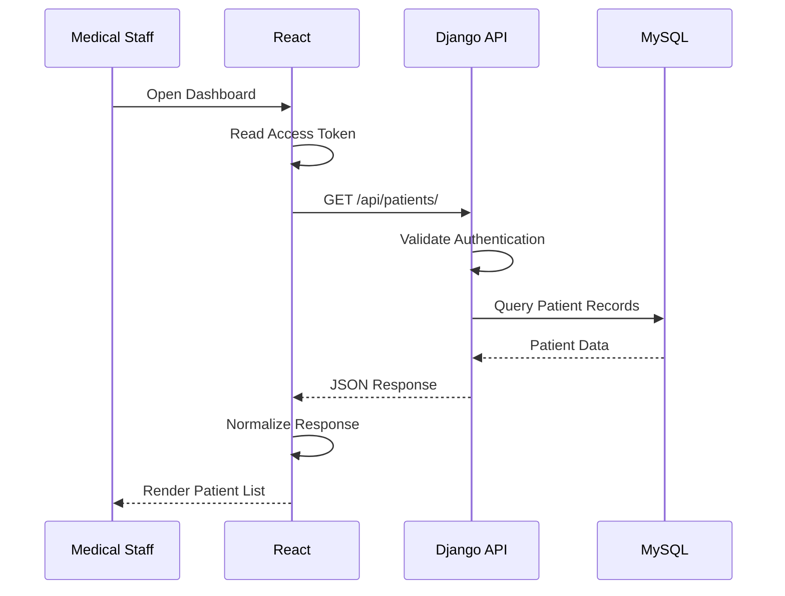

서버 측 인증 및 데이터베이스 조회는 팀 시스템의 역할이며, 개인 개발 범위는 해당 데이터를 활용하는 사용자 인터페이스에 집중하였습니다.

### 5.2 Authentication Header

프론트엔드에서는 저장된 Access Token을 API 요청 헤더에 포함합니다.

```javascript
const access = localStorage.getItem('access');

const response = await axios.get(
  '/api/patients/',
  {
    headers: {
      Authorization: `Bearer ${access}`
    }
  }
);
```

위 코드는 실제 요청 구조를 설명하기 위한 단순화 예시입니다.

### 5.3 Response Normalization

환자 목록 API의 응답은 배열 또는 `results` 속성을 포함한 객체 형태로 처리합니다.

```javascript
const data = response.data;

if (Array.isArray(data)) {
  setPatientList(data);
} else if (Array.isArray(data?.results)) {
  setPatientList(data.results);
} else {
  setPatientList(patients);
}
```

이를 통해 응답 형식에 따라 환자 목록 렌더링 로직을 각각 작성하는 대신, 화면에서 사용할 수 있는 배열 형태로 변환합니다.

### 5.4 Fallback Handling

API 요청이 실패하거나 예상한 응답 형식과 다른 경우 상위 컴포넌트에서 전달받은 환자 목록을 대체 데이터로 활용하는 구조가 확인됩니다.

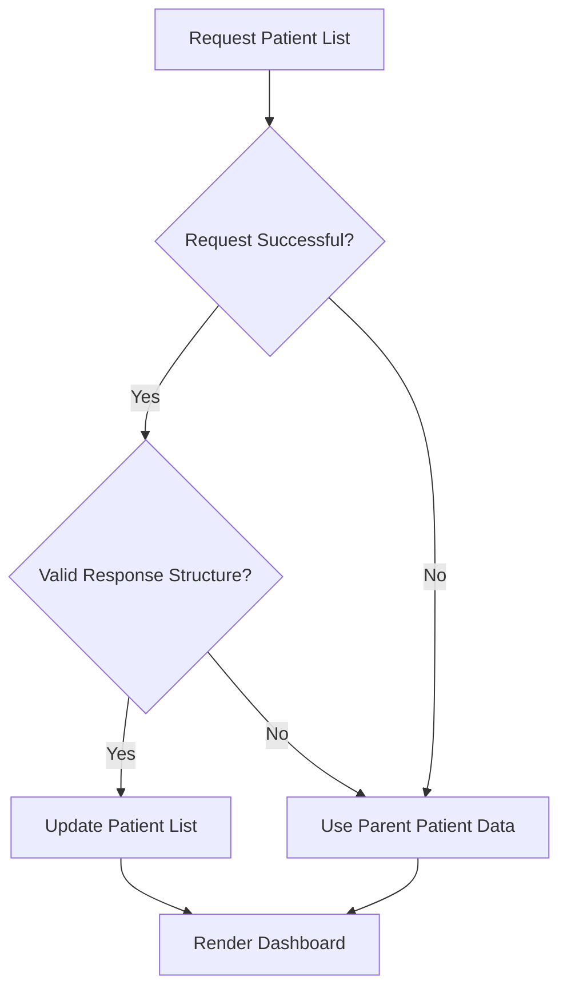

기존 데이터를 활용하여 화면 표시를 유지할 수 있지만, 의료 서비스에서는 해당 데이터가 최신 상태인지 구분할 수 있어야 합니다.

향후에는 API 요청 실패와 기존 데이터 사용 여부를 명시적으로 표시하는 방식이 필요합니다.

### 5.5 Loading State

비동기 요청의 진행 여부를 상태로 관리합니다.

```javascript
setLoading(true);

try {
  // Request patient data
} catch (error) {
  // Handle request failure
} finally {
  setLoading(false);
}
```

`finally`를 사용하여 요청 성공 여부와 관계없이 로딩 상태를 종료하는 구조입니다.

---

## 6. Patient Data Model

환자 조회 화면에서 사용하는 주요 데이터 필드는 다음과 같습니다.

| Field | Description |
|---|---|
| patient_id | 환자 식별자 |
| patient_name | 환자 이름 |
| age | 나이 |
| gender | 성별 |
| chief_complaint | 주요 증상 |
| ecg_result | 심전도 검사 결과 |
| troponin_t | Troponin T 검사값 |
| latest_severity_class | 최근 AI 분류 결과 |
| has_lesion | 병변 관련 표시값 |
| examinations | 검사 데이터 목록 |
| image_url | 의료영상 접근 경로 |
| key_frame_url | 대표 검사 이미지 경로 |

위 필드는 프론트엔드에서 참조하는 주요 데이터 항목이며, 실제 데이터베이스의 전체 스키마를 의미하지 않습니다.

### 6.1 UI Data Contract

다음은 화면에서 사용하는 환자 객체의 개념적 타입 예시입니다.

```typescript
interface Patient {
  patient_id: string | number;
  patient_name: string;
  age?: number;
  gender?: string;
  chief_complaint?: string;
  ecg_result?: string;
  troponin_t?: number | string | null;
  latest_severity_class?: string;
  has_lesion?: boolean;
  image_url?: string;
  key_frame_url?: string;
  examinations?: Examination[];
}

interface Examination {
  key_frame_url?: string;
}
```

위 인터페이스는 실제 화면에서 참조하는 데이터 구조를 설명하기 위해 재구성한 예시이며, 원본 TypeScript 타입 정의 전체와 동일하지는 않습니다.

### 6.2 Patient Identifier

환자 ID는 문자열 또는 숫자 형태로 전달될 수 있으므로 검색이나 비교 과정에서 문자열 변환을 활용합니다.

```javascript
String(patient.patient_id)
```

이를 통해 숫자형 ID에 문자열 검색 메서드를 직접 호출하면서 발생할 수 있는 오류를 방지할 수 있습니다.

---

## 7. Patient Search

### 7.1 Search Requirements

환자 검색은 의료진이 환자 목록에서 필요한 환자를 빠르게 찾을 수 있도록 구현하였습니다.

두 가지 검색 인터페이스를 제공합니다.

| Search Type | Purpose |
|---|---|
| Sidebar Search | 전체 화면에서 빠르게 환자 선택 |
| Patient Management Search | 환자 목록 내 조건별 검색 |

### 7.2 Sidebar Search

사이드바 검색에서는 환자 이름과 ID를 대상으로 부분 일치 검색을 수행합니다.

주요 처리 과정은 다음과 같습니다.

1. 사용자 검색어 입력
2. 검색어 앞뒤 공백 제거
3. 영문 대소문자 정규화
4. 환자 이름 및 ID 비교
5. 일치하는 환자 목록 생성
6. 검색 결과 드롭다운 표시
7. 환자 선택 후 상세 화면 이동

### 7.3 Search Algorithm

아래 코드는 최종 개인 브랜치의 사이드바 검색 방식을 단순화한 예시입니다.

```javascript
function searchPatients(patients, keyword) {
  const normalizedKeyword = keyword
    .trim()
    .toLowerCase();

  if (!normalizedKeyword) {
    return [];
  }

  return patients.filter(patient => {
    const name = String(
      patient.patient_name || ''
    ).toLowerCase();

    const id = String(
      patient.patient_id ?? ''
    ).toLowerCase();

    return (
      name.includes(normalizedKeyword) ||
      id.includes(normalizedKeyword)
    );
  });
}
```

### 7.4 Search Processing Flow

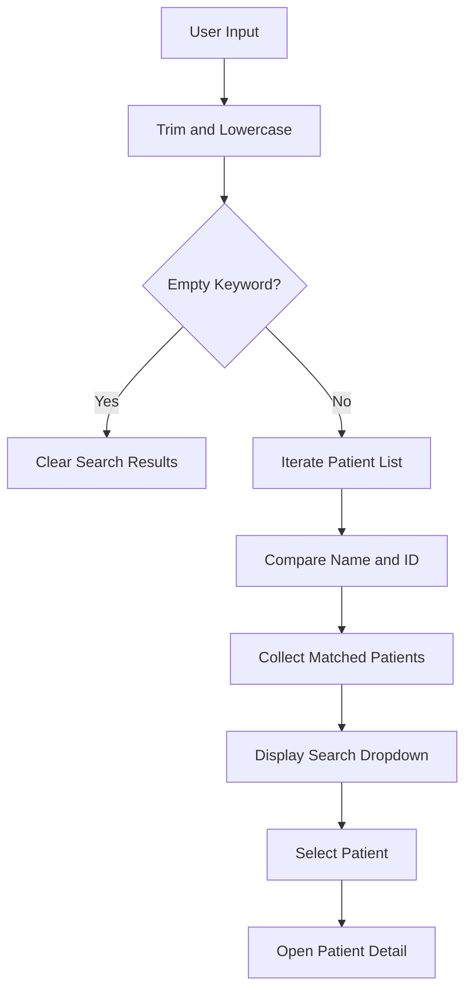

### 7.5 Example

아래 데이터는 검색 동작을 설명하기 위해 생성한 가상의 환자 데이터입니다.

| Patient ID | Patient Name |
|---|---|
| P1001 | 김환자 |
| P1002 | 이환자 |
| P2001 | 박환자 |
| P2002 | 최환자 |

| Search Input | Expected Result |
|---|---|
| `P100` | P1001, P1002 |
| `p200` | P2001, P2002 |
| `김` | P1001 |
| `환자` | 전체 4개 |
| `P999` | 검색 결과 없음 |
| 빈 문자열 | 검색 결과 초기화 |

### 7.6 Algorithm Complexity

현재 클라이언트 검색은 배열의 `filter()`를 사용합니다.

환자 수를 N이라고 할 때 환자 목록을 한 번 순회하므로, 문자열 길이를 일정하다고 가정하면 시간 복잡도는 O(N)입니다.

실제 문자열 비교 비용은 환자 이름, ID 및 검색어 길이에 따라 달라질 수 있습니다.

| 항목 | 복잡도 |
|---|---|
| 환자 목록 순회 | O(N) |
| 검색 결과 저장 | O(K) |
| 최악의 결과 저장 공간 | O(N) |

K는 검색 조건에 일치하는 환자 수입니다.

소규모 환자 목록에서는 별도의 검색 서버 없이 사용할 수 있지만, 대규모 환자 데이터를 처리하는 경우 서버 검색과 페이지네이션이 필요합니다.

---

## 8. Patient Management Search

환자 관리 화면에서는 검색어와 검색 유형을 별도 상태로 관리합니다.

```javascript
const [searchTerm, setSearchTerm] = useState('');
const [searchCategory, setSearchCategory] =
  useState('all');
```

### 8.1 Search Categories

| Category | Search Target |
|---|---|
| all | 환자 이름 및 ID |
| name | 환자 이름 |
| id | 환자 ID |

### 8.2 Filtering Logic

아래 코드는 환자 관리 화면의 검색 구조를 설명하기 위한 단순화 예시입니다.

```javascript
const filteredPatients = patients.filter(patient => {
  if (!patient) return false;

  const name = patient.patient_name || '';
  const id = String(patient.patient_id ?? '');

  switch (searchCategory) {
    case 'name':
      return name.includes(searchTerm);

    case 'id':
      return id.includes(searchTerm);

    default:
      return (
        name.includes(searchTerm) ||
        id.includes(searchTerm)
      );
  }
});
```

### 8.3 Search Strategy Comparison

| 항목 | 사이드바 검색 | 환자 관리 검색 |
|---|---|---|
| 목적 | 빠른 환자 선택 | 목록 탐색 |
| 검색 대상 | 이름 및 ID | 선택한 검색 유형 |
| 결과 표시 | 드롭다운 | 환자 테이블 |
| 공백 정규화 | 적용 | 추가 개선 필요 |
| 대소문자 정규화 | 적용 | 추가 개선 필요 |
| 검색 방식 | 클라이언트 필터링 | 클라이언트 필터링 |

개발 초기에는 서버 검색 API를 호출하는 방식도 사용하였으며, 최종 개인 브랜치에서는 이미 조회한 환자 목록을 대상으로 검색하는 방식이 확인됩니다.

### 8.4 Client-Side vs Server-Side Search

| 항목 | Client-Side | Server-Side |
|---|---|---|
| 검색 위치 | 브라우저 | 백엔드 서버 |
| 검색 요청 | 입력마다 API 요청 불필요 | 검색 요청 필요 |
| 검색 대상 | 로딩된 환자 목록 | 서버 조회 범위 |
| 데이터 규모 | 소규모 목록에 적합 | 대규모 데이터에 적합 |
| 최신성 | 기존 조회 시점 기준 | 요청 시점 조회 가능 |
| 확장성 | 브라우저 자원에 의존 | DB 인덱스 및 페이지네이션 활용 |

실제 의료 서비스에서는 환자 데이터 규모와 접근 권한 정책을 고려하여 서버 검색을 적용하는 것이 적절할 수 있습니다.

---

## 9. Patient Selection & Navigation

### 9.1 Selected Patient State

Dashboard는 선택한 환자와 현재 메뉴를 상태로 관리합니다.

```javascript
const [selectedPatient, setSelectedPatient] =
  useState(null);

const [selectedDiagPatient, setSelectedDiagPatient] =
  useState(null);

const [currentMenu, setCurrentMenu] =
  useState('dashboard');
```

### 9.2 Selection Handler

환자 선택 시 선택 상태와 현재 메뉴를 변경하고, 검색 관련 화면 상태를 초기화합니다.

```javascript
const handleSelectPatient = patient => {
  setSelectedPatient(patient);
  setSelectedDiagPatient(patient);
  setCurrentMenu('patient-detail');

  setSidebarSearch('');
  setIsSearchDropdownOpen(false);
  setIsMobileSidebarOpen(false);
};
```

위 코드는 확인한 환자 선택 처리 구조를 정리한 예시입니다.

### 9.3 State Transition

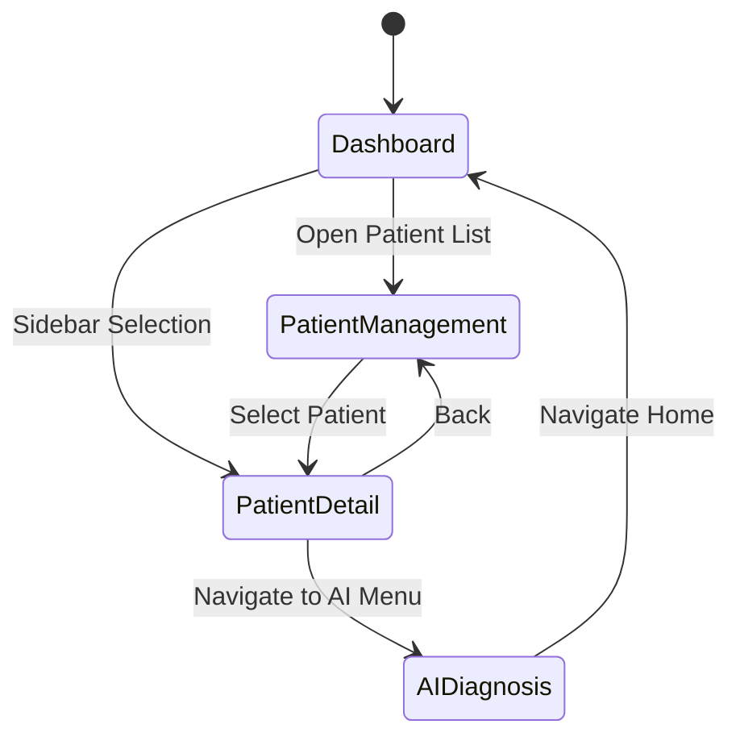

위 상태 다이어그램은 주요 화면 전환 관계를 개념적으로 표현한 것입니다.

별도의 URL 기반 라우팅이나 모든 상태 전환을 검증한 결과는 아닙니다.

### 9.4 Data Flow

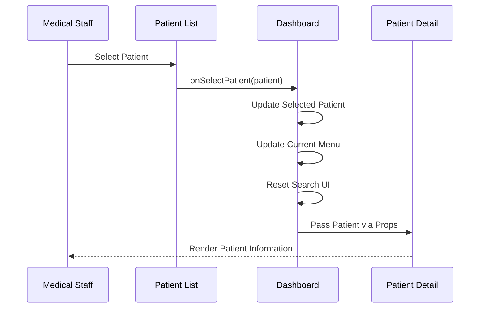

### 9.5 Design Benefits

- 환자 선택 로직을 상위 컴포넌트에서 관리
- 여러 화면에서 동일한 선택 Callback 활용
- 선택한 환자 객체를 하위 화면에 전달
- 환자 선택 이후 검색 UI 상태 정리
- 환자 상세 화면과 AI 분석 대상 연결

---

## 10. Patient Detail

### 10.1 Detail Screen Layout

환자 상세 화면은 의료영상과 환자 임상정보를 함께 확인할 수 있도록 구성하였습니다.

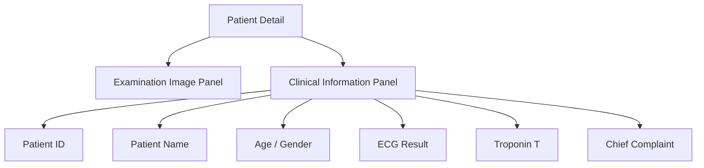

### 10.2 Clinical Information Cards

| Card | Data |
|---|---|
| 환자 식별정보 | patient_id |
| 환자 이름 | patient_name |
| 나이 및 성별 | age, gender |
| 심전도 검사 | ecg_result |
| Troponin T | troponin_t |
| 주요 증상 | chief_complaint |

각 임상정보를 독립적인 카드로 구성하여 의료진이 필요한 항목을 구분하여 확인할 수 있도록 하였습니다.

### 10.3 Null Patient Handling

선택한 환자가 존재하지 않는 경우 환자 객체의 속성에 직접 접근하지 않도록 예외 화면을 제공합니다.

```jsx
if (!patient) {
  return (
    <div>
      <p>선택된 환자가 없습니다.</p>

      <button onClick={onBack}>
        돌아가기
      </button>
    </div>
  );
}
```

이를 통해 환자 데이터가 없는 상태에서 상세 화면을 렌더링하면서 발생할 수 있는 참조 오류를 방지합니다.

### 10.4 Missing Clinical Data

일부 임상정보는 검사 결과가 없거나 빈 값으로 전달될 수 있습니다.

```javascript
const troponinDisplay =
  patient.troponin_t == null ||
  patient.troponin_t === ''
    ? '-'
    : patient.troponin_t;
```

특히 숫자 0은 유효한 데이터일 수 있으므로 단순한 Truthy/Falsy 검사보다 `null`, `undefined`, 빈 문자열을 구분하는 것이 중요합니다.

```javascript
// 0도 누락 데이터로 처리될 수 있는 방식
const value = patient.troponin_t || '-';

// 0을 유지할 수 있는 방식
const value = patient.troponin_t ?? '-';
```

빈 문자열까지 처리하려면 별도의 조건이 필요합니다.

의료 데이터에서는 값의 누락과 정상 검사 결과를 구분하는 것이 중요합니다.

---

## 11. Medical Image Loading

### 11.1 Media URL Resolution

환자 객체의 검사 이미지 경로가 여러 필드 형태로 전달될 수 있으므로 우선순위에 따라 표시할 URL을 선택합니다.

```javascript
const rawUrl =
  patient.examinations?.[0]?.key_frame_url ||
  patient.key_frame_url ||
  patient.image_url ||
  patient.imageUrl ||
  patient.file_url ||
  patient.aiFileUrl;
```

### 11.2 URL Resolution Flow

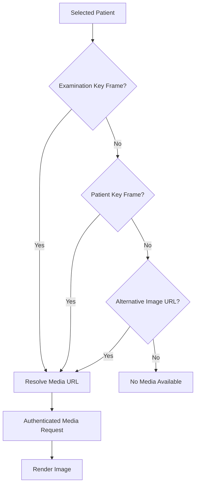

### 11.3 Optional Chaining

검사 목록이 없거나 첫 번째 검사 데이터가 존재하지 않을 수 있으므로 Optional Chaining을 활용합니다.

```javascript
patient.examinations?.[0]?.key_frame_url
```

이를 통해 중첩된 객체나 배열이 존재하지 않는 경우에도 안전하게 값을 확인할 수 있습니다.

### 11.4 Authenticated Media Access

팀에서 구현한 `fetchAuthBlobUrl` 공통 함수를 활용하여 인증이 필요한 의료 미디어에 접근하는 구조를 연결하였습니다.

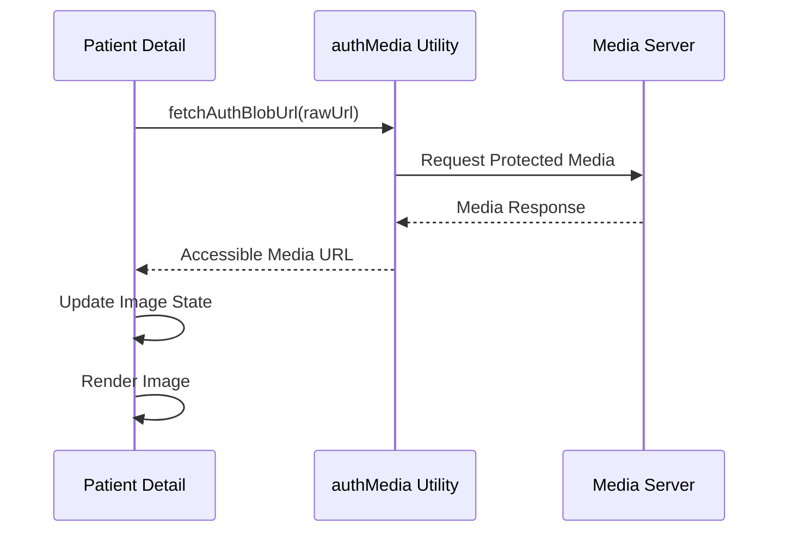

인증 미디어 접근 공통 함수의 구현 자체는 팀 협업 영역이며, 개인 기여는 해당 기능을 환자 상세 화면에 연결하는 사용자 인터페이스입니다.

### 11.5 Image Rendering States

| State | UI |
|---|---|
| Loading | 이미지 로딩 안내 |
| Success | 검사 이미지 표시 |
| Error | 이미지 로딩 실패 안내 |
| Empty | 등록된 검사 이미지 없음 |

환자 정보와 검사 이미지의 로딩 상태를 구분하여 처리합니다.

### 11.6 Media Resource Cleanup

일부 미디어 응답은 Blob URL 형태로 브라우저에서 표시됩니다.

사용이 종료된 Blob URL은 다음 API를 이용하여 해제할 수 있습니다.

```javascript
URL.revokeObjectURL(blobUrl);
```

확인한 개인 브랜치에서는 컴포넌트의 Effect Cleanup 과정에서 생성된 Blob URL을 해제하는 로직을 사용합니다.

다만 환자 전환 직후 이전 비동기 요청이 완료되는 경우까지 모든 자원 해제가 보장되는 것은 아닙니다.

---

## 12. Asynchronous Data Lifecycle

### 12.1 Problem

환자 A의 검사 이미지를 조회하는 중 환자 B로 변경하면, 이전 환자의 요청이 더 늦게 완료될 수 있습니다.

이 경우 요청 결과를 구분하지 않으면 현재 선택된 환자와 다른 환자의 이미지가 표시될 가능성이 있습니다.

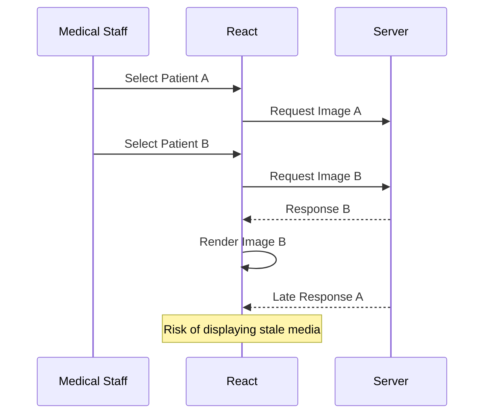

### 12.2 Existing Approach

확인한 코드에서는 `useEffect` 내부의 취소 여부 플래그를 사용하여 이전 요청의 결과가 화면에 반영되는 것을 방지하는 구조가 적용되어 있습니다.

```javascript
let cancelled = false;

// Asynchronous media request

if (!cancelled) {
  setSelectedImage(imageData);
}

return () => {
  cancelled = true;
};
```

이 방식은 이전 요청 결과의 상태 반영을 제한하지만, 실제 네트워크 요청 자체를 중단하는 방식은 아닙니다.

### 12.3 Improvement Proposal

향후에는 AbortController와 Object URL Cleanup을 함께 적용하여 네트워크 요청과 브라우저 자원의 생명주기를 관리할 수 있습니다.

다음은 개선 방향을 설명하기 위한 예시 코드이며, 기존 프로젝트에 적용한 구현은 아닙니다.

```javascript
useEffect(() => {
  const controller = new AbortController();

  let disposed = false;
  let objectUrl = null;

  setImageUrl(null);
  setImageError('');
  setLoading(Boolean(rawUrl));

  if (!rawUrl) {
    return () => controller.abort();
  }

  async function loadImage() {
    try {
      const access = localStorage.getItem('access');

      const response = await fetch(rawUrl, {
        signal: controller.signal,
        headers: {
          Authorization: `Bearer ${access}`
        }
      });

      if (!response.ok) {
        throw new Error('Media request failed');
      }

      const blob = await response.blob();

      if (disposed) return;

      objectUrl = URL.createObjectURL(blob);

      setImageUrl(objectUrl);

    } catch (error) {
      if (
        !disposed &&
        error.name !== 'AbortError'
      ) {
        setImageError('이미지를 불러올 수 없습니다.');
      }
    } finally {
      if (!disposed) {
        setLoading(false);
      }
    }
  }

  loadImage();

  return () => {
    disposed = true;
    controller.abort();

    if (objectUrl) {
      URL.revokeObjectURL(objectUrl);
    }
  };
}, [rawUrl]);
```

실제 적용 시에는 신뢰할 수 있는 서버에만 인증 헤더를 전달하도록 URL 검증과 공통 미디어 접근 정책을 함께 고려해야 합니다.

---

## 13. Component Refactoring

### 13.1 Initial Structure

초기 Dashboard에는 다음과 같은 기능이 함께 포함되어 있었습니다.

- 환자 관리 화면
- 메인 홈 화면
- 사이드바 및 메뉴
- 영상 제어 상태
- AI 분석 상태
- 화면 전환 처리

기능이 추가될수록 단일 컴포넌트에서 관리해야 하는 책임이 증가하였습니다.

### 13.2 Refactoring Strategy

메인 홈 화면을 별도의 Home 컴포넌트로 구성하고, 상위 Dashboard에서 환자 목록과 화면 전환 함수를 전달하도록 개선하였습니다.

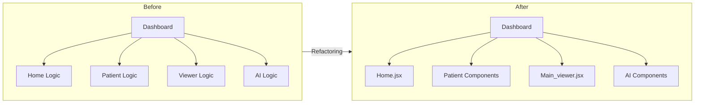

### 13.3 Component Contract

```jsx
<Home
  displayName={displayName}
  patients={patientList}
  onNavigate={setCurrentMenu}
  onSelectPatient={handleSelectPatient}
/>
```

| Prop | Responsibility |
|---|---|
| displayName | 의료진 표시 이름 |
| patients | 환자 목록 |
| onNavigate | 화면 전환 요청 |
| onSelectPatient | 환자 선택 이벤트 |

Home 컴포넌트는 상위 화면의 내부 상태를 직접 수정하지 않고 전달받은 Callback을 통해 사용자 이벤트를 전달합니다.

### 13.4 Git Evidence

대표 커밋:

`e7fa8f8` — 대시보드 수정 및 메인홈 파일 분할을 위한 파일 생성, 뷰어 수정

해당 커밋에서는 별도의 `Home.jsx` 파일이 신규 생성되었습니다.

다만 당시 Dashboard 내부에도 Home 함수가 존재하는 중간 단계가 확인되므로, 전체 컴포넌트 분리를 한 번에 완료한 것으로 표현하지 않습니다.

### 13.5 Engineering Benefits

- 화면별 역할 구분
- Props를 통한 명시적인 데이터 전달
- Callback 기반 사용자 이벤트 처리
- 화면 변경 시 수정 범위 관리
- 컴포넌트 단위 유지보수

이러한 이점은 설계 구조를 기준으로 설명한 것이며, 성능이나 코드 복잡도 감소를 정량적으로 측정한 결과는 아닙니다.

---

## 14. Responsive Layout & Dark Theme

### 14.1 Dark Theme

의료영상 중심의 화면 구성을 고려하여 어두운 배경과 명확한 정보 구분을 사용하는 다크 테마를 적용하였습니다.

- 의료영상 영역과 정보 패널 구분
- 임상정보 카드별 시각적 구분
- 선택된 메뉴 강조
- 주요 버튼 및 상태 표시 색상 구분
- 공통 배경 및 테두리 스타일

확인한 코드에서는 다크 스타일을 기본 화면에 적용하는 방식이며, 사용자 설정에 따른 동적 테마 전환 기능과는 구분합니다.

### 14.2 Responsive Sidebar

화면 크기에 따라 사이드바 표시 방식을 변경합니다.

```javascript
const [
  isMobileSidebarOpen,
  setIsMobileSidebarOpen
] = useState(false);
```

| Environment | Layout |
|---|---|
| Desktop | 고정 사이드바 |
| Smaller Screen | 토글 기반 사이드바 |
| Sidebar Open | 배경 오버레이 |
| Patient Selected | 사이드바 닫기 |

Tailwind CSS의 반응형 클래스와 React 상태를 활용하여 화면 크기에 따른 메뉴 접근 방식을 구성하였습니다.

전체 모바일 기기 및 브라우저에 대한 호환성 검증은 별도로 수행할 필요가 있습니다.

---

## 15. Defensive Programming

환자 조회 및 상세 화면에서 고려한 주요 예외 상황입니다.

| Scenario | Handling |
|---|---|
| 환자 목록 미전달 | 빈 배열 기본값 |
| 환자 객체 없음 | 상세 화면 대체 안내 |
| 환자 ID 숫자형 | 문자열 변환 |
| 검색 결과 없음 | 빈 결과 안내 |
| API 응답 형식 차이 | 배열 및 results 처리 |
| 검사 목록 없음 | Optional Chaining |
| 이미지 경로 없음 | 미디어 누락 안내 |
| 이미지 로딩 실패 | 오류 상태 표시 |
| 환자 수 0명 | 통계 계산 조건 처리 |
| 환자 변경 | 이전 요청 결과 반영 제한 |

위 항목은 확인한 코드의 처리 방식과 설계 의도를 정리한 것입니다.

모든 예외 상황에 대한 실행 테스트를 완료했다는 의미는 아닙니다.

---

## 16. Technical Review & Identified Limitations

소스코드 검토 과정에서 확인한 개선 필요 항목입니다.

### 16.1 AI Classification Statistics

최종 Home 컴포넌트에서는 AI 정상 및 주의 환자 수를 계산할 때 문자열 포함 여부와 병변 관련 값을 활용합니다.

예를 들어 다음과 같은 조건이 사용됩니다.

```javascript
severity.includes('obstructive')
```

하지만 `non-obstructive`에도 `obstructive` 문자열이 포함되어 있으므로 의도와 다른 분류가 발생할 수 있습니다.

또한 정상 및 주의 분류를 독립적으로 계산하는 경우 동일 환자가 중복 집계되거나 일부 환자가 어느 분류에도 포함되지 않을 수 있습니다.

### Improvement Direction

- 서버와 프론트엔드 간 분류값 정의
- 정확한 Enum 또는 분류 코드 비교
- 상호 배타적인 분류 조건
- 미분류 및 데이터 없음 상태 추가
- 전체 환자 수와 분류별 집계 검증

다음은 개선 설계 예시입니다.

```javascript
function classifyPatient(patient) {
  const severity = String(
    patient.latest_severity_class ?? ''
  ).trim().toLowerCase();

  switch (severity) {
    case 'normal':
    case 'no cad':
      return 'NORMAL';

    case 'obstructive':
    case 'obstructive cad':
      return 'OBSTRUCTIVE';

    case 'non-obstructive':
    case 'non-obstructive cad':
      return 'NON_OBSTRUCTIVE';

    default:
      return 'UNKNOWN';
  }
}
```

위 코드는 실제 서버 분류값에 맞춰 수정해야 하는 개선 예시이며, 의료적 위험도를 독립적으로 판단하는 알고리즘은 아닙니다.

---

### 16.2 Missing ECG Data

일부 환자 목록 화면에서는 ECG 결과가 없는 경우 정상이라는 기본값을 표시하는 구조가 확인됩니다.

의료 데이터에서는 검사 결과 없음과 정상 결과가 서로 다른 의미를 가지므로 명확하게 구분해야 합니다.

개선 예시:

```javascript
const ecgDisplay =
  patient.ecg_result == null ||
  patient.ecg_result === ''
    ? '검사 결과 없음'
    : patient.ecg_result;
```

---

### 16.3 Recent Patient Ordering

현재 환자 요약 목록은 배열의 앞부분을 선택하는 방식입니다.

```javascript
patients.slice(0, 5);
```

실제 최근 등록 환자를 표시하려면 서버의 정렬 규칙 또는 등록일 필드가 필요합니다.

개선 방향:

- 등록일 기준 서버 정렬
- 최신 환자 조회 API
- 페이지네이션
- 정렬 기준 명시

---

### 16.4 Duplicate API Requests

App과 Dashboard에서 환자 목록을 조회하는 구조가 존재합니다.

공통 데이터의 관리 위치가 분산되면 동일한 데이터를 중복 요청하거나 서로 다른 시점의 환자 목록을 사용하는 문제가 발생할 수 있습니다.

개선 방향:

- 환자 데이터 조회 책임 통합
- 공통 API Client 구성
- 환자 조회 Custom Hook 분리
- 캐싱 및 재조회 정책 정의

---

### 16.5 Media URL Lifecycle

파일 변경과 환자 전환 과정에서 생성되는 Object URL을 일관되게 관리할 필요가 있습니다.

개선 방향:

- 이전 Object URL 해제
- 비동기 요청 취소
- 늦게 완료된 요청의 자원 정리
- 환자 변경 시 로딩 및 오류 상태 초기화

---

### 16.6 Examination Selection

현재 상세 화면에서는 첫 번째 검사 데이터 또는 대체 이미지 경로를 사용합니다.

여러 검사 이력을 가진 환자의 전체 검사 목록을 선택하고 비교하는 기능으로 확장할 수 있습니다.

개선 방향:

- 검사 목록 조회
- 검사 ID 기반 선택 상태
- 검사일 및 영상 유형 표시
- 검사별 AI 분석 결과 연결

---

## 17. Validation Scenarios

다음은 환자 관리 및 대시보드 기능의 검증을 위해 정의한 테스트 시나리오입니다.

실제 자동화 테스트 실행 결과가 아니라, 소스코드 검토를 기반으로 작성한 검증 계획입니다.

| ID | Test Scenario | Expected Result |
|---|---|---|
| DASH-01 | 정상 환자 목록 조회 | 환자 목록 표시 |
| DASH-02 | 배열 형태 API 응답 | 정상 목록 렌더링 |
| DASH-03 | results 형태 API 응답 | 정상 목록 렌더링 |
| DASH-04 | 빈 환자 목록 | 빈 데이터 안내 |
| DASH-05 | 환자 이름 부분 검색 | 일치하는 환자 표시 |
| DASH-06 | 숫자형 환자 ID 검색 | 검색 오류 없이 결과 표시 |
| DASH-07 | 검색 결과 없음 | 빈 검색 결과 안내 |
| DASH-08 | 사이드바 검색 후 환자 선택 | 상세 화면 이동 |
| DASH-09 | 환자 선택 후 검색 상태 | 검색어 및 드롭다운 초기화 |
| DASH-10 | 선택 환자 없음 | 대체 화면 표시 |
| DASH-11 | 검사 이미지 경로 없음 | 미디어 없음 안내 |
| DASH-12 | 검사 이미지 요청 실패 | 오류 메시지 표시 |
| DASH-13 | 환자 연속 변경 | 이전 환자 이미지 반영 방지 |
| DASH-14 | 전체 환자 수 0명 | 통계 계산 오류 없음 |
| DASH-15 | Troponin T 값이 0 | 유효한 값으로 표시 |
| DASH-16 | ECG 결과 누락 | 정상과 구분된 안내 |
| DASH-17 | Non-obstructive 분류 | Obstructive와 구분 |
| DASH-18 | 모바일 메뉴 선택 | 사이드바 닫힘 |

DASH-13, DASH-16, DASH-17 등은 기존 구현의 개선 필요 항목을 포함합니다.

---

## 18. Git Contribution

개인 Git 변경 이력을 통해 확인한 주요 대시보드 개발 작업입니다.

| Commit | Contribution |
|---|---|
| `8749953` | 환자 목록 대시보드 생성 |
| `d75b325` | 환자 상세 페이지 및 빠른 검색 구현 |
| `21acdae` | 사이드바 검색 기능 수정 |
| `847f46d` | 대시보드 사이드바 및 업무 화면 수정 |
| `8e188fc` | 인트로 및 대시보드 디자인 개선 |
| `e7fa8f8` | Home 컴포넌트 생성 및 분리 작업 |
| `0161739` | 대시보드 복구 및 오류 수정 |
| `77e079c` | 대시보드 및 AI Viewer 수정 |
| `f83d166` | AI 판독 화면 3분할 구성 |
| `c871f85` | AI 진단 화면 재구성 |
| `ee3c068` | 결과 리포트 및 환자 상세 화면 수정 |

### Representative Source Files

- `src/Page/Dashboard.jsx`
- `src/Page/Home.jsx`
- `src/Page/Patient_Management.jsx`
- `src/Page/Patient_Detail.jsx`

Git 변경 이력은 개인 개발 참여를 확인하기 위한 근거이며, 해당 파일의 모든 기능을 개인이 단독으로 구현하였다는 의미는 아닙니다.

---

## 19. Engineering Retrospective

이번 대시보드 개발 과정에서는 화면 구성뿐만 아니라 서버에서 전달되는 환자 데이터를 어떻게 관리하고, 사용자 이벤트에 따라 화면 상태를 어떻게 변경해야 하는지 경험하였습니다.

특히 환자 검색 기능을 구현하면서 데이터 타입과 입력값 정규화의 중요성을 이해하였으며, 환자 상세 화면을 구성하면서 비동기 데이터 요청과 미디어 자원 관리의 필요성을 확인하였습니다.

또한 기능이 추가됨에 따라 단일 컴포넌트의 책임이 증가하는 문제를 경험하였고, Home 컴포넌트를 별도로 구성하면서 화면별 책임 분리와 Props 기반 데이터 전달 구조를 적용하였습니다.

### Key Learnings

- React 컴포넌트 설계 및 책임 분리
- 사용자 입력 정규화
- 배열 기반 검색 및 데이터 필터링
- API 응답 형식 처리
- 상태 기반 화면 전환
- 비동기 요청 결과 관리
- 인증 의료 미디어 접근
- 누락 데이터와 실제 검사 결과 구분

프론트엔드에서 환자 데이터를 처리하는 과정은 안정적인 화면 동작을 위해 백엔드 API의 응답 규격과 데이터 무결성이 중요하다는 점을 이해하는 계기가 되었습니다.

이후 DUGN 프로젝트에서는 이러한 경험을 바탕으로 의료 업무 API와 데이터 관리 구조를 백엔드 관점에서 설계하고 구현하였습니다.

---

## 20. Related Documentation

- [Project Overview](./README.md)
- [System Architecture](./architecture.md)
- [Medical Image Viewer](./image-viewer.md)
- [AI Diagnosis & XAI](./ai-diagnosis.md)
- [UI & State Management](./ui-state.md)
- [Troubleshooting](./troubleshooting.md)

### Source References

- [Team Repository](https://github.com/hyunkyung31/React_DL)
- [Personal Development Branch](https://github.com/hyunkyung31/React_DL/tree/yuri)
- [Patient Dashboard Commit](https://github.com/hyunkyung31/React_DL/commit/8749953)
- [Patient Detail Commit](https://github.com/hyunkyung31/React_DL/commit/d75b325)
- [Search Improvement Commit](https://github.com/hyunkyung31/React_DL/commit/21acdae)
- [Home Refactoring Commit](https://github.com/hyunkyung31/React_DL/commit/e7fa8f8)
- [Dashboard Recovery Commit](https://github.com/hyunkyung31/React_DL/commit/0161739)

본 문서는 개인 개발 브랜치, Git 변경 이력 및 팀 프로젝트 발표 자료를 바탕으로 작성하였습니다.

설명용 코드와 다이어그램은 실제 구현 구조를 이해하기 쉽게 재구성한 것이며, 개선 제안 및 검증 계획은 기존 구현과 구분하여 표시하였습니다.
