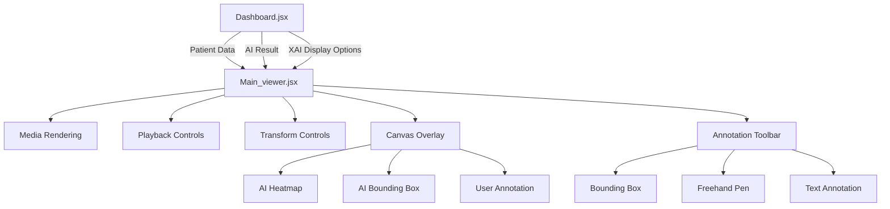
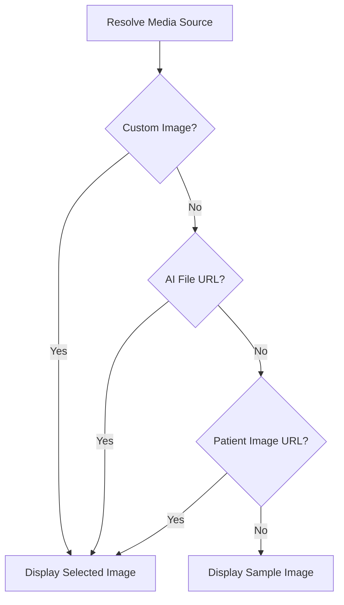
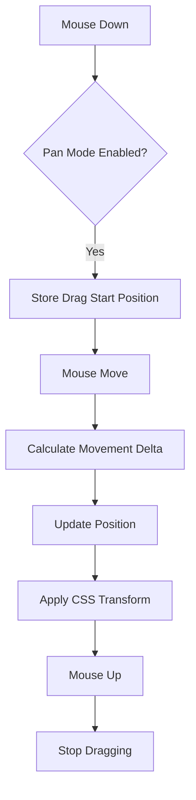
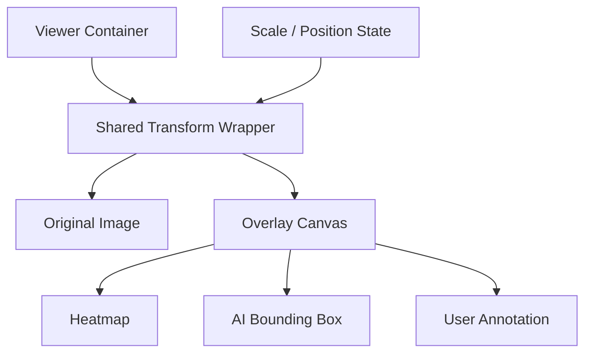
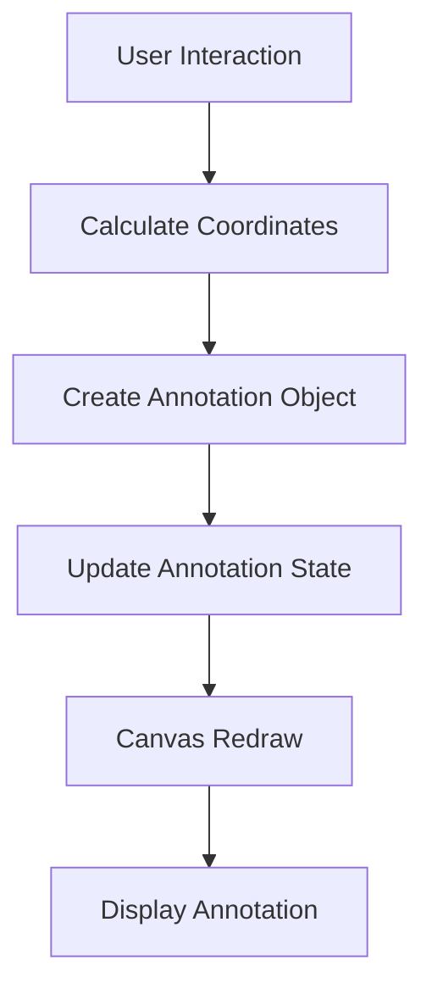
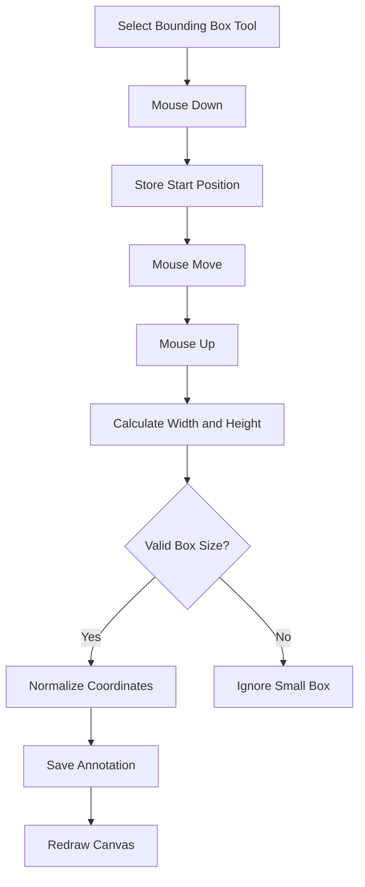
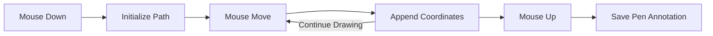
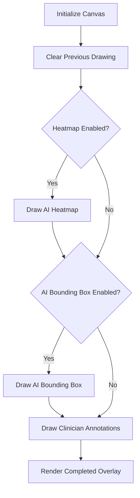
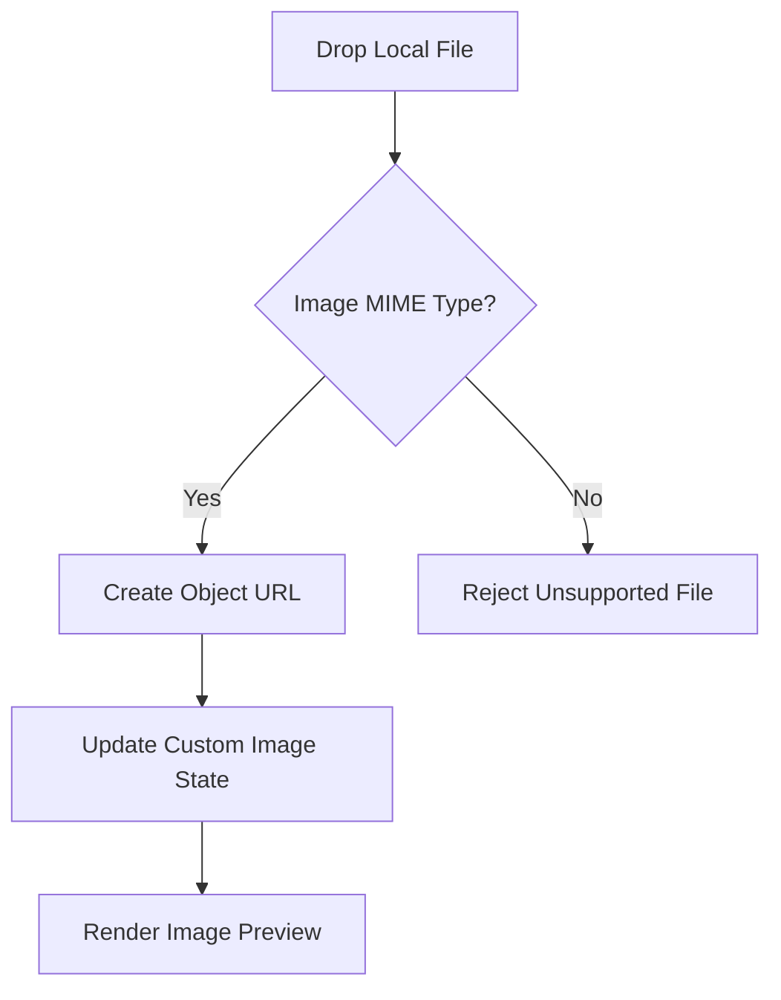
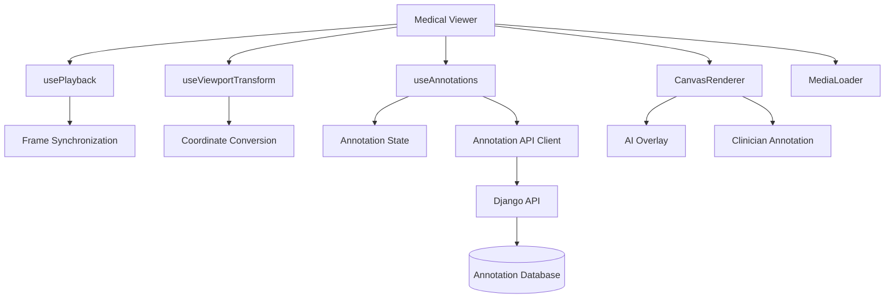

# Medical Image Viewer & Canvas Annotation

> ANGIO XAI — 의료영상 Viewer 및 Canvas 기반 의료진 주석 시스템

관상동맥 조영영상과 AI 분석 결과를 함께 확인하고, 의료진이 영상 위에 직접 판독 정보를 표시할 수 있도록 React 기반 의료영상 Viewer를 구성하였습니다.

본 문서는 개인 개발 영역인 영상 제어 인터페이스, 확대 및 이동, Canvas Annotation, 좌표 계산 및 사용자 이벤트 처리를 중심으로 설명합니다.

---

## 1. Implementation Overview

| 항목 | 내용 |
|---|---|
| 담당 영역 | 의료영상 Viewer 및 Canvas Annotation |
| 주요 기술 | React, JavaScript, Canvas API |
| 상태 관리 | useState, useEffect, useRef |
| 영상 제어 | HTML Video API, Frame Control UI |
| 화면 변환 | CSS Transform |
| 좌표 처리 | getBoundingClientRect, Scale Calculation |
| 사용자 이벤트 | Mouse Event, Drag & Drop |
| 주요 소스 | Main_viewer.jsx, Dashboard.jsx |

### Implementation Objectives

- 관상동맥 조영영상 조회 인터페이스 구현
- 영상 재생 및 탐색 컨트롤 구성
- 영상 확대, 축소 및 이동
- AI 분석 결과와 원본 영상의 시각적 연결
- 의료진 Bounding Box 및 텍스트 주석
- 자유곡선 기반 판독 영역 표시
- 영상 이동과 주석 기능 간 이벤트 분리
- 환자 및 영상 변경 시 관련 상태 관리

---

## 2. Background & Problem

관상동맥 조영영상에서는 혈관의 형태와 협착 의심 영역을 확인하기 위해 영상을 반복적으로 검토하거나 특정 영역을 확대할 필요가 있습니다.

AI 분석 결과를 제공하더라도 의료진이 직접 관심 영역을 표시하고 원본 영상과 분석 결과를 비교할 수 있는 인터페이스가 필요합니다.

### Technical Challenges

| 문제 | 기술적 요구사항 |
|---|---|
| 작은 병변 영역 확인 | 영상 확대 및 이동 |
| 영상 탐색의 불편함 | 재생 및 프레임 제어 |
| AI 결과와 원본 영상 비교 | Overlay 렌더링 |
| 의료진의 추가 판독 정보 | Canvas Annotation |
| 영상과 Bounding Box 위치 차이 | 좌표 변환 및 공통 Transform |
| 여러 마우스 기능 간 충돌 | 도구별 이벤트 분리 |
| 환자 변경 시 이전 정보 유지 | 상태 초기화 |
| 다양한 미디어 형식 | 유형별 조건부 렌더링 |

본 Viewer는 교육용 의료 AI 프로토타입의 일부이며, 의료기기 수준의 영상 정확도와 임상적 안전성을 검증한 시스템은 아닙니다.

---

## 3. Viewer Architecture

### 3.1 Component Structure



Dashboard는 환자 정보와 AI 분석 결과 및 표시 옵션을 전달합니다.

Main Viewer는 영상 표시, 사용자 인터랙션 및 Canvas 주석 상태를 관리합니다.

### 3.2 Responsibility Separation

| Component | Responsibility |
|---|---|
| Dashboard | 환자 및 AI 분석 상태 관리 |
| Main_viewer | 영상 표시 및 사용자 인터랙션 |
| Xai_visualization | AI 결과 표시 옵션 |
| Canvas Overlay | AI 및 의료진 주석 렌더링 |
| Annotation Toolbar | 의료진 주석 도구 선택 |

AI 모델의 학습 및 추론은 팀 담당 영역이며, 개인 개발은 해당 결과를 확인하고 조작할 수 있는 Viewer 인터페이스에 집중하였습니다.

---

## 4. Viewer Layout

Viewer는 의료영상 표시 영역과 사용자 제어 영역을 구분하여 구성하였습니다.

```text
+------------------------------------------------+
| Viewer Header                                  |
| Patient Information / Series / Fullscreen      |
+------------------------------------------------+
| Annotation Toolbar                             |
| Box / Pen / Text / Clear                       |
+------------------------------------------------+
|                                                |
|              Medical Image                     |
|                                                |
|        +-----------------------+               |
|        | AI Bounding Box       |               |
|        +-----------------------+               |
|                                                |
|           Clinician Annotation                 |
|                                                |
+------------------------------------------------+
| Frame Slider                                   |
+------------------------------------------------+
| Previous / Play / Pause / Next / Speed          |
+------------------------------------------------+
| Thumbnail Navigation                           |
+------------------------------------------------+
```

위 구조는 확인한 Viewer의 주요 기능을 설명하기 위한 개념적 화면 구성입니다.

---

## 5. Props & Data Interface

### 5.1 Viewer Props

최종 개인 개발 브랜치의 Main Viewer는 다음과 같은 데이터를 전달받습니다.

| Prop | Responsibility |
|---|---|
| patientData | 환자 및 의료영상 정보 |
| showHeatmap | Heatmap 표시 여부 |
| showBoundingBox | AI Bounding Box 표시 여부 |
| confidenceThreshold | AI 결과 표시 기준 |
| aiFileUrl | 분석 대상 이미지 경로 |
| aiResult | AI 분석 결과 |
| heatmapOpacity | Heatmap 투명도 |

### 5.2 Component Integration

다음은 실제 컴포넌트 연결 구조를 단순화한 예시입니다.

```jsx
<MainViewer
  patientData={selectedPatient}
  aiFileUrl={aiFileUrl}
  aiResult={aiResult}
  showHeatmap={showHeatmap}
  showBoundingBox={showBoundingBox}
  confidenceThreshold={confidenceThreshold}
  heatmapOpacity={heatmapOpacity}
/>
```

상위 컴포넌트의 AI 분석 결과와 표시 옵션을 Viewer에서 활용하도록 구성하였습니다.

AI 추론 결과의 생성과 서버 응답 구조는 팀 구현 영역입니다.

---

## 6. Viewer State Management

### 6.1 State Classification

Viewer 내부 상태는 영상 탐색, 화면 변환, 주석 및 미디어 표시 상태로 구분할 수 있습니다.

| Category | State | Purpose |
|---|---|---|
| Playback | currentFrame | 현재 프레임 표시 |
| Playback | isPlaying | 재생 상태 |
| Playback | playbackSpeed | 재생 속도 |
| Playback | selectedSeries | 선택한 Series |
| Transform | scale | 확대 배율 |
| Transform | position | 영상 이동 위치 |
| Transform | isZoomMode | 확대 및 이동 모드 |
| Transform | isDragging | 드래그 진행 여부 |
| Display | isFullscreen | 전체 화면 상태 |
| Display | isImageLoaded | 이미지 로딩 상태 |
| Annotation | activeTool | 활성 주석 도구 |
| Annotation | userAnnotations | 의료진 주석 목록 |
| Annotation | currentText | 입력 중인 텍스트 |
| Annotation | isDrawing | 주석 그리기 상태 |
| Annotation | drawStartPos | 그리기 시작 좌표 |
| Annotation | currentPath | 자유곡선 좌표 목록 |
| Media | customImageUrl | 사용자 선택 이미지 |
| Media | isDragOver | 파일 드래그 상태 |

### 6.2 React Hooks

| Hook | Usage |
|---|---|
| useState | 사용자 인터랙션 및 화면 상태 |
| useEffect | 타이머, Canvas 렌더링 및 상태 변경 처리 |
| useRef | 이미지, Canvas 및 DOM 요소 접근 |

### 6.3 DOM References

```javascript
const imageRef = useRef(null);
const overlayCanvasRef = useRef(null);
const dragStartRef = useRef(null);
const viewerRef = useRef(null);
```

DOM 요소에 직접 접근해야 하는 Canvas 렌더링, 좌표 계산 및 전체 화면 기능에 Ref를 활용합니다.

---

## 7. Media Rendering

### 7.1 Media Source Priority

Viewer는 여러 경로로 전달되는 이미지 중 우선순위에 따라 표시할 이미지를 선택합니다.

```javascript
const currentDisplayImage =
  customImageUrl ||
  aiFileUrl ||
  patientData?.imageUrl ||
  patientData?.url ||
  angioImage;
```

### 7.2 Source Priority Flow



기본 샘플 이미지는 개발 및 시연을 위한 대체 리소스입니다.

실제 의료 서비스에서는 환자의 검사 영상이 없는 경우 샘플 이미지가 실제 환자 영상으로 오인되지 않도록 명확하게 구분해야 합니다.

### 7.3 Media Type Handling

이미지와 영상은 서로 다른 방식으로 표시해야 합니다.

개발 과정에서는 이미지와 영상의 유형에 따라 렌더링 요소를 구분하였습니다.

```jsx
{patientData?.mediaType === 'video' ? (
  <iframe
    src={patientData.url}
    title="Medical Video"
    allowFullScreen
  />
) : (
  
)}
```

위 코드는 최종 개인 브랜치의 미디어 분기 구조를 설명하기 위한 단순화 예시입니다.

---

## 8. Video Playback & Frame Control

### 8.1 Development Process

영상 제어 기능은 개발 과정에서 여러 차례 구조가 변경되었습니다.

| Development Stage | Implementation |
|---|---|
| 초기 개발 | 의료영상 Viewer UI 구성 |
| Dashboard 개선 | HTML Video API 기반 재생 제어 |
| Viewer 재구성 | 프레임 상태 및 탐색 컨트롤 |
| 최종 개인 브랜치 | 이미지 중심 Viewer 및 영상 분기 |

개발 과정의 영상 재생 기능과 최종 개인 브랜치의 프레임 탐색 UI를 구분하여 설명합니다.

### 8.2 HTML Video API

개인 커밋 `0161739`에서는 Video 요소에 접근하여 재생 및 일시정지 상태를 제어하는 구현이 확인됩니다.

다음은 해당 구현 구조를 설명하기 위한 단순화 예시입니다.

```javascript
const videoRef = useRef(null);

useEffect(() => {
  const video = videoRef.current;

  if (!video) return;

  if (isPlaying) {
    video.play();
  } else {
    video.pause();
  }
}, [isPlaying]);
```

### 8.3 Playback Speed

HTML Video API의 playbackRate 속성을 활용하여 영상 재생 속도를 변경할 수 있습니다.

```javascript
useEffect(() => {
  if (videoRef.current) {
    videoRef.current.playbackRate = playbackSpeed;
  }
}, [playbackSpeed]);
```

최종 Viewer 인터페이스에서는 다음 재생 속도 선택 옵션이 제공됩니다.

| Speed | Description |
|---|---|
| 0.5x | 느린 탐색 |
| 1.0x | 기본 속도 |
| 1.5x | 빠른 탐색 |
| 2.0x | 빠른 탐색 |

### 8.4 Frame State

최종 개인 브랜치에서는 현재 프레임 번호를 React 상태로 관리합니다.

```javascript
const [currentFrame, setCurrentFrame] =
  useState(125);

const totalFrames = 250;
```

현재 구현의 전체 프레임 수는 고정값입니다.

실제 영상 파일의 프레임 수를 자동으로 분석하여 설정하는 기능과는 구분합니다.

### 8.5 Frame Navigation

프레임 이동 인터페이스는 다음과 같이 구성됩니다.

- 첫 번째 프레임 이동
- 이전 프레임 이동
- 다음 프레임 이동
- 마지막 프레임 이동
- Range Slider 기반 위치 선택
- 주변 프레임 썸네일 표시

프레임 범위를 제한하는 단순화 예시는 다음과 같습니다.

```javascript
function moveNextFrame() {
  setCurrentFrame(prev =>
    Math.min(prev + 1, totalFrames)
  );
}

function movePreviousFrame() {
  setCurrentFrame(prev =>
    Math.max(prev - 1, 1)
  );
}
```

### 8.6 Timer-Based Frame Progression

최종 개인 브랜치에서는 setInterval을 활용하여 프레임 표시 상태를 증가시키는 구조가 확인됩니다.

```javascript
useEffect(() => {
  if (!isPlaying) return;

  const interval = setInterval(() => {
    setCurrentFrame(prev =>
      Math.min(prev + 1, totalFrames)
    );
  }, 1000 / (10 * playbackSpeed));

  return () => clearInterval(interval);
}, [isPlaying, playbackSpeed]);
```

위 코드는 타이머 기반 프레임 증가 구조를 설명하기 위해 단순화한 예시입니다.

실제 코드에서는 마지막 프레임에 도달했을 때 재생 상태를 종료하는 처리도 포함됩니다.

### 8.7 Playback Interval

기준 프레임 진행 속도를 초당 10회로 설정한 경우 타이머 간격은 다음과 같이 계산됩니다.

```text
Interval = 1000 / (Base FPS × Playback Speed)
```

| Playback Speed | Interval |
|---|---|
| 0.5x | 200 ms |
| 1.0x | 100 ms |
| 1.5x | 약 66.7 ms |
| 2.0x | 50 ms |

위 값은 코드의 타이머 설정에 따른 이론적인 계산값입니다.

실제 영상의 FPS 또는 브라우저에서 측정한 재생 성능을 의미하지 않습니다.

### 8.8 Implementation Boundary

최종 개인 브랜치에서 이미지 URL은 currentFrame에 따라 변경되지 않습니다.

또한 썸네일 이미지도 동일한 이미지 리소스를 활용합니다.

따라서 다음 기능은 구분하여 기술합니다.

| Feature | Implementation Scope |
|---|---|
| HTML Video 재생 제어 | 개발 과정에서 확인 |
| 프레임 번호 상태 관리 | 최종 개인 브랜치에서 확인 |
| 프레임 탐색 UI | 구현 확인 |
| 재생 속도 선택 UI | 구현 확인 |
| 실제 영상 프레임 추출 | 추가 구현 필요 |
| 영상과 프레임 번호 동기화 | 추가 개선 필요 |
| 구간 반복 재생 | 최종 코드에서 확인되지 않음 |

---

## 9. Zoom & Pan Interaction

### 9.1 Zoom State

의료영상의 관심 영역을 자세히 확인할 수 있도록 확대 배율을 상태로 관리합니다.

```javascript
const [scale, setScale] = useState(1);
```

확인한 Viewer에서는 확대 배율을 일정 범위 내에서 변경합니다.

| Property | Value |
|---|---|
| Minimum Scale | 1 |
| Maximum Scale | 4 |
| Scale Step | 0.2 |

### 9.2 Zoom Boundary

```javascript
function zoomIn() {
  setScale(prev =>
    Math.min(prev + 0.2, 4)
  );
}

function zoomOut() {
  setScale(prev =>
    Math.max(prev - 0.2, 1)
  );
}
```

위 코드는 확대 배율 제한 방식을 설명하기 위한 단순화 예시입니다.

### 9.3 Pan Position

확대된 영상의 위치를 변경하기 위해 X축과 Y축 이동값을 상태로 관리합니다.

```javascript
const [position, setPosition] = useState({
  x: 0,
  y: 0
});
```

### 9.4 Mouse Drag Processing

영상 이동 과정은 다음과 같습니다.



마우스 이동량을 이용하여 영상의 이동 위치를 계산하고 화면에 반영합니다.

```text
Delta X = Current Mouse X - Start Mouse X
Delta Y = Current Mouse Y - Start Mouse Y

New X = Initial Position X + Delta X
New Y = Initial Position Y + Delta Y
```

### 9.5 CSS Transform

확대 배율과 이동 위치는 CSS Transform으로 적용합니다.

```jsx
<div
  style={{
    transform:
      `translate(${position.x}px, ${position.y}px) ` +
      `scale(${scale})`
  }}
>
  
  <canvas ref={overlayCanvasRef} />
</div>
```

위 구조는 원본 이미지와 Canvas를 공통 컨테이너에 배치하는 방식을 설명하기 위한 예시입니다.

### 9.6 Design Considerations

CSS Transform은 원본 이미지 파일의 픽셀 데이터를 수정하지 않고 화면 표시 위치와 크기를 변경합니다.

이를 통해 의료영상 원본과 화면 인터랙션을 분리할 수 있습니다.

다만 확대 및 이동 범위 제한, Transform Origin, Canvas 입력 좌표 변환은 추가적인 검증이 필요합니다.

---

## 10. Canvas Overlay Architecture

### 10.1 Overlay Concept

원본 의료영상 위에 Canvas를 배치하여 AI 분석 결과와 의료진 주석을 표시합니다.

```text
Logical Drawing Order

+----------------------------------+
| Clinician Annotation             |
| Box / Pen / Text                 |
+----------------------------------+
| AI Bounding Box                  |
+----------------------------------+
| AI Heatmap                       |
+----------------------------------+
| Original Medical Image           |
+----------------------------------+
```

위 구조는 논리적인 표시 순서를 의미합니다.

실제 구현에서는 AI Heatmap, AI Bounding Box 및 의료진 주석을 하나의 Overlay Canvas에 순차적으로 렌더링합니다.

각 항목이 별도의 Canvas DOM 요소로 구현된 것은 아닙니다.

### 10.2 Common Transform Container



영상과 Canvas가 동일한 부모 컨테이너의 Transform을 공유하도록 구성합니다.

영상 확대 및 이동 시 오버레이도 함께 변환되는 구조입니다.

### 10.3 Original Data Preservation

Canvas 기반 오버레이는 원본 이미지와 판독 표시 정보를 분리할 수 있습니다.

| Data | Responsibility |
|---|---|
| Original Image | 원본 의료영상 |
| AI Overlay | AI 분석 결과 표시 |
| User Annotation | 의료진 입력 정보 |
| React State | 주석 데이터 관리 |

원본 이미지 자체에 직접 그림을 추가하거나 파일을 수정하지 않고, 화면 위에 별도의 시각적 정보를 표시합니다.

---

## 11. Canvas Resolution & Device Pixel Ratio

### 11.1 CSS Size and Drawing Buffer

Canvas는 화면에 표시되는 CSS 크기와 내부 픽셀 버퍼 크기가 다를 수 있습니다.

고해상도 화면에서는 Device Pixel Ratio를 고려하지 않을 경우 선과 텍스트가 흐리게 표시될 수 있습니다.

### 11.2 Device Pixel Ratio

```javascript
const dpr = window.devicePixelRatio || 1;
```

Canvas 내부 버퍼 크기를 화면 표시 크기와 Device Pixel Ratio에 맞춰 설정합니다.

```javascript
canvas.width = displayWidth * dpr;
canvas.height = displayHeight * dpr;

canvas.style.width = `${displayWidth}px`;
canvas.style.height = `${displayHeight}px`;

ctx.setTransform(dpr, 0, 0, dpr, 0, 0);
```

위 코드는 확인한 Canvas 해상도 처리 방식을 설명하기 위한 단순화 예시입니다.

### 11.3 Example

| Property | Value |
|---|---|
| CSS Width | 600 px |
| CSS Height | 400 px |
| Device Pixel Ratio | 2 |
| Canvas Buffer Width | 1200 px |
| Canvas Buffer Height | 800 px |

Device Pixel Ratio를 반영하여 내부 렌더링 해상도를 높이면서 화면상의 크기는 유지합니다.

### 11.4 Coordinate Separation

다음 좌표 체계는 서로 구분해야 합니다.

- 원본 의료영상 픽셀 좌표
- 화면 표시 이미지 좌표
- Canvas 내부 버퍼 좌표
- 브라우저 마우스 이벤트 좌표
- CSS Transform이 적용된 화면 좌표

Device Pixel Ratio를 처리하는 것만으로 모든 좌표 정렬 문제가 해결되는 것은 아닙니다.

영상 확대 및 이동에 따른 좌표 변환도 함께 고려해야 합니다.

---

## 12. AI Bounding Box Coordinate Transformation

### 12.1 Problem Definition

AI 모델이 반환하는 Bounding Box 좌표는 원본 이미지 크기를 기준으로 생성될 수 있습니다.

하지만 브라우저에서는 의료영상이 원본 크기와 다른 크기로 표시될 수 있습니다.

원본 좌표를 그대로 화면에 적용하면 AI Bounding Box가 실제 관심 영역과 다른 위치에 표시될 수 있습니다.

### 12.2 Coordinate System

```text
Original Image

Width  = W_original
Height = H_original

Bounding Box

X      = x
Y      = y
Width  = w
Height = h
```

```text
Displayed Image

Width  = W_display
Height = H_display
```

### 12.3 Scale Calculation

원본 이미지와 화면 표시 이미지의 크기 비율을 계산합니다.

```text
Scale X = Display Width / Original Width

Scale Y = Display Height / Original Height
```

### 12.4 Bounding Box Conversion

```text
Display X      = Original X × Scale X
Display Y      = Original Y × Scale Y
Display Width  = Original Width × Scale X
Display Height = Original Height × Scale Y
```

### 12.5 Calculation Example

다음은 좌표 변환 원리를 설명하기 위한 가상의 데이터입니다.

| Property | Original | Display |
|---|---:|---:|
| Image Width | 1000 | 500 |
| Image Height | 800 | 400 |
| Bounding Box X | 300 | 150 |
| Bounding Box Y | 200 | 100 |
| Bounding Box Width | 200 | 100 |
| Bounding Box Height | 100 | 50 |

```text
Scale X = 500 / 1000 = 0.5

Scale Y = 400 / 800 = 0.5
```

원본 Bounding Box의 위치와 크기에 각각의 축 비율을 적용합니다.

### 12.6 Implementation Example

```javascript
function convertBoundingBox(
  box,
  originalWidth,
  originalHeight,
  displayWidth,
  displayHeight
) {
  const scaleX =
    displayWidth / originalWidth;

  const scaleY =
    displayHeight / originalHeight;

  return {
    x: box.x * scaleX,
    y: box.y * scaleY,
    width: box.width * scaleX,
    height: box.height * scaleY
  };
}
```

위 코드는 실제 좌표 변환 원리를 설명하기 위한 재구성 예시입니다.

실제 적용 시에는 원본 크기가 0이거나 좌표값이 유효하지 않은 경우도 검증해야 합니다.

### 12.7 Canvas Drawing

변환한 좌표를 Canvas의 strokeRect 함수에 전달하여 사각형을 표시합니다.

```javascript
ctx.strokeStyle = '#ef4444';
ctx.lineWidth = 2;

ctx.strokeRect(
  displayBox.x,
  displayBox.y,
  displayBox.width,
  displayBox.height
);
```

### 12.8 Contribution Boundary

영상과 AI Bounding Box 간 좌표 정렬 문제는 팀 프로젝트의 최종 발표 자료에서 다룬 기술적 문제입니다.

개인 개발 브랜치에서도 이미지와 Canvas의 공통 Transform 및 좌표 계산 구조가 확인됩니다.

다만 해당 문제 해결의 전체 과정을 개인이 단독으로 구현하였다고 단정하지 않습니다.

개인 기여는 Viewer 수정, 화면 인터랙션 및 Canvas 기반 의료진 주석 구현을 중심으로 설명합니다.

---

## 13. Clinician Annotation System

### 13.1 Implementation Background

AI 모델이 제공하는 Bounding Box와 Heatmap은 의료진의 판단을 보조하기 위한 정보입니다.

의료진이 AI 분석 결과와 별도로 관심 영역이나 판독 의견을 표시할 수 있도록 Canvas 기반 주석 기능을 추가하였습니다.

### 13.2 Supported Annotation Tools

| Tool | Function |
|---|---|
| Bounding Box | 사각형 관심 영역 표시 |
| Pen | 자유곡선 표시 |
| Text | 판독 관련 텍스트 표시 |
| Clear | 의료진 주석 초기화 |

### 13.3 Representative Commit

`f83d166`

AI 진단 메인화면 3분할, Canvas 기능 추가, 메인뷰어 수정

해당 개인 커밋에서 의료진 주석 상태, 마우스 이벤트 처리, 주석 도구 및 Canvas 렌더링 관련 기능의 추가를 확인하였습니다.

### 13.4 Annotation Data Structure

의료진 주석은 유형별 객체 형태로 React 상태에 저장합니다.

```javascript
const [userAnnotations, setUserAnnotations] =
  useState([]);
```

Bounding Box 예시:

```javascript
{
  type: 'bbox',
  x: 120,
  y: 80,
  width: 100,
  height: 60
}
```

Text 예시:

```javascript
{
  type: 'text',
  x: 180,
  y: 120,
  text: '관심 영역'
}
```

Pen 예시:

```javascript
{
  type: 'pen',
  path: [
    { x: 100, y: 100 },
    { x: 110, y: 105 },
    { x: 120, y: 115 }
  ]
}
```

위 좌표 및 텍스트는 데이터 구조를 설명하기 위한 가상의 예시입니다.

### 13.5 Data-Driven Rendering

Canvas에 표시되는 주석을 단순한 이미지 변경으로만 관리하지 않고, 주석 객체의 배열을 별도로 관리합니다.



이러한 구조는 주석 데이터와 화면 렌더링을 분리하기 위한 기반이 됩니다.

다만 주석의 서버 저장, 수정 이력 및 개별 삭제 기능까지 구현한 것은 아닙니다.

---

## 14. Mouse Coordinate Calculation

### 14.1 Browser Coordinate

브라우저 마우스 이벤트의 clientX와 clientY는 Viewport를 기준으로 하는 좌표입니다.

Canvas에 그림을 표시하려면 Canvas 요소를 기준으로 하는 좌표로 변환해야 합니다.

### 14.2 getBoundingClientRect

```javascript
const rect =
  canvas.getBoundingClientRect();
```

getBoundingClientRect는 요소의 화면상 위치와 크기를 반환합니다.

### 14.3 Local Coordinate

```javascript
const x = event.clientX - rect.left;
const y = event.clientY - rect.top;
```

```text
Canvas X = Mouse Client X - Canvas Left

Canvas Y = Mouse Client Y - Canvas Top
```

### 14.4 Calculation Example

| Property | Value |
|---|---:|
| Mouse Client X | 350 |
| Mouse Client Y | 220 |
| Canvas Left | 100 |
| Canvas Top | 50 |
| Canvas Local X | 250 |
| Canvas Local Y | 170 |

### 14.5 Implementation Limitation

위 계산은 화면상 Canvas의 시작 위치를 기준으로 상대 좌표를 구하는 방식입니다.

Canvas에 CSS 확대 변환이 적용된 경우에는 화면상 좌표와 Canvas의 논리적 좌표 사이에 추가적인 비율 변환이 필요할 수 있습니다.

최종 개인 브랜치의 의료진 주석은 화면 표시 좌표를 중심으로 저장하므로 확대 상태 및 화면 크기 변경에 따른 정확도 검증이 필요합니다.

---

## 15. Bounding Box Annotation

### 15.1 Drawing Workflow



### 15.2 Initial Position

마우스를 누르는 시점의 좌표를 저장합니다.

```javascript
setDrawStartPos({
  x: startX,
  y: startY
});

setIsDrawing(true);
```

### 15.3 Width and Height

마우스를 놓는 시점의 좌표와 시작 좌표를 비교합니다.

```javascript
const width = endX - startX;
const height = endY - startY;
```

### 15.4 Reverse Drag Problem

사용자는 반드시 왼쪽 위에서 오른쪽 아래 방향으로 사각형을 그리는 것이 아닙니다.

오른쪽 아래에서 왼쪽 위로 드래그하면 너비와 높이가 음수가 될 수 있습니다.

```text
Start Point = (300, 220)
End Point   = (120, 80)

Width  = 120 - 300 = -180
Height = 80 - 220  = -140
```

음수 크기를 그대로 주석 데이터에 저장하면 이후 좌표 계산과 데이터 관리가 복잡해질 수 있습니다.

### 15.5 Coordinate Normalization

시작점과 종료점 중 작은 값을 사각형의 기준 위치로 사용하고, 크기는 절댓값으로 계산합니다.

```javascript
const box = {
  type: 'bbox',

  x: Math.min(startX, endX),
  y: Math.min(startY, endY),

  width: Math.abs(endX - startX),
  height: Math.abs(endY - startY)
};
```

### 15.6 Normalized Result

| Property | Before | After |
|---|---:|---:|
| X | 300 | 120 |
| Y | 220 | 80 |
| Width | -180 | 180 |
| Height | -140 | 140 |

위 방식으로 드래그 방향과 관계없이 동일한 사각형 영역을 표현할 수 있습니다.

실제 개인 커밋에서는 너비와 높이의 부호를 확인하여 기준 좌표를 보정하는 구현이 확인됩니다.

### 15.7 Minimum Size Validation

단순 클릭이나 작은 마우스 움직임으로 불필요한 Bounding Box가 생성되지 않도록 최소 크기 조건을 적용합니다.

```javascript
if (
  Math.abs(width) > 5 &&
  Math.abs(height) > 5
) {
  setUserAnnotations(prev => [
    ...prev,
    normalizedBox
  ]);
}
```

최종 개인 구현에서는 가로와 세로 크기가 모두 5픽셀을 초과하는 경우 주석을 추가하는 조건이 확인됩니다.

### 15.8 Engineering Benefits

- 드래그 방향에 독립적인 데이터 구조
- 음수 너비 및 높이 방지
- 불필요한 작은 주석 생성 제한
- 일관된 Bounding Box 렌더링
- 주석 데이터의 후속 처리 기반 마련

---

## 16. Freehand Pen Annotation

### 16.1 Implementation Concept

자유곡선 도구는 마우스 이동 과정에서 발생하는 좌표를 배열로 수집하고, 이를 연결하여 하나의 주석으로 표시합니다.

### 16.2 Path Collection

```javascript
const [currentPath, setCurrentPath] =
  useState([]);
```

마우스를 누르면 첫 번째 좌표를 저장합니다.

```javascript
setCurrentPath([
  { x: startX, y: startY }
]);
```

마우스 이동 시 새로운 좌표를 배열에 추가합니다.

```javascript
setCurrentPath(prev => [
  ...prev,
  { x, y }
]);
```

### 16.3 Annotation Creation

마우스를 놓는 시점에 수집한 좌표가 충분한 경우 주석 목록에 추가합니다.

```javascript
if (currentPath.length > 1) {
  setUserAnnotations(prev => [
    ...prev,
    {
      type: 'pen',
      path: currentPath
    }
  ]);
}
```

### 16.4 Canvas Path Rendering

```javascript
function drawPen(ctx, path) {
  if (path.length < 2) return;

  ctx.beginPath();

  ctx.moveTo(
    path[0].x,
    path[0].y
  );

  path.slice(1).forEach(point => {
    ctx.lineTo(point.x, point.y);
  });

  ctx.stroke();
}
```

위 코드는 자유곡선 렌더링 원리를 설명하기 위한 단순화 예시입니다.

### 16.5 Drawing Process



### 16.6 Performance Considerations

마우스 이동 이벤트마다 배열 상태를 변경하면 좌표가 많아질수록 배열 복사 및 렌더링 비용이 증가할 수 있습니다.

향후에는 다음과 같은 방식으로 개선할 수 있습니다.

- useRef 기반 임시 좌표 저장
- requestAnimationFrame 기반 화면 갱신
- 좌표 샘플링
- 불필요한 중복 좌표 제거
- 그리기 종료 시 최종 상태 저장

위 항목은 향후 개선 방향이며, 기존 구현에서 성능 최적화를 완료하였다는 의미는 아닙니다.

---

## 17. Text Annotation

### 17.1 Implementation Concept

의료진이 입력한 텍스트를 영상의 선택한 위치에 표시하도록 구성하였습니다.

### 17.2 Input Validation

빈 문자열이나 공백만 포함된 텍스트가 주석으로 저장되지 않도록 입력값을 확인합니다.

```javascript
const text = currentText.trim();

if (!text) {
  return;
}
```

### 17.3 Annotation Object

```javascript
const annotation = {
  type: 'text',
  x,
  y,
  text
};

setUserAnnotations(prev => [
  ...prev,
  annotation
]);
```

### 17.4 Canvas Text Rendering

```javascript
ctx.font = '14px sans-serif';
ctx.fillStyle = '#fbbf24';

ctx.fillText(
  annotation.text,
  annotation.x,
  annotation.y
);
```

위 코드는 Canvas 텍스트 표시 원리를 설명하기 위한 예시입니다.

### 17.5 Tool State

텍스트 주석을 추가한 후 활성 도구 상태를 초기화하는 처리를 적용하였습니다.

이를 통해 동일한 텍스트가 의도하지 않게 반복 입력되는 상황을 줄일 수 있습니다.

---

## 18. Annotation Rendering Pipeline

### 18.1 Rendering Order

Canvas 렌더링은 논리적으로 다음 순서로 구성됩니다.



의료진 주석을 AI 분석 표시 이후에 렌더링하여 서로 다른 표시 정보를 함께 확인할 수 있도록 구성합니다.

### 18.2 Annotation Type Rendering

```javascript
function drawAnnotation(ctx, annotation) {
  switch (annotation.type) {
    case 'bbox':
      ctx.strokeRect(
        annotation.x,
        annotation.y,
        annotation.width,
        annotation.height
      );
      break;

    case 'pen':
      drawPen(ctx, annotation.path);
      break;

    case 'text':
      ctx.fillText(
        annotation.text,
        annotation.x,
        annotation.y
      );
      break;
  }
}
```

위 코드는 유형별 렌더링 구조를 설명하기 위한 단순화 예시입니다.

### 18.3 Annotation State Update

React 상태의 불변성을 유지하기 위해 기존 배열을 직접 수정하는 대신 새로운 배열을 생성합니다.

```javascript
setUserAnnotations(prev => [
  ...prev,
  newAnnotation
]);
```

### 18.4 Clear Annotation

```javascript
setUserAnnotations([]);
```

의료진 주석 목록을 초기화하고 Canvas를 다시 렌더링하는 방식입니다.

AI 분석 결과 자체를 삭제하거나 원본 의료영상을 수정하는 기능과는 구분합니다.

### 18.5 Canvas Redraw

주석 목록과 표시 옵션이 변경될 때 Canvas를 다시 그리는 구조를 사용합니다.

또한 화면 크기 변경에 대응하기 위한 Resize Event 처리와 Cleanup 로직이 확인됩니다.

다만 비동기 Heatmap 로딩과 의료진 주석의 렌더링 순서가 모든 상황에서 안정적으로 유지되는지는 추가 검증이 필요합니다.

---

## 19. Interaction Conflict Prevention

### 19.1 Problem

영상 이동과 의료진 주석은 모두 마우스 드래그 이벤트를 사용합니다.

두 기능이 동시에 활성화되면 하나의 드래그 동작으로 영상이 이동하면서 주석도 생성되는 문제가 발생할 수 있습니다.

### 19.2 Tool-Based Interaction

현재 활성화된 도구와 확대 이동 모드를 상태로 관리합니다.

```javascript
const [activeTool, setActiveTool] =
  useState(null);

const [isZoomMode, setIsZoomMode] =
  useState(false);
```

### 19.3 Interaction Modes

| Mode | Pan | Annotation |
|---|---|---|
| Default | Disabled | Disabled |
| Zoom / Pan | Enabled | Disabled |
| Bounding Box | Disabled | Enabled |
| Pen | Disabled | Enabled |
| Text | Disabled | Enabled |

### 19.4 State Transition

```mermaid
stateDiagram-v2
    [*] --> Default

    Default --> PanMode: Select Zoom Tool
    Default --> BoxMode: Select Box Tool
    Default --> PenMode: Select Pen Tool
    Default --> TextMode: Select Text Tool

    PanMode --> BoxMode: Select Box
    PanMode --> PenMode: Select Pen
    PanMode --> TextMode: Select Text

    BoxMode --> PanMode: Select Zoom
    PenMode --> PanMode: Select Zoom
    TextMode --> PanMode: Select Zoom

    BoxMode --> Default: Deactivate
    PenMode --> Default: Deactivate
    TextMode --> Default: Text Added
    PanMode --> Default: Deactivate
```

위 다이어그램은 도구 간 상호 배타적인 동작 의도를 설명하기 위한 개념적 상태 구조입니다.

### 19.5 Tool Selection

```javascript
function selectAnnotationTool(tool) {
  setActiveTool(tool);
  setIsZoomMode(false);
}
```

```javascript
function enablePanMode() {
  setActiveTool(null);
  setIsZoomMode(true);
}
```

위 코드는 확인한 도구 선택 처리 방식을 단순화한 예시입니다.

### 19.6 Pointer Events

Canvas가 활성화된 주석 도구를 사용할 때만 마우스 이벤트를 받도록 Pointer Events를 제어합니다.

```jsx
<canvas
  ref={overlayCanvasRef}
  className={
    activeTool
      ? 'pointer-events-auto'
      : 'pointer-events-none'
  }
/>
```

### 19.7 Event Guard

```javascript
function handlePanMouseDown(event) {
  if (!isZoomMode || activeTool) {
    return;
  }

  // Initialize drag interaction
}
```

```javascript
function handleCanvasMouseDown(event) {
  if (!activeTool || isZoomMode) {
    return;
  }

  // Initialize annotation interaction
}
```

위 코드는 이벤트 충돌 방지 원리를 설명하기 위한 예시입니다.

### 19.8 Implementation Result

개인 커밋 `f83d166`에서 주석 도구 상태, 마우스 이벤트 처리 및 Pointer Events 제어 관련 구현이 확인됩니다.

이를 통해 영상 이동과 의료진 주석의 입력 처리 경로를 구분하였습니다.

실제 모든 사용자 입력 조합에서 충돌이 발생하지 않는다는 실행 테스트 결과는 별도로 확인하지 않았습니다.

---

## 20. Drag & Drop Image Preview

### 20.1 Implementation Concept

사용자가 이미지 파일을 Viewer에 드래그하여 표시할 수 있도록 로컬 미리보기 기능을 구성하였습니다.

### 20.2 File Type Validation

```javascript
if (!file.type.startsWith('image/')) {
  return;
}
```

파일의 MIME Type을 확인하여 이미지 파일을 대상으로 처리합니다.

### 20.3 Object URL

```javascript
const previewUrl =
  URL.createObjectURL(file);

setCustomImageUrl(previewUrl);
```

Object URL을 활용하면 파일을 서버에 업로드하지 않고도 브라우저에서 선택한 이미지를 표시할 수 있습니다.

### 20.4 Processing Flow



### 20.5 Implementation Boundary

Viewer의 Drag & Drop 기능은 로컬 이미지 미리보기입니다.

다음 기능과는 구분합니다.

- 서버 파일 업로드
- 의료영상 저장
- DICOM 파일 파싱
- AI 모델 자동 분석
- 의료영상 무결성 검증

### 20.6 Resource Management

Object URL은 사용이 종료되었을 때 해제해야 합니다.

```javascript
URL.revokeObjectURL(previewUrl);
```

최종 개인 브랜치의 로컬 미리보기 생성 경로에서는 모든 Object URL의 해제 처리가 확인되지 않습니다.

향후 파일 변경 및 컴포넌트 종료 시 자원 정리 로직을 보완할 필요가 있습니다.

---

## 21. Fullscreen Interaction

### 21.1 Fullscreen API

의료영상을 더 넓은 화면에서 확인할 수 있도록 브라우저의 Fullscreen API를 활용합니다.

```javascript
async function enterFullscreen() {
  const element = viewerRef.current;

  if (element?.requestFullscreen) {
    await element.requestFullscreen();
  }
}
```

```javascript
async function exitFullscreen() {
  if (document.fullscreenElement) {
    await document.exitFullscreen();
  }
}
```

위 코드는 전체 화면 전환 원리를 설명하기 위한 단순화 예시입니다.

### 21.2 State Synchronization

전체 화면 상태는 사용자가 ESC 키를 누르거나 브라우저에서 직접 종료하는 경우에도 변경될 수 있습니다.

향후에는 fullscreenchange 이벤트를 통해 실제 브라우저 상태와 React 상태를 일관되게 동기화하는 방식으로 개선할 수 있습니다.

---

## 22. Patient & Media State Lifecycle

### 22.1 Patient Change

다른 환자를 선택하면 이전 환자의 영상과 주석이 계속 표시되지 않도록 관련 상태를 초기화해야 합니다.

확인한 Viewer에서는 환자 정보 변경 시 다음과 같은 상태 초기화가 이루어집니다.

- 사용자 선택 이미지
- 이미지 로딩 상태
- 확대 배율
- 영상 이동 위치
- 의료진 주석 목록
- 활성 주석 도구

### 22.2 State Reset Example

```javascript
useEffect(() => {
  setCustomImageUrl(null);
  setIsImageLoaded(false);

  setScale(1);
  setPosition({ x: 0, y: 0 });

  setUserAnnotations([]);
  setActiveTool(null);
}, [patientData]);
```

위 코드는 실제 환자 변경 처리 구조를 단순화한 예시입니다.

### 22.3 AI File Change

AI 분석 대상 이미지가 변경되는 경우 이미지 로딩 상태를 다시 설정하는 처리도 확인됩니다.

### 22.4 Lifecycle Limitation

환자 변경 시 일부 Viewer 상태를 초기화하지만, 모든 재생 상태와 선택 상태가 동일한 시점에 초기화되는 것은 아닙니다.

또한 동일한 환자 내에서 검사 영상만 변경하는 경우의 주석 관리 정책도 추가적으로 정의할 필요가 있습니다.

실제 의료 서비스에서는 환자 ID와 검사 ID를 기준으로 영상, AI 결과 및 의료진 주석의 연결 관계를 검증해야 합니다.

---

## 23. Thumbnail Rendering Improvement

### 23.1 Problem

이미지와 영상 리소스를 동일한 이미지 요소로 표시하면 미디어 유형에 따라 썸네일이 정상적으로 표시되지 않을 수 있습니다.

### 23.2 Implementation

개인 커밋 `17fc9b7`에서는 썸네일 렌더링을 미디어 유형에 따라 구분하는 변경이 확인됩니다.

| Media Type | Display |
|---|---|
| Image | 이미지 썸네일 |
| Video | VIDEO 및 프레임 번호 표시 |
| Image Load Error | 오류 이미지 숨김 |

### 23.3 Conditional Rendering

```jsx
{patientData?.mediaType === 'video' ? (
  <div>
    <span>VIDEO</span>
    <span>F-{frameNum}</span>
  </div>
) : (
   {
      event.target.style.display = 'none';
    }}
  />
)}
```

위 코드는 해당 커밋의 미디어 유형 분기 구조를 설명하기 위한 단순화 예시입니다.

### 23.4 Implementation Boundary

해당 변경은 미디어 유형에 따른 썸네일 표시 개선입니다.

영상에서 실제 프레임 이미지를 추출하거나 각 프레임의 썸네일을 생성하는 기능은 아닙니다.

---

## 24. Technical Review & Identified Limitations

### 24.1 Annotation Coordinate Normalization

현재 의료진 주석은 화면 표시 좌표를 중심으로 저장합니다.

화면 크기 또는 확대 배율이 변경되면 주석의 위치가 원본 영상의 동일한 영역을 유지하지 못할 가능성이 있습니다.

향후에는 원본 이미지 좌표 또는 정규화 좌표를 기준으로 주석 데이터를 저장할 수 있습니다.

```text
Normalized X = Local X / Display Width

Normalized Y = Local Y / Display Height
```

```text
Normalized Width  = Box Width / Display Width

Normalized Height = Box Height / Display Height
```

### 24.2 Normalized Bounding Box Example

다음은 향후 개선 설계를 설명하기 위한 가상의 데이터입니다.

```javascript
{
  type: 'bbox',
  x: 0.25,
  y: 0.30,
  width: 0.20,
  height: 0.15
}
```

좌표를 0과 1 사이의 상대적인 값으로 저장하면 화면 표시 크기가 변경되더라도 새로운 크기를 기준으로 주석 위치를 계산할 수 있습니다.

```javascript
function restoreBoundingBox(
  annotation,
  displayWidth,
  displayHeight
) {
  return {
    x: annotation.x * displayWidth,
    y: annotation.y * displayHeight,

    width:
      annotation.width * displayWidth,

    height:
      annotation.height * displayHeight
  };
}
```

이 방식은 실제 프로젝트에 적용한 구현이 아니라 향후 개선 제안입니다.

### 24.3 CSS Transform and Mouse Coordinates

현재 Canvas 입력 좌표 계산에서는 getBoundingClientRect를 활용합니다.

그러나 확대된 Canvas에서 마우스 좌표를 계산할 때 화면상 크기와 논리적 Canvas 크기의 차이를 고려해야 합니다.

다음은 축 방향 확대 및 이동을 사용하는 구조에서 고려할 수 있는 개선 예시입니다.

```javascript
function getCanvasPoint(
  event,
  canvas,
  logicalWidth,
  logicalHeight
) {
  const rect =
    canvas.getBoundingClientRect();

  if (!rect.width || !rect.height) {
    return null;
  }

  return {
    x:
      (event.clientX - rect.left) *
      (logicalWidth / rect.width),

    y:
      (event.clientY - rect.top) *
      (logicalHeight / rect.height)
  };
}
```

회전이나 기울이기 등 복잡한 Transform이 적용되는 경우에는 별도의 역변환 계산이 필요합니다.

### 24.4 Frame Synchronization

최종 개인 브랜치의 프레임 카운터는 실제 영상의 재생 시간과 완전히 연결되어 있지 않습니다.

향후에는 영상의 실제 재생 시간과 확인된 FPS 정보를 기반으로 프레임 위치를 관리할 수 있습니다.

```text
Frame Index = floor(Current Time × FPS)
```

위 계산은 일정한 프레임 속도를 가진 영상에 적용할 수 있는 단순화된 방식입니다.

가변 프레임 속도 영상이나 의료영상의 실제 프레임 메타데이터를 처리하려면 별도의 검토가 필요합니다.

### 24.5 Live Drawing Preview

현재 주석 생성 구조에서는 마우스를 놓는 시점에 최종 주석 객체를 저장합니다.

그리기 진행 중인 Bounding Box나 자유곡선을 별도의 임시 렌더링 상태로 표시하는 기능을 보완할 수 있습니다.

### 24.6 Annotation Persistence

현재 의료진 주석은 React 컴포넌트 내부 상태를 중심으로 관리합니다.

서버 저장 및 재조회 기능은 추가 개선 영역입니다.

향후에는 다음과 같은 데이터 구조를 고려할 수 있습니다.

```javascript
{
  annotation_id: 101,
  patient_id: 1001,
  exam_id: 2001,
  frame_number: 125,
  annotation_type: 'bbox',
  coordinate_system: 'normalized',
  coordinates: {
    x: 0.25,
    y: 0.30,
    width: 0.20,
    height: 0.15
  },
  created_by: 10
}
```

위 객체는 향후 API 및 데이터 모델 설계를 위한 가상의 예시입니다.

### 24.7 Proposed Annotation API

| Method | Endpoint | Purpose |
|---|---|---|
| GET | /api/examinations/{id}/annotations/ | 검사별 주석 조회 |
| POST | /api/examinations/{id}/annotations/ | 주석 생성 |
| PATCH | /api/annotations/{id}/ | 주석 수정 |
| DELETE | /api/annotations/{id}/ | 주석 삭제 |

위 API는 향후 확장 설계 제안이며, 기존 ANGIO XAI에서 구현한 실제 API가 아닙니다.

실제 의료 서비스에서는 작성자 권한, 검사 접근 권한, 수정 이력 및 삭제 정책을 함께 고려해야 합니다.

---

## 25. Proposed Viewer Architecture

Viewer의 기능이 확장되면 영상 제어, 좌표 처리, 주석 관리 및 렌더링 로직을 분리할 수 있습니다.



### Proposed Responsibilities

| Module | Responsibility |
|---|---|
| usePlayback | 영상 재생 및 프레임 동기화 |
| useViewportTransform | 확대, 이동 및 좌표 변환 |
| useAnnotations | 의료진 주석 상태 관리 |
| CanvasRenderer | Canvas 렌더링 |
| MediaLoader | 미디어 로딩 및 자원 관리 |
| Annotation API Client | 서버 저장 및 재조회 |

위 구조는 향후 유지보수성과 기능 확장을 고려한 개선 아키텍처이며, 기존 프로젝트에 적용된 구조는 아닙니다.

---

## 26. Validation Scenarios

다음은 Viewer 기능을 검증하기 위해 정의한 테스트 시나리오입니다.

실제 자동화 테스트를 실행한 결과가 아니라, 확인한 코드와 개선 필요 항목을 바탕으로 작성한 검증 계획입니다.

| ID | Test Scenario | Expected Result |
|---|---|---|
| VIEW-01 | 정상 이미지 선택 | 이미지 표시 |
| VIEW-02 | 영상 유형 선택 | 영상 전용 표시 |
| VIEW-03 | 이미지 로딩 실패 | 오류 처리 |
| VIEW-04 | 재생 버튼 선택 | 재생 상태 변경 |
| VIEW-05 | 0.5배속 선택 | 속도 상태 변경 |
| VIEW-06 | 마지막 프레임 이동 | 범위 초과 방지 |
| VIEW-07 | 최소 확대 배율 도달 | 1배 미만 방지 |
| VIEW-08 | 최대 확대 배율 도달 | 4배 초과 방지 |
| VIEW-09 | 영상 드래그 | 이동 위치 반영 |
| VIEW-10 | 전체 화면 선택 | 전체 화면 전환 |
| VIEW-11 | Box 도구 선택 | 주석 입력 활성화 |
| VIEW-12 | 정방향 Box 그리기 | 정상 사각형 생성 |
| VIEW-13 | 역방향 Box 그리기 | 좌표 및 크기 보정 |
| VIEW-14 | 작은 Box 그리기 | 주석 생성 제한 |
| VIEW-15 | Pen 도구 사용 | 좌표 목록 저장 |
| VIEW-16 | Text 도구 사용 | 텍스트 표시 |
| VIEW-17 | 공백 텍스트 입력 | 주석 생성 제한 |
| VIEW-18 | 주석 초기화 | 의료진 주석 제거 |
| VIEW-19 | Pan 모드 활성화 | 주석 입력 제한 |
| VIEW-20 | 환자 변경 | 기존 주석 초기화 |
| VIEW-21 | 화면 크기 변경 | 오버레이 위치 검증 |
| VIEW-22 | 확대 상태에서 주석 추가 | 좌표 정확도 검증 |
| VIEW-23 | 파일 반복 변경 | Object URL 해제 검증 |
| VIEW-24 | 실제 영상 프레임 이동 | 재생 시간 동기화 검증 |
| VIEW-25 | Heatmap 및 Box 토글 | 표시 옵션 반영 |
| VIEW-26 | 환자 및 검사 변경 | 데이터 혼재 방지 |

VIEW-21부터 VIEW-24까지의 항목은 기존 구현의 개선 필요 영역을 포함합니다.

---

## 27. Git Contribution

### Representative Commits

| Commit | Contribution |
|---|---|
| `847f46d` | 메인 Viewer 수정 및 북마크 추가 |
| `8e188fc` | Viewer 및 화면 스타일 수정 |
| `e7fa8f8` | Dashboard 분리 작업 및 Viewer 수정 |
| `0161739` | Dashboard 복구 및 영상 제어 구조 수정 |
| `17fc9b7` | 미디어 유형별 썸네일 렌더링 개선 |
| `77e079c` | AI Viewer 및 대시보드 수정 |
| `f83d166` | Canvas Annotation 및 3분할 화면 |
| `c871f85` | AI 진단 화면 재구성 |
| `ee3c068` | Viewer 및 환자 상세 화면 수정 |

### Core Contribution

개인 개발 기여를 가장 명확하게 확인할 수 있는 대표 커밋은 `f83d166`입니다.

해당 변경 이력에서 다음 구현을 확인하였습니다.

- 의료진 주석 상태 추가
- Bounding Box 도구
- Pen 도구
- Text 도구
- 마우스 이벤트 기반 좌표 계산
- 역방향 드래그 좌표 보정
- 최소 Bounding Box 크기 검증
- Canvas 주석 렌더링
- 주석 초기화
- 영상 이동 및 주석 도구 분리

Git 변경 이력은 개인 개발 참여를 확인하기 위한 근거이며, Viewer 전체 기능을 개인이 단독으로 구현하였다는 의미는 아닙니다.

---

## 28. Engineering Retrospective

이번 의료영상 Viewer 개발을 통해 단순한 이미지 표시를 넘어 원본 데이터, 화면 표시 좌표, 사용자 입력 좌표 및 렌더링 상태를 함께 관리하는 과정을 경험하였습니다.

특히 Canvas 기반 의료진 주석을 구현하면서 동일한 사각형이라도 마우스 드래그 방향에 따라 좌표와 크기가 달라질 수 있다는 점을 이해하였습니다.

이를 해결하기 위해 좌표를 보정하고, 유효한 크기의 주석만 저장하는 조건을 적용하였습니다.

또한 영상 이동과 주석 기능이 동일한 마우스 이벤트를 사용한다는 점을 고려하여 활성화된 도구 상태에 따라 이벤트 처리 경로를 구분하였습니다.

### Key Learnings

- Canvas API 기반 그래픽 렌더링
- 브라우저 좌표와 요소 상대 좌표의 차이
- 원본 이미지와 화면 표시 이미지 간 좌표 변환
- Device Pixel Ratio와 Canvas 해상도
- CSS Transform 기반 확대 및 이동
- React 상태와 사용자 인터랙션 관리
- 이벤트 충돌 방지
- 데이터 기반 주석 렌더링
- 비동기 미디어 및 브라우저 자원 관리

### Backend Engineering Perspective

Viewer를 구현하면서 화면에 표시되는 AI 결과가 정확하게 연결되기 위해서는 서버에서 전달하는 데이터의 구조와 좌표 기준이 명확해야 한다는 점을 이해하였습니다.

예를 들어 Bounding Box의 좌표 형식, 원본 이미지 크기, 검사 식별자 및 프레임 번호가 일관되게 제공되어야 안정적인 Viewer 구현이 가능합니다.

이러한 경험은 이후 의료영상 분석 결과를 관리하는 백엔드 API와 데이터 구조를 설계하는 데 기반이 되었습니다.

이후 DUGN 프로젝트에서는 의료영상과 AI 분석 결과의 데이터 연결, 좌표 정렬 및 결과 파일 관리 등 백엔드 중심의 개발을 수행하였습니다.

---

## 29. Related Documentation

- [Project Overview](./README.md)
- [System Architecture](./architecture.md)
- [Dashboard & Patient Management](./dashboard.md)
- [AI Diagnosis & XAI](./ai-diagnosis.md)
- [UI & State Management](./ui-state.md)
- [Troubleshooting](./troubleshooting.md)

### Source References

- [Team Repository](https://github.com/hyunkyung31/React_DL)
- [Personal Development Branch](https://github.com/hyunkyung31/React_DL/tree/yuri)
- [Main Viewer Source](https://github.com/hyunkyung31/React_DL/blob/yuri/src/Components/Main_viewer.jsx)
- [Dashboard Recovery Commit](https://github.com/hyunkyung31/React_DL/commit/0161739)
- [Thumbnail Rendering Commit](https://github.com/hyunkyung31/React_DL/commit/17fc9b7)
- [Canvas Annotation Commit](https://github.com/hyunkyung31/React_DL/commit/f83d166)
- [Report and Viewer Update Commit](https://github.com/hyunkyung31/React_DL/commit/ee3c068)

본 문서는 개인 개발 브랜치, Git 변경 이력 및 팀 프로젝트 최종 발표 자료를 바탕으로 작성하였습니다.

설명용 코드와 다이어그램은 실제 구현 원리를 이해하기 쉽게 재구성하였으며, 향후 개선 제안과 검증 계획은 기존 구현과 구분하여 표시하였습니다.
