# Troubleshooting & Engineering Retrospective

> ANGIO XAI — 기술적 문제 해결 및 엔지니어링 회고

딥러닝 기반 관상동맥 협착 탐지 및 XAI 판독 지원 시스템을 개발하는 과정에서 의료영상 표시, 사용자 이벤트 처리, 컴포넌트 구조, 상태 관리 및 API 연동과 관련된 기술적 문제를 검토하였습니다.

본 문서는 개인 Git 변경 이력과 팀 최종 발표 자료를 기반으로 문제 해결 과정 및 향후 개선 방향을 정리한 기술 문서입니다.

---

## 1. Troubleshooting Overview

### 1.1 Project Information

| 항목 | 내용 |
|---|---|
| 프로젝트 | ANGIO XAI |
| 개발 형태 | 5인 팀 프로젝트 |
| 개인 개발 기간 | 3일 |
| 최종 발표 | 2026.07.28 |
| 담당 직무 | Frontend Developer |
| 주요 기술 | React, JavaScript, TypeScript, Tailwind CSS, Canvas API |
| 협업 기술 | Django, FastAPI, MySQL, GCP |

### 1.2 Classification

기술적 문제 해결 내용을 다음 세 가지 범위로 구분합니다.

| 구분 | 설명 |
|---|---|
| Personal Implementation | 개인 Git 변경 이력에서 확인한 구현 및 수정 |
| Team Troubleshooting | 팀 최종 발표 자료에서 확인한 문제 해결 |
| Technical Review | 프로젝트 종료 이후 소스코드 검토에서 확인한 개선 사항 |

실제 구현한 기능과 향후 개선 설계를 구분하여 기술합니다.

별도의 성능 측정이나 자동화 테스트 결과가 없는 경우 정량적인 개선 수치를 제시하지 않습니다.

---

## 2. Troubleshooting Summary

### 2.1 Personal Implementation

| ID | 문제 및 기술적 과제 | 해결 방향 |
|---|---|---|
| TS-01 | 의료영상 위 의료진 주석 표시 | Canvas Overlay |
| TS-02 | 주석 도구와 영상 이동 이벤트 충돌 가능성 | Interaction Mode 분리 |
| TS-03 | 북마크 카드 내부 클릭 이벤트 전파 | stopPropagation |
| TS-04 | 이미지와 영상의 썸네일 표시 차이 | 미디어 유형별 조건부 렌더링 |
| TS-05 | Dashboard의 업무 화면 집중 | Home 컴포넌트 분리 |
| TS-06 | Dashboard 화면 복구 및 오류 수정 | 화면 렌더링 구조 재정비 |
| TS-07 | 환자 정보 접근 및 화면 연결 | 검색 및 선택 상태 관리 |

### 2.2 Team Troubleshooting

| ID | 문제 | 해결 방향 |
|---|---|---|
| TEAM-01 | AVI 영상의 브라우저 재생 호환성 | FFmpeg 기반 MP4 변환 |
| TEAM-02 | Grad-CAM 계산 과정의 중복 추론 | Forward Pass 통합 |
| TEAM-03 | 영상 확대 시 Bounding Box 위치 불일치 | 좌표 기준 및 Transform 통일 |
| TEAM-04 | PIL Image 입력의 Tensor 차원 오류 | 이미지 전처리 및 Batch 차원 구성 |

### 2.3 Technical Review

| ID | 개선 필요 영역 | 개선 방향 |
|---|---|---|
| REV-01 | 프레임 상태와 실제 영상 동기화 | 실제 미디어 프레임 연결 |
| REV-02 | 의료진 주석 좌표의 해상도 의존성 | 정규화 좌표 |
| REV-03 | 비동기 응답 순서 문제 | 요청 취소 및 응답 검증 |
| REV-04 | Object URL 자원 관리 | URL Lifecycle 관리 |
| REV-05 | Bounding Box 높이 계산 오류 | 좌표 변환 검증 |
| REV-06 | 북마크 캡처 데이터 전달 누락 | API 계약 개선 |
| REV-07 | 협진 목록의 Mock Data 의존성 | 서버 조회 및 응답 정규화 |
| REV-08 | 결과 확정과 서버 저장의 연결 부족 | 서버 응답 기반 상태 전이 |
| REV-09 | 의료 데이터 누락 시 기본값 처리 | Unknown State 분리 |
| REV-10 | 환자 상태 및 API 조회 책임 중복 | 데이터 조회 계층 통합 |

---

## 3. TS-01 — Canvas-based Medical Annotation

### Classification

Personal Implementation

### Background

AI 모델에서 제공하는 Bounding Box는 모델이 탐지한 관심 영역을 시각적으로 표시합니다.

그러나 의료진이 직접 확인한 관심 영역이나 추가 검토 의견은 AI 결과와 별도로 표현할 필요가 있습니다.

원본 의료영상에 직접 그림을 그리는 방식은 영상 데이터와 사용자 입력을 분리하여 관리하기 어렵습니다.

### Engineering Requirement

- 원본 의료영상 유지
- AI 탐지 결과 표시
- 의료진 직접 주석 표시
- 여러 주석 유형 지원
- 주석 초기화 기능
- 영상 확대 및 이동 기능과 연결

### Solution

원본 의료영상 위에 Canvas Overlay를 배치하고 AI 결과 및 의료진 주석을 별도로 관리하는 구조를 구성하였습니다.

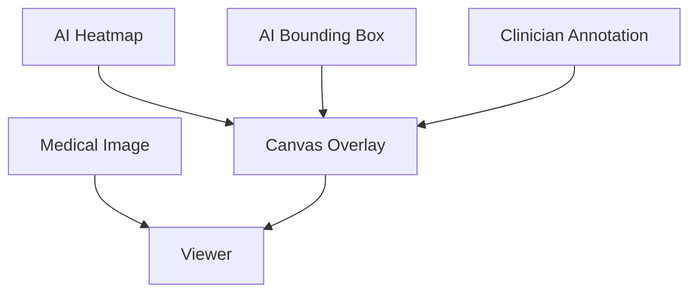

위 다이어그램은 논리적인 표시 순서를 설명합니다.

실제 구현에서는 여러 시각화 요소가 하나의 Overlay Canvas에 그려지는 구조입니다.

### Annotation Types

| Type | Purpose |
|---|---|
| Bounding Box | 관심 영역 지정 |
| Pen | 자유로운 영역 표시 |
| Text | 추가 판독 메모 |

### State Structure

```javascript
const [activeTool, setActiveTool] = useState(null);
const [userAnnotations, setUserAnnotations] = useState([]);
const [isDrawing, setIsDrawing] = useState(false);
const [drawStartPos, setDrawStartPos] = useState(null);
const [currentPath, setCurrentPath] = useState([]);
```

위 코드는 개인 브랜치에서 확인한 주요 상태를 정리한 것입니다.

### Annotation Lifecycle

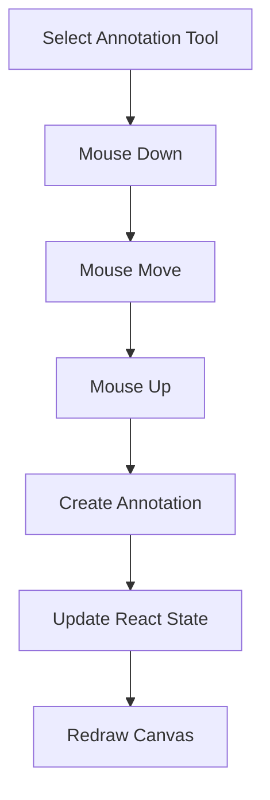

### Bounding Box Direction Handling

사용자가 좌측 상단에서 우측 하단으로만 드래그한다는 보장은 없습니다.

반대 방향으로 드래그하면 너비 또는 높이가 음수가 될 수 있습니다.

다음과 같이 시작점과 종료점을 정규화할 수 있습니다.

```javascript
const x = Math.min(startX, endX);
const y = Math.min(startY, endY);

const width = Math.abs(endX - startX);
const height = Math.abs(endY - startY);
```

개인 커밋에서는 드래그 방향을 고려하여 Bounding Box 좌표를 구성하는 처리가 확인됩니다.

또한 지나치게 작은 영역이 주석으로 등록되지 않도록 크기 조건을 적용하였습니다.

### Result

- 원본 의료영상과 의료진 주석의 논리적 분리
- Bounding Box, Pen, Text 주석 인터페이스 구성
- 주석 상태 변경에 따른 Canvas 갱신
- 의료진 주석 초기화 기능 구현

주석의 서버 저장 및 의료영상 표준 형식으로의 변환은 확인된 구현 범위에 포함되지 않습니다.

### Evidence

- Source: `src/Components/Main_viewer.jsx`
- Commit: [`f83d166`](https://github.com/hyunkyung31/React_DL/commit/f83d166)

---

## 4. TS-02 — Viewer Interaction Mode Separation

### Classification

Personal Implementation

### Problem

의료영상 Viewer에서는 마우스 드래그가 여러 기능에 사용될 수 있습니다.

- 영상 위치 이동
- Bounding Box 생성
- Pen 주석 작성

동일한 마우스 이벤트에 여러 동작이 연결되면 사용자가 주석을 작성하려는 상황에서 영상이 이동하거나, 영상을 이동하려는 상황에서 주석이 생성될 가능성이 있습니다.

### Root Cause

마우스 입력 이벤트 자체만으로는 사용자의 작업 목적을 구분하기 어렵습니다.

따라서 현재 활성화된 도구와 Viewer의 상호작용 상태를 함께 확인해야 합니다.

### Solution

영상 확대 및 이동 모드와 주석 입력 모드를 구분하여 관리하였습니다.

```mermaid
stateDiagram-v2
    [*] --> Default

    Default --> ZoomMode: Select Zoom
    Default --> AnnotationMode: Select Annotation Tool

    ZoomMode --> Default: Disable Zoom
    AnnotationMode --> Default: Disable Tool

    ZoomMode --> AnnotationMode: Select Annotation Tool
    AnnotationMode --> ZoomMode: Select Zoom
```

### Interaction Rules

| Mode | Drag Behavior |
|---|---|
| Default | 일반 Viewer 상태 |
| Zoom Mode | 영상 위치 이동 |
| Bounding Box | 관심 영역 생성 |
| Pen | 자유 경로 작성 |
| Text | 선택 위치에 텍스트 등록 |

### Implementation Concept

```javascript
function handleZoomMode() {
  setActiveTool(null);
  setIsZoomMode(previous => !previous);
}

function handleAnnotationMode(tool) {
  setIsZoomMode(false);
  setActiveTool(tool);
}
```

위 코드는 확인한 상호작용 상태 분리 원리를 단순화한 예시입니다.

### Pointer Event Control

Canvas Overlay가 항상 마우스 이벤트를 받으면 하위 Viewer의 이동 기능에 영향을 줄 수 있습니다.

따라서 활성화된 주석 도구에 따라 Canvas의 Pointer Event를 제어하는 구조를 적용하였습니다.

```jsx
<canvas
  className={
    activeTool
      ? 'pointer-events-auto'
      : 'pointer-events-none'
  }
/>
```

### Result

코드상 주석 입력과 영상 이동의 이벤트 처리 조건을 분리하였습니다.

모든 확대 배율과 해상도에서 주석 좌표가 정확하게 유지되는지에 대한 별도의 검증 결과는 존재하지 않습니다.

### Evidence

- Source: `src/Components/Main_viewer.jsx`
- Commit: [`f83d166`](https://github.com/hyunkyung31/React_DL/commit/f83d166)

---

## 5. TS-03 — Bookmark Event Bubbling

### Classification

Personal Implementation

### Problem

북마크 카드 전체에 상세보기 이벤트를 적용하고 카드 내부에 별도의 삭제 및 상세보기 버튼을 배치하였습니다.

이러한 구조에서는 내부 버튼의 클릭 이벤트가 상위 카드까지 전달될 수 있습니다.

```text
Bookmark Card
├── Title
├── Patient Information
└── Action Buttons
    ├── Open
    └── Delete
```

삭제 버튼을 클릭했을 때 상위 카드의 상세 팝업 열기 이벤트가 함께 실행될 가능성이 있습니다.

### Root Cause

DOM 이벤트는 대상 요소에서 상위 요소로 전달되는 Event Bubbling 특성을 가지고 있습니다.

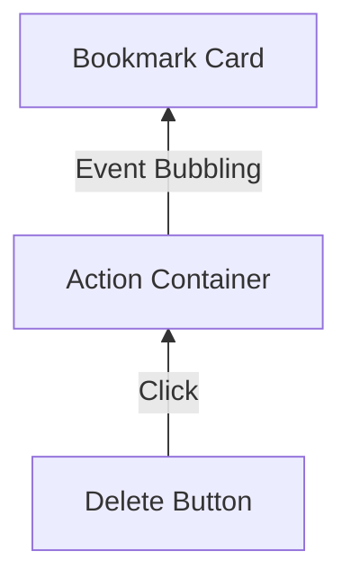

### Solution

카드 내부 Action 영역에 `stopPropagation()`을 적용하였습니다.

```jsx
<div onClick={event => event.stopPropagation()}>
  <button onClick={handleOpen}>
    상세보기
  </button>

  <button onClick={handleDelete}>
    삭제
  </button>
</div>
```

위 코드는 개인 커밋에서 확인한 이벤트 처리 방식을 단순화한 예시입니다.

### Before and After

| Action | Before | After |
|---|---|---|
| 카드 클릭 | 상세 팝업 열기 | 상세 팝업 열기 |
| 상세보기 버튼 | 상위 이벤트까지 전달 가능 | 명시적인 상세보기 처리 |
| 삭제 버튼 | 상위 이벤트까지 전달 가능 | 삭제 Callback 실행 |

### Result

북마크 카드 선택과 내부 Action 버튼의 이벤트 처리 범위를 분리하였습니다.

이는 실제 오류 발생 횟수를 측정한 결과가 아니라 Git 변경 이력에서 확인한 이벤트 제어 구현입니다.

### Key Learning

`stopPropagation()`과 `preventDefault()`는 서로 다른 역할을 수행합니다.

- stopPropagation: 상위 요소로의 이벤트 전달 제한
- preventDefault: 브라우저 기본 동작 제한

### Evidence

- Source: `src/Components/BoomarkView.jsx`
- Commit: [`8e188fc`](https://github.com/hyunkyung31/React_DL/commit/8e188fc)

---

## 6. TS-04 — Image and Video Thumbnail Rendering

### Classification

Personal Implementation

### Problem

의료영상 Viewer에서 이미지와 영상은 서로 다른 미디어 유형입니다.

기존 썸네일 구조에서 미디어 유형을 구분하지 않고 이미지 요소를 사용하면 영상 URL을 이미지로 표시하려는 문제가 발생할 수 있습니다.

### Root Cause

HTML의 img 요소는 영상 파일에서 특정 프레임을 자동으로 추출하여 표시하지 않습니다.

### Solution

미디어 유형에 따라 썸네일의 표시 방식을 분리하였습니다.

```jsx
{patientData?.mediaType === 'video' ? (
  <div>
    <span>VIDEO</span>
    <span>F-{frameNum}</span>
  </div>
) : (
   {
      event.target.style.display = 'none';
    }}
  />
)}
```

위 코드는 개인 커밋에서 확인한 변경 내용을 설명하기 위한 재구성 예시입니다.

### Rendering Flow

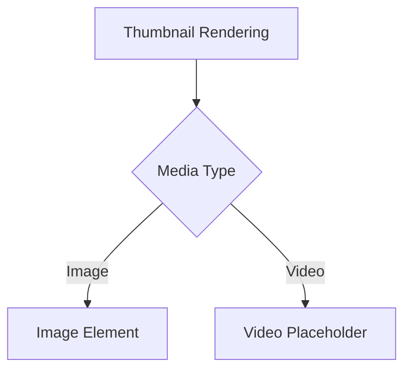

### Result

- 이미지와 영상의 썸네일 표시 방식 분리
- 영상 유형에 대한 Placeholder 제공
- 이미지 표시 오류 발생 시 해당 이미지 숨김

### Implementation Boundary

이 변경은 영상 유형에 따른 UI 표시 문제를 다루는 기능입니다.

실제 영상 프레임 추출, 프레임별 썸네일 생성 및 영상 재생 엔진 구현과는 구분합니다.

### Evidence

- Source: `src/Components/Main_viewer.jsx`
- Commit: [`17fc9b7`](https://github.com/hyunkyung31/React_DL/commit/17fc9b7)

---

## 7. TS-05 — Dashboard Component Refactoring

### Classification

Personal Implementation

### Problem

Dashboard에는 여러 업무 기능이 집중되어 있었습니다.

- 환자 검색
- 환자 선택
- 업무 메뉴 전환
- 메인 홈 화면
- 의료영상 Viewer
- AI 분석 화면
- 협진 및 북마크 화면

하나의 컴포넌트에서 여러 화면의 렌더링과 상태를 관리하면 코드 수정 범위가 넓어지고 각 기능의 책임을 구분하기 어려워질 수 있습니다.

### Solution

메인 홈 화면을 별도의 `Home.jsx` 컴포넌트로 분리하였습니다.

### Before

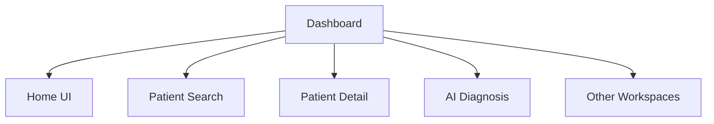

### After

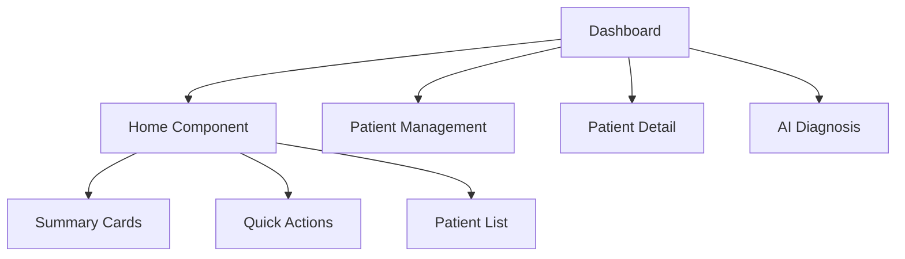

### Component Responsibility

| Component | Responsibility |
|---|---|
| Dashboard | 메뉴 전환 및 업무 상태 관리 |
| Home | 요약 정보 및 메인 업무 화면 |
| Patient Management | 환자 목록 및 검색 |
| Patient Detail | 환자 상세정보 |
| Main Viewer | 의료영상 상호작용 |

### Data Flow

```jsx
<Home
  patients={patientList}
  onNavigate={setCurrentMenu}
  onSelectPatient={handleSelectPatient}
/>
```

위 코드는 컴포넌트 간 Props 및 Callback 연결 구조를 설명하기 위한 예시입니다.

### Result

- 메인 홈 화면의 독립적인 컴포넌트 구성
- Dashboard와 Home의 렌더링 책임 분리
- 상위 컴포넌트에서 관리하는 데이터를 Props로 전달
- 하위 컴포넌트의 사용자 행동을 Callback으로 연결

Dashboard의 모든 업무 상태를 분리한 것은 아니며, 추가적인 리팩터링이 필요한 구조가 남아 있습니다.

### Evidence

- Source: `src/Page/Dashboard.jsx`
- Source: `src/Page/Home.jsx`
- Commit: [`e7fa8f8`](https://github.com/hyunkyung31/React_DL/commit/e7fa8f8)

---

## 8. TS-06 — Dashboard Recovery and Rendering Structure

### Classification

Personal Implementation

### Background

팀 프로젝트에서는 여러 개발자가 동일한 Dashboard 및 관련 컴포넌트를 수정하였습니다.

화면 구성과 업무 기능을 지속적으로 변경하는 과정에서 기존 화면의 연결 상태와 렌더링 구조를 다시 확인할 필요가 있었습니다.

### Confirmed Development History

개인 커밋 `0161739`에는 Dashboard 복구 및 오류 수정이라는 변경 이력이 존재합니다.

해당 커밋에서 다음 파일의 변경이 확인됩니다.

- Dashboard.jsx
- Home.jsx
- Main_viewer.jsx
- Consultation_View.jsx

### Implementation Scope

- Dashboard 화면 구조 수정
- 업무 메뉴별 조건부 렌더링 정비
- 환자 상세정보 화면 구성 변경
- 의료영상 Viewer 관련 화면 수정
- 협진 화면 및 메인 홈 연결 수정

### Conditional Rendering Concept

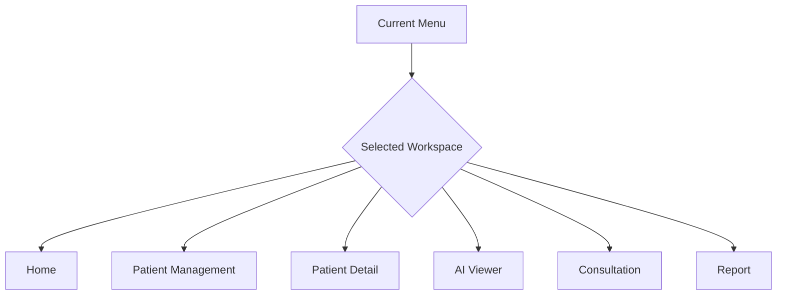

### Result

Git 변경 이력을 통해 Dashboard와 관련 업무 화면의 복구 및 수정 작업을 확인하였습니다.

당시 발생한 구체적인 오류 메시지와 재현 절차는 별도로 기록되어 있지 않으므로 특정 오류 원인을 임의로 단정하지 않습니다.

### Key Learning

여러 개발자가 공통 화면을 수정하는 프로젝트에서는 다음 사항이 중요합니다.

- 컴포넌트별 책임 정의
- 변경 범위 최소화
- 공통 인터페이스 합의
- 브랜치별 변경 사항 검토
- Merge 이후 화면 동작 검증
- 기존 기능에 대한 Regression Test

### Evidence

- Commit: [`0161739`](https://github.com/hyunkyung31/React_DL/commit/0161739)

---

## 9. TS-07 — Patient Search and Selection

### Classification

Personal Implementation

### Problem

의료진이 특정 환자의 정보를 확인하려면 환자 목록에서 대상 환자를 찾고 상세 화면으로 이동해야 합니다.

환자 목록과 상세 화면의 선택 상태가 연결되지 않으면 화면을 전환할 때 동일한 환자를 다시 선택해야 할 수 있습니다.

### Solution

환자 목록 검색 및 Sidebar 빠른 검색 기능을 구성하고 선택 환자 정보를 상세 화면과 연결하였습니다.

### Search Flow

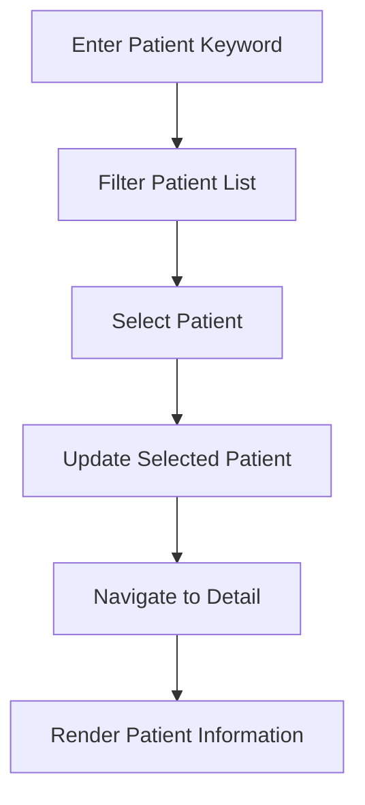

### Search Criteria

- 환자 이름
- 환자 ID

### Selection Concept

```javascript
function handleSelectPatient(patient) {
  setSelectedPatient(patient);
  setSelectedDiagPatient(patient);
  setCurrentMenu('patient-detail');
}
```

위 코드는 확인한 환자 선택 구조를 단순화한 예시입니다.

### Result

- 환자 검색 인터페이스 구성
- Sidebar 빠른 검색 기능 연결
- 환자 선택과 상세 화면 전환 연결
- 환자 중심 업무 화면 구성

실제 환자 검색 시간이나 업무 효율 개선 수치는 측정하지 않았습니다.

### Evidence

- [`8749953`](https://github.com/hyunkyung31/React_DL/commit/8749953)
- [`d75b325`](https://github.com/hyunkyung31/React_DL/commit/d75b325)
- [`21acdae`](https://github.com/hyunkyung31/React_DL/commit/21acdae)

---

## 10. TEAM-01 — Browser Video Compatibility

### Classification

Team Troubleshooting

### Problem

팀 최종 발표 자료에서는 AVI 영상이 브라우저에서 정상적으로 재생되지 않는 호환성 문제가 보고되었습니다.

### Root Cause

브라우저의 영상 재생 가능 여부는 파일 확장자뿐만 아니라 Container와 Codec의 지원 여부에 영향을 받습니다.

AVI 파일을 브라우저의 일반적인 영상 요소에서 항상 재생할 수 있는 것은 아닙니다.

### Solution

팀에서는 FFmpeg를 활용하여 브라우저 재생에 적합한 MP4 형식으로 변환하는 방향으로 문제를 해결하였습니다.

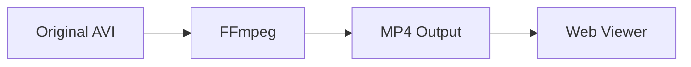

### Engineering Considerations

- 원본 의료영상 보존
- 변환 결과와 원본 파일의 관계 관리
- 영상 해상도 유지
- 프레임 정보 관리
- 변환 작업의 비동기 처리
- 브라우저별 Codec 지원 확인

### Result

팀 발표 자료에서 영상 변환을 통한 재생 호환성 문제 해결이 보고되었습니다.

정확한 FFmpeg 실행 옵션, Codec 설정 및 변환 성능 수치는 별도로 확인하지 않았습니다.

### Contribution Boundary

영상 변환 파이프라인은 팀 기술적 문제 해결 사례이며, 개인 단독 구현으로 기록하지 않습니다.

---

## 11. TEAM-02 — Duplicate Grad-CAM Inference

### Classification

Team Troubleshooting

### Problem

팀 발표 자료에서는 이미지 분류와 Grad-CAM 생성 과정에서 모델의 Forward Pass가 중복되는 문제가 보고되었습니다.

### Root Cause

분류 결과를 생성하는 과정과 Grad-CAM을 생성하는 과정이 독립적으로 모델을 실행하면 동일 입력에 대한 Forward 계산이 반복될 수 있습니다.

### Before

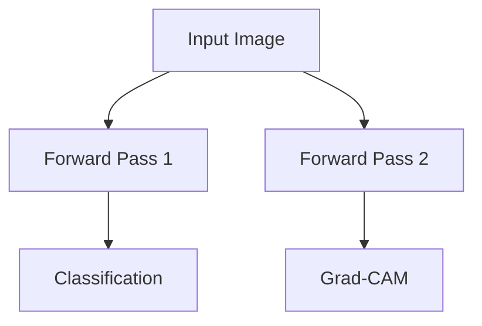

### Solution

팀에서는 분류 결과와 Grad-CAM 생성에 필요한 정보를 하나의 Forward Pass에서 활용하는 방향으로 처리 구조를 개선하였습니다.

### After

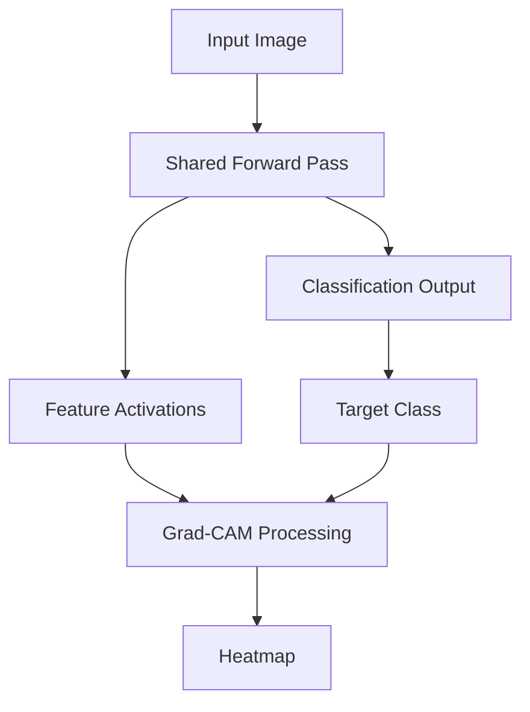

### Engineering Consideration

Grad-CAM에는 대상 클래스와 관련된 Gradient 계산이 필요합니다.

Forward Pass를 공유하더라도 필요한 Feature Activation과 Gradient를 적절하게 유지해야 합니다.

### Result

팀 발표 자료에서는 중복 Forward 계산을 줄이는 방향의 개선이 보고되었습니다.

실제 추론 시간 감소율 및 GPU 메모리 사용량은 확인되지 않았습니다.

### Contribution Boundary

AI 모델 추론 및 Grad-CAM 내부 처리 구조는 팀 AI 모델 담당 영역입니다.

개인 개발 범위는 해당 분석 결과를 의료진 업무 화면에서 표시하고 활용하는 인터페이스 구성입니다.

---

## 12. TEAM-03 — Bounding Box Misalignment During Zoom

### Classification

Team Troubleshooting

### Problem

의료영상을 확대하거나 이동할 때 AI Bounding Box가 원본 영상의 관심 영역과 일치하지 않는 문제가 팀 발표 자료에서 보고되었습니다.

### Root Cause

영상과 Bounding Box가 서로 다른 좌표 기준 또는 Transform을 사용하는 경우 화면 확대 및 이동 이후 위치가 달라질 수 있습니다.

### Coordinate Systems

| Coordinate System | Description |
|---|---|
| Original Image | 원본 이미지 픽셀 좌표 |
| Display Image | 브라우저 표시 영역 좌표 |
| Canvas | Overlay Canvas 좌표 |
| Transformed Viewer | 확대 및 이동 이후 화면 좌표 |

### Example

원본 영상 크기가 1000 × 1000이고 표시 크기가 500 × 500인 경우 원본 좌표는 표시 크기에 맞게 변환되어야 합니다.

| Property | Original | Display |
|---|---:|---:|
| x | 400 | 200 |
| y | 300 | 150 |
| width | 200 | 100 |
| height | 100 | 50 |

위 값은 좌표 변환 원리를 설명하기 위한 가상의 예시입니다.

### Coordinate Transformation

```javascript
const scaleX = displayWidth / originalWidth;
const scaleY = displayHeight / originalHeight;

const displayBox = {
  x: originalBox.x * scaleX,
  y: originalBox.y * scaleY,
  width: originalBox.width * scaleX,
  height: originalBox.height * scaleY
};
```

### Shared Transform

원본 이미지와 Overlay Canvas를 동일한 상위 요소에 배치하고 공통 Transform을 적용하는 구조입니다.

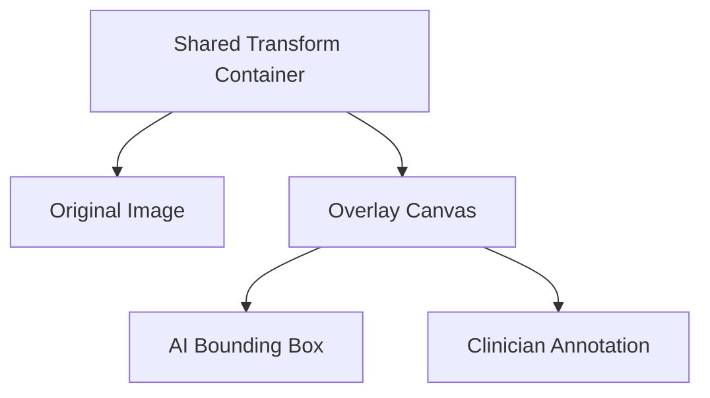

```jsx
<div
  style={{
    transform: `translate(${position.x}px, ${position.y}px) scale(${scale})`
  }}
>
  
  <canvas />
</div>
```

위 코드는 확인한 공통 Transform 구조를 설명하기 위한 단순화 예시입니다.

### Result

팀 최종 발표 자료에서는 영상과 Bounding Box의 좌표 기준 및 확대 구조를 통일하여 위치 불일치 문제를 해결했다고 보고하였습니다.

개인 개발 브랜치에서도 이미지와 Canvas를 공통 Transform 영역에 배치하는 구조가 확인됩니다.

### Contribution Boundary

개인 개발 이력에서는 Canvas 주석 기능 및 Viewer 상호작용 관련 변경이 확인됩니다.

다만 Bounding Box 위치 불일치 문제의 전체 해결 과정을 개인 단독 구현으로 확인할 수 없으므로 팀 문제 해결 사례로 분류합니다.

또한 의료진 주석의 정규화 좌표 저장까지 구현되었다는 의미는 아닙니다.

---

## 13. TEAM-04 — PIL Image and Tensor Dimension Error

### Classification

Team Troubleshooting

### Problem

팀 발표 자료에서는 PIL Image 객체에 Tensor 전용 연산을 적용하는 과정에서 오류가 발생한 사례가 보고되었습니다.

### Root Cause

PIL Image와 PyTorch Tensor는 서로 다른 데이터 타입입니다.

PyTorch 모델에 입력하기 위해서는 이미지 전처리 및 Tensor 변환 과정이 필요합니다.

### Solution

이미지 크기 조정, Tensor 변환, 정규화 및 Batch 차원 추가 순서로 입력 데이터를 구성하였습니다.

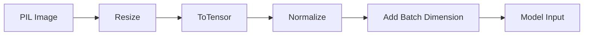

### Tensor Shape Example

| Stage | Shape |
|---|---|
| Tensor Image | C × H × W |
| Batch Input | N × C × H × W |

단일 이미지의 경우 Batch 크기 N은 일반적으로 1입니다.

### Conceptual Example

```python
image_tensor = transform(image)
batch_tensor = image_tensor.unsqueeze(0)
```

위 코드는 Tensor 변환 및 Batch 차원 추가 원리를 설명하기 위한 예시입니다.

실제 모델 입력 크기와 Normalize 설정은 학습 당시 전처리 조건에 맞추어야 합니다.

### Contribution Boundary

해당 사례는 팀 AI 모델 처리 영역의 문제 해결 사례입니다.

개인 개발 범위와 구분하여 기록합니다.

---

## 14. Technical Review Overview

이후 내용은 프로젝트 종료 후 소스코드를 검토하면서 확인한 개선 필요 영역입니다.

실제 개발 당시 모두 수정하거나 테스트한 사항은 아닙니다.

---

## 15. REV-01 — Frame State and Actual Media Synchronization

### Problem

Viewer에서는 currentFrame 상태와 재생 속도 및 프레임 이동 버튼을 관리합니다.

그러나 확인한 개인 브랜치에서는 프레임 상태가 변경되어도 실제 이미지 URL이 해당 프레임에 맞게 변경되지 않는 구조가 존재합니다.

### Existing Structure

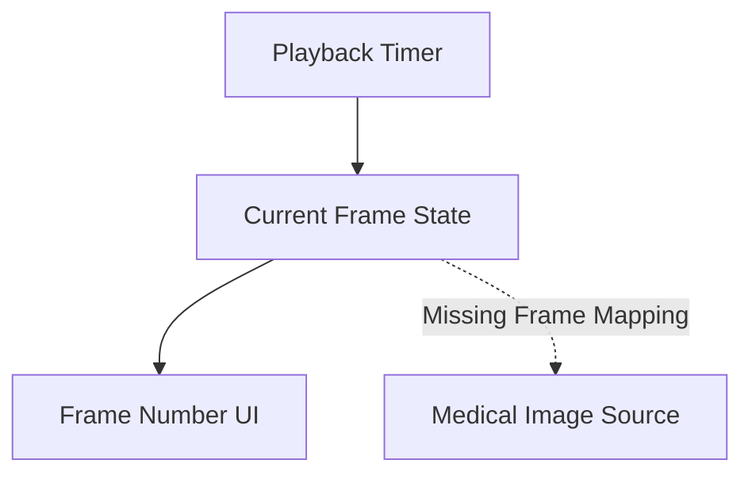

### Identified Limitation

- 고정된 전체 프레임 수
- 실제 영상 메타데이터와 분리된 프레임 상태
- 프레임별 이미지 URL 연결 부족
- 영상 재생 위치와 UI 상태의 동기화 미확인
- 구간 반복 기능의 실제 동작 미확인

### Proposed Solution

영상 기반 Viewer와 이미지 시퀀스 기반 Viewer의 재생 방식을 구분할 필요가 있습니다.

#### Video-based Viewer

HTML Video의 currentTime, duration 및 playbackRate를 활용합니다.

```javascript
function seekVideo(frame, fps) {
  if (!videoRef.current || fps <= 0) return;

  videoRef.current.currentTime = frame / fps;
}
```

#### Image Sequence Viewer

```javascript
const currentImage =
  frameImages[currentFrame];
```

### Proposed Synchronization

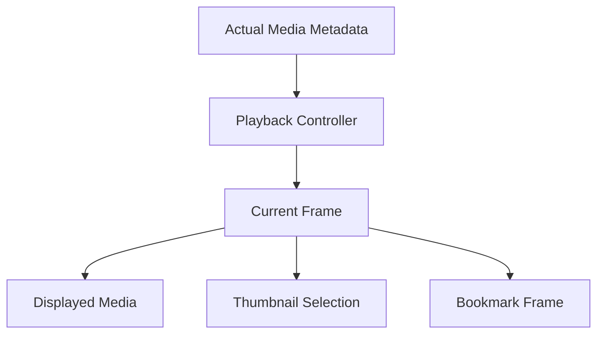

### Considerations

가변 프레임 레이트 영상에서는 단순한 currentTime × FPS 계산이 정확한 프레임 식별을 보장하지 않을 수 있습니다.

의료영상의 정확한 프레임 식별을 위해 영상 메타데이터와 실제 프레임 매핑 기준을 검토해야 합니다.

### Status

Improvement Proposal — Not Implemented

---

## 16. REV-02 — Annotation Coordinate Normalization

### Problem

의료진 주석이 현재 표시 화면의 픽셀 좌표를 기준으로 저장되는 경우 화면 크기 변경 이후 동일한 위치에 표시되지 않을 수 있습니다.

### Existing Limitation

```javascript
const annotation = {
  x: displayX,
  y: displayY,
  width: displayWidth,
  height: displayHeight
};
```

위 구조에서는 저장된 좌표가 특정 화면 크기에 의존할 수 있습니다.

### Proposed Solution

영상 자체의 표시 영역을 기준으로 좌표를 정규화합니다.

```javascript
function normalizeBox(box, imageWidth, imageHeight) {
  if (imageWidth <= 0 || imageHeight <= 0) {
    throw new Error('Invalid image dimensions');
  }

  return {
    x: box.x / imageWidth,
    y: box.y / imageHeight,
    width: box.width / imageWidth,
    height: box.height / imageHeight
  };
}
```

### Example

| Property | Pixel Coordinate | Normalized Coordinate |
|---|---:|---:|
| x | 200 | 0.4 |
| y | 150 | 0.3 |
| width | 100 | 0.2 |
| height | 50 | 0.1 |

표시 영역 크기를 500 × 500으로 가정한 예시입니다.

### Restore Coordinates

```javascript
function restoreBox(box, imageWidth, imageHeight) {
  return {
    x: box.x * imageWidth,
    y: box.y * imageHeight,
    width: box.width * imageWidth,
    height: box.height * imageHeight
  };
}
```

### Additional Considerations

- 이미지 비율 유지
- object-fit에 따른 여백
- CSS Transform 역변환
- Device Pixel Ratio
- Canvas 실제 해상도
- 영상 프레임 식별자
- 주석 작성자 및 생성 시간

정규화 좌표만으로 모든 확대 및 이동 좌표 문제가 해결되는 것은 아닙니다.

사용자 입력 좌표를 영상의 실제 로컬 좌표로 변환하는 과정도 필요합니다.

### Status

Improvement Proposal — Not Implemented

---

## 17. REV-03 — Stale Asynchronous Responses

### Problem

사용자가 환자 A를 선택한 직후 환자 B를 선택하면 A의 요청이 B보다 늦게 완료될 수 있습니다.

### Risk

이전 환자의 응답이 현재 선택 환자의 화면에 표시될 가능성이 있습니다.

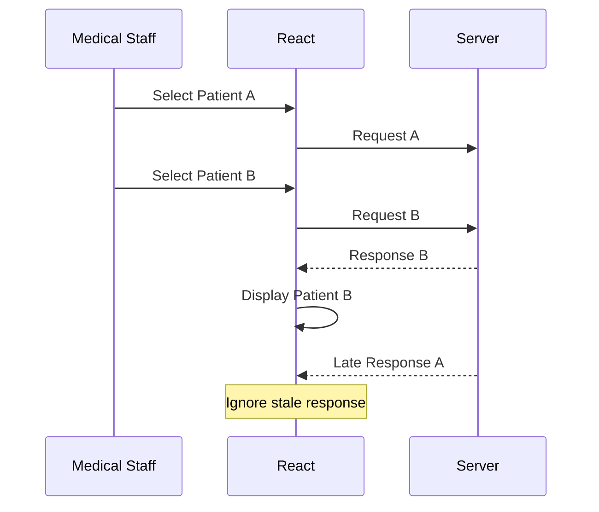

### Existing Handling

일부 환자 및 미디어 조회 코드에서는 취소 플래그를 활용하여 이전 요청의 상태 반영을 제한하는 구조가 확인됩니다.

다만 모든 비동기 요청 및 오류 처리 경로에서 동일한 방식이 적용된 것은 아닙니다.

### Proposed Solution

AbortController와 취소 상태를 함께 관리합니다.

```javascript
useEffect(() => {
  const controller = new AbortController();
  let cancelled = false;

  async function loadPatient() {
    try {
      const response = await fetch(
        `/api/patients/${patientId}/`,
        {
          signal: controller.signal,
          headers: {
            Authorization: `Bearer ${access}`
          }
        }
      );

      if (!response.ok) {
        throw new Error('Patient request failed');
      }

      const data = await response.json();

      if (!cancelled) {
        setPatient(data);
      }

    } catch (error) {
      if (
        !cancelled &&
        error.name !== 'AbortError'
      ) {
        setError(error.message);
      }
    }
  }

  loadPatient();

  return () => {
    cancelled = true;
    controller.abort();
  };
}, [patientId, access]);
```

위 코드는 요청 취소 및 이전 응답 방지를 위한 개선 예시입니다.

### Expected Benefits

- 이전 환자 응답의 상태 반영 제한
- 불필요한 요청 처리 감소
- 화면 전환 시 데이터 일관성 개선 가능

### Status

Partial Existing Handling / Further Improvement Required

---

## 18. REV-04 — Object URL Lifecycle

### Problem

브라우저에서 로컬 이미지 또는 Blob 데이터를 표시하기 위해 Object URL을 생성할 수 있습니다.

```javascript
const objectUrl = URL.createObjectURL(file);
```

Object URL을 반복적으로 생성하고 사용이 끝난 이후 해제하지 않으면 브라우저 자원이 불필요하게 유지될 수 있습니다.

### Existing Handling

일부 인증 미디어 조회 컴포넌트에서는 Effect Cleanup을 활용하여 Blob URL을 해제하는 구조가 확인됩니다.

반면 로컬 파일 업로드 및 비동기 요청 완료 시점에 따라 URL 해제가 누락될 가능성이 존재합니다.

### Proposed Lifecycle

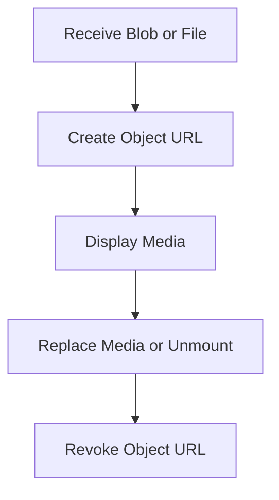

### Proposed Implementation

```javascript
useEffect(() => {
  if (!file) {
    setPreviewUrl(null);
    return;
  }

  const objectUrl =
    URL.createObjectURL(file);

  setPreviewUrl(objectUrl);

  return () => {
    URL.revokeObjectURL(objectUrl);
  };
}, [file]);
```

### Additional Consideration

비동기 요청에서 Blob URL이 생성되기 전에 컴포넌트가 종료되었다면, 요청 완료 이후 생성된 URL도 별도로 해제해야 합니다.

### Status

Partial Existing Handling / Further Improvement Required

---

## 19. REV-05 — Bounding Box Height Calculation

### Problem

Dashboard의 AI 분석 결과 정규화 코드에서 일부 Bounding Box 좌표 변환 분기의 높이 계산식이 다음과 같은 형태로 확인됩니다.

```javascript
const height = Math.max(0, y2 - y2);
```

### Root Cause

Bounding Box의 높이는 하단 좌표와 상단 좌표의 차이로 계산해야 합니다.

동일한 y2 값을 서로 빼면 항상 0이 됩니다.

### Expected Calculation

```javascript
const width = Math.max(0, x2 - x1);
const height = Math.max(0, y2 - y1);
```

### Example

| Property | Value |
|---|---:|
| x1 | 100 |
| y1 | 50 |
| x2 | 250 |
| y2 | 200 |
| Expected Width | 150 |
| Expected Height | 150 |
| Incorrect Height | 0 |

### Proposed Validation

```javascript
function normalizeXYXY(box) {
  const { x1, y1, x2, y2 } = box;

  const coordinates = [x1, y1, x2, y2];

  if (!coordinates.every(Number.isFinite)) {
    throw new Error('Invalid coordinates');
  }

  if (x2 <= x1 || y2 <= y1) {
    throw new Error('Invalid bounding box');
  }

  return {
    x: x1,
    y: y1,
    width: x2 - x1,
    height: y2 - y1
  };
}
```

### Proposed Unit Test

```javascript
const result = normalizeXYXY({
  x1: 100,
  y1: 50,
  x2: 250,
  y2: 200
});

console.assert(result.width === 150);
console.assert(result.height === 150);
```

### Engineering Significance

단순한 좌표 계산 오류도 의료영상의 관심 영역 표시 결과에 영향을 줄 수 있습니다.

따라서 모델 응답 정규화 과정에 대한 단위 테스트가 필요합니다.

### Status

Identified During Source Review — Fix Not Applied

---

## 20. REV-06 — Bookmark Snapshot Data Contract

### Problem

Dashboard에서는 북마크 생성 시 Canvas 또는 Video를 활용하여 캡처 데이터를 구성하는 로직이 존재합니다.

그러나 App의 북마크 생성 요청에서는 해당 캡처 데이터가 완전하게 전달되지 않는 부분이 확인됩니다.

### Existing Data Flow

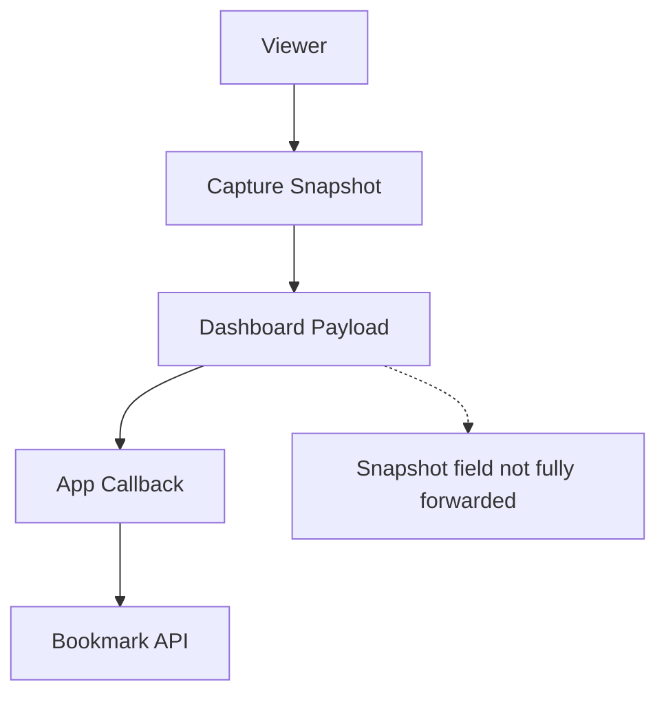

### Additional Limitation

Overlay Canvas만 캡처하면 원본 의료영상이 포함되지 않을 수 있습니다.

또한 document.querySelector를 사용하면 Viewer가 아닌 다른 Canvas가 선택될 가능성이 있습니다.

### Proposed Solution

원본 영상과 Overlay Canvas를 명시적인 Ref로 관리하고 합성된 결과를 생성합니다.

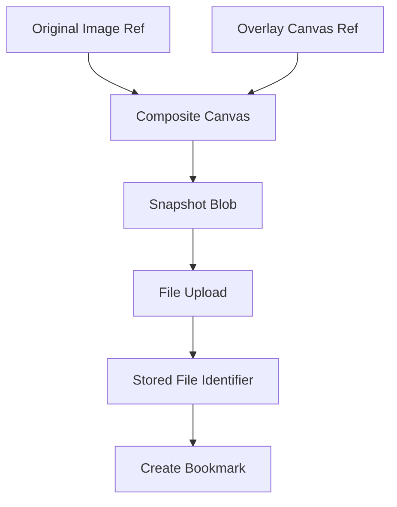

### Proposed Metadata

```json
{
  "patient_id": 1001,
  "exam_id": 20,
  "frame_number": 125,
  "title": "Example bookmark",
  "note": "Example review note",
  "snapshot_path": "example/snapshot.png"
}
```

위 데이터는 가상의 API 설계 예시입니다.

### Backend Considerations

- 환자와 검사 ID의 관계 검증
- 파일 업로드 성공 여부 확인
- 북마크 생성 실패 시 고아 파일 정리
- 접근 권한 검증
- 파일 저장 경로 관리
- 생성 및 삭제 정책 정의

### Status

Improvement Proposal — Not Implemented

---

## 21. REV-07 — Consultation Data Persistence

### Problem

협진 화면의 초기 목록은 Mock Data를 사용합니다.

신규 협진 요청 성공 이후 서버 응답을 React 상태에 추가하는 구조는 존재하지만 서버 협진 목록을 다시 조회하는 GET 요청은 확인되지 않았습니다.

### Existing Flow

```mermaid
flowchart TD
    A["Open Consultation"]
    B["Load Mock List"]
    C["Submit New Request"]
    D["POST API"]
    E["Append Response to State"]

    A --> B --> C --> D --> E
```

### Risk

- 새로고침 이후 서버 협진 이력 미표시
- Mock Data와 실제 응답 필드 불일치
- 협진 상태의 서버 기준 동기화 부족

### Proposed Flow

```mermaid
flowchart TD
    A["Open Consultation"]
    B["GET Consultation List"]
    C["Normalize Response"]
    D["Render Server Data"]

    A --> B --> C --> D

    E["Create Consultation"]
    E --> F["POST API"]
    F --> G["Refresh Consultation List"]
    G --> C
```

### Proposed API Contract

| Method | Endpoint | Purpose |
|---|---|---|
| GET | `/api/consultations/` | 협진 목록 조회 |
| POST | `/api/consultations/` | 신규 요청 생성 |
| GET | `/api/consultations/{id}/` | 상세정보 조회 |
| PATCH | `/api/consultations/{id}/` | 요청 상태 변경 |

POST 요청을 제외한 위 경로는 향후 API 설계를 설명하기 위한 제안입니다.

기존 서버에서 실제 제공되는 Endpoint로 확인한 것은 아닙니다.

### Status

Improvement Proposal — Not Implemented

---

## 22. REV-08 — Clinical Report and Server Confirmation

### Problem

확인한 Dashboard에서는 판독 결과를 확정할 때 React의 savedReports 상태를 갱신하는 구조가 존재합니다.

EmrConfirmPanel 내부에는 서버 요청을 수행하는 함수가 존재하지만 실제 버튼은 상위 onConfirm Callback에 연결되어 있습니다.

따라서 확인한 화면 경로에서는 내부 서버 확정 함수가 직접 호출되지 않습니다.

### Existing Flow

```mermaid
flowchart TD
    A["Confirm Button"]
    B["Parent onConfirm"]
    C["Update savedReports"]
    D["Report UI"]

    A --> B --> C --> D

    E["Internal API Handler"]
    E -.->|"Not connected to this button"| A
```

### Risk

UI에서 결과가 확정된 것처럼 표시되더라도 서버 저장 성공 여부가 확인되지 않을 수 있습니다.

### Proposed Workflow

```mermaid
stateDiagram-v2
    [*] --> Draft

    Draft --> Submitting: Confirm Request
    Submitting --> Finalized: Server Success
    Submitting --> Draft: Request Failure

    Finalized --> Amended: Authorized Revision
```

### Proposed Server-side Validation

- 의료진 인증
- 환자 접근 권한
- 검사 식별자 검증
- 판독 결과 필수값 확인
- 중복 확정 요청 처리
- 확정 시간 및 의료진 기록
- 수정 이력 관리

### Engineering Perspective

의료 서비스에서 화면의 상태와 서버에 저장된 업무 상태는 구분되어야 합니다.

결과 확정은 단순한 UI 변경이 아니라 서버의 데이터 검증 및 상태 전이와 연결되어야 합니다.

### Status

Improvement Proposal — Not Implemented

---

## 23. REV-09 — Missing Clinical Data and Mock Values

### Problem

일부 화면에서는 실제 의료 데이터가 없을 때 기본값 또는 Mock Data를 표시하는 구조가 존재합니다.

### Identified Examples

- ECG 결과 누락 시 정상으로 표시하는 기본값
- 환자 정보 누락 시 가상의 임상 수치 표시
- 실제 AI 결과가 없는 경우 예시 Confidence 표시
- 리포트의 고정 위험도 및 권고 문구

### Risk

데이터가 존재하지 않는 상태와 실제 정상 결과를 구분하지 못할 수 있습니다.

### Proposed State Model

| State | Meaning |
|---|---|
| Loading | 데이터 조회 중 |
| Available | 실제 데이터 존재 |
| Not Measured | 검사 미수행 |
| Unknown | 데이터 없음 |
| Error | 데이터 조회 실패 |
| Demo | 가상 데이터 |

### Proposed Display

```javascript
function getClinicalValue(value) {
  if (
    value === null ||
    value === undefined ||
    value === ''
  ) {
    return '데이터 없음';
  }

  return value;
}
```

### Important Principle

데이터가 없다는 사실은 정상이라는 의미가 아닙니다.

Mock Data는 실제 의료 데이터와 명확하게 구분되어야 합니다.

AI 결과와 임상 위험도 또한 실제 모델 응답 및 검증된 계산 결과가 존재할 때만 해당 값으로 표시해야 합니다.

### Status

Identified During Source Review — Improvement Required

---

## 24. REV-10 — Shared State and Duplicate API Requests

### Problem

App과 Dashboard에서 환자 목록을 각각 조회하는 구조가 존재합니다.

서로 다른 시점에 데이터를 조회하면 화면마다 다른 환자 목록 상태를 사용할 가능성이 있습니다.

### Existing Structure

```mermaid
flowchart TD
    S["Patient API"]

    S --> A["App Patient State"]
    S --> D["Dashboard Patient State"]

    A --> V["Shared Props"]
    D --> V
```

### Proposed Structure

```mermaid
flowchart TD
    S["Patient API"]
    Q["Shared Patient Query Layer"]

    S --> Q

    Q --> A["App"]
    Q --> D["Dashboard"]
    Q --> P["Patient Management"]
    Q --> C["Consultation"]
```

### Improvement Direction

- 환자 데이터 조회 책임 통합
- 공통 API Client 구성
- 서버 데이터와 UI 상태 분리
- 요청 중복 방지
- 데이터 갱신 기준 정의
- 인증 상태 변경 시 Cache 초기화
- 오류 및 로딩 상태 표준화

### Status

Improvement Proposal — Not Implemented

---

## 25. Additional Technical Review

### 25.1 AI Result Classification

환자 상태를 분류하는 과정에서 문자열의 부분 일치 조건을 사용하면 non-obstructive와 obstructive가 동시에 일치할 수 있습니다.

향후에는 서버와 합의된 Enum 값을 기준으로 분류하는 것이 필요합니다.

```javascript
function classifySeverity(value) {
  switch (value) {
    case 'no_cad':
      return 'normal';

    case 'non_obstructive':
      return 'non_obstructive';

    case 'obstructive':
      return 'obstructive';

    default:
      return 'unknown';
  }
}
```

위 Enum은 개선 방향을 설명하기 위한 가상의 데이터 계약입니다.

### 25.2 Identifier Type Normalization

환자 ID와 의료진 ID가 숫자 또는 문자열로 전달될 수 있습니다.

```javascript
const isSameId =
  String(firstId) === String(secondId);
```

식별자의 타입을 통일하고 누락값을 검증해야 합니다.

### 25.3 AI Confidence and Uncertainty

모델 Confidence를 단순히 1에서 빼는 방식은 보정된 불확실성 측정과 동일하지 않습니다.

실제 의료 AI에서는 Calibration 및 별도의 불확실성 평가가 필요할 수 있습니다.

### 25.4 Security Configuration

API 주소와 환경 설정값을 컴포넌트 내부에 직접 작성하면 배포 환경 변경 및 설정 관리가 어려워질 수 있습니다.

향후 환경 변수와 공통 API Client를 활용하는 구조를 고려할 수 있습니다.

인증 토큰, 실제 환자 데이터 및 내부 서버 정보는 공개 포트폴리오에 포함하지 않습니다.

---

## 26. Proposed Validation Plan

다음 검증 시나리오는 기술적 문제 해결 및 개선 방향을 바탕으로 작성한 테스트 계획입니다.

실제 자동화 테스트 실행 결과가 아닙니다.

### 26.1 Viewer Validation

| ID | Scenario | Expected Result |
|---|---|---|
| VIEW-01 | 이미지 표시 | 정상 이미지 렌더링 |
| VIEW-02 | 영상 썸네일 표시 | 영상 Placeholder 표시 |
| VIEW-03 | Bounding Box 작성 | 관심 영역 표시 |
| VIEW-04 | 반대 방향 드래그 | 양수 너비 및 높이 생성 |
| VIEW-05 | Pen 작성 | 입력 경로 표시 |
| VIEW-06 | Text 작성 | 선택 위치에 텍스트 표시 |
| VIEW-07 | 주석 초기화 | 의료진 주석 제거 |
| VIEW-08 | Zoom Mode 활성화 | 영상 이동 가능 |
| VIEW-09 | Annotation Mode 활성화 | 영상 이동 이벤트 제한 |
| VIEW-10 | 환자 변경 | 이전 주석 초기화 |
| VIEW-11 | 화면 크기 변경 | 주석 위치 유지 검증 |
| VIEW-12 | 영상 프레임 이동 | 실제 영상 동기화 검증 |
| VIEW-13 | 영상 확대 | AI Bounding Box 위치 검증 |

### 26.2 Bookmark Validation

| ID | Scenario | Expected Result |
|---|---|---|
| BM-01 | 카드 클릭 | 상세 팝업 표시 |
| BM-02 | 삭제 버튼 클릭 | 카드 열기 이벤트 제한 |
| BM-03 | 팝업 닫기 | 선택 상태 초기화 |
| BM-04 | 이미지 조회 실패 | 오류 안내 |
| BM-05 | 숫자 타입 환자 ID | 검색 오류 방지 |
| BM-06 | 북마크 캡처 | 원본 및 Overlay 포함 검증 |
| BM-07 | 서버 생성 실패 | 잘못된 성공 상태 방지 |
| BM-08 | 새로고침 | 저장된 북마크 복원 검증 |

### 26.3 API Validation

| ID | Scenario | Expected Result |
|---|---|---|
| API-01 | 인증 토큰 없음 | 인증 오류 처리 |
| API-02 | HTTP 401 | 인증 만료 안내 |
| API-03 | HTTP 403 | 접근 권한 오류 안내 |
| API-04 | HTTP 500 | 서버 오류 안내 |
| API-05 | 네트워크 연결 실패 | 오류 상태 표시 |
| API-06 | 잘못된 JSON | 응답 형식 오류 처리 |
| API-07 | 이전 요청 지연 | 이전 응답 반영 제한 |
| API-08 | 로그아웃 중 요청 완료 | 이전 데이터 복원 방지 |
| API-09 | Bounding Box 변환 | 좌표 및 크기 검증 |

### 26.4 Clinical Workflow Validation

| ID | Scenario | Expected Result |
|---|---|---|
| CL-01 | 환자 변경 | 현재 환자 정보만 표시 |
| CL-02 | ECG 데이터 누락 | 데이터 없음 표시 |
| CL-03 | AI 결과 없음 | 실제 결과처럼 표시하지 않음 |
| CL-04 | 협진 필수값 누락 | 요청 제한 |
| CL-05 | 협진 요청 실패 | 오류 안내 |
| CL-06 | 결과 확정 실패 | Draft 상태 유지 |
| CL-07 | 결과 확정 성공 | 서버 응답 기반 상태 변경 |
| CL-08 | 다른 환자 리포트 선택 | 환자별 결과 일치 검증 |

---

## 27. Improvement Priority

| Priority | Improvement | Reason |
|---|---|---|
| P0 | 환자별 데이터 일치 검증 | 다른 환자 정보 표시 방지 |
| P0 | 누락 임상 데이터 처리 | 미검사와 정상 결과 구분 |
| P0 | 결과 확정 API 연결 | 서버 저장과 UI 상태 일치 |
| P1 | Bounding Box 계산 검증 | 관심 영역 표시 정확성 |
| P1 | 실제 영상 프레임 동기화 | 판독 위치 및 북마크 정확성 |
| P1 | 주석 좌표 정규화 | 해상도 변경 대응 |
| P1 | 비동기 요청 취소 | 이전 데이터 반영 제한 |
| P2 | 북마크 캡처 저장 | 관심 영상 관리 |
| P2 | 협진 목록 서버 연동 | 업무 이력 유지 |
| P2 | 공통 데이터 조회 계층 | 상태 일관성 및 유지보수 |
| P3 | Modal 접근성 | 사용자 조작 편의 |
| P3 | UI Animation 개선 | 화면 사용성 |

위 우선순위는 소스코드 검토 이후 제안한 개선 순서입니다.

실제 의료기관의 위험 관리 평가 결과는 아닙니다.

---

## 28. Proposed Engineering Architecture

기존 프로젝트의 프론트엔드 구현 경험을 바탕으로 향후 다음과 같은 구조를 고려할 수 있습니다.

```mermaid
flowchart TD
    U["Medical Staff"]
    F["React Workspace"]

    U --> F

    F --> V["Viewer Controller"]
    F --> Q["Shared Data Layer"]
    F --> C["Clinical Workflow"]

    V --> M["Media Service"]
    Q --> A["API Client"]
    C --> A

    A --> D["Django API"]

    D --> P["Patient Domain"]
    D --> B["Bookmark Domain"]
    D --> CO["Consultation Domain"]
    D --> R["Report Domain"]

    D --> AI["AI Model Service"]
    D --> DB["Database"]
    D --> S["File Storage"]
```

### Design Principles

- 환자 및 검사 식별자 중심 데이터 관리
- UI 상태와 서버 상태 분리
- API 응답 형식 표준화
- 의료영상과 주석 데이터 분리
- 서버 기반 업무 상태 관리
- 인증 및 접근 권한 검증
- 비동기 요청 및 오류 처리
- 테스트 가능한 컴포넌트 및 서비스 구조

위 아키텍처는 향후 개선 방향을 설명하기 위한 제안입니다.

기존 프로젝트에서 전체 구조를 구현한 것으로 표현하지 않습니다.

---

## 29. Personal Git Evidence

### 29.1 Representative Commits

| Commit | Personal Development History |
|---|---|
| `7d3a4d5` | Tailwind CSS 설정 및 로그인 페이지 구현 |
| `8749953` | 환자 목록 Dashboard 생성 |
| `d75b325` | 환자 상세 페이지 및 Sidebar 빠른 검색 |
| `21acdae` | Sidebar 검색 기능 수정 |
| `0ada8d4` | Lucide React 관련 설정 및 Dashboard 수정 |
| `847f46d` | Viewer, 북마크 및 협진 화면 구성 |
| `8e188fc` | Intro 및 북마크 상세 팝업 구현 |
| `e7fa8f8` | Home 컴포넌트 분리 및 Dashboard 수정 |
| `0161739` | Dashboard 복구 및 오류 수정 |
| `17fc9b7` | 미디어 유형별 썸네일 처리 |
| `77e079c` | Dashboard 및 AI Viewer 수정 |
| `f83d166` | Canvas 주석 및 AI 판독 화면 구성 |
| `c871f85` | AI 진단 화면 재구성 |
| `ee3c068` | 결과 리포트 탭 및 업무 화면 수정 |

### 29.2 Contribution Count

| Metric | Count |
|---|---:|
| Non-merge Commits | 14 |
| Commits Including Merges | 17 |

위 수치는 확인한 Git 작성자 이력을 기준으로 정리한 것입니다.

커밋 개수는 실제 업무량, 코드 품질 또는 전체 프로젝트 기여율과 동일하지 않습니다.

### 29.3 Contribution Boundary

개인 커밋에서 변경한 파일에는 팀원이 구현한 기능이 함께 포함될 수 있습니다.

따라서 변경 파일 전체를 개인 단독 개발 결과로 간주하지 않습니다.

---

## 30. Engineering Retrospective

### 30.1 Frontend Engineering Experience

이번 프로젝트에서는 React를 활용하여 의료진 중심의 업무 화면을 구현하였습니다.

환자 조회, 의료영상 Viewer, 북마크, 협진 요청 및 결과 리포트 화면을 구성하면서 각 기능의 사용자 인터페이스뿐만 아니라 상태 관리와 데이터 연결 구조의 중요성을 이해하였습니다.

특히 Canvas 기반 의료진 주석을 구현하는 과정에서 영상 좌표, 마우스 이벤트, 화면 확대 및 이동 상태가 서로 영향을 줄 수 있다는 점을 경험하였습니다.

### 30.2 API Integration Experience

프론트엔드 화면에 필요한 데이터를 구성하는 과정에서 서버 API의 응답 형식과 식별자 관리가 중요하다는 점을 이해하였습니다.

환자 정보, 의료영상, AI 분석 결과 및 북마크 데이터가 서로 다른 구조로 전달되는 경우 화면에서 이를 일관된 형태로 처리해야 합니다.

이러한 경험을 통해 API 설계 시 데이터 계약과 예외 처리 기준을 명확하게 정의하는 것이 중요하다는 점을 배웠습니다.

### 30.3 Collaboration Experience

팀 프로젝트에서는 여러 개발자가 동일한 업무 화면과 관련 컴포넌트를 수정하였습니다.

기능을 빠르게 구현하는 것뿐만 아니라 기존 코드와의 연결 관계를 이해하고 변경 범위를 관리하는 것이 중요하다는 점을 경험하였습니다.

이후에는 기능별 책임 분리와 API 인터페이스 합의 및 변경 이력 관리의 필요성을 더욱 명확하게 인식하게 되었습니다.

### 30.4 Backend Engineering Perspective

의료진 업무 화면을 구현하면서 사용자에게 표시되는 데이터의 정확성과 일관성이 서버의 데이터 구조 및 업무 상태 관리에 직접적인 영향을 받는다는 점을 이해하였습니다.

특히 다음 사항에 관심을 가지게 되었습니다.

- 환자와 검사 데이터의 관계
- 의료진별 접근 권한
- 의료영상 및 결과 파일 저장
- API 요청 및 응답 데이터 계약
- 업무 상태의 서버 기반 관리
- 비동기 처리와 데이터 일관성

이러한 경험은 이후 DUGN 프로젝트에서 백엔드 개발을 담당하며 예약 및 일정 관리, 의료진 판독 결과 공개 조건, 의료영상 저장소 분리 등을 설계하는 데 연결되었습니다.

---

## 31. Interview Preparation

### Q1. 가장 기술적으로 어려웠던 프론트엔드 기능은 무엇인가요?

의료영상 위에 의료진이 직접 주석을 작성할 수 있는 Canvas 기반 기능입니다.

영상 확대 및 이동과 주석 입력에 동일한 마우스 이벤트가 사용될 수 있어 각 작업 모드를 구분하는 것이 중요했습니다.

활성화된 주석 도구와 확대 모드 상태를 관리하고 Canvas의 Pointer Event를 제어하여 상호작용을 분리하였습니다.

### Q2. Canvas를 사용한 이유는 무엇인가요?

원본 의료영상을 직접 수정하지 않고 AI 탐지 결과와 의료진 주석을 별도로 표시하기 위해 사용하였습니다.

Canvas Overlay를 활용하면 Bounding Box, Pen, Text와 같은 여러 형태의 주석을 화면에 표현할 수 있습니다.

### Q3. 영상 확대 시 Bounding Box가 어긋나는 문제는 어떻게 해결하였나요?

팀에서는 영상과 Bounding Box가 서로 다른 좌표 및 Transform 기준을 사용하면서 위치 불일치가 발생하는 문제를 검토하였습니다.

이를 해결하기 위해 표시 크기에 맞는 좌표 변환과 이미지 및 Overlay의 공통 Transform 구조를 적용하였습니다.

저는 Viewer 및 Canvas 주석 관련 기능을 담당하였으며, 좌표 정렬 문제의 전체 해결은 팀 협업 사례로 구분하고 있습니다.

### Q4. 이벤트 버블링 문제는 어떻게 처리하였나요?

북마크 카드 전체에 클릭 이벤트가 존재하고 내부에도 삭제 및 상세보기 버튼이 있어 이벤트가 상위 카드로 전달될 수 있었습니다.

카드 내부 Action 영역에 stopPropagation을 적용하여 카드 선택과 내부 버튼 동작을 분리하였습니다.

### Q5. Dashboard를 리팩터링한 이유는 무엇인가요?

Dashboard에 여러 업무 화면의 렌더링과 상태가 집중되어 있었습니다.

메인 홈 화면을 별도의 Home 컴포넌트로 분리하고 필요한 데이터를 Props와 Callback으로 연결하여 화면별 책임을 구분하였습니다.

### Q6. 프론트엔드 경험이 백엔드 개발에 어떤 도움이 되었나요?

프론트엔드에서 환자 정보와 의료영상 및 AI 결과를 연결하면서 API 응답 구조와 데이터 식별자가 일관되어야 한다는 점을 경험하였습니다.

또한 UI에서 결과가 확정되었다고 표시하는 것과 실제 서버에서 데이터가 저장되는 것은 다르다는 점을 이해하였습니다.

이러한 경험을 바탕으로 이후 프로젝트에서는 데이터 관계, API 설계 및 서버 기반 업무 상태 관리에 더욱 집중하였습니다.

### Q7. 다시 개발한다면 무엇을 개선하고 싶나요?

실제 영상 프레임과 Viewer 상태를 정확하게 연결하고 의료진 주석을 정규화 좌표로 저장하고 싶습니다.

또한 환자 데이터 조회 책임을 통합하고 결과 확정 및 협진 이력을 서버 상태와 일관되게 연결하고 싶습니다.

특히 의료 데이터가 없는 상태와 정상 결과를 명확하게 구분하고 환자 변경 시 이전 데이터가 표시되지 않도록 검증을 강화하고 싶습니다.

---

## 32. Final Engineering Summary

### Personal Implementation

- 의료진 업무 Dashboard 구성
- 환자 검색 및 상세정보 연결
- Home 컴포넌트 분리
- 의료영상 Viewer 인터페이스
- Canvas 기반 의료진 주석
- 주석 도구와 영상 이동 상태 분리
- 북마크 상세 팝업
- 이벤트 버블링 제어
- 협진 요청 화면 초기 구성
- 결과 리포트 화면
- Dark Theme 적용

### Team Troubleshooting

- 영상 재생 호환성 개선
- Grad-CAM 중복 Forward 계산 개선
- 영상 및 Bounding Box 좌표 정렬
- AI 모델 입력 Tensor 전처리

### Future Improvements

- 실제 프레임 기반 Viewer
- 정규화 주석 좌표
- 환자별 비동기 응답 검증
- 북마크 캡처 저장
- 협진 서버 상태 관리
- 결과 확정 API 연결
- 공통 데이터 조회 계층
- 의료 데이터 누락 처리
- 자동화 테스트

---

## 33. Related Documentation

- [Project Overview](./README.md)
- [System Architecture](./architecture.md)
- [Dashboard & Patient Management](./dashboard.md)
- [Medical Image Viewer](./image-viewer.md)
- [AI Diagnosis & XAI Integration](./ai-diagnosis.md)
- [UI Architecture & State Management](./ui-state.md)

### Source References

- [Team Repository](https://github.com/hyunkyung31/React_DL)
- [Personal Development Branch](https://github.com/hyunkyung31/React_DL/tree/yuri)
- [Main Viewer Source](https://github.com/hyunkyung31/React_DL/blob/yuri/src/Components/Main_viewer.jsx)
- [Dashboard Source](https://github.com/hyunkyung31/React_DL/blob/yuri/src/Page/Dashboard.jsx)
- [Bookmark Source](https://github.com/hyunkyung31/React_DL/blob/yuri/src/Components/BoomarkView.jsx)
- [Consultation Source](https://github.com/hyunkyung31/React_DL/blob/yuri/src/Components/Consultation_View.jsx)
- [Canvas Annotation Commit](https://github.com/hyunkyung31/React_DL/commit/f83d166)
- [Thumbnail Rendering Commit](https://github.com/hyunkyung31/React_DL/commit/17fc9b7)
- [Bookmark Modal Commit](https://github.com/hyunkyung31/React_DL/commit/8e188fc)
- [Dashboard Refactoring Commit](https://github.com/hyunkyung31/React_DL/commit/e7fa8f8)
- [Dashboard Recovery Commit](https://github.com/hyunkyung31/React_DL/commit/0161739)

본 문서는 개인 개발 브랜치, Git 변경 이력 및 2026년 7월 28일 팀 최종 발표 자료를 기반으로 작성하였습니다.

설명용 코드, 가상 데이터, 개선 아키텍처 및 검증 시나리오는 실제 구현 내용과 구분하였습니다.

본 프로젝트는 교육용 의료 AI 프로토타입이며 실제 임상 환경에서의 안전성, 진단 성능 및 의료적 유효성을 검증한 시스템은 아닙니다.
