# UI Architecture & State Management

> ANGIO XAI — 의료진 업무 인터페이스 및 상태 관리

의료진이 환자 조회, AI 영상 판독, 북마크 관리, 협진 요청 및 결과 확인 업무를 하나의 웹 서비스에서 수행할 수 있도록 사용자 인터페이스를 구성하였습니다.

본 문서는 React 컴포넌트 설계, 상태 관리, API 연동, 북마크 및 협진 인터페이스를 중심으로 개인 개발 기여와 팀 협업 구조를 설명합니다.

---

## 1. Implementation Overview

| 항목 | 내용 |
|---|---|
| 프로젝트 | ANGIO XAI |
| 담당 직무 | Frontend Developer |
| Frontend | React, JavaScript, TypeScript |
| Styling | Tailwind CSS, CSS |
| State Management | React Hooks |
| API Communication | Axios, Fetch API |
| Authentication | JWT Bearer Token |
| Icon Library | Lucide React |
| 주요 기능 | 화면 전환, 북마크, 협진 요청, 로그인 상태 관리 |

### Implementation Objectives

- 의료진 중심의 업무 화면 구성
- 컴포넌트별 역할 분리
- 상위 및 하위 컴포넌트 간 데이터 전달
- 환자 선택 상태 관리
- 북마크 목록 및 상세 팝업 구성
- 협진 요청 입력 인터페이스 구현
- 인증 상태에 따른 화면 전환
- 비동기 API 요청 및 오류 처리
- 일관된 Dark Theme 적용

---

## 2. UI Design Background

의료진은 환자 조회부터 의료영상 판독, 협진 요청, 결과 확인까지 여러 업무를 수행합니다.

각 기능이 독립적으로 구성되어 있더라도 환자 정보와 업무 상태가 연결되지 않으면 화면을 전환할 때마다 동일한 정보를 다시 입력하거나 조회해야 할 수 있습니다.

이를 고려하여 Dashboard를 중심으로 의료진 업무 화면을 구성하였습니다.

### Design Requirements

| 요구사항 | 구현 방향 |
|---|---|
| 환자 중심 업무 | 선택 환자 상태 관리 |
| 빠른 업무 전환 | Sidebar Navigation |
| 주요 정보 확인 | Dashboard Card |
| 관심 영상 관리 | Bookmark Interface |
| 의료진 간 협업 | Consultation Interface |
| 상세정보 확인 | Modal Interface |
| 인증 상태 관리 | App-level State |
| 화면 일관성 | Dark Theme |

위 요구사항은 교육용 의료 서비스 프로토타입의 화면 설계 방향입니다.

실제 의료기관의 업무 효율이나 사용자 만족도를 측정한 결과는 아닙니다.

---

## 3. Component Architecture

### 3.1 Application Structure

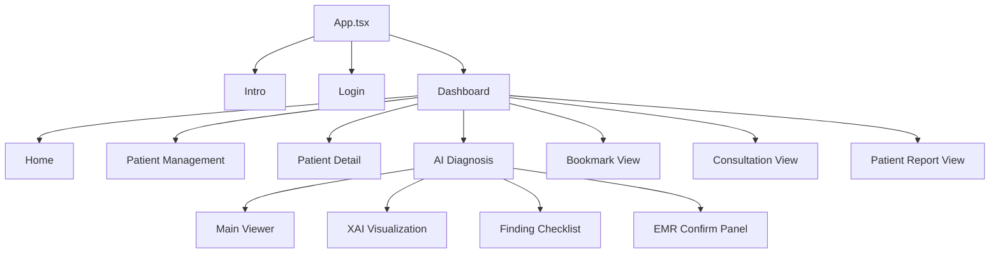

### 3.2 Component Responsibilities

| Component | Responsibility |
|---|---|
| App.tsx | 인증 및 공통 데이터 상태 관리 |
| Intro.jsx | 서비스 진입 화면 |
| Login.jsx | 의료진 로그인 화면 |
| Dashboard.jsx | 업무 화면 전환 및 환자 선택 |
| Home.jsx | 주요 업무 정보 및 빠른 메뉴 |
| Patient_Management.jsx | 환자 목록 및 검색 |
| Patient_Detail.jsx | 환자 상세정보 |
| Main_viewer.jsx | 의료영상 및 주석 |
| BoomarkView.jsx | 북마크 목록 및 상세 팝업 |
| Consultation_View.jsx | 협진 요청 인터페이스 |
| Patient_ReportView.jsx | 결과 리포트 |

`BoomarkView.jsx`는 원본 프로젝트에서 사용한 실제 파일명입니다.

### 3.3 Source Directory

```text
src/
├── App.tsx
├── App.css
├── index.css
├── main.jsx
│
├── Page/
│   ├── Intro.jsx
│   ├── Login.jsx
│   ├── Home.jsx
│   ├── Dashboard.jsx
│   ├── Patient_Management.jsx
│   └── Patient_Detail.jsx
│
├── Components/
│   ├── Main_viewer.jsx
│   ├── BoomarkView.jsx
│   ├── Consultation_View.jsx
│   ├── Patient_ReportView.jsx
│   ├── Xai_visualization.jsx
│   ├── FindingChecklist.jsx
│   ├── ImpressionTemplate.jsx
│   ├── EmrConfirmPanel.jsx
│   ├── Mace_risk.jsx
│   └── Notification_bell.jsx
│
└── utils/
    ├── authMedia.js
    └── bookmarksApi.js
```

위 구조는 확인한 개인 개발 브랜치의 주요 소스 파일을 기준으로 정리하였습니다.

---

## 4. State Management Strategy

### 4.1 React Hooks

프로젝트에서는 React Hooks와 Props를 활용하여 컴포넌트의 상태 및 데이터 전달을 관리합니다.

| Hook | Usage |
|---|---|
| useState | 사용자 입력 및 화면 상태 |
| useEffect | API 요청 및 상태 변경 감지 |
| useRef | DOM 참조 및 타이머 관리 |

Redux 또는 Context API를 중심으로 전역 상태 관리 시스템을 구현한 것으로 확인되지는 않았습니다.

### 4.2 State Ownership

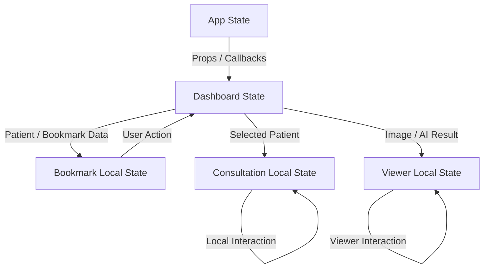

### 4.3 State Classification

| State Category | Examples | Owner |
|---|---|---|
| Authentication | 로그인 사용자 | App |
| Shared Data | 환자 목록, 북마크 목록 | App |
| Navigation | 현재 업무 메뉴 | Dashboard |
| Patient Context | 선택 환자 | Dashboard |
| AI Analysis | 분석 결과 및 표시 옵션 | Dashboard |
| Viewer Interaction | 확대, 이동, 주석 | Main Viewer |
| Bookmark Interaction | 검색어, 선택 항목 | Bookmark View |
| Consultation Form | 환자, 수신 의료진, 요청 사유 | Consultation View |
| Report Selection | 선택 리포트 환자 | Report View |

위 표는 확인한 구현을 바탕으로 상태의 역할을 분류한 것입니다.

### 4.4 State Design Principle

여러 화면에서 공통으로 사용하는 데이터는 상위 컴포넌트에서 관리하고, 특정 화면에서만 필요한 입력 상태는 해당 컴포넌트에서 관리하는 구조입니다.

이를 통해 모든 UI 상태를 하나의 컴포넌트에 집중시키는 문제를 줄일 수 있습니다.

---

## 5. Unidirectional Data Flow

### 5.1 Props and Callbacks

React에서는 상위 컴포넌트가 하위 컴포넌트에 데이터를 전달하고, 하위 컴포넌트는 Callback을 호출하여 사용자 행동을 상위 컴포넌트에 전달할 수 있습니다.

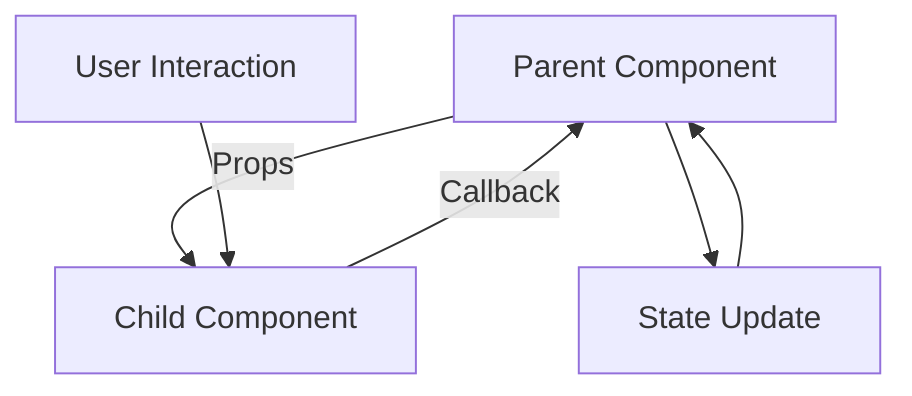

### 5.2 Simplified Example

```jsx
function Dashboard() {
  const [selectedPatient, setSelectedPatient] =
    useState(null);

  return (
    <PatientManagement
      onSelectPatient={setSelectedPatient}
    />
  );
}
```

하위 컴포넌트:

```jsx
function PatientManagement({
  patients = [],
  onSelectPatient
}) {
  return patients.map(patient => (
    <button
      key={patient.patient_id}
      onClick={() => onSelectPatient(patient)}
    >
      {patient.name}
    </button>
  ));
}
```

위 코드는 데이터 전달 원리를 설명하기 위한 단순화 예시입니다.

### 5.3 Engineering Benefits

- 데이터 변경 책임 명확화
- 컴포넌트 간 직접적인 의존성 감소
- UI 컴포넌트 재사용 가능
- 사용자 행동과 상태 변경 관계 파악
- API 응답과 화면 렌더링 연결

---

## 6. Application Entry & Authentication State

### 6.1 Application Entry Flow

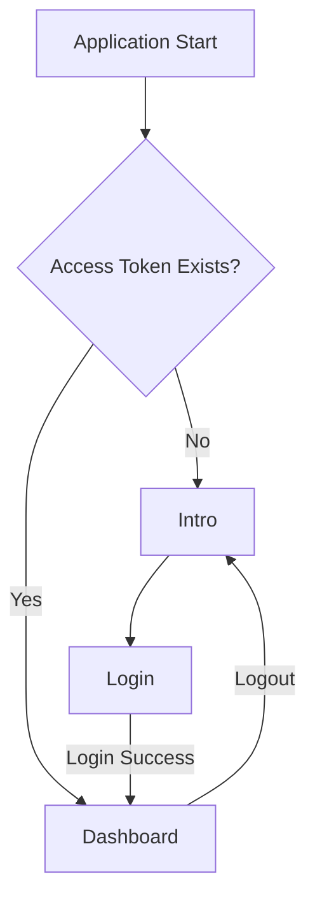

확인한 App.tsx에서는 LocalStorage의 access 토큰 존재 여부와 사용자 상태를 기반으로 진입 화면을 결정합니다.

### 6.2 Authentication Storage

| Key | Purpose |
|---|---|
| access | API 요청용 Access Token |
| refresh | Refresh Token |
| doctor_name | 의료진 표시 이름 |

토큰이 존재한다는 사실만으로 해당 토큰의 유효성이 보장되는 것은 아닙니다.

실제 인증 및 권한 검증은 서버에서 수행되어야 합니다.

### 6.3 Authentication Header

```javascript
const access = localStorage.getItem('access');

const headers = {
  Authorization: `Bearer ${access}`
};
```

인증이 필요한 API 요청에 Bearer Token을 포함하는 구조입니다.

JWT 발급 및 검증 로직은 팀 백엔드 담당 영역입니다.

### 6.4 Conditional Rendering

```jsx
if (step === 'intro') {
  return <Intro />;
}

if (step === 'login') {
  return <Login />;
}

return <Dashboard />;
```

위 코드는 실제 화면 전환 원리를 설명하기 위한 단순화 예시입니다.

프로젝트에 React Router 관련 의존성이 존재하지만, 확인한 App.tsx의 주요 화면 전환은 상태 기반 조건부 렌더링 구조입니다.

---

## 7. Logout & Shared State Cleanup

### 7.1 Logout Flow

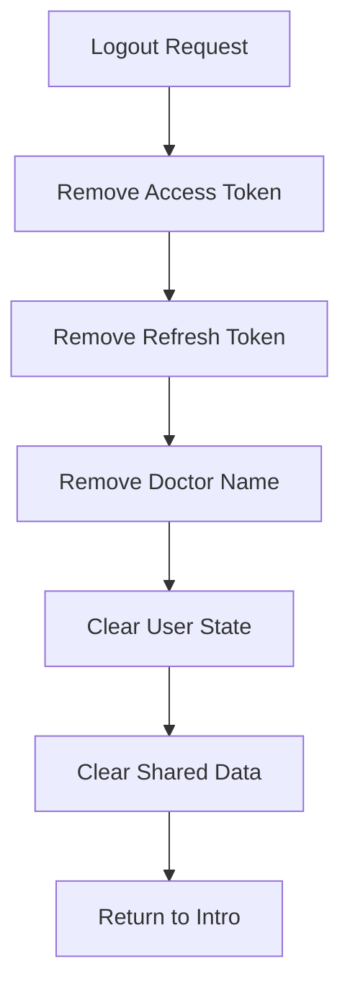

### 7.2 State Cleanup

확인한 App.tsx에서는 로그아웃 시 인증 관련 LocalStorage 값과 사용자, 환자 목록 및 북마크 목록 상태를 초기화합니다.

```javascript
function handleLogout() {
  localStorage.removeItem('access');
  localStorage.removeItem('refresh');
  localStorage.removeItem('doctor_name');

  setUser(null);
  setPatients([]);
  setBookmarks([]);
  setStep('intro');
}
```

위 코드는 로그아웃 처리 구조를 설명하기 위한 재구성 예시입니다.

### 7.3 Security Boundary

클라이언트에서 토큰을 삭제하는 것은 브라우저의 인증 정보를 제거하는 동작입니다.

다음 서버 기능까지 구현되었다는 의미는 아닙니다.

- Refresh Token 폐기
- 서버 세션 종료
- JWT Blacklist
- 강제 로그아웃
- 사용자별 접근 권한 회수

### 7.4 Improvement Direction

로그아웃 이후 이전 API 요청이 완료되어 환자 데이터가 다시 상태에 반영되지 않도록 요청 취소 또는 인증 상태 검증을 추가할 수 있습니다.

---

## 8. Shared API Data

### 8.1 Application-level Requests

| Method | Endpoint | Purpose |
|---|---|---|
| GET | `/api/health/` | 서버 상태 확인 |
| GET | `/api/patients/` | 환자 목록 조회 |
| GET | `/api/bookmarks/` | 북마크 목록 조회 |
| POST | `/api/bookmarks/` | 북마크 생성 |
| DELETE | `/api/bookmarks/{id}/` | 북마크 삭제 |

위 API는 확인한 프론트엔드 소스코드에서 사용되는 요청 경로입니다.

서버 내부의 데이터베이스 처리 및 접근 권한 검증까지 독립적으로 확인한 것은 아닙니다.

### 8.2 Shared Data Flow

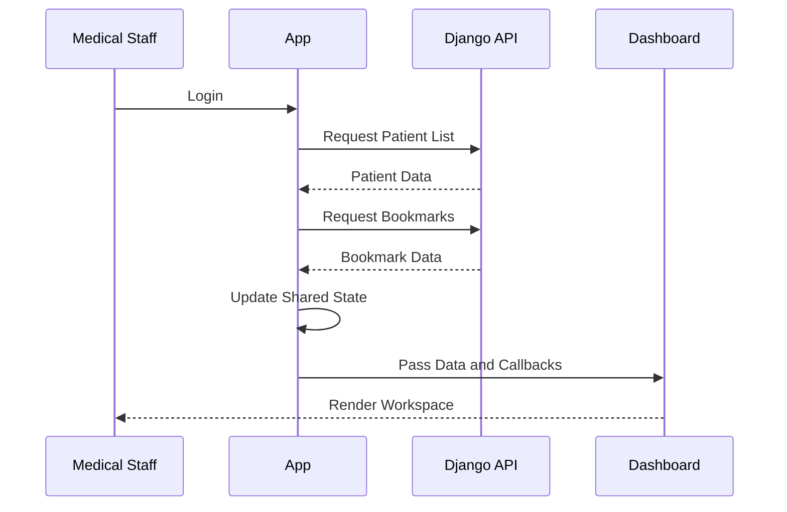

### 8.3 Data Ownership

환자 목록과 북마크 목록을 App에서 관리하고 Dashboard에 전달하는 구조가 존재합니다.

다만 Dashboard 내부에서도 환자 목록을 별도로 조회하는 부분이 확인됩니다.

향후에는 공통 데이터 조회 책임을 하나의 계층으로 통합하여 중복 요청과 상태 불일치 가능성을 줄일 수 있습니다.

---

## 9. Dashboard Navigation

### 9.1 Navigation State

Dashboard에서는 현재 선택한 메뉴를 상태로 관리합니다.

```javascript
const [currentMenu, setCurrentMenu] =
  useState('home');
```

### 9.2 Menu Structure

| Menu | Purpose |
|---|---|
| Home | 주요 업무 정보 |
| Patients | 환자 목록 |
| Patient Detail | 환자 상세정보 |
| AI Diagnosis | AI 영상 판독 |
| Consultation | 협진 요청 |
| Bookmarks | 북마크 관리 |
| Patient Report | 결과 리포트 |

### 9.3 Navigation Flow

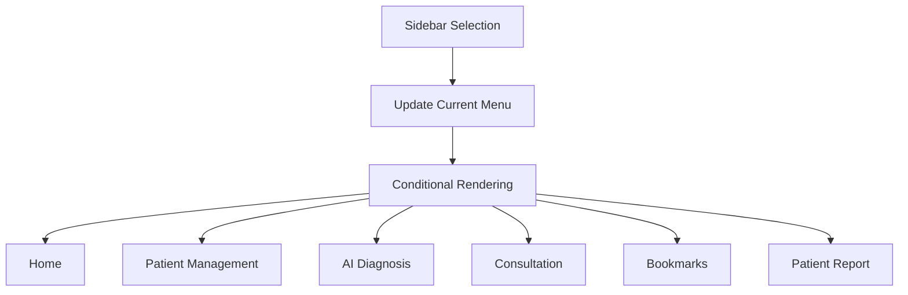

### 9.4 Personal Contribution

개인 커밋에서는 Dashboard 화면 구성, Home 컴포넌트 분리, 환자 상세 화면 연결 및 업무 메뉴 수정 이력이 확인됩니다.

대표 커밋:

- `8749953`: 환자 목록 Dashboard 생성
- `d75b325`: 환자 상세 페이지 및 빠른 검색 기능
- `e7fa8f8`: Dashboard 수정 및 Home 컴포넌트 분리
- `0161739`: Dashboard 복구 및 오류 수정
- `ee3c068`: 결과 리포트 탭 및 업무 화면 수정

---

## 10. Bookmark Feature Overview

### 10.1 Background

의료영상 판독 과정에서는 관심 영역이나 다시 확인할 정보를 별도로 관리할 필요가 있습니다.

북마크 인터페이스는 의료진이 이러한 관심 정보를 목록으로 확인하고 상세 내용을 조회할 수 있도록 구성하였습니다.

### 10.2 Feature Scope

| Feature | Implementation Scope |
|---|---|
| 북마크 목록 | 개인 UI 구현 |
| 북마크 검색 | 개인 브랜치 구현 확인 |
| 상세 팝업 | 개인 구현 확인 |
| 카드 클릭 처리 | 개인 구현 확인 |
| 삭제 버튼 | 개인 UI 및 Callback 연결 |
| 생성 및 삭제 API | 팀 API 연동 |
| 서버 저장 구조 | 팀 백엔드 영역 |
| 수정 API Utility | 팀 구현 확인 |
| 수정 UI 연결 | 확인되지 않음 |

### 10.3 Personal Development Evidence

개인 커밋 `847f46d`에서 북마크 컴포넌트의 신규 생성이 확인됩니다.

이후 `8e188fc`에서 북마크 상세 팝업과 카드 클릭 이벤트 처리 기능을 추가하였습니다.

`ee3c068`에서는 북마크 및 관련 업무 화면의 추가 수정이 확인됩니다.

---

## 11. Bookmark Component Architecture

### 11.1 Component Relationship

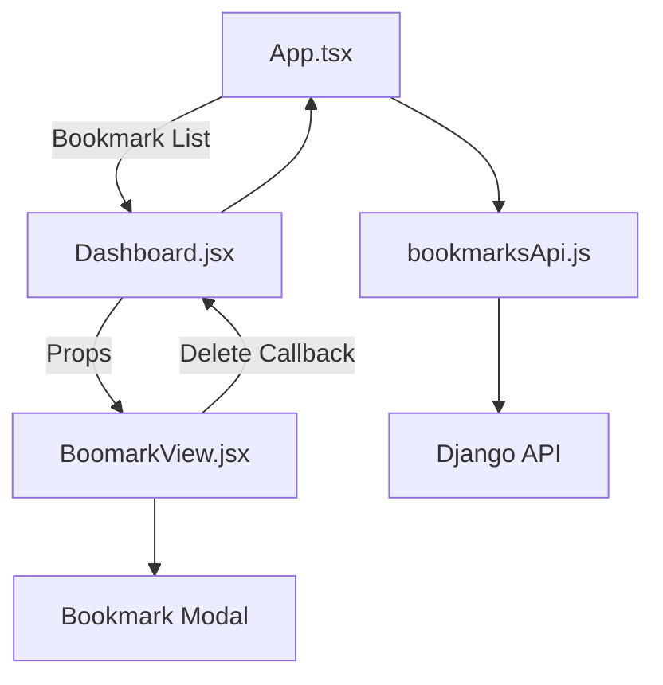

### 11.2 Component Props

| Prop | Responsibility |
|---|---|
| bookmarks | 북마크 목록 |
| onSelectBookmark | 북마크 선택 Callback |
| onDeleteBookmark | 북마크 삭제 Callback |

### 11.3 Local State

| State | Purpose |
|---|---|
| searchTerm | 검색 입력값 |
| selectedItem | 상세 조회 항목 |
| modalMediaUrl | 상세 팝업 미디어 경로 |
| isModalLoading | 미디어 로딩 상태 |
| modalImgError | 이미지 표시 오류 상태 |

공통 북마크 데이터와 상세 팝업의 일시적인 UI 상태를 분리하여 관리합니다.

---

## 12. Bookmark Data Model

### 12.1 Frontend Data Structure

다음은 확인한 북마크 데이터 구조를 설명하기 위한 가상의 객체입니다.

```json
{
  "id": 1,
  "title": "Example bookmark",
  "patientId": "1001",
  "examId": 20,
  "frameNumber": 125,
  "note": "Example review note",
  "bboxData": [],
  "snapshotPath": null,
  "snapshotUrl": null
}
```

위 값은 실제 환자 정보가 아닌 설명용 데이터입니다.

### 12.2 Field Responsibilities

| Field | Purpose |
|---|---|
| id | 북마크 식별자 |
| title | 북마크 제목 |
| patientId | 환자 식별자 |
| examId | 검사 식별자 |
| frameNumber | 관심 프레임 정보 |
| note | 의료진 메모 |
| bboxData | 관심 영역 좌표 정보 |
| snapshotPath | 캡처 파일 경로 |
| snapshotUrl | 캡처 파일 접근 경로 |

### 12.3 Data Integrity Considerations

실제 의료영상 북마크에서는 환자 ID뿐만 아니라 검사 ID, 영상 시리즈, 프레임 위치 및 좌표 기준을 함께 관리할 필요가 있습니다.

현재 코드에서는 일부 식별자와 캡처 데이터가 완전하게 전달되지 않는 부분이 확인됩니다.

---

## 13. Bookmark API Adapter

### 13.1 API Utility

팀 공통 Utility인 `bookmarksApi.js`는 북마크 관련 API 요청과 응답 데이터 변환을 담당합니다.

### 13.2 Naming Convention

백엔드와 프론트엔드에서 서로 다른 필드 명명 규칙을 사용하는 경우 데이터 변환이 필요합니다.

| Backend | Frontend |
|---|---|
| patient_id | patientId |
| exam_id | examId |
| frame_number | frameNumber |
| bbox_data | bboxData |
| snapshot_path | snapshotPath |
| snapshot_url | snapshotUrl |
| created_at | createdAt |
| updated_at | updatedAt |

### 13.3 Adapter Example

```javascript
function toUiBookmark(data) {
  return {
    id: data.id,
    title: data.title,
    patientId: data.patient_id,
    examId: data.exam_id,
    frameNumber: data.frame_number,
    bboxData: data.bbox_data,
    snapshotPath: data.snapshot_path,
    snapshotUrl: data.snapshot_url
  };
}
```

위 코드는 확인한 데이터 변환 구조를 단순화한 예시입니다.

### 13.4 Data Transformation Flow

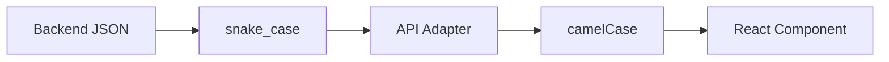

### 13.5 Engineering Perspective

API 응답 형식을 UI에서 직접 처리하는 대신 변환 모듈을 활용하면 컴포넌트와 서버 데이터 구조 사이의 결합도를 줄일 수 있습니다.

해당 API Utility 자체는 팀 협업 영역이며, 개인 단독 구현으로 기록하지 않습니다.

---

## 14. Bookmark CRUD Integration

### 14.1 API Endpoints

| Method | Endpoint | Purpose |
|---|---|---|
| GET | `/api/bookmarks/` | 목록 조회 |
| POST | `/api/bookmarks/` | 신규 생성 |
| PATCH | `/api/bookmarks/{id}/` | 기존 정보 수정 |
| DELETE | `/api/bookmarks/{id}/` | 삭제 |

PATCH 요청 함수는 Utility에 존재하지만, 확인한 북마크 화면에서 실제 수정 UI와 연결된 것은 확인되지 않았습니다.

### 14.2 Read Flow

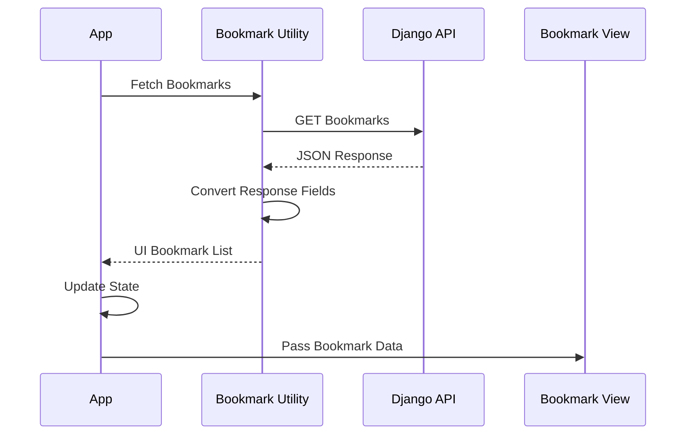

### 14.3 Create Flow

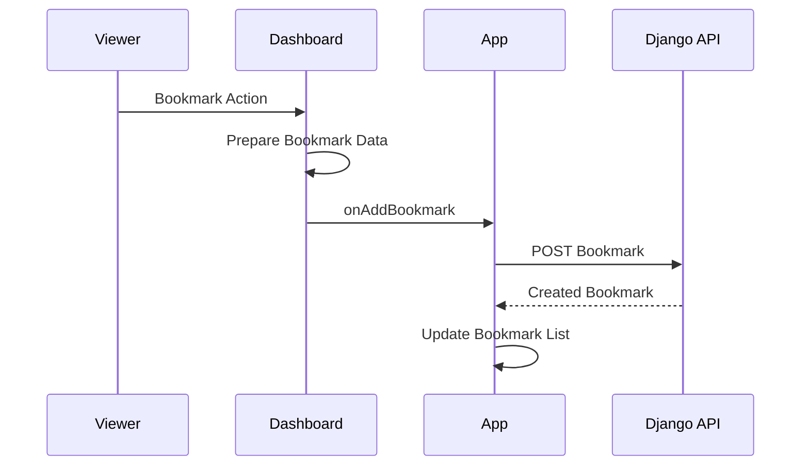

### 14.4 State Update After Creation

```javascript
const created = await createBookmark(payload);

setBookmarks(previous => [
  created,
  ...previous
]);
```

서버 응답 이후 생성된 객체를 목록 상태에 추가하는 방식입니다.

### 14.5 Delete Flow

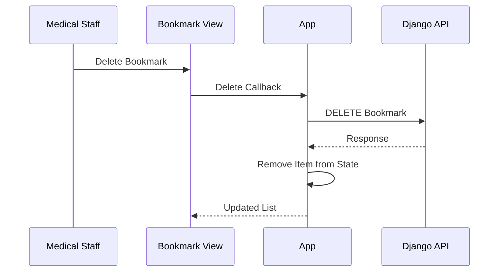

### 14.6 Immutable Deletion

```javascript
await deleteBookmark(bookmarkId);

setBookmarks(previous =>
  previous.filter(item =>
    item.id !== bookmarkId
  )
);
```

위 코드는 서버 요청 이후 목록을 갱신하는 원리를 설명하기 위한 예시입니다.

### 14.7 State Consistency

서버 요청이 실패한 경우 UI에서 해당 북마크를 삭제된 것으로 표시하지 않도록 서버 응답과 상태 갱신의 순서를 고려해야 합니다.

---

## 15. Bookmark Capture Metadata

### 15.1 Capture Context

Dashboard에는 북마크 생성 시 현재 환자 및 프레임 관련 정보와 캡처 데이터를 구성하는 로직이 존재합니다.

| Data | Purpose |
|---|---|
| patientId | 대상 환자 |
| frameNumber | 관심 프레임 |
| title | 북마크 제목 |
| note | 검토 메모 |
| bboxData | AI 관심 영역 |
| snapshotUrl | 브라우저 캡처 데이터 |
| examId | 검사 식별자 |

### 15.2 Canvas Capture

Canvas는 현재 그려진 내용을 이미지 데이터로 변환할 수 있습니다.

```javascript
const snapshotUrl =
  canvas.toDataURL('image/png');
```

### 15.3 Video Capture

영상의 현재 프레임을 Canvas에 그린 뒤 이미지로 변환하는 방식도 사용할 수 있습니다.

```javascript
const canvas = document.createElement('canvas');

canvas.width = video.videoWidth;
canvas.height = video.videoHeight;

const ctx = canvas.getContext('2d');

ctx.drawImage(
  video,
  0,
  0,
  canvas.width,
  canvas.height
);

const snapshotUrl =
  canvas.toDataURL('image/png');
```

위 코드는 캡처 원리를 설명하기 위한 예시입니다.

### 15.4 Existing Implementation Limitations

확인한 Dashboard에서는 `document.querySelector('canvas')`를 활용하는 캡처 구조가 존재합니다.

그러나 Viewer는 원본 이미지와 Overlay Canvas를 분리하여 표시합니다.

따라서 Overlay Canvas만 캡처하는 경우 원본 의료영상이 포함되지 않을 수 있습니다.

또한 페이지에 여러 Canvas가 존재하면 의도하지 않은 Canvas가 선택될 수 있습니다.

### 15.5 Snapshot Persistence Boundary

Dashboard에서 구성한 snapshotUrl이 App의 북마크 생성 요청을 통해 완전하게 전달되지 않는 부분이 확인됩니다.

따라서 실제 캡처 파일의 서버 저장 및 재조회까지 완료된 기능으로 표현하지 않습니다.

### 15.6 Improvement Direction

- Viewer 전용 Ref 사용
- 원본 이미지와 Overlay 합성
- 검사 ID 및 프레임 식별자 연결
- 캡처 파일 업로드 API 정의
- 파일 저장 성공 이후 북마크 생성
- 저장된 파일과 북마크 메타데이터 연결
- 환자별 접근 권한 검증

위 내용은 소스코드 검토 이후 도출한 개선 방향입니다.

---

## 16. Bookmark Search

### 16.1 Client-side Filtering

북마크 목록에서 제목 및 환자 식별자를 기준으로 검색할 수 있는 구조가 존재합니다.

### 16.2 Search Flow

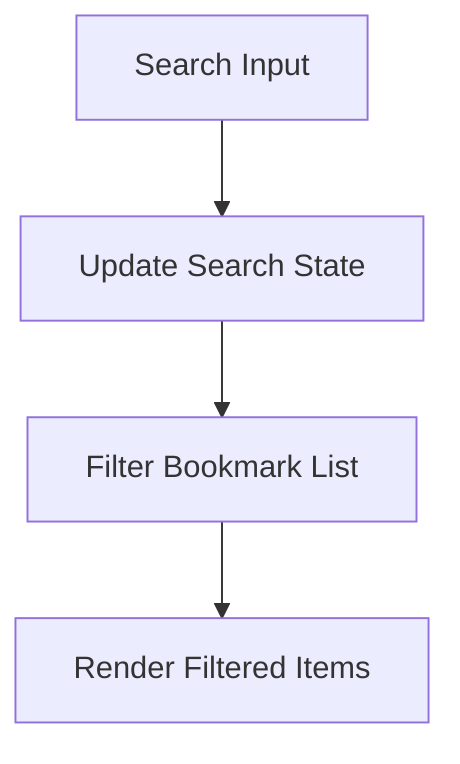

### 16.3 Improved Search Example

```javascript
const keyword =
  searchTerm.trim().toLowerCase();

const filteredBookmarks =
  bookmarks.filter(item => {
    const title =
      String(item.title ?? '').toLowerCase();

    const patientId =
      String(item.patientId ?? '').toLowerCase();

    return (
      title.includes(keyword) ||
      patientId.includes(keyword)
    );
  });
```

위 코드는 문자열 타입과 누락 데이터를 고려한 개선 예시입니다.

### 16.4 Identified Type Issue

원본 코드에서는 환자 식별자에 직접 `includes()`를 사용하는 부분이 확인됩니다.

환자 ID가 숫자 타입으로 전달되는 경우 문자열 메서드를 사용할 수 없어 오류가 발생할 수 있습니다.

따라서 검색에 사용되는 식별자를 문자열로 정규화하는 방식이 필요합니다.

### 16.5 Scalability

현재 검색 구조는 브라우저에 조회된 목록을 대상으로 필터링하는 방식입니다.

데이터 규모가 증가하는 경우 서버 검색, Pagination 및 검색 조건별 API 요청을 고려할 수 있습니다.

---

## 17. Bookmark Detail Modal

### 17.1 Personal Contribution

개인 커밋 `8e188fc`에서는 북마크 목록의 항목을 선택하면 상세 팝업이 표시되는 기능을 추가하였습니다.

### 17.2 Modal State

```javascript
const [selectedItem, setSelectedItem] =
  useState(null);
```

### 17.3 Open and Close

```javascript
function openBookmark(item) {
  setSelectedItem(item);
}

function closeBookmark() {
  setSelectedItem(null);
}
```

### 17.4 Conditional Rendering

```jsx
{selectedItem && (
  <BookmarkModal
    item={selectedItem}
    onClose={closeBookmark}
  />
)}
```

위 코드는 팝업 표시 구조를 설명하기 위한 단순화 예시입니다.

### 17.5 Modal State Transition

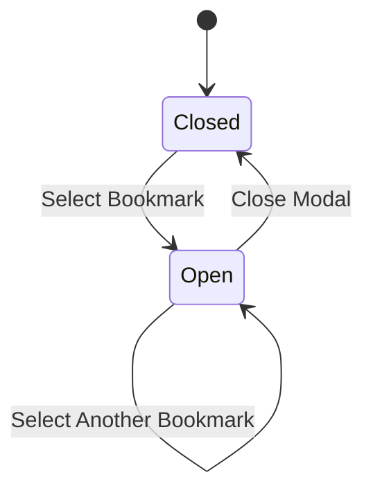

### 17.6 Modal Information

| Area | Content |
|---|---|
| Header | 북마크 제목 |
| Media Area | 이미지 또는 미디어 정보 |
| Metadata | 환자 식별자 |
| Close Action | 팝업 닫기 |

초기 개인 커밋에서는 미디어 유형에 따른 조건부 렌더링이 확인됩니다.

이후 개인 브랜치에서는 인증 미디어 URL 조회와 이미지 로딩 및 오류 상태가 추가된 구조가 확인됩니다.

---

## 18. Event Bubbling Prevention

### 18.1 Problem

북마크 카드 전체에 클릭 이벤트가 존재하고 카드 내부에 삭제 및 상세보기 버튼이 함께 존재하는 경우, 내부 버튼의 클릭 이벤트가 상위 카드까지 전달될 수 있습니다.

```text
Bookmark Card
├── Title
├── Metadata
└── Action Buttons
    ├── Open
    └── Delete
```

삭제 버튼을 클릭했을 때 카드의 상세 팝업 열기 이벤트까지 실행될 가능성이 있습니다.

### 18.2 Event Bubbling

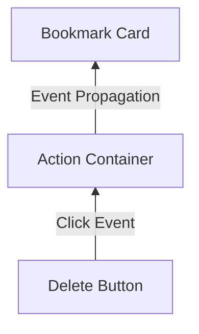

### 18.3 Implementation

개인 커밋 `8e188fc`에서는 카드 내부 Action 영역에 이벤트 전파 방지 처리를 추가하였습니다.

```jsx
<div
  onClick={(event) => event.stopPropagation()}
>
  <button onClick={handleOpen}>
    상세보기
  </button>

  <button onClick={handleDelete}>
    삭제
  </button>
</div>
```

위 코드는 확인한 이벤트 처리 방식을 단순화한 예시입니다.

### 18.4 Event Isolation

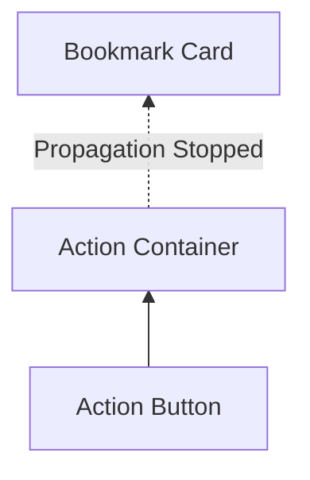

### 18.5 Engineering Result

코드상 카드 선택 이벤트와 내부 Action 이벤트가 분리되는 구조를 구현하였습니다.

실제 브라우저에서 발생한 오류 횟수나 개선 전후의 정량적 결과는 별도로 측정하지 않았습니다.

### 18.6 stopPropagation vs preventDefault

| Method | Purpose |
|---|---|
| stopPropagation() | 상위 요소로 이벤트 전달 제한 |
| preventDefault() | 브라우저 기본 동작 제한 |

두 메서드는 서로 다른 역할을 수행합니다.

본 구현에서는 상위 카드의 클릭 이벤트가 함께 실행되는 것을 방지하기 위해 stopPropagation을 활용하였습니다.

---

## 19. Authenticated Bookmark Media

### 19.1 Media URL Resolution

확인한 북마크 컴포넌트에서는 여러 미디어 관련 필드를 확인하여 표시할 URL을 결정하는 구조가 존재합니다.

```javascript
const rawUrl =
  item.snapshotUrl ||
  item.snapshotPath ||
  item.url ||
  item.image_url ||
  item.imageUrl ||
  item.file_url ||
  item.key_frame_url;
```

위 코드는 확인한 필드 우선순위를 설명하기 위한 예시입니다.

### 19.2 Authenticated Media Utility

팀 공통 함수인 `fetchAuthBlobUrl`을 활용하여 인증 미디어를 조회하는 구조입니다.

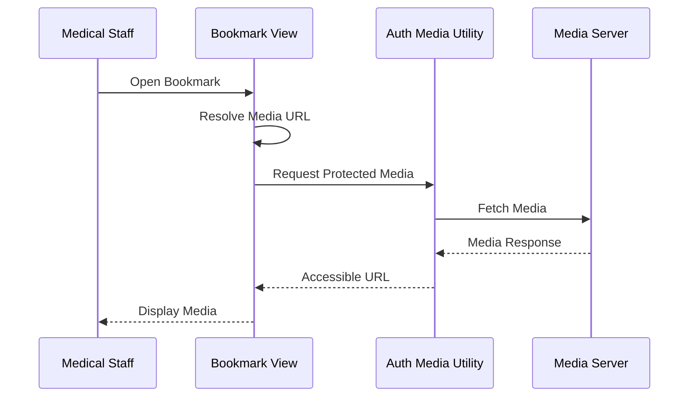

### 19.3 Loading and Error States

| State | UI Behavior |
|---|---|
| Loading | 미디어 조회 진행 표시 |
| Success | 이미지 표시 |
| Missing URL | 미디어 없음 안내 |
| Image Error | 이미지 표시 실패 안내 |
| Closed | 상세 팝업 숨김 |

### 19.4 Fallback Endpoint Boundary

일부 코드에서는 환자 ID와 프레임 번호를 활용하여 대체 미디어 요청 경로를 구성합니다.

해당 대체 Endpoint가 실제 백엔드에서 제공되는지는 별도로 확인하지 않았습니다.

### 19.5 Resource Cleanup

Blob URL은 사용이 끝난 이후 해제할 필요가 있습니다.

```javascript
URL.revokeObjectURL(blobUrl);
```

확인한 컴포넌트에서는 Effect Cleanup을 활용한 URL 해제 구조가 존재합니다.

다만 팝업이 닫힌 이후 비동기 요청이 완료되는 경우까지 모든 자원 정리가 보장되는 것은 아닙니다.

---

## 20. Asynchronous UI State

### 20.1 Request Lifecycle

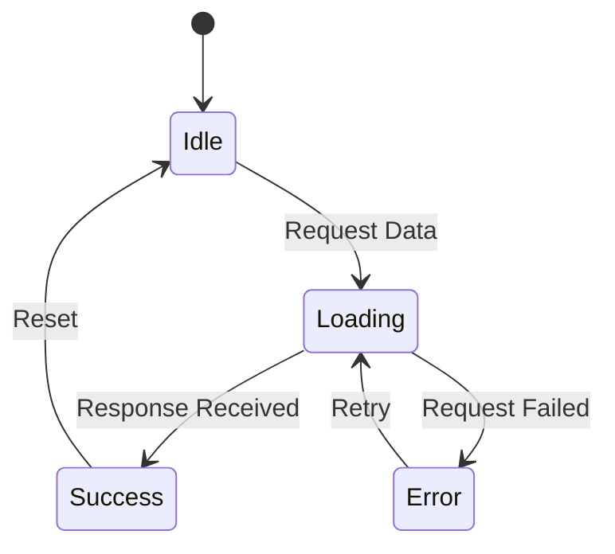

### 20.2 Stale Response Problem

사용자가 북마크 A를 선택한 직후 북마크 B를 선택하면 A의 요청이 B보다 늦게 완료될 수 있습니다.

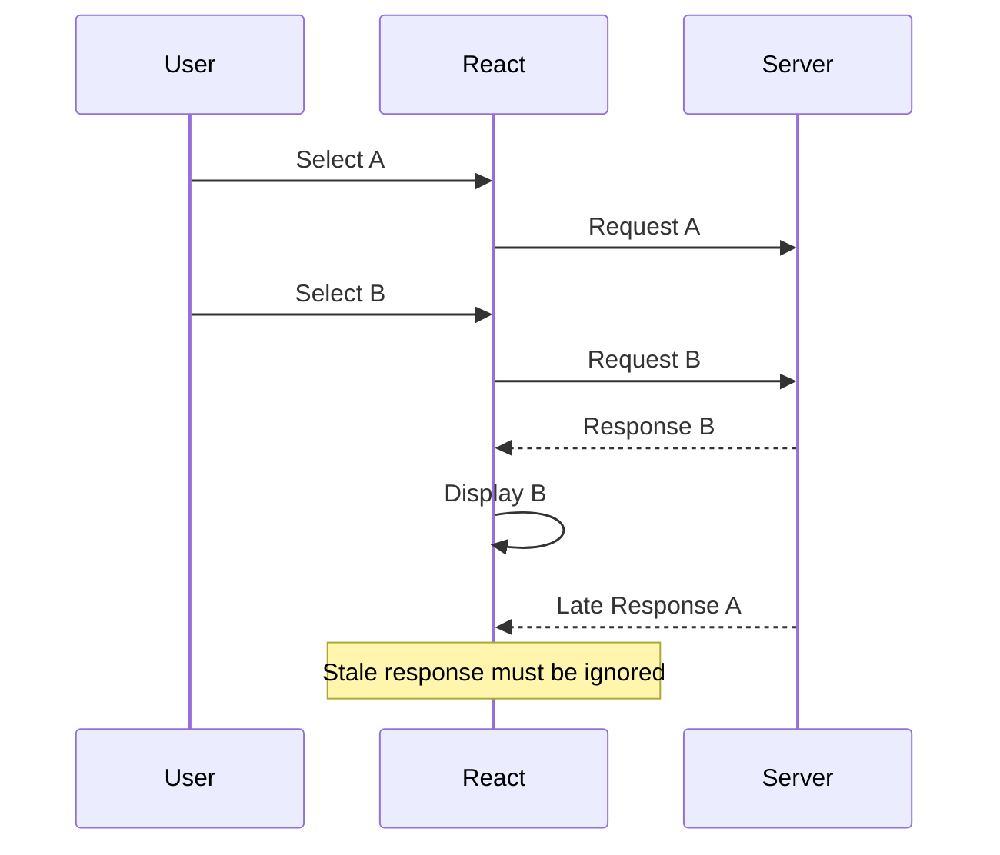

### 20.3 Cancellation Flag

확인한 북마크 및 환자 미디어 관련 코드에서는 비동기 요청의 결과 반영 여부를 판단하기 위한 취소 플래그가 사용됩니다.

이 방식은 요청 자체를 반드시 중단하는 것은 아니며, 이전 응답의 상태 반영을 제한하는 데 활용할 수 있습니다.

### 20.4 Improved Cleanup Example

```javascript
useEffect(() => {
  let cancelled = false;
  let objectUrl = null;

  async function loadMedia() {
    try {
      const response = await fetch(mediaUrl);

      if (!response.ok) {
        throw new Error('Media request failed');
      }

      const blob = await response.blob();

      objectUrl = URL.createObjectURL(blob);

      if (cancelled) {
        URL.revokeObjectURL(objectUrl);
        objectUrl = null;
        return;
      }

      setMediaUrl(objectUrl);

    } catch (error) {
      if (!cancelled) {
        setMediaError(true);
      }
    }
  }

  if (mediaUrl) {
    loadMedia();
  }

  return () => {
    cancelled = true;

    if (objectUrl) {
      URL.revokeObjectURL(objectUrl);
    }
  };
}, [mediaUrl]);
```

위 코드는 비동기 응답과 Object URL 정리 문제를 설명하기 위한 개선 예시입니다.

기존 프로젝트에 적용한 코드가 아니며, 인증 헤더 등 실제 서비스의 요청 조건은 별도로 구성해야 합니다.

### 20.5 Further Improvements

- AbortController 기반 요청 취소
- 요청별 식별자 관리
- 이전 응답의 상태 반영 제한
- 로딩 및 오류 상태 초기화
- Blob URL 수명 관리
- 환자 변경 시 데이터 검증

---

## 21. Consultation Feature Overview

### 21.1 Background

의료진은 환자 상태 및 검사 결과에 따라 다른 진료과 또는 의료진에게 추가적인 검토를 요청할 수 있습니다.

프로젝트에서는 협진 요청을 위한 의료진 업무 인터페이스를 구성하였습니다.

### 21.2 Personal Contribution

개인 커밋 `847f46d`에서 `Consultation_View.jsx`의 신규 생성이 확인됩니다.

이후 Dashboard 수정 및 화면 연결 과정에서 협진 컴포넌트의 변경이 확인됩니다.

최종 협진 API 및 알림 기능은 팀 협업 영역으로 구분합니다.

### 21.3 Feature Scope

- 협진 목록 화면
- 협진 상세정보 화면
- 신규 협진 요청 Form
- 환자 검색 및 선택
- 진료과 선택
- 수신 의료진 선택
- 요청 사유 입력
- 우선순위 선택
- 추가 메모 입력
- 제출 상태 및 결과 안내

실제 협진 응답 관리와 실시간 메시지 전달 기능까지 완성한 것으로 확인되지는 않았습니다.

---

## 22. Consultation Screen Architecture

### 22.1 Screen Structure

```text
+------------------------------------------------+
| Consultation Workspace                         |
+-------------------+----------------------------+
| Consultation List | Consultation Detail       |
|                   |                            |
| Search            | Patient Information        |
| Request Items     | Receiver Information       |
| Status            | Request Reason             |
| Priority          | Additional Note            |
|                   |                            |
+-------------------+----------------------------+
| New Consultation Request                       |
+------------------------------------------------+
```

### 22.2 Component Responsibilities

| Area | Responsibility |
|---|---|
| List | 협진 항목 조회 및 선택 |
| Search | 목록 검색 |
| Detail | 선택 협진 정보 표시 |
| Request Form | 신규 요청 입력 |
| Notification | 요청 결과 안내 |

### 22.3 Local State

| State | Purpose |
|---|---|
| consultations | 협진 목록 |
| selectedConsult | 선택 협진 항목 |
| isWriting | 요청 Form 표시 여부 |
| loading | 초기 데이터 조회 상태 |
| submitting | 요청 제출 상태 |
| notification | 결과 안내 |
| patientList | 환자 선택 목록 |
| doctorsList | 의료진 선택 목록 |
| searchTerm | 협진 검색어 |
| newForm | 신규 협진 요청 입력값 |

### 22.4 State Ownership

협진 요청에만 필요한 입력값과 선택 상태를 Consultation View 내부에서 관리합니다.

상위 Dashboard에서 선택한 환자 정보는 Props를 통해 전달받는 구조입니다.

---

## 23. Consultation Initial Data

### 23.1 Required Data

협진 요청 Form을 구성하기 위해 환자 목록과 수신 의료진 목록이 필요합니다.

| Method | Endpoint | Purpose |
|---|---|---|
| GET | `/api/patients/` | 환자 목록 |
| GET | `/api/doctors/` | 의료진 목록 |

### 23.2 Parallel Requests

확인한 협진 컴포넌트에서는 Promise.all을 활용하여 환자 목록과 의료진 목록을 함께 조회하는 구조가 존재합니다.

```javascript
const [patientsResponse, doctorsResponse] =
  await Promise.all([
    fetch('/api/patients/', options),
    fetch('/api/doctors/', options)
  ]);
```

위 코드는 요청 구조를 설명하기 위한 단순화 예시입니다.

### 23.3 Sequential vs Parallel

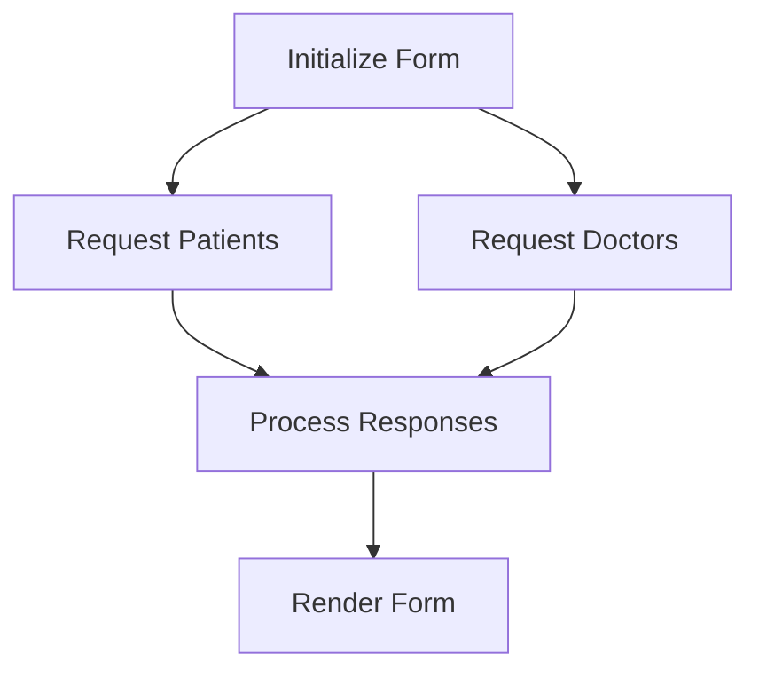

서로 의존하지 않는 요청을 함께 실행하여 초기 데이터 조회를 구성할 수 있습니다.

실제 응답 시간 개선 수치는 측정하지 않았습니다.

### 23.4 Promise.all Limitation

Promise.all은 포함된 Promise 중 하나가 Reject되면 전체 결과가 Reject됩니다.

또한 Fetch API는 HTTP 400 또는 500 응답만으로 자동 Reject되지 않으므로 response.ok를 별도로 확인해야 합니다.

향후 일부 데이터 조회 실패를 독립적으로 처리하려면 Promise.allSettled 또는 개별 오류 처리를 고려할 수 있습니다.

---

## 24. Consultation List Data Boundary

### 24.1 Existing Mock Data

확인한 협진 컴포넌트에는 초기 협진 목록을 구성하기 위한 `MOCK_CONSULTATIONS` 데이터가 존재합니다.

환자 및 의료진 목록 조회와 협진 목록 조회는 구분해야 합니다.

### 24.2 Implementation Status

| Data | Existing Source |
|---|---|
| 환자 선택 목록 | API 조회 구조 |
| 의료진 선택 목록 | API 조회 구조 |
| 초기 협진 목록 | Mock Data |
| 신규 협진 요청 | POST API 호출 구조 |
| 신규 요청 직후 목록 | React State |
| 서버 협진 이력 재조회 | 확인되지 않음 |

### 24.3 Persistence Limitation

신규 협진 요청의 응답 객체를 현재 목록에 추가하는 구조는 확인됩니다.

그러나 페이지를 새로고침한 이후 서버의 협진 이력을 다시 조회하는 GET 요청은 확인되지 않았습니다.

따라서 서버 기반 협진 이력 관리 전체를 구현 완료한 것으로 설명하지 않습니다.

---

## 25. Consultation Patient Selection

### 25.1 Patient Search

협진 요청 대상 환자를 이름 또는 환자 ID로 검색할 수 있도록 구성하였습니다.

### 25.2 Selection Flow

```mermaid
flowchart TD
    A["Enter Patient Keyword"]
    B["Filter Patient List"]
    C["Select Patient"]
    D["Set Patient Name"]
    E["Set Patient ID"]
    F["Update Request Form"]

    A --> B --> C
    C --> D
    C --> E
    D --> F
    E --> F
```

### 25.3 Search Example

```javascript
const keyword =
  searchTerm.trim().toLowerCase();

const filteredPatients =
  patientList.filter(patient => {
    const name =
      String(patient.name ?? '').toLowerCase();

    const id =
      String(patient.patient_id ?? '');

    return (
      name.includes(keyword) ||
      id.includes(keyword)
    );
  });
```

위 코드는 환자 검색 원리를 설명하기 위한 예시입니다.

### 25.4 Selected Patient Synchronization

상위 Dashboard에서 선택한 환자 정보가 전달되면 협진 요청 Form의 환자 이름과 식별자를 연결하는 Effect 구조가 존재합니다.

### 25.5 Preventing Name-ID Mismatch

환자 이름 입력값을 직접 수정할 때 기존 환자 ID를 초기화하는 처리가 확인됩니다.

```javascript
setNewForm(previous => ({
  ...previous,
  patientName: inputValue,
  patientId: ''
}));
```

검색 목록에서 환자를 다시 선택하면 이름과 ID를 함께 갱신하는 구조입니다.

### 25.6 Engineering Perspective

화면에 표시되는 환자 이름과 실제 API 요청에 사용하는 환자 식별자는 서로 일치해야 합니다.

이름만 입력하고 이전 환자의 ID를 유지하면 다른 환자에게 협진 요청이 연결될 가능성이 있습니다.

프론트엔드 입력 상태 관리와 함께 서버에서도 환자 접근 권한 및 식별자 검증이 필요합니다.

---

## 26. Department & Doctor Selection

### 26.1 Dependent Selection

협진 요청에서는 진료과 선택에 따라 해당 진료과의 의료진 목록을 표시하는 구조가 존재합니다.

```mermaid
flowchart TD
    A["Select Department"]
    B["Filter Doctor List"]
    C["Select Receiver"]
    D["Set Receiver ID"]
    E["Update Form"]

    A --> B --> C --> D --> E
```

### 26.2 Filtering Example

```javascript
const availableDoctors =
  doctorsList.filter(doctor =>
    doctor.department === newForm.department
  );
```

### 26.3 Dependent State Reset

진료과를 변경하면 이전에 선택한 수신 의료진 정보를 초기화하는 구조가 확인됩니다.

```javascript
setNewForm(previous => ({
  ...previous,
  department: selectedDepartment,
  receiverId: '',
  receiver: ''
}));
```

### 26.4 Purpose

진료과가 변경되었는데 기존 수신 의료진 정보가 남아 있으면 화면의 선택값과 실제 요청 대상이 일치하지 않을 수 있습니다.

상위 선택값 변경 시 하위 선택 상태를 초기화하여 이러한 불일치 가능성을 줄이는 구조입니다.

### 26.5 Identified Type Issue

HTML Select의 value는 일반적으로 문자열로 전달됩니다.

의료진 ID가 숫자 타입인 경우 엄격한 비교에서 일치하지 않을 수 있습니다.

개선 예시:

```javascript
const selectedDoctor =
  doctorsList.find(doctor =>
    String(doctor.doctor_id) ===
    String(selectedId)
  );
```

위 코드는 타입 차이를 고려한 개선 예시입니다.

---

## 27. Consultation Request Form

### 27.1 Form Data

| Field | Purpose |
|---|---|
| patientId | 대상 환자 |
| patientName | 환자 표시 이름 |
| department | 수신 진료과 |
| receiverId | 수신 의료진 식별자 |
| receiver | 의료진 표시 이름 |
| reason | 협진 요청 사유 |
| priority | 요청 우선순위 |
| note | 추가 메모 |

### 27.2 Controlled Input

```jsx
<textarea
  value={newForm.reason}
  onChange={event =>
    setNewForm(previous => ({
      ...previous,
      reason: event.target.value
    }))
  }
/>
```

React 상태와 입력값을 연결하여 Form 데이터를 관리하는 구조입니다.

### 27.3 Priority Options

확인한 코드에는 다음 우선순위 선택 항목이 존재합니다.

| Priority | UI Meaning |
|---|---|
| routine | 일반 요청 |
| urgent | 긴급 요청 |
| STAT | 즉시 검토 요청 |

해당 값은 의료진이 선택하는 입력 항목입니다.

실제 병원의 응급도 분류나 자동 의료 판단을 수행하는 기능은 아닙니다.

### 27.4 Immutable Form Update

```javascript
setNewForm(previous => ({
  ...previous,
  [fieldName]: fieldValue
}));
```

기존 Form 객체를 직접 변경하지 않고 새로운 객체를 생성하여 상태를 갱신합니다.

---

## 28. Consultation Validation

### 28.1 Required Fields

확인한 협진 요청 함수에서는 다음 항목을 검증합니다.

- 환자 식별자
- 수신 의료진 식별자
- 협진 요청 사유
- 인증 토큰

### 28.2 Validation Example

```javascript
function validateConsultation(form) {
  if (!form.patientId) {
    return '환자를 선택해 주세요.';
  }

  if (!form.receiverId) {
    return '수신 의료진을 선택해 주세요.';
  }

  if (!form.reason.trim()) {
    return '협진 요청 사유를 입력해 주세요.';
  }

  return null;
}
```

위 코드는 입력 검증 구조를 설명하기 위한 단순화 예시입니다.

### 28.3 Validation Flow

```mermaid
flowchart TD
    A["Submit Request"]
    B{"Patient Selected?"}
    C{"Receiver Selected?"}
    D{"Reason Provided?"}
    E{"Access Token Exists?"}
    F["Send API Request"]
    X["Display Validation Message"]

    A --> B
    B -->|"Yes"| C
    C -->|"Yes"| D
    D -->|"Yes"| E
    E -->|"Yes"| F

    B -->|"No"| X
    C -->|"No"| X
    D -->|"No"| X
    E -->|"No"| X
```

### 28.4 Frontend vs Backend Validation

| Layer | Responsibility |
|---|---|
| Frontend | 사용자 입력 확인 및 안내 |
| Backend | 요청 데이터 검증 |
| Backend | 환자 접근 권한 확인 |
| Backend | 수신 의료진 유효성 확인 |
| Database | 데이터 관계 및 제약조건 관리 |

프론트엔드 입력 검증만으로 요청 데이터의 보안이나 무결성을 보장할 수 없습니다.

---

## 29. Consultation API Integration

### 29.1 Request Endpoint

| 항목 | 내용 |
|---|---|
| Method | POST |
| Endpoint | `/api/consultations/` |
| Content Type | application/json |
| Authentication | Bearer Token |
| Purpose | 협진 요청 생성 |

### 29.2 Request Payload

다음은 확인한 프론트엔드 요청 구조를 설명하기 위한 가상의 데이터입니다.

```json
{
  "patientId": "1001",
  "receiverId": "2001",
  "reason": "Additional image review requested",
  "department": "Cardiology",
  "priority": "routine",
  "note": "Example consultation note"
}
```

위 필드가 서버 Serializer에서 모두 지원되는지는 별도로 확인하지 않았습니다.

### 29.3 Request Example

```javascript
const response = await fetch(
  '/api/consultations/',
  {
    method: 'POST',

    headers: {
      'Content-Type': 'application/json',
      Authorization: `Bearer ${access}`
    },

    body: JSON.stringify(payload)
  }
);
```

### 29.4 Request Sequence

```mermaid
sequenceDiagram
    participant U as Medical Staff
    participant C as Consultation View
    participant D as Django API

    U->>C: Fill Request Form
    U->>C: Submit Request

    C->>C: Validate Input
    C->>C: Set Submitting State

    C->>D: POST Consultation

    alt Request Success
        D-->>C: Response Data
        C->>C: Update Local List
        C->>C: Reset Form
        C-->>U: Success Notification
    else Request Failure
        D-->>C: Error Response
        C-->>U: Error Message
    end

    C->>C: Clear Submitting State
```

### 29.5 Contribution Boundary

협진 화면의 초기 구성과 사용자 입력 인터페이스에 대한 개인 개발 이력이 확인됩니다.

최종 API 요청 및 서버 처리 전체의 개인 단독 구현 여부는 확인되지 않았으므로 팀 협업 기능으로 구분합니다.

---

## 30. Submission State & Duplicate Requests

### 30.1 Submission State

```javascript
const [submitting, setSubmitting] =
  useState(false);
```

### 30.2 Button State

```jsx
<button disabled={submitting}>
  {submitting
    ? '요청 중...'
    : '협진 요청'}
</button>
```

확인한 코드에서는 제출 진행 중 버튼을 비활성화하는 구조가 존재합니다.

### 30.3 Request Lifecycle

```javascript
setSubmitting(true);

try {
  await submitConsultation(payload);

} catch (error) {
  // Display request error

} finally {
  setSubmitting(false);
}
```

위 코드는 요청 상태 처리 원리를 설명하기 위한 예시입니다.

### 30.4 Duplicate Request Boundary

버튼 비활성화는 사용자의 반복 클릭을 줄이는 UI 처리입니다.

다음 상황까지 완전하게 방지하는 것은 아닙니다.

- 네트워크 재전송
- 동일 요청의 반복 호출
- 여러 브라우저에서 동시 요청
- 서버 응답 유실 이후 재시도

실제 중복 요청 방지를 위해서는 서버의 Idempotency 정책과 데이터 검증이 필요합니다.

---

## 31. API Error Handling

### 31.1 HTTP Response Handling

Fetch API는 HTTP 오류 상태를 별도로 확인해야 합니다.

```javascript
const response = await fetch(
  endpoint,
  options
);

const data = await response
  .json()
  .catch(() => null);

if (!response.ok) {
  throw new Error(
    data?.detail ||
    data?.message ||
    `HTTP ${response.status}`
  );
}
```

위 코드는 확인한 협진 요청 오류 처리 구조를 단순화한 예시입니다.

### 31.2 Error Categories

| Error | Handling Direction |
|---|---|
| 필수 입력 누락 | 사용자 입력 안내 |
| 인증 정보 없음 | 로그인 필요 안내 |
| HTTP 400 | 요청 데이터 오류 안내 |
| HTTP 401 | 인증 오류 안내 |
| HTTP 403 | 접근 권한 오류 안내 |
| HTTP 500 | 서버 오류 안내 |
| Network Error | 네트워크 오류 안내 |
| Invalid JSON | 응답 형식 오류 처리 |

위 표는 오류 유형별 설계 방향이며, 모든 HTTP 상태에 대한 개별 분기가 구현되었다는 의미는 아닙니다.

### 31.3 Error Message Extraction

확인한 협진 요청 코드에는 응답의 detail, message 및 기타 오류 정보를 확인하여 사용자에게 전달하는 구조가 존재합니다.

### 31.4 Engineering Consideration

사용자에게 필요한 오류 메시지와 개발자가 확인할 상세 오류 정보를 분리할 필요가 있습니다.

의료 서비스에서는 오류 메시지나 브라우저 로그에 불필요한 환자 정보 및 인증 정보가 노출되지 않도록 고려해야 합니다.

---

## 32. Consultation Response Normalization

### 32.1 Existing State Update

협진 요청 성공 이후 서버 응답 객체를 기존 협진 목록에 추가하는 구조가 확인됩니다.

```javascript
setConsultations(previous => [
  responseData,
  ...previous
]);

setSelectedConsult(responseData);
```

### 32.2 Identified Limitation

초기 Mock Data와 실제 서버 응답의 필드 구조가 동일하다는 보장이 없습니다.

서버 응답이 snake_case를 사용하고 화면이 camelCase 필드를 참조하면 신규 요청 항목의 일부 정보가 표시되지 않을 수 있습니다.

### 32.3 Proposed Adapter

```javascript
function normalizeConsultation(data) {
  return {
    id: data.id,

    patientId:
      data.patientId ??
      data.patient_id ??
      null,

    patientName:
      data.patientName ??
      data.patient_name ??
      '',

    receiver:
      data.receiver_name ??
      data.receiver ??
      '',

    department:
      data.department ?? '',

    reason:
      data.reason ?? '',

    priority:
      data.priority ?? null,

    note:
      data.note ?? ''
  };
}
```

위 코드는 가상의 응답 구조를 바탕으로 작성한 개선 예시입니다.

실제 서버 데이터 계약을 확인한 후 적용해야 합니다.

### 32.4 Proposed Data Flow

```mermaid
flowchart LR
    A["Server Response"]
    B["Response Validation"]
    C["Consultation Adapter"]
    D["UI State"]
    E["Consultation List"]

    A --> B --> C --> D --> E
```

### 32.5 Expected Benefits

- Mock Data와 서버 데이터 구조 통일
- 응답 형식 차이 처리
- 컴포넌트 예외 분기 감소
- API 계약 검증 용이
- 데이터 표시 오류 감소 가능

위 항목은 개선 설계의 기대 효과입니다.

---

## 33. Consultation Notification

### 33.1 Local Notification

협진 요청 결과를 사용자에게 안내하기 위한 Notification 상태와 타이머 관리 구조가 확인됩니다.

### 33.2 Timer Lifecycle

```javascript
const timerRef = useRef(null);

function showNotification(message) {
  if (timerRef.current) {
    clearTimeout(timerRef.current);
  }

  setNotification(message);

  timerRef.current = setTimeout(() => {
    setNotification(null);
  }, 3000);
}
```

위 코드는 알림 표시 원리를 설명하기 위한 예시입니다.

### 33.3 Cleanup

```javascript
useEffect(() => {
  return () => {
    if (timerRef.current) {
      clearTimeout(timerRef.current);
    }
  };
}, []);
```

컴포넌트가 종료될 때 남아 있는 타이머를 정리하는 구조입니다.

### 33.4 Notification Boundary

협진 요청 성공 안내는 현재 화면에서 표시하는 UI 알림입니다.

다음 기능과는 구분합니다.

- WebSocket 실시간 알림
- 모바일 Push Notification
- 수신 의료진의 실제 알림 확인
- 메시지 읽음 상태
- 실시간 채팅

팀 프로젝트에 관련 알림 컴포넌트가 존재하지만, 해당 기능 전체를 개인 개발 범위로 기록하지 않습니다.

---

## 34. Dropdown Interaction

### 34.1 Outside Click Handling

협진 요청 화면에서는 환자 검색 Dropdown 외부를 클릭했을 때 목록을 닫는 이벤트 처리 구조가 확인됩니다.

### 34.2 DOM Reference

```javascript
const dropdownRef = useRef(null);
```

### 34.3 Event Listener Example

```javascript
useEffect(() => {
  function handleOutsideClick(event) {
    if (
      dropdownRef.current &&
      !dropdownRef.current.contains(event.target)
    ) {
      setDropdownOpen(false);
    }
  }

  document.addEventListener(
    'mousedown',
    handleOutsideClick
  );

  return () => {
    document.removeEventListener(
      'mousedown',
      handleOutsideClick
    );
  };
}, []);
```

위 코드는 외부 클릭 감지 원리를 설명하기 위한 예시입니다.

### 34.4 Event Listener Cleanup

이벤트 Listener를 등록한 컴포넌트가 종료될 때 해당 Listener를 제거해야 불필요한 이벤트 처리와 중복 등록을 방지할 수 있습니다.

---

## 35. Dark Theme Design

### 35.1 Design Objective

의료영상 Viewer와 의료진 업무 화면에서 일관된 시각적 구조를 유지하기 위해 어두운 배경을 중심으로 UI를 구성하였습니다.

### 35.2 Design Elements

| Element | Design Direction |
|---|---|
| Background | Dark Color |
| Sidebar | 업무 메뉴 구분 |
| Card | 정보 단위 분리 |
| Primary Action | 강조 색상 |
| Secondary Action | 낮은 시각적 강조 |
| Warning | 상태 구분 색상 |
| Viewer | 영상 중심 배경 |
| Modal | 상세정보 집중 |

### 35.3 Styling Technologies

- Tailwind CSS Utility Classes
- CSS Custom Styling
- Lucide React Icons
- Flexbox
- CSS Grid
- Responsive Layout

### 35.4 Personal Contribution

팀 최종 발표 자료에서는 개인 담당 영역으로 전체 Dark Theme 적용이 명시되어 있습니다.

개인 커밋에서도 Dashboard, Login, Intro 및 App.css 관련 변경이 확인됩니다.

### 35.5 Implementation Boundary

확인한 화면은 어두운 색상 체계를 중심으로 구성되어 있습니다.

사용자가 Light Mode와 Dark Mode를 자유롭게 전환하는 전역 Theme Toggle 기능까지 구현한 것으로 확인되지는 않았습니다.

---

## 36. Intro & Login Interface

### 36.1 Personal Development Evidence

| Commit | Contribution |
|---|---|
| `7d3a4d5` | Tailwind CSS 설정 및 로그인 화면 구현 |
| `847f46d` | 서비스 진입 화면 관련 구성 |
| `8e188fc` | Intro 화면 생성 및 Login 수정 |

### 36.2 Entry Screen Structure

```mermaid
flowchart LR
    I["Intro Screen"]
    L["Login Screen"]
    D["Dashboard"]

    I --> L --> D
```

### 36.3 CSS Animation

App.css에서는 서비스 진입 화면의 시각적 효과를 위한 CSS Animation 관련 변경이 확인됩니다.

대표적인 Animation 이름:

- pulseGlow
- floatParticle
- colorFlow

### 36.4 Animation Principle

```css
@keyframes pulse-example {
  0%, 100% {
    opacity: 0.6;
  }

  50% {
    opacity: 1;
  }
}

.intro-effect {
  animation: pulse-example 4s ease-in-out infinite;
}
```

위 코드는 CSS Animation 원리를 설명하기 위한 예시입니다.

### 36.5 Accessibility Improvement

향후에는 사용자의 움직임 감소 설정을 고려하여 불필요한 Animation을 제한할 수 있습니다.

```css
@media (prefers-reduced-motion: reduce) {
  .intro-effect {
    animation: none;
  }
}
```

위 코드는 기존 구현이 아닌 접근성 개선 예시입니다.

---

## 37. Responsive UI Considerations

### 37.1 Layout Strategy

Dashboard에서는 업무 영역에 따라 Grid와 Flexbox를 활용하여 화면을 구성합니다.

### 37.2 Layout Components

| Component | Layout Purpose |
|---|---|
| Sidebar | 주요 업무 메뉴 |
| Header | 사용자 및 화면 정보 |
| Dashboard Cards | 요약 데이터 |
| Viewer | 의료영상 확인 |
| Clinical Panel | 판독 관련 입력 |
| Modal | 상세정보 표시 |

### 37.3 Responsive Behavior

확인한 Dashboard에는 모바일 Sidebar 표시 상태 및 반응형 Layout 관련 처리가 존재합니다.

다만 모든 화면 크기와 기기에서의 사용성을 검증한 것은 아닙니다.

### 37.4 Medical Viewer Consideration

의료영상 판독 화면에서는 일반 웹 서비스보다 영상의 표시 크기와 정보 밀도가 중요할 수 있습니다.

작은 화면에서 단순히 모든 요소를 축소하기보다 다음 방향을 고려할 수 있습니다.

- 업무 패널 접기
- Viewer 중심 화면 전환
- 가로 스크롤 최소화
- 버튼 터치 영역 확보
- 영상 비율 유지
- 주석 좌표 재계산

---

## 38. Technical Review & Limitations

다음 항목은 소스코드 검토 과정에서 확인한 개선 필요 영역입니다.

프로젝트 개발 당시 모두 수정 완료한 사항은 아닙니다.

### 38.1 Dashboard State Complexity

Dashboard에 환자 선택, 메뉴 전환, AI 분석, 리포트 및 기타 업무 상태가 집중되어 있습니다.

개선 방향:

- 업무별 상태 관리 분리
- Custom Hook 활용
- API 요청 모듈 분리
- 공통 데이터 조회 계층 구성
- 컴포넌트 책임 재정의

### 38.2 Duplicate Patient Requests

App과 Dashboard에서 환자 목록을 별도로 조회하는 구조가 존재합니다.

개선 방향:

- 환자 데이터 조회 책임 통합
- 공통 Cache 정책
- 데이터 갱신 기준 정의
- 요청 중복 방지

### 38.3 Bookmark ID Type

북마크 검색 과정에서 숫자 타입의 환자 ID에 문자열 메서드를 호출할 가능성이 존재합니다.

개선 방향:

- String 변환
- 누락값 처리
- 데이터 타입 표준화

### 38.4 Snapshot Data Transfer

Dashboard에서 생성한 캡처 데이터가 북마크 API 요청에 완전하게 연결되지 않는 부분이 확인됩니다.

개선 방향:

- 캡처 데이터 전달 규칙 통일
- 파일 업로드와 메타데이터 저장 분리
- 저장 결과 확인
- 서버 파일 접근 권한 검증

### 38.5 Bookmark Pagination

확인한 북마크 조회 Utility에서는 응답의 results 배열을 사용하는 구조가 존재합니다.

전체 Pagination 페이지를 순회하거나 추가 페이지를 조회하는 구조는 확인되지 않았습니다.

개선 방향:

- Pagination 응답 규격 정의
- 추가 페이지 조회
- 서버 검색 및 정렬
- 전체 데이터 개수 표시

### 38.6 Consultation Persistence

초기 협진 목록이 Mock Data를 사용하며, 서버 협진 이력을 다시 조회하는 구조가 확인되지 않았습니다.

개선 방향:

- 협진 목록 GET API 연결
- 서버 응답 정규화
- 새로고침 이후 데이터 복원
- 요청 상태별 조회
- 의료진별 접근 권한 적용

### 38.7 Consultation Response Contract

신규 협진 요청의 응답 객체와 기존 Mock Data의 필드 구조가 다를 수 있습니다.

개선 방향:

- 공통 데이터 타입 정의
- Response Adapter
- 필수 필드 검증
- API 계약 테스트

### 38.8 Asynchronous Request Cleanup

컴포넌트 종료 또는 환자 변경 이후 이전 요청이 완료될 가능성이 존재합니다.

개선 방향:

- AbortController
- Request ID
- 취소 플래그
- 이전 응답 반영 제한
- Object URL 정리

### 38.9 Authentication Storage

LocalStorage에 저장된 토큰은 JavaScript에서 접근할 수 있습니다.

실제 서비스에서는 XSS 위험과 토큰 관리 정책을 고려해야 합니다.

개선 방향:

- 토큰 저장 전략 검토
- Content Security Policy
- 토큰 만료 처리
- Refresh 정책
- 서버 권한 검증
- 민감 데이터 로그 제한

### 38.10 Modal Accessibility

상세 팝업의 접근성을 개선하기 위해 다음 기능을 고려할 수 있습니다.

- Escape 키 닫기
- Focus Trap
- 팝업 종료 후 Focus 복원
- aria-modal
- Dialog Label
- 키보드 탐색 지원

---

## 39. Proposed State Architecture

### 39.1 Improvement Concept

업무별 상태와 서버 데이터 조회 책임을 분리하여 Dashboard의 복잡도를 줄이는 구조를 제안합니다.

```mermaid
flowchart TD
    A["Application"]

    A --> AU["Authentication State"]
    A --> Q["Server Data Layer"]
    A --> N["Navigation State"]

    Q --> P["Patient Query"]
    Q --> B["Bookmark Query"]
    Q --> C["Consultation Query"]

    N --> D["Dashboard"]

    P --> D
    B --> D
    C --> D

    D --> V["Viewer State"]
    D --> F["Clinical Form State"]
    D --> M["Modal State"]
```

### 39.2 Proposed Directory Structure

```text
src/
├── features/
│   ├── auth/
│   ├── patients/
│   ├── viewer/
│   ├── bookmarks/
│   ├── consultations/
│   └── reports/
│
├── api/
│   ├── client.ts
│   ├── patients.ts
│   ├── bookmarks.ts
│   └── consultations.ts
│
├── hooks/
│   ├── usePatients.ts
│   ├── useBookmarks.ts
│   └── useConsultations.ts
│
├── components/
├── types/
└── pages/
```

위 구조는 향후 리팩터링 방향을 설명하기 위한 제안이며, 기존 프로젝트의 실제 디렉터리 구조는 아닙니다.

### 39.3 Custom Hook Example

```javascript
function useBookmarks() {
  const [bookmarks, setBookmarks] =
    useState([]);

  const [loading, setLoading] =
    useState(false);

  const [error, setError] =
    useState(null);

  async function loadBookmarks() {
    setLoading(true);
    setError(null);

    try {
      const data = await fetchBookmarks();

      setBookmarks(data);

    } catch (requestError) {
      setError(requestError);

    } finally {
      setLoading(false);
    }
  }

  return {
    bookmarks,
    loading,
    error,
    loadBookmarks
  };
}
```

위 코드는 상태 관리 책임 분리를 설명하기 위한 개선 예시입니다.

실제 적용 시 요청 취소 및 인증 상태 변경 처리도 함께 고려해야 합니다.

### 39.4 Expected Benefits

- 업무별 상태 관리 책임 분리
- 컴포넌트 복잡도 감소
- API 요청 로직 재사용
- 데이터 조회 정책 통합
- 테스트 작성 용이
- 유지보수성 개선 가능

---

## 40. Proposed Backend Data Design

### 40.1 Bookmark Domain

```mermaid
erDiagram
    PATIENT ||--o{ EXAMINATION : has
    EXAMINATION ||--o{ BOOKMARK : contains
    DOCTOR ||--o{ BOOKMARK : creates

    BOOKMARK {
        int bookmark_id PK
        int exam_id FK
        int doctor_id FK
        int frame_number
        string title
        string note
        string snapshot_path
        datetime created_at
    }
```

### 40.2 Consultation Domain

```mermaid
erDiagram
    PATIENT ||--o{ CONSULTATION : related_to
    DOCTOR ||--o{ CONSULTATION : participates_in
    CONSULTATION ||--o{ CONSULTATION_REPLY : contains

    CONSULTATION {
        int consultation_id PK
        int patient_id FK
        int sender_id FK
        int receiver_id FK
        string reason
        string priority
        string status
        datetime created_at
    }

    CONSULTATION_REPLY {
        int reply_id PK
        int consultation_id FK
        int doctor_id FK
        string content
        datetime created_at
    }
```

위 ERD는 프론트엔드 구현 경험을 바탕으로 작성한 백엔드 확장 설계 예시입니다.

팀 프로젝트의 실제 데이터베이스 스키마를 그대로 재현한 것은 아닙니다.

### 40.3 Backend Considerations

- 환자 및 검사 관계 검증
- 북마크 작성자 기록
- 의료진별 접근 권한
- 협진 요청자와 수신자 구분
- 요청 상태 관리
- 답변 이력 관리
- 데이터 변경 감사 로그
- 결과 파일 저장 정책

### 40.4 Proposed Consultation Status

```mermaid
stateDiagram-v2
    [*] --> Requested

    Requested --> Accepted
    Requested --> Rejected
    Requested --> Cancelled

    Accepted --> InReview
    InReview --> Completed

    Completed --> [*]
    Rejected --> [*]
    Cancelled --> [*]
```

위 상태 전이 구조는 향후 협진 업무의 서버 기반 상태 관리를 위한 제안입니다.

기존 프로젝트에서 해당 상태 전이 전체를 구현한 것은 아닙니다.

---

## 41. Validation Scenarios

다음은 소스코드 검토를 바탕으로 작성한 검증 계획입니다.

실제 자동화 테스트 실행 결과는 아닙니다.

### 41.1 Application State

| ID | Scenario | Expected Result |
|---|---|---|
| UI-01 | 인증 정보 없음 | 진입 화면 표시 |
| UI-02 | 로그인 성공 | Dashboard 진입 |
| UI-03 | 로그아웃 | 인증 정보 초기화 |
| UI-04 | 로그아웃 | 환자 및 북마크 상태 초기화 |
| UI-05 | 업무 메뉴 변경 | 선택 화면 표시 |
| UI-06 | 환자 선택 | 환자 관련 상태 연결 |
| UI-07 | 이전 API 응답 지연 | 잘못된 상태 반영 방지 |

### 41.2 Bookmark

| ID | Scenario | Expected Result |
|---|---|---|
| BM-01 | 북마크 목록 조회 | 목록 표시 |
| BM-02 | 제목 검색 | 일치 항목 표시 |
| BM-03 | 환자 ID 검색 | 일치 항목 표시 |
| BM-04 | 숫자 타입 환자 ID | 검색 오류 방지 |
| BM-05 | 카드 클릭 | 상세 팝업 열기 |
| BM-06 | 팝업 닫기 | 선택 상태 초기화 |
| BM-07 | 내부 Action 클릭 | 상위 카드 이벤트 제한 |
| BM-08 | 북마크 생성 성공 | 목록 상태 갱신 |
| BM-09 | 북마크 삭제 성공 | 해당 항목 제거 |
| BM-10 | 삭제 요청 실패 | 기존 항목 유지 |
| BM-11 | 미디어 조회 중 | 로딩 상태 표시 |
| BM-12 | 이미지 표시 실패 | 오류 안내 |
| BM-13 | 다른 북마크 선택 | 이전 응답 반영 제한 |
| BM-14 | 팝업 종료 | Blob URL 정리 |
| BM-15 | 영상 캡처 | 원본 영상과 주석 포함 검증 |
| BM-16 | 새로고침 | 서버 저장 데이터 복원 검증 |

### 41.3 Consultation

| ID | Scenario | Expected Result |
|---|---|---|
| CO-01 | 환자 목록 조회 | 환자 선택 가능 |
| CO-02 | 의료진 목록 조회 | 의료진 선택 가능 |
| CO-03 | 환자 이름 검색 | 검색 결과 표시 |
| CO-04 | 환자 선택 | 이름 및 ID 연결 |
| CO-05 | 환자 이름 직접 변경 | 이전 ID 초기화 |
| CO-06 | 진료과 변경 | 수신 의료진 초기화 |
| CO-07 | 의료진 선택 | 수신 ID 연결 |
| CO-08 | 필수 환자 정보 누락 | 제출 제한 |
| CO-09 | 수신 의료진 누락 | 제출 제한 |
| CO-10 | 요청 사유 누락 | 제출 제한 |
| CO-11 | 인증 토큰 없음 | 인증 필요 안내 |
| CO-12 | 요청 진행 중 | 제출 버튼 비활성화 |
| CO-13 | 요청 성공 | 신규 목록 항목 추가 |
| CO-14 | 요청 실패 | 오류 메시지 표시 |
| CO-15 | 요청 완료 | 제출 상태 종료 |
| CO-16 | Dropdown 외부 클릭 | Dropdown 닫기 |
| CO-17 | 알림 타이머 종료 | 알림 숨김 |
| CO-18 | 새로고침 | 서버 협진 이력 복원 검증 |
| CO-19 | 응답 필드 불일치 | 데이터 정규화 검증 |

일부 시나리오는 현재 구현의 개선 필요 영역을 포함합니다.

---

## 42. Git Contribution

### 42.1 Representative Commits

| Commit | Contribution |
|---|---|
| `7d3a4d5` | Tailwind CSS 설정 및 로그인 페이지 구현 |
| `8749953` | 환자 목록 Dashboard 생성 |
| `d75b325` | 환자 상세 화면 및 빠른 검색 |
| `21acdae` | Sidebar 검색 기능 수정 |
| `847f46d` | 북마크 및 협진 컴포넌트 신규 구성 |
| `8e188fc` | Intro 화면 및 북마크 상세 팝업 구현 |
| `e7fa8f8` | Home 컴포넌트 분리 및 Dashboard 수정 |
| `0161739` | Dashboard 복구 및 관련 화면 수정 |
| `ee3c068` | 결과 리포트 및 업무 화면 연결 개선 |

### 42.2 Representative Source Files

- `src/App.tsx`
- `src/App.css`
- `src/Page/Intro.jsx`
- `src/Page/Login.jsx`
- `src/Page/Home.jsx`
- `src/Page/Dashboard.jsx`
- `src/Components/BoomarkView.jsx`
- `src/Components/Consultation_View.jsx`
- `src/Components/Patient_ReportView.jsx`

### 42.3 Personal Contribution Summary

- 의료진 업무 Dashboard 구성
- 환자 중심 화면 전환 구조 개선
- Intro 및 Login 화면 구현
- 북마크 목록 컴포넌트 신규 구성
- 북마크 상세 팝업 구현
- 이벤트 버블링 방지 처리
- 협진 요청 화면 초기 구현
- 업무 화면 간 데이터 전달 및 연결
- 결과 리포트 화면 신규 생성
- 전체 Dark Theme 적용 및 UI 일관성 개선

### 42.4 Team Contribution Boundary

| Area | Responsibility |
|---|---|
| JWT Authentication | 팀 백엔드 |
| Patient API | 팀 백엔드 |
| Bookmark API | 팀 백엔드 및 연동 |
| Bookmark API Utility | 팀 협업 |
| Consultation API | 팀 백엔드 및 연동 |
| Authenticated Media Utility | 팀 공통 기능 |
| Notification System | 팀 협업 |
| Database | 팀 백엔드 |
| Server Infrastructure | 팀 인프라 |

개인 커밋에서 수정한 파일에 팀원이 구현한 기능이 포함되어 있을 수 있습니다.

따라서 해당 파일 전체를 개인 단독 개발 범위로 표현하지 않습니다.

---

## 43. Engineering Retrospective

이번 프로젝트에서는 의료진 업무 화면을 구성하면서 프론트엔드의 상태 관리가 단순한 화면 표시 이상의 역할을 수행한다는 점을 이해하였습니다.

환자 선택, 북마크, 협진 요청 및 결과 리포트는 서로 다른 기능이지만 동일한 환자 정보를 중심으로 연결됩니다.

따라서 컴포넌트 간 데이터 전달 방식과 상태의 소유 위치가 명확해야 하며, 화면 전환이나 비동기 요청 과정에서 잘못된 데이터가 표시되지 않도록 고려해야 합니다.

특히 북마크 상세 팝업을 구현하면서 상위 요소와 하위 요소의 이벤트가 함께 실행될 수 있다는 점을 이해하고 이벤트 전파를 분리하였습니다.

또한 협진 요청 화면에서는 환자와 의료진 선택값, 진료과 및 요청 사유를 관리하는 과정에서 사용자 입력과 실제 API 요청 데이터의 일치가 중요하다는 점을 경험하였습니다.

### Key Learnings

- React Hooks 기반 상태 관리
- Props 및 Callback 기반 데이터 전달
- 컴포넌트 책임 분리
- 조건부 렌더링
- 이벤트 버블링 및 이벤트 전파 제어
- Controlled Form
- 의존 관계가 있는 입력값 관리
- API 응답 데이터 변환
- CRUD 요청과 UI 상태 연결
- 비동기 요청 및 오류 처리
- Effect Cleanup
- 인증 상태와 업무 데이터 관리

### Backend Engineering Perspective

프론트엔드 업무 화면을 구현하면서 사용자 인터페이스의 안정성이 백엔드 데이터 구조와 API 계약에 직접적인 영향을 받는다는 점을 이해하였습니다.

북마크에서는 환자와 검사 및 관심 영상의 연결 관계가 중요하며, 협진 요청에서는 요청자와 수신자 및 대상 환자의 관계를 명확하게 관리해야 합니다.

프론트엔드에서 입력값을 검증하더라도 실제 데이터 무결성과 접근 권한은 서버에서 검증해야 합니다.

이러한 경험은 이후 DUGN 프로젝트에서 예약 및 일정 관리, 의료진 판독 결과 처리, 데이터 저장소 분리 등 백엔드 중심의 업무 기능을 설계하는 데 연결되었습니다.

---

## 44. Related Documentation

- [Project Overview](./README.md)
- [System Architecture](./architecture.md)
- [Dashboard & Patient Management](./dashboard.md)
- [Medical Image Viewer](./image-viewer.md)
- [AI Diagnosis & XAI Integration](./ai-diagnosis.md)
- [Troubleshooting](./troubleshooting.md)

### Source References

- [Team Repository](https://github.com/hyunkyung31/React_DL)
- [Personal Development Branch](https://github.com/hyunkyung31/React_DL/tree/yuri)
- [Application Source](https://github.com/hyunkyung31/React_DL/blob/yuri/src/App.tsx)
- [Dashboard Source](https://github.com/hyunkyung31/React_DL/blob/yuri/src/Page/Dashboard.jsx)
- [Bookmark Component](https://github.com/hyunkyung31/React_DL/blob/yuri/src/Components/BoomarkView.jsx)
- [Consultation Component](https://github.com/hyunkyung31/React_DL/blob/yuri/src/Components/Consultation_View.jsx)
- [Bookmark API Utility](https://github.com/hyunkyung31/React_DL/blob/yuri/src/utils/bookmarksApi.js)
- [Bookmark and Consultation Commit](https://github.com/hyunkyung31/React_DL/commit/847f46d)
- [Bookmark Modal and Intro Commit](https://github.com/hyunkyung31/React_DL/commit/8e188fc)
- [Dashboard Refactoring Commit](https://github.com/hyunkyung31/React_DL/commit/e7fa8f8)
- [Dashboard Fix Commit](https://github.com/hyunkyung31/React_DL/commit/0161739)
- [Report and Workflow Commit](https://github.com/hyunkyung31/React_DL/commit/ee3c068)

본 문서는 개인 개발 브랜치, Git 변경 이력 및 팀 프로젝트 최종 발표 자료를 바탕으로 작성하였습니다.

설명용 코드와 데이터 구조 및 다이어그램은 구현 원리를 이해하기 쉽게 재구성하였습니다.

소스코드 검토 과정에서 확인한 개선 필요 항목과 향후 백엔드 확장 설계는 기존 구현 및 실제 검증 결과와 구분하여 표시하였습니다.
