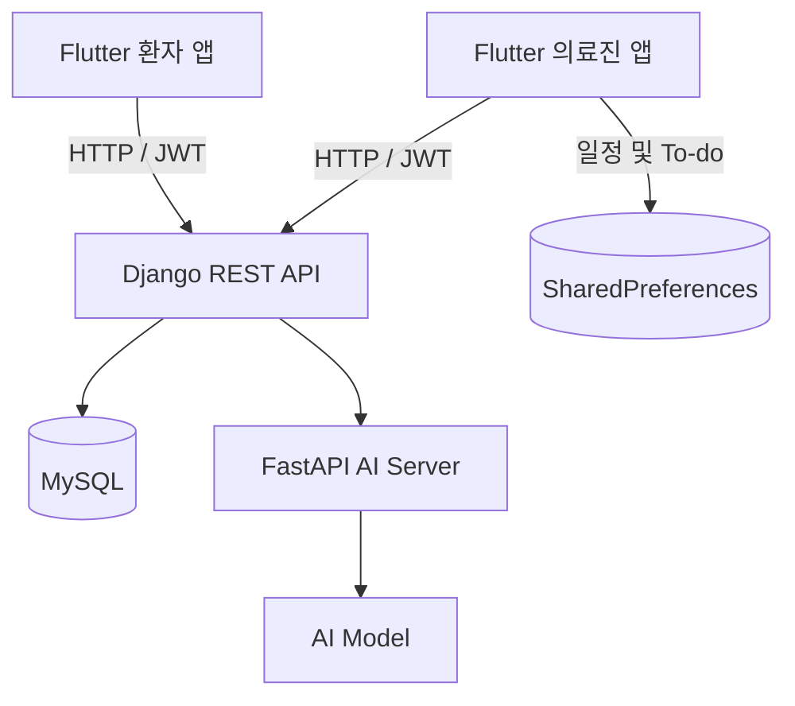
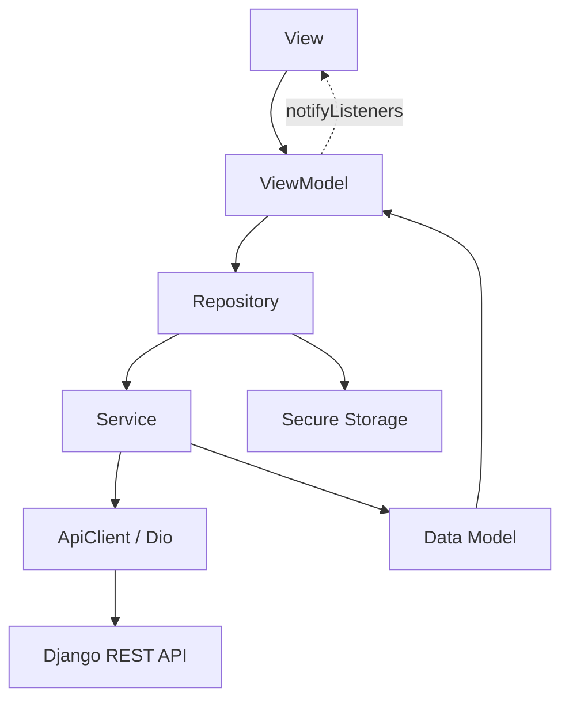
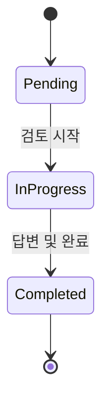
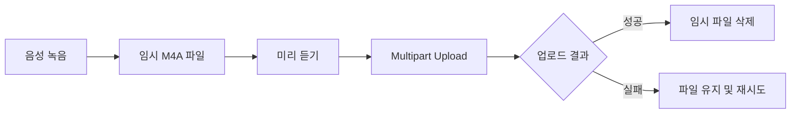

# VENA — 의료진 모바일 업무 지원 플랫폼

> 관상동맥 협착 탐지 모델 기반 의사·환자 양방향 헬스케어 플랫폼

분산된 의료진 업무를 하나의 모바일 환경으로 통합하고,
환자 정보 조회부터 의료진 간 소통, 협진, 일정 관리,
진료 기록까지 연결하는 모바일 헬스케어 프로젝트입니다.

---

## 1. Project Overview

| 항목 | 내용 |
|---|---|
| 프로젝트명 | VENA |
| 팀명 | 맥(脈)가이버 |
| 프로젝트 유형 | 팀 프로젝트 |
| 개발 인원 | 4명 |
| 개인 개발 기간 | 1주 |
| 담당 영역 | 의료진 Flutter 앱 및 REST API 연동 |
| 주요 사용자 | 의료진 및 환자 |
| 개발 환경 | Flutter, Django, FastAPI, MySQL |

### 개발 배경

기존 의료진 업무는 환자 정보 조회, 의료진 간 소통,
협진 요청, 일정 관리 및 진료 기록이 여러 환경에 분산되어
업무 흐름의 연속성을 유지하기 어렵다는 문제가 있었습니다.

또한 PC 중심의 의료 업무 환경에서는 이동 중 환자 정보를
확인하거나 다른 의료진에게 협진을 요청하는 데 제약이 있었습니다.

VENA는 이러한 문제를 개선하기 위해 의료진과 환자가
각자의 모바일 애플리케이션을 통해 의료 서비스에
접근할 수 있도록 설계되었습니다.

### 프로젝트 목표

- 의료진 업무의 모바일 환경 통합
- 환자 정보 및 검사 데이터 접근성 개선
- 의료진 간 채팅 및 비동기 협진 지원
- AI 분석 결과와 의료 업무 흐름 연결
- 일정 및 진료 기록 관리 효율화

---

## 2. My Contributions

의료진용 Flutter 애플리케이션에서 환자 데이터 조회,
REST API 연동, 비동기 협진, 채팅 상태 관리,
로컬 데이터 저장 및 음성 파일 처리 기능을 담당했습니다.

| 담당 영역 | 주요 구현 내용 |
|---|---|
| 홈 대시보드 | 기능별 ViewModel 데이터 통합 및 업무 현황 표시 |
| 환자 관리 | 환자 목록 API 연동, 검색 및 상세 정보 조회 |
| 채팅 | 채팅방 생성·조회, 메시지 송수신 및 읽음 상태 관리 |
| 협진 | 협진 요청, 수신·발신 목록 조회, 상태 변경 및 답변 |
| 캘린더 | 일정 등록·수정·삭제, 기간별 일정 표시 |
| To-do List | 할 일 등록, 완료 상태 관리, 삭제 및 복원 |
| 텍스트 메모 | 환자별 메모 등록·조회·수정·삭제 |
| 음성 메모 | 녹음, 미리 듣기, 파일 업로드 및 재생 |
| 공통 UI | 라이트·다크 모드 및 공통 내비게이션 구성 |

### Engineering Focus

단순한 모바일 화면 구현을 넘어 다음과 같은
데이터 처리 및 애플리케이션 구조에 집중했습니다.

- ViewModel, Repository, Service 기반 책임 분리
- Dio 기반 REST API 연동
- Bearer Token을 이용한 인증 요청
- JSON 응답 파싱 및 데이터 모델 변환
- 비동기 요청의 로딩·오류·완료 상태 관리
- SharedPreferences 기반 로컬 데이터 영속화
- Multipart 기반 음성 파일 전송
- Provider 및 ChangeNotifier 기반 상태 관리

---

## 3. Tech Stack

### Mobile Application

| 기술 | 사용 목적 |
|---|---|
| Flutter | 모바일 애플리케이션 개발 |
| Dart | 애플리케이션 로직 구현 |
| Provider | 의존성 주입 및 상태 공유 |
| ChangeNotifier | 상태 변경 및 화면 갱신 |
| GoRouter | 화면 이동 및 공통 레이아웃 구성 |
| Dio | REST API 및 Multipart 요청 |
| SharedPreferences | 일정 및 To-do 데이터 저장 |
| Flutter Secure Storage | 인증 토큰 저장 및 조회 |
| TableCalendar | 캘린더 및 기간별 일정 표시 |
| Record | 음성 녹음 |
| Just Audio | 로컬 및 서버 음성 파일 재생 |
| Path Provider | 임시 음성 파일 경로 관리 |

### Team Backend & AI

| 기술 | 사용 목적 |
|---|---|
| Django | 의료 서비스 REST API |
| MySQL | 서버 업무 데이터 관리 |
| FastAPI | AI 모델 추론 서비스 |
| JWT | 사용자 인증 |
| YOLOv11 | 관상동맥 영상 분석 |
| InceptionV3 | 영상 분류 |

서버 및 AI 모델은 팀 전체 시스템의 구성 요소이며,
개인 담당 범위는 의료진 모바일 애플리케이션과
해당 서비스의 API 연동 및 데이터 처리입니다.

---

## 4. System Architecture

의료진 및 환자 애플리케이션은 Django REST API를
통해 서버 데이터에 접근합니다.

AI 분석은 별도의 FastAPI 모델 서버와 연계되며,
일정 및 To-do 데이터는 의료진 앱의 로컬 저장소에서
관리하도록 구성되었습니다.

### Mobile Application Architecture

서버 연동 기능에서는 화면과 데이터 요청 로직을
분리하여 각 계층의 책임을 구분했습니다.

| 계층 | 역할 |
|---|---|
| View | 사용자 입력 및 화면 표시 |
| ViewModel | 비즈니스 흐름 및 화면 상태 관리 |
| Repository | 인증 토큰 조회 및 데이터 접근 중계 |
| Service | API 요청 및 응답 처리 |
| Model | 서버 응답의 객체 변환 |
| ApiClient | 공통 HTTP 요청 환경 구성 |

캘린더 및 To-do와 같은 로컬 저장 기능은
별도의 서버 요청 없이 ViewModel 또는 화면 상태와
SharedPreferences를 이용해 관리합니다.

---

## 5. Core Features

### 5.1 Patient Management

- 환자 목록 및 상세 정보 API 연동
- 환자 검색 기능
- 환자 검사 정보 및 AI 결과 데이터 처리
- 서버 응답 형식에 대응하는 JSON 파싱
- 최근 조회 환자 상태 관리

### 5.2 Messaging System

- 의료진 간 채팅방 생성 및 조회
- 텍스트 메시지 전송
- 환자·검사·AI 결과·협진 참조 정보 공유
- 메시지 읽음 및 공유 정보 확인 상태 관리
- 5초 주기 Polling 기반 채팅 목록 갱신
- 채팅방별 미확인 메시지 수 합산

현재 채팅 목록 갱신은 REST API 기반 Polling 방식이며,
WebSocket 기반 실시간 통신은 개선 과제로 구분했습니다.

### 5.3 Consultation Workflow

- 환자 및 협진 대상 의료진 선택
- 협진 사유, 우선순위 및 참고 정보 전달
- 수신·발신 협진 요청 조회
- 협진 검토 상태 변경
- 답변 등록 및 완료 처리

위 다이어그램은 의료진 앱의 대표적인 협진 업무 흐름을
표현한 것으로, 서버의 엄격한 상태 전이 검증까지
확인된 것은 아닙니다.

### 5.4 Schedule & Task Management

- 일정 등록·수정·삭제
- 시작일 및 종료일 기반 일정 표시
- 일정별 색상 관리
- 홈 화면과 전체 캘린더의 일정 데이터 공유
- To-do 완료 상태 관리
- 삭제 후 Undo 기능
- JSON 직렬화 및 로컬 저장

### 5.5 Clinical Memo System

- 환자별 텍스트 메모 CRUD
- 음성 녹음 및 일시정지·재개
- 녹음 파일 미리 듣기
- Multipart 기반 서버 업로드
- 인증 헤더를 이용한 서버 음성 파일 재생
- 업로드 성공 후 임시 파일 정리
- 업로드 실패 시 재시도를 위한 파일 유지

### 5.6 Dashboard & Application State

- 기능별 ViewModel 구독
- 환자·협진·예약·판독 기록 현황 통합
- Future.wait를 이용한 비동기 데이터 동시 조회
- ChangeNotifier 기반 화면 상태 갱신
- GoRouter 및 ShellRoute 기반 공통 레이아웃
- 라이트·다크 모드 전환
- 앱 생명주기에 따른 데이터 갱신 및 Timer 정리

---

## 6. Data Management Strategy

데이터의 사용 목적에 따라 서버 데이터와
로컬 데이터를 구분하여 관리했습니다.

| 데이터 | 관리 위치 | 접근 방식 |
|---|---|---|
| 환자 정보 | 서버 | REST API |
| 채팅 및 메시지 | 서버 | REST API |
| 협진 요청 및 답변 | 서버 | REST API |
| 텍스트 메모 | 서버 | REST API |
| 음성 메모 | 서버 | Multipart / HTTP |
| 의료진 일정 | 로컬 | SharedPreferences |
| To-do List | 로컬 | SharedPreferences |
| 인증 토큰 | 로컬 보안 저장소 | Flutter Secure Storage |
| 녹음 임시 파일 | 기기 임시 디렉터리 | File I/O |
| 테마 설정 | 메모리 | ChangeNotifier |

환자 정보와 의료진 간 공유가 필요한 데이터는
서버 API를 통해 접근하고, 개인 일정 및 할 일은
로컬 저장소를 활용하는 구조입니다.

로컬 일정 및 To-do는 현재 기기 중심으로 관리되므로
기기 변경 및 재설치 시 데이터 복원에 한계가 있습니다.

---

## 7. Technical Challenges

| 기술적 과제 | 적용한 처리 방식 |
|---|---|
| 여러 기능의 데이터 통합 | Provider 기반 ViewModel 구독 |
| 서버 응답 형식 차이 | JSON 응답 파싱 및 모델 변환 |
| 중복 요청 및 전송 방지 | 로딩·전송 상태 플래그 |
| 채팅 목록 갱신 | Timer 기반 주기적 조회 |
| 협진 업무 상태 관리 | 요청 상태 및 답변 데이터 관리 |
| 기간 일정 표시 | 시작일·종료일 포함 범위 비교 |
| 앱 재실행 후 로컬 데이터 유지 | SharedPreferences 및 JSON |
| 음성 파일 전송 | Multipart 요청 |
| 음성 파일 관리 | 임시 파일 생성·재생·정리 |
| 다크 모드 가독성 | 공통 ThemeData 및 색상 보정 |

---

## 8. Limitations & Future Improvements

현재 소스 코드와 프로젝트 발표 자료를 바탕으로
확인한 한계 및 개선 방향입니다.

| 개선 영역 | 개선 방향 |
|---|---|
| 채팅 통신 | WebSocket 기반 이벤트 전달 검토 |
| Polling | 백그라운드 중단 및 요청 주기 최적화 |
| 로컬 데이터 | 사용자별 저장소 분리 및 서버 동기화 |
| 인증 | 토큰 만료 및 갱신 처리 강화 |
| 네트워크 보안 | HTTPS 및 민감 데이터 로그 제한 |
| 상태 관리 | 동시 요청 및 응답 순서 제어 |
| 음성 메모 | STT 및 AI 요약 기능 확장 |
| 테마 설정 | 사용자 설정 영속화 |
| 데이터 모델 | 고유 ID 및 타입 안정성 강화 |
| 테스트 | 단위·통합·UI 테스트 확대 |

위 항목은 개선 제안이며 실제 운영 환경에서 발생한
장애나 구현 완료된 기능을 의미하지 않습니다.

---

## 9. Technical Documentation

| 문서 | 주요 내용 |
|---|---|
| [System Architecture](./architecture.md) | 전체 시스템 및 모바일 계층 구조 |
| [Patient Management](./patient-management.md) | 환자 조회 및 데이터 처리 |
| [Messaging System](./messaging.md) | 채팅, 읽음 상태 및 Polling |
| [Consultation Workflow](./consultation.md) | 비동기 협진 요청 및 답변 |
| [Schedule & Task](./schedule-task.md) | 일정 및 To-do 로컬 저장 |
| [Clinical Memo System](./memo-system.md) | 텍스트·음성 메모 및 파일 처리 |
| [Data & State Management](./data-state-management.md) | API, 인증 및 상태 관리 |
| [Troubleshooting](./troubleshooting.md) | 기술적 문제 및 개선 방향 |

---

## 10. Engineering Evidence

개인 기여 내용은 팀 프로젝트의 발표 자료와
Flutter 의료진 앱 저장소의 Git 이력 및
소스 코드 분석을 바탕으로 정리했습니다.

| 항목 | 확인 내용 |
|---|---|
| 개인 개발 기간 | 1주 |
| 개인 작성 커밋 | 72개 (Merge 포함) |
| 개인 Non-Merge 커밋 | 36개 |
| 분석 범위 | 의료진 Flutter 애플리케이션 |
| 검증 방식 | Git 이력 및 소스 코드 정적 분석 |

커밋 수는 개인 이메일을 기준으로 전체 브랜치에서
집계한 수치이며, 프로젝트 기여도 비율을 의미하지 않습니다.

본 문서는 실제 소스 코드에서 확인된 구현과
프로젝트 발표 자료를 기반으로 작성되었습니다.

별도의 앱 재빌드, API 통합 테스트 및 운영 환경
성능 측정은 수행하지 않았습니다.

---

## 11. Retrospective

VENA 프로젝트를 통해 모바일 애플리케이션에서
서버 데이터를 요청하고 응답을 처리하는 과정뿐 아니라,
비동기 작업과 화면 상태를 일관되게 관리하는 구조의
중요성을 경험했습니다.

특히 환자 조회, 채팅, 협진 및 음성 메모 기능을 구현하며
API 요청, 인증, 데이터 모델, 파일 전송 및 오류 처리가
사용자 업무 흐름과 직접 연결된다는 점을 이해했습니다.

또한 서버 데이터와 로컬 데이터를 구분하여 관리하면서
데이터의 공유 범위와 저장 목적에 따라 적절한
저장 방식을 선택해야 한다는 점을 학습했습니다.

이러한 경험은 이후 백엔드 시스템의 API 설계와
데이터 관리 구조를 이해하는 기반이 되었습니다.

---

## 12. Resources

- [Flutter Doctor Team Repository](https://github.com/hyunkyung31/Flutter_doctor)
- [Notion Project Portfolio](https://app.notion.com/p/3f60b387fad881a6ac01e8f2871eb6a2)

팀 프로젝트의 전체 소스 코드는 개인 포트폴리오
저장소에 복제하여 공개하지 않습니다.

본 포트폴리오는 개인 담당 영역의 구현 내용,
기술적 구조 및 개선 방향을 중심으로 작성되었습니다.
