# VENA — System Architecture

> 의료진 모바일 애플리케이션의 시스템 구성,
> 계층별 책임 분리 및 데이터 처리 아키텍처

[← 프로젝트 개요로 돌아가기](./README.md)

---

## 1. Architecture Overview

VENA는 의료진과 환자를 위한 모바일 애플리케이션,
업무 데이터를 관리하는 Django 서버,
AI 영상 분석을 수행하는 FastAPI 서버로 구성된
모바일 헬스케어 플랫폼입니다.

개인 담당 영역인 의료진 애플리케이션에서는
화면 구현과 데이터 처리 로직을 분리하고,
서버 데이터와 로컬 데이터를 각각의 목적에 맞게
관리하는 구조를 적용했습니다.

### Architecture Goals

- 화면과 API 요청 로직의 책임 분리
- 기능별 독립적인 상태 관리
- 공통 네트워크 환경 재사용
- 인증 정보 접근 방식 일원화
- 서버 데이터와 로컬 데이터 분리
- 기능 확장 및 유지보수를 고려한 모듈 구성

---

## 2. Overall System Architecture

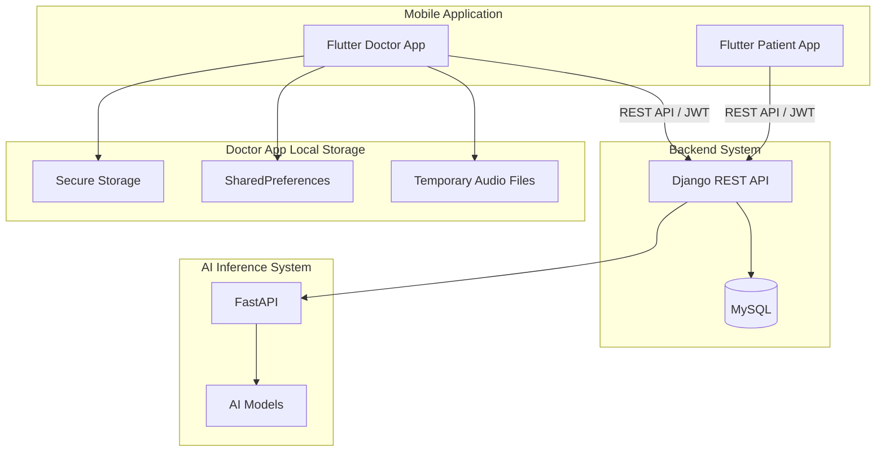

### 시스템 구성 요소

| 구성 요소 | 역할 |
|---|---|
| Flutter Doctor App | 환자 조회, 채팅, 협진, 일정, 메모 및 의료 업무 지원 |
| Flutter Patient App | 환자용 의료 서비스 접근 |
| Django | 인증 및 업무 데이터 API 제공 |
| MySQL | 서버 업무 데이터 관리 |
| FastAPI | AI 모델 추론 서비스 |
| Secure Storage | 인증 토큰 저장 및 조회 |
| SharedPreferences | 일정 및 To-do 데이터 저장 |
| Temporary Directory | 음성 녹음 임시 파일 관리 |

### 개인 담당 범위

전체 시스템 중 의료진 Flutter 애플리케이션의
환자 관리, 채팅, 협진, 캘린더, To-do,
텍스트 및 음성 메모 기능을 담당했습니다.

Django 서버와 AI 모델은 팀 시스템의 구성 요소이며,
본 문서에서는 해당 서버와 연동하는
모바일 애플리케이션의 구조를 중심으로 설명합니다.

---

## 3. Project Directory Structure

의료진 애플리케이션은 기능 중심의 디렉터리 구조와
공통 모듈을 결합하여 구성되었습니다.

다음은 주요 담당 기능과 공통 모듈을 중심으로
정리한 디렉터리 구조입니다.

```text
lib/
├── main.dart
├── app.dart
│
├── core/
│   ├── constants/
│   ├── network/
│   │   ├── api_client.dart
│   │   ├── api_endpoints.dart
│   │   └── dio_interceptor.dart
│   ├── security/
│   ├── storage/
│   │   └── secure_storage.dart
│   ├── theme/
│   │   ├── app_colors.dart
│   │   ├── app_theme.dart
│   │   └── text_styles.dart
│   ├── utils/
│   └── widgets/
│
├── features/
│   ├── auth/
│   ├── home/
│   ├── patient/
│   ├── chat/
│   ├── consultation/
│   ├── calendar/
│   ├── memo/
│   ├── appointment/
│   ├── diagnosis/
│   ├── ai_result/
│   ├── clinical_report/
│   ├── notification/
│   ├── mypage/
│   ├── settings/
│   └── splash/
│
└── routes/
    ├── app_router.dart
    ├── app_shell.dart
    └── route_names.dart
```

### 디렉터리 분리 기준

| 디렉터리 | 책임 |
|---|---|
| core | 네트워크, 인증 저장소, 테마 등 공통 기능 |
| features | 기능별 화면 및 데이터 처리 로직 |
| routes | 전체 화면 이동 및 공통 레이아웃 |
| app.dart | 의존성 주입 및 애플리케이션 초기 구성 |

기능별 코드를 독립적인 디렉터리로 관리하여
관련 화면과 데이터 처리 로직을 함께 확인할 수 있도록
구성했습니다.

공통 네트워크 및 테마 기능은 core 영역으로 분리하여
기능별 중복 구현을 줄이는 구조입니다.

---

## 4. Feature-Based Architecture

환자 관리, 채팅, 협진 및 메모와 같은
서버 연동 기능은 다음과 같은 계층으로 구성됩니다.

```text
features/
└── feature_name/
    ├── model/
    ├── repository/
    ├── service/
    ├── view/
    ├── view_model/
    └── feature_routes.dart
```

모든 기능이 동일한 계층 구조를 사용하는 것은 아닙니다.

캘린더 및 To-do와 같이 로컬 저장소를 사용하는 기능은
서버 연동을 위한 Repository 및 Service 계층 없이
ViewModel 또는 화면 상태에서 데이터를 관리합니다.

### 계층별 책임

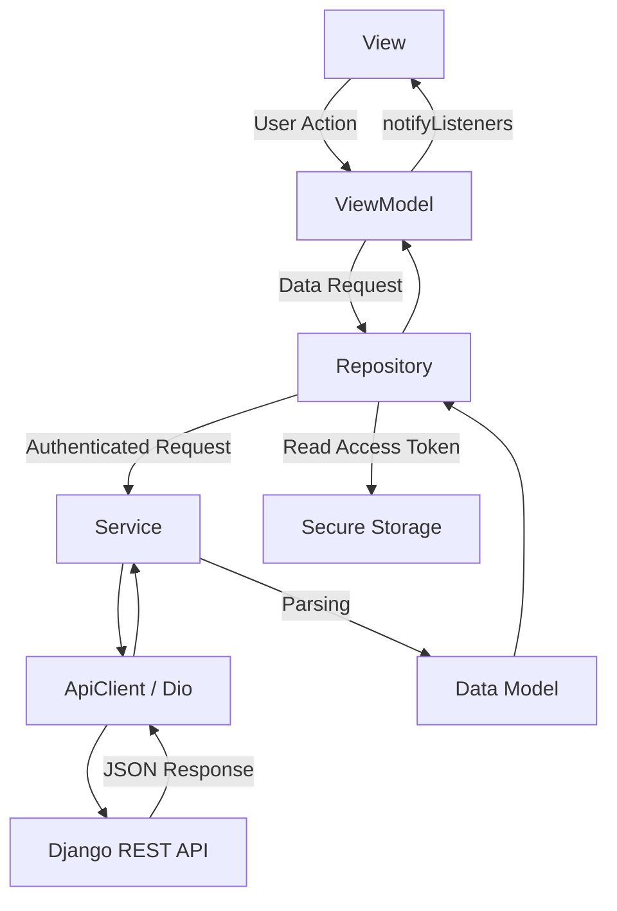

| 계층 | 주요 책임 |
|---|---|
| View | 사용자 입력, 화면 렌더링, 이벤트 전달 |
| ViewModel | 데이터 조회 흐름, 로딩 및 오류 상태 관리 |
| Repository | 인증 정보 확인 및 데이터 접근 중계 |
| Service | HTTP 요청, 응답 파싱 및 오류 변환 |
| Model | 서버 응답의 객체 변환 |
| ApiClient | 공통 HTTP 통신 환경 구성 |

### 계층을 분리한 이유

화면에서 직접 API를 호출하는 방식은
기능이 증가할수록 UI 코드와 네트워크 로직이
서로 강하게 결합될 수 있습니다.

계층을 분리하면 화면은 사용자 입력과 데이터 표시를
중심으로 관리하고, API 요청 및 응답 처리는
별도의 Service에서 담당할 수 있습니다.

Repository는 인증 정보 조회와 데이터 접근을 중계하며,
ViewModel은 요청 결과에 따른 화면 상태를 관리합니다.

이를 통해 기능별 수정 범위를 명확하게 구분하고
공통 네트워크 로직을 재사용할 수 있는 구조를
구성했습니다.

---

## 5. Dependency Injection

애플리케이션의 공통 객체와 기능별 상태 객체는
app.dart의 MultiProvider를 통해 제공됩니다.

### 의존성 구성

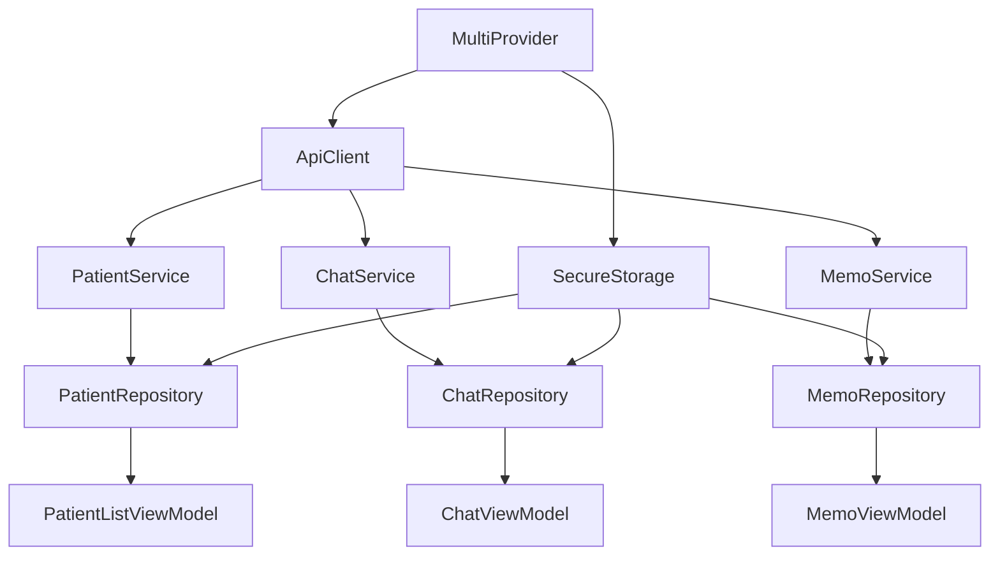

위 다이어그램은 실제 의존성 구성 중
환자, 채팅 및 메모 기능의 주요 연결 관계를
중심으로 단순화한 것입니다.

### 의존성 주입의 목적

- 공통 ApiClient 객체 재사용
- 기능별 Service 및 Repository 연결
- 인증 저장소 접근 방식 통합
- 여러 화면에서 동일한 ViewModel 상태 공유
- 객체 생성 책임과 화면 표시 책임 분리

ChatViewModel은 채팅 기능뿐 아니라
협진 Repository를 통해 의료진 목록을 조회합니다.

이는 기존 의료진 조회 로직을 재사용하는 구조이지만,
기능 간 의존성이 증가할 수 있으므로
공통 의료진 조회 모듈로 분리하는 방안도
향후 개선 방향으로 고려할 수 있습니다.

---

## 6. Network Architecture

### 6.1 Common ApiClient

공통 네트워크 환경은 Dio 기반 ApiClient에서 관리합니다.

| 설정 | 내용 |
|---|---|
| HTTP Client | Dio |
| Base URL | 환경 변수 설정 및 기본 주소 |
| Connection Timeout | 10초 |
| Send Timeout | 15초 |
| Receive Timeout | 15초 |
| 기본 응답 형식 | JSON |
| 인증 방식 | Bearer Token |
| 디버깅 | LogInterceptor |

API 서버 주소는 String.fromEnvironment를 통해
빌드 시점에 지정할 수 있도록 구성되어 있습니다.

공개 포트폴리오에서는 기존 서버의 실제 IP 주소를
노출하지 않습니다.

### 6.2 Endpoint Management

API 경로는 ApiEndpoints에서 공통으로 관리합니다.

| 기능 | 대표 API 경로 |
|---|---|
| 로그인 | /api/login/ |
| 토큰 갱신 | /api/token/refresh/ |
| 사용자 정보 | /api/me/ |
| 환자 목록 | /api/patients/ |
| 환자 상세 | /api/patients/{id}/ |
| 의료진 목록 | /api/doctors/ |
| 협진 | /api/consultations/ |
| 채팅방 | /api/chat/rooms/ |
| 메시지 | /api/chat/rooms/{id}/messages/ |
| 메모 | /api/memos/ |
| 음성 메모 | /api/memos/voice/ |
| 예약 | /api/appointments/ |
| 알림 | /api/notifications/ |

기능별 Service에서 API 경로를 직접 반복 작성하는 대신
공통 Endpoint 정의를 참조하는 구조입니다.

### 6.3 Authentication Flow

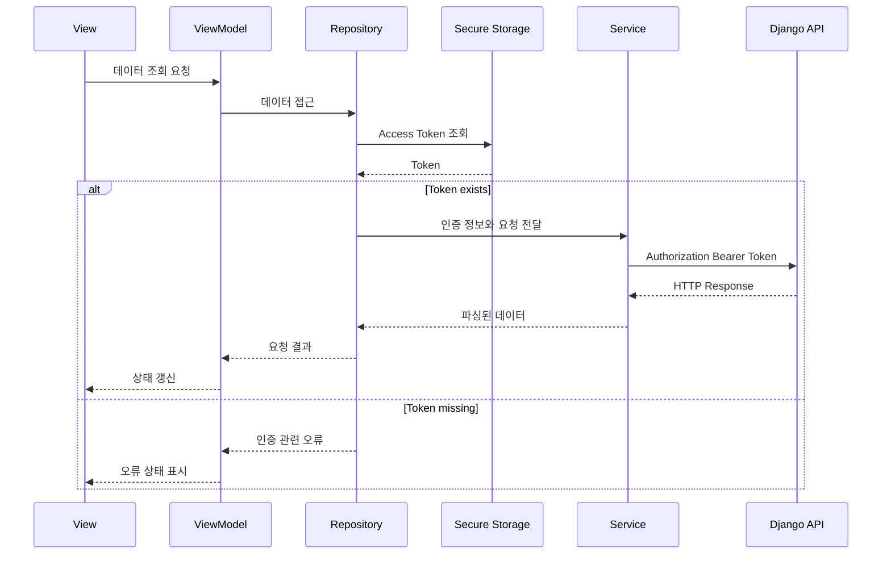

Repository는 저장된 Access Token을 조회하고,
인증 정보가 없는 경우 요청을 진행하지 않도록
처리합니다.

Service에서는 Authorization 헤더에
Bearer Token을 포함하여 서버에 요청합니다.

### 인증 구조의 검증 범위

토큰 조회 및 인증 헤더 전달 구조는
의료진 앱의 소스 코드에서 확인했습니다.

다만 공통 dio_interceptor.dart에는
자동 토큰 갱신 로직이 확인되지 않았습니다.

따라서 모든 API 요청에서 토큰 만료 시
자동 갱신 및 재요청이 수행된다고
설명하지 않습니다.

---

## 7. API Request Lifecycle

환자 목록 조회를 예시로
서버 데이터 요청의 전체 흐름을 정리했습니다.

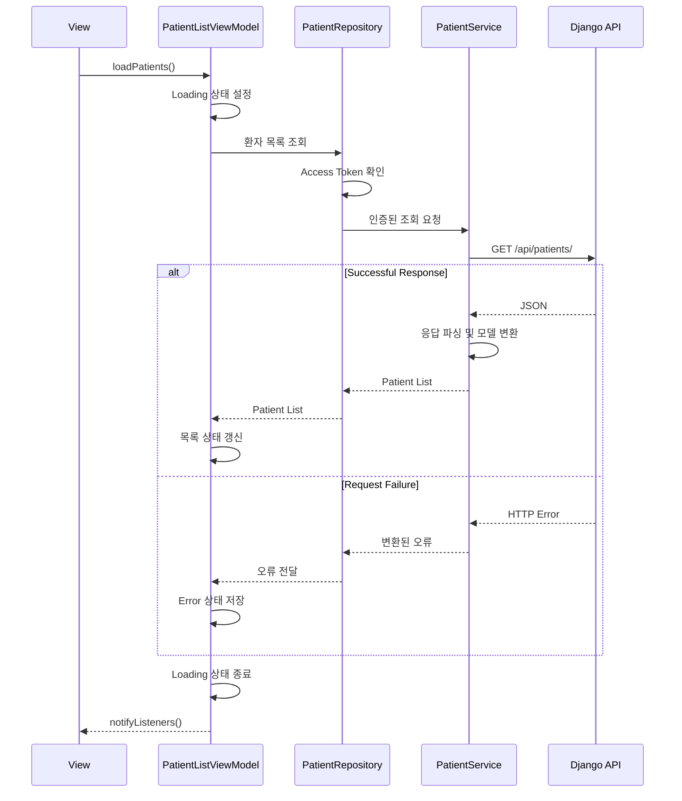

### 요청 처리 단계

1. 화면에서 데이터 조회 이벤트를 전달합니다.
2. ViewModel에서 요청 상태를 관리합니다.
3. Repository에서 인증 정보를 확인합니다.
4. Service에서 API를 호출합니다.
5. 서버 응답을 데이터 모델로 변환합니다.
6. ViewModel에서 결과 또는 오류를 저장합니다.
7. notifyListeners를 통해 화면 상태를 갱신합니다.

이 구조는 환자 조회뿐 아니라 채팅, 협진 및 메모 등
서버 연동 기능에서도 공통적으로 사용됩니다.

단, 기능별 로딩 상태 및 오류 처리 방식에는
일부 차이가 존재합니다.

---

## 8. Data Storage Architecture

데이터는 사용 목적과 공유 범위에 따라
서버 저장소, 로컬 저장소, 임시 파일 및 메모리 상태로
구분하여 관리합니다.

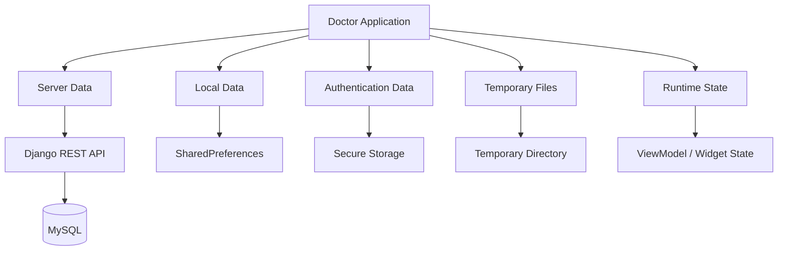

### 데이터별 저장 전략

| 데이터 | 관리 방식 | 주요 목적 |
|---|---|---|
| 환자 정보 | 서버 API | 의료 업무 데이터 조회 |
| 채팅 메시지 | 서버 API | 의료진 간 정보 공유 |
| 협진 요청 | 서버 API | 요청 및 답변 상태 관리 |
| 텍스트 메모 | 서버 API | 환자별 기록 관리 |
| 음성 메모 | 서버 API | 음성 파일 등록 및 조회 |
| 캘린더 | SharedPreferences | 개인 일정 저장 |
| To-do | SharedPreferences | 개인 업무 상태 저장 |
| 인증 토큰 | Secure Storage | 인증 요청 |
| 임시 녹음 파일 | Temporary Directory | 녹음 및 업로드 준비 |
| 테마 | 메모리 | 화면 스타일 변경 |
| 최근 조회 환자 | 메모리 | 조회 이력 상태 관리 |

### 8.1 Server Data

여러 의료진 간 공유가 필요하거나
환자 정보와 연결되는 데이터는
서버 API를 통해 접근합니다.

모바일 애플리케이션은 서버 데이터베이스에
직접 접근하지 않고 Django API를 이용합니다.

### 8.2 Local Data

캘린더 및 To-do는 SharedPreferences에
JSON 문자열 형태로 저장합니다.

서버 요청 없이 개인 업무 데이터를 관리할 수 있지만,
다른 기기와의 동기화 및 사용자별 데이터 분리에는
한계가 있습니다.

### 8.3 Temporary Files

음성 녹음은 기기의 임시 디렉터리에
M4A 파일로 생성됩니다.

녹음 결과를 미리 재생하거나 서버에 업로드할 수 있으며,
업로드 성공 이후 임시 파일을 정리합니다.

### 8.4 Runtime State

로딩 상태, 오류 메시지, 선택된 환자,
채팅방 상태 및 테마 설정 등은
ViewModel 또는 Widget 상태에서 관리합니다.

모든 상태가 영속적으로 저장되는 것은 아니며,
앱 종료 시 초기화되는 데이터도 존재합니다.

---

## 9. State Management Architecture

VENA에서는 Provider와 ChangeNotifier를 이용해
기능별 상태를 관리합니다.

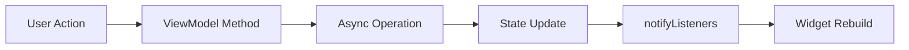

### 상태 접근 방식

| 방식 | 사용 목적 |
|---|---|
| context.watch | 상태 변경 구독 및 화면 갱신 |
| context.read | 이벤트 처리 및 메서드 호출 |
| notifyListeners | 상태 변경 알림 |
| setState | 화면 내부의 지역 상태 변경 |

### 주요 상태 객체

| ViewModel | 관리 데이터 |
|---|---|
| AuthViewModel | 인증 및 의료진 정보 |
| PatientListViewModel | 환자 목록 및 최근 조회 환자 |
| PatientDetailViewModel | 환자 상세 및 검사 정보 |
| ChatViewModel | 채팅방, 메시지, 읽음 상태 |
| ConsultationViewModel | 협진 요청 및 답변 상태 |
| CalendarViewModel | 일정 및 선택 날짜 |
| MemoViewModel | 메모 목록, 선택 메모, 저장 상태 |
| SettingsViewModel | 라이트·다크 모드 |

### 상태 관리의 설계 목적

화면에서 직접 모든 데이터를 관리하는 대신
기능별 ViewModel을 활용하여
데이터 조회 및 요청 상태를 관리합니다.

다만 To-do와 녹음 화면의 임시 상태처럼
특정 화면에만 필요한 데이터는
StatefulWidget의 지역 상태를 사용합니다.

---

## 10. Dashboard Data Integration

홈 화면에서는 여러 ViewModel의 데이터를
하나의 대시보드에 통합합니다.

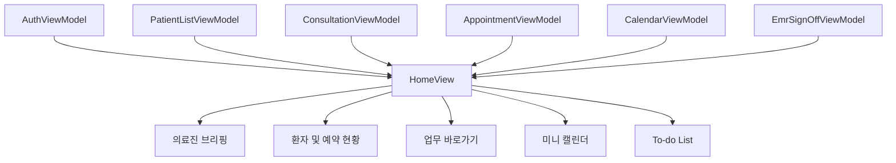

홈 화면은 기존 ViewModel을 구독하여
기능별 데이터 변경을 화면에 반영합니다.

환자 수, 대기 협진 수, 활성 예약 수,
판독 기록 수 등을 각 상태 객체에서 조회합니다.

새로운 분석 건수 및 대기 환자 수는
현재 코드에서 0으로 고정되어 있으므로
서버 집계가 완료된 기능과 구분합니다.

### Concurrent Data Refresh

홈 화면의 Pull-to-Refresh 기능은
Future.wait를 사용하여 여러 조회 작업을
함께 시작하도록 구성되어 있습니다.

다음은 실제 구현의 핵심 부분입니다.

```dart
await Future.wait([
  patientListViewModel.refreshPatients(),
  consultationViewModel.refreshReceivedRequests(),
  appointmentViewModel.loadAppointments(),
  signOffViewModel.loadSignOffs(),
]);
```

각 조회 작업을 순차적으로 기다리지 않고
비동기적으로 함께 진행하도록 구성했습니다.

이는 독립적인 네트워크 요청의 대기 시간을
중첩할 수 있는 방식입니다.

실제 응답 시간 및 성능 개선 수치는
별도로 측정하지 않았습니다.

---

## 11. Routing Architecture

화면 이동은 GoRouter를 사용하며,
기능별 라우트를 AppRouter에서 통합합니다.

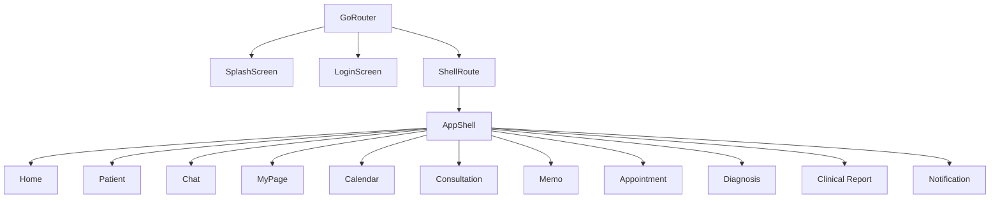

### 공통 레이아웃

AppShell은 다음 요소를 관리합니다.

- 공통 상단 AppBar
- 하단 NavigationBar
- 알림 미확인 수 표시
- 채팅 미확인 메시지 수 표시
- 테마 변경 버튼
- 현재 경로에 따른 선택 탭
- 채팅 목록 Polling

로그인 및 스플래시 화면은 ShellRoute 외부에
배치되어 공통 내비게이션이 표시되지 않습니다.

일부 기능 화면에서는 경로에 따라
공통 상단바를 숨기도록 구성했습니다.

### 화면 이동 방식

| 방식 | 사용 목적 |
|---|---|
| context.go | 주요 하단 탭 이동 |
| context.push | 세부 화면 추가 |
| context.pushNamed | 이름 기반 화면 이동 |
| uri.path | 현재 경로 및 선택 탭 확인 |

현재 AppRouter 정의에서는
전역 인증 redirect가 확인되지 않았습니다.

따라서 라우팅 구조 자체가 모든 비인가 접근을
차단한다고 판단하지 않습니다.

---

## 12. Application Lifecycle

AppShell은 WidgetsBindingObserver를 사용하여
앱 생명주기 이벤트를 처리합니다.

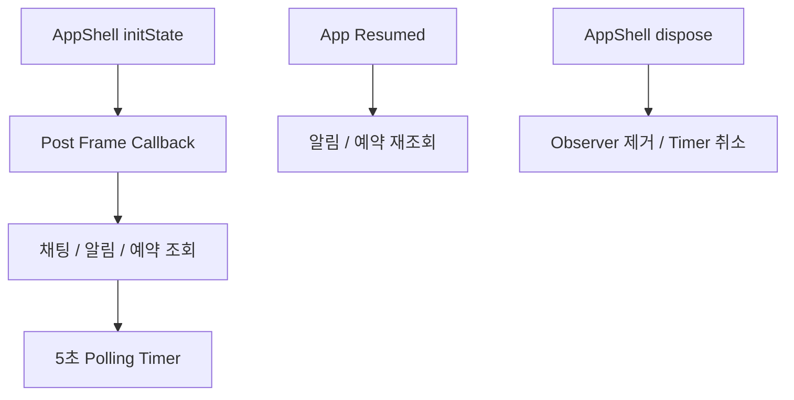

### 생명주기별 처리

| 시점 | 동작 |
|---|---|
| initState | 생명주기 Observer 등록 |
| 첫 프레임 이후 | 채팅, 알림 및 예약 조회 |
| Timer.periodic | 5초마다 채팅 목록 조회 시도 |
| resumed | 알림 및 예약 재조회 |
| dispose | Observer 제거 및 Timer 취소 |

### Polling 기반 상태 갱신

채팅 목록은 AppShell에서 5초 주기로
조회하도록 구성되어 있습니다.

조회된 채팅방의 미확인 메시지 수를 합산하여
하단 채팅 탭에 표시합니다.

현재 구현은 REST API 기반 Polling이며,
WebSocket 기반 이벤트 전달 구조는 아닙니다.

또한 백그라운드 전환 시 Timer를
명시적으로 중단하는 로직은 확인되지 않았습니다.

---

## 13. Theme Architecture

공통 테마는 AppColors, AppTheme,
SettingsViewModel을 중심으로 구성됩니다.

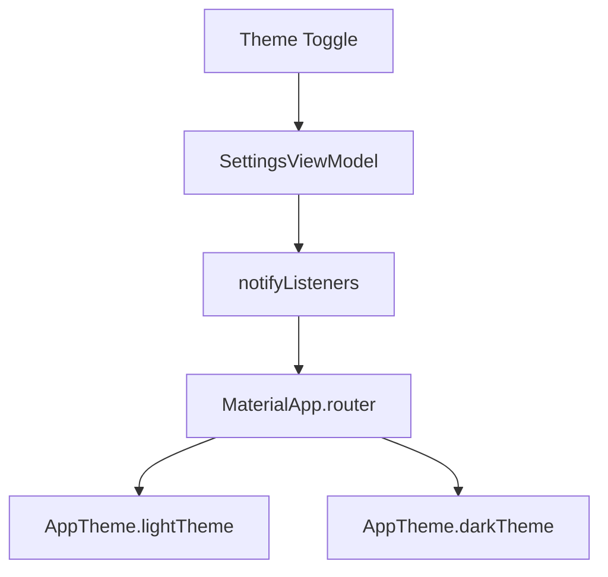

| 구성 요소 | 역할 |
|---|---|
| AppColors | 공통 색상 상수 |
| AppTheme | 라이트·다크 ThemeData 정의 |
| SettingsViewModel | 현재 테마 상태 관리 |
| MaterialApp.router | 선택된 테마 적용 |

홈 화면에서는 다크 모드의 아이콘 가독성을
고려하여 Color.lerp를 사용한 색상 보정도
적용했습니다.

테마 상태는 현재 메모리에서 관리되며,
앱 재실행 이후 설정을 복원하는 저장 로직은
확인되지 않았습니다.

---

## 14. Architecture Decisions & Trade-offs

### 14.1 Feature-Based Directory

선택한 구조:

- 기능별 디렉터리 구성
- 공통 모듈과 기능별 코드 분리

장점:

- 관련 코드의 탐색 및 수정이 용이
- 기능 단위의 책임 구분
- 공통 네트워크 및 테마 재사용

한계:

- 기능 간 의존성이 증가할 가능성
- 기능별 계층 구조의 일관성 차이

### 14.2 Layered API Integration

선택한 구조:

- ViewModel, Repository, Service 분리

장점:

- UI와 네트워크 로직의 결합 감소
- 인증 및 데이터 처리 책임 구분
- 기능별 상태 관리

한계:

- 단순한 기능에도 계층이 증가할 수 있음
- 계층별 오류 및 데이터 변환 규칙 관리 필요

### 14.3 REST API Polling

현재 구현:

- 채팅 목록 5초 주기 조회

장점:

- 기존 REST API를 활용할 수 있음
- 별도의 지속 연결 없이 목록 갱신 가능

한계:

- 데이터 변경 여부와 관계없이 조회
- 네트워크 및 배터리 사용량 증가 가능성
- 즉각적인 이벤트 전달에 한계

### 14.4 Local Persistence

현재 구현:

- 일정 및 To-do를 SharedPreferences에 저장

장점:

- 서버 요청 없이 데이터 접근 가능
- 비교적 단순한 저장 및 복원 구조

한계:

- 기기 간 동기화 미지원
- 사용자별 데이터 격리 부족
- 복잡한 데이터 조회 및 관계 관리에 부적합

### 14.5 Shared Application State

현재 구현:

- MultiProvider를 통한 기능별 ViewModel 제공

장점:

- 여러 화면에서 데이터 상태 공유
- 홈 화면과 세부 기능 간 데이터 재사용

한계:

- 공유 상태의 조회 범위 충돌 가능성
- 비동기 요청의 응답 순서 관리 필요
- 기능별 상태 초기화 및 생명주기 관리 필요

위 내용은 현재 구현을 분석하여 정리한
설계상 장점과 기술적 절충점입니다.

개발 당시 모든 대안을 공식적으로 비교하거나
성능 검증을 수행했다는 의미는 아닙니다.

---

## 15. Security Considerations

의료 데이터를 다루는 애플리케이션이라는 점에서
인증 정보와 데이터 접근 방식은 중요한 고려 사항입니다.

### 확인된 구현

- Secure Storage 기반 인증 토큰 접근
- Bearer Token 기반 API 요청
- 인증 정보 누락 시 요청 제한
- 인증 헤더를 이용한 음성 파일 접근
- 팀 공통 화면 보호 구성

### 개선이 필요한 영역

| 영역 | 개선 방향 |
|---|---|
| HTTP 통신 | HTTPS 기반 암호화 통신 |
| API 로그 | 인증 헤더 및 환자 정보 마스킹 |
| 토큰 만료 | 공통 갱신 및 재요청 정책 |
| 화면 접근 | 인증 기반 Route Guard 검토 |
| 로컬 저장 | 사용자별 데이터 분리 |
| 미디어 URL | 허용된 서버 주소 검증 |
| 서버 권한 | 리소스별 접근 권한 검증 |

특히 현재 공통 네트워크 설정의 LogInterceptor는
요청 및 응답 정보를 기록할 수 있으므로
운영 환경에서는 민감 데이터 노출을 방지하는
별도의 로그 정책이 필요합니다.

모바일 앱의 인증 헤더 전달만으로
서버의 접근 권한 검증이나 의료 정보 보안이
완전히 보장되는 것은 아닙니다.

---

## 16. Architecture Improvements

향후 확장 시 다음과 같은 구조를 고려할 수 있습니다.

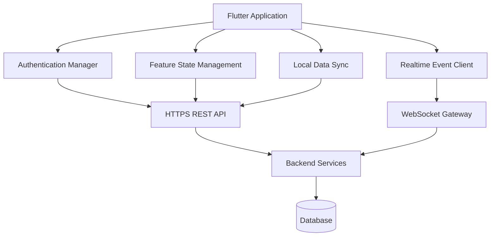

### 개선 우선순위

| 우선순위 | 개선 항목 | 목적 |
|---|---|---|
| P1 | HTTPS 및 민감 로그 제한 | 의료 정보 보호 |
| P1 | 인증 토큰 갱신 정책 | 인증 요청 안정성 |
| P1 | 사용자별 로컬 데이터 분리 | 데이터 격리 |
| P2 | 비동기 요청 중복 및 순서 제어 | 상태 일관성 |
| P2 | Polling 생명주기 최적화 | 불필요한 요청 감소 |
| P2 | WebSocket 도입 검토 | 메시지 전달 개선 |
| P3 | 일정 및 To-do 서버 동기화 | 기기 간 데이터 복원 |
| P3 | 기능별 테스트 확대 | 유지보수 안정성 |

위 아키텍처는 현재 구현이 아닌
향후 개선 방향을 표현한 제안입니다.

---

## 17. Engineering Evidence

아키텍처 분석에 사용한 주요 소스 파일입니다.

| 소스 파일 | 확인 내용 |
|---|---|
| lib/app.dart | MultiProvider 및 앱 초기 구성 |
| lib/core/network/api_client.dart | Dio 공통 통신 설정 |
| lib/core/network/api_endpoints.dart | API 경로 관리 |
| lib/core/network/dio_interceptor.dart | 공통 인터셉터 구현 범위 |
| lib/core/storage/secure_storage.dart | 인증 저장소 구성 |
| lib/routes/app_router.dart | 기능별 라우트 통합 |
| lib/routes/app_shell.dart | 공통 UI 및 Polling |
| lib/features/home/view/home_view.dart | 대시보드 상태 통합 |
| lib/features/settings/view_model/settings_view_model.dart | 테마 상태 관리 |
| lib/core/theme/app_theme.dart | 라이트·다크 테마 |
| lib/core/theme/app_colors.dart | 공통 색상 정의 |

### 개인 기여 관련 Git 이력

| Commit | 주요 작업 |
|---|---|
| 4b69e07 | 공통 앱 및 라우팅 구성 |
| 35ca816 | 라이트·다크 테마 |
| c6863cc | 홈 화면 구성 |
| a1498f4 | 공통 상단·하단바 및 마이페이지 |
| 77a9ee0 | 환자 목록 및 상세 API 연동 |
| de2ee84 | 채팅 목록 및 메시지 API 연동 |
| d4b2909 | 협진 요청 및 의료진 목록 연동 |
| 596d616 | 음성 녹음 및 최근 메모 기능 |

커밋 이력은 개인 담당 기능의 개발 근거로
활용하며, 전체 시스템의 단독 개발을
의미하지 않습니다.

---

## 18. Validation Scope

본 문서는 다음 자료를 기반으로 작성했습니다.

- 팀 프로젝트 최종 발표 자료
- Flutter 의료진 앱 소스 코드
- 개인 작성 Git 커밋 이력
- 공통 네트워크 및 상태 관리 구조
- 기능별 API 연동 및 데이터 모델

### 검증 범위

| 항목 | 검증 방식 |
|---|---|
| 시스템 구성 | 발표 자료 및 소스 코드 |
| 모바일 계층 구조 | 소스 코드 정적 분석 |
| API 요청 경로 | Endpoint 및 Service 코드 |
| 의존성 구성 | app.dart 분석 |
| 상태 관리 | ViewModel 및 View 코드 |
| 라우팅 | AppRouter 및 AppShell 분석 |
| 개인 기여 | Git 이력 및 발표 자료 |

실제 서버의 내부 데이터베이스 스키마,
서버 권한 검증, 운영 환경 성능,
네트워크 부하 및 앱 재빌드 결과는
별도로 검증하지 않았습니다.

---

## 19. Related Documentation

- [프로젝트 개요](./README.md)
- [환자 관리 시스템](./patient-management.md)
- [채팅 시스템](./messaging.md)
- [비동기 협진 시스템](./consultation.md)
- [일정 및 To-do](./schedule-task.md)
- [텍스트 및 음성 메모](./memo-system.md)
- [데이터 및 상태 관리](./data-state-management.md)
- [문제 해결 및 개선 방향](./troubleshooting.md)

---

[← 프로젝트 개요로 돌아가기](./README.md)
