# VENA — Asynchronous Consultation System

> 의료진 간 비동기 협진 요청,
> 업무 상태 관리 및 소견 전달 시스템

[← 프로젝트 개요로 돌아가기](./README.md)

---

## 1. Overview

비동기 협진 시스템은 의료진이 다른 의료진에게
환자 관련 검토를 요청하고, 요청을 받은 의료진이
관련 정보를 확인한 후 소견을 전달할 수 있도록
구성한 기능입니다.

일반적인 채팅 기능이 의료진 간 소통에
초점을 맞춘다면, 협진 기능은 특정 환자에 대한
요청과 검토, 답변이라는 업무 흐름을 관리하는 데
목적이 있습니다.

의료진이 동시에 접속하지 않아도
서버에 등록된 협진 요청을 조회하고
이후 답변을 전달할 수 있는 구조입니다.

### Implementation Goals

- 협진 대상 환자 정보 연결
- 의료진 목록 및 진료과별 의료진 조회
- 협진 요청 데이터 구성
- 협진 사유 및 우선순위 전달
- 받은 협진과 보낸 협진 분리
- 협진 요청 상태 관리
- 의료진 소견 등록
- 서버 응답 기반 데이터 갱신
- 비동기 요청 및 오류 상태 관리
- 대기 중인 협진 요청 수 집계

---

## 2. My Contributions

| 담당 기능 | 구현 내용 |
|---|---|
| 협진 요청 | 환자 및 대상 의료진 기반 요청 구성 |
| 의료진 조회 | 의료진 목록 API 연동 |
| 의료진 필터 | 진료과별 의료진 데이터 분류 |
| 협진 목록 | 받은 요청과 보낸 요청 관리 |
| 협진 상세 | 협진 식별자 기반 데이터 조회 |
| 상태 관리 | 대기 및 검토 상태 처리 |
| 소견 전달 | 협진 답변 등록 API 연동 |
| 비동기 처리 | 요청 진행 상태 및 오류 관리 |
| 기능 연계 | 환자 정보 및 채팅 기능 연결 |

개인 담당 범위는 Flutter 의료진 앱의
협진 기능 및 관련 API 연동입니다.

서버 내부의 협진 데이터베이스 설계,
서버 상태 전이 정책 및 트랜잭션 구현을
개인 개발 성과로 포함하지 않습니다.

---

## 3. Problem Definition

### 3.1 의료진 간 업무 소통

의료진 간 환자 정보 검토가 필요한 경우
단순한 메시지 전달만으로는 다음 정보를
체계적으로 관리하기 어려울 수 있습니다.

- 어떤 환자에 대한 요청인지
- 누가 협진을 요청했는지
- 누가 요청을 받았는지
- 어떤 이유로 검토가 필요한지
- 요청이 현재 어떤 상태인지
- 의료진의 최종 소견이 등록되었는지

### 3.2 구조화된 협진 데이터

협진 요청을 독립적인 데이터 모델로
관리하여 요청 대상, 요청자, 수신자,
검토 사유, 상태 및 답변을 연결합니다.

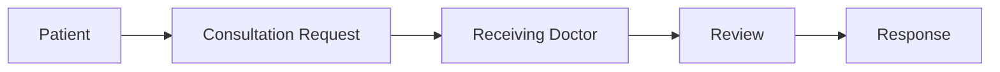

이 구조는 의료진 간 소통을
단순 메시지 교환에서 업무 요청 및
답변 관리로 확장하기 위한 것입니다.

---

## 4. Feature Architecture

협진 기능은 View, ViewModel,
Repository, Service 및 Model 계층으로
구성됩니다.

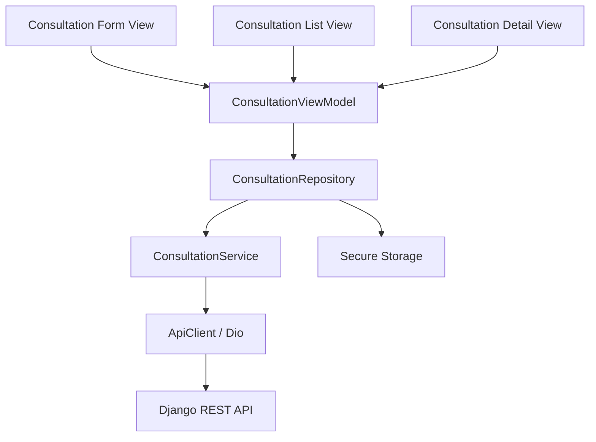

### 계층별 책임

| 구성 요소 | 역할 |
|---|---|
| View | 협진 요청 및 조회 인터페이스 |
| ConsultationViewModel | 요청 데이터 및 업무 상태 관리 |
| ConsultationRepository | 인증 정보 확인 및 데이터 접근 |
| ConsultationService | HTTP 요청 및 응답 변환 |
| ConsultationDoctor | 협진 대상 의료진 모델 |
| ConsultationRequest | 협진 요청 및 답변 모델 |
| ConsultationFormArgs | 협진 요청 화면 전달 데이터 |
| ApiClient | 공통 네트워크 환경 |

### 주요 디렉터리

```text
lib/features/consultation/
├── model/
│   ├── consultation_doctor.dart
│   ├── consultation_form_args.dart
│   └── consultation_request.dart
├── repository/
│   └── consultation_repository.dart
├── service/
│   └── consultation_service.dart
├── view/
├── view_model/
│   └── consultation_view_model.dart
└── consultation_routes.dart
```

본 문서는 위 구조 중 데이터 모델,
Service, Repository 및 ViewModel을
중심으로 분석합니다.

---

## 5. Consultation Workflow

협진 기능의 전체 업무 흐름은
요청자와 수신자의 역할을 구분하여
설명할 수 있습니다.

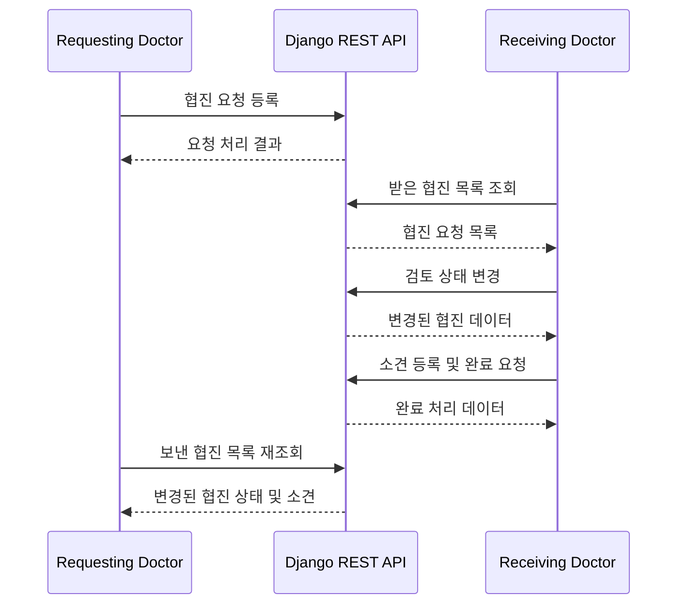

### 업무 단계

| 단계 | 요청자 | 수신자 |
|---|---|---|
| 요청 준비 | 환자 및 의료진 선택 | - |
| 요청 등록 | 협진 사유 및 참고 정보 전달 | - |
| 요청 확인 | 보낸 요청 조회 | 받은 요청 조회 |
| 검토 | 요청 상태 확인 | 검토 상태 변경 |
| 답변 | 등록된 소견 조회 | 소견 등록 |
| 완료 | 협진 결과 확인 | 완료 처리 결과 확인 |

위 흐름은 현재 API 및 상태 관리 구조를
기반으로 정리한 개념적 업무 흐름입니다.

각 단계의 실제 화면 이동 및
자동 갱신 시점까지 모두 검증한 것은 아닙니다.

---

## 6. Asynchronous Consultation

협진은 요청자와 수신자가
동시에 접속하지 않아도 업무를
진행할 수 있도록 구성합니다.

### 일반 채팅과 협진 비교

| 구분 | 채팅 | 협진 |
|---|---|---|
| 주요 목적 | 의료진 간 소통 | 환자 관련 검토 요청 |
| 데이터 단위 | 메시지 | 협진 요청 |
| 환자 정보 | 선택적 참조 | 요청 대상 환자 |
| 업무 상태 | 읽음 및 공유 정보 상태 | 대기, 검토, 완료 |
| 답변 | 메시지 전송 | 협진 소견 등록 |
| 관리 기준 | 채팅방 ID | 협진 요청 ID |

### 비동기 업무 처리의 의미

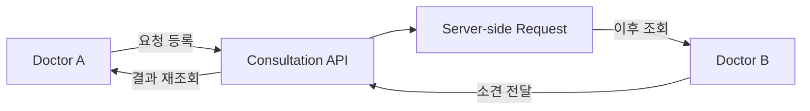

협진 요청 등록과 수신 의료진의 검토가
서로 다른 시점에 이루어질 수 있습니다.

여기서 비동기 협진은 의료진 간 업무 처리
시점이 분리된다는 의미입니다.

Flutter의 Future 및 async/await를 이용한
비동기 HTTP 요청과도 관련되지만,
두 개념은 동일하지 않습니다.

Celery, Redis 또는 별도의 메시지 큐를
사용하여 서버 백그라운드 작업을
구현했다는 의미는 아닙니다.

---

## 7. Data Model Architecture

협진 기능은 다음 세 가지 주요 모델을
사용합니다.

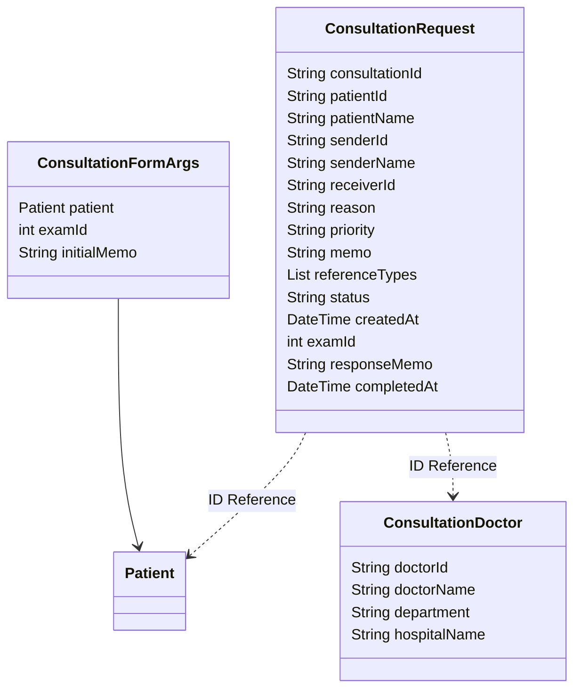

위 클래스 다이어그램은 모바일 데이터 모델의
주요 필드와 논리적 참조 관계를 표현합니다.

Nullable 타입 표기는 일부 생략했습니다.

서버 데이터베이스의 실제 ERD는 아닙니다.

---

## 8. ConsultationDoctor Model

ConsultationDoctor는 협진 대상 의료진의
정보를 관리합니다.

| 필드 | 타입 | 역할 |
|---|---|---|
| doctorId | String | 의료진 식별자 |
| doctorName | String | 의료진 이름 |
| department | String | 진료과 |
| hospitalName | String | 소속 병원 |

### JSON 변환

다음은 의료진 응답 구조를 설명하기 위한
가상의 데이터입니다.

```json
{
  "doctor_id": "DOCTOR-DEMO-002",
  "doctor_name": "테스트 의료진",
  "department": "순환기내과",
  "hospital_name": "테스트 병원"
}
```

ConsultationDoctor.fromJson은
각 필드를 문자열로 변환하며,
값이 없는 경우 빈 문자열을 사용합니다.

### 설계상 고려 사항

의료진 ID가 누락된 응답도
빈 문자열을 가진 객체로 변환될 수 있습니다.

의료진 식별자는 협진 요청에 필요한
핵심 데이터이므로 향후에는 필수 필드의
유효성을 명시적으로 검증하는 방안을
고려할 수 있습니다.

---

## 9. ConsultationFormArgs

환자 상세 기능과 협진 요청 기능 사이에서
필요한 정보를 전달하기 위해
ConsultationFormArgs 모델을 사용합니다.

```dart
final class ConsultationFormArgs {
  const ConsultationFormArgs({
    required this.patient,
    this.examId,
    this.initialMemo = '',
  });

  final Patient patient;
  final int? examId;
  final String initialMemo;
}
```

### 전달 데이터

| 필드 | 역할 |
|---|---|
| patient | 협진 대상 환자 |
| examId | 관련 검사 식별자 |
| initialMemo | 초기 협진 메모 |

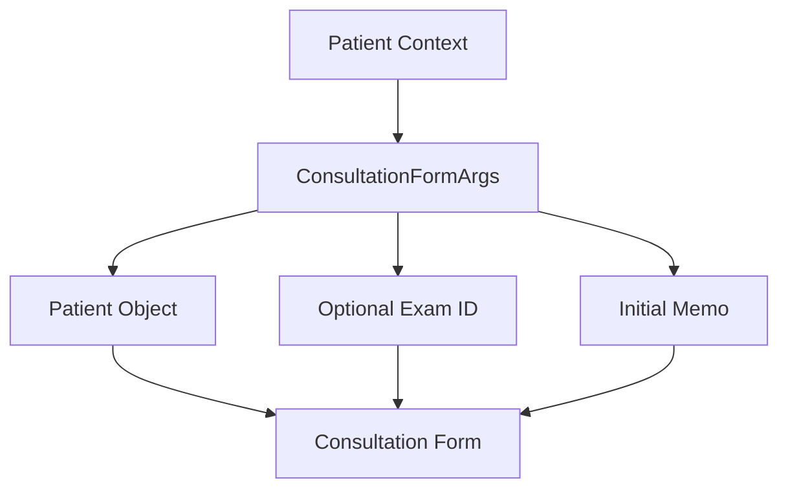

### 설계 목적

환자 정보와 관련 검사 정보를
하나의 전달 객체로 구성하여
기능 간 데이터 전달 구조를 명확하게 합니다.

환자 상세 화면에서 협진 기능으로
연결할 수 있는 데이터 기반을 제공합니다.

실제 모든 화면의 라우팅 인자 전달 방식은
별도로 검증하지 않았습니다.

---

## 10. ConsultationRequest Model

ConsultationRequest는 협진 요청의
주요 업무 데이터를 관리합니다.

### 10.1 식별 정보

| 필드 | 역할 |
|---|---|
| consultationId | 협진 요청 식별자 |
| patientId | 협진 대상 환자 ID |
| patientName | 환자 이름 |
| senderId | 요청 의료진 ID |
| senderName | 요청 의료진 이름 |
| receiverId | 수신 의료진 ID |
| examId | 관련 검사 ID |

### 10.2 요청 정보

| 필드 | 역할 |
|---|---|
| reason | 협진 요청 사유 |
| priority | 협진 우선순위 |
| memo | 추가 요청 메모 |
| referenceTypes | 참고 정보 유형 |

### 10.3 상태 및 답변 정보

| 필드 | 역할 |
|---|---|
| status | 협진 요청 상태 |
| createdAt | 협진 생성 시각 |
| responseMemo | 수신 의료진의 답변 |
| completedAt | 협진 완료 시각 |

### 데이터 구조의 특징

협진 요청 데이터와 답변 데이터를
하나의 ConsultationRequest 모델에서
관리합니다.

서버가 상태 변경 또는 소견 등록 결과를
반환하면 새로운 ConsultationRequest 객체로
변환하여 기존 데이터를 갱신할 수 있습니다.

### 객체 갱신 방식

ConsultationRequest는 final 필드를 사용하며,
copyWith 메서드를 제공합니다.

copyWith를 통해 다음 데이터를 변경한
새로운 객체를 구성할 수 있습니다.

- status
- responseMemo
- completedAt

다만 현재 ViewModel의 상태 변경 및
소견 등록 흐름에서는 서버 응답으로 생성된
ConsultationRequest 객체를 사용합니다.

copyWith가 모든 상태 변경에서
사용되는 것은 아닙니다.

또한 completedAt의 Null 값을 명시적으로
설정하여 기존 값을 제거하는 기능은
현재 copyWith 구조에서 지원하지 않습니다.

---

## 11. REST API Endpoints

협진 기능은 Django REST API를
기반으로 구성되어 있습니다.

| Method | Endpoint | 역할 |
|---|---|---|
| GET | /api/doctors/ | 의료진 목록 조회 |
| POST | /api/consultations/ | 협진 요청 등록 |
| GET | /api/consultations/?receiver=me | 받은 협진 조회 |
| GET | /api/consultations/?sender=me | 보낸 협진 조회 |
| PATCH | /api/consultations/{id}/status/ | 협진 상태 변경 |
| PATCH | /api/consultations/{id}/complete/ | 소견 등록 및 완료 요청 |

### 인증 헤더

```http
Authorization: Bearer <access_token>
```

JSON 요청에서는 다음 헤더를 사용합니다.

```http
Content-Type: application/json
```

Repository에서 Secure Storage의
Access Token을 조회한 뒤
Service에 전달하는 구조입니다.

---

## 12. Doctor Directory Management

협진 요청을 등록하기 위해서는
요청 대상 의료진을 선택할 수 있어야 합니다.

### 의료진 조회 흐름

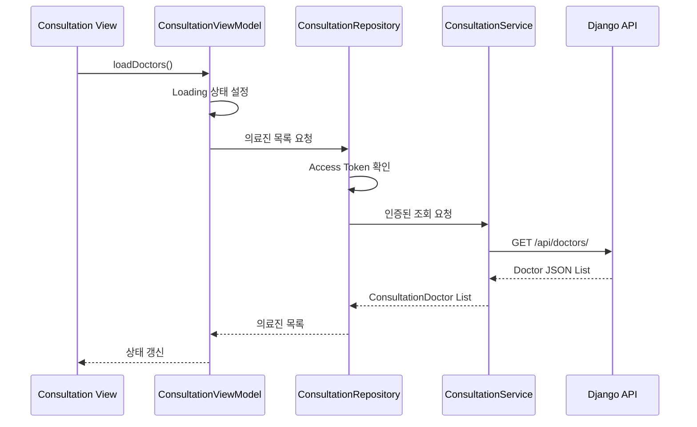

### 응답 구조 처리

ConsultationService는 의료진 목록에 대해
직접 전달되는 List와
객체 내부의 목록 형식을 처리합니다.

지원하는 목록 키는 다음과 같습니다.

- results
- doctors
- data

이후 Map 형식의 항목을
ConsultationDoctor 객체로 변환합니다.

---

## 13. Department Filtering

ConsultationViewModel은 의료진 목록에서
진료과 정보를 추출하여 관리합니다.

### 진료과 목록 생성

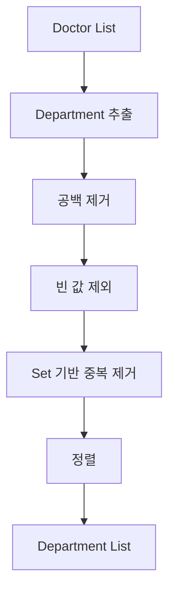

다음은 실제 소스의 진료과 목록
생성 메서드입니다.

```dart
List<String> get departments {
  final values = _doctors
      .map((doctor) => doctor.department.trim())
      .where((department) => department.isNotEmpty)
      .toSet()
      .toList();

  values.sort();

  return values;
}
```

### 진료과별 의료진 필터

```dart
List<ConsultationDoctor> doctorsByDepartment(
  String department,
) {
  return _doctors
      .where((doctor) => doctor.department == department)
      .toList();
}
```

### 가상 데이터 예시

| 의료진 | 진료과 |
|---|---|
| Doctor A | 순환기내과 |
| Doctor B | 영상의학과 |
| Doctor C | 순환기내과 |
| Doctor D | 흉부외과 |

진료과 목록에서는 중복된 순환기내과가
하나의 항목으로 관리됩니다.

순환기내과를 기준으로 필터링하면
Doctor A와 Doctor C가 반환됩니다.

### 설계상 한계

진료과 목록을 생성할 때에는
trim을 적용하지만,
의료진 필터에서는 원본 department 값과
선택된 진료과를 직접 비교합니다.

따라서 서버 응답에 앞뒤 공백이 포함되면
진료과 목록에는 정상적으로 표시되더라도
해당 의료진이 필터 결과에서
제외될 가능성이 있습니다.

향후에는 진료과 값의 정규화 방식을
일관되게 적용하거나 진료과 ID를
사용하는 방식으로 개선할 수 있습니다.

---

## 14. Consultation Request Creation

협진 요청 등록 시 환자, 수신 의료진,
협진 사유 및 우선순위를 전달합니다.

### 필수 요청 필드

| 필드 | 역할 |
|---|---|
| patient_id | 협진 대상 환자 |
| receiver_id | 수신 의료진 |
| reason | 협진 요청 사유 |
| priority | 요청 우선순위 |

### 선택적 요청 필드

| 필드 | 포함 조건 |
|---|---|
| memo | 공백 제거 후 값이 존재하는 경우 |
| reference_types | 목록이 비어 있지 않은 경우 |
| exam_id | Null이 아니며 공백 제거 후 값이 존재하는 경우 |

여기서 필수 요청 필드는
Service에서 항상 요청 데이터에
포함하는 필드를 의미합니다.

서버가 정의한 필수 입력 검증 규칙과
완전히 동일하다고 확인한 것은 아닙니다.

### 요청 데이터 구성

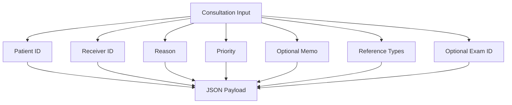

### 가상 요청 예시

```json
{
  "patient_id": "PATIENT-DEMO-001",
  "receiver_id": "DOCTOR-DEMO-002",
  "reason": "검사 결과 추가 검토 요청",
  "priority": "normal",
  "memo": "관련 검사 정보를 확인해 주세요.",
  "reference_types": [
    "examination"
  ],
  "exam_id": "101"
}
```

위 데이터는 요청 구조를 설명하기 위한
가상의 예시입니다.

priority 및 reference_types의
서버 허용 값 전체를 검증한 것은 아닙니다.

실제 요청에서는 exam_id가
문자열 형태로 전달되는 구조를 사용합니다.

---

## 15. Request Payload Normalization

협진 요청 등록 전 일부 문자열의
앞뒤 공백을 제거합니다.

### 정규화 대상

- patientId
- receiverId
- reason
- memo
- examId

priority와 referenceTypes는
전달받은 값을 그대로 사용합니다.

### 요청 구성 코드

다음은 실제 Service의 요청 데이터
구성 부분입니다.

```dart
final normalizedPatientId = patientId.trim();
final normalizedReceiverId = receiverId.trim();
final normalizedReason = reason.trim();
final normalizedMemo = memo.trim();
final normalizedExamId = examId?.trim();

final data = <String, dynamic>{
  'patient_id': normalizedPatientId,
  'receiver_id': normalizedReceiverId,
  'reason': normalizedReason,
  'priority': priority,
};

if (normalizedMemo.isNotEmpty) {
  data['memo'] = normalizedMemo;
}

if (referenceTypes.isNotEmpty) {
  data['reference_types'] = referenceTypes;
}

if (normalizedExamId != null &&
    normalizedExamId.isNotEmpty) {
  data['exam_id'] = normalizedExamId;
}
```

### 설계 목적

- 식별자 앞뒤의 불필요한 공백 제거
- 선택적 데이터의 불필요한 전송 감소
- 요청 데이터 구성 방식의 일관성 확보

### 현재 구조의 한계

문자열 정규화는 입력 데이터의
유효성 검증과 동일하지 않습니다.

patientId, receiverId 및 reason이
빈 문자열인 경우에도 Service의
요청 데이터에는 포함될 수 있습니다.

따라서 화면의 입력 검증과
서버의 필수 필드 검증이 필요합니다.

현재 분석한 Service만으로는
모든 잘못된 요청이 사전에 차단된다고
판단할 수 없습니다.

---

## 16. Asynchronous Submission

협진 요청 등록은 ViewModel의
비동기 메서드를 통해 처리합니다.

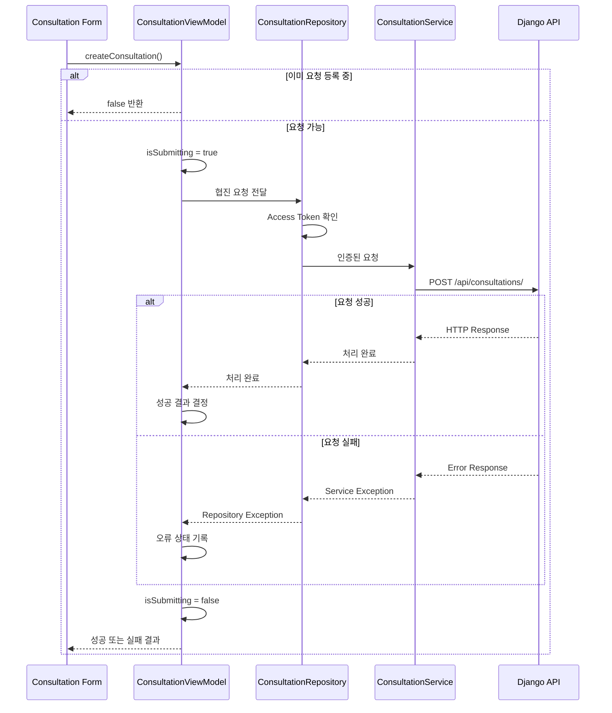

### 중복 제출 제한

ConsultationViewModel은
_isSubmitting 플래그를 사용하여
협진 요청 등록 중 추가 제출을 제한합니다.

```dart
if (_isSubmitting) {
  return false;
}

_isSubmitting = true;
_errorMessage = null;
notifyListeners();
```

요청 성공 여부와 관계없이
finally에서 제출 상태를 해제합니다.

```dart
finally {
  _isSubmitting = false;
  notifyListeners();
}
```

### 반환 방식

| 결과 | 반환값 |
|---|---|
| 요청 성공 | true |
| 요청 실패 | false |
| 이미 요청 진행 중 | false |

### 생성 응답 처리

협진 생성 Service는 Future<void>를
반환하는 구조입니다.

서버 응답에서 생성된 협진 객체를
파싱하여 목록에 즉시 추가하는 방식은
사용하지 않습니다.

ViewModel의 createConsultation 내부에서도
생성 성공 후 받은 요청 또는 보낸 요청
목록을 자동으로 다시 조회하지 않습니다.

생성 이후 목록 갱신이 필요한 경우에는
화면 또는 다른 호출 지점에서
별도의 조회가 이루어져야 합니다.

---

## 17. Received & Sent Consultation Separation

협진 요청은 현재 의료진의 역할에 따라
받은 요청과 보낸 요청으로 구분합니다.

### 받은 협진 요청

```http
GET /api/consultations/?receiver=me
Authorization: Bearer <access_token>
```

### 보낸 협진 요청

```http
GET /api/consultations/?sender=me
Authorization: Bearer <access_token>
```

### 데이터 분리 구조

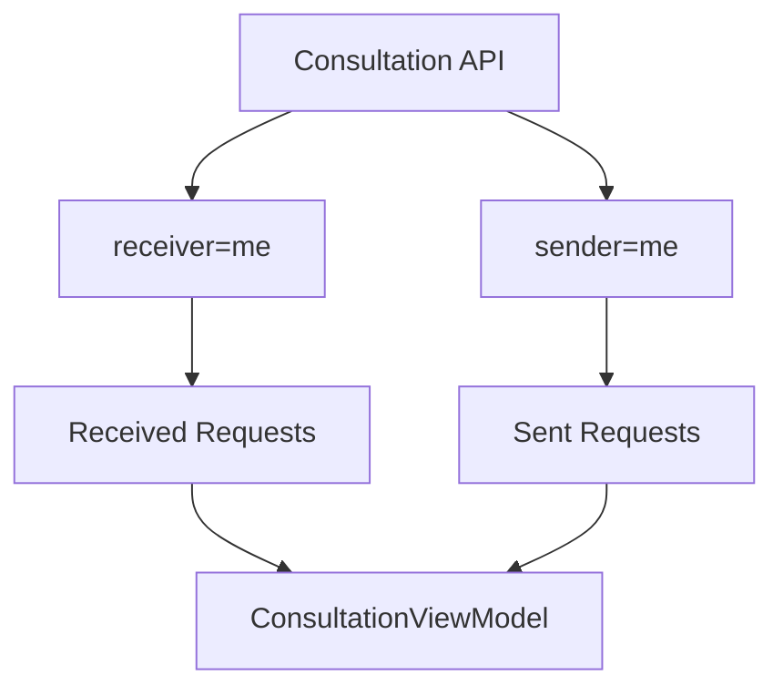

### ViewModel 상태

```dart
List<ConsultationRequest> _receivedRequests =
    <ConsultationRequest>[];

List<ConsultationRequest> _sentRequests =
    <ConsultationRequest>[];
```

외부에서는 List.unmodifiable을 통해
목록을 조회하도록 구성합니다.

```dart
List<ConsultationRequest> get receivedRequests =>
    List.unmodifiable(_receivedRequests);

List<ConsultationRequest> get sentRequests =>
    List.unmodifiable(_sentRequests);
```

### 설계 목적

- 현재 의료진의 요청자 및 수신자 역할 구분
- 업무 목적에 따른 목록 관리
- 받은 요청에 대한 검토 및 답변 처리
- 보낸 요청에 대한 진행 상황 확인

서버가 me 값을 인증된 의료진으로
정확하게 해석하는지와
다른 의료진의 요청 접근을 차단하는지는
서버 코드 및 통합 테스트가 필요합니다.

---

## 18. Concurrent Request Loading

받은 협진과 보낸 협진은
Future.wait를 사용하여
함께 조회할 수 있도록 구성합니다.

### 실제 구현

```dart
final results = await Future.wait([
  _consultationRepository
      .fetchReceivedConsultations(),
  _consultationRepository
      .fetchSentConsultations(),
]);

_receivedRequests = results[0];
_sentRequests = results[1];
```

### 순차 조회 방식

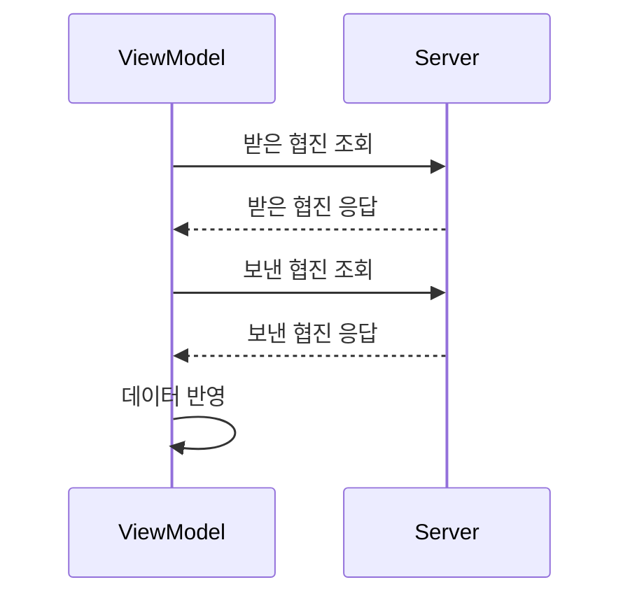

### 현재 Future.wait 방식

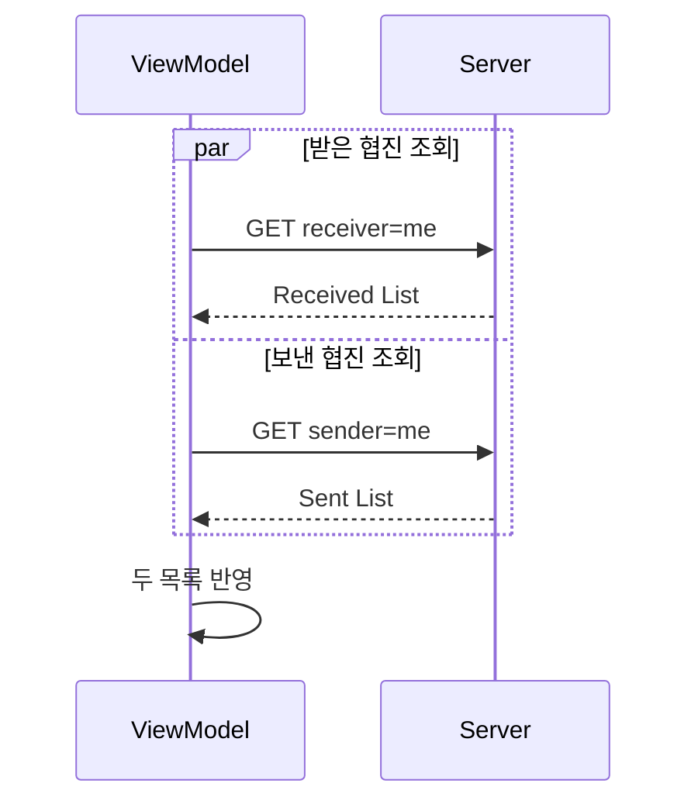

### 설계 이유

받은 요청과 보낸 요청은
서로의 응답 데이터에 의존하지 않는
독립적인 조회 작업입니다.

한 요청이 종료된 후 다른 요청을
시작할 필요가 없으므로
Future.wait를 이용하여 함께 처리합니다.

### 이론적 응답 시간 비교

다음은 동시 비동기 조회의 효과를
설명하기 위한 가상 예시입니다.

| 요청 | 가정한 소요 시간 |
|---|---:|
| 받은 협진 조회 | 800ms |
| 보낸 협진 조회 | 600ms |

순차 조회:

```text
800ms + 600ms = 1,400ms
```

동시 비동기 조회:

```text
max(800ms, 600ms) = 약 800ms
```

이론적 대기 시간 차이:

```text
1,400ms - 800ms = 600ms
```

이는 네트워크 및 서버가 두 요청을
동시에 처리할 수 있다는 가정에 따른
설명용 계산입니다.

실제 프로젝트의 성능 측정 결과는 아닙니다.

### Future.wait의 한계

현재 구현에서는 두 요청이 모두 성공한 후
받은 요청과 보낸 요청을 갱신합니다.

한 요청이 실패하면 Future.wait에서
오류가 발생하고 이후 목록 할당이
이루어지지 않습니다.

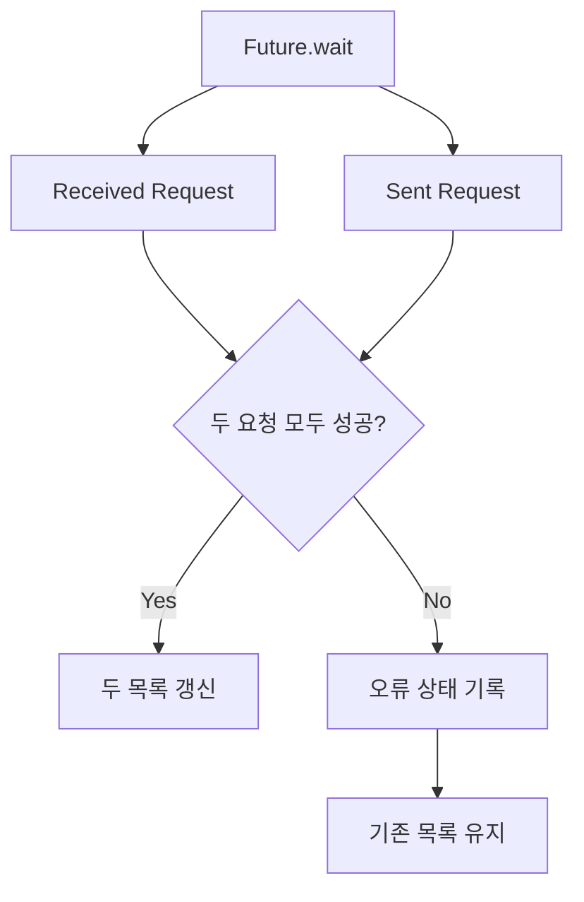

따라서 한쪽 요청만 성공하더라도
성공한 목록이 화면에 반영되지 않을 수 있습니다.

향후에는 받은 요청과 보낸 요청의
오류 상태를 분리하여 부분 성공 결과도
반영하는 방안을 고려할 수 있습니다.

Future.wait는 클라이언트의
비동기 작업 완료를 함께 기다리는 방식이며,
서버 데이터베이스 트랜잭션이나
멀티스레드 실행을 보장하는 기능은 아닙니다.

---

## 19. Consultation Status Model

협진 요청은 status 문자열과
상태 판별 Getter를 통해 관리합니다.

### 상태 분류

| 분류 | 서버 상태값 또는 조건 |
|---|---|
| Pending | 빈 문자열, pending, requested, waiting, new |
| In Progress | in_progress, reviewing, processing |
| Completed | completed, complete, answered 또는 답변 존재 |

### 상태 판별 전처리

```dart
final normalizedStatus = status.trim().toLowerCase();
```

상태 문자열의 앞뒤 공백과
대소문자 차이를 정리하여
상태 판별에 사용합니다.

### 19.1 대기 상태

```dart
bool get isPending {
  final normalizedStatus =
      status.trim().toLowerCase();

  return normalizedStatus.isEmpty ||
      normalizedStatus == 'pending' ||
      normalizedStatus == 'requested' ||
      normalizedStatus == 'waiting' ||
      normalizedStatus == 'new';
}
```

### 19.2 검토 상태

```dart
bool get isInProgress {
  final normalizedStatus =
      status.trim().toLowerCase();

  return normalizedStatus == 'in_progress' ||
      normalizedStatus == 'reviewing' ||
      normalizedStatus == 'processing';
}
```

### 19.3 완료 상태

```dart
bool get isCompleted {
  final normalizedStatus =
      status.trim().toLowerCase();

  return normalizedStatus == 'completed' ||
      normalizedStatus == 'complete' ||
      normalizedStatus == 'answered' ||
      responseMemo.trim().isNotEmpty;
}
```

### 19.4 답변 대기 상태

```dart
bool get isWaitingForResponse {
  return isPending || isInProgress;
}
```

대기 상태와 검토 상태를
답변 대기 상태로 함께 분류할 수 있도록
구성되어 있습니다.

---

## 20. Consultation Lifecycle

협진 기능의 대표적인 업무 흐름은
대기, 검토, 완료의 세 단계로
설명할 수 있습니다.

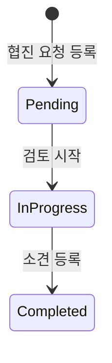

### 상태별 업무 의미

| 상태 | 의미 |
|---|---|
| Pending | 의료진 검토 대기 |
| InProgress | 의료진 검토 진행 |
| Completed | 협진 답변 등록 또는 완료 |

### 상태 전이의 검증 범위

위 다이어그램은 협진 업무를 설명하기 위한
대표적인 상태 흐름입니다.

현재 Flutter 코드에서 모든 상태 전이를
강제하는 별도의 상태 머신을
구현한 것은 아닙니다.

updateStatus 메서드는
문자열 형태의 status를 전달받으며,
completeConsultation 메서드에는
이전 상태가 반드시 in_progress여야 한다는
검증이 포함되어 있지 않습니다.

따라서 다음 정책은 서버에서
별도로 정의하고 검증할 필요가 있습니다.

- 대기 상태에서만 검토 시작 가능 여부
- 검토 이전 완료 처리 허용 여부
- 완료된 요청의 상태 변경 가능 여부
- 요청자와 수신자의 상태 변경 권한
- 거절 및 취소 상태의 처리 정책

---

## 21. Status Classification Consistency

현재 모델에서는 상태 판별 Getter가
각각 독립적으로 동작합니다.

특히 완료 상태는 status 값뿐 아니라
responseMemo의 존재 여부로도
판별합니다.

### 상태 충돌 가능성

| status | responseMemo | isPending | isCompleted |
|---|---|---|---|---|
| pending | 빈 문자열 | true | false |
| pending | 답변 존재 | true | true |
| completed | 답변 존재 | false | true |
| 빈 문자열 | 답변 존재 | true | true |

두 번째와 네 번째 사례에서는
하나의 협진 요청이 대기 상태와
완료 상태에 동시에 해당할 수 있습니다.

### 문제 분석

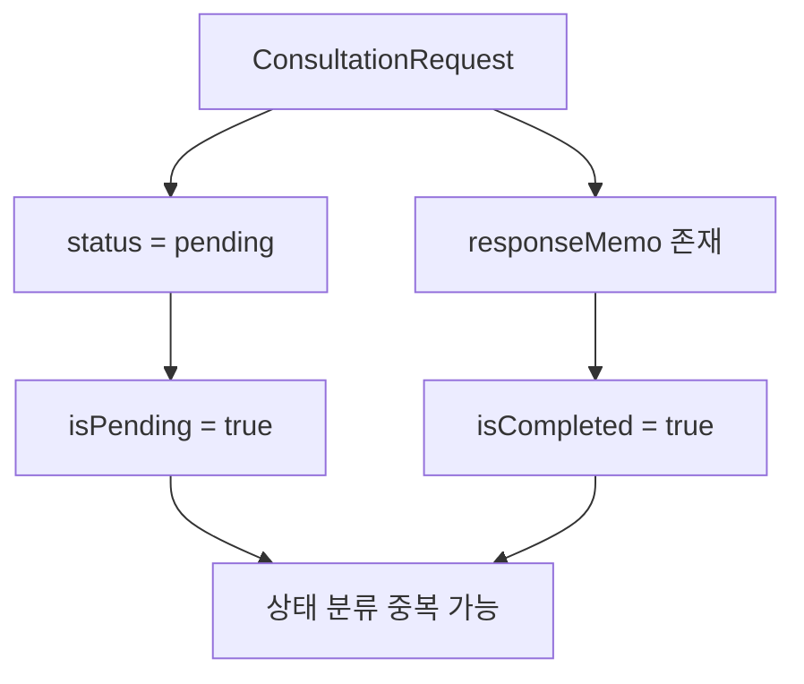

이 구조는 다양한 서버 응답을
유연하게 처리하기 위한 방식으로
활용될 수 있습니다.

그러나 상태 필터 및 대기 요청 수를
계산하는 경우 일관되지 않은 결과가
발생할 가능성이 있습니다.

### 개선 방향

협진 상태를 하나의 Enum으로
정규화하고 상태 판별의 기준을
단일화하는 방안을 고려할 수 있습니다.

다음은 향후 개선을 위한
개념적 코드 예시입니다.

```dart
enum ConsultationStatus {
  pending,
  inProgress,
  completed,
  rejected,
  cancelled,
  unknown,
}
```

이 Enum은 현재 프로젝트에
구현된 코드가 아닙니다.

거절 및 취소 상태 역시
향후 서버 업무 정책에 따라
정의할 수 있는 확장 예시입니다.

### 개선 구조

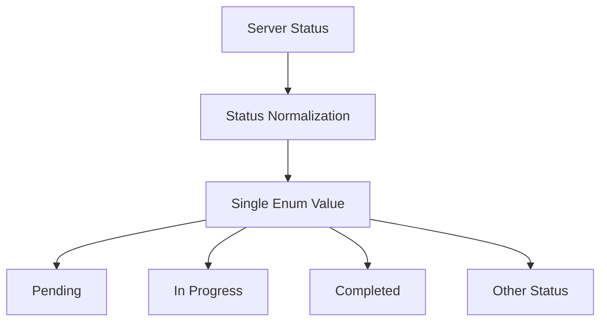

상태를 하나의 값으로 관리하면
대기 상태와 완료 상태가 동시에
참으로 판별되는 문제를 줄일 수 있습니다.

---

## 22. Review Status Update

협진 요청의 검토 상태 변경은
markAsReviewing 메서드를 통해
처리할 수 있습니다.

### 실제 구현 흐름

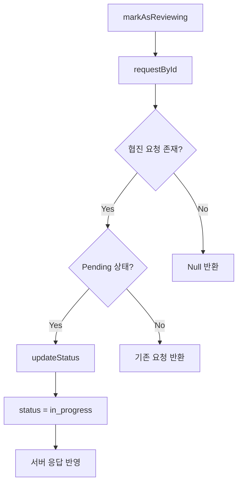

### 상태 변경 요청

```http
PATCH /api/consultations/{consultationId}/status/
Authorization: Bearer <access_token>
Content-Type: application/json
```

```json
{
  "status": "in_progress"
}
```

### markAsReviewing의 역할

1. 협진 ID로 요청을 검색합니다.
2. 요청이 없으면 Null을 반환합니다.
3. 대기 상태가 아니면 기존 요청을 반환합니다.
4. 대기 상태이면 상태 변경을 요청합니다.
5. 성공 시 갱신된 요청을 다시 조회합니다.
6. 실패 시 Null을 반환합니다.

### updateStatus의 역할

updateStatus에서는 받은 협진 목록에서
해당 협진 ID를 검색합니다.

대상 요청이 없으면 API 호출을 진행하지 않고
오류 상태를 설정한 뒤 false를 반환합니다.

대상 요청이 존재하면 서버에
상태 변경을 요청합니다.

서버 응답으로 반환된 협진 객체를
기존 목록에 반영합니다.

---

## 23. Server Response-based State Update

협진 상태는 서버 요청 결과를
기준으로 갱신합니다.

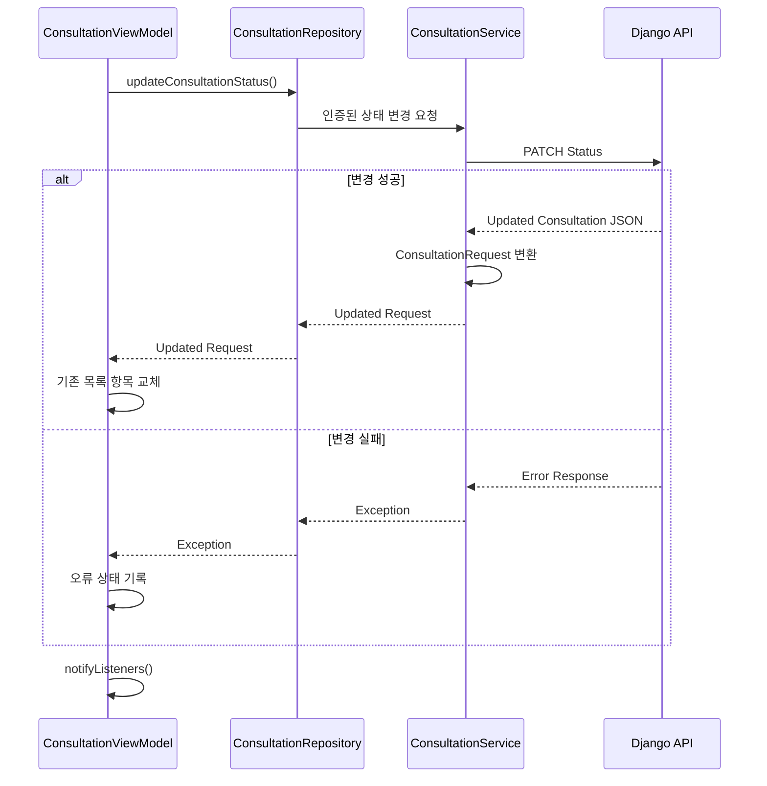

### 목록 갱신 코드

```dart
final updatedRequest =
    await _consultationRepository
        .updateConsultationStatus(
          consultationId: consultationId,
          status: status,
        );

_receivedRequests[index] = updatedRequest;
notifyListeners();
```

### 설계 목적

- 서버 처리 결과를 기준으로 화면 상태 갱신
- 상태 변경 실패 시 기존 데이터 유지
- 서버에서 반환한 최신 협진 데이터 반영
- 클라이언트의 임의 상태 변경 감소

현재 구조는 서버 응답 이후
로컬 데이터를 변경하는 방식입니다.

서버 응답 이전에 완료 상태를
먼저 표시하는 Optimistic Update와는
구분됩니다.

---

## 24. Consultation Completion

협진 완료 기능은 수신 의료진의
소견을 서버에 전달합니다.

### 완료 요청 API

```http
PATCH /api/consultations/{consultationId}/complete/
Authorization: Bearer <access_token>
Content-Type: application/json
```

### 가상 요청 데이터

```json
{
  "response_memo": "관련 검사 정보를 검토했습니다."
}
```

Service는 responseMemo의
앞뒤 공백을 제거하여 전달합니다.

```dart
data: {
  'response_memo': responseMemo.trim(),
}
```

### 소견 등록 흐름

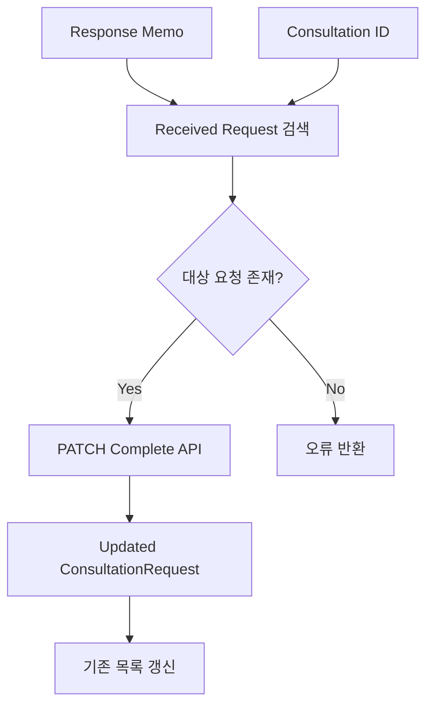

### 처리 결과

| 결과 | 처리 |
|---|---|
| 성공 | 서버 응답으로 받은 요청 갱신 |
| 실패 | 오류 상태 기록 |
| 요청 없음 | API 호출 없이 false 반환 |

### 현재 검증 범위

완료 API가 소견을 저장하면서
서버의 status 및 completedAt을
어떤 규칙으로 변경하는지는
서버 구현을 확인해야 합니다.

현재 모바일 코드에서는
서버가 반환한 협진 객체를
파싱하여 반영하는 구조입니다.

또한 빈 소견에 대한 필수 입력 검증은
분석한 Service 및 ViewModel 내부에서
별도로 확인되지 않았습니다.

---

## 25. Consultation Request Lookup

협진 요청은 consultationId를
기준으로 검색할 수 있습니다.

### 실제 구현

```dart
ConsultationRequest? requestById(
  String consultationId,
) {
  for (final request in [
    ..._receivedRequests,
    ..._sentRequests,
  ]) {
    if (request.consultationId == consultationId) {
      return request;
    }
  }

  return null;
}
```

### 검색 흐름

```mermaid
flowchart TD
    A["Consultation ID"]
    B["Received Requests"]
    C["Sent Requests"]
    D["Combined Search"]
    E{"ID 일치?"}

    A --> D
    B --> D
    C --> D

    D --> E

    E -->|Yes| F["ConsultationRequest 반환"]
    E -->|No| G["Null 반환"]
```

받은 요청과 보낸 요청을 함께 검색하여
해당 ID의 협진 객체를 반환합니다.

동일 ID가 두 목록에 존재하는 경우에는
받은 요청 목록의 항목이 먼저 반환됩니다.

### 개선 방향

현재 검색은 목록을 순회하는 방식입니다.

협진 데이터가 많아지는 경우에는
협진 ID를 Key로 사용하는 Map 구조나
정규화된 데이터 저장 구조를
고려할 수 있습니다.

현재 프로젝트에서 검색 성능 문제가
발생했다고 확인한 것은 아닙니다.

---

## 26. Dashboard Integration

홈 대시보드는 협진 ViewModel의
pendingCount를 활용하여
대기 중인 협진 요청 수를 표시합니다.

### 집계 코드

```dart
int get pendingCount =>
    _receivedRequests
        .where((request) => request.isPending)
        .length;
```

### 집계 대상

- 현재 의료진이 받은 협진 요청
- isPending이 true인 요청

보낸 협진 요청은 포함하지 않습니다.

검토 중인 요청도 pendingCount에
포함되지 않습니다.

### 가상 집계 예시

| 협진 ID | 요청 방향 | 상태 | 집계 여부 |
|---|---|---|---|
| C-001 | Received | pending | 포함 |
| C-002 | Received | in_progress | 제외 |
| C-003 | Received | completed | 제외 |
| C-004 | Sent | pending | 제외 |
| C-005 | Received | waiting | 포함 |

위 예시의 pendingCount는 2입니다.

```mermaid
flowchart TD
    A["Received Requests"]
    B["isPending Filter"]
    C["Pending Count"]
    D["ConsultationViewModel"]
    E["Home Dashboard"]

    A --> B
    B --> C
    C --> D
    D --> E
```

### 데이터 일관성 고려

isPending과 isCompleted가
동시에 참이 될 수 있는 모델 구조에서는
이미 답변이 등록된 요청이 대기 수에
포함될 가능성도 있습니다.

따라서 정확한 업무 집계를 위해서는
상태 판별 기준을 일관되게 관리하는 것이
중요합니다.

---

## 27. Response Parsing Strategy

협진 Service는 서버 응답을
ConsultationRequest 객체로 변환합니다.

### 목록 응답 구조

다음 형식을 처리합니다.

- 직접 전달되는 List
- results 내부 목록
- consultations 내부 목록
- data 내부 목록

### 가상 응답 예시

```json
{
  "results": [
    {
      "consultation_id": "C-DEMO-001",
      "patient_id": "PATIENT-DEMO-001",
      "sender_id": "DOCTOR-DEMO-001",
      "receiver_id": "DOCTOR-DEMO-002",
      "reason": "추가 검토 요청",
      "priority": "normal",
      "status": "pending"
    }
  ]
}
```

### 파싱 흐름

```mermaid
flowchart TD
    A["HTTP Response"]
    B{"Response Structure"}

    A --> B

    B -->|List| C["Consultation Items"]
    B -->|Map| D["results / consultations / data"]

    D --> C

    C --> E["Map 항목 선택"]
    E --> F["ConsultationRequest.fromJson"]
    F --> G["ConsultationRequest List"]
```

목록 응답이 지원하는 구조와 다르면
빈 목록으로 처리될 수 있습니다.

### 단일 객체 응답

상태 변경 및 완료 API에서는
응답 데이터가 Map 형식인지 확인합니다.

Map 형식이 아닌 경우에는
ConsultationServiceException을 발생시킵니다.

목록 응답과 달리 상태 변경 및
완료 응답에서는 data 또는 result 내부의
객체를 별도로 추출하는 처리가 없습니다.

따라서 해당 API가 객체를 감싼 형태로
응답 구조를 변경하는 경우에는
파싱 결과를 추가로 검증해야 합니다.

---

## 28. JSON Field Compatibility

ConsultationRequest 모델은
일부 필드의 대체 JSON 키를
지원하도록 구성되어 있습니다.

### 협진 ID

```text
consultation_id
consultationId
request_id
id
```

### 환자 ID

```text
patient_id
patientId
patient.patient_id
patient.id
```

### 요청 의료진 ID

```text
sender_id
senderId
requester_id
sender.doctor_id
sender.id
```

### 수신 의료진 ID

```text
receiver_id
receiverId
receiver.doctor_id
receiver.id
```

### 상태 및 답변

```text
status
request_status

response_memo
responseMemo
```

### 데이터 구조 호환 예시

직접 필드 구조:

```json
{
  "patient_id": "PATIENT-DEMO-001",
  "patient_name": "테스트 환자"
}
```

중첩 객체 구조:

```json
{
  "patient": {
    "id": "PATIENT-DEMO-001",
    "name": "테스트 환자"
  }
}
```

두 구조를 동일한 모바일 모델로
변환할 수 있도록 구성합니다.

### 설계상 장점

- 일부 서버 응답 구조 차이 대응
- 화면의 JSON 파싱 책임 감소
- 기능별 데이터 모델 재사용

### 설계상 한계

다수의 대체 키를 허용하면
서버 응답 계약의 변경이나
필수 데이터 누락을 발견하기
어려워질 수 있습니다.

향후에는 API 응답 스키마를
명확하게 정의하고 필수 식별자의
누락 여부를 검증할 필요가 있습니다.

---

## 29. Reference Type Parsing

referenceTypes는 서버 응답에서
List 또는 문자열 형태로
전달되는 경우를 처리합니다.

### List 형태

```json
{
  "reference_types": [
    "examination",
    "ai_result"
  ]
}
```

### 문자열 형태

```json
{
  "reference_types": "examination, ai_result"
}
```

### 문자열 변환 흐름

```mermaid
flowchart TD
    A["Reference Types"]
    B{"Value Type"}

    A --> B

    B -->|List| C["문자열 변환"]
    B -->|String| D["괄호 및 따옴표 제거"]
    B -->|Other| E["Empty List"]

    D --> F["쉼표 기준 분리"]

    C --> G["공백 제거 및 빈 값 제외"]
    F --> G

    G --> H["List of String"]
```

### 설계 목적

서버 응답의 일부 형식 차이를
모바일 모델에서 처리하여
참고 정보 유형을 목록으로 관리합니다.

다만 문자열에서 괄호 및 따옴표를
제거한 뒤 쉼표로 분리하는 방식은
정식 JSON 파서와 동일하지 않습니다.

참고 정보 유형에 쉼표나 특수 문자가
포함되는 경우에는 의도하지 않은
데이터 변환이 발생할 수 있습니다.

향후에는 서버 응답 형식을
문자열 배열로 통일하는 방안을
고려할 수 있습니다.

---

## 30. Date & Identifier Handling

협진 모델은 생성 시각 및 완료 시각을
Nullable DateTime으로 관리합니다.

```dart
final DateTime? createdAt;
final DateTime? completedAt;
```

날짜 변환에는 DateTime.tryParse를
사용합니다.

```dart
static DateTime? _dateTimeValue(dynamic value) {
  final text = _stringValue(value);

  if (text.isEmpty) {
    return null;
  }

  return DateTime.tryParse(text);
}
```

### 날짜 처리 결과

| 입력 | 처리 결과 |
|---|---|
| 정상 날짜 문자열 | DateTime 변환 |
| 빈 문자열 | Null |
| 잘못된 날짜 문자열 | Null |
| 누락된 값 | Null |

잘못된 날짜를 현재 시각으로
대체하지 않고 Null로 처리합니다.

### 검사 ID 변환

examId는 int 또는 숫자,
문자열 형태의 응답을 처리합니다.

- int 값은 그대로 사용
- num 값은 toInt로 변환
- 문자열은 int.tryParse 사용
- 변환 실패 시 Null

### 개선 방향

소수 형태의 숫자가 examId로
전달되는 경우 toInt를 통해
정수로 변환될 수 있습니다.

식별자는 일반적인 수치 데이터와
의미가 다르므로 서버의 데이터 타입을
명확하게 정의하는 것이 중요합니다.

---

## 31. Authentication & Repository

ConsultationRepository는 각 API 요청 전에
Secure Storage에서 Access Token을
조회합니다.

```mermaid
flowchart TD
    A["Repository Method"]
    B["Read Access Token"]
    C{"Token is null or empty?"}

    A --> B
    B --> C

    C -->|Yes| D["Repository Exception"]
    C -->|No| E["ConsultationService"]

    E --> F["Bearer Token Request"]
    F --> G["Django API"]
```

### 인증 정보 확인 코드

```dart
final accessToken =
    await _secureStorage.readAccessToken();

if (accessToken == null || accessToken.isEmpty) {
  throw const ConsultationRepositoryException(
    '로그인 정보가 없습니다. 다시 로그인해 주세요.',
  );
}
```

### Repository의 책임

- 인증 정보 조회
- Null 및 빈 토큰 확인
- Service 호출
- Service 오류 변환
- ViewModel에 데이터 반환

### 현재 구조의 한계

협진 Repository에서는
accessToken.isEmpty를 확인하지만
trim을 적용하지 않습니다.

따라서 공백으로만 구성된 토큰은
클라이언트의 해당 검증을
통과할 가능성이 있습니다.

또한 토큰이 존재한다는 사실만으로
토큰의 만료 여부나 접근 권한을
확인할 수는 없습니다.

공통 인증 모듈을 구성하여
토큰 정규화, 만료 및 갱신 정책을
일관되게 관리하는 것이 개선 방향입니다.

---

## 32. ViewModel State Management

ConsultationViewModel은 ChangeNotifier를
기반으로 협진 기능의 상태를 관리합니다.

### 주요 데이터 상태

| 상태 | 역할 |
|---|---|
| _doctors | 의료진 목록 |
| _receivedRequests | 받은 협진 목록 |
| _sentRequests | 보낸 협진 목록 |
| _errorMessage | 오류 메시지 |

### 요청 상태

| 상태 | 역할 |
|---|---|
| _isLoading | 의료진 목록 조회 상태 |
| _isRequestsLoading | 협진 목록 조회 상태 |
| _isSubmitting | 협진 등록 상태 |

### 상태 분리 구조

```mermaid
flowchart TD
    A["ConsultationViewModel"]

    A --> B["Doctor State"]
    A --> C["Request State"]
    A --> D["Submission State"]
    A --> E["Error State"]

    B --> F["isLoading"]
    C --> G["isRequestsLoading"]
    D --> H["isSubmitting"]
    E --> I["errorMessage"]
```

의료진 조회와 협진 목록 조회,
협진 요청 등록을 각각 구분하여
진행 상태를 관리합니다.

### 비동기 상태 관리

```mermaid
stateDiagram-v2
    [*] --> Idle

    Idle --> Loading: 조회 시작
    Loading --> Success: 응답 성공
    Loading --> Error: 요청 실패

    Success --> Idle: 상태 반영
    Error --> Idle: 요청 상태 해제
```

위 다이어그램은 로딩 플래그와
오류 처리 흐름을 설명하기 위한
개념적 표현입니다.

별도의 상태 머신 라이브러리를
사용한 것은 아닙니다.

### 중복 조회 제한

loadDoctors는 _isLoading을
확인하여 중복 조회를 제한합니다.

loadReceivedRequests와
loadAllRequests는
_isRequestsLoading을 공유합니다.

따라서 받은 요청 조회가 진행 중이면
전체 요청 조회가 제한될 수 있으며,
반대의 경우도 동일합니다.

### 오류 상태 공유

각 기능의 오류는 공통
_errorMessage에서 관리합니다.

동시에 여러 종류의 요청이 진행되면
오류 상태가 다른 요청의 시작 또는
완료 과정에서 변경될 수 있습니다.

향후에는 의료진 조회 오류,
협진 목록 오류, 제출 오류,
상태 변경 오류를 분리하는 방안을
고려할 수 있습니다.

---

## 33. Concurrency & Data Consistency

현재 상태 변경 및 완료 메서드는
서버 요청 전에 대상 협진의
목록 인덱스를 검색합니다.

### 현재 처리 방식

```dart
final index = _receivedRequests.indexWhere(
  (request) =>
      request.consultationId == consultationId,
);

if (index == -1) {
  return false;
}

final updatedRequest =
    await repositoryRequest();

_receivedRequests[index] = updatedRequest;
```

위 코드는 현재 처리 구조를
설명하기 위해 단순화한 예시입니다.

### 잠재적인 동시성 문제

서버 요청을 기다리는 동안
협진 목록이 새로고침되면
기존 인덱스가 다른 요청을
가리킬 가능성이 있습니다.

### 가상 시나리오

```text
초기 받은 요청 목록

Index 0 : C-001
Index 1 : C-002
Index 2 : C-003

C-002의 상태 변경 요청 시작
기존 Index 1 저장

서버 응답 대기 중 목록 갱신

Index 0 : C-004
Index 1 : C-001
Index 2 : C-002
Index 3 : C-003

C-002의 상태 변경 응답 도착

기존 Index 1에 응답 객체를 저장하면
C-001 위치가 잘못 변경될 가능성 존재
```

### 동시성 문제 개념도

```mermaid
sequenceDiagram
    participant VM as ViewModel
    participant API as Server

    VM->>VM: C-002의 Index 저장
    VM->>API: C-002 상태 변경 요청

    VM->>API: 협진 목록 재조회
    API-->>VM: 순서가 변경된 목록
    VM->>VM: 목록 갱신

    API-->>VM: C-002 상태 변경 결과
    VM->>VM: 이전 Index 사용
    Note over VM: 다른 항목이 변경될 가능성
```

### 개선 제안

서버 응답이 반환된 이후
협진 ID를 기준으로 현재 목록에서
대상 항목을 다시 검색합니다.

```dart
final updatedRequest =
    await repositoryRequest();

final currentIndex =
    _receivedRequests.indexWhere(
      (request) =>
          request.consultationId ==
          updatedRequest.consultationId,
    );

if (currentIndex != -1) {
  _receivedRequests[currentIndex] =
      updatedRequest;

  notifyListeners();
}
```

위 코드는 개선 방향을 설명하기 위한
제안 코드이며 실제 적용한 코드는 아닙니다.

또한 상태 변경과 완료 요청에는
협진 ID별 중복 요청 제한이
별도로 구성되어 있지 않습니다.

향후에는 다음 사항도 검토할 수 있습니다.

- 협진 ID별 요청 진행 상태
- 최신 응답 여부 검증
- 상태 변경과 목록 갱신의 순서 관리
- 서버의 동시 수정 충돌 제어
- 서버 데이터 버전 관리

위 문제는 정적 코드 분석을 통해
발견한 잠재적 위험입니다.

실제 실행 중 데이터가 잘못 변경되는
장애를 재현한 것은 아닙니다.

---

## 34. Exception Handling

협진 기능은 Service, Repository,
ViewModel을 통해 오류를 전달합니다.

```mermaid
flowchart TD
    A["DioException"]
    B["ConsultationService"]
    C["Server Error Extraction"]
    D["ConsultationServiceException"]
    E["ConsultationRepository"]
    F["ConsultationRepositoryException"]
    G["ConsultationViewModel"]
    H["Error State"]

    A --> B
    B --> C
    C --> D
    D --> E
    E --> F
    F --> G
    G --> H
```

### 서버 오류 메시지 추출 순서

ConsultationService는 서버 응답에서
다음 순서로 오류 메시지를 확인합니다.

1. detail 문자열
2. message 문자열
3. 응답 내부 List의 첫 번째 값
4. 응답 내부의 비어 있지 않은 문자열
5. 기본 오류 메시지

### 가상 오류 응답

```json
{
  "detail": "협진 요청을 처리할 수 없습니다."
}
```

```json
{
  "receiver_id": [
    "수신 의료진 정보가 올바르지 않습니다."
  ]
}
```

### 오류 유형별 기본 메시지

| 요청 | 기본 오류 메시지 |
|---|---|
| 의료진 조회 | 의사 목록을 불러오지 못했습니다. |
| 협진 등록 | 협진 요청 전송에 실패했습니다. |
| 받은 요청 조회 | 받은 협진 요청을 불러오지 못했습니다. |
| 보낸 요청 조회 | 보낸 협진 요청을 불러오지 못했습니다. |
| 상태 변경 | 협진 상태를 변경하지 못했습니다. |
| 소견 등록 | 소견을 전송하지 못했습니다. |

### 개선 방향

현재 오류는 주로 문자열 메시지로
전달됩니다.

향후에는 인증 오류, 권한 오류,
입력 검증 오류, 네트워크 오류 등을
타입으로 구분하여 서로 다른
후속 동작을 제공할 수 있습니다.

---

## 35. Cross-Feature Integration

협진 기능은 환자 관리, 채팅,
홈 대시보드와 데이터 참조 관계를
가집니다.

```mermaid
flowchart TD
    A["Patient Management"]
    B["Consultation System"]
    C["Chat System"]
    D["Home Dashboard"]
    E["Doctor Directory"]

    A -->|Patient / Exam Context| B
    E -->|Doctor Information| B
    E -->|Doctor Information| C

    B -->|Consultation ID Reference| C
    B -->|Pending Count| D
```

### 환자 관리 연계

ConsultationFormArgs를 통해
환자 및 검사 정보를 협진 요청에
전달할 수 있는 구조를 제공합니다.

### 채팅 연계

ChatMessageType에는
consultation 유형이 존재합니다.

채팅 요청 데이터에서
consultation_id를 전달하여
협진 정보를 참조할 수 있습니다.

또한 ChatViewModel은
ConsultationRepository의 의료진 조회
기능을 재사용합니다.

### 대시보드 연계

홈 화면에서는 협진 ViewModel의
pendingCount를 사용하여
대기 중인 받은 협진 요청 수를
표시합니다.

이러한 구조를 통해 독립적인
의료진 업무 기능들이 환자 및
협진 식별자와 공유 상태를 기준으로
연결될 수 있습니다.

---

## 36. Security Considerations

협진 요청에는 환자 식별 정보,
검사 정보, 요청 사유 및 의료진 소견이
포함될 수 있습니다.

따라서 인증뿐 아니라
리소스별 접근 권한 관리가 중요합니다.

### 확인된 모바일 구현

- Secure Storage 기반 Access Token 조회
- Bearer Token 기반 API 요청
- Null 및 빈 토큰에 대한 요청 제한
- 받은 협진과 보낸 협진 분리
- 협진 ID 기반 상태 변경 요청
- 받은 요청 목록에서 변경 대상 확인

### 서버에서 검증해야 하는 사항

| 영역 | 검토 사항 |
|---|---|
| 협진 생성 | 요청 의료진의 환자 접근 권한 |
| 수신 의료진 | 유효한 의료진 및 요청 가능 대상 |
| 협진 조회 | 요청자 또는 수신자 여부 |
| 상태 변경 | 변경 요청자의 권한 |
| 소견 등록 | 수신 의료진의 답변 권한 |
| 참고 정보 | 관련 검사 및 AI 결과 접근 권한 |
| 상태 전이 | 허용된 업무 상태 변경 여부 |
| 감사 기록 | 요청 및 답변 변경 이력 |
| 전송 보안 | HTTPS 적용 |
| 로그 관리 | 환자 및 소견 데이터 마스킹 |

### 인증과 인가의 구분

인증은 요청자가 누구인지 확인하는
과정입니다.

인가는 해당 요청자가 특정 협진 및
환자 정보에 접근하거나 변경할 수
있는지 확인하는 과정입니다.

클라이언트에서 받은 협진 목록을
검색하여 변경 대상을 확인하는 방식은
사용자 인터페이스의 요청 제어에
도움을 줄 수 있습니다.

그러나 서버의 접근 권한 검증을
대체할 수는 없습니다.

---

## 37. Technical Challenges

### 37.1 협진 요청의 구조화

기술적 고려 사항:

- 환자와 의료진 정보 연결
- 요청 사유 및 우선순위 전달
- 선택적 참고 정보 관리

현재 처리:

- ConsultationRequest 모델
- ConsultationFormArgs 모델
- 필수 및 선택적 요청 데이터 구분
- REST API 기반 요청 등록

개선 방향:

- 필수 필드 유효성 검증
- 우선순위 Enum 정의
- 참고 정보 타입 명확화

### 37.2 받은 요청과 보낸 요청 관리

기술적 고려 사항:

- 의료진의 역할에 따른 데이터 분리
- 독립적인 두 목록의 조회

현재 처리:

- receiver=me 쿼리
- sender=me 쿼리
- 별도 목록 상태 관리
- Future.wait 기반 동시 비동기 조회

개선 방향:

- 목록별 로딩 및 오류 상태 분리
- 부분 성공 결과 반영
- 서버 페이지네이션 적용 검토

### 37.3 협진 상태 일관성

기술적 고려 사항:

- 다양한 서버 상태 문자열 처리
- 요청 상태와 답변 데이터의 관계
- 대기 요청 수 집계

현재 처리:

- 상태 문자열 정규화
- isPending Getter
- isInProgress Getter
- isCompleted Getter

개선 방향:

- 단일 Enum 기반 상태 분류
- 서버 상태 전이 규칙 정의
- 답변 데이터와 완료 상태 일관성 검증

### 37.4 비동기 데이터 갱신

기술적 고려 사항:

- 목록 조회와 상태 변경의 동시 실행
- 응답 순서에 따른 데이터 변경 가능성

현재 처리:

- 서버 응답 기반 객체 교체
- 요청별 로딩 상태 관리
- notifyListeners 기반 상태 전달

개선 방향:

- 협진 ID 기반 최신 데이터 갱신
- 협진 ID별 중복 요청 제한
- 요청 버전 및 동시성 관리

위 내용은 현재 구현 구조와
정적 코드 분석을 기반으로 정리했습니다.

모든 기술적 고려 사항이 실제 장애로
발생하여 해결한 사례라는 의미는 아닙니다.

---

## 38. Validation Scenarios

다음은 협진 기능의 코드 분석을
기반으로 작성한 검증 계획입니다.

### 의료진 조회 및 필터

| ID | 검증 항목 | 기대 결과 |
|---|---|---|
| CS-01 | 정상 의료진 목록 응답 | 의료진 모델 목록 변환 |
| CS-02 | results 내부 목록 응답 | 목록 정상 추출 |
| CS-03 | doctors 내부 목록 응답 | 목록 정상 추출 |
| CS-04 | data 내부 목록 응답 | 목록 정상 추출 |
| CS-05 | 중복 진료과 존재 | 진료과 중복 제거 |
| CS-06 | 빈 진료과 존재 | 진료과 목록에서 제외 |
| CS-07 | 특정 진료과 조회 | 해당 의료진 반환 |

### 협진 요청 등록

| ID | 검증 항목 | 기대 결과 |
|---|---|---|
| CS-08 | 정상 협진 요청 | POST 요청 성공 |
| CS-09 | 환자 ID 앞뒤 공백 | 공백 제거 후 전송 |
| CS-10 | 수신 의료진 ID 공백 | 공백 제거 후 전송 |
| CS-11 | 빈 선택적 메모 | memo 필드 제외 |
| CS-12 | 빈 참고 정보 목록 | reference_types 제외 |
| CS-13 | 검사 ID 없음 | exam_id 제외 |
| CS-14 | 중복 제출 요청 | 추가 제출 제한 |
| CS-15 | 등록 API 실패 | false 반환 및 오류 기록 |
| CS-16 | 요청 종료 | 제출 상태 해제 |

### 협진 목록 및 상태 관리

| ID | 검증 항목 | 기대 결과 |
|---|---|---|
| CS-17 | 받은 협진 조회 | receiver=me 요청 |
| CS-18 | 보낸 협진 조회 | sender=me 요청 |
| CS-19 | 전체 협진 조회 | Future.wait 기반 두 목록 조회 |
| CS-20 | 두 조회 중 하나 실패 | 기존 목록 유지 및 오류 기록 |
| CS-21 | 협진 ID 검색 | 일치하는 객체 반환 |
| CS-22 | 존재하지 않는 ID 검색 | Null 반환 |
| CS-23 | pending 상태 | isPending true |
| CS-24 | requested 상태 | isPending true |
| CS-25 | reviewing 상태 | isInProgress true |
| CS-26 | answered 상태 | isCompleted true |
| CS-27 | 대기 요청 수 집계 | 받은 대기 요청만 집계 |

### 상태 변경 및 소견 등록

| ID | 검증 항목 | 기대 결과 |
|---|---|---|
| CS-28 | 대기 요청 검토 시작 | in_progress 변경 요청 |
| CS-29 | 이미 검토 중인 요청 | 기존 요청 반환 |
| CS-30 | 상태 변경 대상 없음 | false 반환 |
| CS-31 | 정상 상태 변경 응답 | 서버 객체로 목록 갱신 |
| CS-32 | 정상 소견 등록 | 완료 API 요청 |
| CS-33 | 소견 앞뒤 공백 | 공백 제거 후 전송 |
| CS-34 | 소견 등록 실패 | 기존 요청 유지 및 오류 기록 |
| CS-35 | 잘못된 단일 객체 응답 | Service 오류 발생 |

### 추가 검증이 필요한 항목

| ID | 검증 항목 | 검토 목적 |
|---|---|---|
| CS-36 | 빈 환자 ID | 필수 입력 검증 |
| CS-37 | 빈 협진 사유 | 필수 입력 검증 |
| CS-38 | 빈 소견 등록 | 답변 필수 여부 |
| CS-39 | 공백 인증 토큰 | 인증 정보 검증 |
| CS-40 | 진료과 앞뒤 공백 | 필터 일관성 |
| CS-41 | pending 상태와 답변 동시 존재 | 상태 분류 충돌 |
| CS-42 | 상태 변경 중 목록 갱신 | 인덱스 변경 문제 |
| CS-43 | 동시 완료 요청 | 중복 처리 여부 |
| CS-44 | 완료된 요청의 상태 변경 | 서버 상태 전이 정책 |
| CS-45 | 다른 의료진 협진 조회 | 서버 접근 권한 |
| CS-46 | 권한 없는 환자 참조 | 환자별 인가 정책 |
| CS-47 | 생성 후 응답 유실 | 중복 요청 생성 가능성 |
| CS-48 | 생성 후 목록 갱신 | 화면과 서버 상태 일치 |
| CS-49 | 토큰 만료 | 인증 갱신 동작 |
| CS-50 | 여러 요청 동시 실패 | 공통 오류 상태 충돌 |

위 50개 항목은 실제 테스트 실행 결과가
아닌 검증 계획 및 기대 동작입니다.

실제 API 통합 테스트와
모바일 기기 테스트는 별도로
수행해야 합니다.

---

## 39. Limitations & Improvements

| 현재 구조 | 개선 방향 |
|---|---|
| 문자열 기반 협진 상태 | 단일 Enum 기반 상태 관리 |
| 답변 존재 여부로 완료 판별 | 상태 및 답변 일관성 검증 |
| 상태 변경 전 목록 인덱스 저장 | 응답 이후 ID 기반 대상 검색 |
| Future.wait 전체 성공 후 반영 | 부분 성공 처리 |
| 공통 오류 메시지 | 기능별 오류 상태 분리 |
| 생성 API Future<void> 반환 | 생성된 협진 객체 반환 검토 |
| 생성 후 자동 목록 갱신 없음 | 생성 결과 기반 목록 갱신 |
| 등록 요청 중복 제한 | 서버 Idempotency 정책 |
| 상태 변경별 중복 제한 없음 | 협진 ID별 요청 상태 관리 |
| 문자열 진료과 필터 | 진료과 정규화 또는 ID 사용 |
| 다양한 JSON 키 허용 | 명확한 API 응답 스키마 |
| 빈 토큰 확인 | 공통 인증 검증 및 갱신 |
| 모바일 목록 기반 대상 확인 | 서버 리소스별 접근 권한 |
| 정적 코드 분석 중심 | 자동화 및 통합 테스트 |

### 개선 우선순위

P1 — 보안 및 데이터 정확성

- 환자 및 협진 접근 권한 검증
- 서버 상태 전이 규칙 정의
- 상태 분류 기준 단일화
- 필수 입력값 검증
- HTTPS 및 민감 데이터 로그 제한

P2 — 비동기 처리 안정성

- 협진 ID 기반 응답 데이터 갱신
- 중복 상태 변경 요청 제한
- 부분 성공 결과 반영
- 기능별 오류 상태 분리
- 생성 후 목록 동기화

P3 — 기능 확장

- 협진 변경 이력 조회
- 협진 취소 및 거절 정책
- 협진 재배정
- 알림 기반 상태 변경 전달
- 협진 목록 페이지네이션
- 감사 로그 및 업무 통계

개선 우선순위는 현재 코드를 분석하여
제안한 내용입니다.

실제 개선 작업을 완료했다는
의미는 아닙니다.

---

## 40. Engineering Evidence

### 개인 기여 관련 Git 이력

| Commit | 주요 작업 |
|---|---|
| b2caa09 | 협진 요청 및 환자 검색 |
| d4b2909 | 협진 요청 화면 및 의료진 목록 API |
| 88a0b81 | 협진 목록, 상세, 상태 및 답변 관련 작업 |
| c363020 | 협진 필터 및 전송 API 관련 작업 |

### 주요 분석 소스

| 파일 | 확인 내용 |
|---|---|
| consultation_doctor.dart | 의료진 데이터 모델 |
| consultation_form_args.dart | 환자 및 검사 정보 전달 |
| consultation_request.dart | 협진 모델 및 상태 판별 |
| consultation_service.dart | 협진 REST API 연동 |
| consultation_repository.dart | 인증 및 데이터 접근 |
| consultation_view_model.dart | 비동기 조회 및 상태 관리 |
| core/network/api_endpoints.dart | 협진 API 경로 |
| home/view/home_view.dart | 대기 협진 요청 수 연계 |
| chat/view_model/chat_view_model.dart | 의료진 조회 기능 재사용 |

개인 Git 이력은 협진 기능의
개발 기여를 확인하기 위한
근거로 활용했습니다.

팀 프로젝트의 최종 소스에는
다른 팀원의 수정 및 공통 기능이
포함될 수 있으므로 모든 코드를
단독으로 작성했다고 주장하지 않습니다.

---

## 41. Backend Engineering Perspective

협진 기능은 모바일 애플리케이션에서
구현했지만 다음과 같은 백엔드 개발
주제와 연결됩니다.

| 기술 주제 | 프로젝트에서의 경험 |
|---|---|
| API 설계 이해 | 조회, 생성, 상태 변경 API 연동 |
| 데이터 모델링 | 환자, 의료진, 협진 정보 연결 |
| 인증 | Bearer Token 기반 요청 |
| 인가 | 리소스별 접근 권한의 필요성 |
| 상태 관리 | 대기, 검토, 완료 상태 분류 |
| 비동기 처리 | Future.wait 및 async/await |
| 동시성 | 중복 요청 및 응답 순서 고려 |
| 데이터 일관성 | 서버 응답 기반 상태 갱신 |
| 예외 처리 | 계층별 오류 전달 |
| 업무 로직 | 요청자와 수신자 역할 분리 |

### 백엔드 확장 관점

향후 서버에서 협진 시스템을
직접 설계하는 경우 다음 구조를
검토할 수 있습니다.

```mermaid
flowchart TD
    A["Authenticated Request"]
    B["Permission Validation"]
    C["Consultation Service"]
    D["State Transition Validation"]
    E["Database Transaction"]
    F["Audit History"]
    G["Response"]

    A --> B
    B --> C
    C --> D
    D --> E
    E --> F
    E --> G
```

위 구조는 백엔드 개발 관점에서
제안한 확장 설계입니다.

VENA 프로젝트의 서버 내부에
해당 구조가 구현되었다고
확인한 것은 아닙니다.

---

## 42. Retrospective

협진 기능을 구현하면서
단순한 데이터 조회 및 등록을 넘어
사용자의 역할과 업무 상태에 따라
데이터를 관리하는 과정의 중요성을
경험했습니다.

특히 받은 요청과 보낸 요청을
분리하여 관리하고, 상태 변경 및
소견 등록 결과를 서버 응답으로
갱신하는 과정에서 데이터 일관성과
API 응답 계약의 필요성을 이해했습니다.

Future.wait를 이용하여
독립적인 조회 작업을 함께 처리하면서
비동기 요청 구조에 대한 이해를
확장할 수 있었습니다.

또한 현재 코드를 분석하는 과정에서
상태 분류의 중복 가능성,
목록 갱신 중 인덱스 변경,
공통 오류 상태 관리 등
추가적인 개선 사항을 확인했습니다.

향후 백엔드 개발에서는
단순한 CRUD 구현뿐 아니라
업무 상태 전이, 인증 및 인가,
동시성 제어, 데이터 검증과
변경 이력 관리까지 함께 고려하여
안정적인 서비스 구조를
설계하고자 합니다.

---

## 43. Validation Scope

본 문서는 다음 자료를 기반으로
작성했습니다.

- 팀 프로젝트 최종 발표 자료
- ConsultationDoctor 모델
- ConsultationFormArgs 모델
- ConsultationRequest 모델
- ConsultationService
- ConsultationRepository
- ConsultationViewModel
- 공통 API Endpoint
- 관련 홈 및 채팅 기능
- 개인 Git 커밋 이력

### 확인 범위

| 항목 | 확인 방식 |
|---|---|
| 협진 요청 데이터 | Service 소스 분석 |
| 의료진 필터 | ViewModel 소스 분석 |
| 받은 요청 및 보낸 요청 | Service 및 ViewModel 분석 |
| Future.wait | ViewModel 소스 분석 |
| 상태 판별 | Model 소스 분석 |
| 상태 변경 API | Service 및 Repository 분석 |
| 소견 등록 | Service 및 ViewModel 분석 |
| 개인 기여 | Git 이력 및 발표 자료 |

### 미검증 범위

- 모든 협진 화면의 최종 렌더링
- 화면별 필수 입력 검증
- 협진 화면 이동 및 자동 갱신 전체 경로
- 서버 데이터베이스 구조
- 서버 상태 전이 제한
- 협진 거절 및 삭제의 최종 구현 범위
- 서버의 환자 및 협진 접근 권한
- 서버 데이터베이스 트랜잭션
- 실제 응답 시간 및 성능 개선 수치
- 앱 재빌드 및 기기 실행
- 자동화 테스트 실행 결과

문서의 가상 JSON 데이터와
일부 축약 코드는 구현 구조를
설명하기 위해 작성했습니다.

실제 의료진 및 환자의 개인정보,
인증 토큰 및 운영 서버 주소는
포함하지 않았습니다.

---

## 44. Related Documentation

- [프로젝트 개요](./README.md)
- [시스템 아키텍처](./architecture.md)
- [환자 관리 시스템](./patient-management.md)
- [채팅 시스템](./messaging.md)
- [일정 및 To-do](./schedule-task.md)
- [텍스트 및 음성 메모](./memo-system.md)
- [데이터 및 상태 관리](./data-state-management.md)
- [문제 해결 및 개선 방향](./troubleshooting.md)

---

[← 프로젝트 개요로 돌아가기](./README.md)
