# VENA — Data & State Management

> 의료진 모바일 애플리케이션의 데이터 처리 및 상태 관리 아키텍처
>
> MVVM · Repository Pattern · Dependency Injection · REST API · Asynchronous Processing

[← 프로젝트 개요로 돌아가기](./README.md)

---

## 1. Overview

VENA는 의료진의 환자 조회, 채팅, 협진,
일정 관리 및 진료 참고 메모 기능을
하나의 모바일 환경에서 제공하는
헬스케어 애플리케이션입니다.

각 기능은 서로 다른 데이터 구조와
처리 방식을 가지고 있습니다.

환자, 채팅, 협진 및 메모는
서버 API를 통해 데이터를 관리하고,
캘린더와 To-do는 로컬 저장소를
활용하여 관리합니다.

이러한 데이터 처리 과정에서
화면과 데이터 접근 로직을 분리하고,
비동기 요청 상태와 서버 응답을
관리하는 구조를 사용했습니다.

본 문서는 개별 기능의 구현 내용을
통합하여 데이터 흐름과 상태 관리,
API 통신 및 데이터 일관성 관점에서
프로젝트를 분석합니다.

---

## 2. Engineering Objectives

### Architecture

- 화면과 데이터 처리 로직 분리
- 기능별 책임 구분
- 공통 네트워크 설정 관리
- 의존성 주입 기반 객체 구성
- Repository 기반 데이터 접근

### Data Management

- REST API 기반 서버 통신
- JSON 응답 모델 변환
- 인증 정보 관리
- 로컬 데이터 직렬화
- 서버 데이터와 로컬 데이터 구분

### State Management

- 기능별 ViewModel 구성
- 요청 진행 상태 관리
- 오류 상태 관리
- 서버 응답 기반 목록 갱신
- 화면 간 데이터 공유

### Reliability

- 반복 요청 제한
- 비동기 작업 상태 복구
- 화면 생명주기 관리
- Timer 및 오디오 리소스 정리
- 데이터 일관성 유지

---

## 3. Personal Contribution Scope

| 기능 | 개인 담당 범위 |
|---|---|
| 환자 관리 | 환자 목록 및 상세 API 연동 |
| 채팅 | 채팅방, 메시지 및 답변 상태 관리 |
| 협진 | 협진 요청, 조회 및 답변 처리 |
| 캘린더 | 일정 등록, 수정, 삭제 및 날짜 관리 |
| To-do | 업무 목록 및 완료 상태 관리 |
| 메모 | 텍스트 및 음성 메모 관리 |
| 음성 데이터 | 녹음, Multipart 업로드 및 재생 |
| 공통 UI | 홈 화면, 일부 공통 레이아웃 및 테마 |

공통 네트워크 모듈, 인증 시스템,
전체 앱 의존성 구성 및 라우팅은
팀 프로젝트의 공통 아키텍처입니다.

본 문서는 개인 담당 기능이
공통 아키텍처와 연결되는 방식을
중심으로 설명합니다.

팀 전체 시스템을 개인적으로
설계하고 구현했다는 의미는 아닙니다.

---

## 4. System Data Architecture

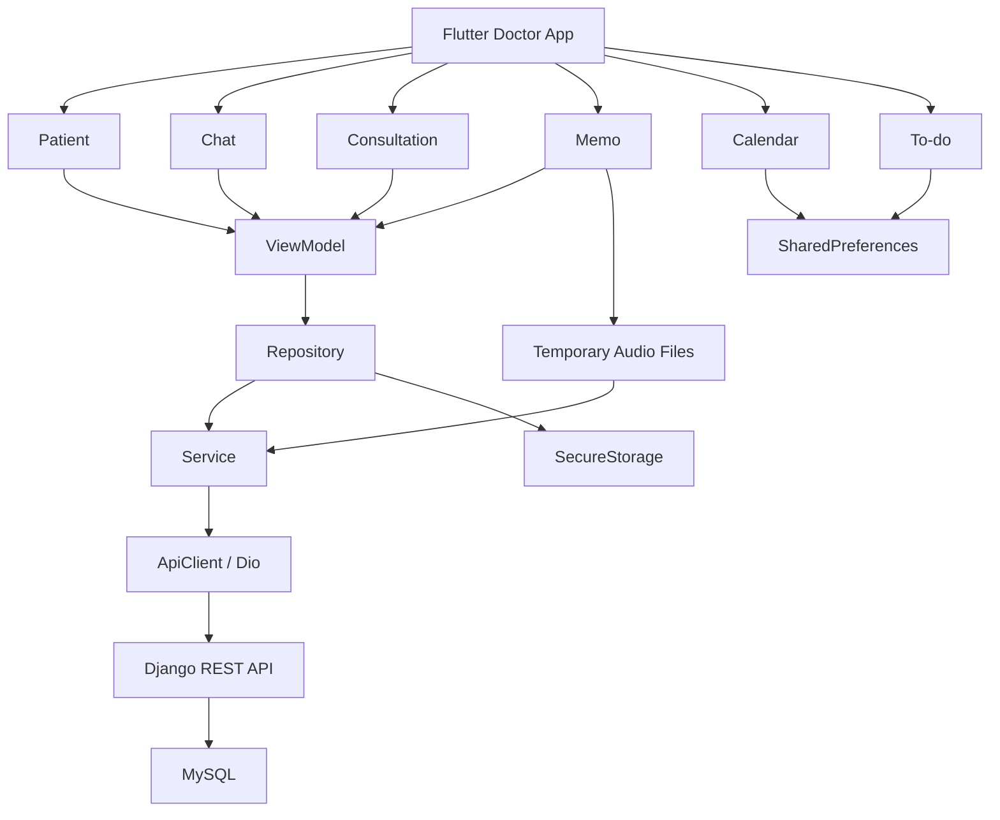

위 다이어그램은 주요 데이터 흐름을
개념적으로 정리한 것입니다.

MySQL은 팀 프로젝트 발표 자료의
서버 아키텍처를 기준으로 표시했습니다.

실제 서버의 물리 데이터베이스 구조와
파일 저장소 구성까지 검증한 것은 아닙니다.

---

## 5. Data Classification

VENA에서 사용하는 데이터는
관리 목적에 따라 구분할 수 있습니다.

| 데이터 | 관리 위치 | 주요 접근 방식 |
|---|---|---|
| 환자 정보 | 서버 | REST API |
| 검사 및 AI 결과 | 서버 | REST API |
| 채팅방 | 서버 | REST API |
| 채팅 메시지 | 서버 | REST API |
| 협진 요청 | 서버 | REST API |
| 텍스트 메모 | 서버 | JSON API |
| 음성 메모 | 서버 | Multipart 및 Audio API |
| 캘린더 일정 | 모바일 로컬 | SharedPreferences |
| To-do | 모바일 로컬 | SharedPreferences |
| 인증 정보 | 모바일 보안 저장소 | SecureStorage |
| 녹음 중인 음성 파일 | 임시 디렉터리 | File API |
| 화면 선택 상태 | 메모리 | Widget State |
| 기능별 요청 상태 | 메모리 | ViewModel |
| 테마 상태 | 메모리 | SettingsViewModel |

### 데이터 분리 목적

모든 데이터를 동일한 저장 방식으로
관리할 필요는 없습니다.

데이터의 공유 범위, 보존 필요성,
보안 요구 사항 및 접근 방식에 따라
서버와 로컬 저장소를 구분합니다.

다만 현재 저장 방식이
의료정보 보호 요구 사항을
모두 충족한다고 검증한 것은 아닙니다.

---

## 6. Data Ownership

### Server-managed Data

환자 정보, 채팅, 협진 및 메모는
서버 API를 통해 관리합니다.

클라이언트는 서버에서 전달받은
데이터를 모델로 변환하고
화면 상태에 반영합니다.

### Local-managed Data

캘린더 일정과 To-do는
현재 모바일 기기의 로컬 저장소를
기반으로 관리합니다.

서버와의 자동 동기화 기능은
확인되지 않았습니다.

### Ephemeral Data

다음 데이터는 주로 실행 중인
애플리케이션의 상태로 관리됩니다.

- 선택된 환자
- 선택된 메모
- 현재 필터
- 요청 진행 여부
- 오류 메시지
- 테마 상태
- 최근 조회 환자 목록

### Temporary Binary Data

음성 메모 작성 과정에서
녹음된 파일은 임시 디렉터리에
생성됩니다.

업로드 이후에는 서버 응답을
기준으로 메모 데이터를 관리합니다.

---

## 7. Layered Architecture

환자, 채팅, 협진 및 메모 기능은
다음과 같은 계층 구조를 사용합니다.

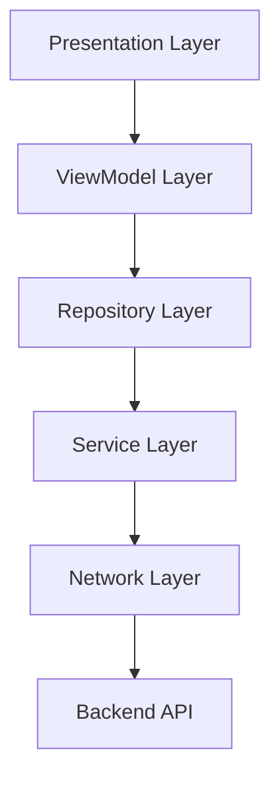

### 계층별 책임

| Layer | Responsibility |
|---|---|
| View | 사용자 입력 및 화면 표시 |
| ViewModel | 상태 관리 및 요청 흐름 제어 |
| Repository | 데이터 접근 및 인증 정보 처리 |
| Service | HTTP 요청 및 응답 처리 |
| Network | 공통 HTTP 클라이언트 설정 |
| Model | 데이터 구조 및 파싱 |

모든 기능이 완전히 동일한
계층 구조를 사용하는 것은 아닙니다.

캘린더와 To-do는 로컬 저장을
중심으로 하는 비교적 단순한
구조를 사용합니다.

---

## 8. MVVM Architecture

MVVM은 Model, View, ViewModel을
구분하여 애플리케이션의
화면과 상태 처리 로직을
분리하는 구조입니다.

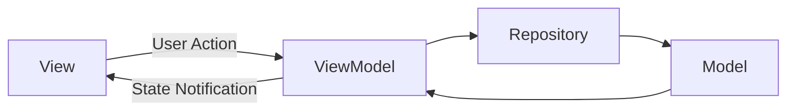

### Model

서버 응답 및 애플리케이션에서
사용하는 데이터 구조를 정의합니다.

### View

사용자 입력을 받고,
ViewModel의 상태를 기반으로
화면을 구성합니다.

### ViewModel

데이터 조회, 요청 상태,
오류 메시지 및 목록 갱신 등의
처리 흐름을 관리합니다.

### 적용 목적

- UI와 데이터 처리 책임 분리
- 상태 관리 구조 명확화
- 기능별 코드 유지보수
- 공통 데이터 접근 로직 재사용
- 테스트 가능한 구조로 확장

현재 구현은 MVVM의 주요 개념을
활용하는 구조입니다.

모든 비즈니스 로직이 ViewModel에
완전히 분리되어 있는 것은 아닙니다.

---

## 9. Feature-based Directory Structure

```text
lib/
├── app.dart
├── main.dart
├── core/
│   ├── constants/
│   ├── network/
│   ├── security/
│   ├── storage/
│   ├── theme/
│   ├── utils/
│   └── widgets/
│
└── features/
    ├── auth/
    ├── home/
    ├── patient/
    ├── chat/
    ├── consultation/
    ├── calendar/
    ├── memo/
    ├── appointment/
    ├── diagnosis/
    ├── ai_result/
    ├── notification/
    ├── clinical_report/
    ├── settings/
    └── mypage/
```

위 디렉터리 구조는
주요 기능을 중심으로 정리했습니다.

일부 세부 디렉터리 및 파일은
생략했습니다.

### 기능별 구성

환자, 채팅, 협진 및 메모 기능은
다음과 같은 내부 구조를 사용합니다.

```text
feature/
├── model/
├── repository/
├── service/
├── view/
├── view_model/
└── routes/
```

### 설계상 장점

기능에 관련된 모델, 화면,
데이터 접근 및 상태 관리 코드를
하나의 기능 단위로 확인할 수 있습니다.

### 현재 구조의 한계

프로젝트에는 일부 기존 모델과
서비스 코드가 별도 디렉터리에
남아 있는 구조도 존재합니다.

사용하지 않는 코드와 현재 사용하는
코드를 명확하게 구분하는
추가 정리가 필요할 수 있습니다.

---

## 10. Dependency Injection

의존성 주입은 객체가 필요한
다른 객체를 직접 생성하는 대신
외부에서 전달받도록 구성하는
방식입니다.

VENA는 Provider와 MultiProvider를
사용하여 공통 객체 및
기능별 객체를 구성합니다.

### 개념적 의존성 흐름

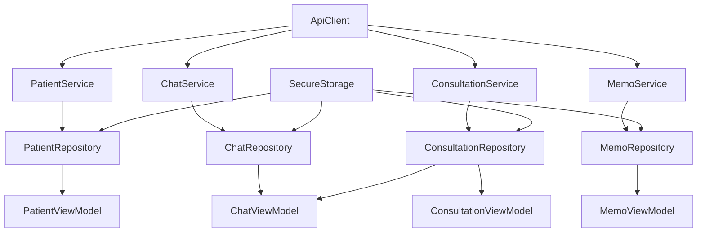

위 다이어그램은 주요 의존성을
축약하여 표현한 것입니다.

실제 모든 Provider 및 생성자
구성을 표시한 것은 아닙니다.

---

## 11. MultiProvider Composition

app.dart에서는 MultiProvider를
사용하여 앱에서 필요한
공통 객체와 상태 관리 객체를
구성합니다.

### 주요 객체

| 구분 | 구성 객체 |
|---|---|
| Network | ApiClient |
| Storage | SecureStorage |
| Authentication | AuthService, AuthRepository |
| Patient | PatientService, PatientRepository |
| Consultation | ConsultationService, ConsultationRepository |
| Chat | ChatService, ChatRepository |
| Memo | MemoService, MemoRepository |
| State | 기능별 ViewModel |
| Theme | SettingsViewModel |
| Calendar | CalendarViewModel |

### 의존성 구성 예시

```dart
MultiProvider(
  providers: [
    Provider<ApiClient>(
      create: (_) => ApiClient(),
    ),

    Provider<SecureStorage>(
      create: (_) => SecureStorage(),
    ),

    // Feature Services
    // Feature Repositories
    // Feature ViewModels
  ],
  child: const App(),
);
```

위 코드는 MultiProvider의
구성 개념을 설명하기 위한
축약 예시입니다.

실제 app.dart 전체를
그대로 복사한 코드는 아닙니다.

### 의존성 주입의 장점

- 공통 객체 재사용
- 객체 생성 책임 분리
- 기능별 의존성 명확화
- 테스트용 객체 교체 가능성
- 화면에서 직접 HTTP 객체를
  생성하는 구조 감소

---

## 12. Provider State Access

Provider를 사용하면 화면에서
등록된 객체와 상태를
조회할 수 있습니다.

### context.read

객체에 접근하여 메서드를
호출할 때 사용할 수 있습니다.

```dart
context.read<MemoViewModel>();
```

### context.watch

상태 변경을 구독하여
화면을 다시 구성할 때
사용할 수 있습니다.

```dart
context.watch<MemoViewModel>();
```

### 사용 목적

| 접근 방식 | 주요 목적 |
|---|---|
| read | 이벤트 처리 및 메서드 호출 |
| watch | 상태 변경에 따른 화면 갱신 |

### 상태 변경 흐름

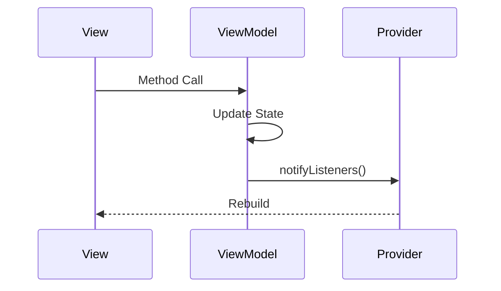

### 개선 방향

큰 화면에서 여러 ViewModel을
동시에 구독하면 일부 상태 변경에도
화면 전체가 다시 구성될 수 있습니다.

필요한 상태만 구독하는
Selector 또는 context.select
사용을 고려할 수 있습니다.

실제 렌더링 성능을 측정한
결과는 아닙니다.

---

## 13. Repository Pattern

Repository는 ViewModel과
실제 데이터 접근 구현 사이의
중간 계층입니다.

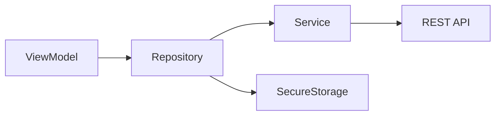

### 현재 Repository의 주요 역할

- 인증 토큰 조회
- 인증 정보 존재 여부 확인
- Service 메서드 호출
- 데이터 접근 오류 변환
- 기능별 데이터 접근 인터페이스 제공

### Repository를 사용하는 이유

ViewModel이 HTTP 요청 구성과
인증 정보 조회를 직접 담당하면
상태 관리와 네트워크 처리의
책임이 혼합될 수 있습니다.

Repository를 통해 데이터 접근
과정을 분리하면 ViewModel은
요청 흐름과 상태 관리에
집중할 수 있습니다.

### 현재 구현 범위

Repository를 사용한다고 해서
자동으로 캐싱, 오프라인 동기화,
데이터베이스 추상화까지
제공되는 것은 아닙니다.

현재 구현은 서버 API 접근과
인증 정보 처리 중심입니다.

---

## 14. Service Layer

Service는 실제 HTTP 요청과
응답 처리에 집중합니다.

### 주요 책임

- HTTP Method 선택
- Endpoint 구성
- Query Parameter 구성
- Authorization Header 구성
- JSON Request 구성
- Multipart Request 구성
- 응답 데이터 추출
- Model 변환
- DioException 처리

### 기능별 Service

| Service | 주요 기능 |
|---|---|
| PatientService | 환자 목록 및 상세 조회 |
| ChatService | 채팅방 및 메시지 요청 |
| ConsultationService | 협진 요청 및 상태 변경 |
| MemoService | 메모 CRUD 및 음성 업로드 |

### 설계 목적

HTTP 요청의 세부 구현을
화면에서 분리하여
네트워크 통신 방식이 변경될 때
수정 범위를 줄일 수 있습니다.

---

## 15. Common Network Client

ApiClient는 Dio 기반의
공통 HTTP 클라이언트를
구성합니다.

### 주요 설정

| 항목 | 설정 |
|---|---|
| HTTP Client | Dio |
| Base URL | 환경 변수 기반 설정 및 기본 주소 |
| Connect Timeout | 10초 |
| Send Timeout | 15초 |
| Receive Timeout | 15초 |
| Accept | application/json |
| Content-Type | application/json |
| Error Response Data | 수신하도록 설정 |
| Logging | LogInterceptor |

### Base URL 관리

API_BASE_URL 환경 값을
사용할 수 있도록 구성되어 있습니다.

```dart
const String.fromEnvironment(
  'API_BASE_URL',
);
```

위 코드는 환경 설정 개념을
설명하기 위한 축약 예시입니다.

실제 서버 주소는 공개 문서에
포함하지 않습니다.

### 공통 설정의 장점

- 서버 주소 관리
- 요청 시간 제한 통일
- 기본 Header 관리
- 네트워크 설정 중복 감소

---

## 16. Timeout Strategy

공통 네트워크 클라이언트에는
연결, 전송 및 응답 수신에 대한
시간 제한이 설정되어 있습니다.

### Timeout 구분

| 종류 | 의미 |
|---|---|
| Connect Timeout | 서버 연결 과정의 제한 |
| Send Timeout | 요청 전송 과정의 제한 |
| Receive Timeout | 응답 수신 과정의 제한 |

### 음성 파일 업로드 고려 사항

일반적인 JSON 요청과 달리
음성 메모 업로드는 파일 크기와
네트워크 환경의 영향을 받습니다.

128 kbps 녹음 설정을 기준으로
5분 음성의 이론적 파일 크기는
약 4.8 MB입니다.

1 Mbps 환경에서 전송할 경우
이론적으로 약 38.4초가 필요합니다.

따라서 대용량 파일 요청에서는
공통 Timeout 설정이 적절한지
별도로 검토할 필요가 있습니다.

위 수치는 계산에 따른 추정값이며
실제 업로드 성능 측정값이 아닙니다.

Dio의 Timeout 동작 또한
단순한 전체 요청 시간 제한과
동일하다고 가정하지 않습니다.

---

## 17. API Endpoint Management

공통 ApiEndpoints를 통해
주요 API 경로를 관리합니다.

### Authentication

| Method | Endpoint |
|---|---|
| POST | /api/login/ |
| POST | /api/token/refresh/ |
| GET | /api/me/ |

### Patient

| Method | Endpoint |
|---|---|
| GET | /api/patients/ |
| GET | /api/patients/{patientId}/ |

### Chat

| Method | Endpoint |
|---|---|
| GET | /api/chat/rooms/ |
| POST | /api/chat/rooms/ |
| GET | /api/chat/rooms/{id}/messages/ |
| POST | /api/chat/rooms/{id}/messages/ |
| PATCH | /api/chat/rooms/{id}/read/ |
| PATCH | /api/chat/messages/{id}/resource-status/ |

### Consultation

| Method | Endpoint |
|---|---|
| GET | /api/doctors/ |
| GET | /api/consultations/ |
| POST | /api/consultations/ |
| PATCH | /api/consultations/{id}/status/ |
| PATCH | /api/consultations/{id}/complete/ |

### Memo

| Method | Endpoint |
|---|---|
| GET | /api/memos/ |
| POST | /api/memos/ |
| GET | /api/memos/{id}/ |
| PATCH | /api/memos/{id}/ |
| DELETE | /api/memos/{id}/ |
| POST | /api/memos/voice/ |
| GET | /api/memos/{id}/audio/ |

위 표는 주요 클라이언트 요청을
중심으로 정리한 것입니다.

서버의 전체 API 명세를
검증한 결과는 아닙니다.

---

## 18. REST API Design Perspective

REST API를 통해 서버에
데이터 조회 및 변경을 요청합니다.

### HTTP Method

| Method | 일반적인 목적 |
|---|---|
| GET | 데이터 조회 |
| POST | 신규 데이터 생성 또는 작업 요청 |
| PATCH | 데이터 일부 변경 |
| DELETE | 데이터 삭제 |

### VENA 적용 예시

```http
GET /api/patients/
```

환자 목록 조회 요청입니다.

```http
POST /api/consultations/
```

신규 협진 요청을 생성합니다.

```http
PATCH /api/consultations/101/status/
```

협진 상태 변경을 요청합니다.

```http
DELETE /api/memos/102/
```

특정 메모 삭제를 요청합니다.

모든 ID는 설명을 위한
가상 식별자입니다.

### 설계상 고려 사항

HTTP Method의 선택뿐 아니라
서버에서 각 요청의 권한,
입력값, 상태 전환 및
데이터 일관성을 검증해야 합니다.

---

## 19. Query Parameter Management

일부 기능에서는 Query Parameter를
사용하여 서버에 조회 범위를
전달합니다.

### 받은 협진 요청

```http
GET /api/consultations/?receiver=me
```

### 보낸 협진 요청

```http
GET /api/consultations/?sender=me
```

### 환자별 메모

```http
GET /api/memos/?patient_id=DEMO-001
```

### 설계 목적

- 필요한 데이터 범위 지정
- 조회 목적 구분
- 클라이언트 데이터 처리 단순화

### 보안 고려 사항

Query Parameter는 사용자가
변경할 수 있는 요청 데이터입니다.

따라서 서버에서는 해당 필터가
인증된 사용자의 접근 권한을
벗어나지 않는지 검증해야 합니다.

클라이언트가 환자 ID를
전달하는 것만으로 접근 권한이
보장되는 것은 아닙니다.

---

## 20. Request Serialization

서버에 전달하는 데이터는
요청 목적에 따라 구성합니다.

### JSON Request

```json
{
  "patient_id": "DEMO-001",
  "memo_type": "text",
  "title": "참고 사항",
  "content": "추가 자료 검토 필요"
}
```

### Multipart Request

```text
patient_id: DEMO-001
memo_type: voice
title: 음성 참고 기록
audio_duration_seconds: 60
audio_file: voice_memo.m4a
```

### 데이터 유형별 전송 방식

| 데이터 | 전송 방식 |
|---|---|
| 환자 조회 조건 | Query Parameter |
| 채팅 메시지 | JSON |
| 협진 요청 | JSON |
| 텍스트 메모 | JSON |
| 음성 메모 | Multipart FormData |

모든 예시 데이터는
실제 환자 정보와 관계없는
가상 데이터입니다.

---

## 21. Response Deserialization

서버 응답은 Flutter에서
사용할 수 있는 데이터 모델로
변환합니다.

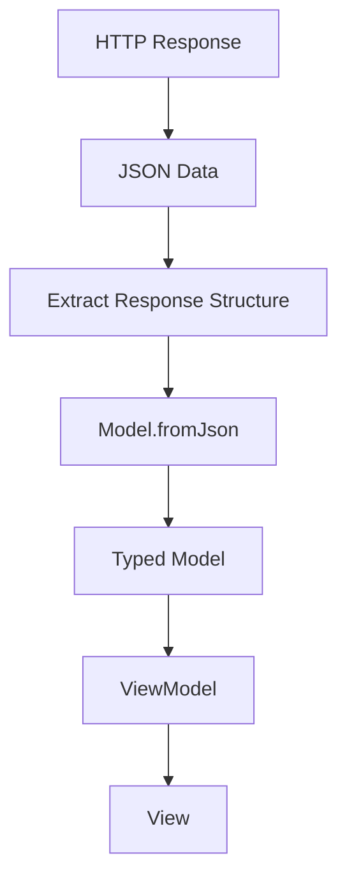

### 모델 예시

- Patient
- PatientDetail
- ChatDoctor
- ChatRoom
- ChatMessage
- ConsultationDoctor
- ConsultationRequest
- PatientMemo
- ScheduleItem

### 모델 변환의 목적

동적인 JSON 데이터를
애플리케이션에서 사용하는
구조화된 객체로 변환합니다.

화면에서 JSON 필드 이름을
직접 참조하는 코드의 증가를
줄일 수 있습니다.

---

## 22. Response Structure Normalization

서버 응답은 API에 따라
서로 다른 형태를 가질 수 있습니다.

### 직접적인 목록

```json
[
  {
    "id": 101
  },
  {
    "id": 102
  }
]
```

### Wrapper 형태

```json
{
  "results": [
    {
      "id": 101
    }
  ]
}
```

### Data Wrapper

```json
{
  "data": [
    {
      "id": 101
    }
  ]
}
```

일부 Service에서는
results, data 또는 기능별
Wrapper 키를 확인하여
목록 데이터를 추출합니다.

### 장점

- 응답 구조 변화 대응
- 모델 변환 로직 집중
- 화면의 파싱 책임 감소

### 한계

예상하지 못한 응답 구조를
빈 목록으로 처리하면
서버 계약 오류가 정상적인
빈 데이터처럼 보일 수 있습니다.

향후 응답 스키마 검증과
명확한 파싱 오류 처리를
고려할 수 있습니다.

---

## 23. Field Normalization

일부 모델에서는 서로 다른
필드 이름과 데이터 타입을
처리하는 로직이 존재합니다.

### 필드 이름 예시

```text
patient_id
patientId
```

```text
created_at
createdAt
```

### 숫자 변환

```text
101
"101"
```

### 날짜 변환

```dart
DateTime.tryParse(value);
```

### 문자열 정규화

```dart
value.trim();
```

위 코드는 처리 방식을
설명하기 위한 예시입니다.

### 설계 목적

서버 응답의 일부 표현 차이로
인한 파싱 실패를 줄이고
화면에서 일관된 모델을
사용할 수 있도록 합니다.

### 개선 방향

서버와 클라이언트가
명확한 API 계약을 공유하면
과도한 필드 별칭과 기본값
처리를 줄일 수 있습니다.

---

## 24. Nullable Data Handling

의료진 애플리케이션에서
일부 데이터는 존재하지 않을 수
있습니다.

### 예시

- 관련 검사 ID
- 메모 수정 시각
- 음성 변환 텍스트
- 검사 결과
- 일부 환자 정보
- 협진 완료 시각

### Nullable 처리 목적

존재하지 않는 데이터와
실제로 값이 있는 데이터를
구분할 수 있도록 합니다.

### 기본값 사용의 위험

예를 들어 환자 나이가
누락된 경우 0을 기본값으로
사용하면 실제 나이와
누락 상태를 구분하기 어렵습니다.

메모 ID가 누락된 경우에도
기본값이 유효한 식별자처럼
사용될 수 있습니다.

### 개선 방향

- 필수 필드 검증
- Nullable 필드 명확화
- Unknown 상태 표현
- 잘못된 식별자 요청 제한
- 파싱 오류와 빈 데이터 구분

---

## 25. Authentication Data Flow

인증 정보는 공통 SecureStorage
구조를 통해 접근합니다.

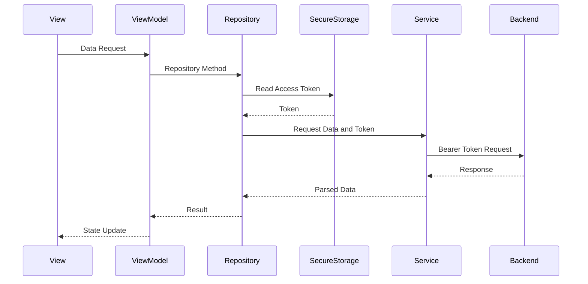

### 인증 Header

```http
Authorization: Bearer <ACCESS_TOKEN>
```

### 현재 처리

Repository에서 인증 정보를
조회하고 Service에 전달합니다.

토큰이 없거나 비어 있는 경우
요청을 제한하는 구조가
존재합니다.

---

## 26. JWT Management Perspective

JWT는 서버와 클라이언트 사이에서
인증 정보를 전달하는 데
사용할 수 있는 토큰 형식입니다.

### Access Token

보호된 API에 접근하기 위한
인증 정보로 사용합니다.

### Refresh Token

Access Token이 만료되었을 때
새로운 토큰을 발급받는 과정에
사용할 수 있습니다.

### 프로젝트 구조

공통 인증 모듈에는
로그인 및 토큰 갱신 관련
Endpoint가 존재합니다.

팀 발표 자료에는 Access Token과
Refresh Token을 사용하는
인증 구조가 설명되어 있습니다.

### 검증 범위

개별 기능의 Repository가
Access Token을 조회하여
요청에 전달하는 구조는
확인했습니다.

그러나 모든 API 요청에서
토큰 만료가 자동으로 처리되고
실패한 요청이 다시 실행되는
구조까지 검증한 것은 아닙니다.

---

## 27. Proposed Token Refresh Flow

다음은 향후 고려할 수 있는
공통 토큰 갱신 구조입니다.

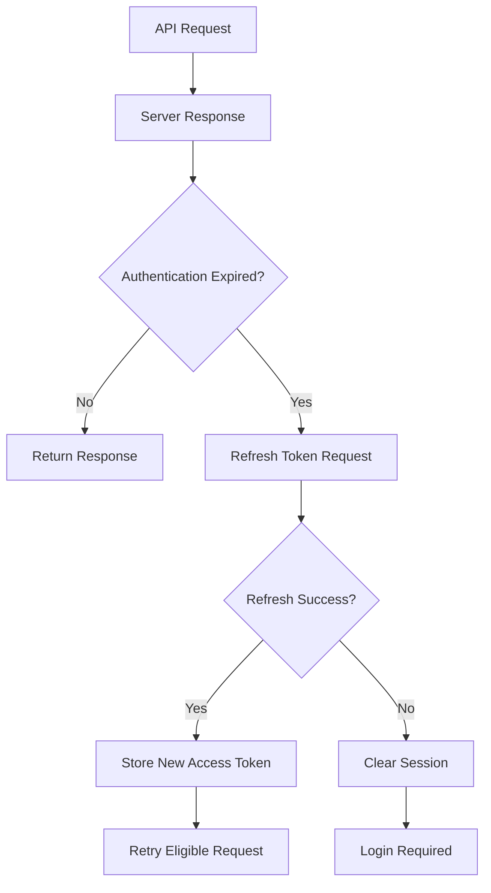

### 추가 고려 사항

- 동시에 발생하는 토큰 갱신 요청
- 갱신 요청의 중복 실행 방지
- 재시도 횟수 제한
- Refresh Token 만료
- 사용자 로그아웃
- POST 요청 재시도의 중복 생성 위험

위 구조는 개선 제안입니다.

현재 공통 Dio Interceptor에서
동일한 자동 갱신 구조가
완성되어 있다고 주장하지 않습니다.

---

## 28. Authentication vs Authorization

### Authentication

요청을 수행하는 사용자가
누구인지 확인하는 과정입니다.

### Authorization

인증된 사용자가 특정 데이터나
기능에 접근할 수 있는지
판단하는 과정입니다.

### VENA 예시

의료진이 인증 토큰을 사용하여
메모 조회 API를 호출할 수 있습니다.

그러나 해당 의료진이 모든 환자의
메모에 접근할 수 있어야 한다는
의미는 아닙니다.

### 서버 검증 대상

- 환자 정보 접근 권한
- 채팅방 참여자 확인
- 협진 요청 발신자 및 수신자
- 메모 작성자 및 조회 권한
- 음성 파일 접근 권한
- 검사 및 AI 결과 접근 권한

서버의 객체 단위 권한 검증은
별도로 확인해야 합니다.

---

## 29. ChangeNotifier State Management

ChangeNotifier는 상태 변경을
구독자에게 전달할 수 있는
Flutter의 상태 관리 방식입니다.

### 개념적 예시

```dart
class ExampleViewModel extends ChangeNotifier {
  bool _isLoading = false;

  bool get isLoading => _isLoading;

  void updateLoading(bool value) {
    _isLoading = value;
    notifyListeners();
  }
}
```

위 코드는 ChangeNotifier의
동작을 설명하기 위한
독립적인 예시입니다.

### VENA 적용 기능

- 환자 목록
- 환자 상세
- 채팅방 및 메시지
- 협진 요청
- 메모 목록
- 캘린더 일정
- 테마 상태

### 상태 변경 목적

데이터가 변경될 때
관련 화면이 새로운 상태를
반영할 수 있도록 합니다.

---

## 30. Request State Model

비동기 API 요청에서는
데이터 자체뿐 아니라
요청 진행 상태도 관리해야 합니다.

### 주요 상태

| 상태 | 의미 |
|---|---|
| Idle | 요청 진행 전 |
| Loading | 데이터 조회 중 |
| Saving | 데이터 등록 또는 수정 중 |
| Deleting | 데이터 삭제 중 |
| Success | 요청 성공 |
| Error | 요청 실패 |

위 상태는 개념적인 구분입니다.

모든 ViewModel이 동일한
Enum 기반 상태 머신을
사용하는 것은 아닙니다.

### 현재 구현

기능별로 Boolean 상태와
오류 메시지를 사용하여
요청 진행 여부를 관리합니다.

---

## 31. Asynchronous Request Lifecycle

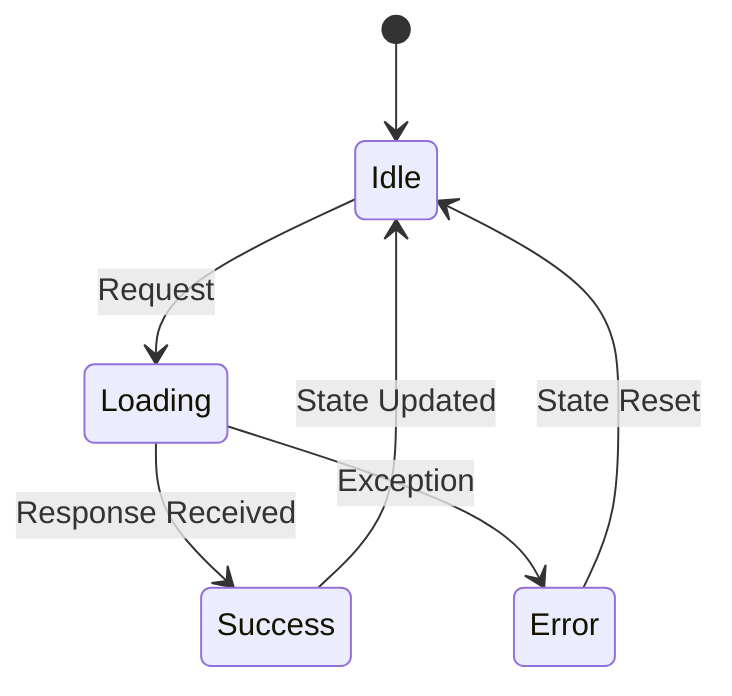

### 일반적인 처리 구조

```dart
Future<void> loadData() async {
  if (isLoading) {
    return;
  }

  isLoading = true;
  errorMessage = null;

  notifyListeners();

  try {
    final result = await repository.fetchData();

    data = result;
  } catch (error) {
    errorMessage = '데이터를 불러오지 못했습니다.';
  } finally {
    isLoading = false;
    notifyListeners();
  }
}
```

위 코드는 여러 ViewModel에서
사용하는 비동기 처리 개념을
설명하기 위한 축약 예시입니다.

실제 특정 파일의 전체 메서드를
그대로 복사한 것은 아닙니다.

---

## 32. Loading Guard

일부 ViewModel에서는
이미 요청이 진행 중인 경우
추가 요청을 제한합니다.

### 개념적 처리

```dart
if (_isLoading) {
  return;
}
```

### 설계 목적

- 동일 요청의 반복 실행 감소
- 불필요한 네트워크 요청 제한
- 요청 상태 충돌 감소
- 반복적인 버튼 입력 제한

### 한계

Loading Guard는
클라이언트 내부의 요청 상태를
기준으로 동작합니다.

서버에서 동일한 작업이
중복 실행되는 것을
완전히 방지하지는 못합니다.

또한 모든 조회 및 새로고침
메서드가 동일한 Guard를
사용하는 것은 아닙니다.

---

## 33. Finally-based State Recovery

비동기 요청에서 예외가 발생하면
요청 상태가 복구되지 않는
문제가 발생할 수 있습니다.

### 개선된 처리 개념

```dart
try {
  await repository.request();
} catch (error) {
  handleError(error);
} finally {
  isLoading = false;
  notifyListeners();
}
```

### finally의 역할

요청 성공 또는 실패와
관계없이 정리 로직을
실행할 수 있도록 합니다.

### 프로젝트 적용 목적

- 로딩 상태 해제
- 저장 버튼 상태 복구
- 메시지 전송 상태 해제
- 삭제 요청 상태 정리

모든 예외 상황에서
상태 복구가 완전하게 동작하는지
실행 검증한 것은 아닙니다.

---

## 34. Feature-specific State

| 기능 | 주요 상태 |
|---|---|
| Patient | 환자 목록, 상세, 최근 환자, 로딩 |
| Chat | 채팅방, 메시지, 읽지 않은 개수, 전송 상태 |
| Consultation | 받은 요청, 보낸 요청, 제출 상태 |
| Memo | 메모 목록, 선택 메모, 필터, 저장 및 삭제 상태 |
| Calendar | 선택 날짜, 일정 목록 |
| To-do | 업무 목록, 완료 여부 |
| Settings | ThemeMode |

### 상태 분리의 목적

모든 기능을 하나의 거대한
상태 객체로 관리하는 대신
기능별로 상태를 구분합니다.

다만 동일한 기능 내부에서도
여러 화면이 공통 ViewModel을
공유하는 경우 조회 범위가
충돌할 수 있습니다.

---

## 35. Patient State Management

환자 기능은 목록과 상세 정보를
구분하여 관리합니다.

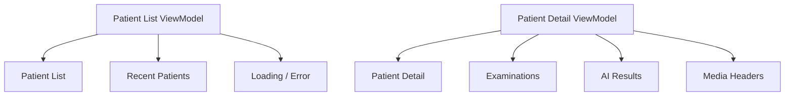

### 주요 특징

- 환자 목록 조회
- 환자 상세 조회
- 환자 ID 기반 데이터 접근
- 최근 조회 환자 관리
- 조회 오류 상태 관리
- 의료영상 접근 Header 구성

### 최근 환자 상태

최근 조회 환자는
환자 ID를 기준으로 중복을
줄이고 최대 10개까지
관리하는 구조입니다.

현재 메모리 기반 상태이며
영구 저장 기능으로 설명하지 않습니다.

---

## 36. Chat State Management

채팅 기능은 채팅방 목록과
메시지 목록을 관리합니다.

### 주요 상태

- 채팅방 목록
- 의료진 목록
- 채팅방별 메시지
- 읽지 않은 메시지 개수
- 채팅방별 조회 상태
- 채팅방별 전송 상태
- 공유 자료 확인 및 답변 상태

### 채팅방별 상태 관리

일부 요청 상태는
채팅방 ID를 기준으로
관리하는 구조입니다.

```text
_loadingRoomIds
_sendingRoomIds
_roomsWithLoadedMessages
```

### 설계 목적

한 채팅방에서 진행 중인
요청 상태를 다른 채팅방과
구분할 수 있도록 합니다.

### 잠재적인 한계

채팅방 목록 갱신과
개별 메시지 목록 갱신의
시점이 다를 수 있습니다.

최신 메시지와 읽지 않은 개수가
항상 동일한 시점의 상태를
나타내는지 추가 검증이 필요합니다.

---

## 37. Consultation State Management

협진 기능은 받은 요청과
보낸 요청을 구분합니다.

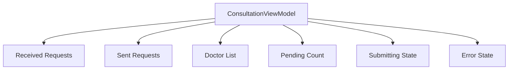

### 상태 변경

협진 요청의 검토 및 완료 상태를
서버 API를 통해 변경합니다.

서버 응답으로 전달된
협진 요청 객체를
기존 목록에 반영합니다.

### 주의 사항

클라이언트의 상태 변경 제한과
서버의 실제 상태 전환 검증은
서로 다른 책임입니다.

서버에서도 허용되지 않는
상태 전환과 권한 없는 요청을
검증해야 합니다.

---

## 38. Memo State Management

메모 기능은 다음 상태를
공통 ViewModel에서 관리합니다.

- 메모 목록
- 선택된 메모
- 메모 유형 필터
- 조회 상태
- 저장 상태
- 삭제 상태
- 오류 메시지

### 데이터 갱신

등록 및 수정 성공 이후
서버 응답을 모델로 변환하여
목록에 반영합니다.

삭제는 서버 성공 이후
목록에서 해당 메모를 제거합니다.

### 조회 범위 문제

환자별 메모 화면과
최근 음성 메모 화면이
동일한 ViewModel을 사용합니다.

따라서 조회 범위가 달라지는
상황에서 목록 상태가
서로 영향을 받을 가능성이 있습니다.

이 문제는 정적 코드 분석에서
도출한 검토 사항이며
실제 장애 재현 결과는 아닙니다.

---

## 39. Calendar State Management

캘린더는 선택된 날짜와
일정 목록을 관리합니다.

### 주요 상태

```text
selectedDate
schedules
```

### 주요 처리

- 날짜 선택
- 날짜 범위에 포함되는 일정 조회
- 일정 시간 기준 정렬
- 일정 추가
- 일정 수정
- 일정 삭제
- 로컬 저장

### 상태 변경 흐름

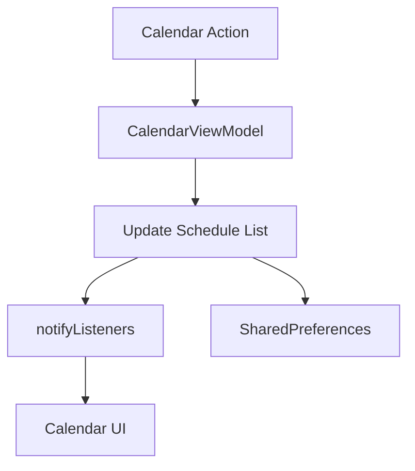

현재 일부 저장 작업은
비동기로 실행됩니다.

화면 상태 변경이
로컬 저장 완료를 의미하지는 않습니다.

---

## 40. To-do State Management

To-do는 HomeView 내부의
Widget State를 사용합니다.

### 주요 데이터

```text
title
isCompleted
```

### 주요 기능

- 업무 추가
- 완료 여부 변경
- 업무 삭제
- 삭제 취소
- 로컬 저장

### ViewModel과 Widget State 비교

| 기능 | 관리 방식 |
|---|---|
| 환자 | ViewModel |
| 채팅 | ViewModel |
| 협진 | ViewModel |
| 메모 | ViewModel |
| 캘린더 | ViewModel |
| To-do | HomeView 내부 상태 |

### 개선 방향

To-do 기능을 다른 화면에서도
사용하거나 서버 동기화 기능을
추가하는 경우 별도의
TodoViewModel 및 Repository로
분리할 수 있습니다.

현재 To-do 기능이
독립적인 MVVM 계층을
완전히 구성하고 있다고
설명하지 않습니다.

---

## 41. Local State vs Shared State

### Local State

특정 화면에서만 필요한
상태를 관리합니다.

예시:

- 입력창 내용
- Dialog 상태
- 현재 녹음 상태
- 화면 내부 선택값
- To-do 목록

### Shared State

여러 화면에서 사용할 수 있는
상태를 관리합니다.

예시:

- 환자 목록
- 채팅방 목록
- 협진 요청
- 메모 목록
- 캘린더 일정
- 테마 상태

### 선택 기준

| 고려 사항 | Local State | Shared State |
|---|---|---|
| 사용 범위 | 특정 화면 | 여러 화면 |
| 생명주기 | 화면 중심 | Provider 범위 중심 |
| 상태 접근 | Widget | ViewModel |
| 복잡도 | 상대적으로 낮음 | 공유 범위 관리 필요 |

공유 상태는 편리하지만
불필요하게 넓은 범위에서
사용하면 데이터 충돌 및
세션 분리 문제가 발생할 수 있습니다.

---

## 42. Future and Async/Await

Dart의 Future는
나중에 완료되는 작업의 결과를
표현할 수 있습니다.

VENA에서는 서버 요청과
파일 및 로컬 저장소 접근에
비동기 처리를 사용합니다.

### 주요 비동기 작업

- Access Token 조회
- 환자 목록 조회
- 채팅방 조회
- 메시지 전송
- 협진 요청
- 메모 등록
- 음성 파일 업로드
- SharedPreferences 읽기 및 쓰기
- 음성 파일 재생 준비
- 임시 파일 삭제

### 처리 예시

```dart
final token = await storage.readToken();

final result = await service.fetchData(token);

updateState(result);
```

위 코드는 비동기 처리 순서를
설명하기 위한 개념적 예시입니다.

---

## 43. Sequential Processing

이전 작업의 결과가
다음 작업에 필요한 경우
순차적으로 처리해야 합니다.

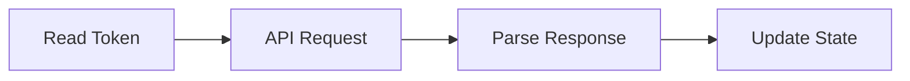

### 적용 예시

- 인증 토큰 조회 후 API 요청
- 음성 녹음 종료 후 파일 업로드
- 서버 응답 수신 후 목록 갱신
- 삭제 성공 후 목록 항목 제거

### 설계 목적

작업 사이의 의존성을
명확하게 관리합니다.

이전 작업이 실패한 경우
다음 작업을 실행하지 않도록
제어할 수 있습니다.

---

## 44. Concurrent Asynchronous Processing

서로 독립적인 비동기 작업은
Future.wait를 사용하여
함께 실행할 수 있습니다.

### 협진 요청 조회

받은 협진 요청과
보낸 협진 요청은
서로 다른 조회 작업입니다.

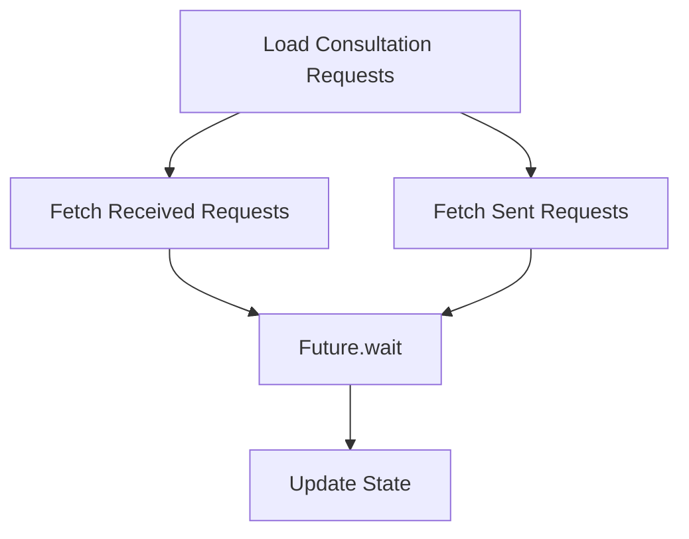

### 홈 화면 새로고침

HomeView의 새로고침 과정에서도
여러 데이터 조회 작업을
Future.wait로 묶어 처리하는
구조가 존재합니다.

### 개념적 예시

```dart
await Future.wait([
  loadPatients(),
  loadConsultations(),
  loadAppointments(),
  loadReports(),
]);
```

위 코드는 독립적인 조회 작업을
함께 실행하는 개념을 설명합니다.

실제 메서드 이름 및
전체 구현을 그대로 복사한
코드는 아닙니다.

---

## 45. Sequential vs Concurrent Requests

서로 독립적인 요청 세 개가
존재한다고 가정합니다.

| Request | 가상 소요 시간 |
|---|---|
| A | 700ms |
| B | 800ms |
| C | 600ms |

### 순차 처리

```text
A: 700ms
B: 800ms
C: 600ms

Total: 2,100ms
```

### 동시 비동기 처리

```text
A: 700ms
B: 800ms
C: 600ms

Ideal Total: approximately 800ms
```

### 이론적 차이

독립적인 요청을 동시에
시작하면 모든 요청을
순서대로 기다리는 것보다
전체 대기 시간을 줄일
가능성이 있습니다.

### 측정 범위

위 수치는 설명을 위한
가상 시나리오입니다.

VENA의 실제 응답 시간을
측정하거나 성능 개선율을
검증한 결과는 아닙니다.

Future.wait는 비동기 작업의
완료를 함께 기다리는 기능이며,
CPU 작업을 별도 스레드에서
자동으로 병렬 실행하는
기능은 아닙니다.

---

## 46. Future.wait Error Handling

Future.wait로 여러 요청을
묶으면 오류 처리 정책도
고려해야 합니다.

### 가상 상황

```text
Received Requests: Success
Sent Requests: Failure
```

현재 협진 전체 조회에서는
두 요청의 결과를 함께 기다린 후
목록에 반영하는 구조가 존재합니다.

따라서 하나의 요청이 실패하면
다른 요청이 성공했더라도
해당 전체 갱신이 수행되지
않을 수 있습니다.

### 개선 방향

- 요청별 성공 및 실패 관리
- 부분 성공 데이터 반영
- 기능별 오류 메시지
- 실패한 요청만 재시도
- 화면별 로딩 상태 분리

### 주의 사항

부분 성공 처리가 필요한지 여부는
기능의 데이터 일관성 요구 사항에
따라 결정해야 합니다.

---

## 47. Polling Architecture

채팅방 목록의 변경 상태를
주기적으로 조회하기 위해
Polling 구조가 사용됩니다.

### 확인된 구현

AppShell에서는 5초 간격으로
ChatViewModel의 loadRooms를
호출하는 Timer가 존재합니다.

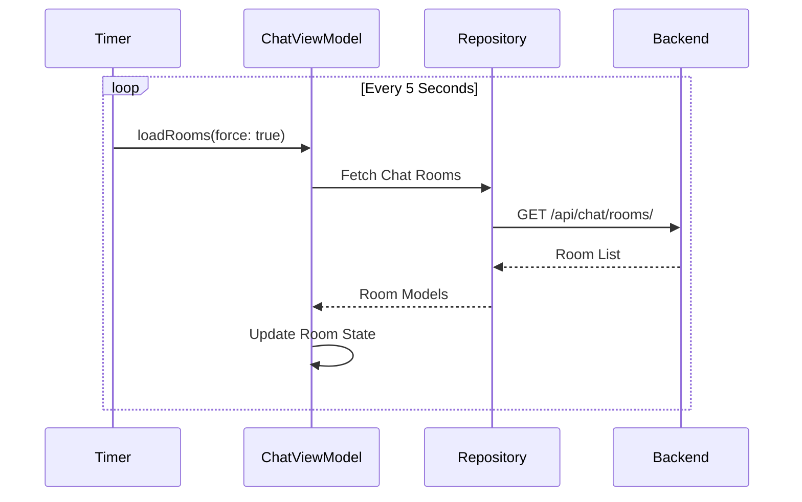

### Polling 범위

현재 확인된 5초 Polling은
채팅방 목록 조회를 대상으로 합니다.

모든 개별 채팅 메시지가
5초마다 자동으로 갱신된다고
확인한 것은 아닙니다.

---

## 48. Polling Implementation

AppShell의 주요 처리 구조는
다음과 같습니다.

```dart
_chatPollingTimer = Timer.periodic(
  const Duration(seconds: 5),
  (_) {
    if (mounted) {
      context
          .read<ChatViewModel>()
          .loadRooms(force: true);
    }
  },
);
```

위 코드는 AppShell에서 확인한
Polling 구조의 핵심 부분입니다.

### 주요 특징

- Timer.periodic 사용
- 5초 주기
- mounted 확인
- 채팅방 목록 갱신 요청
- 화면 종료 시 Timer 정리

### 요청 실행과 Timer의 차이

Timer가 호출되었다는 사실과
실제 HTTP 요청이 실행되었다는
사실은 구분해야 합니다.

ViewModel 내부의 요청 제한 및
실행 상태에 따라 실제 요청 횟수는
달라질 수 있습니다.

---

## 49. Polling Request Estimation

5초 주기의 Timer가
계속 실행된다고 가정합니다.

### 이론적 호출 횟수

```text
60 seconds / 5 seconds
= 12 callbacks per minute
```

| 실행 시간 | 이론적 Timer 호출 횟수 |
|---|---|
| 1분 | 12회 |
| 10분 | 120회 |
| 30분 | 360회 |
| 1시간 | 720회 |

### 동시 사용자 가정

100개의 클라이언트가
동일한 주기로 요청하고,
모든 Timer 호출이 HTTP 요청으로
이어진다고 가정합니다.

```text
100 clients / 5 seconds
= 20 requests per second
```

이는 초기 조회 요청을 제외한
단순한 이론적 평균입니다.

실제 서버 요청량, 동시 접속자 수,
네트워크 처리량 또는
부하 테스트 결과가 아닙니다.

---

## 50. Polling vs WebSocket

| 항목 | Polling | WebSocket |
|---|---|---|
| 연결 방식 | 반복 HTTP 요청 | 지속 연결 |
| 데이터 전달 | 클라이언트 조회 | 양방향 이벤트 전달 |
| 변경 감지 | 다음 조회 시점 | 이벤트 발생 시 전달 가능 |
| 유휴 상태 | 반복 요청 가능 | 연결 유지 필요 |
| 구현 고려 사항 | 조회 주기 및 요청량 | 연결 및 재연결 관리 |

### 현재 프로젝트

최종 Flutter 소스에서는
REST API 기반 채팅방 목록
Polling 구조를 확인했습니다.

WebSocket 기반 실시간 메시지
스트리밍은 확인되지 않았습니다.

### 개선 방향

채팅 메시지의 실시간 전달이
필요한 경우 WebSocket을
고려할 수 있습니다.

다만 WebSocket 도입 시에도
인증, 재연결, 메시지 순서,
누락 데이터 복구 및
서버 확장성을 고려해야 합니다.

---

## 51. Polling Lifecycle

AppShell은 Timer를 생성하고
dispose에서 정리하는
구조를 사용합니다.

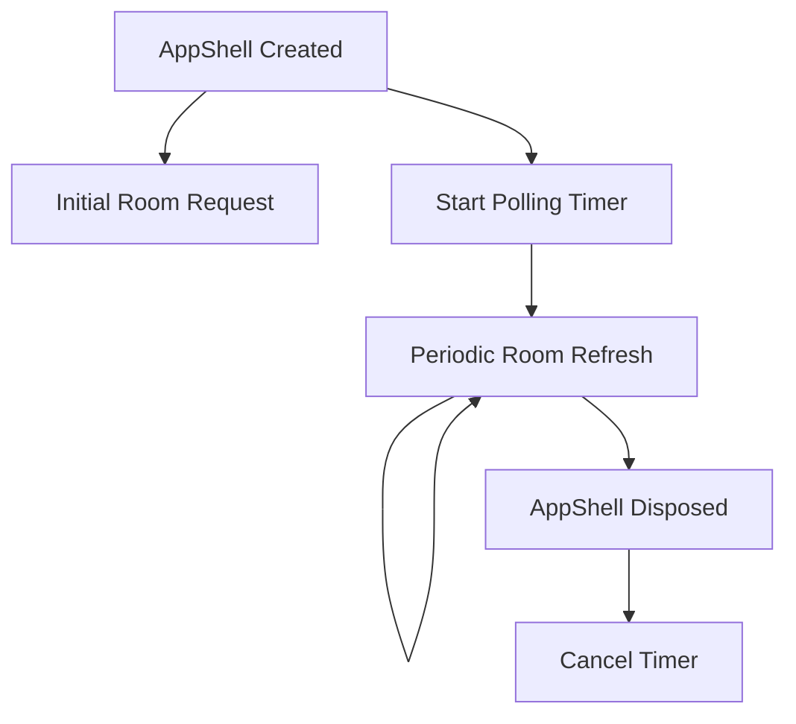

### 정리 목적

화면이 종료된 이후에도
Timer가 계속 실행되는 상황을
줄이기 위해 정리 로직을
구성합니다.

### 현재 한계

앱이 백그라운드로 이동할 때
Polling Timer를 명시적으로
중지하는 로직은 확인되지 않았습니다.

운영체제 및 앱 실행 상태에 따라
Timer 동작은 달라질 수 있습니다.

---

## 52. App Lifecycle Management

AppShell은 WidgetsBindingObserver를
사용하여 앱 생명주기 변경을
관찰합니다.

### 확인된 처리

| 시점 | 주요 처리 |
|---|---|
| 초기 화면 구성 | 채팅방, 알림, 예약 조회 |
| Timer 실행 | 채팅방 목록 조회 |
| resumed | 알림 및 예약 재조회 |
| dispose | Observer 제거 및 Timer 정리 |

### 앱 복귀 시 갱신

앱이 다시 활성화되는 경우
알림과 예약 데이터를
재조회하는 구조가 존재합니다.

### 개선 방향

- 백그라운드 진입 시 Polling 중지
- 활성화 시 즉시 채팅방 갱신
- 네트워크 상태에 따른 조회 제한
- 사용자 세션 종료 시 작업 취소
- 반복 요청에 대한 Backoff 적용

위 개선 방향은
현재 구현된 기능이 아닙니다.

---

## 53. Derived State

일부 화면 데이터는
별도의 원본 데이터로 저장하지 않고
기존 상태에서 계산할 수 있습니다.

### VENA 예시

- 전체 환자 수
- 대기 중인 협진 요청 수
- 읽지 않은 메시지 개수
- 메모 유형별 개수
- 선택 날짜의 일정 목록
- To-do 완료 여부

### 채팅방 읽지 않은 개수

```text
Room A: 3
Room B: 2
Room C: 0

Total: 5
```

AppShell은 채팅방 목록의
읽지 않은 메시지 개수를
합산하여 Badge를 표시합니다.

### Badge 표시

99를 초과하는 경우
99+ 형태로 표시하는
처리가 존재합니다.

### 설계 목적

원본 상태에서 필요한 값을
계산하면 별도의 상태를
중복 저장하는 경우를
줄일 수 있습니다.

---

## 54. Home Dashboard Data Integration

HomeView는 여러 기능의
ViewModel을 사용하여
의료진의 업무 정보를 표시합니다.

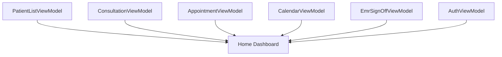

### 주요 데이터

- 환자 수
- 협진 대기 건수
- 예약 관련 개수
- 일정 목록
- EMR 관련 목록
- 로그인 의료진 정보

### 구현 범위

일부 대시보드 지표는
실제 ViewModel 데이터를
사용합니다.

원본 영상 개수 및 일부
대기 건수는 고정된 값 또는
Placeholder 상태로 존재합니다.

따라서 모든 대시보드 지표가
실제 서버 통계와 연동되어
있다고 설명하지 않습니다.

---

## 55. Local Persistence

캘린더와 To-do는
SharedPreferences를 사용하여
로컬 데이터를 관리합니다.

### 저장 구조

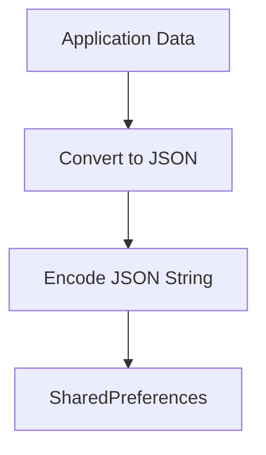

### 복원 구조

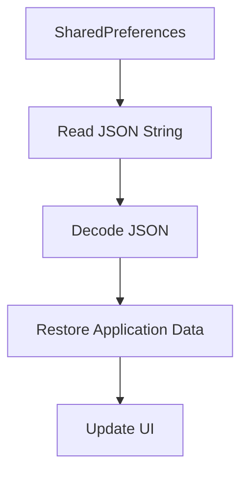

### 설계 목적

별도의 서버 요청 없이
일정 및 To-do 데이터를
저장하고 다시 불러올 수
있도록 구성합니다.

---

## 56. SharedPreferences Storage Keys

### 캘린더

```text
doctor_calendar_schedules
```

### To-do

```text
doctor_todo_items
```

### 캘린더 저장 예시

```json
[
  {
    "date": "2026-11-24T00:00:00.000",
    "endDate": "2026-11-27T00:00:00.000",
    "time": "09:00",
    "title": "업무 일정"
  }
]
```

### To-do 저장 예시

```json
[
  {
    "title": "협진 요청 확인",
    "isCompleted": true
  },
  {
    "title": "자료 검토",
    "isCompleted": false
  }
]
```

위 JSON은 저장 구조를
설명하기 위한 축약된
가상 데이터입니다.

실제 사용자 일정이나
환자 정보를 포함하지 않습니다.

---

## 57. Local Storage Limitations

SharedPreferences는
간단한 Key-Value 데이터를
저장하는 데 사용할 수 있습니다.

### 현재 구조의 한계

- 계정별 저장 범위 분리 미확인
- 여러 기기 간 동기화 미확인
- 서버 백업 미확인
- 앱 삭제 이후 데이터 보존 미보장
- 대규모 데이터 검색에 부적합
- 관계형 데이터 관리 기능 제한
- 민감 데이터 암호화 미확인

### 저장 키 범위

현재 일정 및 To-do 저장 키는
고정된 문자열을 사용합니다.

여러 의료진 계정이 동일한
기기에서 앱을 사용하는 경우
계정별 데이터 분리 정책을
추가로 검토해야 합니다.

### 개선 방향

사용자 식별자를 기준으로
저장 범위를 구분하거나
서버 기반 데이터 관리 구조로
확장할 수 있습니다.

---

## 58. Local Save Consistency

캘린더에서는 화면 상태를
변경한 이후 로컬 저장 작업을
비동기로 실행하는 구조가
존재합니다.

### 개념적 흐름

```mermaid
flowchart TD
    A["Schedule Changed"]
    B["Update In-memory State"]
    C["Notify UI"]
    D["Async Local Save"]

    A --> B
    B --> C
    B --> D
```

### 장점

사용자의 일정 변경을
화면에 빠르게 반영할 수 있습니다.

### 잠재적인 문제

저장 작업이 실패하면
현재 화면에는 변경된 일정이
표시되지만 앱을 다시 실행했을 때
해당 변경이 복원되지 않을 수 있습니다.

### 추가 고려 사항

- 저장 성공 여부 확인
- 저장 실패 안내
- 연속 저장 요청의 순서 관리
- 앱 종료 전 저장 완료
- 이전 상태 복구 정책

실제 저장 실패 장애를
재현한 결과는 아닙니다.

---

## 59. Server Response-based Update

채팅, 협진 및 메모 기능에서는
서버 요청 결과를 기반으로
클라이언트 상태를 갱신합니다.

```mermaid
flowchart TD
    A["User Action"]
    B["API Request"]
    C{"Server Success?"}

    A --> B
    B --> C

    C -->|Yes| D["Parse Response"]
    D --> E["Update Local State"]
    E --> F["Notify UI"]

    C -->|No| G["Preserve or Recover State"]
    G --> H["Display Error"]
```

### 주요 목적

서버에서 생성한 식별자,
수정 시각 및 변경된 상태를
클라이언트에 반영할 수 있습니다.

### 현재 적용 예시

- 신규 채팅 메시지 추가
- 협진 상태 변경
- 협진 답변 완료
- 메모 등록
- 메모 수정
- 메모 삭제

모든 기능의 모든 상태 변경이
서버 성공 이후에만 발생하는
것은 아닙니다.

---

## 60. Optimistic and Pessimistic Updates

### Optimistic Update

서버 응답을 기다리기 전에
화면 상태를 먼저 변경하는
방식입니다.

### Pessimistic Update

서버 성공 응답을 확인한 후
화면 상태를 변경하는 방식입니다.

### 비교

| 항목 | Optimistic | Pessimistic |
|---|---|---|
| 화면 반응 | 즉시 반영 가능 | 서버 응답 이후 |
| 실패 처리 | Rollback 필요 | 기존 상태 유지 가능 |
| 데이터 일관성 | 추가 관리 필요 | 서버 응답 중심 |
| 사용자 경험 | 빠른 반응 | 요청 대기 발생 |

### VENA 적용 관점

메모 등록 및 수정,
협진 상태 변경 등은
서버 응답을 기반으로
목록을 갱신합니다.

반면 채팅의 읽지 않은 개수는
메시지 조회 과정에서
서버 읽음 처리 완료 이전에
변경될 수 있는 구조가 존재합니다.

따라서 전체 프로젝트를
단일 상태 갱신 방식으로
설명하지 않습니다.

---

## 61. Chat Read State Consistency

채팅방의 읽지 않은 메시지 개수와
서버 읽음 상태는
일관성을 유지해야 합니다.

### 현재 검토 사항

메시지 목록 조회 과정에서
로컬의 읽지 않은 개수를
0으로 변경하는 처리가 존재합니다.

서버 읽음 처리 요청이
실패하는 경우 로컬 상태를
이전 값으로 복구하는 구조는
확인되지 않았습니다.

### 잠재적 상황

```mermaid
flowchart TD
    A["Open Chat Room"]
    B["Load Messages"]
    C["Local Unread Count = 0"]
    D["Mark Read API"]
    E{"Success?"}

    A --> B
    B --> C
    C --> D
    D --> E

    E -->|Yes| F["Consistent State"]
    E -->|No| G["Potential State Mismatch"]
```

### 개선 방향

- 서버 성공 이후 읽음 상태 갱신
- 실패 시 이전 상태 복구
- 서버 목록 재조회
- 읽음 요청 재시도 정책

위 내용은 소스 분석에서
도출한 잠재적인 데이터
일관성 문제입니다.

---

## 62. ID-based Data Reconciliation

서버 응답을 목록에 반영할 때
데이터 식별자를 활용할 수 있습니다.

### 가상 기존 목록

```text
Memo ID 101
Memo ID 102
Memo ID 103
```

### 수정 응답

```text
Memo ID 102
Updated Title
```

### 갱신 결과

```text
Memo ID 101
Memo ID 102 — Updated
Memo ID 103
```

### 개념적 처리

```dart
final index = items.indexWhere(
  (item) => item.id == updatedItem.id,
);

if (index >= 0) {
  items[index] = updatedItem;
}
```

위 코드는 ID 기반 갱신 개념을
설명하기 위한 예시입니다.

### 적용 목적

- 기존 항목 갱신
- 동일 데이터 식별
- 서버 응답 반영
- 목록 중복 감소

현재 모든 신규 생성 경로에서
전체 목록 중복 제거를
보장하는 것은 아닙니다.

---

## 63. State Scope and Data Isolation

여러 화면이 동일한 ViewModel을
공유하면 데이터 접근이
편리해질 수 있습니다.

그러나 조회 조건이 다른 화면에서는
데이터 범위를 명확하게
관리해야 합니다.

### 메모 조회 예시

```text
Screen A:
Patient A Memo List

Screen B:
Recent Voice Memo List
```

두 화면이 동일한 목록을
공유하면 Screen B의 조회가
Screen A의 목록 상태에
영향을 줄 수 있습니다.

### 개선 제안

```mermaid
flowchart TD
    A["MemoRepository"]

    B["PatientMemoViewModel"]
    C["RecentVoiceMemoViewModel"]
    D["MemoDetailViewModel"]

    A --> B
    A --> C
    A --> D
```

Repository는 공통으로 사용하고
화면별 상태를 분리하는
구조를 고려할 수 있습니다.

위 구조는 현재 구현이 아닌
개선 제안입니다.

---

## 64. Race Condition Perspective

여러 비동기 요청이
서로 다른 시점에 완료되면
데이터 상태가 예상과 다르게
변경될 수 있습니다.

### 가상 시나리오

```text
Request A starts
Request B starts

Request B completes
New data is displayed

Request A completes
Old data replaces new data
```

### 검토 대상

- 환자 목록 새로고침
- 메모 조회 범위 변경
- 채팅방 Polling
- 협진 목록 갱신
- 일정 로컬 저장

### 개선 방향

- Request ID
- 최신 요청 확인
- 요청 취소
- 조회 범위별 상태 분리
- 저장 작업 순서 보장
- 응답 버전 관리

실제 Race Condition을
재현하거나 해결한 이력이
확인된 것은 아닙니다.

---

## 65. Request Cancellation

화면이 종료되거나
조회 조건이 변경된 경우
기존 요청이 더 이상 필요하지
않을 수 있습니다.

### mounted의 역할

mounted는 Widget이
현재 Widget Tree에 존재하는지
확인하는 데 사용할 수 있습니다.

```dart
if (!mounted) {
  return;
}
```

### 주의 사항

mounted를 확인한다고 해서
이미 시작된 HTTP 요청이
자동으로 취소되는 것은 아닙니다.

### 개선 방향

Dio의 CancelToken과 같은
요청 취소 구조를 고려할 수 있습니다.

```mermaid
flowchart TD
    A["Start Request"]
    B["View Disposed"]
    C["Cancel Request"]
    D["Release Resources"]

    A --> B
    B --> C
    C --> D
```

위 구조는 개선 제안입니다.

모든 VENA 요청에서
CancelToken을 사용하고 있다고
확인한 것은 아닙니다.

---

## 66. Error Handling Architecture

오류는 발생한 계층에서
기능에 적합한 형태로
변환할 수 있습니다.

```mermaid
flowchart TD
    A["Network Error"]
    B["DioException"]
    C["Service Exception"]
    D["Repository Exception"]
    E["ViewModel Error State"]
    F["User Interface"]

    A --> B
    B --> C
    C --> D
    D --> E
    E --> F
```

### 계층별 책임

| 계층 | 오류 처리 목적 |
|---|---|
| Network | 연결 및 HTTP 오류 |
| Service | API 오류 메시지 해석 |
| Repository | 데이터 접근 오류 전달 |
| ViewModel | 오류 상태 및 요청 상태 관리 |
| View | 사용자 안내 및 재시도 |

기능에 따라 예외 클래스와
오류 처리 방식에는 차이가 있습니다.

---

## 67. HTTP Error Classification

HTTP 요청에서는 다양한
오류 상황이 발생할 수 있습니다.

| 상태 | 일반적인 의미 |
|---|---|
| 400 | 잘못된 요청 |
| 401 | 인증 정보 부족 또는 인증 실패 |
| 403 | 접근 권한 부족 |
| 404 | 요청한 리소스 없음 |
| 500 | 서버 내부 오류 |

### 네트워크 오류

- 연결 시간 초과
- 응답 수신 시간 초과
- 네트워크 연결 실패
- 요청 취소
- 인증서 관련 오류
- 기타 알 수 없는 오류

### 프로젝트 적용

환자 Service에는
여러 Dio 오류 유형 및
HTTP 상태에 대응하는
메시지 처리 구조가 존재합니다.

채팅, 협진 및 메모 Service는
서버의 detail, message 및
일부 필드 오류를 해석하는
구조를 사용합니다.

모든 서버 오류 응답을
실제로 재현하여 검증한 것은 아닙니다.

---

## 68. Empty State vs Error State

데이터가 없는 상황과
데이터 조회에 실패한 상황은
구분해야 합니다.

### 정상적인 빈 목록

```json
{
  "results": []
}
```

### 오류 응답 예시

```json
{
  "detail": "데이터 조회에 실패했습니다."
}
```

### 화면 처리 관점

| 상태 | 사용자 안내 |
|---|---|
| Loading | 조회 중 |
| Empty | 등록된 데이터 없음 |
| Success | 정상 데이터 표시 |
| Error | 조회 실패 및 재시도 |
| Stale Data | 이전 데이터와 오류 안내 |

### 현재 개선 필요 사항

일부 기능은 기존 목록이
존재하는 경우 오류 상태를
별도로 표시하지 않을 수 있습니다.

이 경우 사용자가 최신 데이터
조회에 실패했다는 사실을
인지하기 어려울 수 있습니다.

---

## 69. Stale Data Management

서버 조회 실패 시
기존 데이터를 유지하는 방식은
화면의 연속성을 제공할 수 있습니다.

### 장점

- 기존 정보 유지
- 화면 전체가 비어 있는 상태 감소
- 일시적인 네트워크 장애 대응

### 위험

기존 데이터가 최신 상태라고
사용자가 오해할 수 있습니다.

특히 의료진 업무 환경에서는
정보의 최신성 여부가
중요할 수 있습니다.

### 개선 제안

- 마지막 갱신 시각 표시
- 오래된 데이터 상태 표시
- 재조회 실패 안내
- 명확한 새로고침 기능
- 중요 데이터의 최신성 검증

현재 전체 기능에
Stale Data 표시 정책이
적용되었다고 확인하지 않았습니다.

---

## 70. Idempotency Perspective

네트워크 요청은 서버에서
처리되었지만 클라이언트가
응답을 받지 못할 수 있습니다.

### 가상 시나리오

```mermaid
sequenceDiagram
    participant C as Client
    participant S as Server

    C->>S: POST Create Memo
    S->>S: Create Record
    Note over C,S: Response Lost

    C->>S: Retry POST
    S->>S: Potential Duplicate Record
```

### 관련 기능

- 메시지 전송
- 협진 요청 생성
- 텍스트 메모 등록
- 음성 메모 업로드

### 개선 제안

서버에서 Idempotency Key 또는
업무 식별자를 활용하여
동일 작업의 중복 생성을
제한할 수 있습니다.

### 현재 범위

클라이언트의 요청 진행 상태는
반복 입력을 줄일 수 있습니다.

그러나 서버의 Idempotency 정책이
구현되어 있다고 확인하지 않았습니다.

---

## 71. Routing Architecture

GoRouter를 사용하여
화면 이동 구조를 구성합니다.

### 개념적 Route 구조

```mermaid
flowchart TD
    A["AppRouter"]

    B["Splash"]
    C["Login"]
    D["ShellRoute"]

    E["Home"]
    F["Patient"]
    G["Chat"]
    H["Consultation"]
    I["Calendar"]
    J["Memo"]
    K["My Page"]
    L["Other Feature Routes"]

    A --> B
    A --> C
    A --> D

    D --> E
    D --> F
    D --> G
    D --> H
    D --> I
    D --> J
    D --> K
    D --> L
```

### ShellRoute

공통 AppShell을 통해
주요 기능 화면을 연결합니다.

### 공통 UI

- 상단 AppBar
- 하단 Navigation
- 알림 Badge
- 채팅 Badge
- 테마 전환

일부 화면에서는
상단 AppBar를 숨기는
조건을 사용합니다.

---

## 72. Navigation Data Transfer

화면 이동 시 필요한 데이터는
Route Parameter 또는 Extra를
통해 전달할 수 있습니다.

### 주요 전달 데이터

- 환자 ID
- 채팅방 ID
- 협진 요청 정보
- 메모 ID
- Patient 객체
- PatientMemo 객체

### 설계상 고려 사항

객체 전체를 전달하면
즉시 화면을 구성하기 쉽습니다.

그러나 전달된 객체가
서버의 최신 상태와
일치하지 않을 수 있습니다.

### 개선 방향

- 식별자 중심 화면 이동
- 필요한 데이터 서버 재조회
- 직접 URL 접근 대응
- Route 복원 시 필수 데이터 확인
- 접근 권한 재검증

---

## 73. Navigation Result Propagation

메모 작성 및 수정 화면에서는
변경 성공 여부를 이전 화면에
전달하는 구조가 존재합니다.

```dart
context.pop(true);
```

### 처리 흐름

```mermaid
sequenceDiagram
    participant L as List View
    participant F as Form View
    participant API as Backend

    L->>F: Open Form
    F->>API: Save Data
    API-->>F: Success
    F-->>L: Return true
    L->>API: Refresh List
    API-->>L: Updated Data
```

### 설계 목적

화면 이동 이후
변경된 데이터를 다시 조회하여
목록과 상세 화면의 상태를
갱신할 수 있도록 합니다.

### 한계

모든 화면 이동 경로에서
동일한 결과 전달 정책이
사용되는 것은 아닙니다.

---

## 74. Theme State Management

SettingsViewModel은
현재 ThemeMode를 관리합니다.

### 초기 상태

```dart
ThemeMode _themeMode = ThemeMode.light;
```

### 상태 변경

```mermaid
stateDiagram-v2
    [*] --> Light

    Light --> Dark: Toggle
    Dark --> Light: Toggle
```

### 상태 전달

테마 변경 이후
notifyListeners를 호출하여
관련 화면에 변경 상태를
전달합니다.

### App Theme

MaterialApp.router는
SettingsViewModel의 상태를
기반으로 Light 및 Dark Theme를
적용하는 구조를 사용합니다.

### 현재 한계

테마 설정을 로컬 저장소에
영구적으로 저장하는 기능은
확인되지 않았습니다.

따라서 앱을 다시 실행한 경우
초기 테마 상태가 적용될 수 있습니다.

---

## 75. Resource Lifecycle Management

모바일 애플리케이션에서는
데이터뿐 아니라 사용 중인
리소스도 관리해야 합니다.

### 주요 리소스

| Resource | 주요 관리 |
|---|---|
| Polling Timer | 생성 및 취소 |
| Recording Timer | 시작 및 취소 |
| AudioPlayer | 생성 및 dispose |
| Audio Recorder | 녹음 및 dispose |
| Temporary File | 생성 및 삭제 |
| TextEditingController | 입력 상태 및 dispose |
| Lifecycle Observer | 등록 및 제거 |

### 설계 목적

- 화면 종료 이후 불필요한 작업 감소
- 사용하지 않는 리소스 정리
- 임시 파일 잔존 최소화
- 상태 변경 오류 위험 감소

### 검증 범위

리소스 정리 코드의 존재는
확인했지만 실제 메모리 누수,
배터리 사용량 및 장시간 실행
안정성을 측정한 것은 아닙니다.

---

## 76. Security Considerations

의료진 앱은 환자 및 진료 관련
민감한 데이터를 처리할 수 있으므로
데이터 보호가 중요합니다.

### 확인된 클라이언트 구조

- SecureStorage 기반 인증 정보 접근
- Bearer Token 요청
- 인증 Header 기반 의료영상 접근
- 인증 Header 기반 음성 파일 접근
- 일부 화면 보호 관련 공통 기능
- 임시 음성 파일 정리

### 추가 검토 대상

- HTTPS
- 서버 객체 단위 접근 권한
- 로그 마스킹
- 계정별 데이터 분리
- 로컬 데이터 보호
- 파일 암호화
- 데이터 보존 정책
- 감사 로그
- 세션 만료 처리

공통 화면 보호 및 인증 기능은
팀 프로젝트의 공동 시스템이며
모두 개인 구현 성과로
포함하지 않습니다.

---

## 77. Sensitive Logging

공통 ApiClient에는
LogInterceptor 설정이 존재합니다.

### 잠재적 노출 데이터

- Authorization Header
- 환자 식별 정보
- 요청 및 응답 데이터
- 채팅 내용
- 협진 요청 정보
- 메모 내용

### 개발 환경

네트워크 로그는 요청 및 응답
문제를 확인하는 데 도움이
될 수 있습니다.

### 운영 환경

민감한 의료정보가
로그에 기록되지 않도록
출력 범위와 마스킹 정책을
관리해야 합니다.

### 개선 방향

- Authorization Header 마스킹
- 개인정보 필드 마스킹
- 요청 본문 출력 제한
- 운영 환경 로그 수준 제한
- 로그 접근 권한 관리

실제 개인정보 노출 사고를
확인한 것은 아닙니다.

---

## 78. Transport Security

공통 API 설정에는
HTTP 기반 기본 주소가
존재합니다.

### HTTP의 한계

HTTP 자체는 전송 데이터의
암호화를 제공하지 않습니다.

### 개선 방향

운영 환경에서는 HTTPS를
사용하여 인증 정보와
민감한 데이터를 전송할 때
전송 구간 보호를 적용해야 합니다.

### 추가 고려 사항

- TLS 인증서 검증
- 안전한 서버 주소 설정
- 인증 Header 전송 대상 제한
- 외부 URL 접근 정책
- 인증 정보가 포함된 요청의 Redirect 처리

현재 모든 통신이 HTTPS로
보호된다고 주장하지 않습니다.

---

## 79. Authenticated Media Access

환자 상세 및 음성 메모 기능은
미디어 데이터에 접근할 때
인증 Header를 사용할 수 있는
구조를 포함합니다.

### 주요 데이터

- 의료영상 URL
- 음성 파일 URL
- Bearer Token
- Accept Header

### 음성 메모 흐름

```mermaid
flowchart LR
    A["Memo ID"]
    B["Repository"]
    C["Audio URL and Headers"]
    D["AudioPlayer"]
    E["Backend Audio API"]

    A --> B
    B --> C
    C --> D
    D --> E
```

### 보안 검토 사항

환자 상세 기능에는
절대 URL을 그대로 사용하는
URL 처리 구조가 존재합니다.

해당 URL에 인증 Header가
함께 전달되는 경우
신뢰할 수 없는 Host로
인증 정보가 전송되지 않도록
추가 검증이 필요합니다.

실제 인증 정보 유출이
발생했다고 확인한 것은 아닙니다.

---

## 80. Session Isolation

공유 ViewModel과 로컬 저장소는
사용자 계정 전환 시
데이터 분리 정책이 필요합니다.

### 잠재적 상황

```text
Doctor A Login
Load Patient and Memo Data

Doctor A Logout

Doctor B Login
Shared State or Local Data Remains
```

### 검토 대상

- 환자 목록
- 최근 환자
- 채팅방 목록
- 협진 요청
- 메모 목록
- 캘린더 일정
- To-do
- 저장된 인증 정보

### 개선 방향

- 로그아웃 시 공유 상태 초기화
- 사용자별 저장 키
- 세션 변경 시 요청 취소
- 인증 정보 제거
- 사용자별 데이터 재조회
- 이전 세션의 비동기 응답 무시

현재 전체 세션 분리 동작을
실행 검증한 것은 아닙니다.

---

## 81. Performance Review

### 현재 구조에서 확인한 특징

- 공통 Dio 클라이언트
- 기능별 상태 관리
- 일부 독립 요청의 Future.wait 처리
- 요청 진행 상태 관리
- 채팅방 목록 Polling
- 음성 소스 지연 준비
- 로컬 일정 및 To-do 저장

### 추가 개선 가능성

| 항목 | 개선 방향 |
|---|---|
| 반복 Polling | 활성 상태 기반 조회 |
| 큰 목록 | Pagination |
| 전체 화면 재구성 | Selector 기반 구독 |
| 중복 조회 | 요청 병합 및 Cache 정책 |
| 음성 업로드 | 크기 제한 및 진행률 |
| 오류 재시도 | Backoff |
| 미디어 재생 | 리소스 공유 |
| 대용량 JSON | 파싱 비용 측정 |

실제 처리량, 응답 시간,
메모리 사용량 및 CPU 사용량을
측정한 결과는 아닙니다.

---

## 82. Proposed Data Architecture

다음은 현재 구조를 기반으로
향후 개선할 수 있는
데이터 처리 아키텍처입니다.

```mermaid
flowchart TD
    A["Feature Views"]
    B["Scoped ViewModels"]
    C["Repositories"]
    D["API Services"]
    E["Authenticated API Client"]
    F["Backend API"]

    G["Session Manager"]
    H["Request Cancellation"]
    I["Error Normalization"]
    J["Local Data Source"]
    K["User-scoped Storage"]

    A --> B
    B --> C
    C --> D
    D --> E
    E --> F

    G --> E
    H --> E
    I --> D

    C --> J
    J --> K
```

### 개선 목표

- 화면별 상태 범위 분리
- 공통 인증 정책
- 요청 취소 관리
- 오류 처리 통일
- 계정별 데이터 분리
- 서버 및 로컬 데이터 접근 구분

위 구조는 현재 구현을
개선하기 위한 제안입니다.

---

## 83. Proposed Server Synchronization

캘린더와 To-do는 현재
로컬 저장을 중심으로
관리합니다.

향후 서버 동기화를
추가할 경우 다음과 같은
구조를 고려할 수 있습니다.

```mermaid
flowchart TD
    A["Schedule or Todo Action"]
    B["Local State"]
    C["Local Data Source"]
    D["Sync Queue"]
    E["Repository"]
    F["Backend API"]
    G["Server Response"]
    H["Reconciliation"]

    A --> B
    B --> C
    C --> D
    D --> E
    E --> F
    F --> G
    G --> H
    H --> B
```

### 추가 고려 사항

- 데이터 고유 ID
- 사용자별 소유권
- 생성 및 수정 시각
- 삭제 상태
- 네트워크 연결 여부
- 변경 충돌
- 재시도 정책
- 여러 기기 간 일관성

현재 VENA에 오프라인 우선
동기화 시스템이 구현되어
있다는 의미는 아닙니다.

---

## 84. Engineering Trade-offs

### SharedPreferences vs Server Storage

SharedPreferences는 간단한
로컬 데이터를 저장하기에
편리합니다.

그러나 여러 기기에서 데이터를
공유하거나 중앙 관리해야 하는
경우에는 서버 저장 구조가
필요할 수 있습니다.

### Polling vs WebSocket

Polling은 REST API를 활용하여
주기적인 데이터 갱신을
구성할 수 있습니다.

WebSocket은 지속 연결을 통해
변경 이벤트를 전달할 수 있지만
연결 관리가 추가로 필요합니다.

### Shared ViewModel vs Scoped ViewModel

공유 ViewModel은 여러 화면에서
데이터를 쉽게 사용할 수 있습니다.

반면 조회 범위가 서로 다른
화면에서는 상태를 분리하는 것이
더 적합할 수 있습니다.

### Immediate Update vs Server-confirmed Update

즉시 화면을 갱신하면
사용자 반응성을 높일 수 있습니다.

서버 응답 이후 갱신하면
서버 처리 결과를 기준으로
데이터를 관리할 수 있습니다.

기능별 데이터 중요도와
실패 복구 요구 사항에 따라
적절한 방식을 선택해야 합니다.

---

## 85. Validation Scenarios

다음 항목은 정적 코드 분석을
기반으로 작성한 검증 계획입니다.

### Network & Authentication

| ID | 검증 항목 | 검토 목적 |
|---|---|---|
| DS-01 | 정상 API 요청 | 응답 모델 변환 |
| DS-02 | 인증 정보 없음 | 요청 제한 |
| DS-03 | 인증 만료 | 오류 및 갱신 정책 |
| DS-04 | 서버 연결 실패 | 오류 안내 |
| DS-05 | 연결 Timeout | 상태 복구 |
| DS-06 | 응답 Timeout | 상태 복구 |
| DS-07 | 400 응답 | 검증 오류 처리 |
| DS-08 | 401 응답 | 인증 오류 처리 |
| DS-09 | 403 응답 | 권한 오류 처리 |
| DS-10 | 404 응답 | 리소스 없음 처리 |
| DS-11 | 500 응답 | 서버 오류 처리 |
| DS-12 | 예상하지 못한 JSON | 파싱 오류 처리 |

### State Management

| ID | 검증 항목 | 검토 목적 |
|---|---|---|
| DS-13 | 초기 조회 | Loading 상태 |
| DS-14 | 조회 성공 | 데이터 반영 |
| DS-15 | 조회 실패 | Error 상태 |
| DS-16 | 반복 조회 | 중복 요청 제한 |
| DS-17 | 반복 저장 | 중복 입력 제한 |
| DS-18 | 요청 실패 후 재시도 | 상태 복구 |
| DS-19 | 화면 종료 후 응답 | 생명주기 처리 |
| DS-20 | 이전 요청의 늦은 응답 | Race Condition |
| DS-21 | ID 기반 수정 | 목록 일관성 |
| DS-22 | 서버 삭제 실패 | 기존 데이터 유지 |
| DS-23 | 조회 범위 변경 | 상태 분리 |
| DS-24 | 기존 데이터 조회 실패 | Stale Data 표시 |

### Polling & Lifecycle

| ID | 검증 항목 | 검토 목적 |
|---|---|---|
| DS-25 | AppShell 초기 실행 | 초기 데이터 조회 |
| DS-26 | 5초 Timer | 주기적 채팅방 조회 |
| DS-27 | 긴 응답 시간 | 요청 중첩 여부 |
| DS-28 | 네트워크 연결 해제 | Polling 오류 처리 |
| DS-29 | 앱 백그라운드 전환 | Timer 동작 확인 |
| DS-30 | 앱 활성화 | 데이터 재조회 |
| DS-31 | AppShell 종료 | Timer 취소 |
| DS-32 | 채팅방 읽음 처리 실패 | Badge 일관성 |
| DS-33 | 새 메시지 도착 | 채팅방 정보 갱신 |
| DS-34 | 다수 채팅방 | 목록 처리 비용 |

### Local Persistence

| ID | 검증 항목 | 검토 목적 |
|---|---|---|
| DS-35 | 일정 저장 | JSON 저장 |
| DS-36 | 일정 수정 | 변경 데이터 저장 |
| DS-37 | 일정 삭제 | 삭제 상태 저장 |
| DS-38 | 앱 재실행 | 일정 복원 |
| DS-39 | To-do 완료 | 완료 상태 저장 |
| DS-40 | To-do 삭제 취소 | 목록 복원 |
| DS-41 | 손상된 JSON | 오류 복구 |
| DS-42 | 로컬 저장 실패 | 화면 및 저장 일관성 |
| DS-43 | 연속 저장 | 작업 순서 |
| DS-44 | 사용자 계정 변경 | 저장 범위 분리 |

### Security & Resource Management

| ID | 검증 항목 | 검토 목적 |
|---|---|---|
| DS-45 | 로그아웃 | 인증 정보 제거 |
| DS-46 | 다른 계정 로그인 | 이전 상태 제거 |
| DS-47 | 권한 없는 환자 조회 | 서버 접근 제한 |
| DS-48 | 권한 없는 메모 조회 | 객체 단위 권한 |
| DS-49 | 외부 미디어 URL | 인증 정보 보호 |
| DS-50 | 민감 정보 로그 | 마스킹 정책 |
| DS-51 | 음성 업로드 실패 | 임시 파일 유지 |
| DS-52 | 음성 업로드 성공 | 임시 파일 정리 |
| DS-53 | 녹음 중 화면 종료 | 리소스 해제 |
| DS-54 | 재생 중 화면 종료 | AudioPlayer 정리 |
| DS-55 | 앱 강제 종료 | 잔존 파일 확인 |
| DS-56 | 장시간 앱 실행 | 메모리 및 Timer 상태 |

위 56개 항목은 검증 계획이며
실제 테스트 실행 및 통과
결과가 아닙니다.

---

## 86. Improvement Priorities

### P1 — Security and Data Integrity

- HTTPS 적용
- 서버 객체 단위 권한 검증
- 민감 정보 로그 마스킹
- 사용자별 상태 분리
- 로컬 저장 범위 분리
- 미디어 URL 검증
- 중복 등록 방지

### P2 — Reliability

- 공통 토큰 갱신 정책
- 요청 취소 구조
- 조회 범위별 ViewModel
- 비동기 응답 순서 관리
- 저장 실패 복구
- 읽음 상태 일관성
- 오류 처리 정책 통일

### P3 — Performance

- Polling 주기 최적화
- 백그라운드 Polling 제한
- 목록 페이지네이션
- 필요한 상태만 구독
- 중복 조회 감소
- 업로드 Timeout 검토

### P4 — Feature Extension

- WebSocket 기반 채팅
- 일정 서버 동기화
- To-do 서버 동기화
- 오프라인 데이터 관리
- 음성 메모 STT 연동
- Push Notification 확장

위 우선순위는 현재 코드 구조를
분석하여 작성한 개선 제안입니다.

실제 개발 완료 상태를
의미하지 않습니다.

---

## 87. Engineering Evidence

### 주요 개인 Git 이력

| Commit | 관련 기능 |
|---|---|
| 5e653da | 환자 목록 API 및 검색 |
| 77a9ee0 | 환자 목록 및 상세 API |
| de2ee84 | 채팅 목록 및 메시지 API |
| 3904502 | 채팅 기능 수정 |
| d4b2909 | 협진 요청 및 의료진 API |
| c363020 | 협진 필터 및 요청 API |
| 88a0b81 | 협진 상세 및 답변 상태 |
| 6882c35 | 캘린더 CRUD 및 미니 캘린더 |
| cb9dbcc | 캘린더 날짜 범위 |
| 2f12337 | 홈 화면 및 일정, To-do |
| 134bbdf | 환자 상세 메모 |
| 596d616 | 음성 녹음 및 최근 메모 |
| 35ca816 | Light 및 Dark Theme |
| a1498f4 | 공통 상단 및 하단 화면 |

### 확인 기준

- 개인 Git 커밋 이력
- 최종 Flutter 소스
- 프로젝트 발표 자료
- 기능별 API 요청 코드
- 상태 관리 및 화면 구성

팀 전체 코드의 최종 상태와
개인 커밋에서 확인한 작업은
구분하여 설명합니다.

공통 아키텍처의 모든 세부 코드가
개인 작성 코드라고
주장하지 않습니다.

---

## 88. Backend Engineering Competencies

VENA에서 경험한 데이터 처리
기술은 백엔드 개발 직무와
다음과 같이 연결됩니다.

| 기술 역량 | 프로젝트 경험 |
|---|---|
| REST API | 환자, 채팅, 협진, 메모 API 연동 |
| Authentication | Bearer Token 요청 |
| Serialization | JSON과 모델 변환 |
| Data Modeling | 환자, 메시지, 협진 및 메모 모델 |
| Repository Pattern | 데이터 접근 책임 분리 |
| Dependency Injection | 공통 객체 의존성 관리 |
| Asynchronous Processing | Future 및 async/await |
| Concurrent Requests | Future.wait |
| Polling | 채팅방 주기적 조회 |
| Error Handling | 계층별 오류 처리 |
| Data Consistency | 서버 응답 기반 상태 갱신 |
| File Transfer | Multipart 음성 업로드 |
| Persistence | 로컬 데이터 저장 |
| Resource Management | Timer 및 파일 정리 |
| Security | 인증, 접근 권한 및 데이터 보호 분석 |

### 직무 연계

클라이언트에서 서버 API를
사용하면서 요청과 응답의 구조,
인증 정보, 오류 처리 및
데이터 상태의 일관성이
중요하다는 점을 경험했습니다.

이러한 경험은 향후 백엔드에서
클라이언트가 안정적으로
사용할 수 있는 API를 설계하는 데
활용할 수 있습니다.

---

## 89. Interview Preparation

### Q1. MVVM 구조를 사용한 이유는 무엇인가요?

화면에서 API 요청과 데이터 처리
로직을 직접 관리하면
UI와 비즈니스 로직의 책임이
혼합될 수 있습니다.

ViewModel에서 상태와 요청 흐름을
관리하고 Repository와 Service를
통해 데이터에 접근하도록
구성했습니다.

이를 통해 기능별 책임을
구분할 수 있었습니다.

### Q2. Repository와 Service의 차이는 무엇인가요?

Service는 실제 HTTP 요청과
응답 처리에 집중합니다.

Repository는 인증 정보를
조회하고 Service를 호출하는 등
데이터 접근 과정을 관리합니다.

ViewModel은 Repository를 통해
데이터에 접근하도록 구성했습니다.

### Q3. Provider는 왜 사용했나요?

여러 화면에서 필요한
ViewModel과 공통 객체를
사용할 수 있도록 구성하기 위해
Provider를 활용했습니다.

ChangeNotifier를 통해 상태 변경을
관련 화면에 전달할 수 있었습니다.

### Q4. 서버 데이터와 로컬 데이터를
### 어떻게 구분했나요?

환자, 채팅, 협진 및 메모는
서버 API를 통해 관리했습니다.

캘린더와 To-do는 현재
SharedPreferences를 사용하여
로컬 데이터를 저장했습니다.

다만 여러 기기 간 일정 공유가
필요한 운영 환경에서는
서버 저장 및 동기화 구조가
필요하다고 생각합니다.

### Q5. 채팅은 실시간으로 동작하나요?

최종 Flutter 코드에서는
5초 주기의 REST API Polling을
통해 채팅방 목록을 갱신하는
구조가 존재합니다.

WebSocket 기반의 실시간
메시지 전달을 구현한 것은
아닙니다.

향후 실시간성이 중요한 경우
WebSocket과 재연결 정책을
고려할 수 있습니다.

### Q6. Future.wait는 왜 사용했나요?

서로 독립적인 여러 조회 요청을
함께 실행하고 완료를
기다리기 위해 사용했습니다.

예를 들어 받은 협진 요청과
보낸 협진 요청을 조회할 때
각 요청을 순서대로 기다리지
않도록 구성할 수 있습니다.

다만 실제 성능 개선 수치를
측정한 것은 아닙니다.

### Q7. API 요청 중복은 어떻게 관리했나요?

일부 ViewModel에서는
조회 및 저장 진행 상태를
사용하여 반복 요청을
제한했습니다.

채팅 기능에서는 채팅방 ID를
기준으로 일부 요청 상태를
관리했습니다.

다만 서버의 중복 등록까지
완전히 방지하려면
별도의 Idempotency 정책이
필요합니다.

### Q8. API 오류는 어떻게 처리했나요?

Service에서 DioException과
서버 오류 메시지를 처리하고,
Repository와 ViewModel을 통해
사용자에게 필요한 오류 상태를
전달했습니다.

또한 finally를 활용하여
요청 종료 이후 로딩 상태가
복구되도록 구성했습니다.

### Q9. 데이터 일관성은 어떻게 유지했나요?

메모 및 협진 기능에서는
서버 응답을 모델로 변환하고
기존 목록의 식별자를 기준으로
데이터를 갱신했습니다.

삭제는 서버 성공 이후
목록에 반영했습니다.

다만 여러 화면이 상태를
공유하거나 비동기 요청이
겹치는 경우 추가적인
일관성 관리가 필요합니다.

### Q10. 다시 개발한다면 무엇을 개선하겠나요?

공유 ViewModel의 조회 범위를
더 명확하게 분리하고,
공통 인증 및 오류 처리 정책을
정리하고 싶습니다.

또한 채팅 Polling의 실행 조건,
요청 취소, 서버 중복 등록 방지,
계정별 데이터 분리 및
민감 정보 보호를 개선하겠습니다.

### Q11. 백엔드 개발에 어떤 도움이 되었나요?

서버 API를 실제 모바일 기능과
연결하면서 응답 구조와
오류 처리 방식이 사용자 화면에
직접적인 영향을 준다는 점을
경험했습니다.

향후 백엔드 개발에서는
정상 응답뿐 아니라 인증 실패,
잘못된 요청, 중복 요청 및
데이터 변경 이후의 일관성까지
고려하고 싶습니다.

---

## 90. Retrospective

VENA 프로젝트를 진행하면서
여러 의료진 업무 기능이
하나의 애플리케이션에서
연결되는 데이터 흐름을
경험했습니다.

환자 정보 조회, 채팅,
협진 및 메모 기능은
서버 API를 통해 데이터를
처리했습니다.

캘린더와 To-do는
로컬 저장소를 활용하여
상태를 관리했습니다.

각 기능의 데이터 특성에 따라
저장 위치와 접근 방식이
달라질 수 있다는 점을
이해했습니다.

또한 비동기 요청 과정에서
로딩 상태, 오류 처리,
서버 응답 기반 데이터 갱신 및
화면 생명주기를 함께
고려해야 한다는 점을 배웠습니다.

특히 서버 API의 응답 구조가
명확하고 일관적일수록
클라이언트의 데이터 처리와
오류 관리가 쉬워질 수 있다는
점을 경험했습니다.

향후 백엔드 개발에서는
API의 기능 구현뿐 아니라
인증, 권한, 데이터 정합성,
실패 복구 및 유지보수성을
함께 고려하는 개발자가
되고자 합니다.

---

## 91. Validation Scope

### 확인된 구조

- 기능별 ViewModel
- Repository 및 Service 계층
- Provider 기반 의존성 관리
- Dio 공통 네트워크 설정
- REST API 요청 구조
- Bearer Token 전달
- JSON 모델 변환
- Multipart 음성 업로드
- 비동기 요청 상태 관리
- Future.wait 사용
- 5초 채팅방 목록 Polling
- AppShell Timer 정리
- SharedPreferences 기반 일정 저장
- SharedPreferences 기반 To-do 저장
- 서버 응답 기반 목록 갱신
- 테마 상태 관리
- 주요 개인 Git 기여 이력

### 미검증 범위

- 전체 앱 실행 및 컴파일 검증
- 모든 API의 실제 응답
- 서버 데이터베이스 스키마
- 서버 객체 단위 접근 권한
- 자동 토큰 갱신 전체 동작
- 서버 중복 등록 방지
- 실제 네트워크 성능
- 동시 사용자 부하 테스트
- 메모리 및 배터리 사용량
- 모든 비동기 경쟁 조건
- 전체 사용자 세션 분리
- WebSocket 실시간 메시지 처리
- 서버 및 로컬 데이터 자동 동기화
- 모든 테스트 시나리오 실행
- 의료정보 보안 규정 준수 여부

본 문서는 팀 발표 자료,
개인 Git 이력 및 최종 Flutter
소스의 정적 분석을 기반으로
작성했습니다.

개념적 코드 예시, 가상 데이터,
성능 추정 및 개선 아키텍처는
기술적 이해를 설명하기 위한
내용입니다.

실제 환자 개인정보,
인증 토큰 및 서버 주소는
포함하지 않았습니다.

---

## 92. Related Documentation

- [프로젝트 개요](./README.md)
- [시스템 아키텍처](./architecture.md)
- [환자 관리 시스템](./patient-management.md)
- [채팅 시스템](./messaging.md)
- [비동기 협진 시스템](./consultation.md)
- [캘린더 및 To-do 관리](./schedule-task.md)
- [텍스트 및 음성 메모](./memo-system.md)
- [문제 해결 및 개선 방향](./troubleshooting.md)

---

[← 프로젝트 개요로 돌아가기](./README.md)
