# VENA — Clinical Memo System

> 의료진 텍스트 및 음성 메모 관리 시스템
>
> REST API · Multipart Upload · Audio Lifecycle · Data Management

[← 프로젝트 개요로 돌아가기](./README.md)

---

## 1. Overview

의료진이 환자 정보를 확인하는 과정에서
추가적인 진료 참고 사항과 업무 내용을
기록할 수 있도록 텍스트 및 음성 메모
관리 기능을 구현했습니다.

텍스트 메모는 제목과 내용을 입력하여
서버에 저장할 수 있도록 구성했습니다.

음성 메모는 모바일 기기의 마이크를
사용하여 음성을 녹음하고,
녹음된 파일을 확인한 뒤
서버로 전송할 수 있도록 구현했습니다.

저장된 메모는 환자별로 조회할 수 있으며,
수정 및 삭제 기능을 제공합니다.

음성 메모는 인증 정보를 포함한
서버 요청을 통해 재생할 수 있도록
구성했습니다.

### Implementation Goals

- 환자별 메모 관리
- 텍스트 메모 CRUD
- 음성 녹음 및 일시정지
- 녹음 재개 및 종료
- 녹음 파일 미리 듣기
- Multipart 기반 파일 업로드
- 음성 파일 인증 기반 재생
- 메모 유형별 필터링
- 최근 수정 기준 정렬
- 임시 파일 생명주기 관리
- API 요청 상태 및 오류 관리

---

## 2. My Contributions

| 담당 기능 | 구현 내용 |
|---|---|
| 텍스트 메모 | 등록, 조회, 수정 및 삭제 |
| 환자별 메모 | 환자 ID 기반 메모 조회 |
| 음성 녹음 | 녹음 시작, 일시정지, 재개 및 종료 |
| 녹음 파일 관리 | 임시 디렉터리 기반 파일 관리 |
| 음성 업로드 | Multipart FormData 구성 |
| 음성 재생 | 인증 헤더 기반 서버 음성 접근 |
| 메모 목록 | 유형별 필터 및 최근 수정 정렬 |
| 상태 관리 | 조회, 저장 및 삭제 상태 관리 |
| 최근 음성 메모 | 마이페이지 음성 메모 조회 |
| 화면 연계 | 환자 상세 및 메모 화면 연결 |

개인 담당 범위는 Flutter 의료진 앱의
메모 기능과 서버 API 연동입니다.

서버의 전체 메모 API,
데이터베이스 및 파일 저장소를
개인적으로 구현했다는 의미는 아닙니다.

---

## 3. Problem Definition

### 3.1 의료진 기록 방식의 다양성

의료진은 환자 정보를 확인하면서
추가적인 참고 사항을 기록할 수 있습니다.

모든 기록을 텍스트 입력 방식으로만
제공하는 경우 상황에 따라
입력 과정이 번거로울 수 있습니다.

이를 고려하여 텍스트와 음성이라는
두 가지 입력 방식을 제공했습니다.

### 3.2 환자 정보와 기록의 연결

메모가 환자 정보와 분리되어 있으면
특정 환자의 기록을 다시 확인하는
과정이 복잡해질 수 있습니다.

환자 ID를 기준으로 메모를 조회하고,
환자 상세 화면과 메모 관리 화면을
연결하는 구조를 구성했습니다.

### 3.3 음성 파일 관리

음성 메모는 일반 문자열과 달리
파일 데이터를 처리해야 합니다.

따라서 다음과 같은 추가적인
기술적 고려 사항이 존재합니다.

- 마이크 접근 권한
- 녹음 파일 생성
- 녹음 상태 관리
- 파일 미리 듣기
- 파일 업로드
- 인증 기반 파일 접근
- 임시 파일 제거
- 오디오 리소스 해제

### 3.4 서버 데이터와 로컬 파일

음성 녹음 과정에서는
모바일 기기의 임시 파일을 사용합니다.

서버 저장 이후에는 메모 API를 통해
저장된 데이터를 조회합니다.

녹음 중인 로컬 파일과
서버에 등록된 음성 메모를
구분하여 관리하는 것이 중요합니다.

---

## 4. Feature Architecture

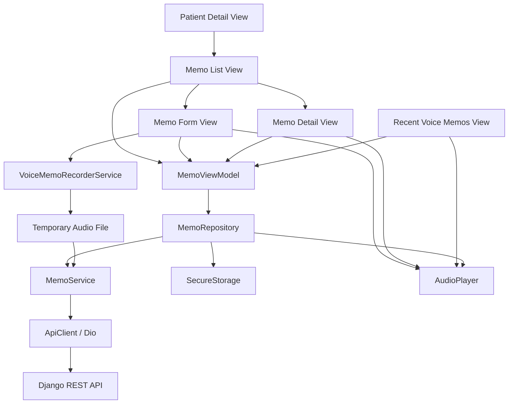

위 구조는 주요 데이터 접근 및
화면 연결 관계를 정리한 것입니다.

실제 모든 메서드 호출 관계를
표현한 클래스 다이어그램은 아닙니다.

### 계층별 책임

| 계층 | 주요 책임 |
|---|---|
| View | 입력, 목록 표시 및 오디오 조작 |
| ViewModel | 메모 상태 및 요청 흐름 관리 |
| Repository | 인증 정보 조회 및 데이터 접근 |
| Service | REST API 요청 및 응답 처리 |
| Model | 메모 데이터 구조 정의 |
| Recorder | 녹음 및 임시 파일 관리 |
| AudioPlayer | 로컬 및 서버 음성 재생 |

---

## 5. Source Structure

```text
lib/
├── features/
│   └── memo/
│       ├── model/
│       ├── repository/
│       ├── service/
│       ├── view/
│       ├── view_model/
│       └── routes/
│
├── core/
│   ├── network/
│   │   ├── api_client.dart
│   │   └── api_endpoints.dart
│   └── storage/
│       └── secure_storage.dart
│
└── app.dart
```

### 주요 분석 파일

| 파일 | 역할 |
|---|---|
| patient_memo.dart | 메모 데이터 모델 |
| memo_service.dart | 메모 REST API |
| memo_repository.dart | 인증 및 데이터 접근 |
| memo_view_model.dart | 메모 상태 관리 |
| memo_form_view.dart | 텍스트 입력 및 음성 녹음 |
| memo_list_view.dart | 환자별 메모 목록 |
| memo_detail_view.dart | 메모 상세 및 음성 재생 |
| recent_voice_memos_view.dart | 최근 음성 메모 목록 |

녹음 관련 Service는
음성 파일 생성 및 녹음 상태를
별도로 관리합니다.

---

## 6. Technology Stack

| 기술 | 사용 목적 |
|---|---|
| Flutter | 의료진 모바일 화면 |
| Dart | 데이터 및 비동기 처리 |
| Provider | 의존성 및 상태 접근 |
| ChangeNotifier | 메모 상태 변경 전달 |
| Dio | REST API 요청 |
| FormData | 파일 및 메타데이터 전송 |
| MultipartFile | 음성 파일 업로드 |
| Flutter Secure Storage | 인증 정보 접근 |
| record | 모바일 음성 녹음 |
| path_provider | 임시 디렉터리 접근 |
| just_audio | 음성 파일 재생 |
| GoRouter | 메모 화면 이동 |
| dart:io | 임시 파일 접근 및 삭제 |
| Timer | 녹음 시간 표시 |

### Package Versions

프로젝트의 pubspec.yaml 기준입니다.

| Package | Version Constraint |
|---|---|
| dio | ^5.9.0 |
| provider | ^6.1.5 |
| flutter_secure_storage | ^9.2.4 |
| record | ^7.1.1 |
| path_provider | ^2.1.5 |
| just_audio | ^0.10.6 |
| go_router | ^17.3.0 |

패키지 버전은 프로젝트 선언 기준이며,
실제 설치된 모든 의존성의
최종 버전을 의미하지는 않습니다.

---

## 7. Memo Data Model

텍스트와 음성 메모는
PatientMemo 모델을 통해 관리합니다.

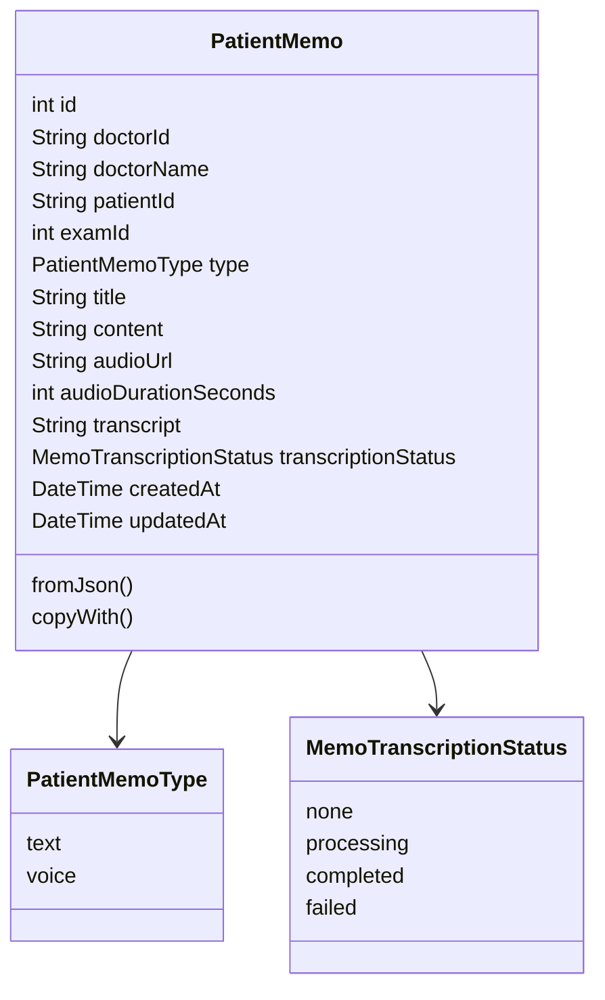

다이어그램에서는 일부 Nullable 타입과
세부 구현을 생략했습니다.

### 주요 필드

| 필드 | 역할 |
|---|---|
| id | 메모 식별자 |
| doctorId | 작성 의료진 식별 정보 |
| doctorName | 작성 의료진 이름 |
| patientId | 환자 식별 정보 |
| examId | 관련 검사 식별 정보 |
| type | 텍스트 또는 음성 유형 |
| title | 메모 제목 |
| content | 텍스트 내용 |
| audioUrl | 음성 파일 관련 URL |
| audioDurationSeconds | 음성 길이 |
| transcript | 음성 변환 텍스트 |
| transcriptionStatus | 변환 상태 |
| createdAt | 생성 시각 |
| updatedAt | 수정 시각 |

### 모델 통합 목적

텍스트와 음성 메모는
입력 데이터와 저장 방식에
차이가 있습니다.

그러나 목록 조회, 작성자 표시,
환자 연결, 생성일 및 수정일 등의
공통 속성을 가집니다.

하나의 모델을 사용하여
공통 데이터 구조를 관리하고,
메모 유형에 따라 화면을
다르게 구성합니다.

---

## 8. Memo Type Management

### PatientMemoType

```text
text
voice
```

텍스트 메모와 음성 메모를
구분하는 유형입니다.

### 유형별 데이터

| 항목 | Text | Voice |
|---|---|---|
| 제목 | 사용 | 사용 |
| 텍스트 내용 | 사용 | 선택적 표시 |
| 음성 파일 | 사용하지 않음 | 사용 |
| 음성 길이 | 사용하지 않음 | 사용 |
| 환자 ID | 사용 | 사용 |
| 검사 ID | 선택적 | 선택적 |
| 생성 및 수정 시각 | 사용 | 사용 |

### 유형별 화면 구성

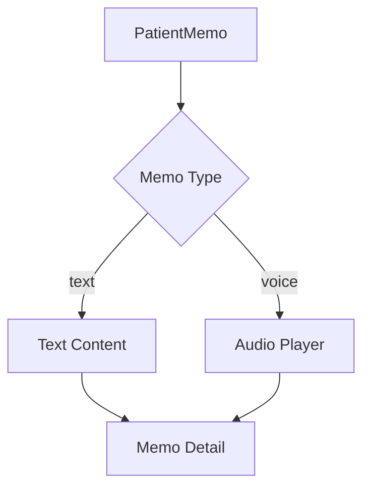

현재 모델에서 알 수 없는 메모 유형은
텍스트 유형으로 처리하는
기본값 로직이 존재합니다.

이는 파싱 실패를 줄일 수 있지만,
지원하지 않는 신규 유형을
정상적인 텍스트 메모처럼
표시할 가능성도 있습니다.

---

## 9. Transcription State

음성 메모 모델에는
텍스트 변환 관련 필드가 존재합니다.

```text
none
processing
completed
failed
```

### 상태 의미

| 상태 | 의미 |
|---|---|
| none | 변환 상태 없음 |
| processing | 변환 진행 상태 |
| completed | 변환 완료 상태 |
| failed | 변환 실패 상태 |

### 구현 범위

현재 Flutter 모델은
서버에서 전달되는 변환 상태와
텍스트 데이터를 표현할 수 있습니다.

음성 메모 상세 화면에서는
변환 텍스트가 존재하는 경우
해당 내용을 표시할 수 있습니다.

다만 다음 기능이 실제로
구현되었다고 확인한 것은 아닙니다.

- Speech-to-Text 모델 실행
- 음성 변환 서버 구축
- 음성 변환 작업 큐
- AI 기반 메모 요약
- 변환 상태 자동 갱신
- 의료 용어 인식 정확도 검증

모델에 관련 필드가 존재한다는 사실과
실제 음성 변환 기능의 구현은
구분하여 설명합니다.

---

## 10. JSON Parsing

PatientMemo.fromJson은
서버 응답을 Flutter 모델로
변환하는 역할을 수행합니다.

### 주요 처리 방식

- snake_case 및 camelCase 필드 대응
- 일부 작성자 중첩 객체 처리
- 문자열 공백 정리
- 숫자 타입 변환
- 날짜 문자열 파싱
- 메모 유형 변환
- 음성 변환 상태 변환
- 누락 필드 기본값 처리

### 가상 응답 예시

```json
{
  "id": 101,
  "patient_id": "DEMO-001",
  "memo_type": "text",
  "title": "추가 확인 사항",
  "content": "관련 자료 검토 필요",
  "created_at": "2026-11-24T09:00:00Z",
  "updated_at": "2026-11-24T09:30:00Z"
}
```

위 JSON은 모델의 이해를 돕기 위한
가상 데이터입니다.

실제 서버 응답을 그대로
복사한 것이 아닙니다.

### 날짜 처리

날짜 문자열은 DateTime.tryParse를
사용하여 변환하는 구조입니다.

유효하지 않은 날짜 데이터가
전달되는 경우를 고려합니다.

### 숫자 처리

숫자 및 숫자 형태의 문자열에 대해
정수 변환을 수행합니다.

### 현재 구조의 한계

필수 식별자가 누락된 경우
기본값을 사용하는 방식은
화면의 파싱 실패를 줄일 수 있습니다.

그러나 유효하지 않은 메모 ID가
정상 데이터처럼 사용될 수 있으므로
필수 필드에 대한 엄격한 검증이
추가로 필요할 수 있습니다.

---

## 11. Display Content

PatientMemo는 목록에서 사용할
표시용 내용을 구성합니다.

### 내용 선택 기준

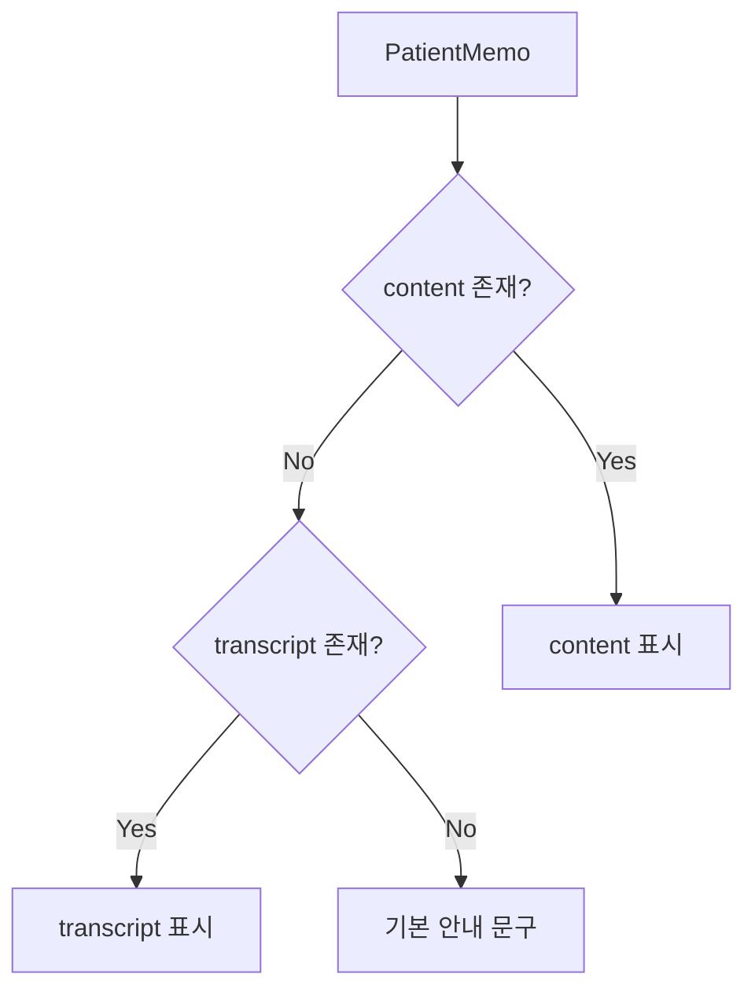

### 설계 목적

텍스트 메모와 음성 메모를
동일한 목록에서 표시할 때
각 유형에 적합한 미리보기 내용을
제공할 수 있습니다.

음성 메모에 변환 텍스트가
존재하는 경우 해당 데이터를
표시할 수 있는 구조입니다.

이는 음성 변환 모델을
직접 실행하는 기능과는 다릅니다.

---

## 12. Immutable Model Update

PatientMemo는 copyWith를 통해
일부 속성을 변경한 모델을
생성할 수 있는 구조를 제공합니다.

### 개념적 예시

```dart
final updatedMemo = memo.copyWith(
  title: '수정된 제목',
);
```

기존 객체를 직접 변경하는 대신
변경된 값을 포함하는 객체를
생성하는 방식입니다.

### 설계상 장점

- 변경 전후 상태 구분
- 목록 항목 교체
- 모델 변경 범위 명확화
- 상태 관리 구조와의 연계

### Nullable 필드 처리

현재 copyWith의 일부 필드는
null 값을 기존 값 유지의
의미로 사용합니다.

이러한 방식에서는 기존 값을
명시적으로 null로 변경하는 것과
값을 변경하지 않는 것을
구분하기 어려울 수 있습니다.

향후 별도의 Sentinel 값이나
명시적인 필드 제거 방식을
고려할 수 있습니다.

---

## 13. API Specification

메모 관련 API는 Django 서버와
REST 방식으로 통신합니다.

### 확인된 Endpoint

| Method | Endpoint | Purpose |
|---|---|---|
| GET | /api/memos/ | 메모 목록 조회 |
| GET | /api/memos/{id}/ | 메모 상세 조회 |
| POST | /api/memos/ | 텍스트 메모 등록 |
| POST | /api/memos/voice/ | 음성 메모 등록 |
| PATCH | /api/memos/{id}/ | 메모 수정 |
| DELETE | /api/memos/{id}/ | 메모 삭제 |
| GET | /api/memos/{id}/audio/ | 음성 파일 접근 |

### 환자별 목록 조회

```http
GET /api/memos/?patient_id=DEMO-001
Authorization: Bearer <ACCESS_TOKEN>
```

### 전체 메모 조회

```http
GET /api/memos/
Authorization: Bearer <ACCESS_TOKEN>
```

전체 조회는 환자 ID 필터를
전달하지 않는 요청을 의미합니다.

실제 서버에서 어떤 의료진의
메모까지 조회할 수 있는지는
서버 권한 정책에 따라 결정됩니다.

### 주의 사항

위 API 명세는 Flutter 클라이언트의
요청 코드에서 확인한 내용입니다.

서버의 내부 구현, HTTP 상태 코드,
데이터베이스 트랜잭션 및
접근 권한 검증 방식까지
확인한 것은 아닙니다.

---

## 14. Authentication Flow

메모 API는 Bearer Token을
포함하여 요청합니다.

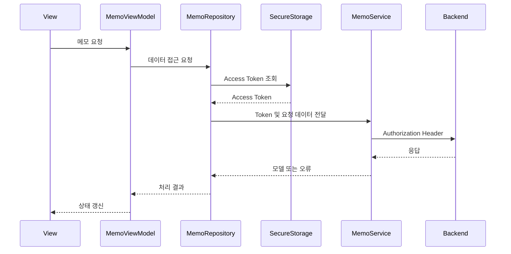

### Repository의 역할

Repository는 저장된 인증 정보를
조회하여 Service에 전달합니다.

토큰이 없거나 유효한 문자열이
아닌 경우 요청을 제한하는
검증 로직이 존재합니다.

### Authorization Header

```http
Authorization: Bearer <ACCESS_TOKEN>
```

실제 인증 토큰은
문서 및 공개 포트폴리오에
포함하지 않습니다.

### 인증과 권한의 차이

클라이언트가 인증 토큰을
전송하는 것과 서버가 특정 메모에
대한 접근 권한을 검증하는 것은
서로 다른 문제입니다.

서버에서는 인증된 의료진이
해당 환자 및 메모에 접근할 수
있는지 별도로 검증해야 합니다.

현재 문서는 서버의 객체 단위
권한 검증까지 완료되었다고
주장하지 않습니다.

---

## 15. Text Memo Creation

텍스트 메모는 제목과 내용을
입력하여 서버에 등록합니다.

### 요청 데이터

| 필드 | 설명 |
|---|---|
| patient_id | 환자 식별자 |
| memo_type | text |
| title | 메모 제목 |
| content | 메모 내용 |
| exam_id | 선택적 검사 식별자 |

### 가상 요청

```http
POST /api/memos/
Content-Type: application/json
Authorization: Bearer <ACCESS_TOKEN>
```

```json
{
  "patient_id": "DEMO-001",
  "memo_type": "text",
  "title": "추가 확인 사항",
  "content": "관련 자료 검토 필요"
}
```

### 등록 흐름

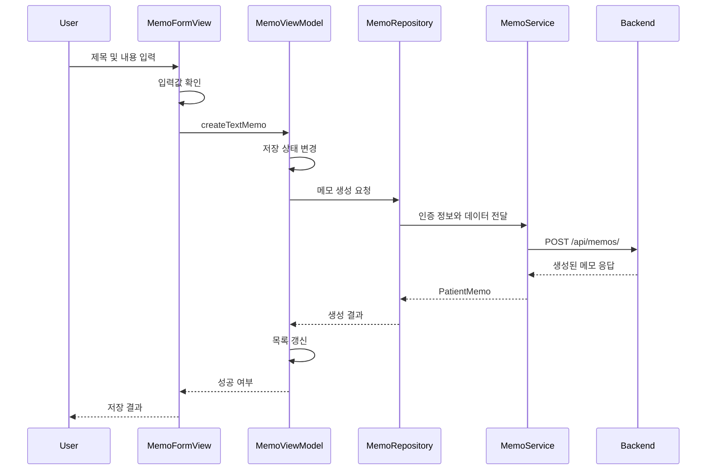

### 입력값 정규화

제목과 내용의 앞뒤 공백을
제거하여 요청 데이터를 구성합니다.

내용이 비어 있는 경우
등록 요청을 제한합니다.

---

## 16. Text Memo Input Validation

메모 입력 화면에서는
텍스트 입력 길이를 제한합니다.

| 입력 항목 | 최대 길이 |
|---|---|
| 제목 | 200자 |
| 내용 | 1,000자 |

### 입력 검증 목적

- 비어 있는 메모 등록 제한
- 지나치게 긴 입력 방지
- 일관된 화면 입력 구조
- 불필요한 공백 제거

### 자동 제목 생성

제목이 입력되지 않은 경우
메모 내용의 첫 번째 줄을
기반으로 제목을 생성합니다.

제목 생성 과정에서는
길이를 제한하여 표시합니다.

### 가상 예시

```text
제목:
입력하지 않음

내용:
추가 자료 검토 필요
다음 업무 시간에 확인

자동 생성 제목:
추가 자료 검토 필요
```

### 자동 제목의 성격

현재 자동 제목 생성은
문자열을 가공하는 방식입니다.

AI 모델을 통해 메모를 분석하거나
요약하는 기능은 아닙니다.

### 서버 검증 필요성

클라이언트의 입력 제한만으로
서버 데이터의 유효성을
보장할 수는 없습니다.

서버에서도 필수 필드,
최대 길이, 데이터 타입 및
접근 권한을 검증해야 합니다.

---

## 17. Quick Text Input

텍스트 메모 작성 화면에서는
자주 사용하는 입력 문구를
빠르게 추가할 수 있도록 구성했습니다.

### 확인된 문구

- 복용 약물
- 추가 검사
- 특이 사항

### 처리 방식

선택한 문구를 기존 내용에
추가합니다.

기존 내용이 존재하는 경우
줄바꿈을 포함하여 추가하며,
전체 입력 길이를 고려합니다.

### 설계 목적

- 반복적인 입력 과정 단축
- 모바일 키보드 입력 부담 완화
- 자주 사용하는 항목 접근성 개선

### 구현 범위

현재 기능은 미리 정의된 문구를
추가하는 입력 보조 기능입니다.

자동 진료 기록 생성,
SOAP 구조 자동 작성,
AI 기반 임상 판단 기능은
확인된 구현 범위에 포함하지 않습니다.

---

## 18. Memo List Retrieval

환자별 메모 목록은
환자 ID를 기준으로 조회합니다.

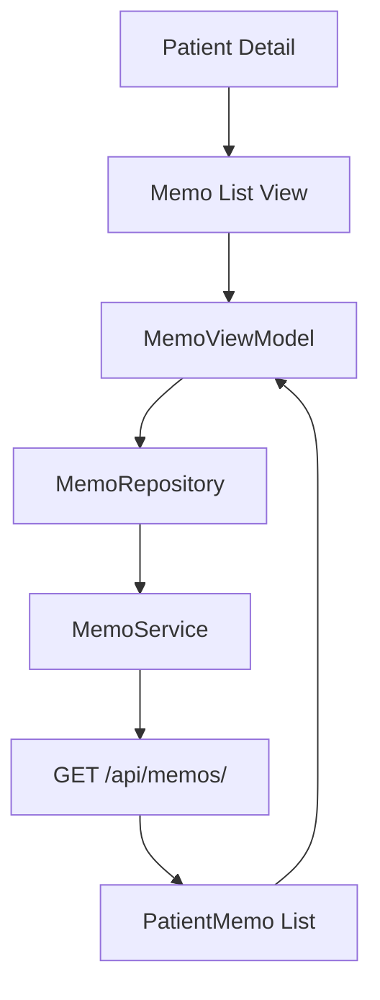

### 환자 필터

환자 ID가 제공되는 경우
patient_id 쿼리 파라미터를
사용합니다.

### 목록 응답 처리

Service는 서버 응답에서
메모 목록을 추출합니다.

직접적인 List 응답과
일부 Wrapper 형태의 응답을
처리하는 구조가 존재합니다.

### 지원되는 응답 구조

```json
[
  {
    "id": 101,
    "memo_type": "text"
  }
]
```

```json
{
  "results": [
    {
      "id": 101,
      "memo_type": "text"
    }
  ]
}
```

위 데이터는 응답 형태를 설명하기
위한 축약된 가상 예시입니다.

results 외에도 memos 또는 data
형태의 목록을 처리하는 로직이
존재합니다.

---

## 19. Memo Filtering

메모 목록은 유형별로
필터링할 수 있습니다.

### 필터 상태

```text
all
text
voice
```

### 처리 흐름

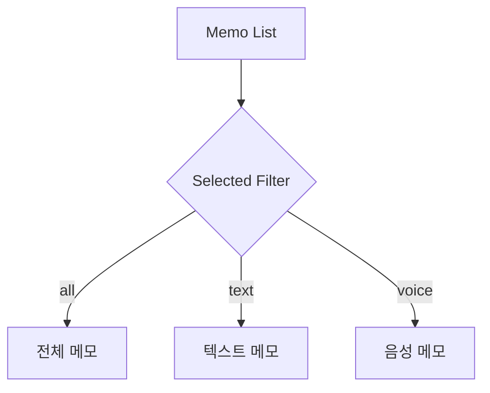

### 가상 목록

| ID | 제목 | 유형 |
|---|---|---|
| 101 | 추가 확인 사항 | text |
| 102 | 업무 참고 기록 | voice |
| 103 | 자료 검토 | text |
| 104 | 음성 참고 사항 | voice |

### 필터 결과

| 필터 | 표시 개수 |
|---|---|
| 전체 | 4 |
| 텍스트 | 2 |
| 음성 | 2 |

현재 필터는 ViewModel에
저장된 목록을 기준으로 처리합니다.

필터를 선택할 때마다
반드시 새로운 서버 요청을
수행하는 방식은 아닙니다.

---

## 20. Memo Sorting

메모 목록은 최근 수정 시각을
기준으로 정렬합니다.

### 정렬 기준

```text
updatedAt
    ↓ 값이 없는 경우
createdAt
    ↓ 값이 없는 경우
Epoch 기준 시각
```

최근 수정 시각이 존재하는 경우
해당 값을 사용합니다.

수정 시각이 없으면 생성 시각을
사용하는 방식입니다.

### 가상 입력

| ID | 생성 시각 | 수정 시각 |
|---|---|---|
| 101 | 09:00 | 14:00 |
| 102 | 10:00 | 없음 |
| 103 | 11:00 | 12:00 |

### 정렬 결과

| 순서 | ID | 정렬 기준 |
|---|---|---|
| 1 | 101 | 14:00 |
| 2 | 103 | 12:00 |
| 3 | 102 | 10:00 |

### 설계 목적

최근 작성되거나 수정된 메모를
목록 상단에서 확인할 수 있도록
구성합니다.

---

## 21. Memo Detail Retrieval

메모 상세 조회는
메모 ID를 기준으로 수행합니다.

```http
GET /api/memos/101/
Authorization: Bearer <ACCESS_TOKEN>
```

### 상태 관리

상세 조회가 성공하면
선택된 메모 상태를 갱신합니다.

목록에 동일한 ID의 메모가
존재하는 경우 해당 항목을
갱신하는 구조입니다.

### 화면 구성

- 메모 제목
- 작성자 정보
- 작성 또는 수정 시각
- 환자 관련 정보
- 텍스트 내용
- 음성 재생 영역
- 변환 텍스트가 존재하는 경우 표시
- 수정 및 삭제 메뉴

### 데이터 일관성 고려

상세 화면은 메모 ID로
ViewModel의 데이터를 찾습니다.

해당 데이터가 없는 경우
선택된 메모 또는 화면 전달 데이터를
사용하는 대체 로직이 존재합니다.

공유된 selectedMemo가 다른 메모를
가리키는 경우 잘못된 상세 정보가
표시될 가능성이 있으므로,
ID 일치 여부에 대한 추가 검증이
필요할 수 있습니다.

실제 잘못된 정보 표시 장애를
재현한 것은 아닙니다.

---

## 22. Text Memo Update

텍스트 메모 수정은
PATCH 요청을 통해 처리합니다.

```http
PATCH /api/memos/101/
Content-Type: application/json
Authorization: Bearer <ACCESS_TOKEN>
```

### 가상 요청 데이터

```json
{
  "memo_type": "text",
  "title": "수정된 참고 사항",
  "content": "추가 자료 검토 완료",
  "exam_id": null
}
```

### 수정 가능한 데이터

- 메모 제목
- 메모 내용
- 관련 검사 정보

### 수정 흐름

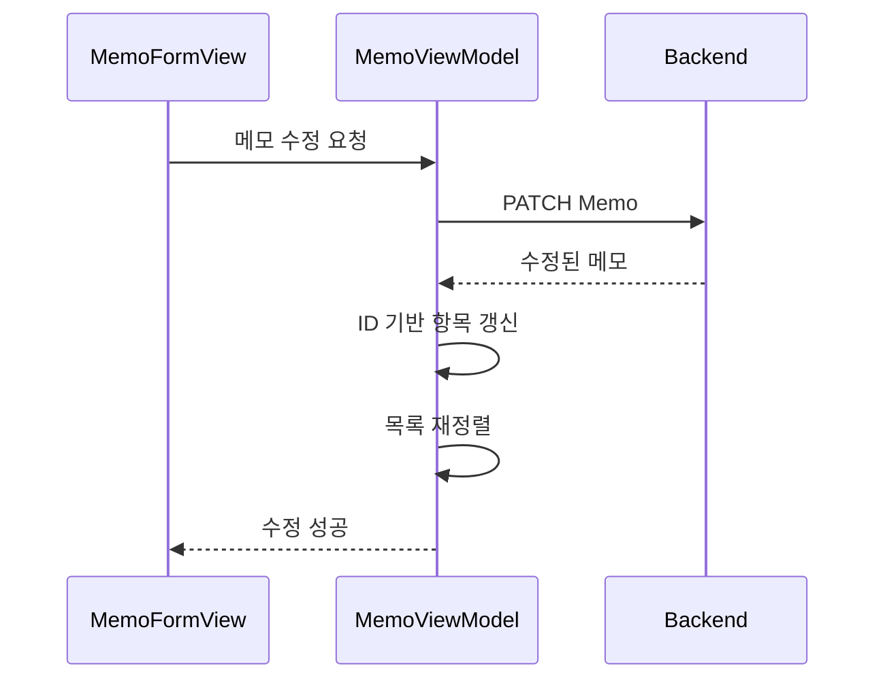

### 서버 응답 기반 갱신

클라이언트에서 입력한 값을
단순히 기존 데이터에 덮어쓰는
것이 아니라 서버 응답을
메모 모델로 변환하여
목록을 갱신합니다.

서버에서 처리된 수정 시각이나
변경된 필드를 반영할 수 있는
구조입니다.

---

## 23. Memo Deletion

메모 삭제는 서버의 DELETE API를
사용하여 처리합니다.

```http
DELETE /api/memos/101/
Authorization: Bearer <ACCESS_TOKEN>
```

### 삭제 흐름

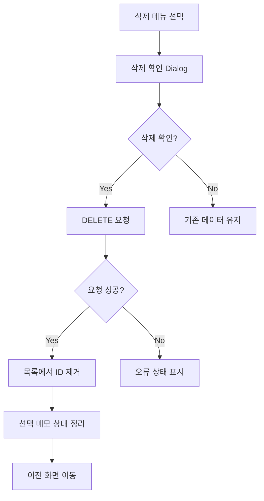

### 서버 성공 이후 갱신

메모 삭제 요청이 성공한 이후
ViewModel의 메모 목록에서
해당 ID를 제거합니다.

현재 선택된 메모가
삭제된 메모인 경우
선택 상태도 정리합니다.

### 파일 삭제 범위

음성 메모를 삭제할 때
서버가 실제 음성 파일까지
삭제하는지는 확인하지 않았습니다.

서버에서 다음 정책을
별도로 고려해야 합니다.

- 메타데이터 삭제
- 음성 파일 삭제
- 삭제 실패 시 정합성 관리
- 보존 기간
- 감사 기록
- 소프트 삭제 여부

---

## 24. Voice Memo Architecture

음성 메모는 텍스트 메모와 달리
파일 생성 및 재생 과정이
추가됩니다.

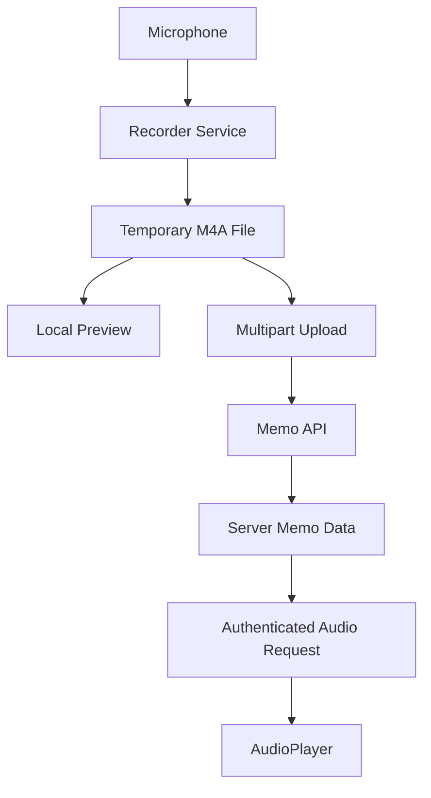

### 주요 구성

| 단계 | 처리 내용 |
|---|---|
| Recording | 모바일 음성 녹음 |
| Temporary File | 임시 파일 생성 |
| Preview | 녹음 결과 미리 듣기 |
| Upload | 파일 및 메타데이터 전송 |
| Response | 서버 메모 모델 변환 |
| Playback | 인증 기반 음성 재생 |
| Cleanup | 임시 파일 및 리소스 정리 |

---

## 25. Microphone Permission

음성 녹음을 시작하기 전에
마이크 사용 권한을 확인합니다.

### 처리 구조

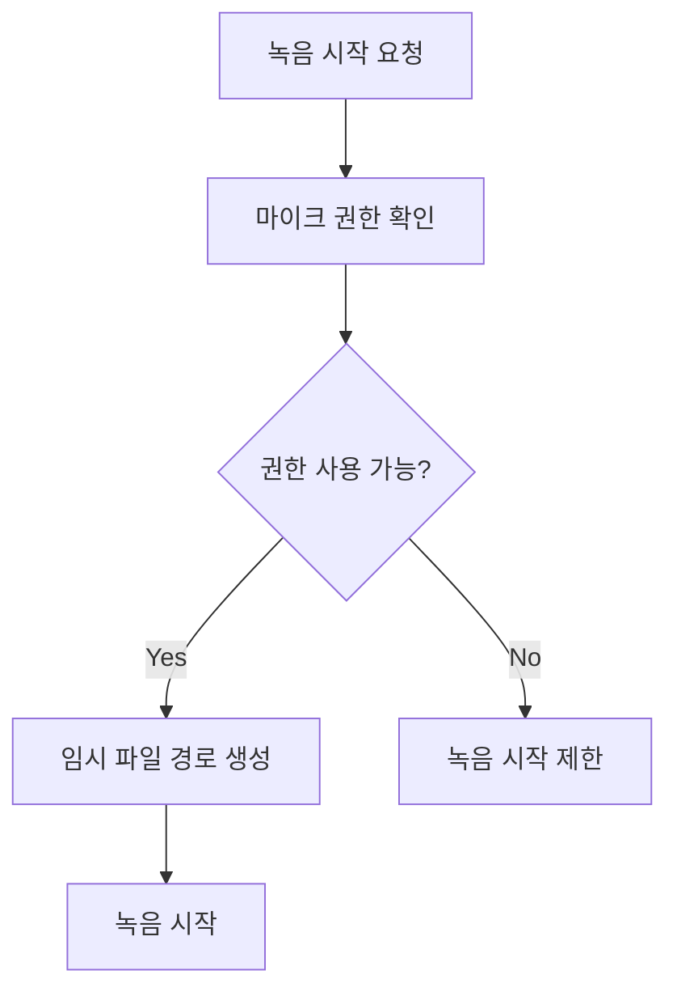

### 설계 목적

마이크 권한이 없는 상태에서
녹음 작업을 실행하는 상황을
제한합니다.

### 추가 검증 항목

- 최초 권한 요청
- 사용자 권한 거부
- 영구적인 권한 거부
- 앱 설정에서 권한 변경
- 녹음 중 권한 상태 변화

모든 운영체제 및 기기에서의
권한 처리 동작을 검증한 것은 아닙니다.

---

## 26. Recording Configuration

음성 녹음은 record 패키지를
사용합니다.

### 확인된 녹음 설정

| 항목 | 설정값 |
|---|---|
| Encoder | AAC-LC |
| File Extension | .m4a |
| Bit Rate | 128,000 bps |
| Sample Rate | 44,100 Hz |

### 설정 구조

```dart
const RecordConfig(
  encoder: AudioEncoder.aacLc,
  bitRate: 128000,
  sampleRate: 44100,
)
```

### AAC-LC

AAC-LC는 음성 및 오디오 데이터를
압축하는 데 사용되는
오디오 코덱입니다.

현재 구현은 AAC-LC 설정을 사용하여
M4A 확장자의 파일을 생성합니다.

### 파일 크기 추정

128,000 bps를 기준으로
단순 계산하면 1분의 녹음은
다음과 같은 크기를 가집니다.

```text
128,000 bits × 60 seconds
= 7,680,000 bits

7,680,000 / 8
= 960,000 bytes

약 0.96 MB
```

이는 설정 비트레이트를 기준으로
계산한 이론적 추정값입니다.

실제 파일 크기는 인코더 동작,
컨테이너 오버헤드 및
기기 환경에 따라 달라질 수 있습니다.

실제 녹음 파일 크기를
측정한 성능 결과는 아닙니다.

---

## 27. Temporary Audio File

녹음 파일은 임시 디렉터리에
생성하도록 구성했습니다.

### 디렉터리 접근

```dart
getTemporaryDirectory()
```

### 파일 이름

시간 정보를 기반으로
녹음 파일 이름을 생성합니다.

확장자는 .m4a를 사용합니다.

### 개념적 파일 경로

```text
Temporary Directory/
└── voice_recording_<timestamp>.m4a
```

위 파일 이름은 구조를 설명하기
위한 개념적 예시입니다.

실제 파일 이름 전체를
그대로 재현한 것은 아닙니다.

### 임시 저장의 목적

- 녹음 데이터 생성
- 서버 업로드 전 파일 유지
- 녹음 미리 듣기
- 업로드 실패 이후 재시도
- 불필요한 파일 정리

### 저장소의 한계

임시 디렉터리는 영구 보존을
보장하는 저장소가 아닙니다.

운영체제 또는 앱의 저장소 관리에
따라 파일이 제거될 수 있습니다.

따라서 서버에 저장되지 않은
음성 파일을 장기적으로 보존하는
구조로 설명하지 않습니다.

---

## 28. Recording State Management

녹음 화면은 여러 상태를
구분하여 관리합니다.

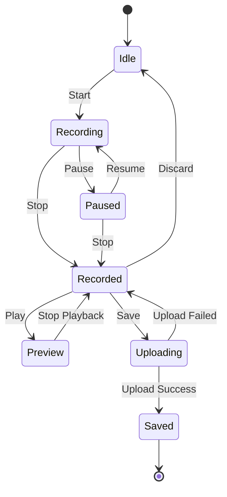

위 상태 다이어그램은
화면 및 Service의 처리 흐름을
개념적으로 정리한 것입니다.

실제 코드에 동일한 이름의
상태 머신 클래스가 존재하는
것은 아닙니다.

### 상태별 역할

| 상태 | 설명 |
|---|---|
| Idle | 녹음 시작 전 |
| Recording | 녹음 진행 |
| Paused | 녹음 일시정지 |
| Recorded | 녹음 파일 생성 완료 |
| Preview | 녹음 파일 미리 듣기 |
| Uploading | 서버 저장 요청 |
| Saved | 서버 저장 성공 |

---

## 29. Recording Start

녹음 시작 시 기존 음성 재생을
중지하고 새로운 녹음 작업을
시작합니다.

### 처리 흐름

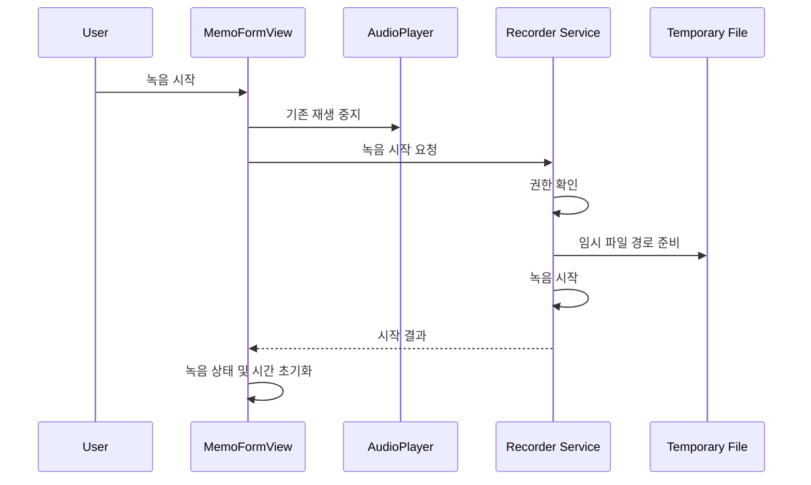

### 녹음 시작 이전 고려 사항

- 기존 미리 듣기 재생 중지
- 마이크 권한 확인
- 이전 임시 파일 정리
- 신규 녹음 파일 경로 생성
- 녹음 시간 초기화

기존 녹음 파일을 유지하는 대신
새로운 녹음 작업을 시작하는
흐름입니다.

---

## 30. Pause & Resume

음성 녹음 중 일시정지 및
재개 기능을 제공합니다.

### 상태 전환

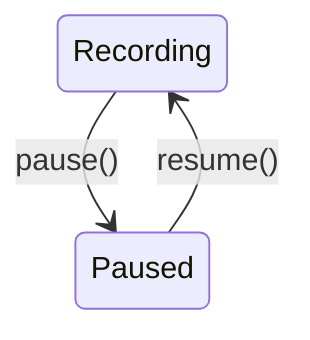

### 일시정지

녹음 작업을 일시적으로 중지합니다.

녹음 화면은 일시정지 상태를
별도로 관리합니다.

### 재개

일시정지된 녹음 작업을
다시 진행합니다.

### 녹음 시간과의 관계

일시정지 상태에서는
화면의 녹음 시간 증가를
제한합니다.

따라서 일시정지한 시간을
녹음 길이에 포함하지 않도록
구성했습니다.

---

## 31. Recording Timer

녹음 시간은 Timer를 사용하여
화면에 표시합니다.

### 시간 갱신 주기

```dart
Timer.periodic(
  const Duration(seconds: 1),
  callback,
)
```

위 코드는 실제 Timer 사용 구조를
축약하여 표현한 예시입니다.

### 가상 시간 흐름

| 실제 경과 | 녹음 상태 | 표시 시간 |
|---|---|---|
| 0초 | 시작 | 00:00 |
| 5초 | 녹음 | 00:05 |
| 10초 | 일시정지 | 00:10 |
| 15초 | 일시정지 유지 | 00:10 |
| 20초 | 녹음 재개 후 진행 | 00:15 |
| 25초 | 녹음 종료 | 00:20 |

위 표는 15초 시점에 녹음을
재개했다고 가정한 예시입니다.

### Timer의 한계

Timer 기반 표시 시간은
실제 인코딩된 오디오 파일의
길이와 정확히 일치하지 않을
가능성이 있습니다.

앱의 백그라운드 전환,
이벤트 루프 지연 및
기기 상태의 영향을 받을 수 있습니다.

### 개선 방향

- 실제 오디오 메타데이터 조회
- 녹음 시간 측정 기준 통일
- 앱 생명주기 대응
- 최대 녹음 시간 제한
- 서버 파일 길이 검증

---

## 32. Recording Stop

녹음 종료 시 녹음 작업을
중지하고 생성된 파일 경로를
확인합니다.

### 처리 흐름

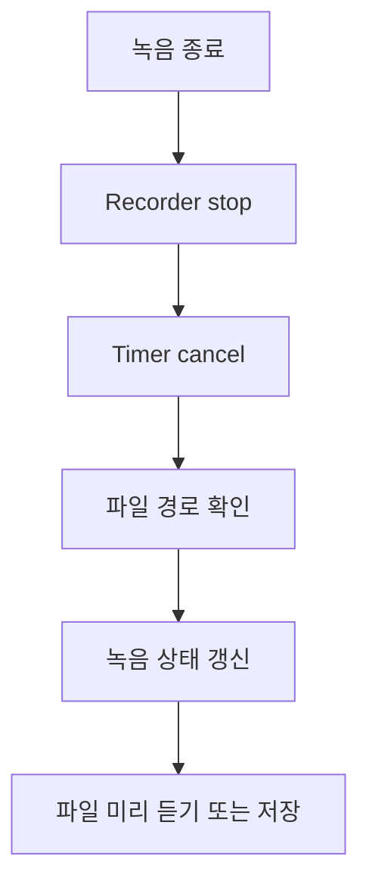

위 다이어그램은 주요 작업을
개념적으로 정리한 것입니다.

### 파일 정보 확인

녹음 종료 후 생성된 파일의
길이 정보를 확인하는 코드가
존재합니다.

파일 크기를 사용자에게
안내하는 처리도 존재합니다.

### 검증 범위

파일 경로 및 파일 크기 확인은
파일 생성 여부를 판단하는 데
도움이 될 수 있습니다.

다만 다음 검증을 완료했다는
의미는 아닙니다.

- 파일 무결성 검증
- 오디오 헤더 검증
- 실제 코덱 검사
- 파일 해시 비교
- 손상된 오디오 복구

---

## 33. Local Audio Preview

서버 업로드 이전에
녹음된 음성 파일을
미리 들을 수 있도록 구성했습니다.

### 재생 방식

```dart
await player.setFilePath(recordedPath);
await player.play();
```

위 코드는 로컬 파일 재생의
핵심 호출을 정리한 것입니다.

### 처리 구조

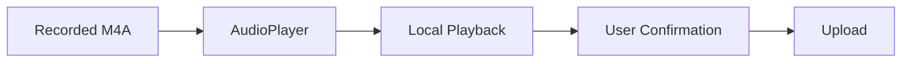

### 설계 목적

사용자가 녹음 결과를 확인한 뒤
서버 저장 여부를 결정할 수
있도록 합니다.

### 로컬 재생과 서버 재생

| 구분 | 로컬 재생 | 서버 재생 |
|---|---|---|
| 데이터 위치 | 임시 파일 | 서버 음성 API |
| 접근 방식 | 파일 경로 | HTTP URL |
| 인증 헤더 | 필요하지 않음 | 사용 |
| 사용 시점 | 업로드 이전 | 서버 저장 이후 |

---

## 34. Voice Memo Input Validation

음성 메모 저장은
녹음 상태 및 파일 경로를
기준으로 제한합니다.

### 저장 가능 조건

신규 음성 메모의 경우
다음 상태를 고려합니다.

- 저장 요청이 진행 중이지 않음
- 현재 녹음 중이 아님
- 녹음된 파일 경로가 존재함

### 수정 모드

기존 음성 메모를 수정하는 경우
제목 입력 상태를 확인합니다.

현재 음성 메모 수정은
제목 변경을 중심으로 처리합니다.

### 기본 제목

신규 음성 메모의 제목이
비어 있는 경우 기본 제목을
사용할 수 있도록 구성했습니다.

```text
음성 메모
```

### 음성 길이

저장 요청에 전달하는 음성 길이는
최소 1초로 보정하는 처리가
존재합니다.

이는 실제 오디오 길이가
반드시 1초 이상이라는 것을
검증하는 방식은 아닙니다.

---

## 35. Multipart File Upload

텍스트 메모는 JSON 요청으로
등록할 수 있습니다.

음성 메모는 파일 데이터와
메타데이터를 함께 전송해야 하므로
Multipart FormData를 사용합니다.

### 요청 Endpoint

```http
POST /api/memos/voice/
Authorization: Bearer <ACCESS_TOKEN>
Content-Type: multipart/form-data
```

실제 Multipart Boundary는
HTTP 클라이언트가 구성하는
요청 정보에 포함됩니다.

### 요청 필드

| Field | Type | Description |
|---|---|---|
| patient_id | String | 환자 ID |
| memo_type | String | voice |
| title | String | 메모 제목 |
| audio_duration_seconds | Integer | 녹음 길이 |
| exam_id | Integer | 선택적 검사 ID |
| audio_file | File | 녹음된 음성 파일 |

### 핵심 FormData 구성

```dart
final formData = FormData.fromMap({
  'patient_id': patientId.trim(),
  'memo_type': PatientMemoType.voice.value,
  'title': title.trim(),
  'audio_duration_seconds': durationSeconds,
  if (examId != null) 'exam_id': examId,
  'audio_file': await MultipartFile.fromFile(
    audioPath,
    filename: 'voice_memo.m4a',
  ),
});
```

위 코드는 분석한 MemoService의
Multipart 요청 구성 부분입니다.

### 파일 필드

```text
audio_file
```

### 업로드 파일 이름

```text
voice_memo.m4a
```

로컬에서 생성된 임시 파일 경로를
사용하여 MultipartFile을 구성하고,
서버에 전달할 파일 이름을
별도로 지정합니다.

---

## 36. Multipart Request Structure

Multipart 요청은 하나의 HTTP 요청에
여러 데이터 파트를 포함할 수 있습니다.

### 개념적 요청 구조

```http
POST /api/memos/voice/
Authorization: Bearer <ACCESS_TOKEN>
Content-Type: multipart/form-data; boundary=DEMO_BOUNDARY

--DEMO_BOUNDARY
Content-Disposition: form-data; name="patient_id"

DEMO-001
--DEMO_BOUNDARY
Content-Disposition: form-data; name="memo_type"

voice
--DEMO_BOUNDARY
Content-Disposition: form-data; name="title"

음성 참고 기록
--DEMO_BOUNDARY
Content-Disposition: form-data; name="audio_duration_seconds"

30
--DEMO_BOUNDARY
Content-Disposition: form-data; name="audio_file"; filename="voice_memo.m4a"

[BINARY AUDIO DATA]
--DEMO_BOUNDARY--
```

위 요청은 Multipart 구조를
설명하기 위한 가상 예시입니다.

실제 네트워크 요청을 캡처한
결과는 아닙니다.

### JSON과 Multipart 비교

| 항목 | JSON | Multipart |
|---|---|---|
| 주요 데이터 | 구조화된 값 | 값 및 파일 |
| 텍스트 메모 | 사용 | 사용하지 않음 |
| 음성 메모 | 메타데이터만 표현 가능 | 파일과 메타데이터 전송 |
| 요청 구성 | JSON 직렬화 | FormData |
| 파일 처리 | 별도 인코딩 필요 | 파일 파트 사용 |

### Multipart 선택 이유

음성 파일을 일반 JSON 문자열로
변환하지 않고 파일 데이터와
메타데이터를 하나의 요청에
포함할 수 있습니다.

현재 구현에서는 Dio의 FormData와
MultipartFile을 활용합니다.

---

## 37. Voice Upload Sequence

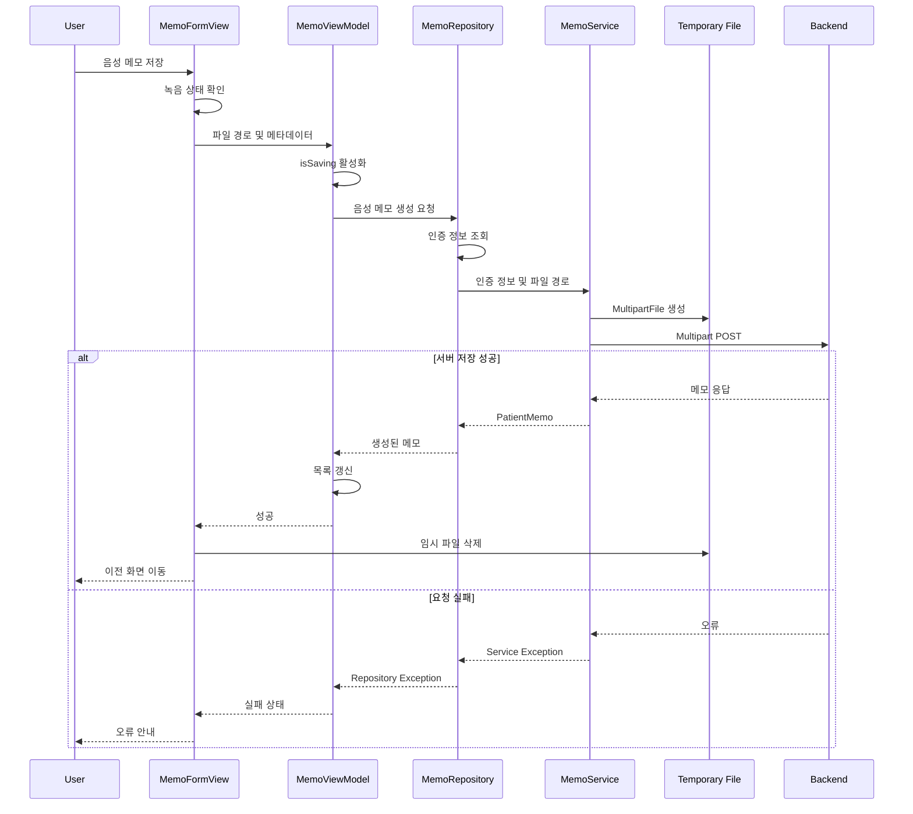

### 주요 특징

- 파일 업로드와 메타데이터 등록을
  하나의 API 요청으로 구성
- 서버 응답을 PatientMemo로 변환
- 성공 응답 이후 메모 목록 갱신
- 성공 시 로컬 임시 파일 정리
- 실패 시 파일을 유지하여 재시도 가능

---

## 38. Upload Success & Failure

### 성공 시

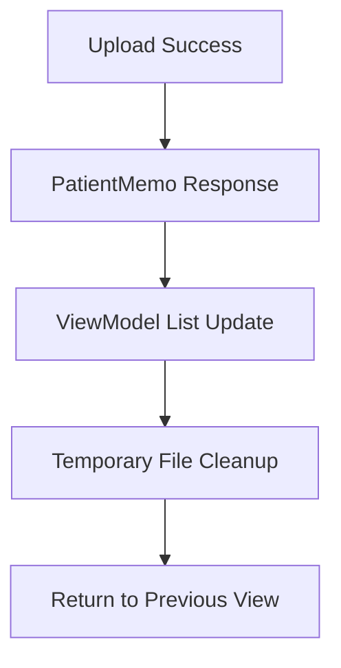

### 실패 시

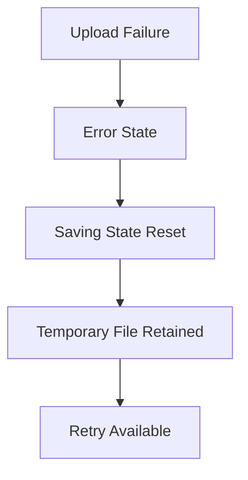

### 실패 후 파일 유지

업로드가 실패한 경우
현재 작성 화면에서 녹음 파일을
유지할 수 있도록 구성했습니다.

사용자는 화면을 유지한 상태에서
다시 저장을 시도할 수 있습니다.

### 현재 재시도 범위

- 사용자가 직접 저장 재시도
- 기존 임시 파일 재사용 가능

### 확인되지 않은 기능

- 자동 재시도
- 백그라운드 업로드
- 업로드 이어받기
- 파일 분할 업로드
- 업로드 진행률 표시
- 네트워크 복구 시 자동 전송

---

## 39. Temporary File Lifecycle

음성 메모 작성 과정에서는
임시 파일을 생성하고
필요한 시점에 제거합니다.

```mermaid
flowchart TD
    A["Temporary File Created"]
    B["Recording Completed"]
    C["Preview / Upload"]
    D{"Upload Result"}

    A --> B
    B --> C
    C --> D

    D -->|Success| E["Delete Temporary File"]
    D -->|Failure| F["Retain for Retry"]

    F --> C
    F --> G["Discard / Exit"]
    G --> E
```

### 정리 대상 상황

- 새로운 녹음 시작
- 녹음 취소
- 메모 유형 변경
- 서버 저장 성공
- 작성 화면 종료

### 설계 목적

사용하지 않는 녹음 파일이
기기에 계속 남는 상황을
줄이기 위해 정리 로직을
구성했습니다.

### 현재 구조의 한계

앱이 비정상적으로 종료되거나
운영체제에 의해 프로세스가
강제 종료되는 경우
dispose가 항상 실행되는 것은
아닙니다.

따라서 임시 파일이
모든 상황에서 제거된다고
보장할 수는 없습니다.

### 개선 방향

- 앱 시작 시 오래된 임시 파일 검사
- 임시 파일 보존 기간 정의
- 업로드 상태와 파일 경로 기록
- 미완료 업로드 복구 정책
- 민감한 음성 파일 보호

---

## 40. Voice Memo Update

기존 음성 메모의 수정은
제목 변경을 중심으로 처리합니다.

```http
PATCH /api/memos/102/
Authorization: Bearer <ACCESS_TOKEN>
Content-Type: application/json
```

### 가상 요청

```json
{
  "title": "수정된 음성 참고 기록"
}
```

### 현재 수정 범위

| 항목 | 수정 여부 |
|---|---|
| 제목 | 지원 |
| 기존 음성 파일 교체 | 확인되지 않음 |
| 메모 유형 변경 | 작성 화면에서 제한 |
| 음성 편집 | 확인되지 않음 |
| 음성 구간 자르기 | 확인되지 않음 |

### 설계상 의미

기존 음성 파일을 변경하지 않고
메모의 표시 제목을 수정할 수
있도록 구성했습니다.

파일 교체 기능으로 확장할 경우
기존 파일과 신규 파일의
저장 정합성을 고려해야 합니다.

---

## 41. Authenticated Audio Playback

서버에 저장된 음성 메모는
인증 정보를 포함한 요청으로
재생할 수 있도록 구성했습니다.

### 음성 접근 Endpoint

```http
GET /api/memos/102/audio/
Authorization: Bearer <ACCESS_TOKEN>
```

### Repository 역할

MemoRepository는 음성 파일에
접근하기 위한 URL과
인증 헤더를 구성합니다.

### 재생 호출

```dart
final source = await context
    .read<MemoRepository>()
    .audioSource(memo.id);

await player.setUrl(
  source.url,
  headers: source.headers,
);
```

위 코드는 실제 재생 구조를
간단하게 정리한 예시입니다.

### 인증 기반 재생 흐름

```mermaid
sequenceDiagram
    participant U as User
    participant V as MemoDetailView
    participant R as MemoRepository
    participant S as SecureStorage
    participant P as AudioPlayer
    participant API as Backend

    U->>V: 음성 재생 요청
    V->>R: audioSource 요청
    R->>S: Access Token 조회
    S-->>R: Access Token
    R-->>V: URL 및 Headers
    V->>P: setUrl
    P->>API: 인증 포함 음성 요청
    API-->>P: 음성 응답
    P-->>U: 음성 재생
```

### 보안 범위

클라이언트에서 인증 헤더를
전송하는 구조는 확인했습니다.

다만 서버의 다음 기능까지
검증한 것은 아닙니다.

- 의료진별 음성 접근 권한
- 환자별 객체 권한
- 음성 파일 암호화
- 다운로드 제한
- 접근 감사 기록
- 인증 만료 후 재생 처리

---

## 42. Lazy Audio Preparation

음성 메모 상세 화면에서는
최초 재생 시점에 오디오 소스를
준비하는 구조를 사용합니다.

### 상태

```text
_isPrepared
_isLoading
```

### 처리 흐름

```mermaid
flowchart TD
    A["재생 버튼 선택"]
    B{"Audio Prepared?"}

    A --> B

    B -->|No| C["Audio Source 조회"]
    C --> D["setUrl"]
    D --> E["Prepared 상태 갱신"]

    B -->|Yes| F["기존 Audio Source 사용"]
    E --> G["Playback"]
    F --> G
```

### 설계 목적

화면에 음성 메모가 표시되었다는
이유만으로 모든 음성 파일을
즉시 준비하지 않습니다.

사용자가 재생을 요청하는 시점에
음성 소스를 준비합니다.

### 현재 한계

준비된 오디오 소스를 재사용하는
과정에서 인증 토큰이 만료되거나
메모의 음성 정보가 변경될 수 있습니다.

토큰 갱신 이후 음성 소스를
자동으로 다시 구성하는 기능은
추가 확인이 필요합니다.

---

## 43. Playback State

음성 재생은 AudioPlayer의
상태를 기반으로 처리합니다.

### 주요 동작

- 재생
- 일시정지
- 재생 완료 후 처음부터 재생
- 재생 위치 이동

### 재생 상태 흐름

```mermaid
stateDiagram-v2
    [*] --> Ready

    Ready --> Playing: Play
    Playing --> Paused: Pause
    Paused --> Playing: Resume

    Playing --> Completed: End
    Completed --> Playing: Seek zero and Play
```

### 재생 완료 처리

음성 재생이 완료된 상태에서
다시 재생하는 경우
재생 위치를 처음으로 이동합니다.

```dart
await player.seek(Duration.zero);
```

### 화면 상태 연계

AudioPlayer의 상태 정보를
사용하여 재생 버튼 및
현재 재생 상태를 표시합니다.

---

## 44. Playback Progress

음성 메모 상세 화면에서는
재생 위치를 확인할 수 있는
인터페이스를 제공합니다.

### 주요 데이터

| 데이터 | 역할 |
|---|---|
| playerStateStream | 재생 상태 |
| positionStream | 현재 재생 위치 |
| duration | 전체 음성 길이 |
| Slider | 재생 위치 표시 및 이동 |

### 처리 구조

```mermaid
flowchart TD
    A["AudioPlayer"]
    B["Player State Stream"]
    C["Position Stream"]
    D["Playback Button"]
    E["Progress Slider"]

    A --> B
    A --> C

    B --> D
    C --> E

    E -->|seek| A
```

### 가상 예시

```text
현재 재생 위치: 00:15
전체 재생 길이: 01:00

진행률: 25%
```

### 전체 길이 처리

오디오 재생기에서 전체 길이를
확인하기 전에는 메모 모델의
음성 길이 정보를 활용할 수 있습니다.

### 추가 검증 항목

- 전체 길이가 없는 경우
- 재생 위치가 전체 길이를 초과하는 경우
- 네트워크 중단
- 재생 중 위치 이동
- 매우 짧은 음성 파일
- 서버의 HTTP Range 요청 지원

---

## 45. Audio Resource Lifecycle

녹음기와 오디오 재생기는
화면이 종료될 때 정리해야 하는
리소스를 가집니다.

### 주요 정리 대상

| Resource | Cleanup |
|---|---|
| Recording Timer | cancel |
| AudioPlayer | dispose |
| Audio Recorder | dispose |
| Temporary Audio File | delete |
| TextEditingController | dispose |

### 생명주기 구조

```mermaid
flowchart TD
    A["View Created"]
    B["Recorder / Player Initialized"]
    C["Recording or Playback"]
    D["View Disposed"]
    E["Timer Cancel"]
    F["Player Dispose"]
    G["Recorder Dispose"]
    H["Temporary File Cleanup"]

    A --> B
    B --> C
    C --> D

    D --> E
    D --> F
    D --> G
    D --> H
```

### 설계 목적

- 화면 종료 이후 불필요한 녹음 방지
- 사용하지 않는 재생 리소스 정리
- Timer의 지속 실행 방지
- 임시 파일 잔존 최소화

### 비동기 정리

일부 리소스 해제 작업은
Future를 반환합니다.

작성 화면의 dispose에서는
일부 비동기 정리 작업을
unawaited 방식으로 실행합니다.

### 한계

비동기 정리 작업의 완료 시점과
실패 여부를 모두 보장하는
구조는 아닙니다.

화면 종료와 파일 삭제,
녹음기 해제 사이의 순서를
추가로 검증할 필요가 있습니다.

---

## 46. Memo ViewModel

MemoViewModel은 메모 기능의
공통 상태를 관리합니다.

```mermaid
flowchart TD
    A["MemoViewModel"]

    B["Memo List"]
    C["Selected Memo"]
    D["Memo Filter"]
    E["Loading State"]
    F["Saving State"]
    G["Deleting State"]
    H["Error Message"]

    A --> B
    A --> C
    A --> D
    A --> E
    A --> F
    A --> G
    A --> H
```

### 주요 상태

| 상태 | 역할 |
|---|---|
| memos | 메모 목록 |
| selectedMemo | 선택된 메모 |
| filter | 메모 유형 필터 |
| isLoading | 조회 진행 여부 |
| isSaving | 등록 및 수정 진행 여부 |
| isDeleting | 삭제 진행 여부 |
| errorMessage | 요청 오류 정보 |

### 상태 변경 전달

ChangeNotifier의
notifyListeners를 사용하여
상태 변경을 관련 화면에
전달합니다.

### 외부 목록 접근

메모 목록은 외부에서 직접
수정하지 않도록 읽기 전용
형태로 제공하는 구조입니다.

---

## 47. Loading State Management

메모 목록 및 상세 조회 시
조회 진행 상태를 관리합니다.

### 기본 흐름

```mermaid
flowchart TD
    A["Load Request"]
    B{"Already Loading?"}

    A --> B

    B -->|Yes| C["추가 요청 제한"]
    B -->|No| D["isLoading = true"]

    D --> E["Repository Request"]
    E --> F{"Success?"}

    F -->|Yes| G["Update Memo Data"]
    F -->|No| H["Set Error Message"]

    G --> I["isLoading = false"]
    H --> I

    I --> J["notifyListeners"]
```

### 요청 상태 관리 목적

- 중복 조회 요청 제한
- 로딩 화면 표시
- 오류 메시지 제공
- 요청 종료 후 상태 복구

### 기존 데이터 유지

목록 조회에 실패하는 경우
기존 메모 목록을 유지할 수
있는 구조입니다.

데이터가 이미 존재하는 상황과
초기 데이터가 없는 상황을
구분하여 화면을 구성합니다.

---

## 48. Saving State Management

메모 등록 및 수정 요청은
저장 진행 상태를 사용합니다.

### 주요 흐름

```text
Idle
  ↓
Saving
  ↓
Success or Failure
  ↓
Idle
```

### 저장 버튼 상태

저장 요청이 진행되는 동안
추가적인 저장 입력을 제한하는
조건을 사용합니다.

### finally 처리

API 요청의 성공 또는 실패와
관계없이 저장 상태를
복구하도록 구성합니다.

### 중복 요청 제한의 범위

클라이언트에서 저장 상태를
관리하면 반복적인 버튼 입력을
줄일 수 있습니다.

하지만 서버의 중복 생성까지
완전히 방지하는 것은 아닙니다.

예를 들어 서버에서 등록이
완료되었지만 응답이 유실된 경우,
사용자가 다시 저장하면
중복 메모가 생성될 수 있습니다.

현재 Idempotency Key 기반
중복 요청 방지 기능은
확인되지 않았습니다.

---

## 49. Server Response Reconciliation

서버 요청이 성공한 이후
응답으로 전달된 PatientMemo를
ViewModel의 목록에 반영합니다.

### 생성

새로운 메모를 목록에 추가하고
정렬 및 선택 상태를 갱신합니다.

### 수정 및 상세 조회

동일한 ID의 메모를 찾고
서버에서 전달된 모델로
항목을 갱신합니다.

### 삭제

서버 삭제 성공 이후
해당 ID를 목록에서 제거합니다.

### 개념적 흐름

```mermaid
flowchart TD
    A["Server Response"]
    B{"Operation"}

    A --> B

    B -->|Create| C["Insert Memo"]
    B -->|Update| D["Replace by ID"]
    B -->|Read Detail| D
    B -->|Delete| E["Remove by ID"]

    C --> F["Update State"]
    D --> F
    E --> F

    F --> G["notifyListeners"]
```

### 데이터 중복 처리 범위

ID 기반 항목 갱신 로직은
기존 메모의 중복 삽입을
줄이는 데 활용됩니다.

다만 신규 메모 생성 경로에서는
모든 경우에 대한 전체 목록
중복 제거를 수행한다고
확인한 것은 아닙니다.

---

## 50. Memo List UI

환자별 메모 목록 화면은
서버에서 조회한 데이터를
표시합니다.

### 화면 상태

| 상태 | 표시 내용 |
|---|---|
| 초기 조회 | 로딩 상태 |
| 조회 실패 및 빈 목록 | 오류 및 재시도 |
| 정상 데이터 | 메모 카드 |
| 빈 목록 | 안내 문구 |
| 새로고침 | 목록 재조회 |

### 메모 카드 정보

- 메모 유형
- 메모 제목
- 내용 미리보기
- 작성자
- 작성 또는 수정 시각
- 음성 메모의 재생 길이

### 새로고침

Pull-to-refresh를 통해
현재 환자의 메모 목록을
다시 조회할 수 있습니다.

### 화면 이동 이후 갱신

메모 작성 또는 상세 화면에서
변경이 완료되면 이전 화면에
성공 여부를 전달합니다.

목록 화면은 해당 결과에 따라
환자별 메모를 다시 조회합니다.

---

## 51. Navigation & Result Propagation

메모 기능은 GoRouter를
사용하여 화면을 연결합니다.

```mermaid
flowchart TD
    A["Patient Detail"]
    B["Memo List"]
    C["Memo Create"]
    D["Memo Detail"]
    E["Memo Edit"]

    A --> B
    B --> C
    B --> D
    D --> E

    C -->|Success Result| B
    E -->|Success Result| D
    D -->|Delete or Change Result| B
```

### 주요 전달 데이터

- patientId
- memoId
- Patient 객체
- PatientMemo 객체
- 변경 성공 여부

### 성공 결과 전달

```dart
context.pop(true);
```

작성 또는 수정 성공 이후
이전 화면에 변경 결과를
전달하는 구조입니다.

### 이전 화면의 처리

이전 화면에서는 반환 결과를
확인하고 필요한 데이터를
다시 조회할 수 있습니다.

### 설계상 장점

- 화면 간 변경 결과 전달
- 변경 완료 이후 목록 갱신
- 사용자 이동 흐름 유지

### 추가 검증 필요 사항

Route Extra로 전달된 데이터가
서버의 최신 데이터와
일치하지 않을 수 있습니다.

직접 URL 접근, 앱 재실행 및
Route 복원 상황에서
필수 데이터가 존재하는지
추가로 검증해야 합니다.

---

## 52. Recent Voice Memos

마이페이지에서는 최근 음성 메모를
조회할 수 있도록 구성했습니다.

### 처리 구조

```mermaid
flowchart TD
    A["My Page"]
    B["Recent Voice Memos"]
    C["MemoViewModel"]
    D["Memo List API"]
    E["Voice Memo Filter"]
    F["Voice Memo Cards"]
    G["Audio Playback"]

    A --> B
    B --> C
    C --> D
    D --> E
    E --> F
    F --> G
```

### 주요 기능

- 메모 목록 조회
- 음성 메모 유형 필터
- 최근 메모 확인
- 음성 파일 재생
- 목록 새로고침

### 조회 범위

최근 음성 메모 화면에서는
환자 ID를 지정하지 않은
메모 목록 요청을 사용합니다.

실제 조회 가능한 데이터의 범위는
서버의 인증 및 권한 정책에
따라 결정됩니다.

### 개별 오디오 재생기

각 음성 메모 카드에서
AudioPlayer를 관리하는
구조가 존재합니다.

### 잠재적인 한계

여러 카드의 재생 상태를
하나의 공통 재생 관리자가
제어하는 구조는 확인되지 않았습니다.

따라서 여러 음성 메모가
동시에 재생되는 상황에 대한
추가 검증이 필요합니다.

---

## 53. Shared Memo State Scope

MemoViewModel은 앱에서
공유되는 상태 관리 구조를
사용합니다.

### 현재 조회 유형

```text
환자별 메모 조회

loadMemos(patientId: ...)
```

```text
환자 필터 없는 메모 조회

loadMemos()
```

### 잠재적인 문제

두 화면이 동일한 ViewModel의
메모 목록을 사용하면
조회 범위가 서로 달라질 수 있습니다.

예를 들어 다음 상황을
고려할 수 있습니다.

1. 환자 A의 메모 목록 조회
2. 최근 음성 메모 화면 이동
3. 환자 필터 없는 메모 조회
4. 환자 A의 메모 화면 복귀

공유 목록의 데이터 범위가
이전과 달라졌을 가능성이 있습니다.

### 개선 방향

```mermaid
flowchart TD
    A["Memo Repository"]
    B["Patient Memo State"]
    C["Recent Voice Memo State"]
    D["Memo Detail State"]

    A --> B
    A --> C
    A --> D
```

화면별 ViewModel을 분리하거나
환자 ID를 기준으로 메모 상태를
구분하여 관리할 수 있습니다.

### 검증 범위

위 내용은 공유 상태 구조에서
확인한 잠재적인 문제입니다.

실제 다른 환자의 메모가
잘못 표시되는 장애를
재현한 것은 아닙니다.

---

## 54. Asynchronous Request Handling

메모 기능은 API 요청과
파일 처리 과정에서
Future 및 async/await를 사용합니다.

### 비동기 처리 대상

- 인증 정보 조회
- 메모 목록 요청
- 메모 상세 요청
- 텍스트 메모 등록
- 음성 파일 접근
- Multipart 업로드
- 메모 수정 및 삭제
- 녹음 시작 및 종료
- 음성 재생 준비
- 임시 파일 삭제

### 처리 흐름

```mermaid
flowchart TD
    A["User Action"]
    B["Set Loading State"]
    C["Await Async Operation"]
    D{"Operation Result"}

    A --> B
    B --> C
    C --> D

    D -->|Success| E["Update Data"]
    D -->|Failure| F["Handle Error"]

    E --> G["Reset Loading State"]
    F --> G
```

### 화면 생명주기

비동기 작업이 완료된 시점에
기존 화면이 이미 종료되었을
가능성이 있습니다.

화면에서는 mounted 확인을
사용하는 처리들이 존재합니다.

다만 모든 비동기 작업이
화면 종료 시 자동으로
취소되는 것은 아닙니다.

---

## 55. API Error Handling

MemoService는 DioException을
처리하여 메모 기능에 적합한
오류 메시지로 변환합니다.

### 주요 오류 데이터

- detail
- message
- 필드별 검증 오류
- 기본 오류 메시지

### 계층별 오류 전달

```mermaid
flowchart TD
    A["DioException"]
    B["MemoServiceException"]
    C["MemoRepositoryException"]
    D["MemoViewModel"]
    E["Error Message"]
    F["User Interface"]

    A --> B
    B --> C
    C --> D
    D --> E
    E --> F
```

### 오류 처리 목적

HTTP 클라이언트의 내부 오류를
그대로 사용자에게 표시하지 않고
기능에 적합한 메시지를
제공하도록 구성합니다.

### 가상 오류 상황

| 상황 | 처리 목적 |
|---|---|
| 인증 정보 없음 | 요청 제한 |
| 메모 조회 실패 | 조회 오류 안내 |
| 텍스트 저장 실패 | 저장 오류 안내 |
| 음성 업로드 실패 | 파일 유지 및 재시도 |
| 음성 재생 실패 | 재생 오류 안내 |
| 삭제 실패 | 기존 데이터 유지 |

실제 서버에서 모든 오류 상황을
재현하여 검증한 결과는 아닙니다.

---

## 56. Error Handling Limitations

현재 오류 처리 구조에서
추가적으로 고려할 수 있는
항목은 다음과 같습니다.

### 인증 만료

인증 토큰이 만료된 경우
토큰을 갱신하고 요청을
다시 실행하는 정책이 필요합니다.

메모 기능 자체에서 자동 토큰
갱신이 완전히 구현되었다고
확인한 것은 아닙니다.

### 네트워크 오류

네트워크 연결이 끊어지면
메모 조회 및 저장에 실패할 수 있습니다.

음성 파일 업로드의 경우
전송 시간이 상대적으로 길어질
가능성이 있습니다.

### 요청 시간 제한

공통 ApiClient에는
요청 시간 제한 설정이 존재합니다.

대용량 음성 파일에 대해서는
별도의 업로드 Timeout 정책이
필요할 수 있습니다.

### 응답 유실

서버 저장이 완료되었지만
클라이언트가 응답을 받지 못하는
상황을 고려해야 합니다.

현재 서버 중복 생성 방지 및
요청 결과 확인 정책은
검증되지 않았습니다.

---

## 57. Security Considerations

의료진 메모에는 환자 정보 및
민감한 진료 관련 내용이
포함될 수 있습니다.

따라서 일반적인 메모 기능보다
데이터 보호를 고려해야 합니다.

### 현재 확인된 구조

- SecureStorage 기반 인증 정보 접근
- Bearer Token 포함 API 요청
- 인증 헤더 기반 음성 파일 재생
- 임시 녹음 파일 정리
- 환자 ID 기반 메모 조회

### 추가적으로 필요한 보안 요소

| 보안 요소 | 고려 목적 |
|---|---|
| HTTPS | 전송 구간 보호 |
| Object-level Authorization | 메모별 접근 제한 |
| File Encryption | 저장된 음성 파일 보호 |
| Audit Log | 메모 접근 및 변경 추적 |
| Retention Policy | 데이터 보존 기간 관리 |
| File Validation | 업로드 파일 검증 |
| Log Masking | 민감 정보 로그 노출 방지 |
| Session Isolation | 계정별 데이터 상태 분리 |

### 전송 구간 보안

프로젝트의 공통 API 설정에는
HTTP 기반 기본 주소가 존재합니다.

따라서 현재 시스템이
모든 네트워크 통신에서
HTTPS를 사용한다고
주장하지 않습니다.

### 로그 관리

공통 Dio 설정의 요청 및
응답 로깅에는 인증 정보와
민감한 데이터가 포함될
가능성이 있습니다.

운영 환경에서는 민감 정보
마스킹 및 로그 출력 제한이
필요합니다.

---

## 58. File Upload Security

파일 업로드 기능은
서버에서 별도의 검증이
필요합니다.

### 클라이언트 처리

- 녹음 파일 경로 구성
- M4A 파일 이름 지정
- Multipart 요청 생성
- 인증 헤더 포함

### 서버 검증 제안

- 업로드 파일 최대 크기
- 허용 파일 형식
- 실제 파일 헤더
- MIME Type
- 오디오 길이
- 파일 손상 여부
- 안전한 저장 파일 이름
- 환자 및 의료진 접근 권한

### 파일 이름의 한계

파일 이름이 .m4a로
끝난다는 사실만으로
실제 파일 형식이 유효하다고
판단할 수는 없습니다.

서버에서는 확장자와 별도로
파일의 실제 내용을
검증해야 합니다.

### 구현 범위

위 서버 검증 항목은
보안 관점의 개선 제안입니다.

실제 서버에 해당 검증이
모두 적용되어 있다고
확인한 것은 아닙니다.

---

## 59. Backend Data Modeling Perspective

메모 기능은 환자 및 의료진
데이터와 관계를 가집니다.

### 개념적 데이터 관계

```mermaid
erDiagram
    DOCTOR ||--o{ PATIENT_MEMO : writes
    PATIENT ||--o{ PATIENT_MEMO : references
    EXAM o|--o{ PATIENT_MEMO : relates_to

    PATIENT_MEMO {
        int id PK
        string doctor_id FK
        string patient_id FK
        int exam_id FK
        string memo_type
        string title
        string content
        string audio_reference
        int audio_duration_seconds
        datetime created_at
        datetime updated_at
    }
```

위 ERD는 Flutter 모델과
API 요청 데이터를 기반으로
관계를 설명하기 위한
개념적 모델입니다.

실제 Django 데이터베이스의
테이블 구조를 확인한
물리 ERD는 아닙니다.

### 데이터 관계 고려 사항

- 작성 의료진 식별
- 환자와 메모의 관계
- 검사 정보의 선택적 연결
- 텍스트 및 음성 유형
- 파일 참조 정보
- 생성 및 수정 시각
- 삭제 정책

---

## 60. Metadata & Binary Data

음성 메모는 일반적인
구조화된 데이터와 파일 데이터를
함께 관리해야 합니다.

### 구조화된 데이터

- 메모 ID
- 작성 의료진 ID
- 환자 ID
- 검사 ID
- 제목
- 메모 유형
- 음성 길이
- 생성 및 수정 시각

### 파일 데이터

- 녹음된 M4A 음성 파일

### 개념적 서버 구조

```mermaid
flowchart TD
    A["Multipart Request"]
    B["Metadata"]
    C["Audio Binary"]
    D["Memo Database"]
    E["File Storage"]

    A --> B
    A --> C

    B --> D
    C --> E

    D -->|File Reference| E
```

위 구조는 파일 업로드 시스템에서
메타데이터와 파일을 분리하여
관리하는 개념을 설명합니다.

실제 VENA 서버의 음성 파일이
어떤 저장소에 저장되는지는
확인하지 않았습니다.

따라서 Object Storage,
특정 클라우드 서비스 또는
파일 암호화 사용을
구현 성과로 포함하지 않습니다.

---

## 61. Data Consistency Perspective

음성 파일 저장과 메모 데이터
등록은 서로 다른 처리 과정이
될 수 있습니다.

### 잠재적인 서버 문제

```text
상황 A

파일 저장 성공
메모 데이터 등록 실패

결과:
참조되지 않는 파일 발생 가능
```

```text
상황 B

메모 데이터 등록 성공
파일 저장 실패

결과:
재생할 수 없는 메모 발생 가능
```

### 개선 제안

```mermaid
flowchart TD
    A["Validate Request"]
    B["Prepare File"]
    C["Save Metadata"]
    D{"All Operations Successful?"}

    A --> B
    B --> C
    C --> D

    D -->|Yes| E["Return Memo Response"]
    D -->|No| F["Compensating Cleanup"]
    F --> G["Return Error"]
```

### 고려 사항

- 파일 저장 실패 처리
- 데이터베이스 트랜잭션
- 실패한 파일 제거
- 중복 업로드 방지
- 메타데이터와 파일 참조 일관성
- 삭제 작업의 정합성

위 내용은 백엔드 시스템
설계 관점의 개선 방향입니다.

현재 서버에서 실제로
이러한 장애가 발생했거나
해결되었다는 의미는 아닙니다.

---

## 62. Performance Considerations

### 텍스트 메모

텍스트 메모는 일반적인
JSON 요청으로 전송됩니다.

파일 업로드에 비해
전송 데이터 크기가 작습니다.

### 음성 메모

음성 메모의 파일 크기는
녹음 시간에 따라 증가합니다.

128 kbps 설정을 기준으로
이론적인 크기를 계산하면
다음과 같습니다.

| 녹음 시간 | 예상 파일 크기 |
|---|---|
| 30초 | 약 0.48 MB |
| 1분 | 약 0.96 MB |
| 3분 | 약 2.88 MB |
| 5분 | 약 4.80 MB |
| 10분 | 약 9.60 MB |

위 수치는 비트레이트를
기준으로 계산한 추정값입니다.

실제 녹음 및 업로드를
측정한 결과가 아닙니다.

### 업로드 시간 추정

```text
Upload Time
≈ File Size in Bits / Upload Bandwidth
```

예를 들어 4.8 MB 파일을
1 Mbps의 전송 속도로
업로드한다고 가정하면
이론적으로 약 38.4초가
필요합니다.

실제 요청 시간은 네트워크 상태,
HTTP 오버헤드 및 서버 처리에
따라 달라질 수 있습니다.

### 개선 방향

- 최대 녹음 시간 제한
- 업로드 진행률 표시
- 음성 전용 Timeout 설정
- 파일 크기 사전 검증
- 목록 페이지네이션
- 오디오 소스 지연 준비
- 재생기 리소스 공유

---

## 63. Technical Challenges

### 63.1 텍스트와 음성 데이터 통합

기술적 고려 사항:

- 서로 다른 입력 유형
- 공통 목록 표시
- 유형별 상세 화면

현재 처리:

- PatientMemo 통합 모델
- PatientMemoType
- 유형별 필터
- 유형별 상세 화면

### 63.2 음성 파일 업로드

기술적 고려 사항:

- 파일과 메타데이터 전송
- 인증 정보 포함
- 서버 응답 처리

현재 처리:

- FormData
- MultipartFile
- Bearer Token
- PatientMemo 응답 변환

### 63.3 녹음 파일 생명주기

기술적 고려 사항:

- 녹음 파일 생성
- 미리 듣기
- 업로드 실패
- 불필요한 파일 제거

현재 처리:

- 임시 디렉터리 사용
- AudioPlayer
- 실패 시 파일 유지
- 성공 및 화면 종료 시 정리

### 63.4 서버 음성 접근

기술적 고려 사항:

- 음성 파일 URL 구성
- 인증 헤더 전달
- 재생 상태 관리

현재 처리:

- Repository 기반 Audio Source
- 인증 헤더 포함 setUrl
- 재생 상태 및 위치 Stream

### 63.5 화면 및 데이터 일관성

기술적 고려 사항:

- 메모 수정 이후 목록 갱신
- 삭제 이후 상태 정리
- 비동기 요청 상태

현재 처리:

- ID 기반 메모 갱신
- 서버 성공 이후 목록 변경
- 화면 이동 결과 전달
- ChangeNotifier

위 내용은 실제 구현 구조에서
확인한 기술적 고려 사항입니다.

모든 항목이 실제 장애로
발생했다는 의미는 아닙니다.

---

## 64. Code Review Findings

최종 Flutter 소스를 분석하면서
추가 검토가 필요한 사항을
정리했습니다.

### 64.1 공유 목록의 조회 범위

환자별 메모와 최근 음성 메모가
공통 ViewModel을 사용합니다.

조회 범위에 따라 목록을
분리하는 구조를 고려할 수 있습니다.

### 64.2 선택된 메모의 ID 검증

상세 화면의 대체 데이터가
요청한 메모 ID와 일치하는지
추가 검증할 필요가 있습니다.

### 64.3 작성자 표시

일부 작성자 정보가 누락된 경우
현재 로그인한 의료진 정보를
대체 값으로 사용하는 구조가
존재합니다.

다른 의료진이 작성한 메모에
잘못된 작성자가 표시되지 않도록
명확한 Unknown 상태를
고려할 수 있습니다.

### 64.4 개별 카드의 오디오 재생기

최근 음성 메모 화면에서는
카드별로 재생기를 관리합니다.

여러 카드의 재생을 조정하는
공통 Audio Controller를
고려할 수 있습니다.

### 64.5 Widget Identity

최근 음성 메모 카드에
안정적인 메모 ID 기반 Key를
사용하는 방안을 고려할 수 있습니다.

목록 재정렬 이후에도
재생기 상태가 올바른 메모와
연결되는지 검증해야 합니다.

### 64.6 최초 재생 로딩 상태

오디오 소스 준비 이후
play 호출을 await하는 동안
로딩 상태가 유지될 수 있습니다.

사용자가 재생 도중 일시정지를
수행할 수 있는지 검증하고,
준비 상태와 재생 상태를
분리하는 개선을 고려할 수 있습니다.

### 64.7 임시 파일 정리 순서

비동기 리소스 해제와
임시 파일 삭제가 진행되는
순서를 검토할 필요가 있습니다.

### 64.8 중복 등록

클라이언트의 저장 상태 관리만으로
서버의 중복 생성까지
방지할 수는 없습니다.

서버 Idempotency 정책을
추가적으로 고려할 수 있습니다.

위 항목은 정적 코드 분석에서
도출한 잠재적인 개선 사항입니다.

실제 장애 재현 및 수정 완료
이력으로 설명하지 않습니다.

---

## 65. Validation Scenarios

다음은 소스 구조를 기반으로
작성한 검증 계획입니다.

### Text Memo

| ID | 검증 항목 | 기대 동작 |
|---|---|---|
| MM-01 | 텍스트 메모 등록 | 신규 메모 생성 |
| MM-02 | 빈 내용 입력 | 저장 제한 |
| MM-03 | 공백 내용 입력 | 저장 제한 |
| MM-04 | 제목 미입력 | 자동 제목 생성 |
| MM-05 | 제목 길이 제한 | 최대 길이 적용 |
| MM-06 | 내용 길이 제한 | 최대 길이 적용 |
| MM-07 | 빠른 문구 입력 | 문구 추가 |
| MM-08 | 텍스트 메모 수정 | 서버 응답 기반 갱신 |
| MM-09 | 메모 삭제 | 서버 성공 이후 제거 |
| MM-10 | 삭제 취소 | 기존 메모 유지 |

### Memo Retrieval

| ID | 검증 항목 | 기대 동작 |
|---|---|---|
| MM-11 | 환자별 조회 | 해당 환자 범위 요청 |
| MM-12 | 전체 유형 필터 | 전체 목록 표시 |
| MM-13 | 텍스트 필터 | 텍스트만 표시 |
| MM-14 | 음성 필터 | 음성만 표시 |
| MM-15 | 최근 수정 정렬 | 최신 메모 우선 |
| MM-16 | 상세 조회 | 해당 ID 데이터 표시 |
| MM-17 | 목록 새로고침 | 서버 데이터 재조회 |
| MM-18 | 빈 목록 | 빈 상태 표시 |
| MM-19 | 조회 실패 | 오류 상태 처리 |
| MM-20 | 수정 화면 복귀 | 상세 데이터 갱신 |

### Recording

| ID | 검증 항목 | 기대 동작 |
|---|---|---|
| MM-21 | 마이크 권한 허용 | 녹음 가능 |
| MM-22 | 마이크 권한 거부 | 녹음 제한 |
| MM-23 | 녹음 시작 | 신규 파일 생성 |
| MM-24 | 녹음 시간 증가 | 시간 표시 갱신 |
| MM-25 | 일시정지 | 녹음 및 시간 증가 중지 |
| MM-26 | 녹음 재개 | 녹음 및 시간 갱신 재개 |
| MM-27 | 녹음 종료 | 파일 경로 확보 |
| MM-28 | 녹음 취소 | 녹음 상태 정리 |
| MM-29 | 미리 듣기 | 로컬 파일 재생 |
| MM-30 | 새로운 녹음 | 이전 임시 파일 정리 |

### File Upload

| ID | 검증 항목 | 기대 동작 |
|---|---|---|
| MM-31 | 정상 음성 업로드 | Multipart 요청 성공 |
| MM-32 | 환자 ID 전달 | 환자 식별 정보 포함 |
| MM-33 | 음성 길이 전달 | 길이 메타데이터 포함 |
| MM-34 | 파일 파트 생성 | audio_file 필드 포함 |
| MM-35 | 업로드 성공 | 메모 목록 갱신 |
| MM-36 | 업로드 성공 후 정리 | 임시 파일 제거 |
| MM-37 | 업로드 실패 | 오류 상태 표시 |
| MM-38 | 실패 후 재시도 | 기존 파일 사용 |
| MM-39 | 저장 중 반복 입력 | 중복 입력 제한 |
| MM-40 | 인증 정보 없음 | 요청 제한 |

### Audio Playback

| ID | 검증 항목 | 기대 동작 |
|---|---|---|
| MM-41 | 서버 음성 접근 | 인증 헤더 포함 |
| MM-42 | 최초 재생 | 오디오 소스 준비 |
| MM-43 | 재생 일시정지 | 재생 중지 |
| MM-44 | 재생 재개 | 기존 위치부터 재생 |
| MM-45 | 재생 완료 후 재생 | 처음부터 재생 |
| MM-46 | Slider 조작 | 재생 위치 변경 |
| MM-47 | 재생 실패 | 오류 안내 |
| MM-48 | 화면 종료 | AudioPlayer 정리 |
| MM-49 | 최근 음성 메모 조회 | 음성 유형 표시 |
| MM-50 | 음성 제목 수정 | 변경된 제목 반영 |

### Additional Validation

| ID | 검증 항목 | 검토 목적 |
|---|---|---|
| MM-51 | 토큰 만료 | 인증 복구 정책 |
| MM-52 | 업로드 중 연결 종료 | 파일 및 상태 유지 |
| MM-53 | 서버 응답 유실 | 중복 메모 생성 여부 |
| MM-54 | 손상된 음성 파일 | 오류 처리 |
| MM-55 | 대용량 음성 파일 | 크기 및 Timeout 정책 |
| MM-56 | 녹음 중 앱 종료 | 리소스 정리 |
| MM-57 | 백그라운드 녹음 | 앱 생명주기 처리 |
| MM-58 | 여러 음성 동시 재생 | 재생 상태 조정 |
| MM-59 | 계정 전환 | 메모 상태 분리 |
| MM-60 | 환자 화면 전환 | 조회 범위 일관성 |
| MM-61 | 다른 메모 상세 이동 | 선택 ID 일치 여부 |
| MM-62 | 목록 재정렬 중 재생 | Widget 상태 일관성 |
| MM-63 | 잘못된 메모 ID | 모델 검증 |
| MM-64 | 서버 파일 삭제 | 파일 및 DB 정합성 |
| MM-65 | 다른 의료진 메모 접근 | 서버 객체 권한 |
| MM-66 | 임시 파일 삭제 실패 | 잔존 파일 관리 |
| MM-67 | 실제 오디오 길이 비교 | Timer 정확성 |
| MM-68 | 민감 데이터 로깅 | 로그 노출 여부 |

위 68개 항목은 검증 계획입니다.

전체 테스트를 실제 기기와
서버에서 실행하여 통과한
결과는 아닙니다.

---

## 66. Limitations & Improvements

| 현재 구조 | 개선 방향 |
|---|---|
| 공통 메모 목록 상태 | 조회 범위별 상태 분리 |
| 선택 메모 대체 로직 | ID 일치 검증 |
| 작성자 대체 정보 | 명확한 Unknown 상태 |
| 카드별 AudioPlayer | 공통 재생 관리자 |
| Timer 기반 음성 길이 | 실제 오디오 길이 확인 |
| 임시 파일 저장 | 보존 및 정리 정책 |
| 수동 업로드 재시도 | 안전한 재시도 정책 |
| 업로드 진행률 미확인 | 전송 진행률 표시 |
| 파일 크기 검증 미확인 | 최대 크기 및 길이 제한 |
| HTTP 기본 주소 | HTTPS 전환 |
| 상세 요청 로그 | 민감 정보 마스킹 |
| 중복 등록 방지 미확인 | Idempotency Key |
| 음성 제목 중심 수정 | 파일 교체 정책 |
| 변환 상태 모델 | 실제 STT 연동 |
| 서버 파일 정합성 미검증 | 실패 보상 처리 |

---

## 67. Improvement Priorities

### P1 — Security & Data Integrity

- HTTPS 통신
- 의료진별 메모 접근 권한
- 환자별 데이터 접근 제한
- 민감 정보 로그 마스킹
- 계정별 메모 상태 분리
- 파일 형식 및 크기 검증
- 임시 음성 파일 보호
- 중복 등록 방지

### P2 — Reliability

- 메모 조회 범위 분리
- 선택된 메모 ID 검증
- 업로드 실패 복구
- 실제 오디오 길이 확인
- 파일 정리 실패 처리
- 토큰 만료 대응
- 비동기 작업 생명주기 관리

### P3 — User Experience

- 업로드 진행률
- 공통 음성 재생 관리자
- 메모 검색
- 메모 즐겨찾기
- 음성 파일 편집
- 녹음 복구
- 반복 입력 템플릿 확장

### P4 — AI Extension

- Speech-to-Text
- 음성 변환 상태 갱신
- 의료 용어 기반 변환 개선
- 사용자 검토 기반 텍스트 수정
- 메모 요약 보조

위 우선순위는 정적 코드 분석을
기반으로 작성한 개선 제안입니다.

실제 개발이 완료된 기능이
아닙니다.

---

## 68. Proposed STT Architecture

현재 메모 모델에는
음성 변환 관련 필드가
존재합니다.

향후 실제 음성 변환 기능으로
확장할 경우 다음과 같은
비동기 구조를 고려할 수 있습니다.

```mermaid
flowchart TD
    A["Voice Memo Upload"]
    B["File Validation"]
    C["Memo Metadata"]
    D["Audio Storage"]
    E["Transcription Job Queue"]
    F["STT Worker"]
    G["Transcript Result"]
    H["Memo Status Update"]
    I["Doctor Review"]

    A --> B

    B --> C
    B --> D

    C --> E
    D --> F

    E --> F
    F --> G
    G --> H
    H --> I
```

### 비동기 처리 목적

음성 파일 업로드 요청에서
변환 작업 전체가 완료될 때까지
기다리는 대신 별도의 작업으로
분리하는 구조입니다.

### 제안 상태 흐름

```mermaid
stateDiagram-v2
    [*] --> None

    None --> Processing: Job Created
    Processing --> Completed: STT Success
    Processing --> Failed: STT Failure
    Failed --> Processing: Retry
```

### 추가 고려 사항

- 작업 중복 방지
- 변환 작업 재시도
- 작업 상태 조회
- 음성 파일 접근 권한
- 변환 결과 검증
- 의료진의 최종 확인
- 의료 용어 정확도
- 개인정보 처리 정책

위 아키텍처는 향후 확장
가능성을 설명하기 위한
제안 구조입니다.

현재 VENA에 STT Worker,
작업 큐 또는 실제 AI 음성 변환
서버가 구현되어 있다는
의미는 아닙니다.

---

## 69. Engineering Evidence

### 개인 기여 관련 Git 이력

| Commit | 주요 작업 |
|---|---|
| 134bbdf | 환자 상세 화면 메모 관련 작업 |
| 596d616 | 음성 녹음 및 마이페이지 최근 메모 |

### 주요 분석 소스

| 파일 | 확인 내용 |
|---|---|
| patient_memo.dart | 통합 메모 모델 |
| memo_service.dart | 메모 API 및 Multipart |
| memo_repository.dart | 인증 정보 및 Audio Source |
| memo_view_model.dart | 메모 상태 관리 |
| memo_form_view.dart | 입력, 녹음 및 저장 |
| memo_detail_view.dart | 상세 조회 및 음성 재생 |
| memo_list_view.dart | 환자별 목록 및 필터 |
| recent_voice_memos_view.dart | 최근 음성 메모 |

### 기여 확인 기준

- 개인 Git 이력
- 최종 Flutter 소스
- 프로젝트 발표 자료
- 실제 클라이언트 API 요청 구조

팀 프로젝트의 공통 코드와
다른 팀원의 작업을
모두 개인 기여로 포함하지 않습니다.

---

## 70. Backend Engineering Perspective

텍스트 및 음성 메모 기능은
Flutter 클라이언트에서
구현했습니다.

그러나 다음과 같은 백엔드
개발 기술과 연결됩니다.

| 기술 주제 | 프로젝트 경험 |
|---|---|
| REST API | 메모 CRUD 요청 |
| Authentication | Bearer Token 전달 |
| Serialization | JSON과 모델 변환 |
| Multipart | 파일 및 메타데이터 전송 |
| Binary Data | 음성 파일 처리 |
| Data Modeling | 메모 유형 및 관계 정의 |
| Resource Management | 임시 파일 관리 |
| Async Processing | 비동기 API 및 파일 작업 |
| Error Handling | 계층별 오류 변환 |
| State Consistency | 서버 응답 기반 데이터 갱신 |
| Data Integrity | 파일 및 메타데이터 정합성 고려 |
| Idempotency | 중복 요청 위험 분석 |
| Authorization | 객체별 접근 권한 고려 |
| Security | 민감 데이터 전송 및 저장 정책 |

### 백엔드 직무 관점의 학습

텍스트 메모와 음성 메모를
구현하면서 데이터의 유형에 따라
서버 요청 방식이 달라진다는 점을
이해했습니다.

특히 음성 메모에서는
파일 데이터와 메타데이터를
함께 전달하는 Multipart 요청을
구성했습니다.

또한 파일 생성부터 업로드,
서버 응답 처리, 재생 및
임시 파일 제거까지 연결되는
전체 데이터 생명주기를
고려했습니다.

이 경험을 통해 서버 API를
호출하는 것뿐 아니라
데이터가 생성되고 변경되며
다시 조회되는 과정의
일관성이 중요하다는 점을
이해했습니다.

---

## 71. Interview Preparation

### Q1. 텍스트 메모와 음성 메모의
### 요청 방식은 어떻게 다른가요?

텍스트 메모는 제목, 내용,
환자 ID 등의 구조화된 데이터를
JSON으로 전송했습니다.

음성 메모는 파일 데이터가
추가되기 때문에 Dio의 FormData와
MultipartFile을 사용하여
음성 파일과 메타데이터를
함께 전송했습니다.

### Q2. 음성 파일을 JSON으로
### 전송하지 않은 이유는 무엇인가요?

음성 파일은 바이너리 데이터이므로
일반 JSON으로 직접 표현하기
어렵습니다.

Multipart를 사용하면
파일을 별도의 파트로 구성하고,
환자 ID나 음성 길이 등의
메타데이터를 같은 요청에
포함할 수 있습니다.

### Q3. 음성 파일은 어디에
### 저장했나요?

Flutter 앱에서는 녹음 파일을
임시 디렉터리에 생성했습니다.

녹음 결과를 미리 듣고
서버 API로 업로드할 수 있도록
구성했습니다.

서버 저장 성공 이후에는
임시 파일을 정리했습니다.

서버의 실제 파일 저장소
구성은 개인 담당 범위가 아니므로
확인된 클라이언트 구조를
중심으로 설명할 수 있습니다.

### Q4. 업로드에 실패하면
### 어떻게 처리하나요?

업로드 실패 시 오류 상태를
사용자에게 전달하고,
작성 화면의 녹음 파일을
유지할 수 있도록 구성했습니다.

따라서 사용자가 동일한 파일로
다시 저장을 시도할 수 있습니다.

다만 자동 재시도나 서버의
중복 등록 방지까지 구현한
것은 아닙니다.

### Q5. 서버 음성 파일은
### 어떻게 재생했나요?

Repository에서 음성 접근 URL과
인증 헤더를 구성했습니다.

이후 just_audio의 AudioPlayer에
URL과 Bearer Token이 포함된
헤더를 전달하여 재생하도록
구성했습니다.

### Q6. 텍스트 메모와 음성 메모를
### 같은 모델로 관리한 이유는 무엇인가요?

두 메모 유형은 입력 데이터는
다르지만 환자 ID, 작성자,
제목, 생성일 및 수정일과 같은
공통 속성을 가집니다.

PatientMemo라는 공통 모델을
사용하고 memo_type을 기준으로
유형별 화면을 구성했습니다.

### Q7. 메모 수정 이후 목록의
### 데이터는 어떻게 갱신했나요?

서버에서 반환한 메모 데이터를
PatientMemo로 변환했습니다.

ViewModel에서 동일한 ID의
메모를 갱신하고
목록을 다시 정렬했습니다.

화면 이동 결과를 통해
이전 화면에서 필요한 데이터를
다시 조회하도록 구성했습니다.

### Q8. 음성 녹음 파일을
### 어떻게 관리했나요?

임시 디렉터리에 녹음 파일을
생성하고 미리 듣기 및
업로드 과정에서 사용했습니다.

저장 성공, 녹음 취소,
화면 종료 등의 상황에서
파일을 정리하는 로직을
구성했습니다.

다만 앱 강제 종료와 같은
상황에서는 추가적인 잔존 파일
관리 정책이 필요합니다.

### Q9. STT 기능도 구현했나요?

현재 메모 모델에는
음성 변환 텍스트와
변환 상태 필드가 존재합니다.

하지만 실제 음성 변환 모델이나
STT 서버를 개인적으로
구현한 것은 아닙니다.

향후 음성 변환 기능을
비동기 작업으로 연결할 수
있는 확장 방향을 고려했습니다.

### Q10. 다시 개발한다면
### 어떤 부분을 개선하고 싶나요?

먼저 환자별 메모와 최근 메모의
공유 상태를 분리하여
데이터 조회 범위를 명확하게
관리하고 싶습니다.

또한 음성 업로드의 파일 검증,
실패 복구, 중복 요청 방지 및
임시 파일 정리 정책을
보완하고 싶습니다.

백엔드 관점에서는 메모별
접근 권한과 파일 및 메타데이터의
저장 정합성을 함께 고려하겠습니다.

---

## 72. Retrospective

텍스트 및 음성 메모 기능을
구현하면서 일반적인 JSON API와
파일 업로드 API의 차이를
경험했습니다.

텍스트 메모는 구조화된
데이터를 서버에 전송하는
방식으로 처리했습니다.

음성 메모는 녹음 파일을 생성하고
파일과 메타데이터를
Multipart 요청으로 구성해야
했습니다.

또한 음성 파일의 생성부터
재생, 업로드, 임시 파일 제거까지
데이터의 전체 생명주기를
고려해야 한다는 점을 배웠습니다.

서버 API 요청이 성공한 이후
메모 목록을 갱신하고,
화면 간 변경 결과를 전달하는
과정에서는 상태 일관성의
중요성을 이해했습니다.

향후 백엔드 개발에서는
클라이언트가 전달하는 데이터를
안전하게 검증하고,
인증 및 접근 권한을 관리하며,
파일과 데이터베이스 정보의
정합성을 유지하는 시스템을
설계하고자 합니다.

---

## 73. Validation Scope

### 확인된 구현 범위

- PatientMemo 통합 데이터 모델
- 텍스트 및 음성 메모 유형
- 메모 API 요청 구조
- 환자별 메모 조회
- 텍스트 메모 CRUD
- Multipart 음성 파일 업로드
- Bearer Token 기반 요청
- 음성 녹음 설정
- 녹음 일시정지 및 재개
- 녹음 시간 표시
- 로컬 음성 미리 듣기
- 임시 파일 정리
- 인증 기반 음성 재생
- 메모 유형별 필터
- 최근 수정 기준 정렬
- 서버 응답 기반 상태 갱신
- 개인 Git 기여 이력

### 미검증 범위

- 실제 모바일 기기의 전체 기능 실행
- 모든 기기의 녹음 권한 처리
- 실제 음성 파일 크기 측정
- 업로드 처리량 및 응답 시간
- 대용량 파일 부하 테스트
- 서버의 데이터베이스 구조
- 서버의 실제 파일 저장소
- 서버 객체 단위 접근 권한
- 파일 저장 암호화
- 서버 파일 삭제 정합성
- 서버 중복 요청 방지
- STT 모델 및 작업 큐
- 음성 변환 정확도
- 모든 자동화 테스트 실행
- 의료정보 보안 규정 준수 여부

본 문서는 팀 프로젝트 발표 자료,
개인 Git 이력 및 Flutter 소스의
정적 분석을 기반으로 작성했습니다.

가상의 API 요청과 응답,
개념적 데이터베이스 설계,
성능 추정값 및 개선 구조는
설명을 위한 예시입니다.

실제 환자 개인정보,
인증 토큰 및 서버 주소는
포함하지 않았습니다.

---

## 74. Related Documentation

- [프로젝트 개요](./README.md)
- [시스템 아키텍처](./architecture.md)
- [환자 관리 시스템](./patient-management.md)
- [채팅 시스템](./messaging.md)
- [비동기 협진 시스템](./consultation.md)
- [캘린더 및 To-do 관리](./schedule-task.md)
- [데이터 및 상태 관리](./data-state-management.md)
- [문제 해결 및 개선 방향](./troubleshooting.md)

---

[← 프로젝트 개요로 돌아가기](./README.md)
