# VENA — Medical Messaging System

> REST API 기반 의료진 간 메시지 전송,
> 의료 정보 공유 및 메시지 상태 관리

[← 프로젝트 개요로 돌아가기](./README.md)

---

## 1. Overview

의료진 간 채팅 시스템은 모바일 환경에서
다른 의료진과 소통하고 환자 관련 정보를
공유할 수 있도록 구성한 기능입니다.

일반적인 텍스트 메시지뿐 아니라 환자 정보,
검사 정보, AI 분석 결과 및 협진 요청을
참조하는 메시지 유형을 지원하는 데이터 구조를
구현했습니다.

또한 메시지의 읽음 여부와
공유된 의료 정보의 확인 및 답변 상태를
구분하여 관리하도록 구성했습니다.

### Implementation Goals

- 의료진 목록 조회
- 기존 채팅방 조회 및 신규 채팅방 생성
- 채팅방별 메시지 조회
- 텍스트 메시지 전송
- 의료 정보 참조 메시지 전송
- 메시지 읽음 상태 관리
- 공유 정보 확인 및 답변 상태 관리
- Polling 기반 채팅 목록 갱신
- 비동기 요청 및 오류 상태 관리

---

## 2. My Contributions

| 담당 기능 | 구현 내용 |
|---|---|
| 채팅 목록 | 채팅방 목록 및 최근 메시지 조회 |
| 의료진 조회 | 채팅 상대 의료진 목록 연동 |
| 채팅방 관리 | 기존 채팅방 확인 및 신규 생성 |
| 메시지 조회 | 채팅방별 메시지 데이터 관리 |
| 메시지 전송 | 텍스트 및 의료 정보 참조 요청 |
| 읽음 상태 | 미확인 메시지 수 및 읽음 처리 |
| 답변 상태 | 공유 정보 확인 및 답변 상태 관리 |
| API 연동 | Service 및 Repository 구성 |
| 상태 관리 | 채팅방별 로딩 및 전송 상태 관리 |

개인 담당 범위는 Flutter 의료진 앱의
채팅 기능과 관련 API 연동입니다.

서버 내부의 메시지 저장 방식,
데이터베이스 트랜잭션 및 접근 권한 정책은
본 문서의 개인 구현 범위에 포함하지 않습니다.

---

## 3. Feature Architecture

채팅 기능은 View, ViewModel, Repository,
Service 및 Model 계층으로 구성됩니다.

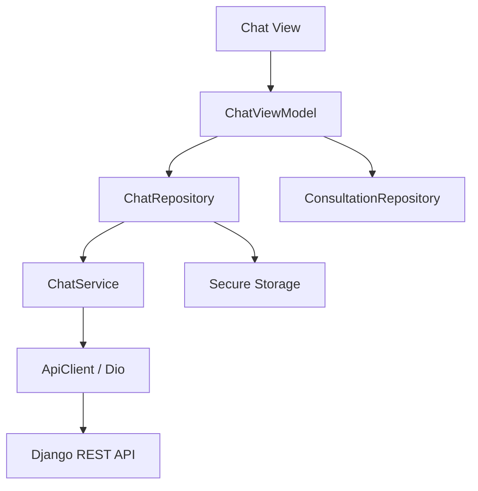

### 계층별 책임

| 구성 요소 | 역할 |
|---|---|
| Chat View | 채팅 목록 및 메시지 인터페이스 |
| ChatViewModel | 채팅방 및 메시지 상태 관리 |
| ChatRepository | 인증 정보 확인 및 데이터 접근 |
| ChatService | HTTP 요청 및 응답 변환 |
| Chat Models | 의료진, 채팅방, 메시지 모델 |
| ConsultationRepository | 의료진 목록 조회 로직 재사용 |
| ApiClient | 공통 네트워크 환경 |

### 주요 디렉터리

```text
lib/features/chat/
├── model/
│   └── chat_models.dart
├── repository/
│   └── chat_repository.dart
├── service/
│   └── chat_service.dart
├── view/
├── view_model/
│   └── chat_view_model.dart
└── chat_routes.dart
```

---

## 4. Data Model Architecture

채팅 데이터는 의료진, 채팅방, 메시지 및
공유 정보 상태로 구분하여 관리합니다.

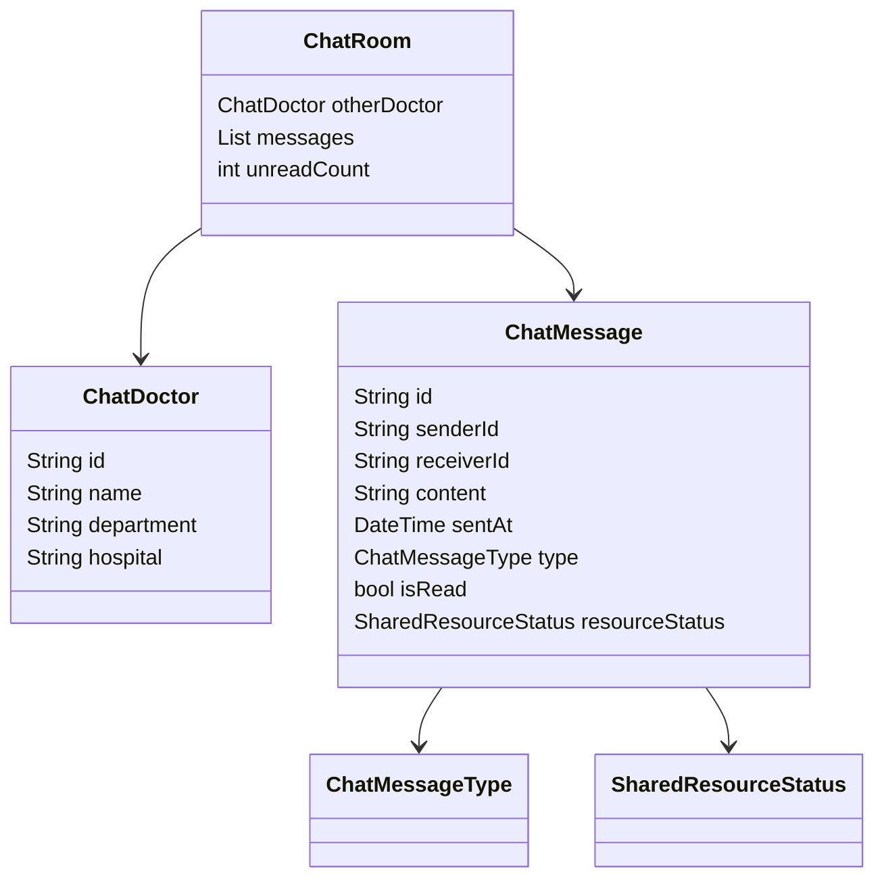

위 클래스 다이어그램은 실제 데이터 모델의
주요 관계를 중심으로 단순화한 것입니다.

서버 데이터베이스의 실제 ERD를
표현한 것은 아닙니다.

### 4.1 ChatDoctor

채팅 상대 의료진의 정보를 관리합니다.

| 필드 | 역할 |
|---|---|
| id | 의료진 식별자 |
| name | 의료진 이름 |
| department | 진료과 |
| hospital | 소속 병원 |

서버 응답의 일부 대체 키를 처리하여
ChatDoctor 객체로 변환합니다.

### 4.2 ChatRoom

채팅방 단위의 정보를 관리합니다.

- 채팅방 식별 정보
- 상대 의료진 정보
- 메시지 목록
- 미확인 메시지 수

채팅방 목록 응답에 포함된 last_message는
메시지 목록 형태로 변환하여 관리할 수 있도록
구성되어 있습니다.

unread_count가 누락된 경우에는
기본값 0을 사용합니다.

### 4.3 ChatMessage

메시지 본문과 의료 정보 참조 데이터를
하나의 메시지 모델에서 관리합니다.

| 필드 | 역할 |
|---|---|
| id | 메시지 식별자 |
| senderId | 발신 의료진 ID |
| receiverId | 수신 의료진 ID |
| content | 메시지 내용 |
| sentAt | 메시지 생성 시각 |
| type | 메시지 유형 |
| patientId | 관련 환자 ID |
| patientName | 관련 환자 이름 |
| examId | 관련 검사 ID |
| aiResultId | 관련 AI 결과 ID |
| consultationId | 관련 협진 ID |
| isRead | 메시지 읽음 여부 |
| resourceStatus | 공유 정보 처리 상태 |

의료 정보 참조 필드는 메시지 유형에 따라
선택적으로 포함됩니다.

---

## 5. Message Type Design

메시지 유형은 Enum을 사용하여 구분합니다.

다음은 소스 코드에서 확인한 메시지 유형 정의입니다.

```dart
enum ChatMessageType {
  text,
  patient,
  examination,
  aiResult,
  consultation
}
```

### 메시지 유형별 역할

| 유형 | 의미 | 주요 참조 데이터 |
|---|---|---|
| text | 일반 텍스트 | content |
| patient | 환자 정보 | patientId |
| examination | 검사 정보 | patientId, examId |
| aiResult | AI 분석 결과 | patientId, aiResultId |
| consultation | 협진 정보 | patientId, consultationId |

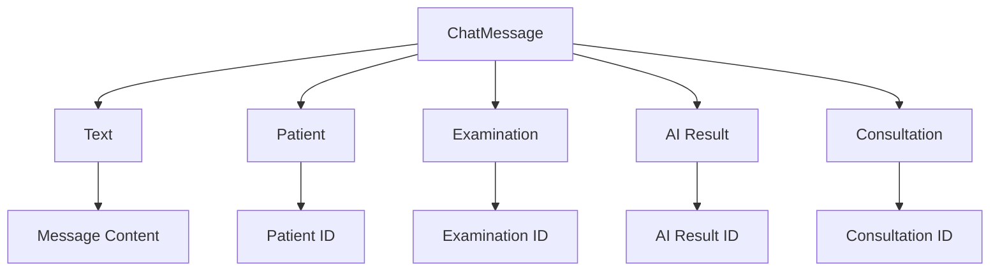

### 설계 목적

일반 텍스트와 의료 정보 참조 메시지를
구분하여 처리할 수 있도록 구성했습니다.

환자 관련 정보를 단순 문자열로만 전달하는 대신
관련 리소스의 식별자를 포함함으로써
다른 기능과 연결할 수 있는 데이터 구조를
제공합니다.

현재 분석한 Service 및 ViewModel에서는
의료 정보의 식별자를 전달하는 구조가 확인됩니다.

실제 영상 파일이나 첨부 파일의 바이너리 업로드,
모든 메시지 유형의 상세 화면 이동 및
렌더링 동작은 별도로 검증하지 않았습니다.

---

## 6. REST API Endpoints

채팅 기능은 Django REST API를 이용합니다.

| Method | Endpoint | 역할 |
|---|---|---|
| GET | /api/chat/rooms/ | 채팅방 목록 조회 |
| POST | /api/chat/rooms/ | 채팅방 생성 |
| GET | /api/chat/rooms/{id}/messages/ | 메시지 목록 조회 |
| POST | /api/chat/rooms/{id}/messages/ | 메시지 전송 |
| PATCH | /api/chat/rooms/{id}/read/ | 채팅방 읽음 처리 |
| PATCH | /api/chat/messages/{id}/resource-status/ | 공유 정보 상태 변경 |

의료진 목록 조회에는 협진 Repository의
의료진 조회 기능을 재사용합니다.

```http
GET /api/doctors/
Authorization: Bearer <access_token>
```

### 공통 인증 헤더

```http
Authorization: Bearer <access_token>
Accept: application/json
Content-Type: application/json
```

Repository에서 Access Token을 확인하고,
Service에서 인증 헤더를 구성합니다.

인증 토큰이 없거나 공백인 경우에는
API 요청을 진행하지 않도록 처리합니다.

---

## 7. Chat Room Management

### 7.1 채팅방 목록 조회

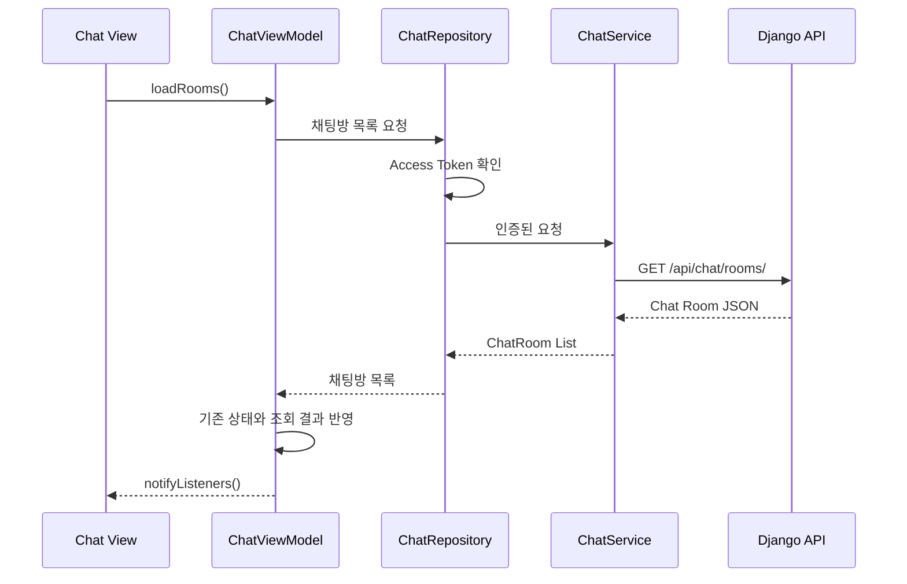

채팅방 목록을 조회할 때에는
서버에서 반환된 채팅방 정보를 모델로 변환하고
ViewModel에 저장합니다.

### 7.2 기존 채팅방 재사용

채팅 상대 의료진의 ID를 기준으로
기존 채팅방이 존재하는지 확인합니다.

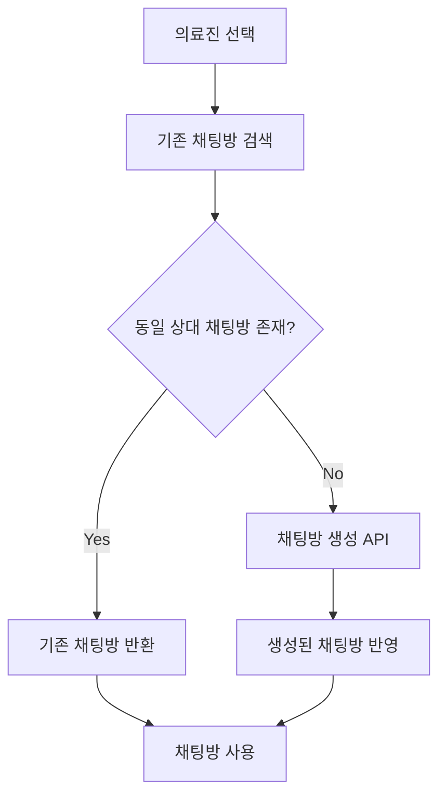

기존 채팅방이 존재하면 해당 채팅방을
재사용하고, 존재하지 않으면 서버에
채팅방 생성을 요청합니다.

### 설계상 장점

- 기존 대화 이력과 연결 가능
- 불필요한 신규 채팅방 생성 감소
- 의료진 ID를 이용한 채팅 상대 식별

### 현재 구조의 한계

기존 채팅방 확인은 클라이언트가
현재 보유한 채팅방 목록을 기준으로 합니다.

동시에 여러 생성 요청이 발생하는 경우에는
중복 채팅방이 생성될 가능성을 검토해야 합니다.

서버에서 의료진 조합에 대한 유일성 제약이나
트랜잭션 처리가 적용되었는지는 확인하지 않았습니다.

---

## 8. Message Loading

채팅방별 메시지 목록은
채팅방 ID를 기반으로 조회합니다.

```http
GET /api/chat/rooms/{roomId}/messages/
```

### 메시지 조회 처리

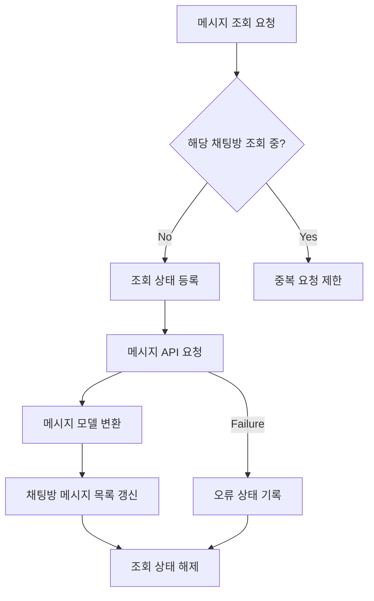

### 채팅방별 로딩 상태

ChatViewModel은 Set을 이용하여
현재 메시지를 조회 중인 채팅방을 관리합니다.

```dart
_loadingRoomIds
```

전체 채팅 기능에 하나의 로딩 플래그만
사용하는 대신 채팅방 ID를 기준으로
요청 진행 여부를 구분합니다.

이를 통해 특정 채팅방의 조회 상태와
다른 채팅방의 조회 상태를 분리할 수 있습니다.

---

## 9. Asynchronous Message Sending

메시지 전송은 비동기 REST API 요청으로
처리합니다.

### 전송 흐름

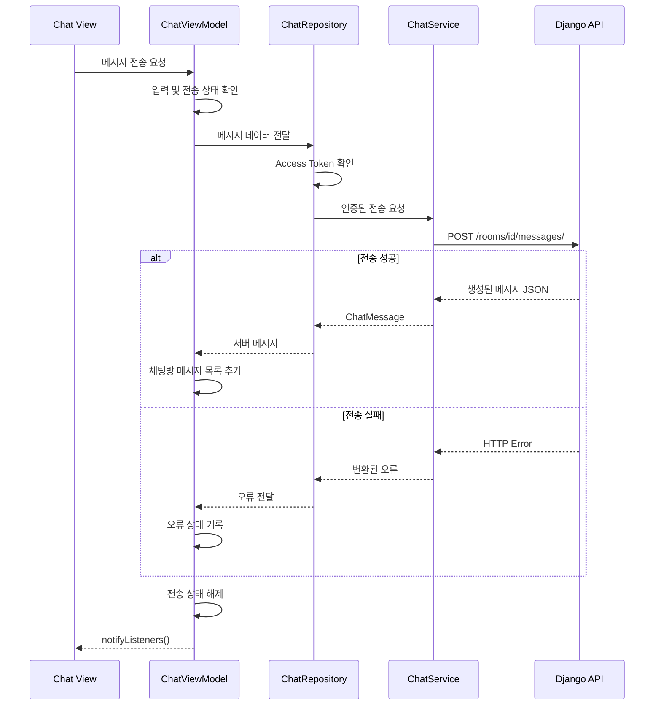

### 9.1 텍스트 메시지

텍스트 메시지는 입력값의 앞뒤 공백을
제거한 후 전송합니다.

공백으로만 구성된 메시지는
전송하지 않도록 처리합니다.

다음은 메시지 요청 구조를 설명하기 위한
가상 데이터 예시입니다.

```json
{
  "message_type": "text",
  "content": "검사 결과 확인 부탁드립니다."
}
```

### 9.2 서버 응답 기반 상태 갱신

현재 구현에서는 서버에서 메시지 생성 결과를
반환한 이후 채팅방의 메시지 목록에 추가합니다.

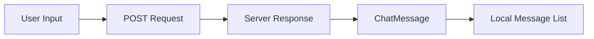

서버 응답 이전에 메시지를 최종 성공 상태로
표시하는 Optimistic Update 방식과는
구분됩니다.

### 장점

- 서버에서 반환한 메시지 ID 활용
- 서버 응답 데이터와 화면 상태 연결
- 실패한 요청을 성공 메시지로 추가하는 상황 감소

### 한계

- 네트워크 지연 시 메시지 반영 지연
- 전송 실패 이후 자동 재전송 정책 미확인
- 서버 처리 후 응답 유실 시 중복 전송 가능성

향후 메시지별 임시 ID와 전송 상태,
재시도 정책 및 Idempotency Key를
도입하는 방안을 고려할 수 있습니다.

---

## 10. Duplicate Request Control

채팅 기능은 채팅방별 조회 및 전송 상태를
별도의 Set으로 관리합니다.

| 상태 객체 | 역할 |
|---|---|
| _loadingRoomIds | 메시지 조회 중인 채팅방 |
| _sendingRoomIds | 메시지 전송 중인 채팅방 |
| _roomsWithLoadedMessages | 메시지 조회 이력이 있는 채팅방 |

### 전송 상태 관리

다음은 실제 처리 흐름을 설명하기 위해
재구성한 축약 코드입니다.

```dart
Future<void> sendMessage(String roomId) async {
  if (sendingRoomIds.contains(roomId)) {
    return;
  }

  sendingRoomIds.add(roomId);
  notifyListeners();

  try {
    final message = await repository.sendMessage();

    appendMessage(roomId, message);
  } catch (error) {
    errorMessage = error.toString();
  } finally {
    sendingRoomIds.remove(roomId);
    notifyListeners();
  }
}
```

위 코드는 설명용 예시이며
실제 소스의 메서드명과 인자를
그대로 복제한 것은 아닙니다.

### 채팅방별 요청 제어 예시

| 채팅방 | 현재 상태 | 신규 전송 요청 |
|---|---|---|
| Room A | 전송 중 | 제한 |
| Room B | 대기 | 가능 |
| Room C | 대기 | 가능 |

채팅방 단위로 전송 상태를 관리하면
하나의 채팅방에서 요청이 진행되는 동안
다른 채팅방의 요청 상태를 독립적으로
관리할 수 있습니다.

다만 클라이언트의 중복 호출 제한은
서버 측 중복 메시지 방지를 보장하지 않습니다.

---

## 11. Medical Resource Sharing

채팅 기능에서는 일반 메시지와 별도로
의료 정보 참조 데이터를 전달할 수 있는
요청 구조를 제공합니다.

### 공유 정보 요청 구조

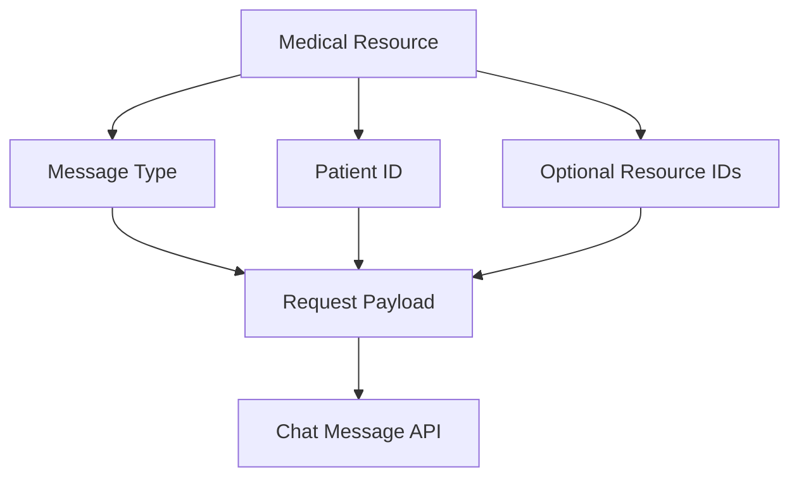

### 요청 데이터 구성

| 필드 | 역할 |
|---|---|
| message_type | 공유 메시지 유형 |
| content | 전달 내용 |
| patient_id | 관련 환자 식별자 |
| exam_id | 관련 검사 식별자 |
| ai_result_id | 관련 AI 결과 식별자 |
| consultation_id | 관련 협진 식별자 |

메시지 유형에 따라 관련 식별자를
선택적으로 전달합니다.

### 가상 요청 예시

#### 환자 정보 참조

```json
{
  "message_type": "patient",
  "content": "환자 정보 확인 요청",
  "patient_id": "DEMO-001"
}
```

#### 검사 정보 참조

```json
{
  "message_type": "examination",
  "content": "검사 영상 확인 요청",
  "patient_id": "DEMO-001",
  "exam_id": 101
}
```

#### AI 결과 참조

```json
{
  "message_type": "ai_result",
  "content": "AI 분석 결과 검토 요청",
  "patient_id": "DEMO-001",
  "ai_result_id": 201
}
```

#### 협진 정보 참조

```json
{
  "message_type": "consultation",
  "content": "협진 요청 내용 확인 부탁드립니다.",
  "patient_id": "DEMO-001",
  "consultation_id": 301
}
```

위 요청은 데이터 구조를 설명하기 위한
가상의 예시입니다.

실제 운영 데이터 또는 서버 응답을
그대로 재현한 것이 아닙니다.

### 참조 기반 공유의 의미

메시지에 환자 및 검사 관련 식별자를
포함하면 관련 데이터를 다른 기능과
연결할 수 있는 기반을 제공합니다.

다만 식별자를 전달하는 것만으로
의료 정보 접근 권한이 보장되는 것은 아닙니다.

수신 의료진이 해당 환자 및 검사 정보에
접근할 수 있는지는 서버에서 별도로
검증해야 합니다.

---

## 12. Read Status Management

채팅 시스템에서는 메시지 읽음 여부와
채팅방의 미확인 메시지 수를 관리합니다.

### 읽음 관련 데이터

| 데이터 | 의미 |
|---|---|
| ChatMessage.isRead | 개별 메시지 읽음 여부 |
| ChatRoom.unreadCount | 채팅방 미확인 메시지 수 |

### 읽음 처리 API

```http
PATCH /api/chat/rooms/{roomId}/read/
Authorization: Bearer <access_token>
```

### 처리 흐름

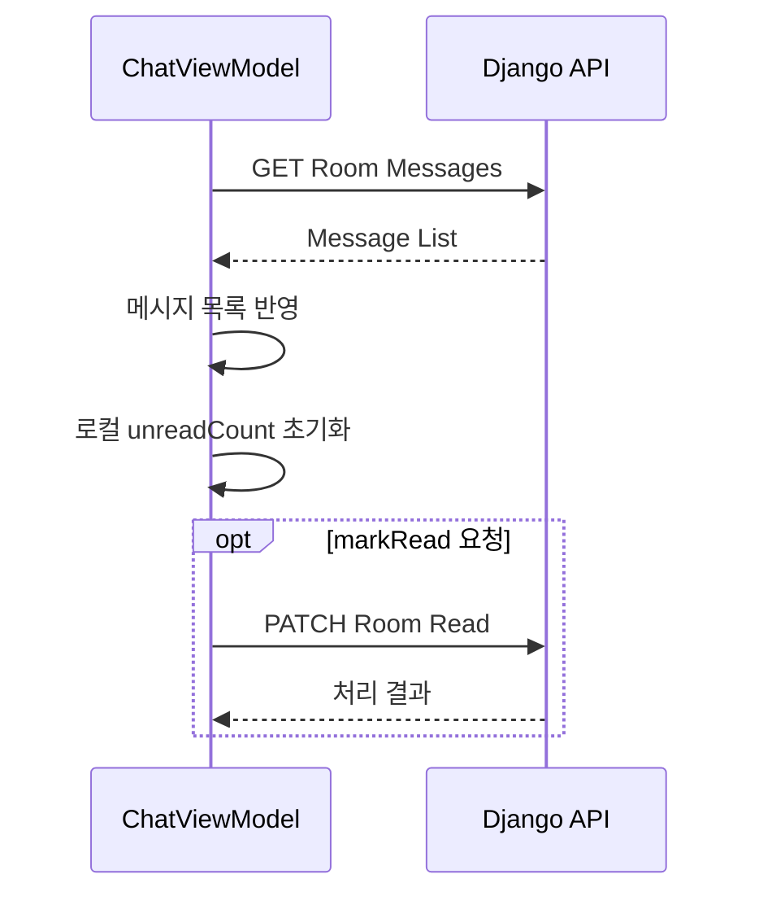

현재 구현에서는 메시지 조회 결과를
채팅방에 반영하면서 로컬 unreadCount를
0으로 설정합니다.

markRead 옵션이 활성화된 경우에는
서버에도 읽음 처리를 요청합니다.

### 현재 구조의 한계

로컬 unreadCount 초기화와
서버 읽음 상태 변경이 하나의 원자적
처리로 구성되어 있지는 않습니다.

따라서 서버 읽음 요청이 실패하면
클라이언트와 서버의 미확인 메시지 수가
일시적으로 다를 수 있습니다.

또한 markRead가 false인 경우에도
로컬 unreadCount가 초기화되는 구조가
확인됩니다.

향후에는 메시지 조회와 읽음 처리의
책임을 명확히 분리하고,
서버 처리 결과에 따라 로컬 상태를
동기화하는 방식으로 개선할 수 있습니다.

---

## 13. Shared Resource Status

의료진 간 정보 공유에서는
메시지를 읽었다는 사실과 공유된 정보를
검토하거나 답변했다는 사실이 다를 수 있습니다.

이를 구분하기 위해 별도의 상태 모델을
사용합니다.

```dart
enum SharedResourceStatus {
  unread,
  checked,
  answered
}
```

### 상태별 의미

| 상태 | 의미 |
|---|---|
| unread | 공유 정보 미확인 |
| checked | 공유 정보 확인 |
| answered | 공유 정보 답변 처리 |

### 읽음 상태와 업무 상태의 차이

| 구분 | 메시지 읽음 | 공유 정보 처리 |
|---|---|---|
| 관리 필드 | isRead | resourceStatus |
| 목적 | 메시지 확인 여부 | 공유된 정보의 업무 처리 |
| 상태 | Boolean | Enum |
| 변경 범위 | 메시지 읽음 관련 | 공유 정보 확인 및 답변 |

### 개념적 업무 흐름

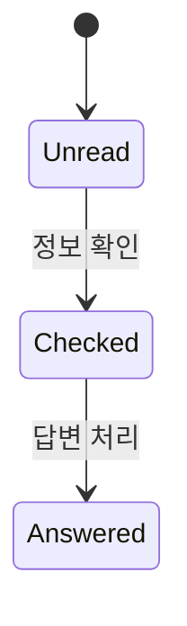

위 다이어그램은 상태의 의미를 설명하기 위한
개념적 업무 흐름입니다.

현재 소스에서 모든 상태 전이 규칙을
강제하는 상태 머신이 구현된 것은 아닙니다.

### 상태 변경 API

```http
PATCH /api/chat/messages/{messageId}/resource-status/
```

다음은 상태 변경을 설명하는 요청 예시입니다.

```json
{
  "resource_status": "checked"
}
```

```json
{
  "resource_status": "answered"
}
```

ChatViewModel에서는 공유 정보 확인 및
답변 처리 메서드를 통해 상태 변경을 요청하고,
서버에서 반환한 메시지를 기준으로
기존 메시지 데이터를 갱신합니다.

서버의 실제 상태 전이 제한 및
변경 권한 검증은 별도로 확인하지 않았습니다.

---

## 14. Polling Architecture

현재 채팅 목록은 REST API 기반
Polling 방식으로 갱신합니다.

공통 AppShell에서 Timer.periodic을 사용하여
5초 주기로 채팅방 목록 조회를 시도합니다.

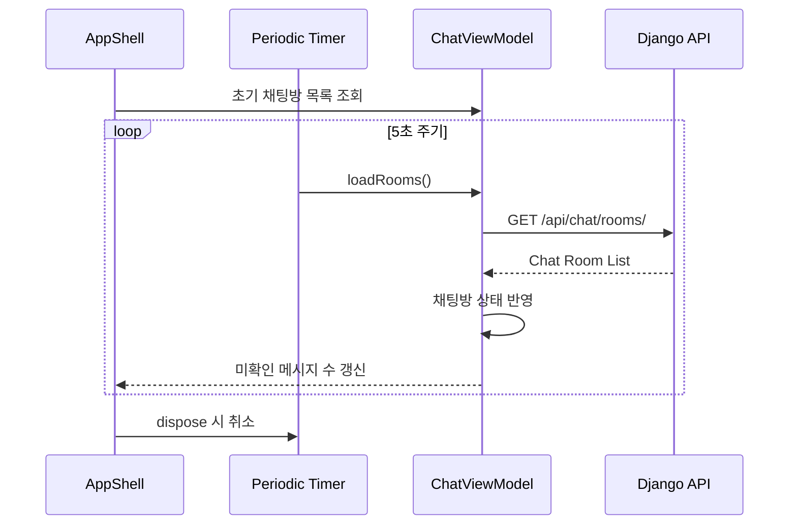

### Polling의 주요 목적

- 채팅방 목록 갱신
- 최근 메시지 정보 조회
- 미확인 메시지 수 갱신
- 공통 내비게이션 상태 반영

### Polling 생명주기

| 시점 | 처리 |
|---|---|
| AppShell 초기 구성 | 채팅방 목록 조회 |
| Timer 실행 | 5초 주기 목록 조회 시도 |
| 상태 변경 | Provider를 통한 화면 갱신 |
| AppShell dispose | Timer 취소 |

### 요청량 분석

5초 주기로 요청을 수행한다고 가정하면
클라이언트 한 대의 이론적 요청 횟수는
다음과 같습니다.

```text
60초 / 5초 = 분당 12회

12회 × 60분 = 시간당 720회
```

| 활성 클라이언트 | 분당 요청 수 | 시간당 요청 수 |
|---|---:|---:|
| 1대 | 12 | 720 |
| 10대 | 120 | 7,200 |
| 50대 | 600 | 36,000 |
| 100대 | 1,200 | 72,000 |

위 수치는 모든 주기에서 요청이 실행된다는
가정에 따른 이론적 계산입니다.

실제 요청량은 앱 생명주기, 요청 진행 상태,
네트워크 환경 및 중복 요청 제한에 따라
달라질 수 있습니다.

실제 서버 부하를 측정한 결과는 아닙니다.

### Polling의 한계

- 변경된 데이터가 없어도 요청 발생
- 활성 사용자 증가에 따른 요청량 증가
- 모바일 데이터 및 배터리 사용 가능성
- 즉각적인 이벤트 전달의 한계
- 백그라운드 상태에서의 요청 관리 필요

5초 주기 조회는 채팅방 목록 갱신을 의미하며,
모든 채팅 메시지가 5초마다 조회되거나
실시간으로 전달된다는 의미는 아닙니다.

---

## 15. Chat Room State Synchronization

채팅방 목록을 다시 조회할 때
기존에 메시지 목록을 조회한 채팅방은
이전 메시지 데이터를 유지하는 구조를
사용합니다.

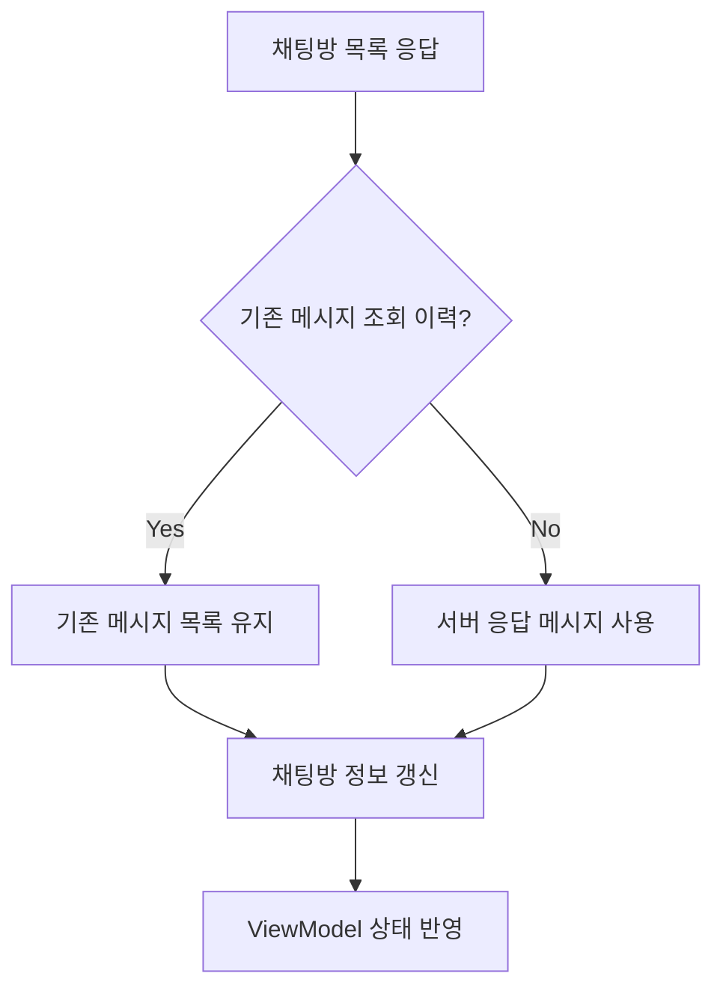

### 설계 목적

채팅방 목록 API가 최근 메시지 정보만
제공하는 경우, 이미 조회한 전체 대화 목록이
최근 메시지 하나로 대체되는 상황을
줄일 수 있습니다.

### 잠재적인 데이터 일관성 문제

기존 메시지 목록을 유지하는 과정에서
서버가 반환한 새로운 최근 메시지가
기존 목록에 반영되지 않을 가능성이 있습니다.

또한 메시지 전송과 채팅방 목록 조회가
동시에 진행되면 응답 순서에 따라
상태가 달라질 수 있습니다.

### 개선 방향

- 채팅방 메타데이터와 메시지 목록 분리
- 메시지 ID 기반 병합 및 중복 제거
- 마지막 메시지 ID 또는 Cursor 기반 조회
- 최신 응답 여부 검증
- 채팅방별 데이터 갱신 정책 정의

위 내용은 정적 코드 분석을 통해 확인한
잠재적인 개선 사항입니다.

실제 사용자 환경에서 데이터 유실이
발생했다고 확인한 것은 아닙니다.

---

## 16. Global Unread Badge

공통 AppShell은 ChatViewModel의
채팅방 상태를 활용하여
미확인 메시지 수를 표시합니다.

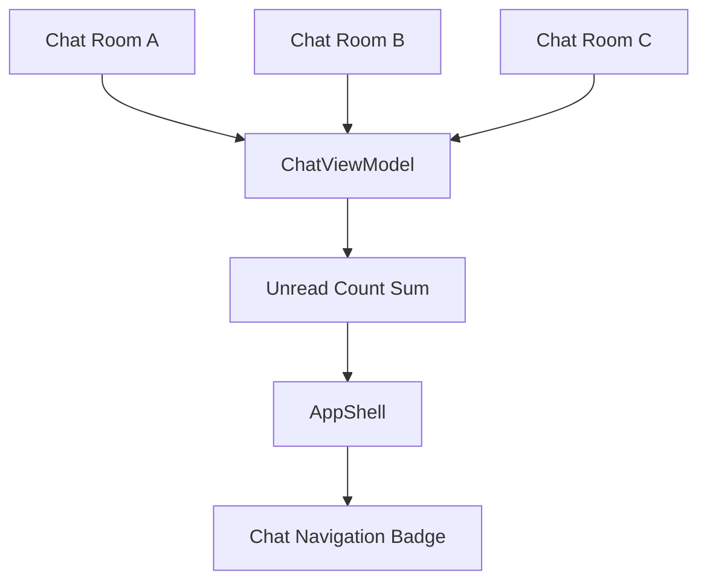

### 집계 예시

| 채팅방 | 미확인 메시지 |
|---|---:|
| Room A | 3 |
| Room B | 2 |
| Room C | 0 |
| 합계 | 5 |

위 데이터는 집계 방식을 설명하기 위한
가상 예시입니다.

공통 내비게이션에서 채팅 상태를
확인할 수 있도록 구성하여
채팅 화면에 직접 접근하지 않아도
미확인 메시지 여부를 표시할 수 있습니다.

별도의 서버 전체 미확인 메시지 집계 API가
구현되었다는 의미는 아닙니다.

---

## 17. JSON Parsing & Error Handling

### 17.1 목록 응답 처리

ChatService는 목록 응답에 대해
직접 전달되는 List 형식과
객체 내부의 목록 형식을 처리합니다.

주요 목록 키는 다음과 같습니다.

- results
- data

### 17.2 객체 응답 처리

단일 객체 응답에서는
다음과 같은 내부 객체 구조를 처리합니다.

- data
- result
- room

Service에서 응답의 외부 구조를 정리한 뒤
ChatRoom 또는 ChatMessage 모델로
변환합니다.

### 17.3 모델 기본값 처리

| 데이터 | 현재 처리 |
|---|---|
| 알 수 없는 메시지 유형 | text로 처리 |
| 알 수 없는 공유 상태 | Null로 처리 |
| 미확인 메시지 수 누락 | 0으로 처리 |
| 생성 시각 파싱 실패 | 현재 시각 사용 |

기본값 처리는 일부 비정상 응답으로 인해
데이터 변환이 실패하는 상황을
줄이는 데 도움이 될 수 있습니다.

다만 생성 시각을 현재 시각으로 대체하면
실제 메시지 생성 시점과 다른 정보가
표시될 수 있습니다.

의료진 간 업무 이력의 정확성을 고려하면
잘못된 시각을 명시적으로 구분하거나
서버 응답 오류로 처리하는 방안이 필요합니다.

### 17.4 오류 처리 흐름

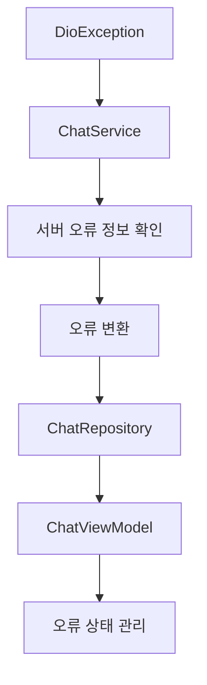

ChatService에서는 DioException 및
서버의 상세 오류 정보를 처리합니다.

ViewModel에서는 요청 실패 정보를 저장하고,
조회 및 전송 상태를 해제하도록 구성합니다.

---

## 18. Cross-Feature Integration

채팅 기능은 환자 관리 및 협진 기능과
데이터 참조 관계를 가집니다.

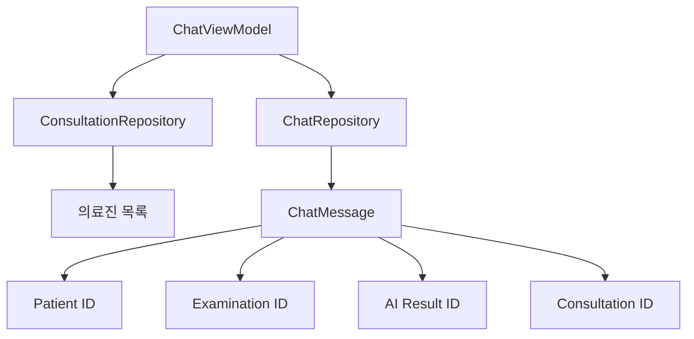

### 의료진 목록 재사용

ChatViewModel은 의료진 목록을 조회할 때
ConsultationRepository를 활용합니다.

동일한 의료진 조회 기능을
채팅과 협진에서 재사용할 수 있다는
장점이 있습니다.

다만 채팅 기능이 협진 기능의 Repository에
직접 의존하는 구조이므로
기능 간 결합도가 증가할 수 있습니다.

향후 공통 DoctorRepository를 분리하여
채팅과 협진이 동일한 의료진 조회 모듈에
의존하도록 개선할 수 있습니다.

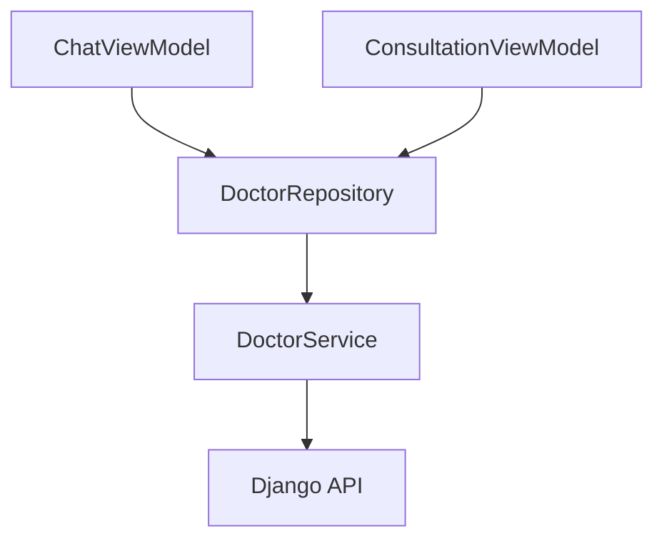

위 구조는 향후 개선 제안이며
현재 구현 완료 상태가 아닙니다.

---

## 19. REST Polling vs WebSocket

현재 구현 방식과 향후 확장 가능한
통신 구조를 비교했습니다.

| 항목 | REST Polling | WebSocket |
|---|---|---|
| 연결 방식 | 주기적 HTTP 요청 | 지속 연결 |
| 데이터 전달 | 클라이언트 요청 | 양방향 이벤트 |
| 변경 확인 | 주기적 조회 | 서버 이벤트 전달 |
| 유휴 상태 | 반복 요청 가능 | 연결 유지 필요 |
| 구현 고려 사항 | 요청 주기 및 중복 제어 | 연결 및 재연결 관리 |
| VENA 적용 상태 | 현재 구현 | 향후 개선 방향 |

### 현재 구조

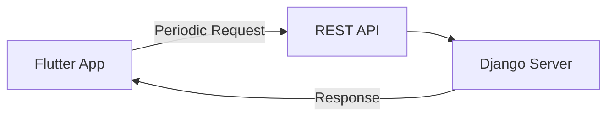

### 향후 개선 구조

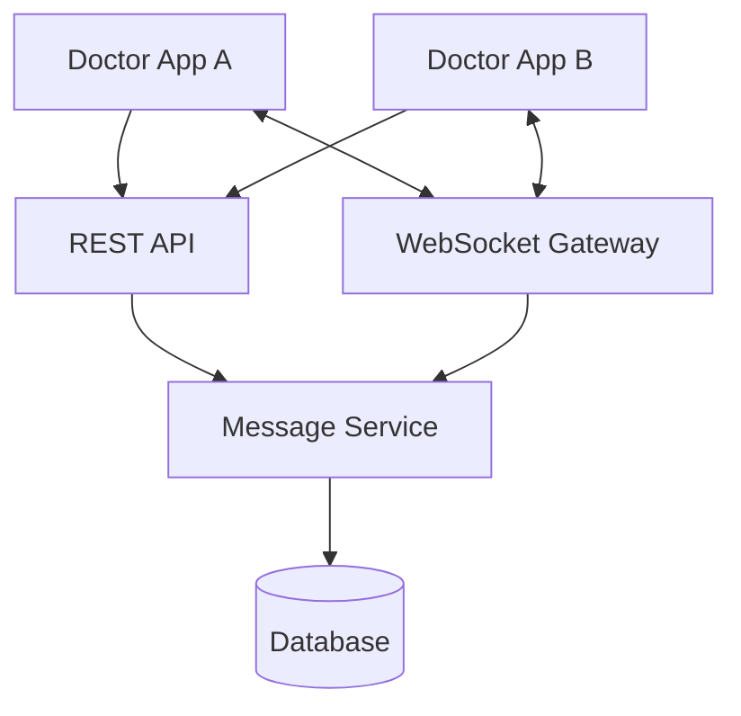

### WebSocket 도입 시 고려 사항

- 연결 인증
- 채팅방별 접근 권한
- 연결 해제 및 재연결
- 메시지 전달 순서
- 중복 이벤트 제거
- 연결 종료 중 발생한 메시지 복구
- 백그라운드 및 포그라운드 전환
- 서버 메시지 저장과 이벤트 발행의 일관성

WebSocket은 단순히 통신 방식을 변경하는
것만으로 모든 메시지 전달 문제를
해결할 수 있는 것은 아닙니다.

서버 저장 상태와 이벤트 전달 상태를
일관되게 관리하는 구조가 함께 필요합니다.

본 프로젝트에서는 WebSocket 기반 채팅을
구현 완료했다고 설명하지 않습니다.

---

## 20. Security Considerations

의료진 간 메시지에는 환자 관련 정보가
포함될 수 있으므로 일반 채팅보다
데이터 접근 권한에 대한 고려가 중요합니다.

### 확인된 구현

- Secure Storage 기반 토큰 조회
- Bearer Token 기반 API 요청
- 인증 정보 누락 시 요청 제한
- 환자 및 의료 리소스 식별자 전달
- 채팅방 및 메시지 ID 기반 API 접근

### 추가 검증이 필요한 보안 영역

| 영역 | 검토 사항 |
|---|---|
| 전송 구간 | HTTPS 적용 |
| 채팅방 접근 | 채팅 참여 의료진 검증 |
| 메시지 조회 | 채팅방 소속 여부 검증 |
| 환자 정보 공유 | 환자별 접근 권한 확인 |
| 상태 변경 | 변경 요청자의 권한 확인 |
| 인증 정보 | 토큰 만료 및 갱신 정책 |
| 네트워크 로그 | 메시지 및 환자 정보 마스킹 |
| 업무 이력 | 메시지 및 상태 변경 감사 기록 |

클라이언트가 Bearer Token을
전달한다는 사실만으로
리소스별 접근 권한이 보장되지는 않습니다.

서버에서는 요청자가 해당 채팅방,
메시지 및 환자 정보에 접근할 수 있는지
별도로 검증해야 합니다.

서버의 실제 인가 구현 및 감사 로그 정책은
본 문서에서 검증하지 않았습니다.

---

## 21. Technical Challenges

### 21.1 채팅방별 비동기 요청 관리

기술적 고려 사항:

- 여러 채팅방에서 조회 및 전송 요청 발생
- 동일 채팅방에 대한 중복 호출 가능성
- 전체 로딩 상태만으로 세부 요청 구분 어려움

현재 처리:

- 채팅방 ID 기반 Set 관리
- 조회 및 전송 상태 분리
- 요청 종료 시 상태 해제

개선 방향:

- 요청 취소 정책
- 채팅방별 오류 상태 분리
- 요청 ID 및 응답 순서 관리

### 21.2 기존 채팅방 재사용

기술적 고려 사항:

- 동일 의료진과 여러 채팅방 생성 가능성
- 기존 대화 이력 유지 필요

현재 처리:

- 상대 의료진 ID 기반 채팅방 검색
- 기존 채팅방 우선 사용
- 채팅방이 없는 경우 생성 요청

개선 방향:

- 서버 유일성 제약 검토
- 생성 요청의 동시성 제어
- 중복 생성 방지 정책

### 21.3 메시지 읽음과 답변 상태 분리

기술적 고려 사항:

- 메시지 읽음과 의료 정보 검토의 의미 차이
- 업무 처리 상태를 별도로 관리할 필요

현재 처리:

- isRead 필드
- unreadCount 필드
- SharedResourceStatus Enum
- 공유 상태 변경 API

개선 방향:

- 상태 전이 규칙 정의
- 서버 상태와 로컬 상태 동기화
- 상태 변경 이력 관리

### 21.4 채팅 목록 갱신

기술적 고려 사항:

- 서버 데이터 변경 확인 필요
- 기존 REST API 기반 구현 범위

현재 처리:

- 5초 주기 채팅 목록 Polling
- 기존 메시지 목록 유지
- 공통 내비게이션 미확인 수 반영

개선 방향:

- 앱 생명주기에 따른 Polling 제어
- 변경 데이터 중심 조회
- WebSocket 기반 이벤트 처리 검토

위 내용은 현재 소스 코드에서 확인한
처리 구조와 잠재적인 기술적 한계를
정리한 것입니다.

모든 항목이 실제 장애로 발생하여
해결한 사례라는 의미는 아닙니다.

---

## 22. Validation Scenarios

다음은 채팅 시스템의 소스 코드 분석을
바탕으로 작성한 검증 계획입니다.

| ID | 검증 항목 | 기대 결과 |
|---|---|---|
| CH-01 | 정상 채팅방 목록 조회 | ChatRoom 목록 변환 |
| CH-02 | 의료진 목록 조회 | 채팅 상대 데이터 반환 |
| CH-03 | 기존 채팅 상대 선택 | 기존 채팅방 반환 |
| CH-04 | 신규 채팅 상대 선택 | 채팅방 생성 요청 |
| CH-05 | 정상 메시지 목록 조회 | ChatMessage 목록 반영 |
| CH-06 | 동일 채팅방 중복 조회 | 추가 조회 제한 |
| CH-07 | 정상 텍스트 전송 | 서버 응답 메시지 추가 |
| CH-08 | 빈 메시지 전송 | 요청 제한 |
| CH-09 | 공백 메시지 전송 | 요청 제한 |
| CH-10 | 동일 채팅방 중복 전송 | 추가 전송 제한 |
| CH-11 | 다른 채팅방 전송 | 독립적인 전송 상태 관리 |
| CH-12 | 환자 정보 참조 전송 | 환자 ID 포함 요청 |
| CH-13 | 검사 정보 참조 전송 | 검사 ID 포함 요청 |
| CH-14 | AI 결과 참조 전송 | AI 결과 ID 포함 요청 |
| CH-15 | 협진 정보 참조 전송 | 협진 ID 포함 요청 |
| CH-16 | 읽음 처리 요청 | 읽음 API 호출 |
| CH-17 | 공유 정보 확인 | checked 상태 변경 요청 |
| CH-18 | 공유 정보 답변 | answered 상태 변경 요청 |
| CH-19 | 메시지 전송 실패 | 오류 상태 및 전송 상태 해제 |
| CH-20 | 인증 토큰 없음 | API 요청 제한 |
| CH-21 | 채팅 목록 Polling | 주기적 목록 조회 시도 |
| CH-22 | AppShell 종료 | Timer 취소 |

### 추가 검증 시나리오

| ID | 검증 항목 | 검토 목적 |
|---|---|---|
| CH-23 | 동시 채팅방 생성 | 중복 채팅방 생성 여부 |
| CH-24 | 전송 성공 후 응답 유실 | 중복 메시지 가능성 |
| CH-25 | 읽음 API 실패 | 서버와 로컬 상태 차이 |
| CH-26 | markRead false | 로컬 미확인 수 처리 |
| CH-27 | Polling과 전송 동시 실행 | 메시지 상태 일관성 |
| CH-28 | 새로운 최근 메시지 수신 | 기존 목록 병합 여부 |
| CH-29 | 백그라운드 전환 | Polling 생명주기 |
| CH-30 | 다른 의료진 채팅방 접근 | 서버 권한 검증 |
| CH-31 | 권한 없는 환자 정보 참조 | 의료 데이터 인가 검증 |
| CH-32 | 잘못된 상태 변경 요청 | 서버 상태 전이 검증 |
| CH-33 | 토큰 만료 | 인증 갱신 동작 |
| CH-34 | 잘못된 메시지 생성 시각 | 데이터 정확성 검토 |

위 시나리오는 실제 테스트 실행 결과가 아닌
검증 계획 및 기대 동작입니다.

실제 API 통합 테스트와 모바일 기기 테스트는
별도로 수행해야 합니다.

---

## 23. Limitations & Improvements

| 현재 구조 | 개선 방향 |
|---|---|
| REST Polling | WebSocket 기반 이벤트 처리 |
| 채팅방 목록 기반 갱신 | 변경 메시지 중심 조회 |
| 기존 메시지 목록 유지 | 메시지 ID 기반 병합 |
| 클라이언트 중복 전송 제한 | 서버 Idempotency 정책 |
| 서버 응답 이후 메시지 추가 | 전송 중 및 실패 상태 관리 |
| 로컬 읽음 수 초기화 | 서버 읽음 상태 동기화 |
| Enum 기반 공유 상태 | 명확한 상태 전이 규칙 |
| 협진 Repository 재사용 | 공통 의료진 조회 모듈 |
| 현재 시각 기본값 | 잘못된 생성 시각 명시적 처리 |
| 공통 오류 상태 | 채팅방별 오류 상태 |
| HTTP 기반 통신 환경 | HTTPS 및 민감 로그 제한 |

### 개선 우선순위

P1 — 보안 및 데이터 일관성

- 채팅방 및 환자별 접근 권한 검증
- HTTPS 적용
- 읽음 상태 동기화
- 민감 데이터 로그 제한
- 중복 메시지 생성 방지

P2 — 비동기 처리 안정성

- 메시지 ID 기반 데이터 병합
- 요청 응답 순서 관리
- 전송 실패 및 재시도 상태 관리
- 채팅방별 오류 상태 분리
- Polling 생명주기 최적화

P3 — 기능 확장

- WebSocket 도입
- 메시지 페이지네이션
- 메시지 검색
- 공통 의료진 조회 모듈 분리
- 메시지 전달 및 업무 처리 이력 관리

개선 우선순위는 현재 구현을 분석하여
제안한 내용입니다.

실제 개선 작업을 완료했다는 의미는 아닙니다.

---

## 24. Engineering Evidence

### 개인 기여 관련 Git 이력

| Commit | 주요 작업 |
|---|---|
| de2ee84 | 채팅 목록 및 메시지 API 연동 |
| 3904502 | 채팅 기능 수정 |
| a1498f4 | 공통 상단바 및 하단바 구성 |
| c363020 | 협진 목록 및 전송 API 관련 작업 |

### 주요 분석 소스

| 파일 | 확인 내용 |
|---|---|
| chat/model/chat_models.dart | 메시지 및 채팅방 모델 |
| chat/service/chat_service.dart | REST API 요청 및 응답 처리 |
| chat/repository/chat_repository.dart | 인증 및 데이터 접근 |
| chat/view_model/chat_view_model.dart | 비동기 요청 및 상태 관리 |
| consultation/repository | 의료진 조회 로직 재사용 |
| core/network/api_endpoints.dart | 채팅 API 경로 |
| core/network/api_client.dart | 공통 HTTP 통신 환경 |
| routes/app_shell.dart | Polling 및 미확인 수 표시 |
| app.dart | ViewModel 및 Repository 의존성 구성 |

위 Git 이력은 개인 개발 기여의
근거로 활용했습니다.

팀 프로젝트의 최종 소스에는
팀원의 수정 및 공통 구현이 포함될 수 있습니다.

---

## 25. Retrospective

채팅 기능을 구현하면서
메시지 전송 자체뿐 아니라
메시지 조회, 읽음 여부, 답변 상태,
채팅방별 비동기 요청 상태 등
다양한 데이터 관리가 필요하다는 점을
경험했습니다.

특히 의료진 간 정보 공유에서는
메시지를 읽었다는 상태와
공유된 의료 정보를 확인하거나
답변했다는 상태를 구분하는 것이
중요하다는 점을 이해했습니다.

또한 REST API 기반 Polling 구조를
분석하면서 기능 구현 이후에도
네트워크 요청량과 데이터 일관성,
앱 생명주기를 함께 고려해야 한다는 점을
학습했습니다.

향후 백엔드 개발에서는
메시지 저장과 전달의 일관성,
리소스 접근 권한, 중복 요청 방지,
상태 변경 이력 관리까지 고려하여
안정적인 데이터 처리 구조를
설계하고자 합니다.

---

## 26. Validation Scope

본 문서는 다음 자료를 기반으로 작성했습니다.

- 팀 프로젝트 최종 발표 자료
- ChatDoctor, ChatRoom, ChatMessage 모델
- ChatService
- ChatRepository
- ChatViewModel
- 공통 AppShell 및 ApiClient
- 개인 Git 커밋 이력

### 확인 범위

| 항목 | 확인 방식 |
|---|---|
| 메시지 유형 | Model 소스 분석 |
| 채팅 API | Service 및 Endpoint 분석 |
| 인증 요청 | Repository 및 Service 분석 |
| 채팅방별 요청 제어 | ViewModel 분석 |
| 읽음 및 공유 상태 | Model 및 ViewModel 분석 |
| Polling | AppShell 분석 |
| 개인 기여 | Git 이력 및 발표 자료 |

### 미검증 범위

- 모든 채팅 화면의 최종 렌더링
- 모든 메시지 유형의 화면 이동 동작
- 바이너리 파일 첨부 및 업로드
- 실제 WebSocket 통신
- 서버 데이터베이스 구조
- 서버의 메시지 저장 트랜잭션
- 서버의 채팅방 및 환자별 권한 검증
- 실제 네트워크 부하 및 응답 시간
- 앱 재빌드 및 기기 실행
- 자동화 테스트 실행 결과

문서에 포함된 일부 Dart 코드와 JSON은
구조 설명을 위해 재구성한 예시입니다.

실제 의료진 및 환자의 개인정보,
인증 토큰, 운영 서버 주소는
공개 포트폴리오에 포함하지 않았습니다.

---

## 27. Related Documentation

- [프로젝트 개요](./README.md)
- [시스템 아키텍처](./architecture.md)
- [환자 관리 시스템](./patient-management.md)
- [비동기 협진 시스템](./consultation.md)
- [일정 및 To-do](./schedule-task.md)
- [텍스트 및 음성 메모](./memo-system.md)
- [데이터 및 상태 관리](./data-state-management.md)
- [문제 해결 및 개선 방향](./troubleshooting.md)

---

[← 프로젝트 개요로 돌아가기](./README.md)
