# VENA — Patient Management System

> REST API 기반 환자 정보 조회 및 데이터 처리 구조

[← 프로젝트 개요로 돌아가기](./README.md)

---

## 1. Overview

환자 관리 시스템은 의료진이 모바일 환경에서
환자 목록과 상세 정보를 조회하고,
관련 검사 및 AI 분석 정보에 접근할 수 있도록
구성한 기능입니다.

환자 정보는 채팅, 협진, 메모 등 다른 의료진 업무와
연결되는 핵심 데이터이므로 화면 표시뿐 아니라
환자 식별자 관리와 인증된 데이터 접근이 중요합니다.

### 구현 목표

- 환자 목록 및 상세 정보 조회
- 환자 검색을 통한 업무 접근성 개선
- 인증된 REST API 요청
- 서버 응답의 데이터 모델 변환
- 환자별 검사 및 AI 결과 정보 처리
- 비동기 요청 및 오류 상태 관리
- 다른 의료 업무 기능과의 환자 정보 연결

---

## 2. My Contributions

| 담당 기능 | 구현 내용 |
|---|---|
| 환자 목록 | 환자 목록 화면 및 API 연동 |
| 환자 검색 | 환자 검색 인터페이스 |
| 환자 상세 | 환자 ID 기반 상세 정보 조회 |
| 데이터 모델 | JSON 응답의 객체 변환 |
| 상태 관리 | 목록 및 상세 조회 상태 관리 |
| 최근 환자 | 최근 조회 환자 데이터 관리 |
| 의료영상 | 환자 영상 전체 화면 관련 UI |
| 기능 연계 | 환자별 메모 및 협진 기능 연결 |

본 문서에서는 의료진 앱의 환자 정보 처리 구조를
중심으로 설명합니다.

AI 모델 학습 및 서버 내부의 환자 데이터베이스 설계는
개인 담당 범위에 포함하지 않습니다.

---

## 3. Feature Architecture

환자 관리 기능은 화면, 상태 관리, 데이터 접근,
API 요청 및 데이터 모델 계층으로 구성됩니다.

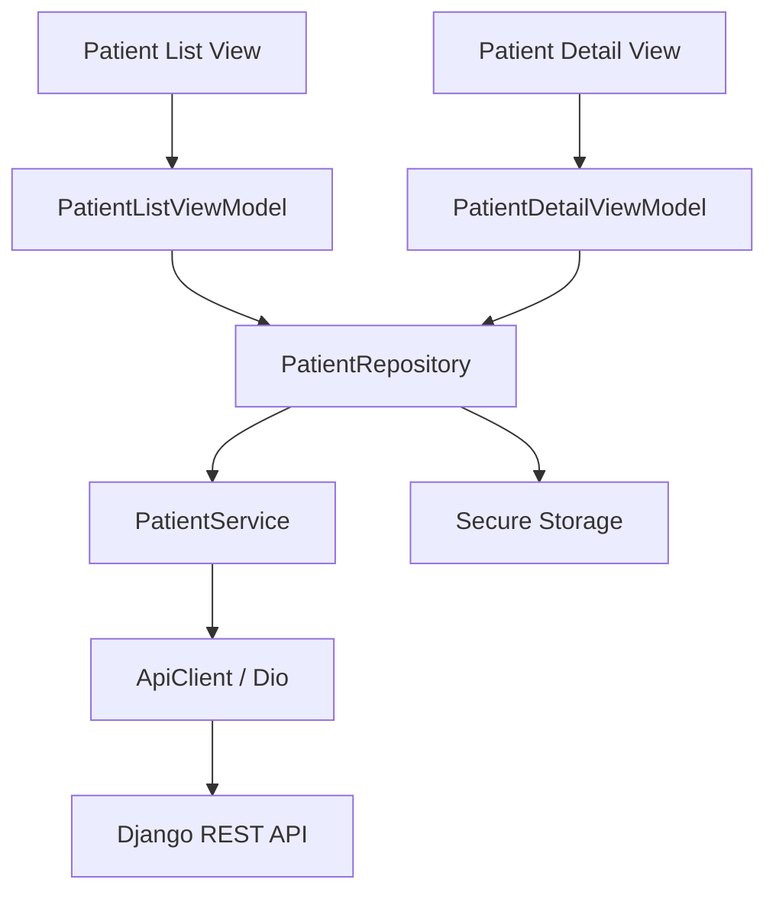

### 계층별 역할

| 구성 요소 | 책임 |
|---|---|
| Patient View | 환자 목록 및 상세 정보 표시 |
| PatientListViewModel | 목록 조회, 로딩, 오류 및 최근 환자 상태 |
| PatientDetailViewModel | 환자 상세 조회 및 미디어 접근 정보 |
| PatientRepository | 인증 정보 확인 및 데이터 접근 중계 |
| PatientService | HTTP 요청 및 응답 파싱 |
| Patient | 환자 기본 정보 모델 |
| PatientDetail | 환자 상세 및 관련 데이터 모델 |

### 주요 디렉터리

```text
lib/features/patient/
├── model/
├── repository/
├── service/
├── view/
├── view_model/
└── patient_routes.dart
```

기능별 디렉터리 안에서 화면과 데이터 처리 코드를
분리하여 관리하는 구조입니다.

---

## 4. REST API Integration

환자 정보는 Django REST API를 통해 조회합니다.

### API Endpoint

| Method | Endpoint | 역할 |
|---|---|---|
| GET | /api/patients/ | 환자 목록 조회 |
| GET | /api/patients/{patientId}/ | 환자 상세 조회 |

공통 ApiEndpoints에는 다음 검색 경로도 정의되어 있습니다.

```text
/api/patients/search/
```

다만 검색 경로의 정의만으로 실제 검색 화면에서
해당 API를 호출한다고 판단할 수는 없습니다.

본 문서에서 상세하게 분석한 API는
환자 목록 및 상세 조회 API입니다.

### Request Header

```http
Authorization: Bearer <access_token>
Accept: application/json
```

Repository에서 인증 토큰을 조회하고,
Service에서 인증 헤더를 포함하여 요청합니다.

### 공통 네트워크 설정

| 항목 | 설정 |
|---|---|
| HTTP Client | Dio |
| Connection Timeout | 10초 |
| Send Timeout | 15초 |
| Receive Timeout | 15초 |
| 기본 응답 형식 | JSON |

공통 ApiClient를 재사용하여
기능별 HTTP 요청 설정의 중복을 줄입니다.

---

## 5. Patient List Request Flow

환자 목록은 ViewModel에서 Repository를 호출하고,
Repository에서 인증 정보를 확인한 뒤
Service를 통해 서버에 요청합니다.

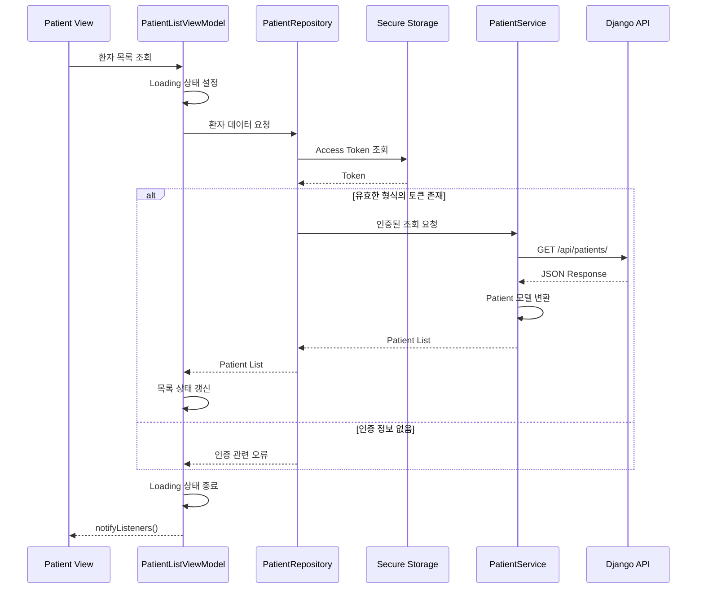

### 처리 단계

1. 환자 목록 조회 요청을 시작합니다.
2. ViewModel에서 로딩 상태를 설정합니다.
3. Repository에서 Access Token을 확인합니다.
4. Service에서 인증된 API 요청을 수행합니다.
5. JSON 응답을 Patient 객체 목록으로 변환합니다.
6. ViewModel에 조회 결과 또는 오류를 저장합니다.
7. 상태 변경을 화면에 전달합니다.

여기서 토큰 존재 여부를 확인하는 것은
서버에서 토큰의 유효성을 검증하는 것과는 다릅니다.

실제 토큰 유효성 및 접근 권한 검증은
서버 측에서 수행되어야 합니다.

---

## 6. Response Parsing Strategy

서버에서 전달되는 JSON 응답은
화면에서 직접 사용하지 않고
Service 및 Model 계층에서 처리합니다.

### 6.1 Response Structure

환자 목록 Service는 직접 전달되는 List 형식과
객체 내부에 포함된 목록 형식을 처리합니다.

지원하는 목록 키는 다음과 같습니다.

- results
- patients
- data

다음 JSON은 응답 구조를 설명하기 위해
재구성한 가상 데이터 예시입니다.

#### Direct List

```json
[
  {
    "patient_id": "DEMO-001",
    "patient_name": "테스트 환자",
    "age": 55
  }
]
```

#### Wrapped Response

```json
{
  "results": [
    {
      "patient_id": "DEMO-001",
      "patient_name": "테스트 환자",
      "age": 55
    }
  ]
}
```

#### Data Response

```json
{
  "data": [
    {
      "patient_id": "DEMO-001",
      "patient_name": "테스트 환자",
      "age": 55
    }
  ]
}
```

### 6.2 Response Normalization

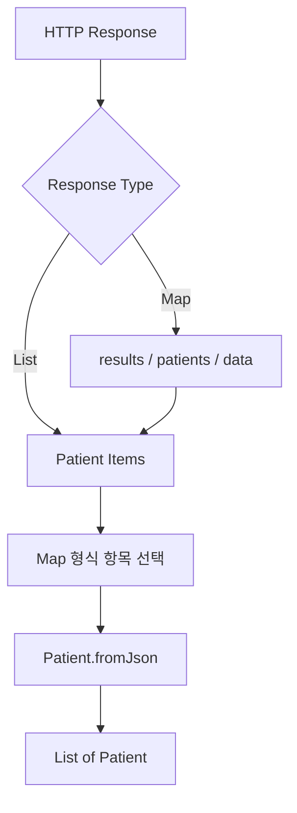

서버 응답의 외부 구조가 달라도
최종적으로 동일한 Patient 모델 목록을
ViewModel에 전달하도록 구성했습니다.

### 설계상 장점

- 화면에서 JSON 구조를 직접 처리할 필요 감소
- 서버 응답 형식에 대한 UI 의존성 감소
- 데이터 모델의 재사용 가능
- 기능별 데이터 처리 책임 구분

### 설계상 한계

여러 응답 형식을 허용하는 방식은
API 변경에 유연하게 대응할 수 있지만,
잘못된 응답을 정상 데이터처럼 처리할 가능성도 있습니다.

특히 목록 내부의 Map이 아닌 항목을 제외하는 처리는
일부 데이터가 누락되는 원인을 발견하기 어렵게
만들 수 있습니다.

향후에는 명확한 API 응답 계약과
스키마 검증을 적용하는 방안을 고려할 수 있습니다.

---

## 7. Patient Data Model

Patient 모델은 서버에서 전달된 환자 정보를
Dart 객체로 변환하여 관리합니다.

### 주요 데이터

| 데이터 | 사용 목적 |
|---|---|
| 환자 ID | 환자 식별 및 상세 조회 |
| 환자 이름 | 목록 및 상세 화면 표시 |
| 나이 | 환자 기본 정보 |
| 성별 | 환자 기본 정보 |
| 기타 환자 정보 | 상세 업무 화면에서 활용 |

### JSON Key Compatibility

Patient 모델은 일부 필드에 대해
서로 다른 JSON 키 형식을 처리합니다.

예를 들어 환자 식별자와 이름은
snake_case, camelCase 및 일부 대체 키를
지원하는 형태로 구성되어 있습니다.

```json
{
  "patient_id": "DEMO-001",
  "patient_name": "테스트 환자"
}
```

```json
{
  "patientId": "DEMO-001",
  "patientName": "테스트 환자"
}
```

위 데이터는 실제 환자 정보가 아닌
키 변환 구조를 설명하기 위한 예시입니다.

### 데이터 변환 흐름

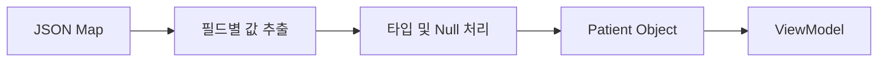

### 타입 및 Null 처리

환자 모델에서는 문자열 및 숫자 데이터의
변환과 누락된 값에 대한 기본값 처리가
이루어집니다.

이러한 처리는 예상하지 못한 응답으로 인해
화면 렌더링이 실패하는 상황을 줄이는 데
도움이 될 수 있습니다.

다만 누락된 나이를 0으로 처리하는 방식은
실제 나이가 0인 경우와 정보가 없는 경우를
구분하기 어렵게 만들 수 있습니다.

의료 데이터에서는 누락과 실제 값의 의미가
다르므로 Nullable 타입과 명시적인
미확인 상태를 사용하는 것이 개선 방향입니다.

---

## 8. Patient Detail Management

환자 상세 정보는 환자 ID를 기반으로 조회합니다.

```http
GET /api/patients/{patientId}/
Authorization: Bearer <access_token>
```

### 상세 조회 흐름

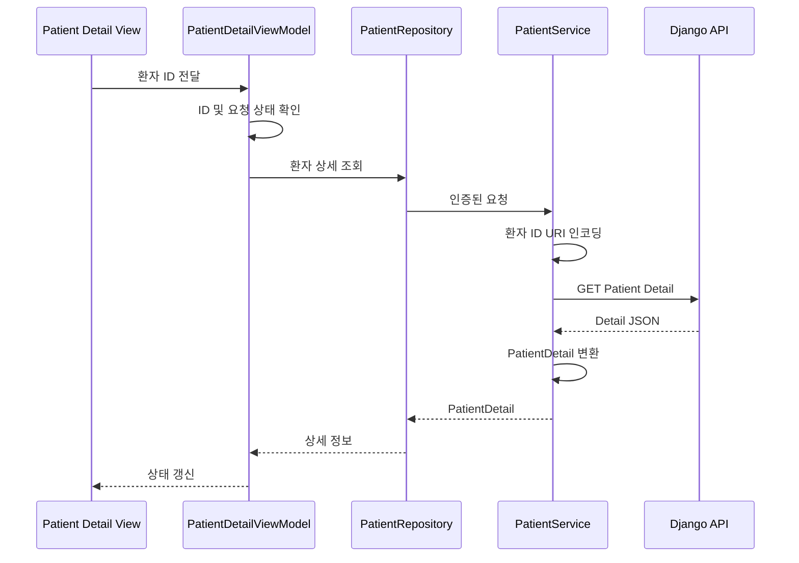

### 8.1 Patient Identifier

환자 상세 조회에서는 환자 ID를
URL 경로의 일부로 사용합니다.

PatientService는 환자 ID를 URI 인코딩하여
경로에 포함하도록 구성되어 있습니다.

다음은 해당 처리 방식을 설명하는
축약 예시입니다.

```dart
final encodedId = Uri.encodeComponent(patientId);
final path = '/api/patients/$encodedId/';
```

이는 식별자에 URL 예약 문자 등이 포함될 때
경로가 의도와 다르게 해석되는 상황을
줄이기 위한 처리입니다.

URI 인코딩은 환자 접근 권한 검증을
대체하는 보안 기능은 아닙니다.

### 8.2 PatientDetail Model

환자 상세 모델에서는 다음 데이터를 관리합니다.

| 데이터 | 역할 |
|---|---|
| patient | 환자 기본 및 상세 정보 |
| examinations | 환자 검사 정보 목록 |
| aiResults | 환자 AI 분석 결과 목록 |

PatientDetail 모델은 patient 항목이
Map 형식인지 확인하며,
검사 및 AI 결과는 Map 목록 형태로 처리합니다.

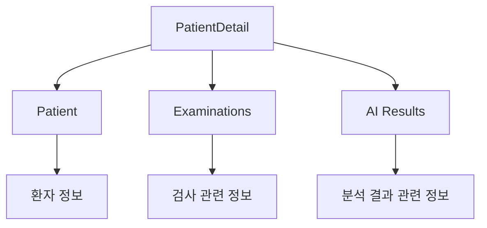

검사 및 AI 결과 데이터를 수신하고 관리하는 구조는
확인했으나 모든 상세 필드의 화면 표시 및
실제 AI 추론 동작까지 검증한 것은 아닙니다.

### 8.3 상세 응답 처리

환자 상세 응답이 data 객체 내부에 포함되는 경우,
PatientService에서 내부 객체를 추출하여
처리할 수 있도록 구성되어 있습니다.

환자 상세 응답의 외부 구조를 정리한 뒤
PatientDetail 모델로 변환함으로써
화면의 데이터 파싱 책임을 줄입니다.

---

## 9. Authentication & Repository

Repository는 API 요청 전에
Secure Storage에서 Access Token을 조회합니다.

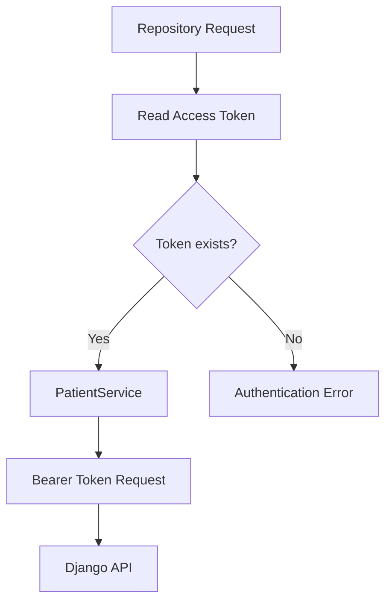

### Repository의 책임

- 인증 정보 조회
- Null 또는 빈 토큰 확인
- Service 호출 중계
- 환자 데이터 반환

토큰이 없거나 공백으로만 구성된 경우에는
서버 요청을 진행하지 않도록 처리합니다.

### 계층 분리의 이유

ViewModel에서 인증 저장소와 HTTP Client를
직접 관리하면 화면 상태와 네트워크 로직이
서로 강하게 결합될 수 있습니다.

Repository에서 인증 정보 접근을 담당하면
ViewModel은 환자 데이터와 요청 상태 관리에
집중할 수 있습니다.

다만 현재 구조는 Repository별 토큰 조회 방식이
반복될 수 있으므로 향후 공통 인증 모듈로
통합하는 방안도 고려할 수 있습니다.

---

## 10. Patient List State Management

PatientListViewModel은 ChangeNotifier를 기반으로
환자 목록과 요청 상태를 관리합니다.

### 주요 상태

| 상태 | 역할 |
|---|---|
| 환자 목록 | 서버에서 조회한 환자 데이터 |
| 환자 수 | 현재 목록의 환자 수 |
| 로딩 상태 | 목록 조회 진행 여부 |
| 오류 상태 | 요청 실패 정보 |
| 최근 조회 환자 | 최근 환자 접근 기록 |

### 상태 전이

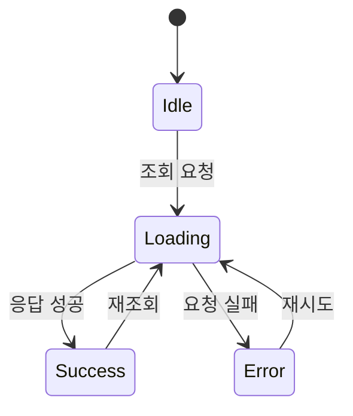

위 상태 다이어그램은 실제 로딩 및 오류 상태를
개념적으로 정리한 것입니다.

별도의 상태 머신 라이브러리를 사용한 것은 아닙니다.

### 비동기 상태 관리

다음은 현재 구현의 처리 흐름을 설명하기 위해
재구성한 축약 코드입니다.

```dart
Future<void> loadPatients() async {
  if (isLoading) return;

  isLoading = true;
  errorMessage = null;
  notifyListeners();

  try {
    patients = await repository.fetchPatients();
  } catch (error) {
    errorMessage = error.toString();
  } finally {
    isLoading = false;
    notifyListeners();
  }
}
```

위 코드는 설명용 예시이며,
실제 소스의 필드명 및 메서드명과
일부 차이가 있을 수 있습니다.

### 처리 목적

- 조회 중 중복 요청 방지
- 요청 진행 상태 전달
- 성공 시 환자 목록 갱신
- 실패 시 오류 정보 관리
- 요청 종료 후 로딩 상태 복원

현재 목록 조회 메서드에는
로딩 상태를 이용한 중복 호출 방지 처리가 있습니다.

다만 새로고침 메서드까지 동일한 보호 방식이
적용된 것은 아니므로 모든 동시 요청이
차단된다고 판단하지 않습니다.

---

## 11. Refresh & Error Recovery

환자 목록을 갱신하는 경우
기존 목록을 다시 서버에서 조회합니다.

### 목록 갱신 성공

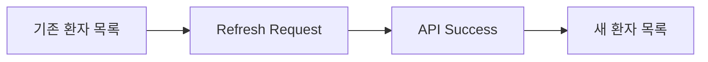

### 목록 갱신 실패

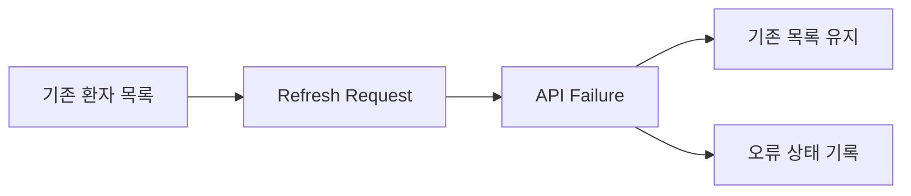

목록 조회 실패 시 기존 데이터가 남아 있는 구조는
일시적인 네트워크 오류로 인해 모든 환자 정보가
즉시 사라지는 상황을 줄일 수 있습니다.

다만 기존 데이터가 최신 상태임을 보장하지는 않습니다.

의료 데이터의 최신성이 중요한 경우에는
마지막 갱신 시간과 데이터 갱신 실패 여부를
화면에 명확하게 표시할 필요가 있습니다.

---

## 12. Patient Detail State Management

PatientDetailViewModel은 환자 목록과 별도로
환자 상세 데이터 및 요청 상태를 관리합니다.

### 주요 책임

- 환자 ID 유효 형식 확인
- 환자 상세 조회
- 상세 데이터 갱신
- 로딩 및 오류 상태 관리
- 미디어 요청용 인증 정보 관리
- 상세 상태 초기화

### 초기 조회와 새로고침

| 구분 | 실패 시 처리 |
|---|---|
| 환자 목록 조회 | 기존 목록 유지 |
| 환자 상세 초기 조회 | 상세 데이터 초기화 |
| 환자 상세 새로고침 | 기존 상세 데이터 유지 |

초기 상세 조회 실패 시 기존 상세 데이터를
초기화하는 방식은 다른 환자의 정보가
남아 있는 상황을 줄이는 데 도움이 될 수 있습니다.

반면 동일 환자의 정보를 새로고침하는 경우에는
기존 데이터를 유지하는 방식으로 처리합니다.

환자 전환 및 동시 요청 상황에서
데이터가 올바른 환자에게 연결되는지는
추가 검증이 필요합니다.

---

## 13. Recent Patient Management

최근 조회 환자 목록은
PatientListViewModel에서 관리합니다.

### 관리 규칙

- 환자 ID를 기준으로 중복 항목 제거
- 최근 환자를 목록 앞쪽에 배치
- 최대 10개 항목 유지
- 메모리 기반 상태 관리

### 데이터 처리 예시

다음은 최근 조회 환자 관리 규칙을
가상의 환자 ID로 표현한 예시입니다.

```text
기존 목록

[DEMO-003, DEMO-002, DEMO-001]

DEMO-002를 다시 조회한 경우

[DEMO-002, DEMO-003, DEMO-001]
```

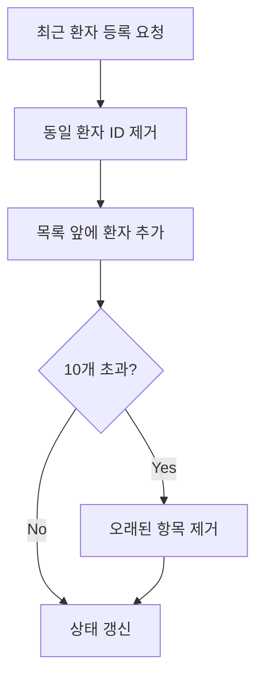

이 구조는 동일 환자가 최근 목록에
반복적으로 쌓이는 상황을 방지합니다.

최근 조회 목록은 메모리에서 관리되므로
앱 재실행 이후 복원되는 영속적인
조회 이력 저장 기능과는 구분됩니다.

또한 해당 메서드가 모든 환자 상세 화면 진입 시
호출되는지와 최근 목록의 실제 화면 노출 여부는
별도로 검증하지 않았습니다.

---

## 14. Authenticated Media Access

환자 상세 정보에는 검사 영상과
관련 미디어 리소스가 포함될 수 있습니다.

PatientDetailViewModel에서는
미디어 접근에 사용할 URL과 인증 헤더를
구성하는 기능을 제공합니다.

### 미디어 요청 헤더

```http
Authorization: Bearer <access_token>
Accept: */*
```

일반적인 JSON API 요청과 달리
미디어 요청에서는 다양한 콘텐츠 형식에
접근할 수 있도록 Accept 헤더를 구성합니다.

### URL Resolution

서버에서 반환하는 미디어 경로는
절대 URL 또는 상대 경로일 수 있습니다.

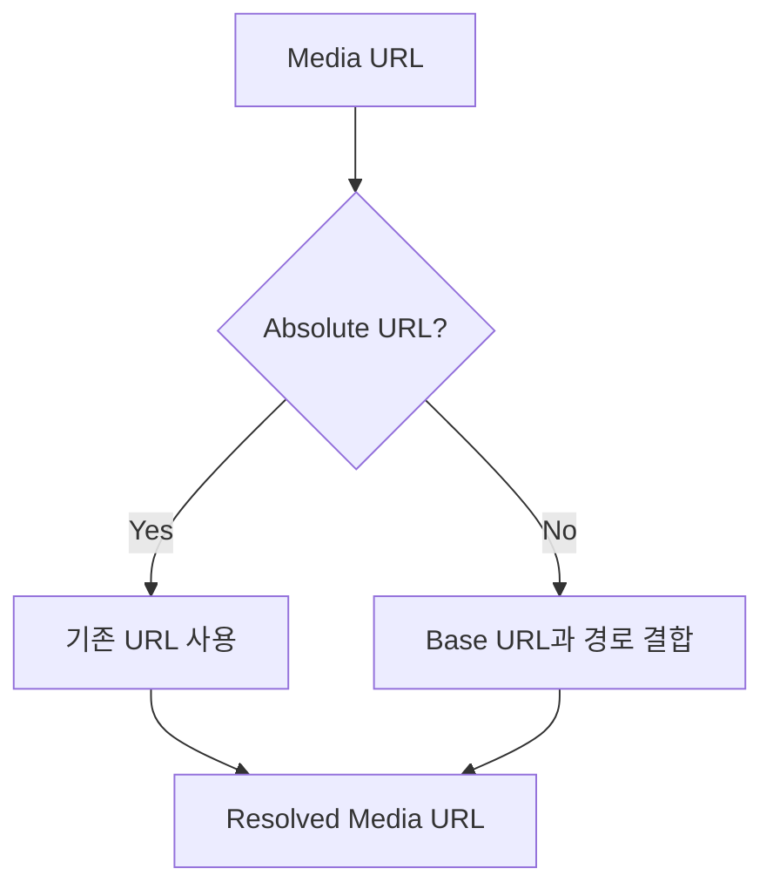

다음은 URL 처리 구조를 설명하기 위한
가상의 서버 주소 예시입니다.

| 입력 | 변환 결과 |
|---|---|
| /media/demo.png | https://example.com/media/demo.png |
| https://example.com/media/demo.png | 기존 URL 유지 |

실제 프로젝트 서버 주소는
공개 포트폴리오에 포함하지 않습니다.

### 보안상 고려 사항

절대 URL을 그대로 허용하고
인증 헤더를 함께 전달하는 경우,
허용되지 않은 외부 주소로 인증 정보가
전송될 가능성을 검토해야 합니다.

향후 미디어 URL의 scheme 및 host를 검증하고,
신뢰할 수 있는 서버에만 인증 헤더를
전달하도록 개선할 수 있습니다.

현재 문서는 미디어 URL 및 인증 헤더 생성 구조를
분석한 것이며, 모든 영상 위젯에서 해당 헤더가
실제로 사용되는지는 별도로 확인하지 않았습니다.

---

## 15. Exception Handling

PatientService에서는 DioException을
요청 실패 원인에 따라 처리합니다.

### 네트워크 오류 분류

| 오류 유형 | 의미 |
|---|---|
| Connection Timeout | 서버 연결 시간 초과 |
| Send Timeout | 요청 전송 시간 초과 |
| Receive Timeout | 응답 수신 시간 초과 |
| Connection Error | 네트워크 연결 실패 |
| Bad Certificate | 인증서 관련 오류 |
| Cancel | 요청 취소 |
| Unknown | 기타 통신 오류 |

### HTTP 응답 오류

| 상태 코드 | 의미 |
|---|---|
| 400 | 잘못된 요청 |
| 401 | 인증 정보 관련 오류 |
| 403 | 접근 권한 부족 |
| 404 | 요청한 리소스를 찾을 수 없음 |
| 5xx | 서버 내부 오류 |

### 오류 전달 구조

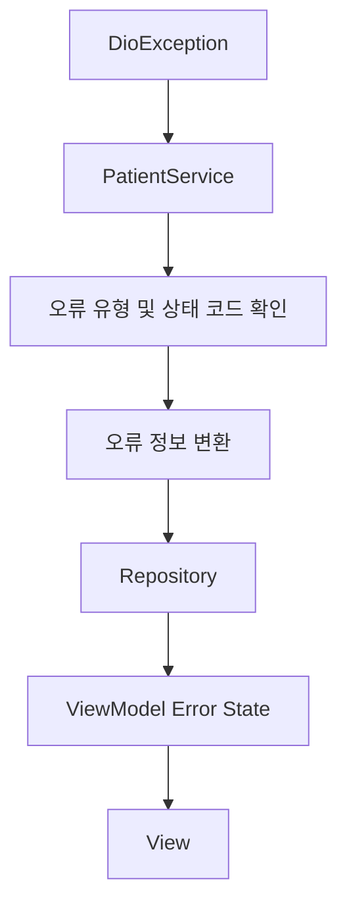

Service에서 통신 오류를 처리하고,
ViewModel에서 오류 상태를 관리함으로써
화면이 Dio의 세부 오류 구조에
직접 의존하는 상황을 줄입니다.

### 개선 방향

현재 오류 처리 구조를 확장하여
인증 만료, 접근 권한 부족, 네트워크 오류,
서버 오류 등을 타입으로 구분할 수 있습니다.

이를 통해 화면에서 오류 유형에 따라
재로그인, 재시도, 접근 제한 안내 등
서로 다른 후속 동작을 제공할 수 있습니다.

---

## 16. Integration with Other Features

환자 정보는 다른 의료진 업무 기능에서
참조할 수 있는 핵심 데이터입니다.

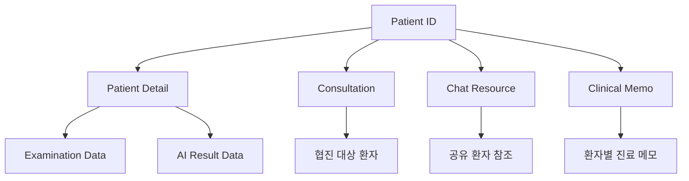

### 기능별 환자 정보 활용

| 기능 | 활용 방식 |
|---|---|
| 환자 상세 | 환자 ID 기반 상세 조회 |
| 협진 | 협진 대상 환자 식별 |
| 채팅 | 환자 관련 참조 정보 전달 |
| 메모 | 환자별 텍스트 및 음성 기록 연결 |
| 홈 화면 | 환자 목록 수 집계 |

### 환자 ID의 역할

환자 이름은 중복되거나 변경될 수 있으므로
기능 간 데이터 연결에는 환자 식별자를
사용하는 것이 중요합니다.

현재 모바일 코드에서는 환자 ID를
상세 조회, 협진 요청 및 메모 등록 등의
데이터 전달에 활용합니다.

이는 모바일 애플리케이션의 참조 관계이며,
서버 데이터베이스의 실제 Foreign Key 구조까지
확인한 것은 아닙니다.

---

## 17. Dashboard Integration

홈 화면은 PatientListViewModel을 구독하여
현재 환자 목록 수를 표시합니다.

```dart
final patientListViewModel =
    context.watch<PatientListViewModel>();

final patientCount =
    patientListViewModel.patientCount;
```

환자 목록과 홈 화면에서 동일한 ViewModel을
활용하는 구조입니다.

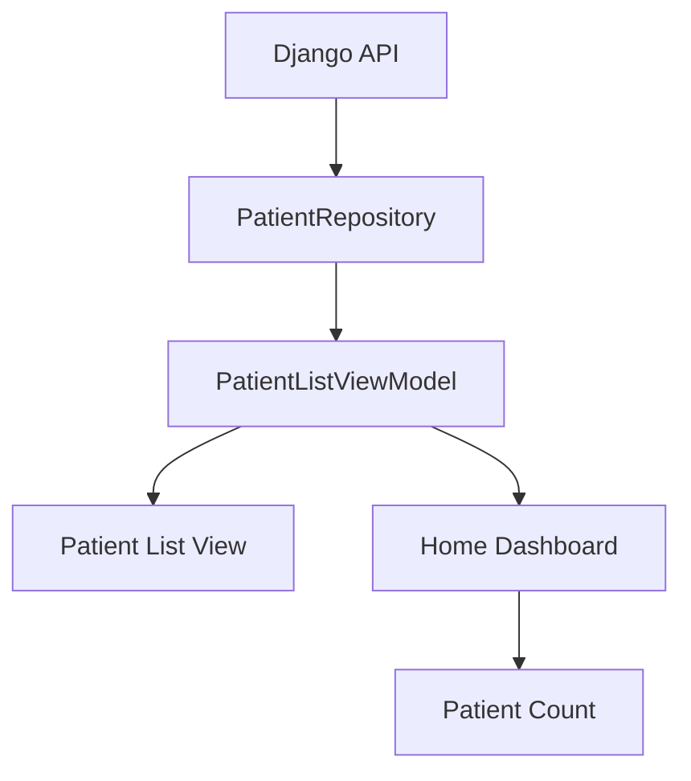

홈 화면의 환자 수는 현재 ViewModel이 관리하는
목록의 환자 수를 의미합니다.

서버에 등록된 전체 환자 수를 별도의 집계 API로
조회하는 기능으로 해석하지 않습니다.

서버 페이지네이션을 도입하는 경우에는
현재 로드된 목록 수와 전체 환자 수를
별도로 관리할 필요가 있습니다.

---

## 18. Technical Challenges

### 18.1 서버 응답 구조 처리

문제 상황:

- 서버 응답의 외부 구조가 달라질 수 있음
- 화면에서 직접 JSON을 처리할 경우 결합도 증가

현재 처리:

- Service에서 응답 구조 확인
- Patient 모델로 데이터 변환
- ViewModel에 객체 목록 전달

개선 방향:

- API 응답 스키마 명확화
- 비정상 응답에 대한 명시적 오류 처리
- 데이터 변환 테스트 추가

### 18.2 인증 정보 접근

문제 상황:

- 기능별 인증 헤더 구성 필요
- 인증 정보가 없는 상태에서 요청할 가능성

현재 처리:

- Repository에서 Access Token 확인
- Service에서 Bearer Token 전달

개선 방향:

- 공통 인증 요청 모듈
- 토큰 만료 및 갱신 정책
- 동시 토큰 갱신 요청 제어

### 18.3 비동기 조회 상태

문제 상황:

- 조회 중 반복 호출
- 요청 실패 시 화면 상태 관리
- 이전 요청과 새로운 요청의 응답 순서 충돌 가능성

현재 처리:

- 로딩 상태 플래그
- try / catch / finally
- notifyListeners 기반 상태 전달

개선 방향:

- 요청 취소 및 요청 ID 관리
- 최신 요청의 응답만 반영
- 초기 조회와 새로고침 상태 분리

### 18.4 의료 데이터 접근

문제 상황:

- 환자 상세 및 미디어 접근 시 인증 필요
- 로그에 민감 데이터가 포함될 가능성

현재 처리:

- Bearer Token 기반 요청
- 미디어 URL 및 인증 헤더 구성

개선 방향:

- HTTPS 적용
- 민감 정보 로그 마스킹
- 허용된 미디어 서버 검증
- 서버의 환자별 접근 권한 검증

위 문제 상황은 현재 구현 구조를 분석하여
정리한 기술적 고려 사항입니다.

모든 상황이 개발 또는 운영 중 실제 장애로
발생했다는 의미는 아닙니다.

---

## 19. Validation Scenarios

다음은 소스 코드 분석을 바탕으로 작성한
환자 관리 기능의 검증 시나리오입니다.

| ID | 검증 항목 | 기대 결과 |
|---|---|---|
| PT-01 | 정상 환자 목록 응답 | Patient 목록 변환 |
| PT-02 | results 내부 목록 응답 | 목록 정상 추출 |
| PT-03 | patients 내부 목록 응답 | 목록 정상 추출 |
| PT-04 | data 내부 목록 응답 | 목록 정상 추출 |
| PT-05 | 인증 토큰 없음 | API 요청 제한 |
| PT-06 | 공백 토큰 | API 요청 제한 |
| PT-07 | 정상 환자 상세 응답 | PatientDetail 변환 |
| PT-08 | 환자 상세 응답 구조 오류 | 오류 처리 |
| PT-09 | HTTP 401 응답 | 인증 관련 오류 상태 |
| PT-10 | HTTP 403 응답 | 접근 권한 관련 오류 상태 |
| PT-11 | HTTP 404 응답 | 리소스 조회 오류 |
| PT-12 | 네트워크 시간 초과 | 로딩 종료 및 오류 상태 |
| PT-13 | 목록 조회 실패 | 기존 목록 유지 |
| PT-14 | 상세 새로고침 실패 | 기존 상세 정보 유지 |
| PT-15 | 최근 환자 중복 등록 | 동일 ID 중복 제거 |
| PT-16 | 최근 환자 10개 초과 | 최대 10개 유지 |
| PT-17 | 상대 미디어 경로 | Base URL과 경로 결합 |
| PT-18 | 절대 미디어 URL | 기존 URL 유지 |

### 추가 검증이 필요한 항목

| ID | 검증 항목 | 검토 목적 |
|---|---|---|
| PT-19 | 새로고침 동시 호출 | 응답 순서 충돌 확인 |
| PT-20 | 환자 상세 화면 빠른 전환 | 이전 환자 데이터 혼입 방지 |
| PT-21 | 외부 미디어 URL | 인증 정보 노출 가능성 확인 |
| PT-22 | 토큰 만료 | 갱신 및 재로그인 동작 확인 |
| PT-23 | 다른 환자 ID 접근 | 서버 권한 검증 확인 |
| PT-24 | 잘못된 JSON 필드 타입 | 데이터 변환 안정성 확인 |
| PT-25 | 앱 재실행 | 최근 환자 상태 초기화 확인 |

위 표는 실제 테스트 실행 결과가 아닌
검증 계획 및 기대 결과입니다.

자동화 테스트와 실제 API 통합 테스트는
별도로 수행해야 합니다.

---

## 20. Limitations & Improvements

| 현재 구조 | 개선 방향 |
|---|---|
| 여러 JSON 키 허용 | 명확한 API 스키마 정의 |
| 일부 누락 값에 기본값 사용 | Nullable 데이터 모델 적용 |
| 검사 및 AI 결과 Map 목록 | 타입이 명확한 모델 분리 |
| 일부 중복 요청 보호 | 공통 요청 상태 및 취소 관리 |
| 목록 중심 환자 수 집계 | 서버 전체 개수 별도 관리 |
| 최근 환자 메모리 저장 | 사용자별 저장 정책 검토 |
| 토큰 저장소 재조회 | 공통 인증 갱신 처리 |
| 절대 미디어 URL 허용 | scheme 및 host 검증 |
| 상세 응답 로그 | 민감 정보 마스킹 |
| 정적 코드 분석 중심 | 단위 및 통합 테스트 추가 |

### 개선 우선순위

P1 — 데이터 보호

- HTTPS 기반 통신
- 인증 정보 및 환자 정보 로그 제한
- 허용된 미디어 서버 검증
- 서버 리소스 접근 권한 확인

P2 — 데이터 일관성

- 비동기 요청 순서 관리
- 명확한 데이터 모델 및 Null 처리
- 초기 조회와 갱신 상태 분리
- API 응답 계약 검증

P3 — 기능 확장

- 페이지네이션 및 서버 검색 검토
- 최근 환자 관리 정책 개선
- 환자 데이터 갱신 시점 표시
- 자동화 테스트 확대

개선 우선순위는 현재 코드를 분석하여
제안한 내용이며 실제 구현 완료 상태가 아닙니다.

---

## 21. Engineering Evidence

### 개인 기여 관련 Git 이력

| Commit | 주요 작업 |
|---|---|
| 2b58ee6 | 환자 목록 UI 구현 |
| 5e653da | 환자 목록 API 및 검색 |
| 77a9ee0 | 환자 목록 및 상세 API 연동 |
| 163909a | 환자 영상 전체 화면 |
| 2f23d0b | 환자 필터 및 AI 요청 버튼 |
| 134bbdf | 환자 상세 메모 기능 추가 |

### 주요 분석 대상

| 소스 영역 | 확인 내용 |
|---|---|
| patient/model | 환자 및 상세 데이터 변환 |
| patient/service | REST API 요청 및 응답 처리 |
| patient/repository | 인증 정보 조회 및 데이터 접근 |
| patient/view_model | 목록 및 상세 상태 관리 |
| core/network | 공통 HTTP 통신 및 Endpoint |
| home/view/home_view.dart | 환자 수 및 대시보드 연계 |
| memo | 환자별 메모 데이터 연결 |
| consultation | 협진 대상 환자 정보 연결 |

개인 작성 커밋은 환자 관리 기능의
개발 기여 근거로 활용했습니다.

현재 최종 소스에는 팀원의 수정 및
공통 기능이 포함될 수 있으므로
모든 코드를 단독으로 작성했다고 주장하지 않습니다.

---

## 22. Retrospective

환자 관리 기능을 구현하면서
API에서 데이터를 받아 화면에 표시하는 과정에는
다양한 데이터 처리 책임이 존재한다는 점을
경험했습니다.

서버 응답 구조, 인증 정보, 데이터 모델,
로딩 및 오류 상태를 각각 관리하는 과정에서
화면과 네트워크 로직을 분리하는 구조의
필요성을 이해했습니다.

또한 환자 ID가 상세 조회, 협진, 채팅 및 메모를
연결하는 공통 식별자로 활용되는 것을 통해
기능 간 데이터 관계의 중요성을 학습했습니다.

의료 데이터는 일반적인 서비스 데이터보다
접근 권한과 정확성에 대한 고려가 중요하므로,
향후 백엔드 개발에서는 데이터 검증,
인증 및 인가, 오류 처리와 데이터 일관성을
함께 고려하고자 합니다.

---

## 23. Validation Scope

본 문서는 Flutter 의료진 앱의 데이터 모델,
Service, Repository, ViewModel 및
관련 Git 이력을 중심으로 작성했습니다.

환자 검색 및 상세 UI의 개인 기여는
발표 자료와 Git 이력을 참고했습니다.

다만 다음 항목은 별도로 검증하지 않았습니다.

- 검색 화면의 최종 API 호출 방식
- 모든 환자 상세 화면의 실제 렌더링
- 최근 환자 등록 메서드의 전체 호출 경로
- 실제 의료영상 요청 시 인증 헤더 사용 여부
- Django 서버 내부 데이터베이스 구조
- 서버의 환자별 접근 권한 검증
- 앱 재빌드 및 실제 기기 실행
- API 응답 시간 및 부하 테스트

문서에 포함된 JSON, 일부 Dart 코드 및
환자 식별자는 구조 설명을 위한 재구성 예시입니다.

실제 환자의 개인정보와 운영 서버 주소는
포함하지 않았습니다.

---

## 24. Related Documentation

- [프로젝트 개요](./README.md)
- [시스템 아키텍처](./architecture.md)
- [채팅 시스템](./messaging.md)
- [비동기 협진 시스템](./consultation.md)
- [텍스트 및 음성 메모](./memo-system.md)
- [데이터 및 상태 관리](./data-state-management.md)
- [문제 해결 및 개선 방향](./troubleshooting.md)

---

[← 프로젝트 개요로 돌아가기](./README.md)
