# VENA — Schedule & Task Management

> 의료진 일정 관리 및 개인 업무 체크리스트
>
> Calendar CRUD · Local Persistence · Shared State Management

[← 프로젝트 개요로 돌아가기](./README.md)

---

## 1. Overview

의료진이 모바일 환경에서 개인 일정과
업무 진행 상황을 관리할 수 있도록
캘린더 및 To-do List 기능을 구현했습니다.

캘린더는 단일 날짜 일정뿐 아니라
시작일과 종료일을 가진 기간 일정을
관리할 수 있도록 구성했습니다.

To-do List는 의료진이 개인 업무를 등록하고,
완료 여부를 확인하며, 필요하지 않은 항목을
삭제할 수 있도록 구성했습니다.

두 기능은 SharedPreferences를 활용하여
앱 내부의 데이터를 로컬에 저장합니다.

### Implementation Goals

- 의료진 개인 일정 등록
- 일정 조회, 수정 및 삭제
- 단일 날짜 및 기간 일정 관리
- 날짜별 일정 필터링
- 일정 시간순 정렬
- 일정별 색상 지정
- 캘린더 화면 확장 및 축소
- 홈 미니 캘린더 연계
- 개인 업무 등록 및 완료 관리
- 업무 삭제 및 실행 취소
- JSON 기반 로컬 데이터 저장

---

## 2. My Contributions

| 담당 기능 | 구현 내용 |
|---|---|
| 월간 캘린더 | TableCalendar 기반 일정 인터페이스 |
| 일정 CRUD | 일정 등록, 조회, 수정 및 삭제 |
| 기간 일정 | 시작일과 종료일 기반 날짜 범위 처리 |
| 일정 시각화 | 단일 일정 및 연속 일정 표시 |
| 색상 관리 | 일정별 색상 선택 및 저장 |
| 화면 상태 | 캘린더 및 일정 목록 영역 전환 |
| 홈 연계 | 미니 캘린더와 일정 데이터 공유 |
| To-do List | 업무 등록, 완료 및 삭제 |
| Undo | 삭제된 업무 복원 |
| 로컬 저장 | SharedPreferences 기반 JSON 저장 |
| 테마 대응 | Light/Dark Mode 기반 화면 구성 |

개인 담당 범위는 Flutter 의료진 앱의
일정 관리 및 To-do List 기능입니다.

서버 기반 병원 예약 시스템이나
의료진 근무 일정 충돌 방지 시스템을
개인적으로 구현했다는 의미는 아닙니다.

---

## 3. Problem Definition

### 3.1 분산된 의료진 업무

의료진은 환자 조회, 협진, 검사 결과 확인,
개인 일정 및 업무 관리 등 다양한 작업을
수행합니다.

이러한 업무가 서로 다른 화면이나
외부 도구에 분산되면 업무 확인 과정에서
불필요한 화면 전환이 발생할 수 있습니다.

### 3.2 개인 업무 관리의 필요성

의료진의 개인 일정과 업무 목록은
환자 진료 기록과는 다른 관리 목적을
가집니다.

이에 따라 개인 일정 및 To-do List를
의료진 앱 내부에 구성하여
업무 접근성을 높이고자 했습니다.

### 3.3 데이터 유지

화면 내부의 메모리 상태만 사용하는 경우
앱이 종료되면 등록된 일정과 업무가
유실될 수 있습니다.

이를 보완하기 위해 일정과 업무 목록을
JSON 문자열로 변환하여
SharedPreferences에 저장하도록 구성했습니다.

---

## 4. Feature Architecture

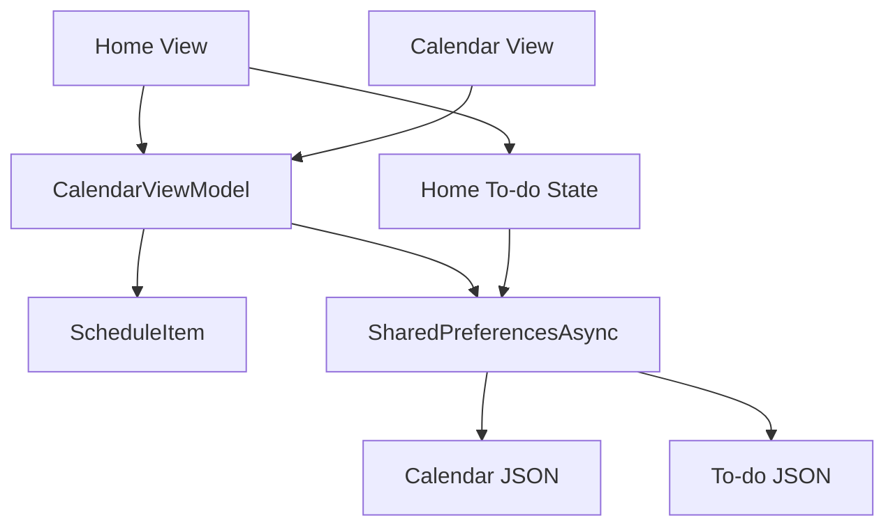

### 계층별 책임

| 구성 요소 | 역할 |
|---|---|
| CalendarView | 일정 관리 화면 |
| CalendarViewModel | 일정 데이터 및 선택 날짜 관리 |
| ScheduleItem | 일정 데이터 모델 |
| MonthlyCalendar | 월간 일정 시각화 |
| ScheduleBottomSheet | 선택 날짜의 일정 목록 |
| HomeView | 홈 캘린더 및 To-do 상태 관리 |
| SharedPreferencesAsync | 로컬 데이터 저장 및 조회 |

### 구조적 특징

환자, 채팅 및 협진 기능은
Service와 Repository를 통해
서버 API에 접근합니다.

반면 개인 일정은 CalendarViewModel에서
직접 로컬 저장소에 접근합니다.

To-do List는 HomeView 내부에서
상태와 로컬 저장을 관리합니다.

따라서 모든 기능이 동일한
MVVM 계층 구조를 사용하는 것은 아닙니다.

---

## 5. Source Structure

```text
lib/
├── features/
│   ├── calendar/
│   │   ├── view/
│   │   │   └── calendar_view.dart
│   │   ├── view_model/
│   │   │   └── calendar_view_model.dart
│   │   └── widgets/
│   │       ├── monthly_calendar.dart
│   │       ├── schedule_bottom_sheet.dart
│   │       └── schedule_tile.dart
│   │
│   └── home/
│       ├── view/
│       │   └── home_view.dart
│       └── widgets/
│           ├── doctor_briefing_card.dart
│           ├── today_schedule_section.dart
│           └── today_todo_section.dart
│
└── app.dart
```

위 구조는 관련 기능의 주요 파일을
중심으로 정리한 것입니다.

일부 홈 위젯 파일은 프로젝트에 존재하지만
최종 HomeView에서 사용되지 않는 경우가
있으므로 파일의 존재만으로 실제 화면에서
사용한다고 판단하지 않습니다.

ScheduleItem 모델은 별도의 model 폴더가 아닌
schedule_bottom_sheet.dart에 정의되어 있습니다.

---

## 6. Technology Stack

| 기술 | 사용 목적 |
|---|---|
| Flutter | 모바일 사용자 인터페이스 |
| Dart | 일정 및 업무 처리 로직 |
| Provider | 공유 ViewModel 접근 |
| ChangeNotifier | 일정 상태 변경 전달 |
| TableCalendar | 월간 캘린더 구성 |
| SharedPreferencesAsync | 로컬 데이터 저장 |
| dart:convert | JSON 직렬화 및 역직렬화 |
| intl | 날짜 관련 표현 |
| Material Widgets | 입력, 체크박스 및 삭제 인터페이스 |

### 주요 패키지

프로젝트의 pubspec.yaml 기준입니다.

| Package | Version Constraint |
|---|---|
| table_calendar | ^3.2.0 |
| provider | ^6.1.5 |
| shared_preferences | ^2.5.5 |
| intl | ^0.20.2 |

---

## 7. Schedule Data Model

일정은 ScheduleItem 모델을 통해 관리합니다.

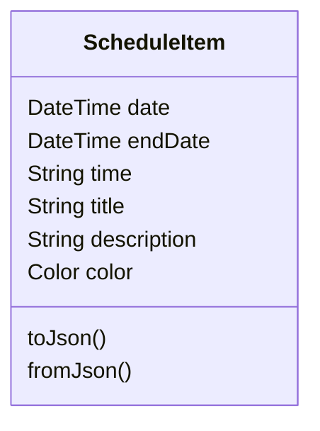

Nullable 타입 표기는 일부 생략했습니다.

### 주요 필드

| 필드 | 타입 | 역할 |
|---|---|---|
| date | DateTime | 일정 시작일 |
| endDate | DateTime | 일정 종료일 |
| time | String | 일정 시간 |
| title | String | 일정 제목 |
| description | String? | 추가 설명 |
| color | Color | 일정 표시 색상 |

### 데이터 모델의 특징

단일 날짜 일정과 기간 일정을
별도의 클래스로 구분하지 않습니다.

시작일과 종료일을 사용하여
동일한 모델에서 두 유형을 처리합니다.

```text
단일 날짜 일정

date    = 2026-11-24
endDate = 2026-11-24

기간 일정

date    = 2026-11-24
endDate = 2026-11-27
```

위 날짜는 설명을 위한 가상 예시입니다.

### 현재 모델의 한계

ScheduleItem에는 독립적인
일정 식별자 ID가 존재하지 않습니다.

따라서 수정 및 삭제 시
객체 또는 목록 인덱스를
기준으로 처리합니다.

향후 서버 연동이나 안정적인
데이터 갱신을 위해서는
고유 ID를 추가하는 것이 적절합니다.

---

## 8. Calendar State Management

CalendarViewModel은 ChangeNotifier를
기반으로 일정 상태를 관리합니다.

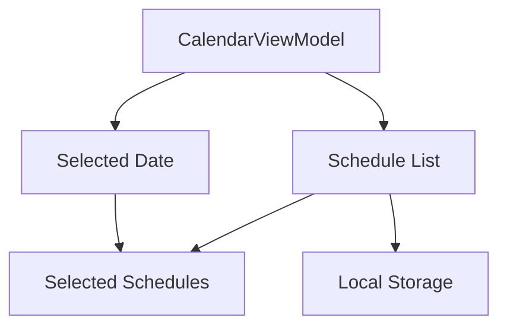

### 주요 상태

| 상태 | 역할 |
|---|---|
| selectedDate | 현재 선택 날짜 |
| schedules | 전체 일정 목록 |
| selectedSchedules | 선택 날짜에 해당하는 일정 |

### 상태 관리 방식

- 일정 목록을 ViewModel 내부에서 관리
- 외부에는 변경할 수 없는 목록 제공
- 날짜 선택 시 상태 갱신
- 일정 변경 시 notifyListeners 호출
- Provider를 통해 홈과 캘린더에서 상태 접근

### 상태 공유의 목적

홈 화면과 전체 캘린더 화면에서
서로 다른 일정 목록을 관리하는 경우
데이터가 일치하지 않을 수 있습니다.

공통 CalendarViewModel을 사용하여
두 화면이 동일한 일정 데이터에
접근하도록 구성했습니다.

---

## 9. Calendar CRUD

### 주요 작업

| 작업 | ViewModel 메서드 |
|---|---|
| Create | addSchedule |
| Read | schedules / selectedSchedules |
| Update | updateSchedule |
| Delete | removeSchedule / removeScheduleAt |

현재 CRUD는 서버 API를 호출하는
방식이 아니라 로컬 목록과
SharedPreferences를 대상으로 수행합니다.

### 데이터 변경 흐름

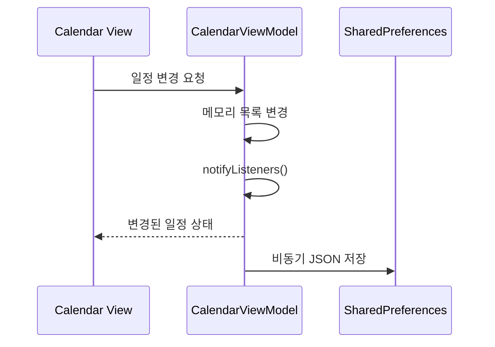

화면 상태는 로컬 목록이 변경된 후
먼저 갱신됩니다.

이후 저장 작업이 비동기적으로
진행되는 구조입니다.

저장 완료가 확인된 후에만
화면을 갱신하는 방식은 아닙니다.

---

## 10. Schedule Creation

일정 등록 시 다음 데이터를
ScheduleItem으로 구성합니다.

- 시작일
- 종료일
- 시간
- 제목
- 설명
- 색상

### 등록 흐름

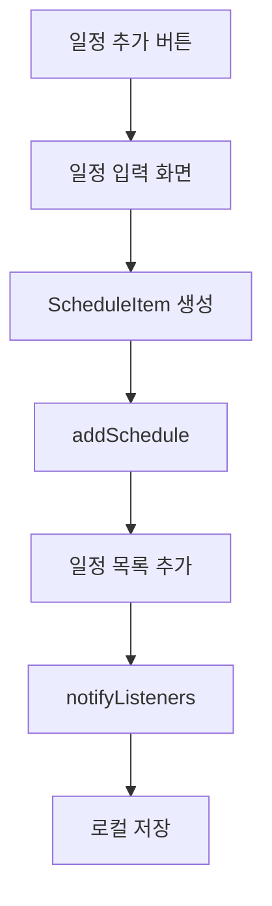

### 가상 일정 예시

| 항목 | 입력값 |
|---|---|
| 제목 | 의료진 회의 |
| 시작일 | 2026-11-24 |
| 종료일 | 2026-11-24 |
| 시간 | 09:00 |
| 설명 | 주간 업무 공유 |
| 색상 | 파랑 |

실제 의료진의 일정 정보가 아닌
기능 설명용 데이터입니다.

---

## 11. Schedule Update

일정 수정은 기존 일정 객체와
수정된 일정 객체를 사용합니다.

### 처리 구조

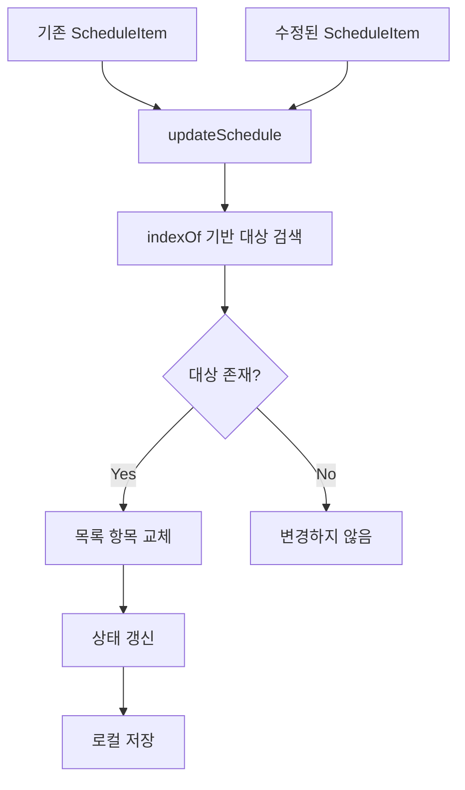

### 객체 기반 검색

현재 일정 수정에서는
기존 ScheduleItem 객체를
indexOf로 검색합니다.

고유 일정 ID를 사용하여
검색하는 방식은 아닙니다.

### 개선 방향

객체가 새롭게 생성되거나
저장소에서 다시 복원된 경우
동일한 일정인지 판단하기
어려울 수 있습니다.

향후 ScheduleItem에 고유 ID를
추가하여 데이터 식별 기준을
명확하게 할 수 있습니다.

---

## 12. Schedule Deletion

일정 삭제 시 확인 Dialog를 통해
사용자의 삭제 의사를 확인합니다.

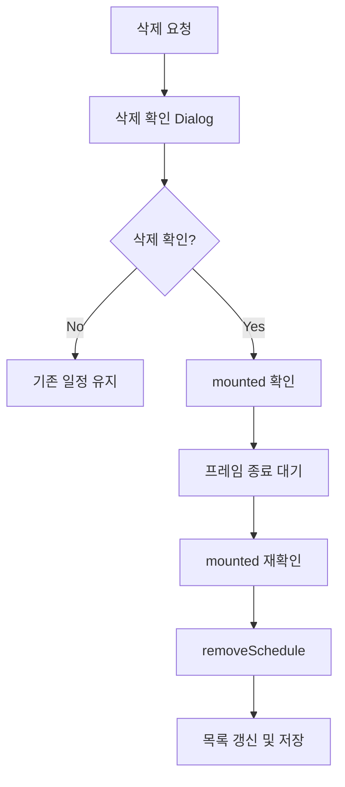

### 비동기 화면 안전성

Dialog의 결과를 기다린 이후에는
기존 화면이 이미 제거되었을
가능성이 있습니다.

이를 고려하여 mounted 상태를
확인합니다.

또한 WidgetsBinding의 endOfFrame을
기다린 후 mounted 상태를
다시 확인하는 처리가 존재합니다.

### 현재 기능 범위

일정 삭제에는 확인 Dialog가
사용됩니다.

To-do List와 동일한 삭제 Undo가
일정 삭제에도 적용되어 있다고
확인한 것은 아닙니다.

---

## 13. Date Range Filtering

기간 일정은 시작일부터 종료일까지
모든 날짜에 포함되도록 처리합니다.

### 핵심 조건

```text
startDate <= targetDate <= endDate
```

시작일과 종료일을 모두 포함하는
Inclusive Range 방식입니다.

### 실제 필터링 구조

```dart
final targetDay = DateUtils.dateOnly(day);

final schedules = widget.schedules.where((schedule) {
  final startDay = DateUtils.dateOnly(schedule.date);

  final endDay = DateUtils.dateOnly(schedule.endDate);

  return !targetDay.isBefore(startDay) &&
      !targetDay.isAfter(endDay);
}).toList();
```

### DateUtils.dateOnly 사용 이유

DateTime은 날짜뿐 아니라
시각 정보도 포함합니다.

날짜별 일정 조회에서는
시각에 따라 같은 날짜의 일정이
제외되지 않도록 날짜 단위로
비교합니다.

### 가상 검증 예시

일정 시작일: 11월 24일

일정 종료일: 11월 27일

| 조회 날짜 | 일정 포함 여부 |
|---|---|
| 11월 23일 | 제외 |
| 11월 24일 | 포함 |
| 11월 25일 | 포함 |
| 11월 26일 | 포함 |
| 11월 27일 | 포함 |
| 11월 28일 | 제외 |

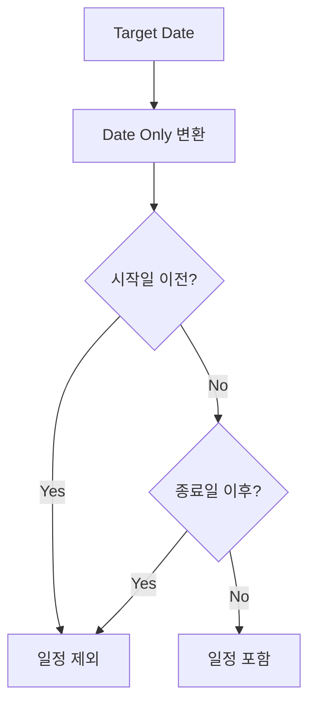

### 설계상 의미

단일 날짜 일정과 기간 일정을
동일한 조건으로 조회할 수 있습니다.

시작일과 종료일이 동일한 경우에도
해당 날짜의 일정으로 처리됩니다.

### 추가 검증 항목

- 시작일과 종료일이 동일한 경우
- 월을 넘어가는 기간 일정
- 연도를 넘어가는 기간 일정
- 종료일이 시작일보다 이전인 경우
- 서로 다른 시간대의 날짜 데이터

위 항목에 대한 전체 자동화 테스트를
수행한 것은 아닙니다.

---

## 14. Schedule Sorting

선택 날짜의 일정은 시간 문자열을
기준으로 정렬합니다.

```dart
schedules.sort((first, second) {
  return first.time.compareTo(second.time);
});
```

### 가상 입력

| 일정 | 시간 |
|---|---|
| 의료진 회의 | 14:00 |
| 업무 확인 | 09:00 |
| 자료 검토 | 11:30 |

### 정렬 결과

| 순서 | 일정 | 시간 |
|---|---|---|
| 1 | 업무 확인 | 09:00 |
| 2 | 자료 검토 | 11:30 |
| 3 | 의료진 회의 | 14:00 |

### 문자열 정렬의 전제

시간이 HH:mm 형식으로
일관되게 저장되는 경우
문자열 정렬을 시간순 정렬로
활용할 수 있습니다.

하지만 다음과 같이 자릿수가
일정하지 않으면 잘못된 결과가
발생할 수 있습니다.

```text
9:00
10:00
```

문자열 비교에서는 10:00이
9:00보다 먼저 배치될 수 있습니다.

### 개선 방향

시간 형식을 명확하게 검증하거나
분 단위 정수로 변환하여
비교하는 방안을 고려할 수 있습니다.

```dart
int timeToMinutes(String time) {
  final parts = time.split(':');

  return int.parse(parts[0]) * 60 +
      int.parse(parts[1]);
}
```

위 코드는 개선 방향을 설명하기 위한
간단한 예시입니다.

실제 적용 시 시간 형식 및
숫자 범위에 대한 검증이 필요합니다.

현재 프로젝트에 적용된 코드는 아닙니다.

---

## 15. Calendar Rendering

월간 캘린더는 TableCalendar를
기반으로 구성했습니다.

### 주요 설정

| 항목 | 설정 |
|---|---|
| 날짜 범위 | 2020-01-01 ~ 2035-12-31 |
| Locale | ko_KR |
| 시작 요일 | 일요일 |
| 표시 형식 | 월간 |
| 축소 행 높이 | 54 |
| 확장 행 높이 | 92 |
| 월 이동 | 좌우 Swipe |

### 날짜 셀 구성

CalendarBuilders를 통해
날짜별 표현을 구성합니다.

- 일반 날짜
- 이전 달 및 다음 달 날짜
- 선택된 날짜
- 오늘 날짜
- 일정 표시 영역

### 이벤트 데이터 연결

```dart
eventLoader: _getSchedulesForDay,
```

각 날짜에 해당하는 일정을
필터링하여 캘린더의 이벤트
데이터로 전달합니다.

### 날짜 상태

선택된 날짜와 현재 보고 있는 월을
구분하여 관리합니다.

```text
selectedDate

사용자가 선택한 날짜

focusedDate

현재 캘린더가 표시하는 날짜 또는 월
```

월을 이동하는 동작과
특정 날짜를 선택하는 동작을
별도로 처리할 수 있습니다.

---

## 16. Single-day & Multi-day Rendering

일정의 시작일과 종료일을 비교하여
단일 일정과 기간 일정을 구분합니다.

```dart
final isSingleDay =
    isSameDay(schedule.date, schedule.endDate);
```

### 축소형 캘린더

단일 날짜 일정은 점으로 표시합니다.

기간 일정은 연속된 가로선으로
표시합니다.

### 가상 표현

```text
날짜       24    25    26    27    28

단일 일정   ●

기간 일정   ━━━━━━━━━━━━━━━━━
```

### 기간 일정의 구간 처리

```dart
final startsSegment =
    isSameDay(day, schedule.date) ||
    day.weekday == DateTime.sunday;

final endsSegment =
    isSameDay(day, schedule.endDate) ||
    day.weekday == DateTime.saturday;
```

기간 일정의 시작일과 종료일뿐 아니라
주간 경계에서도 표시 구간을
나누어 처리합니다.

### 주간 경계 처리 목적

기간 일정이 토요일에서 일요일로
이어지는 경우 달력의 행이 변경됩니다.

각 주의 시작과 끝에서
가로선의 여백과 모서리를
조절하여 시각적으로 구분합니다.

```text
일  월  화  수  목  금  토
                  ╭━━━━━╮

일  월  화  수  목  금  토
╭━━━━━━━━╮
```

위 그림은 주간 경계 처리의
개념을 설명하기 위한 예시입니다.

---

## 17. Multiple Schedule Representation

하나의 날짜에 여러 일정이
등록될 수 있습니다.

현재 캘린더의 markerBuilder는
이벤트 목록의 첫 번째 일정을
대표 표시 대상으로 사용합니다.

```dart
if (events.isEmpty) {
  return null;
}

final schedule = events.first;
```

### 확장형 캘린더

확장형 화면에서는 대표 일정의
제목과 추가 일정 수를 표시합니다.

```text
의료진 회의
외 2개
```

### 전체 일정 확인

선택한 날짜의 전체 일정은
일정 목록 영역에서 확인하는
구조입니다.

### 설계상 한계

대표 일정만 표시하는 경우
동일 날짜에 여러 기간 일정이
겹쳐 있더라도 모든 일정이
캘린더에 개별적으로 표시되지는 않습니다.

전체 캘린더에서는 날짜별 일정을
시간순으로 정렬한 뒤
첫 번째 일정을 사용합니다.

홈 미니 캘린더에서는 동일한
시간순 정렬을 수행하지 않습니다.

따라서 동일 날짜의 대표 일정이
두 화면에서 달라질 가능성이 있습니다.

### 개선 방향

- 대표 일정 선택 기준 통일
- 일정별 복수 Marker 표시
- 기간 일정 중첩 레이아웃
- 일정 유형별 필터
- 중요 일정 표시 기준 정의

---

## 18. Schedule Color Management

일정마다 색상을 지정하여
서로 다른 일정을 시각적으로
구분할 수 있도록 구성했습니다.

### 제공 색상

| 색상 | 표시 목적 |
|---|---|
| 파랑 | 사용자 선택 |
| 초록 | 사용자 선택 |
| 보라 | 사용자 선택 |
| 주황 | 사용자 선택 |
| 빨강 | 사용자 선택 |
| 회색 | 사용자 선택 |

현재 색상은 특정 업무 유형에
강제 연결된 분류 체계가 아니라
사용자가 선택하는 표시 속성입니다.

### 색상 선택 상태

ScheduleColorPicker는 선택된 색상을
입력받고 onSelected 콜백을 통해
선택 결과를 전달합니다.

선택된 색상에는 테두리와
체크 아이콘을 표시합니다.

### 색상 저장

Flutter의 Color 객체를
그대로 JSON에 저장하지 않고
ARGB 정수로 변환합니다.

```dart
color.toARGB32()
```

저장된 정수 값을 사용하여
Color 객체를 다시 구성할 수 있습니다.

### 기본 색상

```dart
Color(0xFF24459A)
```

색상 정보가 없는 일정에 대해
기본 색상을 사용할 수 있도록
구성되어 있습니다.

---

## 19. Calendar Panel Management

캘린더 화면은 세 가지
패널 표시 상태를 관리합니다.

| 상태 | 화면 구성 |
|---|---|
| calendarExpanded | 캘린더 중심 |
| balanced | 캘린더와 일정 목록 |
| scheduleExpanded | 일정 목록 중심 |

### 화면 상태 구조

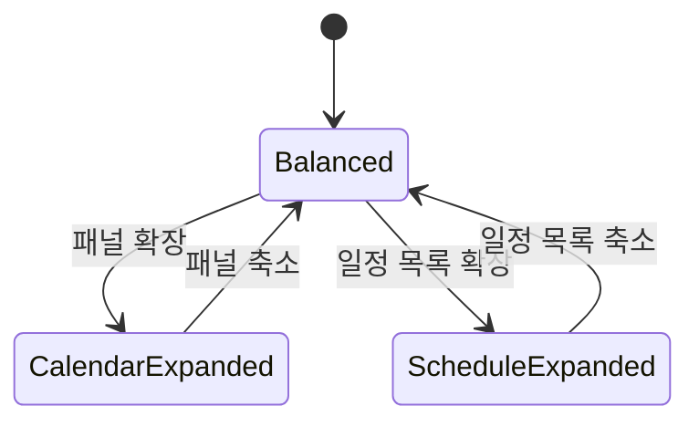

위 다이어그램은 세 가지 화면 모드의
관계를 설명하기 위한 개념적 표현입니다.

### 세로 제스처 처리

CalendarView에서 세로 드래그를
처리하여 화면 영역을 조절합니다.

TableCalendar에는 좌우 Swipe를
허용하여 월 이동에 사용합니다.

```dart
availableGestures:
    AvailableGestures.horizontalSwipe,
```

### 애니메이션

```dart
AnimatedSize(
  duration: const Duration(milliseconds: 250),
  curve: Curves.easeInOut,
  alignment: Alignment.topCenter,
  child: calendarWidget,
)
```

위 코드는 실제 AnimatedSize 사용 구조를
간단하게 정리한 예시입니다.

### 설계 목적

- 작은 모바일 화면의 공간 활용
- 월간 일정 확인과 상세 일정 조회 전환
- 가로 월 이동과 세로 패널 조작 구분

---

## 20. Local Persistence Architecture

개인 일정은 SharedPreferencesAsync를
통해 로컬에 저장합니다.

### 저장 구조

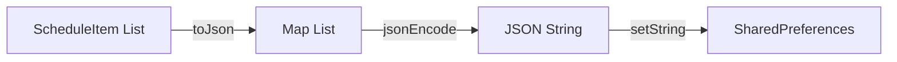

### 복원 구조

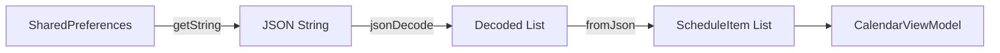

### 저장 키

```text
doctor_calendar_schedules
```

일정 목록 전체를 하나의 JSON 문자열로
저장하는 구조입니다.

### 저장 방식의 선택

개인 일정은 비교적 단순한
데이터 구조를 가집니다.

현재 구현에서는 별도의
로컬 데이터베이스 테이블 대신
JSON 기반 Key-Value 저장 방식을
사용합니다.

### SharedPreferences의 특징

- 간단한 로컬 데이터 저장
- 별도의 데이터베이스 스키마 불필요
- 문자열 및 기본 타입 중심의 저장
- 네트워크 요청 없이 로컬 접근 가능

다만 대량 데이터 조회,
복잡한 검색, 트랜잭션,
관계형 데이터 관리에는
별도의 데이터베이스가 더 적합할 수 있습니다.

---

## 21. Schedule Serialization

일정 객체를 JSON에 저장할 수 있는
데이터로 변환합니다.

### 주요 변환 규칙

| 필드 | 저장 방식 |
|---|---|
| date | ISO 8601 문자열 |
| endDate | ISO 8601 문자열 |
| time | 문자열 |
| title | 문자열 |
| description | 문자열 또는 Null |
| color | ARGB 정수 |

### 가상 JSON 데이터

```json
[
  {
    "date": "2026-11-24T00:00:00.000",
    "endDate": "2026-11-27T00:00:00.000",
    "time": "09:00",
    "title": "업무 검토 일정",
    "description": "관련 자료 확인",
    "color": 4280567194
  }
]
```

위 데이터는 일정 직렬화 구조를
설명하기 위한 가상의 예시입니다.

### DateTime 변환

DateTime 객체는 ISO 8601 형식으로
변환하여 저장합니다.

복원 과정에서는 문자열을
DateTime으로 다시 변환합니다.

### 색상 변환

Color 객체는 ARGB 정수로 저장합니다.

이를 통해 일정의 표시 색상도
앱 재실행 이후 복원할 수 있는
데이터 구조를 제공합니다.

---

## 22. Schedule Deserialization

저장된 JSON 문자열을
ScheduleItem 목록으로 복원합니다.

### 기본값 처리

| 필드 | 누락 시 처리 |
|---|---|
| endDate | 시작일 사용 |
| time | 00:00 |
| title | 빈 문자열 |
| color | 기본 색상 |

### 종료일 호환 처리

기존 일정 데이터에 종료일이
포함되지 않은 경우 시작일을
종료일로 사용합니다.

```text
기존 데이터

date = 2026-11-24
endDate = 없음

복원 결과

date = 2026-11-24
endDate = 2026-11-24
```

이를 통해 종료일이 없는 데이터를
단일 날짜 일정으로 처리할 수 있습니다.

### 잘못된 데이터 처리

CalendarViewModel의 복원 과정에서는
일부 잘못된 일정 항목을
건너뛸 수 있도록 구성합니다.

전체 JSON 복원 과정에서 발생한
오류도 예외 처리합니다.

다만 저장 및 복원 오류가
사용자에게 명시적으로
전달되는 구조는 확인되지 않았습니다.

---

## 23. Application Initialization

CalendarViewModel 생성 시
저장된 일정의 로컬 복원을
비동기적으로 시작합니다.

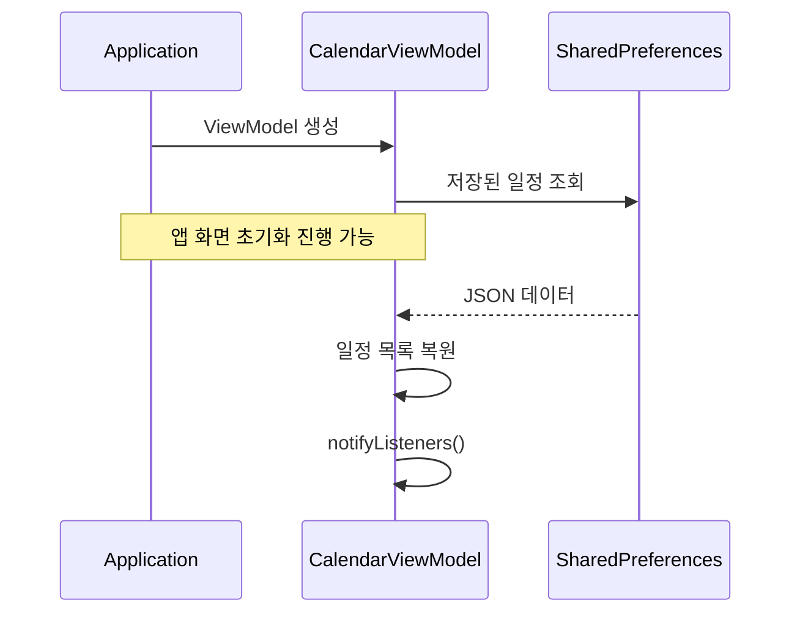

### 비동기 초기화의 장점

로컬 데이터 조회가 완료될 때까지
모든 앱 초기화 작업을
동기적으로 기다리지 않습니다.

### 초기화 경쟁 조건

저장된 일정이 복원되기 전에
사용자가 새로운 일정을 등록하면
복원 결과가 기존 메모리 상태를
변경할 가능성이 있습니다.

현재 구조에는 초기화 완료를
기준으로 일정 변경을 제한하는
별도의 로딩 상태가 확인되지 않습니다.

### 개선 방향

- isInitializing 상태 추가
- 초기 복원 완료 후 입력 허용
- 복원 데이터와 신규 데이터 병합
- 초기화 오류 표시

실제 일정 유실 장애를
재현한 것은 아니며,
비동기 초기화 구조에서 확인한
잠재적 위험입니다.

---

## 24. Persistence Consistency

현재 일정 변경 메서드는
메모리 상태를 변경한 뒤
저장 작업을 비동기적으로 시작합니다.

### 현재 처리 방식

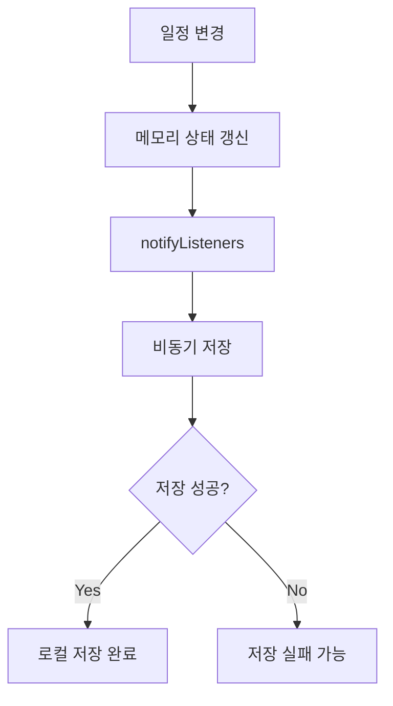

### 잠재적인 문제

짧은 시간에 여러 일정 변경이
발생하는 경우 여러 저장 요청이
연속적으로 실행될 수 있습니다.

현재 코드에서는 각 저장 작업의
완료 순서를 명시적으로
제어하지 않습니다.

따라서 실제 저장소의 동작에 따라
이전 상태가 이후 상태를
덮어쓰는 문제가 발생할 가능성을
검토해야 합니다.

### 저장 오류 처리

저장 오류를 내부에서 처리하지만
사용자에게 실패 여부를
명확하게 전달하지 않습니다.

화면에서는 일정이 변경된 것처럼
표시되더라도 저장이 실패하면
앱 재실행 이후 데이터가
유지되지 않을 수 있습니다.

### 개선 방향

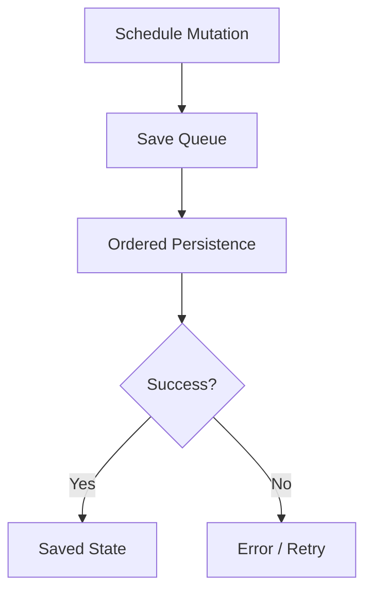

저장 요청을 순차적으로 처리하거나
최신 상태의 저장을 보장하는
별도 로직을 고려할 수 있습니다.

위 구조는 개선 제안이며
현재 적용된 구현은 아닙니다.

---

## 25. Home Calendar Integration

홈 화면에는 전체 캘린더와
동일한 일정 목록을 사용하는
미니 캘린더를 구성했습니다.

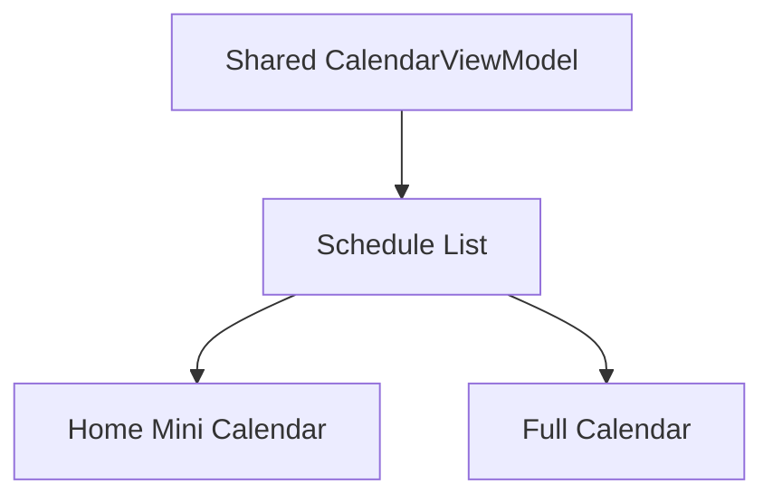

### Provider 기반 상태 접근

HomeView는 CalendarViewModel의
일정 데이터를 구독합니다.

일정 목록이 변경되면
관련 화면에서 변경된 데이터를
사용할 수 있습니다.

### 홈에서 전체 캘린더 이동

```dart
context.pushNamed('calendar');
```

홈의 전체보기 버튼을 통해
캘린더 화면으로 이동합니다.

### 날짜 선택 처리

홈 캘린더에서 날짜를 선택하면
HomeView의 로컬 선택 날짜를
갱신합니다.

동시에 CalendarViewModel의
선택 날짜도 변경합니다.

```dart
onDateChanged: (date) {
  setState(() {
    _selectedDate = date;
  });

  calendarViewModel.selectDate(date);
},
```

### 상태 공유의 한계

일정 목록은 공통 ViewModel을
통해 공유합니다.

하지만 HomeView는 별도의
_selectedDate 상태를 관리합니다.

전체 캘린더에서 선택 날짜를
변경한 경우 홈의 로컬 선택 날짜가
항상 동일하게 갱신된다고
보장할 수는 없습니다.

### 개선 방향

선택 날짜의 단일 데이터 출처를
CalendarViewModel로 통일하여
두 화면의 날짜 상태를
일관되게 관리할 수 있습니다.

---

## 26. To-do List Overview

To-do List는 의료진의 개인 업무를
등록하고 완료 여부를 관리하는
기능입니다.

### 주요 기능

- 업무 제목 입력
- 빈 제목 등록 제한
- 업무 목록 표시
- 체크박스 기반 완료 상태 변경
- 완료된 업무 취소선 표시
- Swipe 기반 삭제
- 삭제 버튼
- 삭제 실행 취소
- JSON 기반 로컬 저장

### 현재 구현 범위

To-do List는 HomeView 내부의
StatefulWidget 상태로 관리합니다.

별도의 To-do Repository,
Service 또는 ViewModel을
사용하지 않습니다.

최종 분석 코드에서는 업무 제목과
완료 여부를 중심으로 관리합니다.

발표 자료에서 언급된 중요 표시 기능은
분석한 최종 HomeView 코드에서
확인되지 않았으므로
현재 구현 성과에 포함하지 않습니다.

---

## 27. To-do Data Structure

To-do List는 Map 기반 목록으로
관리합니다.

```dart
List<Map<String, dynamic>>
```

### 주요 필드

| 필드 | 타입 | 역할 |
|---|---|---|
| title | String | 업무 제목 |
| isCompleted | bool | 업무 완료 여부 |

### 가상 데이터

```json
[
  {
    "title": "협진 요청 확인",
    "isCompleted": false
  },
  {
    "title": "업무 자료 정리",
    "isCompleted": true
  }
]
```

### 구조적 특징

현재 업무 데이터에는 다음 정보가
별도로 포함되어 있지 않습니다.

- 업무 고유 ID
- 업무 생성일
- 업무 완료일
- 마감일
- 우선순위
- 담당 의료진 ID
- 환자 또는 협진 참조 ID

따라서 현재 To-do List는
날짜별 업무 배정 시스템이나
협진 자동 연동 시스템이 아니라
개인 체크리스트에 해당합니다.

---

## 28. To-do State Management

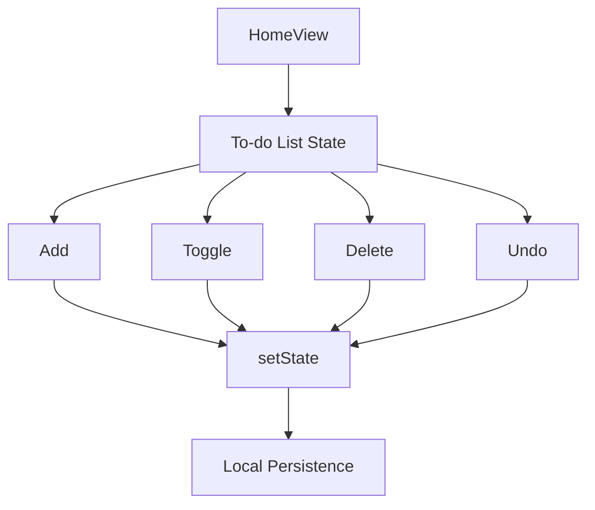

### 캘린더와 To-do 상태 비교

| 구분 | Calendar | To-do |
|---|---|---|
| 상태 위치 | CalendarViewModel | HomeView |
| 데이터 타입 | ScheduleItem | Map |
| 변경 전달 | notifyListeners | setState |
| 저장 위치 | ViewModel | HomeView |
| 저장 방식 | SharedPreferencesAsync | SharedPreferencesAsync |
| 화면 공유 | 홈 및 전체 캘린더 | 홈 중심 |

### 설계상 의미

캘린더는 여러 화면에서
동일한 일정 데이터를 사용합니다.

To-do List는 현재 홈 화면에서
직접 관리하는 기능입니다.

따라서 현재 두 기능은
서로 다른 상태 관리 방식을
사용합니다.

향후 To-do 기능이 여러 화면으로
확장되는 경우 별도의 ViewModel과
Repository를 구성할 수 있습니다.

---

## 29. To-do Creation

업무 추가는 입력 Dialog를 통해
진행합니다.

### 입력 처리

업무 제목의 앞뒤 공백을 제거하고
빈 문자열이면 등록하지 않습니다.

### 등록 흐름

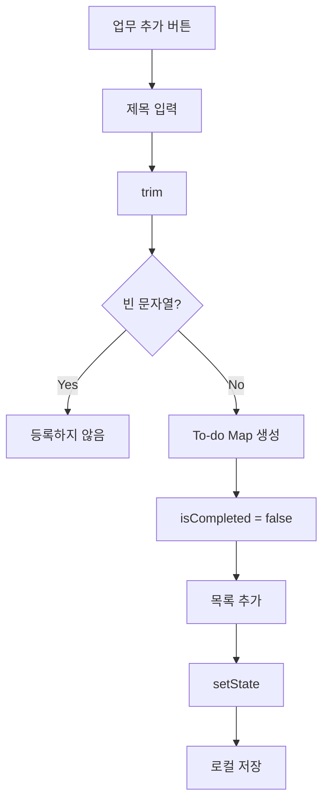

### 신규 업무 데이터

```dart
{
  'title': '업무 제목',
  'isCompleted': false,
}
```

새롭게 등록된 업무는
미완료 상태로 생성됩니다.

### 화면 생명주기 고려

입력 Dialog의 결과를 처리하는
과정에서 mounted 상태와
프레임 종료 시점을 확인합니다.

다만 입력 완료 이벤트와
등록 버튼이 연속적으로 호출되는
상황에 대해서는 추가적인
중복 처리 검증이 필요합니다.

---

## 30. To-do Completion

CheckboxListTile을 사용하여
업무의 완료 여부를 변경합니다.

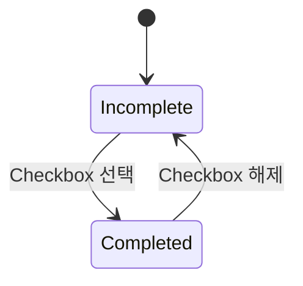

### 완료 상태 표현

| 상태 | 화면 표현 |
|---|---|
| 미완료 | 일반 텍스트 |
| 완료 | 체크박스 선택 및 취소선 |

### 상태 변경

업무의 isCompleted 값을
변경하고 setState를 통해
화면에 반영합니다.

이후 변경된 업무 목록을
로컬 저장소에 저장합니다.

### 완료 상태 유지

완료 여부를 JSON에 포함하므로
저장된 데이터가 정상적으로
복원되면 기존 완료 상태도
다시 사용할 수 있습니다.

---

## 31. To-do Deletion

To-do List는 두 가지 방식으로
삭제할 수 있습니다.

- 삭제 아이콘 선택
- Swipe 기반 삭제

### Dismissible 구성

```dart
Dismissible(
  key: ValueKey('$title-$index'),
  direction: DismissDirection.endToStart,
  onDismissed: (_) {
    onDelete(index);
  },
  child: todoWidget,
)
```

위 코드는 실제 삭제 인터페이스를
간단하게 정리한 예시입니다.

### 삭제 방향

endToStart 방향의 Swipe를
사용하여 삭제 동작을 처리합니다.

### 삭제 처리

삭제 대상의 데이터를 복사하고
기존 목록에서 제거합니다.

변경된 목록을 저장한 뒤
SnackBar를 통해 실행 취소
기능을 제공합니다.

---

## 32. Undo Mechanism

업무를 실수로 삭제한 경우
삭제를 취소할 수 있도록
Undo 기능을 구성했습니다.

### 삭제 이전 데이터 보관

삭제할 업무의 Map을 복사하여
복원에 사용할 수 있도록 합니다.

### 처리 흐름

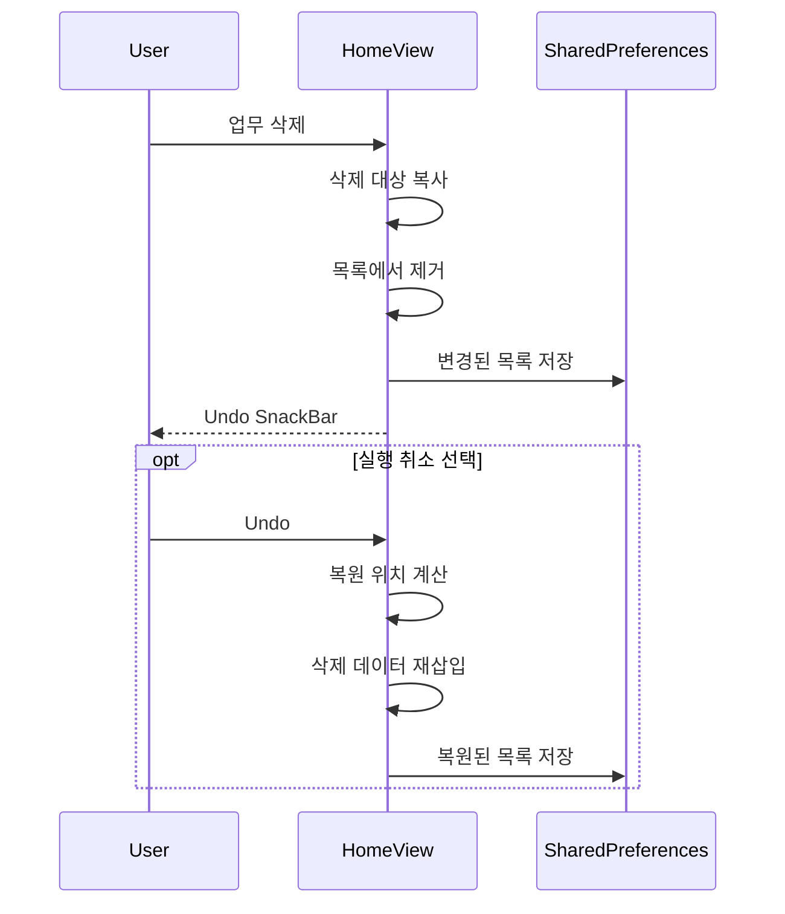

### Undo 표시 시간

현재 SnackBar의 표시 시간은
2초로 설정되어 있습니다.

### 가상 복원 예시

```text
삭제 이전

Index 0 : 업무 A
Index 1 : 업무 B
Index 2 : 업무 C

업무 B 삭제

Index 0 : 업무 A
Index 1 : 업무 C

Undo 선택

Index 0 : 업무 A
Index 1 : 업무 B
Index 2 : 업무 C
```

### 복원 위치 계산

삭제 이후 다른 업무가 추가되거나
삭제될 수 있습니다.

복원할 인덱스가 현재 목록의
유효한 범위를 벗어나지 않도록
clamp를 사용합니다.

### 설계상 의미

단순 삭제 기능뿐 아니라
사용자의 실수로 인한 데이터 제거를
일정 시간 동안 되돌릴 수 있습니다.

### 현재 구조의 한계

Undo는 삭제 대상의 데이터와
목록 위치를 기반으로 동작합니다.

별도의 삭제 이력이나
영구적인 휴지통 기능은 아닙니다.

또한 여러 삭제 작업을 연속적으로
수행하는 경우 복원 순서 및
목록 위치의 일관성을
추가로 검증할 필요가 있습니다.

---

## 33. To-do Local Persistence

To-do List도 SharedPreferencesAsync를
사용하여 저장합니다.

### 저장 키

```text
doctor_todo_items
```

### 저장 데이터

```json
[
  {
    "title": "개인 업무 확인",
    "isCompleted": false
  }
]
```

### 저장 흐름

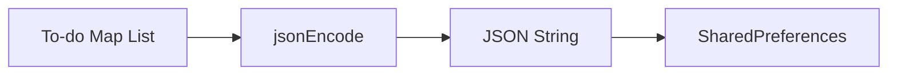

### 복원 흐름

```mermaid
flowchart LR
    A["SharedPreferences"]
    B["JSON String"]
    C["jsonDecode"]
    D["To-do Map List"]
    E["HomeView State"]

    A --> B
    B --> C
    C --> D
    D --> E
```

### 저장 시점

| 작업 | 저장 여부 |
|---|---|
| 업무 추가 | 저장 |
| 완료 상태 변경 | 저장 |
| 업무 삭제 | 저장 |
| Undo 복원 | 저장 |

### 데이터 분리

캘린더와 To-do List는
서로 다른 저장 키를 사용합니다.

```text
SharedPreferences

doctor_calendar_schedules
    └── 일정 목록 JSON

doctor_todo_items
    └── 업무 목록 JSON
```

각 기능의 데이터를 독립적으로
관리할 수 있는 구조입니다.

---

## 34. To-do Restoration & Error Handling

HomeView가 초기화될 때
저장된 To-do 데이터를 조회합니다.

### 복원 과정

1. 저장 키를 통해 문자열 조회
2. JSON 문자열 디코딩
3. 업무 제목 및 완료 상태 변환
4. HomeView 상태 갱신

### 현재 오류 처리 범위

JSON 변환 과정에서 오류가
발생하는 경우 예외 처리를 통해
업무 목록을 초기화할 수 있습니다.

그러나 일부 잘못된 항목 때문에
전체 업무 목록이 비워질
가능성이 있습니다.

또한 getString 호출이
JSON 변환의 try 블록 외부에 있어
저장소 조회 오류에 대한
처리 범위가 제한적입니다.

저장 작업에도 별도의
실패 상태 관리가 확인되지 않습니다.

### 개선 방향

- 저장소 조회 및 파싱 오류 분리
- 항목 단위 데이터 검증
- 정상 데이터의 부분 복원
- 저장 실패 메시지 제공
- 복원 실패 데이터 백업

현재 코드의 예외 처리 범위를
분석한 개선 제안이며,
실제 데이터 유실 장애를
재현한 결과는 아닙니다.

---

## 35. Stable Item Identity

현재 To-do List의 Dismissible Key는
업무 제목과 목록 인덱스를
조합하여 생성합니다.

```dart
ValueKey('$title-$index')
```

### 잠재적인 문제

목록의 중간 항목을 삭제하면
이후 항목의 인덱스가 변경됩니다.

따라서 동일한 업무라도
삭제 전후에 Widget Key가
변경될 수 있습니다.

### 가상 예시

```text
삭제 이전

업무 A-0
업무 B-1
업무 C-2

업무 A 삭제 이후

업무 B-0
업무 C-1
```

업무 B와 C는 동일한 데이터이지만
Key가 변경됩니다.

동일한 제목을 가진 업무가
여러 개 존재하는 경우에도
안정적인 식별이 어려울 수 있습니다.

### 개선 방향

고유 업무 ID를 추가하여
목록 순서와 무관한 Key를
사용할 수 있습니다.

```dart
ValueKey(todo.id)
```

위 코드는 향후 개선 구조입니다.

현재 To-do 데이터에는
id 필드가 존재하지 않습니다.

---

## 36. Local Data vs Server Data

VENA의 기능은 데이터의 목적에 따라
서버 데이터와 로컬 데이터로
구분하여 설명할 수 있습니다.

| 기능 | 데이터 접근 방식 |
|---|---|
| 환자 정보 | REST API |
| 채팅 | REST API |
| 협진 | REST API |
| 텍스트 메모 | REST API |
| 음성 메모 | REST API |
| 개인 일정 | 로컬 저장 |
| To-do List | 로컬 저장 |

```mermaid
flowchart TD
    A["Flutter Doctor App"]
    B["Clinical Data Features"]
    C["Personal Productivity Features"]
    D["Django REST API"]
    E["SharedPreferences"]

    A --> B
    A --> C

    B --> D
    C --> E
```

### 서버 데이터

환자 정보와 의료진 간 공유가 필요한
데이터는 서버 API를 통해
접근하는 구조입니다.

### 로컬 데이터

개인 일정 및 업무 목록은
앱 내부의 저장소를 사용합니다.

### 예약 데이터와 개인 일정의 구분

병원 예약 정보는 별도의
Appointment 관련 기능에서
서버 데이터를 조회합니다.

현재 개인 캘린더의 ScheduleItem은
로컬 일정 모델입니다.

개인 일정 CRUD가 병원 예약의
서버 생성 및 변경과 연결되어
있다고 확인한 것은 아닙니다.

### 현재 구조의 장점

개인 일정 및 To-do는
네트워크 요청 없이
로컬 데이터에 접근할 수 있습니다.

다만 앱 전체가 오프라인 상태에서
동작한다는 의미는 아닙니다.

---

## 37. User-specific Data Isolation

현재 일정 및 To-do의 저장 키는
고정된 문자열을 사용합니다.

```text
doctor_calendar_schedules

doctor_todo_items
```

### 잠재적인 문제

동일한 앱 설치 환경에서
서로 다른 의료진 계정으로
로그인하는 경우를 고려해야 합니다.

저장 키 자체에는 의료진 ID가
포함되어 있지 않습니다.

따라서 로그아웃 시 별도의
데이터 제거 또는 계정별 분리 처리가
없다면 이전 계정의 개인 업무가
다른 계정에서 표시될 가능성이 있습니다.

### 개선 방향

```text
doctor_calendar_schedules_{doctorId}

doctor_todo_items_{doctorId}
```

사용자별 저장 키를 사용하거나
계정별 로컬 데이터 저장 구조를
구성할 수 있습니다.

위 키는 개선 제안이며
현재 구현된 저장 키는 아닙니다.

실제 계정 전환 시 데이터 노출 여부는
로그아웃 처리와 앱 실행 테스트를
통해 별도로 확인해야 합니다.

---

## 38. Security Considerations

의료진의 개인 일정이나 업무 제목에도
환자 정보 또는 민감한 업무 내용이
포함될 수 있습니다.

### 저장소 구분

| 저장소 | 사용 목적 |
|---|---|
| Secure Storage | 인증 정보 |
| SharedPreferences | 일정 및 업무 목록 |

SharedPreferences를 사용했다는 사실만으로
일정 데이터가 암호화되어
저장된다고 판단할 수 없습니다.

### 고려해야 할 사항

- 환자 식별 정보의 로컬 저장 최소화
- 개인 일정 및 업무 데이터의 계정별 분리
- 로그아웃 시 데이터 처리 정책
- 민감한 업무 내용의 저장 정책
- 기기 분실 시 데이터 보호
- 백업 및 복원 정책
- 서버 동기화 시 접근 권한 검증

현재 기능은 개인 일정과
업무 목록 관리에 초점을 맞추고 있으며
의료정보 저장에 대한 보안 적합성을
검증한 것은 아닙니다.

---

## 39. Calendar Holiday Management

전체 캘린더에는 공휴일 표시를 위한
임시 날짜 목록이 존재합니다.

### 확인된 구현

2026년의 일부 공휴일을
Set<DateTime>으로 관리합니다.

- 1월 1일
- 3월 1일
- 5월 5일
- 6월 6일
- 8월 15일
- 10월 3일
- 10월 9일
- 12월 25일

### 표시 방식

일요일과 임시 공휴일에
다른 텍스트 색상을 적용합니다.

### 현재 한계

위 목록은 화면 확인용
임시 공휴일 데이터입니다.

모든 공휴일, 대체공휴일,
음력 명절 및 다른 연도의
공휴일을 제공하지 않습니다.

### 개선 방향

공휴일 데이터 API 또는
연도별 공휴일 데이터셋을 사용하여
정확한 공휴일 표시 기능으로
확장할 수 있습니다.

현재 외부 공휴일 API 연동은
구현된 기능으로 포함하지 않습니다.

---

## 40. Theme Integration

캘린더 및 To-do List는
Flutter의 Theme과 ColorScheme을
활용하여 화면을 구성합니다.

### 적용 요소

- 화면 배경색
- 카드 배경색
- 텍스트 색상
- 선택 날짜 색상
- 체크박스 색상
- 구분선
- 일정 목록
- 빈 목록 안내

### Light / Dark Mode

현재 테마에 따라
ColorScheme의 surface,
onSurface, primary 등의 값을
사용합니다.

일정별 사용자 선택 색상은
별도의 데이터 속성으로 유지합니다.

### 설계 목적

- 화면 간 디자인 일관성
- 다크 모드에서의 가독성
- 선택 상태와 완료 상태 구분
- 사용자 선택 일정 색상 유지

모든 색상 조합에 대한
접근성 대비 기준을 측정한 것은 아닙니다.

---

## 41. Performance Considerations

### 날짜별 일정 검색

현재 날짜별 일정 조회는
전체 일정 목록을 순회하며
시작일과 종료일을 비교합니다.

일정 개수가 N개인 경우
한 날짜의 일정 검색은
일반적으로 O(N)입니다.

조회 결과를 정렬하는 경우
해당 날짜의 일정 수를 K라고 하면
정렬 비용이 추가됩니다.

### 월간 캘린더

캘린더는 여러 날짜 셀에 대해
이벤트 데이터를 요청할 수 있습니다.

일정 데이터가 많아지면
날짜별 필터링 작업이
반복될 수 있습니다.

### 로컬 저장

일정 및 업무 변경 시
전체 목록을 JSON으로 변환하여
저장하는 구조입니다.

데이터가 증가할수록 직렬화 및
저장 작업량도 증가할 수 있습니다.

### 개선 방향

- 날짜별 일정 인덱싱
- 필터링 결과 캐싱
- 일정 데이터 페이지네이션
- 로컬 데이터베이스 사용
- 변경된 데이터만 저장
- 상태 변경 범위 최소화

현재 데이터 규모에서 실제 성능 저하가
발생했다고 확인한 것은 아닙니다.

별도의 성능 측정이나
부하 테스트를 수행하지 않았습니다.

---

## 42. Technical Challenges

### 42.1 기간 일정 처리

기술적 고려 사항:

- 단일 일정과 기간 일정의 통합
- 시작일 및 종료일 포함 여부
- 날짜와 시간의 비교 기준

현재 처리:

- ScheduleItem의 date 및 endDate
- DateUtils.dateOnly
- Inclusive Range Filtering

개선 방향:

- 날짜 범위 유효성 검증
- 공통 날짜 필터 유틸리티
- 기간 일정 중첩 표시

### 42.2 화면 간 일정 공유

기술적 고려 사항:

- 홈과 전체 캘린더의 데이터 일관성
- 일정 변경 이후 화면 갱신

현재 처리:

- 공통 CalendarViewModel
- Provider
- notifyListeners

개선 방향:

- 선택 날짜 상태 단일화
- 대표 일정 선택 기준 통일

### 42.3 로컬 데이터 유지

기술적 고려 사항:

- 앱 재실행 이후 데이터 복원
- 객체의 JSON 변환
- 날짜 및 색상 데이터 저장

현재 처리:

- SharedPreferencesAsync
- JSON 직렬화 및 역직렬화
- ISO 8601 날짜 표현
- ARGB 색상 저장

개선 방향:

- 저장 완료 상태 관리
- 오류 처리 및 재시도
- 데이터 스키마 버전 관리

### 42.4 업무 삭제 복원

기술적 고려 사항:

- 실수로 삭제한 업무 복원
- 삭제 이전 데이터 유지
- 유효한 복원 위치 계산

현재 처리:

- 삭제 대상 Map 복사
- SnackBar Undo
- 인덱스 clamp

개선 방향:

- 고유 업무 ID
- 연속 삭제 및 복원 순서 관리
- 삭제 이력 관리

위 내용은 구현 구조와
코드 분석에서 확인한 사항을
기술적 관점에서 정리한 것입니다.

모든 고려 사항이 실제 장애로
발생했다는 의미는 아닙니다.

---

## 43. Validation Scenarios

다음은 현재 소스를 기반으로
작성한 검증 계획입니다.

### 일정 CRUD

| ID | 검증 항목 | 기대 결과 |
|---|---|---|
| ST-01 | 일정 추가 | 목록에 신규 일정 추가 |
| ST-02 | 일정 수정 | 기존 일정 교체 |
| ST-03 | 일정 삭제 확인 | 대상 일정 제거 |
| ST-04 | 일정 삭제 취소 | 기존 일정 유지 |
| ST-05 | 날짜 선택 | 선택 날짜 상태 변경 |
| ST-06 | 일정 색상 변경 | 변경된 색상 반영 |
| ST-07 | 일정 시간 정렬 | 시간순 일정 조회 |

### 기간 일정

| ID | 검증 항목 | 기대 결과 |
|---|---|---|
| ST-08 | 단일 날짜 일정 | 해당 날짜에 포함 |
| ST-09 | 시작일 조회 | 일정 포함 |
| ST-10 | 종료일 조회 | 일정 포함 |
| ST-11 | 기간 중간 날짜 | 일정 포함 |
| ST-12 | 시작일 이전 | 일정 제외 |
| ST-13 | 종료일 이후 | 일정 제외 |
| ST-14 | 주간 경계 일정 | 표시 구간 분리 |
| ST-15 | 월간 경계 일정 | 해당 날짜에 일정 포함 |

### 로컬 저장

| ID | 검증 항목 | 기대 결과 |
|---|---|---|
| ST-16 | 일정 저장 | JSON 문자열 저장 |
| ST-17 | 일정 복원 | ScheduleItem 목록 변환 |
| ST-18 | 종료일 누락 | 시작일 사용 |
| ST-19 | 색상 누락 | 기본 색상 사용 |
| ST-20 | 일부 잘못된 일정 | 해당 항목 제외 |
| ST-21 | 앱 재실행 | 정상 저장된 일정 복원 |

### 화면 상태

| ID | 검증 항목 | 기대 결과 |
|---|---|---|
| ST-22 | 캘린더 확장 | 캘린더 중심 화면 |
| ST-23 | 균형 모드 | 캘린더 및 일정 목록 |
| ST-24 | 일정 목록 확장 | 일정 목록 중심 화면 |
| ST-25 | 좌우 Swipe | 표시 월 변경 |
| ST-26 | 홈에서 전체보기 | 캘린더 화면 이동 |
| ST-27 | 일정 변경 | 공유 일정 상태 갱신 |

### To-do List

| ID | 검증 항목 | 기대 결과 |
|---|---|---|
| ST-28 | 정상 업무 추가 | 미완료 업무 생성 |
| ST-29 | 빈 제목 입력 | 업무 등록 제한 |
| ST-30 | 업무 완료 | 체크 및 취소선 표시 |
| ST-31 | 완료 해제 | 미완료 상태 복원 |
| ST-32 | 삭제 버튼 | 업무 제거 |
| ST-33 | Swipe 삭제 | 업무 제거 |
| ST-34 | Undo 선택 | 삭제 업무 복원 |
| ST-35 | 복원 위치 범위 초과 | 유효 범위로 조정 |
| ST-36 | 업무 목록 저장 | JSON 문자열 저장 |
| ST-37 | 앱 재실행 | 정상 저장된 업무 복원 |

### 추가 검증 필요 항목

| ID | 검증 항목 | 검토 목적 |
|---|---|---|
| ST-38 | 초기 복원 중 일정 추가 | 데이터 덮어쓰기 여부 |
| ST-39 | 빠른 연속 일정 변경 | 저장 순서 일관성 |
| ST-40 | 저장소 쓰기 실패 | 오류 전달 여부 |
| ST-41 | 잘못된 To-do 항목 | 부분 복원 가능 여부 |
| ST-42 | 계정 전환 | 로컬 데이터 분리 |
| ST-43 | 동일 제목 업무 | Widget Key 안정성 |
| ST-44 | 연속 업무 삭제 및 Undo | 복원 순서 |
| ST-45 | 홈과 전체 캘린더 날짜 선택 | 선택 상태 일관성 |
| ST-46 | 종료일이 시작일보다 이전 | 입력 검증 |
| ST-47 | 비정규 시간 문자열 | 정렬 정확성 |
| ST-48 | 동일 날짜의 복수 일정 | 대표 일정 일관성 |
| ST-49 | 앱 삭제 및 재설치 | 데이터 복원 정책 |
| ST-50 | 대량 일정 데이터 | 렌더링 및 저장 성능 |

위 50개 항목은 실제 테스트 결과가 아닌
검증 계획과 기대 동작입니다.

---

## 44. Limitations & Improvements

| 현재 구조 | 개선 방향 |
|---|---|
| 일정 고유 ID 없음 | UUID 등 고유 ID 도입 |
| 객체 기반 일정 수정 | ID 기반 CRUD |
| To-do Map 구조 | 타입이 정의된 TodoItem 모델 |
| HomeView 내부 To-do 상태 | TodoViewModel 분리 |
| ViewModel 직접 로컬 저장 | Local Repository 분리 |
| 전체 목록 JSON 저장 | 로컬 데이터베이스 검토 |
| 저장 오류 미표시 | 오류 및 재시도 상태 |
| 비동기 저장 순서 미제어 | 저장 작업 직렬화 |
| 초기화 완료 상태 없음 | 초기화 로딩 상태 |
| 고정 저장 키 | 계정별 저장소 분리 |
| 홈의 별도 선택 날짜 | 공유 날짜 상태 단일화 |
| 첫 번째 일정 중심 표시 | 복수 일정 표시 |
| 시간 문자열 정렬 | 시간 타입 정규화 |
| 임시 공휴일 목록 | 공휴일 데이터 연동 |
| 로컬 전용 데이터 | 서버 동기화 및 복원 |

### 개선 우선순위

#### P1 — 데이터 안정성 및 보안

- 일정 및 업무 고유 ID
- 계정별 로컬 데이터 분리
- 저장 실패 처리
- 초기 복원 및 저장 순서 관리
- 민감 정보 저장 정책

#### P2 — 유지보수성

- TodoItem 모델 분리
- TodoViewModel 구성
- 로컬 Repository 도입
- 날짜 필터링 로직 공통화
- 선택 날짜 상태 단일화

#### P3 — 기능 확장

- 서버 동기화
- 기기 간 일정 공유
- 데이터 백업 및 복원
- 반복 일정
- 업무 마감일 및 우선순위
- 일정 알림
- 공휴일 데이터 연동

위 우선순위는 현재 구조를
분석하여 제안한 개선 방향입니다.

실제 개선 작업이 완료되었다는
의미는 아닙니다.

---

## 45. Proposed Architecture

기능 확장을 고려하는 경우
다음과 같은 구조를 제안할 수 있습니다.

```mermaid
flowchart TD
    A["Calendar View"]
    B["Home View"]
    C["CalendarViewModel"]
    D["TodoViewModel"]
    E["ScheduleRepository"]
    F["TodoRepository"]
    G["Local Data Source"]
    H["Remote Data Source"]
    I["Local Database"]
    J["REST API"]

    A --> C
    B --> C
    B --> D

    C --> E
    D --> F

    E --> G
    F --> G

    E --> H
    F --> H

    G --> I
    H --> J
```

### 개선 구조의 목적

- UI와 저장 로직의 책임 분리
- 로컬 저장소 교체 가능성 확보
- 서버 동기화 기능 확장
- 기능별 상태 및 오류 관리
- 단위 테스트 작성 용이성

### 현재 구현과의 차이

현재 CalendarViewModel은
SharedPreferences에 직접 접근합니다.

To-do는 HomeView에서 직접
상태와 저장을 관리합니다.

위 다이어그램은 이를 확장하기 위한
제안 구조이며 현재 프로젝트에
구현된 아키텍처는 아닙니다.

---

## 46. Server Synchronization Perspective

향후 서버 기반 일정 및 업무 관리로
확장할 경우 다음 요소를
고려할 수 있습니다.

### 데이터 모델 확장 예시

```mermaid
erDiagram
    DOCTOR ||--o{ PERSONAL_SCHEDULE : owns
    DOCTOR ||--o{ TODO_ITEM : owns

    PERSONAL_SCHEDULE {
        string id PK
        string doctor_id FK
        string title
        datetime start_at
        datetime end_at
        string description
        string color
        datetime updated_at
    }

    TODO_ITEM {
        string id PK
        string doctor_id FK
        string title
        boolean is_completed
        datetime created_at
        datetime updated_at
    }
```

위 ERD는 향후 서버 확장을 위한
개념적 데이터베이스 설계입니다.

실제 VENA 서버에 해당 테이블이
존재한다고 확인한 것은 아닙니다.

### API 확장 예시

| Method | Proposed Endpoint |
|---|---|
| GET | /api/personal-schedules/ |
| POST | /api/personal-schedules/ |
| PATCH | /api/personal-schedules/{id}/ |
| DELETE | /api/personal-schedules/{id}/ |
| GET | /api/todos/ |
| POST | /api/todos/ |
| PATCH | /api/todos/{id}/ |
| DELETE | /api/todos/{id}/ |

위 Endpoint는 설계 제안이며
현재 사용 중인 실제 API가 아닙니다.

### 동기화 고려 사항

- 의료진별 데이터 접근 권한
- 서버와 로컬 데이터 식별자
- 데이터 변경 시각
- 수정 충돌 처리
- 오프라인 변경사항 관리
- 중복 등록 방지
- 삭제 데이터 동기화
- 기기 간 데이터 복원

---

## 47. Engineering Evidence

### 개인 기여 관련 Git 이력

| Commit | 주요 작업 |
|---|---|
| 2f12337 | 홈 테마, 캘린더 및 To-do 관련 작업 |
| 3d72487 | 캘린더 기능 관련 작업 |
| 6882c35 | 일정 CRUD 및 홈 미니 캘린더 |
| cb9dbcc | 캘린더 날짜 범위 처리 |
| 81c3e12 | 일정 색상 관리 |

### 주요 분석 소스

| 파일 | 확인 내용 |
|---|---|
| calendar_view.dart | 일정 CRUD 인터페이스 및 패널 상태 |
| calendar_view_model.dart | 일정 목록 및 로컬 저장 |
| monthly_calendar.dart | 날짜 필터 및 일정 표시 |
| schedule_bottom_sheet.dart | 일정 모델 및 목록 영역 |
| schedule_tile.dart | 일정 항목 표시 |
| home_view.dart | 미니 캘린더 및 To-do |
| app.dart | Provider 기반 상태 연결 |

개인 Git 이력과 최종 소스를
기준으로 기여 내용을 정리했습니다.

팀 프로젝트의 공통 코드 및
다른 팀원의 수정 사항을
모두 개인 작업으로 주장하지 않습니다.

---

## 48. Backend Engineering Perspective

일정 및 To-do 기능은 모바일 앱에서
구현했지만 다음과 같은 백엔드 개발
주제와 연결됩니다.

| 기술 주제 | 프로젝트 경험 |
|---|---|
| CRUD | 일정 및 업무 데이터 관리 |
| 데이터 모델링 | 일정 기간 및 업무 상태 정의 |
| 직렬화 | 객체와 JSON 간 변환 |
| 데이터 영속성 | 로컬 저장 및 복원 |
| 비동기 처리 | 저장소 조회 및 저장 |
| 상태 일관성 | 공유 일정 상태 관리 |
| 동시성 | 저장 순서 및 초기화 경쟁 조건 |
| 데이터 검증 | 날짜 및 시간 형식 |
| 식별자 관리 | 객체 및 목록 인덱스의 한계 |
| 데이터 격리 | 계정별 저장 정책 |
| 오류 처리 | 잘못된 저장 데이터 처리 |

### 백엔드 직무 관점의 학습

단순히 데이터를 등록하는 기능뿐 아니라
저장된 데이터를 다시 복원하고
변경 이후에도 일관성을 유지하는
과정의 중요성을 경험했습니다.

특히 로컬 저장 구조를 분석하면서
고유 식별자, 저장 순서,
데이터 검증 및 사용자별 데이터 분리가
서버 기반 시스템에서도 중요한
설계 요소임을 이해했습니다.

---

## 49. Retrospective

캘린더 및 To-do List를 구현하면서
사용자의 입력을 화면에 표시하는 것과
데이터를 지속적으로 관리하는 것은
서로 다른 문제임을 경험했습니다.

기간 일정의 날짜 범위를 처리하고,
홈과 전체 캘린더에서 일정 데이터를
공유하는 과정에서 공통 상태 관리의
필요성을 이해했습니다.

또한 JSON 기반 로컬 저장을 통해
데이터 직렬화 및 역직렬화,
앱 초기화 이후 데이터 복원 과정에
대한 이해를 확장했습니다.

To-do List의 삭제 및 Undo 기능을
구성하면서 데이터 변경뿐 아니라
사용자의 실수에 대응할 수 있는
복원 흐름도 고려했습니다.

향후에는 일정 및 업무 관리 기능을
서버와 연결하는 경우 데이터 식별자,
접근 권한, 저장 실패 처리,
동시성 및 데이터 동기화 정책까지
함께 설계하고자 합니다.

---

## 50. Validation Scope

### 확인된 범위

- CalendarViewModel의 일정 관리 구조
- ScheduleItem 데이터 모델
- 일정 JSON 직렬화 및 역직렬화
- SharedPreferencesAsync 저장 구조
- 시작일 및 종료일 기반 날짜 필터링
- 시간 문자열 기반 정렬
- 단일 및 기간 일정 표시
- 일정 색상 선택
- 캘린더 패널 상태
- 홈 미니 캘린더 연계
- To-do 등록 및 완료 상태
- To-do 삭제 및 Undo
- 개인 Git 기여 이력

### 미검증 범위

- 실제 모바일 기기에서의 전체 기능 실행
- 저장 실패 및 데이터 유실 재현
- 빠른 연속 저장의 실제 완료 순서
- 계정 전환 시 데이터 노출 여부
- 모든 날짜 범위 입력 검증
- 실제 대량 데이터 성능
- 서버 기반 개인 일정 동기화
- 앱 재설치 이후 데이터 복원
- 전체 자동화 테스트 실행
- 모든 색상의 접근성 검증

본 문서는 팀 프로젝트 최종 발표 자료,
개인 Git 이력 및 Flutter 소스의
정적 분석을 기반으로 작성했습니다.

가상 일정, 업무 데이터 및 개선 코드,
서버 확장 설계는 설명을 위해
작성한 예시입니다.

실제 의료진 및 환자의 개인정보는
포함하지 않았습니다.

---

## 51. Related Documentation

- [프로젝트 개요](./README.md)
- [시스템 아키텍처](./architecture.md)
- [환자 관리 시스템](./patient-management.md)
- [채팅 시스템](./messaging.md)
- [비동기 협진 시스템](./consultation.md)
- [텍스트 및 음성 메모](./memo-system.md)
- [데이터 및 상태 관리](./data-state-management.md)
- [문제 해결 및 개선 방향](./troubleshooting.md)

---

[← 프로젝트 개요로 돌아가기](./README.md)
