# VENA — Troubleshooting & Engineering Review

> 의료진 모바일 애플리케이션의 문제 해결 과정 및 기술적 개선 방향
>
> Problem Analysis · API Integration · Data Consistency · Reliability · Security

[← 프로젝트 개요로 돌아가기](./README.md)

---

## 1. Overview

VENA 프로젝트에서는 환자 정보 조회,
의료진 간 채팅, 비동기 협진,
캘린더, To-do 및 진료 참고 메모를
하나의 모바일 애플리케이션으로
통합했습니다.

여러 기능을 연결하는 과정에서
단순한 화면 구현뿐 아니라
서버 API 연동, 데이터 변환,
비동기 상태 관리 및
리소스 관리가 필요했습니다.

본 문서는 프로젝트의 구현 과정에서
확인한 기술적 대응 방식과
최종 소스 분석에서 발견한
잠재적인 문제를 정리합니다.

---

## 2. Documentation Principles

문제 해결 사례의 신뢰성을 위해
다음 세 가지 범위를 구분합니다.

| 분류 | 의미 |
|---|---|
| Implementation | 최종 소스에서 확인한 구현 및 대응 방식 |
| Team Experience | 팀 발표 자료에서 확인한 문제 해결 경험 |
| Engineering Review | 프로젝트 종료 후 발견한 잠재적 문제 및 개선 제안 |

최종 소스에서 대응 로직을
확인할 수 있더라도 해당 문제가
실제로 발생했던 장애인지,
어떤 순서로 해결되었는지까지
확인할 수 없는 경우가 있습니다.

따라서 확인되지 않은 장애 발생 이력,
성능 개선 수치 및 테스트 결과를
임의로 작성하지 않습니다.

---

## 3. Troubleshooting Summary

| ID | 기술적 문제 | 대응 또는 개선 방향 | 분류 |
|---|---|---|---|
| TR-01 | API 응답 구조 차이 | 응답 정규화 | Implementation |
| TR-02 | JSON 필드 및 타입 차이 | 모델 파싱 | Implementation |
| TR-03 | 인증 정보 누락 | Repository 인증 확인 | Implementation |
| TR-04 | 네트워크 요청 실패 | 계층별 예외 처리 | Implementation |
| TR-05 | 환자 목록 중복 관리 | 환자 ID 기반 관리 | Implementation |
| TR-06 | 의료영상 접근 | 인증 Header 구성 | Implementation |
| TR-07 | 메시지 반복 전송 | 채팅방별 전송 상태 | Implementation |
| TR-08 | 채팅방 갱신 | REST API Polling | Implementation |
| TR-09 | 채팅 읽음 상태 불일치 | 서버 상태 재확인 | Engineering Review |
| TR-10 | 협진 상태 변경 | 서버 응답 기반 갱신 | Implementation |
| TR-11 | 여러 협진 목록 조회 | Future.wait | Implementation |
| TR-12 | 날짜 범위 일정 표시 | 시작일과 종료일 비교 | Implementation |
| TR-13 | 로컬 데이터 복원 | JSON 및 SharedPreferences | Implementation |
| TR-14 | To-do 실수 삭제 | Undo | Implementation |
| TR-15 | 녹음 상태 관리 | Recorder 및 Timer | Implementation |
| TR-16 | 음성 파일 전송 | Multipart FormData | Implementation |
| TR-17 | 음성 업로드 실패 | 임시 파일 유지 | Implementation |
| TR-18 | 음성 재생 리소스 | AudioPlayer 생명주기 관리 | Implementation |
| TR-19 | 메모 목록 일관성 | ID 기반 갱신 | Implementation |
| TR-20 | 공유 ViewModel 범위 | 화면별 상태 분리 | Engineering Review |
| TR-21 | 비동기 응답 충돌 | 요청 순서 관리 | Engineering Review |
| TR-22 | 로컬 저장 실패 | 저장 결과 확인 | Engineering Review |
| TR-23 | 민감 정보 로그 | 로그 마스킹 | Engineering Review |
| TR-24 | HTTP 통신 | HTTPS 적용 | Engineering Review |
| TR-25 | 사용자별 데이터 분리 | 세션 초기화 및 저장 범위 분리 | Engineering Review |
| TR-26 | 화면 보호와 시연 충돌 | 개발 및 배포 환경 구분 | Team Experience |

---

## 4. TR-01 — API Response Structure

### Category

API Integration / Serialization

### Problem Context

서버 API에서 반환하는 목록 데이터는
API에 따라 서로 다른 JSON 구조를
사용할 수 있습니다.

예를 들어 목록 자체를 반환하거나
results 또는 data와 같은
Wrapper 내부에 목록을 포함할 수 있습니다.

### Example

직접적인 목록 응답:

```json
[
  {
    "id": 101
  },
  {
    "id": 102
  }
]
```

Wrapper 기반 응답:

```json
{
  "results": [
    {
      "id": 101
    },
    {
      "id": 102
    }
  ]
}
```

### Technical Risk

특정 JSON 구조만 가정하면
다른 응답 형태를 처리하는 과정에서
타입 오류 또는 파싱 오류가
발생할 수 있습니다.

### Implementation

환자, 채팅, 협진 및 메모 Service에서는
응답 데이터의 형태를 확인하고
기능별로 필요한 목록 또는 객체를
추출하는 로직을 사용합니다.

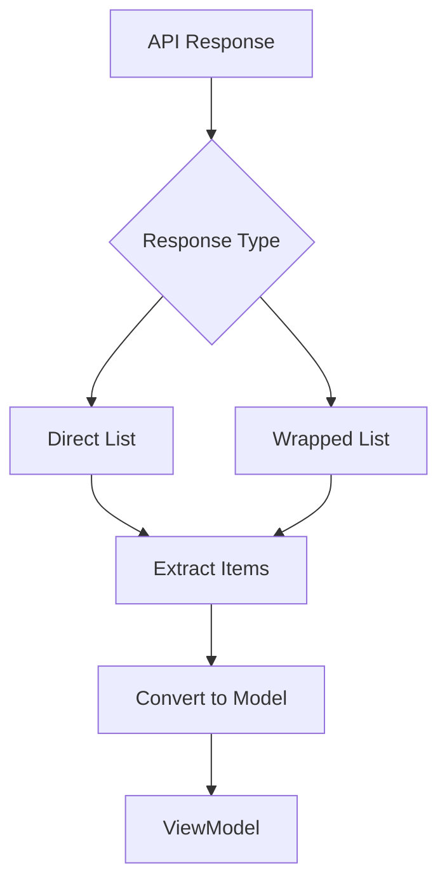

### Simplified Example

```dart
List<dynamic> extractItems(dynamic response) {
  if (response is List) {
    return response;
  }

  if (response is Map) {
    final items = response['results']
        ?? response['data'];

    if (items is List) {
      return items;
    }
  }

  return [];
}
```

위 코드는 응답 정규화 개념을
설명하기 위한 축약 예시입니다.

실제 Service마다 지원하는
Wrapper 키는 다를 수 있습니다.

### Engineering Review

예상하지 못한 응답을
빈 목록으로 처리하면
API 계약 오류를 정상적인
빈 데이터로 오해할 수 있습니다.

### Improvement

- 응답 스키마 검증
- 필수 데이터 구조 확인
- 파싱 오류와 빈 목록 구분
- 서버 API 계약 문서화
- 응답 모델 테스트

### Evidence

- PatientService
- ChatService
- ConsultationService
- MemoService

---

## 5. TR-02 — JSON Field Normalization

### Category

Data Modeling / Serialization

### Problem Context

서버와 클라이언트 사이에서
필드 이름과 데이터 타입의
표현 방식이 다를 수 있습니다.

### Example

```json
{
  "patient_id": "DEMO-001",
  "created_at": "2026-11-24T09:00:00"
}
```

또는 다음과 같은 형태를
사용할 수 있습니다.

```json
{
  "patientId": "DEMO-001",
  "createdAt": "2026-11-24T09:00:00"
}
```

### Implementation

일부 모델의 fromJson에서는
여러 필드 이름을 확인하고
필요한 데이터 타입으로 변환합니다.

### Normalization Flow

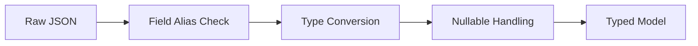

### Simplified Example

```dart
final patientId =
    json['patient_id'] ??
    json['patientId'];

final createdAt = DateTime.tryParse(
  json['created_at']?.toString() ??
  json['createdAt']?.toString() ??
  '',
);
```

### Technical Benefit

- 화면의 직접적인 JSON 접근 감소
- 모델 변환 책임 분리
- 일부 응답 형식 차이 대응
- Nullable 데이터 처리

### Engineering Review

필수 데이터가 누락되었을 때
기본값을 과도하게 사용하면
잘못된 데이터가 정상 데이터처럼
처리될 수 있습니다.

예를 들어 나이 0 또는
식별자 0은 누락 상태와
구분하기 어려울 수 있습니다.

### Improvement

- 필수 필드 검증
- 명확한 Nullable 정책
- 잘못된 식별자 처리
- Unknown 상태 표현
- API 계약 통일

---

## 6. TR-03 — Missing Authentication Token

### Category

Authentication / Repository

### Problem Context

보호된 API를 호출하려면
유효한 인증 정보가 필요합니다.

인증 토큰이 존재하지 않거나
빈 문자열인 상태에서
요청을 수행할 수 있습니다.

### Implementation

기능별 Repository에서는
SecureStorage를 통해
Access Token을 조회하고
인증 정보의 존재 여부를
확인하는 구조를 사용합니다.

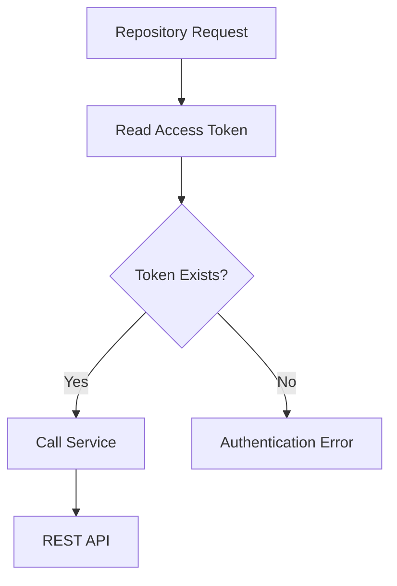

### Simplified Example

```dart
final token = await storage.readAccessToken();

if (token == null || token.trim().isEmpty) {
  throw Exception('인증 정보가 없습니다.');
}
```

위 코드는 인증 정보 확인 개념을
설명하기 위한 예시입니다.

### Technical Benefit

인증 정보가 없는 상태에서
불필요한 보호 API 요청을
수행하는 경우를 줄일 수 있습니다.

### Limitation

토큰이 존재한다고 해서
토큰의 유효 기간이나
서버 접근 권한까지
보장되는 것은 아닙니다.

### Improvement

- 공통 인증 오류 처리
- 토큰 만료 정책
- Refresh Token 관리
- 사용자 세션 초기화
- 서버 객체 단위 권한 검증

자동 토큰 갱신 및 실패 요청의
자동 재실행은 추가 검증이
필요한 범위입니다.

---

## 7. TR-04 — Network Error Handling

### Category

Network / Reliability

### Problem Context

모바일 환경에서는 다음과 같은
네트워크 오류가 발생할 수 있습니다.

- 서버 연결 실패
- 연결 시간 초과
- 응답 시간 초과
- 인증 오류
- 잘못된 요청
- 서버 내부 오류

### Implementation

공통 Dio 클라이언트의
Timeout 설정과 기능별
Service의 예외 처리 로직을
사용합니다.

| Timeout | 설정 |
|---|---|
| Connect | 10초 |
| Send | 15초 |
| Receive | 15초 |

### Error Propagation

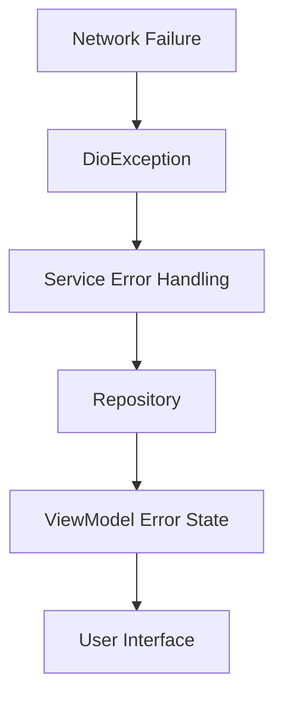

### HTTP Error Classification

| HTTP Status | 일반적인 의미 |
|---|---|
| 400 | 잘못된 요청 |
| 401 | 인증 실패 |
| 403 | 접근 권한 부족 |
| 404 | 리소스 없음 |
| 500 | 서버 내부 오류 |

### State Recovery

일부 ViewModel에서는
try-catch-finally 구조를
사용하여 요청 상태를 관리합니다.

```dart
try {
  await repository.request();
} catch (error) {
  errorMessage = error.toString();
} finally {
  isLoading = false;
  notifyListeners();
}
```

위 코드는 처리 개념을
설명하기 위한 예시입니다.

### Technical Benefit

요청이 실패한 경우에도
로딩 상태를 복구하고
사용자에게 오류를 안내할 수
있는 구조를 구성합니다.

### Improvement

- 공통 오류 타입 정의
- 서버 오류 메시지 표준화
- 네트워크 오류별 재시도 정책
- 사용자 친화적인 메시지
- 기존 데이터의 최신성 표시

---

## 8. TR-05 — Recent Patient Deduplication

### Category

Patient Management / Data Consistency

### Problem Context

동일한 환자를 여러 번 조회하면
최근 조회 환자 목록에
같은 환자가 반복적으로
추가될 수 있습니다.

### Implementation

PatientListViewModel에서는
환자 ID를 기준으로
기존 최근 환자 항목을 제거하고
최근 조회 순서에 따라 관리합니다.

최근 환자 목록은
최대 10개까지 유지합니다.

### Example

초기 목록:

```text
Patient A
Patient B
Patient C
```

Patient B 재조회:

```text
Patient B
Patient A
Patient C
```

### Simplified Example

```dart
recentPatients.removeWhere(
  (item) => item.id == patient.id,
);

recentPatients.insert(0, patient);

if (recentPatients.length > 10) {
  recentPatients.removeLast();
}
```

위 코드는 ID 기반 최근 목록
관리 방식을 설명하기 위한
축약 예시입니다.

### Technical Benefit

- 동일 환자 중복 감소
- 최근 조회 순서 관리
- 목록 크기 제한
- 환자 재접근 편의성

### Limitation

최근 환자 목록은
메모리 기반 상태입니다.

영구 저장 및 계정별
최근 조회 이력 관리 기능으로
설명하지 않습니다.

### Git Evidence

- 5e653da: 환자 목록 API 및 검색
- 77a9ee0: 환자 목록 및 상세 API

---

## 9. TR-06 — Authenticated Medical Media

### Category

Patient Detail / Authentication

### Problem Context

의료영상 데이터가 보호된
서버 리소스인 경우
단순 URL 접근만으로는
조회가 제한될 수 있습니다.

### Implementation

환자 상세 기능에서는
미디어 URL을 처리하고
인증 Header를 구성하는
구조를 사용합니다.

### Request Example

```http
GET /protected/media/example

Authorization: Bearer <ACCESS_TOKEN>
Accept: */*
```

### URL Handling

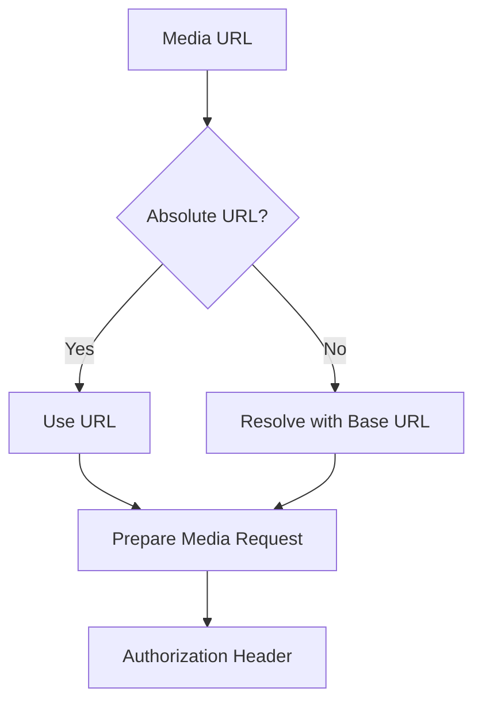

### Engineering Review

절대 URL을 그대로 사용하고
인증 Header를 함께 전달할 경우
외부 Host에 인증 정보가
전송될 가능성을 검토해야 합니다.

### Improvement

- 신뢰할 수 있는 Host 검증
- HTTPS 사용
- 외부 URL 인증 Header 제한
- Redirect 정책 확인
- 서버 미디어 접근 권한 검증

실제 인증 정보 유출 사고가
발생했다고 확인한 것은 아닙니다.

---

## 10. TR-07 — Duplicate Message Submission

### Category

Messaging / Asynchronous State

### Problem Context

메시지 전송 버튼을
반복적으로 입력하거나
이전 요청이 완료되기 전에
추가 요청을 수행할 수 있습니다.

### Implementation

ChatViewModel에서는
채팅방 ID를 기준으로
전송 중인 상태를 관리합니다.

### Main State

```text
_sendingRoomIds
```

### Request Flow

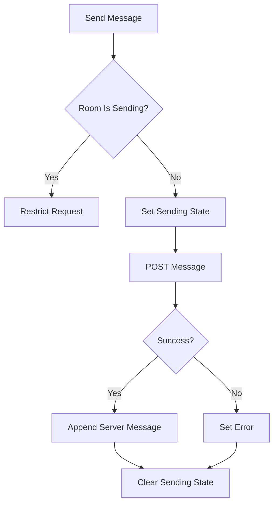

### Technical Benefit

채팅방별 전송 상태를
구분하여 동일 채팅방의
반복 요청을 줄일 수 있습니다.

### Limitation

클라이언트의 전송 상태만으로는
서버의 중복 메시지 생성을
완전히 방지할 수 없습니다.

서버가 요청을 처리했지만
클라이언트가 응답을 받지 못한
상황에서는 재시도에 의해
중복 데이터가 생성될 수 있습니다.

### Improvement

- 서버 Idempotency Key
- 클라이언트 메시지 고유 ID
- 전송 실패 상태 관리
- 재시도 정책
- 서버 응답 기반 중복 제거

### Git Evidence

- de2ee84: 채팅 목록 및 메시지 API
- 3904502: 채팅 기능 수정

---

## 11. TR-08 — Chat Room Refresh

### Category

Messaging / Polling

### Problem Context

REST API 기반 채팅에서는
서버 데이터가 변경되더라도
클라이언트가 새로운 조회 요청을
수행하지 않으면 변경된 상태를
확인하기 어려울 수 있습니다.

### Implementation

최종 AppShell에서는
5초 주기의 Timer를 사용하여
채팅방 목록을 갱신합니다.

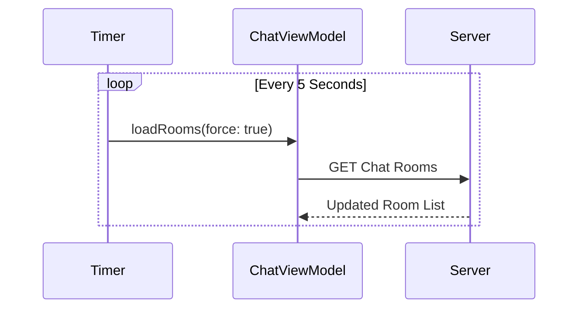

### Lifecycle Management

AppShell 종료 시
Timer를 취소하는 구조를
사용합니다.

### Technical Benefit

- 채팅방 목록 주기적 갱신
- 읽지 않은 메시지 개수 반영
- 공통 Navigation Badge 갱신

### Limitation

현재 확인한 Polling은
채팅방 목록 조회입니다.

개별 메시지 전체의
실시간 스트리밍이나
WebSocket 연결을 구현한 것으로
설명하지 않습니다.

### Request Estimation

```text
60 seconds / 5 seconds
= 12 callbacks per minute
```

동시 사용자 100명을 가정하면:

```text
100 clients / 5 seconds
= 20 requests per second
```

모든 Timer 호출이 실제 요청으로
이어진다는 가정의 계산값입니다.

실제 부하 테스트 결과는 아닙니다.

### Improvement

- 앱 활성 상태 기반 Polling
- 백그라운드 진입 시 중지
- 오류 발생 시 Backoff
- 요청 중첩 제한
- WebSocket 기반 이벤트 전달

### Attribution

5초 Polling은 최종 팀 코드에서
확인한 공통 AppShell 구현입니다.

해당 Timer 코드 전체의
개인 작성 여부까지
독립적으로 검증한 것은 아닙니다.

---

## 12. TR-09 — Chat Read State Consistency

### Category

Messaging / Data Integrity

### Classification

Engineering Review

### Current Behavior

메시지 목록을 조회하는 과정에서
로컬 채팅방의 읽지 않은 개수를
0으로 변경하는 처리가 존재합니다.

서버 읽음 처리 요청과
로컬 상태 변경은
서로 다른 작업입니다.

### Potential Failure Scenario

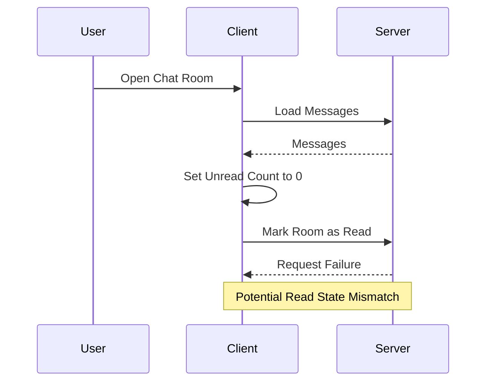

### Potential Impact

- 로컬 Badge와 서버 상태 불일치
- 새로고침 이후 읽지 않은 개수 복원
- 사용자에게 잘못된 읽음 상태 표시

### Proposed Solution

서버 응답을 확인한 후
읽음 상태를 갱신하거나
실패 시 이전 상태를 복구합니다.

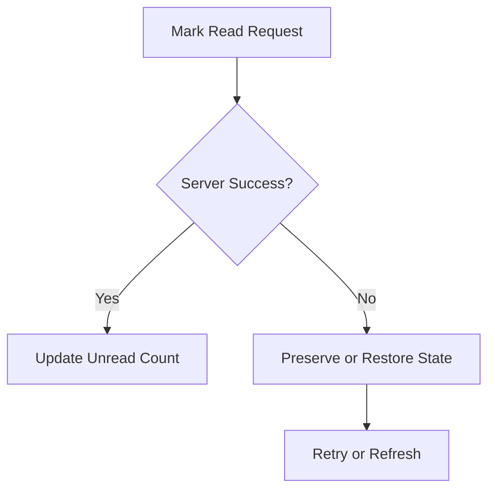

### Validation Plan

- 정상 읽음 처리
- 서버 읽음 처리 실패
- 읽음 요청 중 네트워크 종료
- 새로운 메시지 도착
- 채팅방 목록 재조회

실제 장애를 재현하거나
개선 코드를 적용한 결과는 아닙니다.

---

## 13. TR-10 — Consultation Status Update

### Category

Consultation / Workflow Management

### Problem Context

협진 요청은 단순한 메시지와 달리
요청, 검토 및 답변 완료와 같은
업무 상태를 가질 수 있습니다.

### Conceptual Workflow

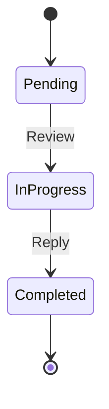

위 다이어그램은 주요 업무 흐름을
개념적으로 표현한 것입니다.

서버가 허용하는 모든 상태 전환을
검증한 상태 머신은 아닙니다.

### Implementation

협진 상태 변경 및 답변 완료는
서버 API를 통해 요청합니다.

```http
PATCH /api/consultations/{id}/status/
```

```http
PATCH /api/consultations/{id}/complete/
```

서버 응답으로 전달된
협진 요청 객체를
기존 목록에 반영합니다.

### Technical Benefit

서버가 반환한 상태 및
답변 데이터를 기준으로
화면을 갱신할 수 있습니다.

### Engineering Review

일부 상태 판단에서는
상태 문자열뿐 아니라
답변 내용의 존재 여부도
활용합니다.

이 경우 상태 값과
답변 내용이 서로 일치하지 않는
응답을 어떻게 처리할지
검토할 필요가 있습니다.

### Improvement

- 서버 상태 전환 규칙 정의
- 상태 Enum 통일
- 완료 상태의 필수 필드 검증
- 발신자 및 수신자 권한 검증
- 중복 완료 요청 제한
- 상태 변경 이력 관리

### Git Evidence

- d4b2909: 협진 요청 및 의료진 API
- c363020: 협진 필터 및 요청 API
- 88a0b81: 협진 상세 및 답변 상태

---

## 14. TR-11 — Multiple Consultation Requests

### Category

Asynchronous Processing

### Problem Context

받은 협진 요청과
보낸 협진 요청은
서로 다른 조회 범위를 사용합니다.

```http
GET /api/consultations/?receiver=me
```

```http
GET /api/consultations/?sender=me
```

### Implementation

독립적인 두 조회 작업을
Future.wait를 통해
함께 처리하는 구조를 사용합니다.

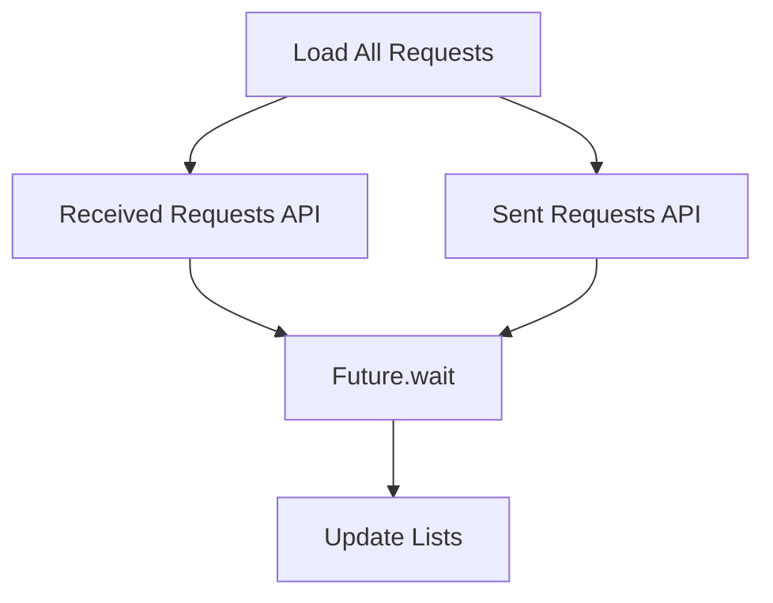

### Simplified Example

```dart
final results = await Future.wait([
  repository.fetchReceivedRequests(),
  repository.fetchSentRequests(),
]);
```

위 코드는 동시 비동기 처리의
개념을 설명하기 위한 예시입니다.

### Theoretical Comparison

가상 응답 시간을 다음과 같이
가정합니다.

| Request | Duration |
|---|---|
| Received | 800ms |
| Sent | 600ms |

순차 처리:

```text
800ms + 600ms = 1,400ms
```

동시 비동기 처리:

```text
max(800ms, 600ms) = 800ms
```

독립적인 요청이 동시에 실행된다는
이상적인 조건의 계산입니다.

실제 VENA 응답 시간을
측정한 결과는 아닙니다.

### Engineering Review

두 요청을 함께 기다리는 구조에서
하나의 요청이 실패하면
전체 목록 갱신이 수행되지
않을 수 있습니다.

### Improvement

- 조회 범위별 로딩 상태
- 부분 성공 처리
- 실패한 요청만 재시도
- 기존 목록의 최신성 표시

---

## 15. TR-12 — Multi-day Calendar Schedule

### Category

Calendar / Date Processing

### Problem Context

일정이 하루에만 해당하는 경우와
여러 날짜에 걸쳐 진행되는 경우를
동일한 캘린더에서
표시할 필요가 있습니다.

### Example

```text
Start Date: November 24
End Date: November 27
```

해당 일정은 다음 날짜에
모두 포함되어야 합니다.

```text
November 24
November 25
November 26
November 27
```

### Implementation

ScheduleItem은 시작일과
종료일을 관리합니다.

선택 날짜가 일정의 시작일과
종료일 사이에 포함되는지
확인하는 구조를 사용합니다.

### Date Inclusion

```text
startDate <= selectedDate <= endDate
```

### Simplified Example

```dart
final included =
    !selectedDate.isBefore(startDate) &&
    !selectedDate.isAfter(endDate);
```

실제 비교 과정에서는
시간 정보의 영향을 줄이기 위한
날짜 정규화가 필요합니다.

### Calendar Visualization

```text
Mon   Tue   Wed   Thu   Fri   Sat   Sun
      24    25    26    27
      [================]
```

여러 날짜에 걸친 일정은
연속적인 표시 영역으로
표현할 수 있습니다.

### Additional Implementation

- 일정 시간 기준 정렬
- 시작일과 종료일 표시
- 일정별 색상
- 주 단위 표시 경계 처리
- 선택 날짜의 일정 조회

### Validation Plan

- 단일 날짜 일정
- 여러 날짜 일정
- 월 경계를 포함하는 일정
- 주 경계를 포함하는 일정
- 시작일과 종료일이 동일한 일정
- 종료일이 시작일보다 빠른 입력

### Git Evidence

- 6882c35: 캘린더 CRUD 및 미니 캘린더
- cb9dbcc: 캘린더 날짜 범위
- 81c3e12: 일정 색상

---

## 16. TR-13 — Local Data Persistence

### Category

Calendar / To-do / Serialization

### Problem Context

Widget 또는 ViewModel 내부의
메모리 상태만 사용하는 경우
애플리케이션 종료 이후
데이터를 복원하기 어렵습니다.

### Implementation

캘린더와 To-do는
SharedPreferences를 사용하여
데이터를 로컬에 저장합니다.

### Storage Keys

```text
doctor_calendar_schedules
doctor_todo_items
```

### Persistence Flow

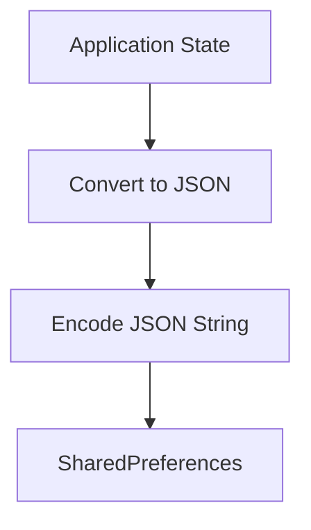

### Restore Flow

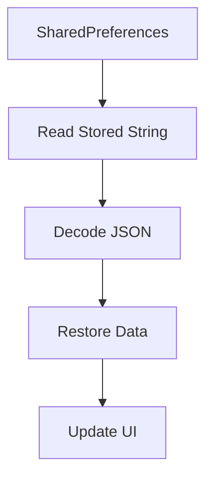

### Technical Benefit

별도의 서버 API 없이
간단한 개인 업무 데이터를
저장하고 복원할 수 있습니다.

### Engineering Review

현재 구조는 서버 동기화,
중앙 백업 및 계정별 저장 범위를
완전히 제공하는 구조가 아닙니다.

### Improvement

- 사용자별 저장 키
- 데이터 고유 ID
- 저장 실패 안내
- 저장 데이터 스키마 관리
- 서버 동기화
- 민감 정보 저장 제한

---

## 17. TR-14 — To-do Accidental Deletion

### Category

User Experience / State Recovery

### Problem Context

사용자가 업무 목록의 항목을
실수로 삭제할 수 있습니다.

### Implementation

To-do 삭제 이후
SnackBar를 통해 삭제 취소를
수행할 수 있는 구조를 사용합니다.

### State Flow

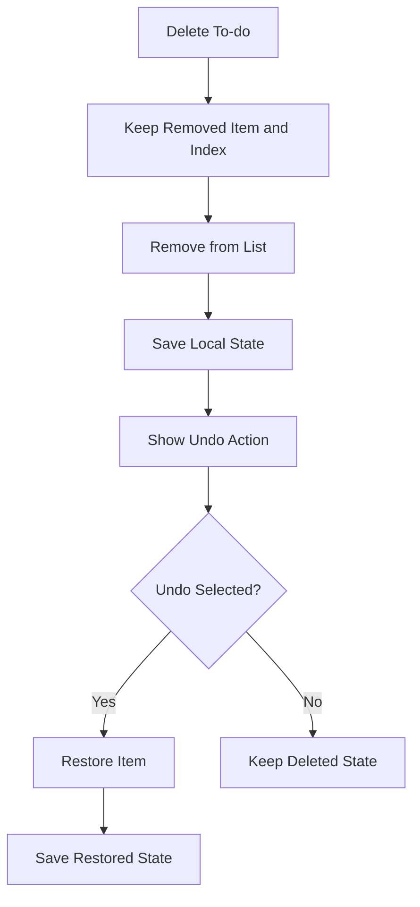

### Technical Benefit

삭제된 항목과 기존 위치를
임시로 유지하여
사용자의 실수를 복구할 수 있습니다.

### Limitation

현재 Undo는 제한된 시간 동안
제공되는 사용자 인터페이스입니다.

영구적인 삭제 이력 또는
서버 기반 복구 기능은 아닙니다.

### Engineering Review

To-do 항목에 고유 ID가 없고
제목 및 목록 인덱스를 기반으로
Widget Key를 구성하는 경우
목록 순서 변경 시
항목 식별 안정성을 검토해야 합니다.

### Improvement

- To-do 고유 ID
- 삭제 이력 관리
- 저장 실패 복구
- 목록 순서 변경 대응

### Git Evidence

- 2f12337: 홈 화면 및 일정, To-do

---

## 18. TR-15 — Voice Recording State

### Category

Audio Recording / Resource Management

### Problem Context

음성 메모는 텍스트 메모와 달리
녹음 상태, 일시정지 상태,
녹음 시간 및 파일 경로를
관리해야 합니다.

### Implementation

녹음 서비스와 화면 상태를
사용하여 녹음 흐름을 관리합니다.

### Conceptual State Machine

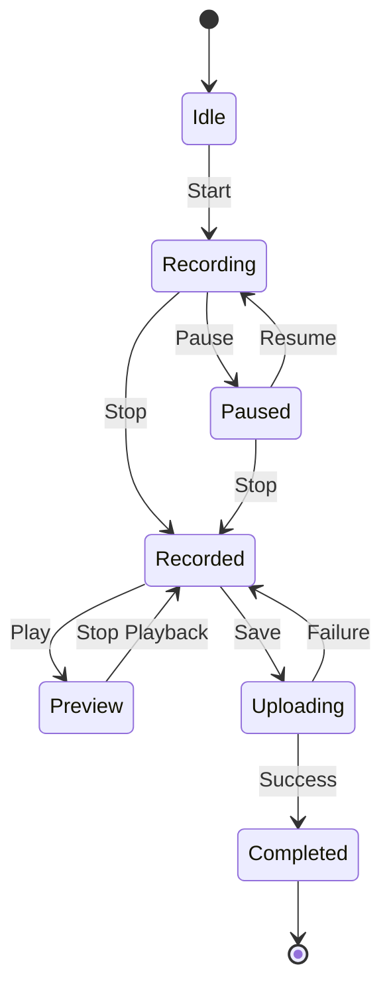

위 상태 머신은 구현된
주요 사용자 흐름을
개념적으로 정리한 것입니다.

실제 코드가 하나의 Enum 기반
상태 머신을 사용하는 것은 아닙니다.

### Recording Configuration

| Item | Value |
|---|---|
| Codec | AAC-LC |
| Container | M4A |
| Bitrate | 128 kbps |
| Sample Rate | 44,100 Hz |

### Recording Timer

녹음 시간 표시를 위해
1초 주기의 Timer를 사용합니다.

일시정지 상태에서는
시간 증가를 제한합니다.

### Resource Management

- 녹음 시작 전 재생 중지
- 녹음 중 상태 관리
- 녹음 종료 시 Timer 정리
- 임시 파일 경로 관리
- 화면 종료 시 Recorder 정리

### Engineering Review

녹음 시간은 Timer 기반
표시값과 실제 오디오 길이가
완전히 동일한지
검증할 필요가 있습니다.

### Git Evidence

- 596d616: 음성 녹음 및 최근 메모

---

## 19. TR-16 — Binary Audio Upload

### Category

File Transfer / REST API

### Problem Context

음성 메모는 일반적인
텍스트 데이터뿐 아니라
바이너리 파일을 포함합니다.

따라서 일반 JSON 요청과
다른 파일 전송 방식이
필요합니다.

### Implementation

음성 메모는 Multipart FormData를
사용하여 서버에 전송합니다.

### Request Structure

```text
Multipart FormData
├── Patient Identifier
├── Memo Type
├── Title
├── Audio Duration
├── Optional Examination Identifier
└── Audio File
```

### Upload Flow

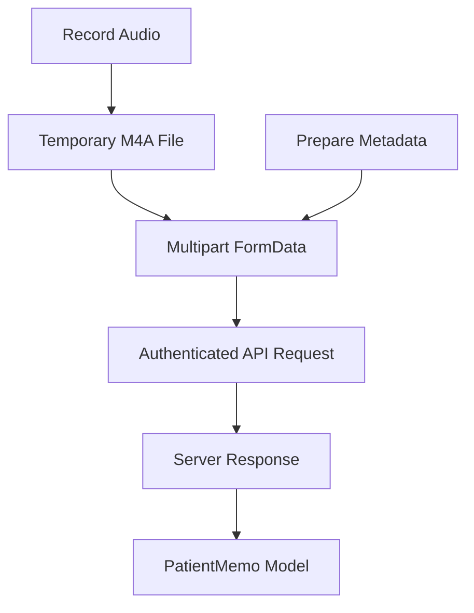

### Endpoint

```http
POST /api/memos/voice/
```

### Technical Benefit

음성 파일과 관련 메모 정보를
하나의 요청으로
서버에 전달할 수 있습니다.

### Engineering Review

파일 업로드에서는 다음 사항을
추가로 고려해야 합니다.

- 최대 파일 크기
- 파일 유형 검증
- 업로드 시간 제한
- 업로드 진행률
- 네트워크 연결 실패
- 서버 저장 실패
- 파일과 메타데이터의 일관성

### Proposed Improvement

서버에서 파일 저장과
메모 레코드 생성 중
일부 작업만 성공하는 경우를
고려하여 실패 복구 및
고아 파일 정리 정책을
설계할 수 있습니다.

실제 서버 파일 저장 구조와
트랜잭션 구현은 검증하지 않았습니다.

---

## 20. TR-17 — Audio Upload Failure Recovery

### Category

File Lifecycle / Reliability

### Problem Context

음성 녹음이 완료된 이후
업로드 요청이 실패할 수 있습니다.

실패 시 임시 파일을
즉시 삭제하면 사용자가
다시 녹음해야 할 수 있습니다.

### Implementation

음성 메모 작성 화면에서는
업로드 성공 여부에 따라
임시 파일을 처리합니다.

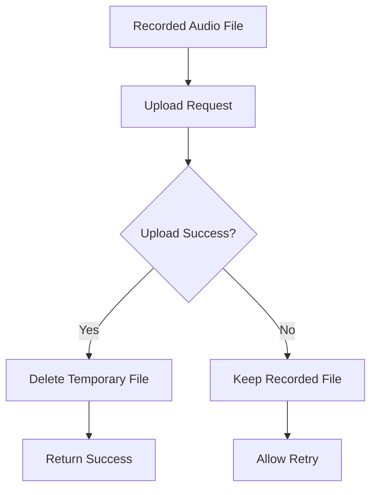

### Technical Benefit

화면이 유지되는 동안
업로드 실패 이후 기존 녹음 파일을
다시 사용할 수 있습니다.

### Limitation

앱 강제 종료 또는
화면 종료 이후에도
녹음 파일이 복원되는
영구적인 Draft 저장 기능은
확인되지 않았습니다.

### Improvement

- 업로드 진행률 표시
- 재시도 정책
- 임시 파일 보존 기간
- 앱 재실행 시 미완료 파일 처리
- 서버 중복 등록 방지
- 임시 파일 보안 관리

---

## 21. TR-18 — Audio Playback Lifecycle

### Category

Audio Playback / Resource Management

### Problem Context

음성 메모를 재생하려면
오디오 소스 준비,
재생 상태, 재생 위치 및
재생 종료 상태를
관리해야 합니다.

### Implementation

AudioPlayer를 사용하여
음성 파일 재생을 구성합니다.

### Playback Flow

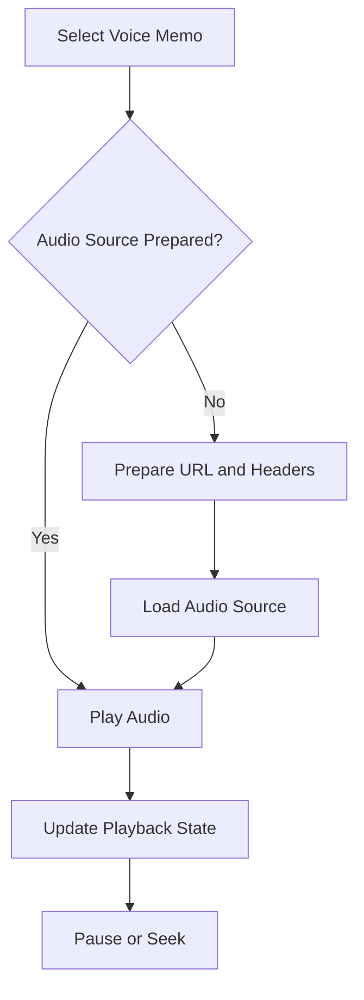

### Confirmed Features

- 인증 Header 기반 음성 접근
- 재생 및 일시정지
- 재생 위치 표시
- 재생 위치 이동
- 재생 완료 후 다시 재생
- AudioPlayer dispose

### Engineering Review

최근 음성 메모 목록에서는
각 카드가 개별 AudioPlayer를
관리하는 구조가 존재합니다.

여러 음성 메모를 동시에
재생하는 상황과 목록 변경 시
재생 상태의 연결을
추가 검토할 필요가 있습니다.

### Improvement

- 공통 Audio Playback Controller
- 단일 활성 재생 정책
- 메모 ID 기반 Widget Key
- 재생 상태 분리
- 오디오 소스 준비 실패 처리

---

## 22. TR-19 — Memo List Consistency

### Category

CRUD / Data Reconciliation

### Problem Context

메모 등록, 수정 및 삭제 이후
목록 화면과 상세 화면이
서로 다른 데이터를 표시할 수 있습니다.

### Implementation

MemoViewModel에서는
서버 응답으로 전달된 메모 객체를
기준으로 목록을 갱신합니다.

### Update Example

기존 목록:

```text
Memo 101
Memo 102
Memo 103
```

서버 수정 응답:

```text
Memo 102
Title: Updated Title
```

갱신 결과:

```text
Memo 101
Memo 102 — Updated Title
Memo 103
```

### Simplified Example

```dart
final index = memos.indexWhere(
  (memo) => memo.id == updatedMemo.id,
);

if (index >= 0) {
  memos[index] = updatedMemo;
}
```

### Deletion Flow

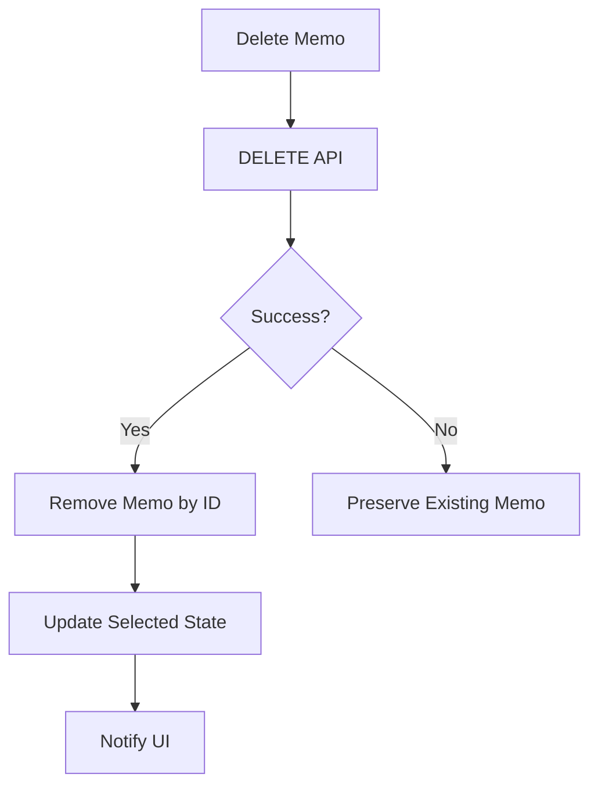

### Additional Implementation

메모 작성 및 수정 화면은
변경 성공 여부를 이전 화면에
전달하는 구조를 사용합니다.

```dart
context.pop(true);
```

이전 화면에서는 성공 결과에 따라
데이터를 다시 조회할 수 있습니다.

### Technical Benefit

- 서버 응답 기반 데이터 갱신
- 식별자 기반 항목 관리
- 목록과 상세 화면 갱신
- 서버 삭제 실패 시 기존 데이터 유지

### Limitation

모든 신규 등록 경로에서
전체 목록의 중복 제거를
보장하는 것은 아닙니다.

---

## 23. TR-20 — Shared ViewModel Scope

### Category

State Management / Data Isolation

### Classification

Engineering Review

### Current Architecture

환자별 메모 목록과
최근 음성 메모 목록은
공통 MemoViewModel을
사용합니다.

### Potential Problem

환자별 메모 화면에서는
특정 환자의 메모를 조회합니다.

최근 음성 메모 화면에서는
전체 메모 조회 결과를 기반으로
음성 메모를 표시합니다.

서로 다른 조회 범위가
하나의 목록 상태를
공유하는 경우 다른 화면의
조회 결과에 의해 기존 목록이
변경될 수 있습니다.

### Current Structure

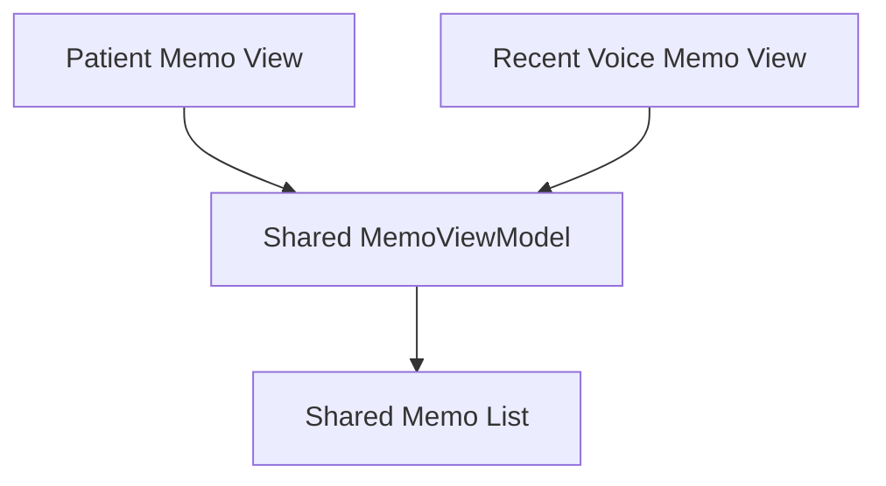

### Proposed Structure

```mermaid
flowchart TD
    A["Patient Memo View"]
    B["Recent Voice Memo View"]

    C["Patient Memo ViewModel"]
    D["Recent Voice Memo ViewModel"]

    E["Shared Memo Repository"]

    A --> C
    B --> D

    C --> E
    D --> E
```

### Expected Benefit

- 조회 범위별 상태 관리
- 화면 사이의 상태 간섭 감소
- 공통 데이터 접근 로직 재사용
- 독립적인 로딩 및 오류 상태

### Additional Review

메모 상세 화면에서는
현재 선택된 메모를
Fallback으로 사용하는 구조가
존재합니다.

해당 메모의 ID가
현재 화면의 메모 ID와
일치하는지 확인하는 정책을
추가할 필요가 있습니다.

### Validation Plan

- 환자 A 메모 조회
- 환자 B 메모 조회
- 최근 음성 메모 조회
- 기존 환자 화면 복귀
- 다른 메모 상세 화면 이동
- 조회 범위 변경 중 요청 실패

위 내용은 실제 장애 재현이 아닌
정적 코드 분석 결과입니다.

---

## 24. TR-21 — Asynchronous Race Condition

### Category

Concurrency / Data Consistency

### Classification

Engineering Review

### Potential Problem

여러 비동기 요청이 동시에
실행되면 요청 시작 순서와
응답 완료 순서가 다를 수 있습니다.

### Failure Scenario

```mermaid
sequenceDiagram
    participant C as Client
    participant S as Server

    C->>S: Request A
    C->>S: Request B

    S-->>C: Response B
    C->>C: Display New Data

    S-->>C: Response A
    C->>C: Replace with Older Data
```

### Review Targets

- 환자 목록 새로고침
- 채팅방 Polling
- 협진 상태 변경
- 메모 조회 범위 변경
- 캘린더 연속 저장

### Proposed Solution

요청마다 식별자를 부여하고
최신 요청의 응답만
현재 화면에 반영하는 방식을
고려할 수 있습니다.

### Simplified Example

```dart
int requestVersion = 0;

Future<void> loadData() async {
  final currentVersion = ++requestVersion;

  final result = await repository.fetchData();

  if (currentVersion != requestVersion) {
    return;
  }

  data = result;
  notifyListeners();
}
```

위 코드는 개선 방식을
설명하기 위한 독립적인 예시입니다.

현재 VENA에 적용한 코드는 아닙니다.

실제 적용 시에는 오류 상태와
로딩 상태도 동일한 요청 버전
정책으로 관리해야 합니다.

### Additional Improvements

- Dio CancelToken
- 조회 범위별 요청 관리
- 요청 중첩 제한
- 서버 데이터 버전
- 저장 작업 직렬화

---

## 25. TR-22 — Local Save Failure

### Category

Persistence / Data Integrity

### Classification

Engineering Review

### Current Behavior

캘린더 일정 변경 이후
화면 상태를 갱신하고
로컬 저장 작업을 비동기로
실행하는 구조가 존재합니다.

### Potential Failure

```mermaid
flowchart TD
    A["Edit Schedule"]
    B["Update In-memory Data"]
    C["Display Updated Schedule"]
    D["Save to Local Storage"]
    E{"Save Success?"}

    A --> B
    B --> C
    B --> D
    D --> E

    E -->|Yes| F["Persisted Data"]
    E -->|No| G["Potential State Mismatch"]
```

### Potential Impact

화면에서는 수정된 일정이
정상적으로 표시되지만
앱을 다시 실행하면
이전 데이터가 복원될 수 있습니다.

### Proposed Solution

- 저장 성공 여부 확인
- 저장 실패 사용자 안내
- 실패한 작업 재시도
- 이전 상태 복구
- 연속 저장 순서 관리

### Alternative Approach

저장 성공 이후
화면 상태를 갱신하는
방식도 고려할 수 있습니다.

```mermaid
flowchart TD
    A["Edit Schedule"]
    B["Save Local Data"]
    C{"Success?"}

    A --> B
    B --> C

    C -->|Yes| D["Update UI State"]
    C -->|No| E["Display Error"]
```

### Trade-off

즉시 화면을 갱신하는 방식은
사용자 반응성을 높일 수 있지만
실패 복구 정책이 필요합니다.

저장 성공 이후 갱신하는 방식은
저장 결과와 화면 상태를
일치시키기 쉽지만
사용자 대기 시간이 발생합니다.

---

## 26. TR-23 — Sensitive Network Logging

### Category

Security / Logging

### Classification

Engineering Review

### Current Configuration

공통 Dio ApiClient에는
LogInterceptor 설정이 존재합니다.

개발 과정에서는 요청과 응답을
확인하는 데 활용할 수 있습니다.

### Potential Risk

로그에 다음 정보가
포함될 수 있습니다.

- Authorization Header
- 환자 식별 정보
- 의료영상 관련 데이터
- 채팅 내용
- 협진 요청 내용
- 메모 내용

### Proposed Solution

민감 정보가 포함된 필드를
마스킹하거나 로그 출력에서
제외하는 정책을 구성합니다.

### Example

Before:

```text
Authorization: Bearer [TOKEN]
patient_id: DEMO-001
content: [MEMO CONTENT]
```

After:

```text
Authorization: [REDACTED]
patient_id: [REDACTED]
content: [REDACTED]
```

### Improvement

- 개발 및 운영 로그 설정 분리
- Authorization Header 제외
- 요청 및 응답 본문 출력 제한
- 민감 정보 마스킹
- 로그 접근 권한 관리
- 로그 보존 기간 설정

실제 개인정보 유출 사고를
확인한 것은 아닙니다.

---

## 27. TR-24 — Transport Security

### Category

Security / Network

### Classification

Engineering Review

### Current Configuration

공통 네트워크 설정에는
HTTP 기반 기본 서버 주소가
존재합니다.

실제 서버 주소는
본 문서에 포함하지 않습니다.

### Technical Risk

HTTP 자체는 전송 데이터의
암호화를 제공하지 않습니다.

인증 토큰과 의료 관련 데이터가
네트워크를 통해 전달되는 경우
전송 구간 보호가 필요합니다.

### Proposed Architecture

```mermaid
flowchart LR
    A["Flutter Client"]
    B["HTTPS / TLS"]
    C["Reverse Proxy"]
    D["Django API"]

    A --> B
    B --> C
    C --> D
```

### Improvement

- HTTPS 기반 API 주소
- TLS 인증서 검증
- HTTP 접근 제한
- 인증 Header 보호
- 외부 Host 접근 제한
- 안전한 환경별 서버 설정

위 구조는 운영 환경 개선 제안입니다.

현재 VENA의 모든 통신이
HTTPS로 보호된다는 의미는 아닙니다.

---

## 28. TR-25 — User Session Isolation

### Category

Security / Shared State

### Classification

Engineering Review

### Potential Problem

여러 의료진이 동일한 기기에서
애플리케이션을 사용하는 경우
이전 사용자의 상태와
현재 사용자의 상태가
명확하게 분리되어야 합니다.

### Potential Scenario

```mermaid
flowchart TD
    A["Doctor A Login"]
    B["Load Server and Local Data"]
    C["Doctor A Logout"]
    D["Doctor B Login"]
    E{"Previous State Cleared?"}

    A --> B
    B --> C
    C --> D
    D --> E

    E -->|Yes| F["Load Doctor B Data"]
    E -->|No| G["Potential Data Isolation Issue"]
```

### Review Targets

- 인증 토큰
- 환자 목록
- 최근 환자 목록
- 채팅방 목록
- 협진 목록
- 메모 목록
- 캘린더 일정
- To-do

### Proposed Solution

```mermaid
flowchart TD
    A["Logout"]
    B["Stop Session Requests"]
    C["Clear Authentication"]
    D["Reset Shared ViewModels"]
    E["Clear or Isolate Local Data"]
    F["Return to Login"]

    A --> B
    B --> C
    C --> D
    D --> E
    E --> F
```

### User-scoped Storage

개념적인 저장 키 예시:

```text
doctor_calendar_schedules_{userId}
doctor_todo_items_{userId}
```

실제 구현된 저장 키가 아닌
계정별 데이터 분리 제안입니다.

### Validation Plan

- 의료진 A 로그인 및 데이터 조회
- 로그아웃
- 의료진 B 로그인
- 이전 데이터 표시 여부 확인
- 이전 세션 요청의 늦은 응답 확인
- 로컬 일정 및 To-do 분리 확인

현재 전체 사용자 세션의
격리 동작을 검증한 것은 아닙니다.

---

## 29. TR-26 — Screen Protection and Demo

### Category

Mobile Security / Team Experience

### Problem Context

팀 프로젝트에서는
민감한 의료정보가 표시되는
화면을 보호하기 위한
화면 캡처 제한 기능을
사용했습니다.

팀 발표 자료에서는
화면 보호 설정으로 인해
시연 영상 녹화 과정에서
화면이 검게 표시되는
문제가 설명되어 있습니다.

### Team Resolution

개발 및 시연 환경과
실제 배포 환경의
화면 보호 정책을 구분하는
방향으로 대응했습니다.

### Engineering Perspective

```mermaid
flowchart TD
    A["Application Environment"]
    B{"Build Configuration"}

    A --> B

    B -->|Demo or Debug| C["Controlled Demo Capture"]
    B -->|Release| D["Screen Protection Policy"]
```

### Technical Lesson

보안 기능은 실제 서비스의
보호 요구 사항뿐 아니라
개발, 테스트 및 시연 환경에서의
사용 방식도 고려해야 합니다.

### Attribution

해당 화면 보호 문제 해결은
팀 발표 자료에서 확인한
팀 차원의 경험입니다.

개인 담당 기능의 독립적인
문제 해결 성과로 포함하지 않습니다.

---

## 30. Additional Static Code Review

프로젝트 종료 후 최종 코드를
분석하면서 다음과 같은
추가 개선 가능성을 확인했습니다.

이 항목들은 실제 장애를
재현한 결과가 아닙니다.

### 30.1 To-do Dialog Navigation

To-do 입력 Dialog의
키보드 제출 처리에서
조건부 화면 종료와
추가 화면 종료가 함께
실행될 가능성이 있습니다.

#### Potential Impact

Dialog 외의 화면까지
종료될 수 있는지
검증할 필요가 있습니다.

#### Improvement

하나의 입력 이벤트에서
화면 종료를 한 번만
수행하도록 구성합니다.

```dart
void submitTodo(String value) {
  final title = value.trim();

  if (title.isEmpty) {
    return;
  }

  Navigator.pop(context, title);
}
```

위 코드는 개선 개념을
설명하기 위한 예시입니다.

### 30.2 Consultation List Update

협진 목록의 특정 항목을
수정하기 위해 목록 인덱스를
확인한 이후 서버 요청을
기다리는 구조가 존재합니다.

요청 대기 중 목록이 변경되면
기존 인덱스가 동일한 항목을
가리키지 않을 수 있습니다.

#### Improvement

서버 응답 수신 이후
협진 요청 ID를 기준으로
갱신 대상의 위치를
다시 확인합니다.

### 30.3 Calendar Persistence

캘린더 초기 로딩 및
저장 작업은 비동기로
처리됩니다.

초기 로딩 중 신규 일정이
추가되거나 연속 저장 요청이
실행되는 상황에서
데이터 순서를 검토할
필요가 있습니다.

#### Improvement

- 초기 복원 완료 상태 관리
- 저장 작업 순서 보장
- 저장 오류 상태 표시

### 30.4 Theme Persistence

SettingsViewModel은
Light 및 Dark Theme 상태를
관리합니다.

현재 테마 설정의
영구 저장은 확인되지 않았습니다.

#### Improvement

SharedPreferences 등을 사용하여
사용자가 선택한 테마를
앱 재실행 이후에도
복원할 수 있도록 구성합니다.

### 30.5 Placeholder Dashboard Metrics

HomeView의 일부 지표는
실제 ViewModel 데이터를
사용합니다.

그러나 일부 영상 개수 및
대기 건수는 고정값으로
존재합니다.

#### Improvement

- 실제 서버 통계 API 연동
- 미연동 지표 구분
- 데이터 없음과 0의 구분
- 조회 실패 상태 표시

---

## 31. Root Cause Analysis Framework

문제를 분석할 때
화면에 나타난 증상과
실제 원인을 구분하는
접근이 필요합니다.

### Analysis Process

```mermaid
flowchart TD
    A["Identify Symptom"]
    B["Check Reproduction Conditions"]
    C["Inspect Request and Response"]
    D["Inspect Model Conversion"]
    E["Inspect State Management"]
    F["Identify Root Cause"]
    G["Implement Fix"]
    H["Validate Normal and Failure Cases"]
    I["Regression Review"]

    A --> B
    B --> C
    C --> D
    D --> E
    E --> F
    F --> G
    G --> H
    H --> I
```

위 과정은 향후 문제 해결에
적용할 수 있는 일반적인
분석 절차입니다.

모든 프로젝트 문제를
동일한 절차로 해결했다는
기록은 아닙니다.

### Layer-based Inspection

| Layer | 확인 대상 |
|---|---|
| View | 입력값, 이벤트, 화면 상태 |
| ViewModel | 로딩, 오류, 목록 갱신 |
| Repository | 인증 정보, 데이터 접근 |
| Service | Endpoint, Method, Request |
| Network | 연결, Timeout, HTTP Status |
| Model | JSON 파싱, 타입, Nullable |
| Backend | 권한, 업무 규칙, 데이터 저장 |

### Example

메모 등록 이후 목록에
신규 메모가 표시되지 않는
가상의 상황을 가정합니다.

다음 항목을 순서대로
확인할 수 있습니다.

1. 사용자 입력이 유효한지 확인
2. 저장 버튼 이벤트 확인
3. ViewModel 저장 상태 확인
4. Repository 인증 정보 확인
5. API Endpoint 및 요청 데이터 확인
6. 서버 응답 상태 확인
7. 메모 모델 파싱 확인
8. 목록 갱신 로직 확인
9. notifyListeners 호출 확인
10. 이전 화면 복귀 결과 확인

---

## 32. Engineering Trade-offs

### 32.1 REST Polling vs WebSocket

| Item | REST Polling | WebSocket |
|---|---|---|
| 통신 | 반복 HTTP 요청 | 지속 연결 |
| 변경 감지 | 조회 시점 | 이벤트 전달 |
| 서버 요청 | 주기적 발생 | 연결 및 이벤트 중심 |
| 추가 관리 | 조회 간격 | 연결, 재연결, 순서 |
| 현재 확인 범위 | 채팅방 목록 | 구현 미확인 |

### 32.2 Shared State vs Scoped State

| Item | Shared State | Scoped State |
|---|---|---|
| 데이터 접근 | 여러 화면 공유 | 화면별 관리 |
| 재사용 | 용이 | Repository 재사용 |
| 위험 | 조회 범위 충돌 | 상태 중복 |
| 개선 방향 | 필요한 범위만 공유 | 화면 책임 명확화 |

### 32.3 Local Storage vs Server Storage

| Item | Local Storage | Server Storage |
|---|---|---|
| 네트워크 | 로컬 접근 가능 | 일반적으로 연결 필요 |
| 기기 간 공유 | 별도 구현 필요 | 중앙 관리 가능 |
| 백업 | 별도 정책 필요 | 서버 정책 필요 |
| 현재 적용 | 일정 및 To-do | 환자, 채팅, 협진, 메모 |

### 32.4 Immediate Update vs Confirmed Update

| Item | Immediate Update | Confirmed Update |
|---|---|---|
| 화면 반응 | 즉시 반영 가능 | 응답 이후 반영 |
| 실패 처리 | Rollback 필요 | 기존 상태 유지 가능 |
| 일관성 | 추가 관리 필요 | 응답 결과 중심 |

기능의 중요도와
데이터 일관성 요구 사항에
따라 적절한 방식을
선택해야 합니다.

---

## 33. Risk Assessment

다음 위험도는 소스 분석을
기반으로 작성한 정성적인
검토 우선순위입니다.

실제 운영 장애 빈도 또는
보안 감사 결과가 아닙니다.

| Risk | Potential Impact | Priority |
|---|---|---|
| HTTP 통신 | 전송 데이터 보호 | High |
| 민감 정보 로그 | 개인정보 보호 | High |
| 사용자 상태 미분리 | 데이터 접근 범위 | High |
| 객체 단위 권한 미검증 | 의료정보 접근 통제 | High |
| 외부 미디어 URL | 인증 정보 보호 | High |
| 중복 POST 요청 | 데이터 중복 | High |
| 메모 공유 상태 | 조회 범위 불일치 | Medium |
| 읽음 상태 불일치 | 메시지 상태 정확성 | Medium |
| 비동기 응답 충돌 | 오래된 데이터 표시 | Medium |
| 로컬 저장 실패 | 일정 데이터 유실 | Medium |
| 반복 Polling | 네트워크 및 서버 부하 | Medium |
| AudioPlayer 중복 | 재생 및 리소스 관리 | Medium |
| 테마 설정 미복원 | 사용자 편의성 | Low |
| 일부 Placeholder 지표 | 정보 표시 정확성 | Medium |

---

## 34. Improvement Roadmap

### Phase 1 — Security and Data Integrity

- HTTPS 기반 통신
- 민감 정보 로그 마스킹
- 서버 객체 단위 접근 권한 검증
- 사용자 세션 초기화
- 계정별 로컬 데이터 분리
- 미디어 URL Host 검증
- 서버 중복 요청 방지

### Phase 2 — Reliability

- 공통 API 오류 처리
- 토큰 갱신 정책 정리
- 조회 범위별 ViewModel
- 비동기 요청 취소
- 응답 순서 관리
- 저장 실패 복구
- 채팅 읽음 상태 일관성

### Phase 3 — Performance

- 앱 활성 상태 기반 Polling
- 네트워크 오류 Backoff
- 목록 Pagination
- 중복 요청 감소
- 필요한 상태만 구독
- 오디오 재생 리소스 관리

### Phase 4 — Feature Expansion

- WebSocket 기반 채팅
- 서버 기반 일정 동기화
- To-do 서버 저장
- 오프라인 데이터 관리
- 음성 메모 STT 연동
- 협진 변경 이력 관리

```mermaid
flowchart LR
    A["Security"]
    B["Reliability"]
    C["Performance"]
    D["Feature Expansion"]

    A --> B
    B --> C
    C --> D
```

위 로드맵은 향후 개선 제안입니다.

현재 개발 완료 상태를
의미하지 않습니다.

---

## 35. Validation Scenarios

다음 항목은 문제 해결 및
회귀 테스트를 위한
검증 계획입니다.

### API and Authentication

| ID | Scenario | Expected Behavior |
|---|---|---|
| T-01 | 정상 목록 응답 | 모델 변환 및 목록 표시 |
| T-02 | Wrapper 응답 | 목록 데이터 추출 |
| T-03 | 필수 필드 누락 | 명확한 파싱 오류 |
| T-04 | 인증 토큰 없음 | 보호 API 요청 제한 |
| T-05 | 토큰 만료 | 인증 오류 또는 갱신 처리 |
| T-06 | 403 응답 | 접근 권한 오류 표시 |
| T-07 | 서버 연결 실패 | 오류 안내 및 상태 복구 |
| T-08 | Timeout | 요청 상태 복구 |

### Patient Management

| ID | Scenario | Expected Behavior |
|---|---|---|
| T-09 | 동일 환자 반복 조회 | 최근 목록 중복 방지 |
| T-10 | 최근 환자 10개 초과 | 목록 크기 제한 |
| T-11 | 환자 상세 조회 실패 | 오류 상태 표시 |
| T-12 | 외부 미디어 URL | 인증 정보 전송 제한 |

### Messaging

| ID | Scenario | Expected Behavior |
|---|---|---|
| T-13 | 빈 메시지 전송 | 요청 제한 |
| T-14 | 반복 전송 입력 | 진행 중 요청 제한 |
| T-15 | 메시지 전송 실패 | 전송 상태 복구 |
| T-16 | 채팅방 목록 갱신 | 서버 상태 반영 |
| T-17 | 읽음 처리 실패 | 읽음 상태 일관성 유지 |
| T-18 | AppShell 종료 | Polling Timer 정리 |
| T-19 | 백그라운드 진입 | Polling 정책 확인 |
| T-20 | 응답 지연 | 요청 중첩 검증 |

### Consultation

| ID | Scenario | Expected Behavior |
|---|---|---|
| T-21 | 신규 협진 요청 | 서버 응답 반영 |
| T-22 | 협진 검토 요청 | 상태 갱신 |
| T-23 | 협진 답변 완료 | 완료 데이터 반영 |
| T-24 | 상태 변경 실패 | 기존 상태 유지 |
| T-25 | 받은 요청 조회 실패 | 오류 및 부분 성공 정책 |
| T-26 | 목록 변경 중 상태 수정 | ID 기반 갱신 |
| T-27 | 권한 없는 상태 변경 | 서버 요청 제한 |

### Calendar and To-do

| ID | Scenario | Expected Behavior |
|---|---|---|
| T-28 | 단일 날짜 일정 | 해당 날짜 표시 |
| T-29 | 여러 날짜 일정 | 날짜 범위 전체 표시 |
| T-30 | 월 경계 일정 | 정상적인 범위 표시 |
| T-31 | 일정 수정 | 변경 상태 저장 |
| T-32 | 앱 재실행 | 저장 일정 복원 |
| T-33 | 로컬 저장 실패 | 실패 안내 또는 복구 |
| T-34 | To-do 삭제 | 목록 및 저장 상태 갱신 |
| T-35 | To-do 삭제 취소 | 항목 복원 |
| T-36 | 키보드 제출 | Dialog 한 번 종료 |

### Memo and Audio

| ID | Scenario | Expected Behavior |
|---|---|---|
| T-37 | 빈 텍스트 메모 | 등록 제한 |
| T-38 | 텍스트 메모 등록 | 서버 응답 반영 |
| T-39 | 메모 수정 | ID 기반 갱신 |
| T-40 | 메모 삭제 실패 | 기존 데이터 유지 |
| T-41 | 마이크 권한 거부 | 녹음 제한 및 안내 |
| T-42 | 녹음 일시정지 | 시간 증가 제한 |
| T-43 | 음성 업로드 실패 | 녹음 파일 유지 |
| T-44 | 음성 업로드 성공 | 임시 파일 정리 |
| T-45 | 음성 재생 실패 | 오류 안내 |
| T-46 | 화면 종료 | AudioPlayer 정리 |
| T-47 | 환자별 메모 조회 | 조회 범위 유지 |
| T-48 | 최근 음성 메모 조회 | 기존 화면 상태 간섭 제한 |

### Security and Session

| ID | Scenario | Expected Behavior |
|---|---|---|
| T-49 | 인증 Header 로그 | 민감 정보 마스킹 |
| T-50 | HTTP 요청 | 운영 환경 보안 정책 확인 |
| T-51 | 다른 사용자 로그인 | 이전 사용자 상태 제거 |
| T-52 | 로그아웃 중 요청 완료 | 이전 세션 응답 무시 |
| T-53 | 권한 없는 메모 접근 | 서버 접근 제한 |
| T-54 | 로컬 저장 데이터 | 계정별 범위 분리 |
| T-55 | 앱 강제 종료 | 임시 파일 잔존 확인 |
| T-56 | 장시간 앱 실행 | Timer 및 리소스 검증 |

### Validation Status

위 56개 시나리오는
검증 계획입니다.

일부 예상 동작은 현재 구현의
검증 대상이며 일부는
향후 개선 목표입니다.

전체 테스트를 실행하거나
통과한 결과가 아닙니다.

---

## 36. Personal Engineering Evidence

개인 Git 이력과
기능별 소스 분석을 통해
다음 작업 범위를 확인했습니다.

| Commit | Related Contribution |
|---|---|
| 4b69e07 | 공통 앱 및 라우팅 |
| 2b58ee6 | 환자 목록 UI |
| 5e653da | 환자 목록 API 및 검색 |
| 77a9ee0 | 환자 목록 및 상세 API |
| 163909a | 환자 영상 전체 화면 |
| 2f23d0b | 환자 필터 및 AI 요청 UI |
| de2ee84 | 채팅 목록 및 메시지 API |
| 3904502 | 채팅 기능 수정 |
| b2caa09 | 협진 요청 및 환자 검색 |
| d4b2909 | 협진 요청 및 의료진 API |
| c363020 | 협진 필터 및 요청 API |
| 88a0b81 | 협진 상세 및 답변 상태 |
| 3d72487 | 캘린더 |
| 6882c35 | 캘린더 CRUD 및 미니 캘린더 |
| cb9dbcc | 캘린더 날짜 범위 |
| 81c3e12 | 일정 색상 |
| 2f12337 | 홈 화면, 일정 및 To-do |
| 134bbdf | 환자 상세 메모 |
| 596d616 | 음성 녹음 및 최근 메모 |
| 35ca816 | Light 및 Dark Theme |
| a1498f4 | 공통 상단 및 하단 레이아웃 |

### Git Statistics

| Item | Count |
|---|---|
| 개인 작성자 기준 전체 커밋 | 72 |
| Merge 제외 개인 커밋 | 36 |

개인 작성자 이메일을 기준으로
확인한 Git 이력입니다.

Merge 커밋을 포함한 수치는
독립적인 기능 구현 횟수나
전체 프로젝트 기여율을
의미하지 않습니다.

### Evidence Scope

커밋 메시지는 해당 기능의
개인 작업 범위를 확인하는
근거로 활용합니다.

특정 커밋이 본 문서에 포함된
모든 잠재적 문제를 해결했다는
의미는 아닙니다.

---

## 37. Interview Preparation

### Q1. 프로젝트에서 가장 어려웠던
### 기술적인 부분은 무엇인가요?

환자 조회, 채팅, 협진 및 메모와
같이 서로 다른 서버 데이터를
하나의 모바일 애플리케이션에서
관리하는 부분이 중요했습니다.

API 응답을 모델로 변환하고
비동기 요청 상태와
화면 갱신 흐름을
관리하는 구조를 경험했습니다.

특히 음성 메모는 일반 JSON
데이터와 달리 녹음 파일 생성,
Multipart 업로드 및 재생까지
연결해야 했습니다.

### Q2. API 오류는 어떻게 처리했나요?

Service에서 DioException과
서버 응답을 처리하고,
ViewModel에서 오류 메시지와
요청 진행 상태를 관리했습니다.

또한 일부 요청에서는
finally를 사용하여 실패 이후에도
로딩 상태가 복구되도록
구성했습니다.

### Q3. 채팅의 실시간성을
### 어떻게 처리했나요?

최종 팀 코드에서는
5초 주기의 REST API Polling을
통해 채팅방 목록을
갱신하는 구조를 사용합니다.

WebSocket 기반 실시간
메시지 전달은 확인되지 않았습니다.

향후 개선한다면
WebSocket과 재연결 정책,
메시지 누락 복구 및
서버 확장성을 함께
고려하고 싶습니다.

### Q4. 중복 메시지 전송은
### 어떻게 제한했나요?

채팅방 ID를 기준으로
전송 진행 상태를 관리하는
구조를 사용했습니다.

동일 채팅방에서 전송이
진행 중인 경우 반복 요청을
제한할 수 있습니다.

다만 서버 중복 등록까지
완전히 방지하기 위해서는
Idempotency Key와 같은
추가 서버 정책이 필요합니다.

### Q5. 여러 날짜에 걸친 일정은
### 어떻게 처리했나요?

일정 모델에 시작일과 종료일을
포함하고 선택 날짜가
해당 범위에 포함되는지
확인하는 방식으로 처리했습니다.

이를 통해 단일 날짜뿐 아니라
여러 날짜에 걸친 일정도
캘린더에 표시할 수 있었습니다.

### Q6. 음성 메모 업로드가
### 실패하면 어떻게 되나요?

음성 녹음 파일을
임시 디렉터리에 생성하고
Multipart 요청으로 전송했습니다.

업로드에 실패한 경우
작성 화면에서 기존 녹음 파일을
유지하여 재시도할 수 있는
구조를 사용했습니다.

업로드 성공 이후에는
임시 파일을 정리합니다.

### Q7. 서버 데이터와 화면 데이터의
### 일관성을 어떻게 관리했나요?

협진 및 메모 기능에서는
서버 응답으로 전달된 객체를
기존 목록에 반영했습니다.

수정된 항목은 식별자를 기준으로
갱신하고 삭제는 서버 성공 이후
목록에 반영하는 구조를
사용했습니다.

### Q8. 프로젝트 종료 후
### 어떤 문제를 추가로 발견했나요?

공유 ViewModel의 조회 범위,
비동기 요청의 완료 순서,
채팅 읽음 상태 및
로컬 저장 실패 처리 등에서
추가 개선 가능성을 확인했습니다.

이는 실제 운영 장애가 아니라
최종 소스 분석에서 발견한
잠재적인 문제입니다.

### Q9. 의료정보 보안 측면에서
### 무엇을 개선해야 하나요?

HTTPS 기반 통신,
민감 정보 로그 마스킹,
서버 객체 단위 접근 권한,
계정별 데이터 분리 및
인증된 미디어 접근 정책을
우선적으로 검토해야 합니다.

클라이언트에서 인증 토큰을
사용하는 것만으로
모든 의료정보 보호 요구 사항을
충족하는 것은 아니라고
생각합니다.

### Q10. 백엔드 개발자로서
### 어떤 점을 배웠나요?

클라이언트 기능을 구현하면서
서버 API의 응답 구조,
오류 메시지, 인증 및
상태 변경 정책이
사용자 경험과 데이터 일관성에
직접적인 영향을 준다는 점을
경험했습니다.

향후 백엔드 개발에서는
정상적인 기능 구현뿐 아니라
예외 상황, 중복 요청,
데이터 정합성 및
실패 복구까지 고려하고 싶습니다.

---

## 38. Retrospective

VENA는 짧은 개발 기간 동안
여러 의료진 업무 기능을
하나의 모바일 환경으로
연결한 프로젝트입니다.

개인적으로 환자 조회,
채팅, 비동기 협진,
캘린더 및 To-do,
텍스트 및 음성 메모 기능을
담당했습니다.

각 기능을 구현하면서
서버 API와 화면 사이의
데이터 흐름을 경험했습니다.

단순히 요청을 보내고
응답을 표시하는 것뿐 아니라
다음과 같은 요소도
함께 고려해야 한다는 점을
배웠습니다.

- 데이터 모델의 일관성
- 인증 정보 관리
- 비동기 요청 상태
- 서버 응답 기반 목록 갱신
- 로컬 데이터 보존
- 파일 업로드 실패 처리
- 화면 생명주기
- 사용자별 데이터 접근 범위

프로젝트 종료 후에는
최종 소스를 다시 분석하면서
기존 구현의 한계와
개선 가능한 구조를
정리했습니다.

특히 백엔드 API의 계약,
데이터 정합성 및
인증과 권한 정책이
클라이언트의 안정성과
밀접하게 연결된다는 점을
확인할 수 있었습니다.

향후에는 기능을 구현하는 것에
그치지 않고 문제 발생 가능성을
분석하고 검증할 수 있는
개발 역량을 발전시키고자 합니다.

---

## 39. Validation Scope

### Confirmed Implementation

- 환자 목록 및 상세 API 연동
- 응답 모델 변환
- 인증 정보 기반 API 요청
- 기능별 네트워크 오류 처리
- 최근 환자 ID 기반 관리
- 채팅방별 요청 상태
- 5초 채팅방 목록 Polling
- 협진 상태 변경 API
- Future.wait 기반 비동기 조회
- 날짜 범위 일정 관리
- SharedPreferences 로컬 저장
- To-do 삭제 취소
- 음성 녹음 및 일시정지
- Multipart 음성 업로드
- 인증 기반 음성 재생
- 임시 파일 및 리소스 정리
- 메모 ID 기반 갱신
- 주요 개인 Git 이력

### Engineering Review

- 공유 ViewModel 범위
- 비동기 응답 충돌 가능성
- 읽음 상태 일관성
- 로컬 저장 실패 처리
- 계정별 데이터 분리
- 민감 정보 로그
- HTTP 통신
- 외부 미디어 URL 검증
- 중복 등록 방지
- 테마 영구 저장
- 일부 대시보드 지표 연동

### Not Verified

- 전체 앱 실행 및 컴파일
- 모든 서버 API 실제 응답
- 서버 데이터베이스 내부 구조
- 서버 객체 단위 권한 구현
- 전체 인증 갱신 동작
- 실제 운영 장애 발생 이력
- 실제 동시 사용자 부하
- 응답 시간 개선 수치
- 장시간 메모리 및 배터리 사용량
- 모든 테스트 시나리오 통과
- WebSocket 실시간 메시지 처리
- 서버 데이터 자동 동기화
- 의료정보 보안 규정 준수 여부

본 문서는 팀 발표 자료,
개인 Git 이력 및 최종 Flutter
소스의 정적 분석을 기반으로
작성했습니다.

개념적인 코드 예시,
가상 오류 시나리오 및
개선 아키텍처는 기술적인
문제 분석 능력을 설명하기
위한 내용입니다.

실제 환자 개인정보,
인증 토큰 및 서버 주소는
포함하지 않았습니다.

---

## 40. Related Documentation

- [프로젝트 개요](./README.md)
- [시스템 아키텍처](./architecture.md)
- [환자 관리 시스템](./patient-management.md)
- [채팅 시스템](./messaging.md)
- [비동기 협진 시스템](./consultation.md)
- [캘린더 및 To-do 관리](./schedule-task.md)
- [텍스트 및 음성 메모](./memo-system.md)
- [데이터 및 상태 관리](./data-state-management.md)

---

[← 프로젝트 개요로 돌아가기](./README.md)
